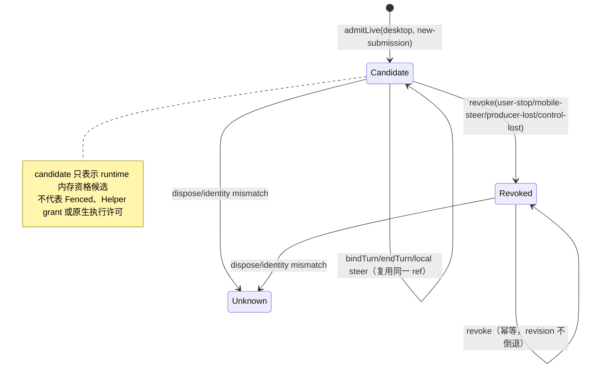
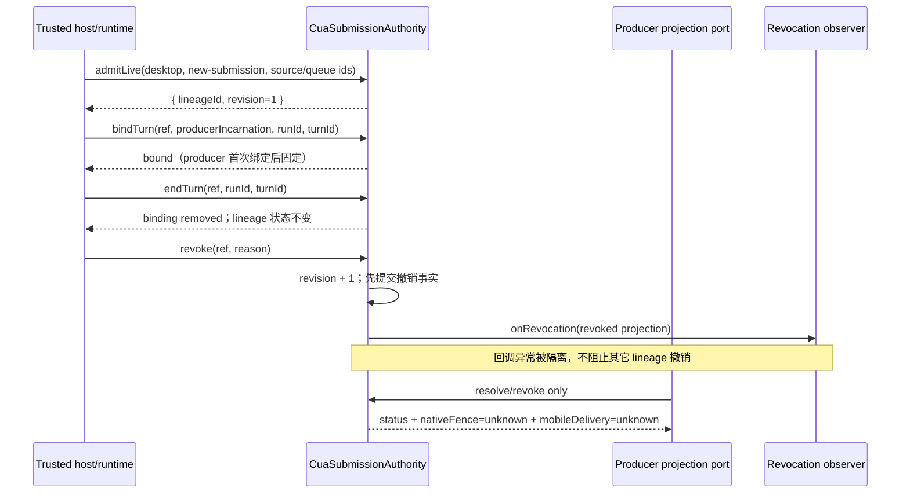

# CUA submission lineage authority contract

状态：默认禁用的内存候选切片。`CuaSubmissionAuthority` 是 CLI runtime 对用户提交 CUA
资格的单一 owner；`CuaSubmissionCoordinator` 只持有当前 ref/输入关联并把 `AgentRuntime`
的实际 admission/steer/stop/shutdown 映射到 owner。未接入生产 bootstrap、CommandInbox、
producer、Helper 或手机投递，也不向模型工具暴露。真实 sideband、Fenced、机器 quarantine
与投递结果由后续集成裁决，本模块不得伪造。

## Runtime coordinator 接线（2026-10-26）

### 构造与注入

- `AgentRuntimeDeps.cuaSubmission` 可选。只有同时提供非空 `appIncarnation`、
  `hostInstanceId`、`runtimeInstanceId`、`sessionId`、`workspaceKey`，且 `sessionId` 与
  `AgentRuntime` 构造参数一致时才创建 coordinator；缺失/不一致/子 Agent 上下文一律不构造，
  不生成任何替代 Host incarnation，普通聊天不受影响。
- 身份在构造时复制为不可变快照并交给 `CuaSubmissionAuthority`。coordinator 自己不做
  `workspaceKey` 规范化或默认值补全，宿主必须传入
  `workspaceIdentity?.trim() || workspacePath` 的结果。
- `AgentRuntime` 暴露三个可信调用面，均不属于模型工具/公开协议：
  - `getCuaSubmissionRegistrar()`：本次 runtime 专属的 live 凭证登记能力；未构造时返回
    `undefined`。
  - `getCuaSubmissionProjection()`：同步读取当前 ref 的 owner 投影；无当前引用时返回
    `unknown`，不会创建 candidate。
  - `getCuaSubmissionProducerPort()`：owner 的窄 facade（`resolve`/`revoke`），供后续可信
    producer/control 接线读取或请求撤销；不暴露 `admitLive`/`bindTurn`。

### 显式 live 凭证

- 凭证是 coordinator 发行的类实例对象，登记在实例内 `WeakSet` 与 source/queue 关联表中；
  它没有可枚举字段、不能被 `JSON.parse`/transcript/metadata 复制，也不写入 trace、模型参数
  或任何公开协议。旧 runtime 的 ticket 在另一个 runtime 的 `WeakSet` 中不存在。
- `registrar.register({ origin: "desktop", inputKind: "new-submission", sourceCommandId,
queueItemId? })` 只接受显式可信调用方传入的本地 Desktop 独立新提交。mobile/unknown、
  continuation/retry/replay/recovery/steer、空关联均拒绝；登记容量默认 256，满后只拒绝
  CUA，不抛错、不阻塞聊天。
- 关联通过既有 `intent.sourceCommandId`/`intent.queueItemId`（缺省回退
  `options.inputId` 作为 source）传给 `admitPrompt`。凭证本身不进入 admission options、
  trace、事件或持久化 intent。
- `intent.inputOrigin === "desktop"` 只证明来源，不能单独建立资格；没有匹配的 live 凭证时
  不创建 candidate。mobile/unknown 来源不需要、也不能登记凭证，但会先锁存撤销当前 lineage。

### admission / steer / queue 顺序

```mermaid
sequenceDiagram
  participant T as Trusted external caller
  participant R as AgentRuntime admission
  participant C as CuaSubmissionCoordinator
  participant A as CuaSubmissionAuthority
  T->>C: registrar.register(desktop, new-submission, source/queue)
  C-->>T: opaque live ticket
  R->>C: observe intent origin/source/queue
  alt mobile or unknown
    C->>A: revoke(current, mobile-steer/unknown-input)
  end
  alt idle start or queued promotion start
    R->>C: consume source/queue once
    C->>A: admitLive(desktop, new-submission)
    A-->>C: candidate ref
    C->>C: currentRef = ref
  else busy steer
    R->>C: steer(desktop/mobile/unknown)
    C->>A: attach local steer or revoke on mobile/unknown
  else busy queue
    C->>C: keep desktop ticket pending; mobile/unknown already revoked
  end
```

- `admitPrompt` 的 idle start 与既有 queue promotion 都走同一次凭证消费；登记在第一次成功
  admission 后移除，重复提升不会创建第二条 lineage。`requireQueue` 初始入队不消费凭证，
  等该 queue item 真正提升为独立 turn 时消费。
- 观察责任放在真实入口：`steerTurn` 与 `enqueueDeferredInput` 都被其它调用方直接使用，
  因此各自在输入/目标校验通过后、写入 pending 前调用 coordinator；`admitPrompt` 不再重复
  observe steer，idle start 仍由 `onTurnStarting` 一次性消费凭证。被拒绝的 wrong-target
  steer 不触达 coordinator，不能撤销无关 lineage。
- 本地 Desktop steer 只对当前 lineage 调 `steer(desktop)`，不建立新 candidate；busy
  queue 也不建立 candidate。mobile/unknown steer/queue 在进入模型前先撤销当前 lineage，
  已接受的普通聊天输入继续按既有 guide/queue 语义投递。
- 直接 `executeTurn`、target 自动续跑、后台通知、retry/replay/recovery 不经过凭证消费，
  因此不能新建 candidate；自动续跑沿用 coordinator 当前 ref。
- 没有匹配凭证的新 desktop/unknown 输入会撤销并清除旧 current ref，避免新 turn 继续使用
  旧提交；容量/非法凭证只让 CUA 无 candidate，普通 turn 照常执行。

### stop / shutdown / projection

- `stopActiveForegroundExecution` 先在 owner 锁存 `user-stop` 撤销，再 abort 实际前台执行；
  `expectedForegroundExecutionId` 不匹配时不撤销、不 abort。既有内部 queue promotion 抢占
  以 `preserveQueueAutoDrainOnCancel: true` 区分，不触发 CUA 撤销。
- 有效用户 stop 在 active 存在时撤销；处于自动续跑间隔或 idle 但没有 expected mismatch 时
  仍撤销当前 lineage。stop 同时清除尚未消费的 live 登记，因此撤销后的 queued promotion
  不会复活 CUA。
- `beginShutdown` 第一次调用即 `dispose` coordinator：先封闭登记/admission 写入口，再由
  authority 撤销当前 lineage 并通知 observer；late/duplicate admission、撤销后的重复 stop、
  新 runtime 都不继承旧 candidate。`dispose` 幂等。
- `getCuaSubmissionProjection()` 在 candidate/revoked 时返回 owner 的冻结投影，否则
  `unknown`。`nativeFence`/`mobileDelivery` 始终 `unknown`。

### 本轮仍不实现

- 没有真实 producer incarnation，因此 coordinator 不调用 `bindTurn`、不伪造 turn binding、
  不签发 Fenced。仅保留 owner 的 candidate/revoked 与 current ref。
- 不接生产 bootstrap/Host/launcher，不新增 CUA 队列或第二条输入通道；placeholder 工具、
  默认 executor、模型 schema 与结果投影均不改变。
- mobile 输入只完成 runtime 撤销与普通聊天投递，真实 Fenced/admission-close 等待仍属后续
  producer/control 接线。

## Owner 与身份

- 唯一 owner：`CuaSubmissionAuthority`。它持有每一份用户提交的候选/撤销状态、turn binding
  和 producer 关联；producer 侧只能通过 `CuaSubmissionProducerPort` 读取或请求撤销。
- 宿主可信构造：`appIncarnation`、`hostInstanceId`、`runtimeInstanceId`、`sessionId`、
  `workspaceKey` 只来自构造参数。`workspaceKey` 由宿主按
  `workspaceIdentity?.trim() || workspacePath` 规范化。
- `submissionLineageId` 由 owner 用 `randomUUID()` 自生成，调用方不能提交或覆盖。
- `authorizationRevision` 是正安全整数，从 `1` 开始；撤销成功后只增不减。旧 revision 的
  bind 永不获权，resolve 必须精确匹配 lineage 的全部身份字段与 revision。
- `sourceCommandId`/`queueItemId` 只作可信 admission 已交付的关联与有界去重证据，不读取
  `requestMeta`、transcript、snapshot 或 intent 字段来补造授权。
- 内部 ref 冻结；所有对外结果、producer 投影和 observer 投影都使用冻结副本，调用方修改
  返回值不能污染权威状态。

## 状态与事件顺序





`admitLive` 只接受可信本地 Desktop 主会话的独立新提交；mobile、unknown、retry、replay、
recovery、continuation 和 steer 均不能经它建立资格。自动续跑在同一 lineage 上调用
`bindTurn`；本地 steer 只附着原 lineage；mobile steer 立即按同一 owner 路径撤销。手机旁观、
attach/reconnect/disconnect 没有进入本 owner 的写入口，因此不改变 state。

无法证明来源的 unknown steer 若命中现有 lineage，按 `unknown-input` 撤销并 fail closed，
不会保留 candidate；引用本身不可验证时返回 unknown，不建立投递成功事实。

`endTurn` 只移除该 turn 的 binding，不改 lineage 的 candidate/revoked 状态。撤销后再次
`admitLive` 只有不同可信 desktop 新提交才可创建新 lineage；相同 source/queue 关联重送返回
既有 ref，不生成可绕过 stop 的新资格。

## 容量、回收与失败

- lineage 与撤销 tombstone 在实例生命周期内不驱逐，默认上限 256。满后仅拒绝新的 CUA
  candidate；不阻塞普通聊天（本 owner 未接入聊天 admission）。
- 每个 lineage 默认最多 32 个活动 turn binding；`endTurn` 回收 binding。lineage 本身不做
  “删除后重建”，避免历史输入重新获权。
- producer 首次成功 bind 后固定在 lineage 上。producer/control lost 撤销其全部相关 lineage；
  新 producer 不能凭旧 ref 重新绑定。dead producer incarnation 使用默认 256 的会话内
  tombstone；tombstone 满后进入 `producer_registry_exhausted`，拒绝所有新 bind（fail closed）。
- `revoke`、`endTurn`、`producerLost`、`dispose` 幂等。撤销事实先提交，再通知 observer；
  observer 抛错被隔离。
- `dispose` 先封闭全部可信写入口，再通知 observer 与清理，因此 observer 重入不能建立新候选
  或 binding。

## 未实现/必须保持 unknown

- 未调用 Helper，故 `nativeFence` 永远为 `unknown`；不能用本 owner 的 revoked 状态冒充
  Fenced。
- 未接手机投递，故 `mobileDelivery` 永远为 `unknown`；mobile steer 只产生 owner 撤销。
- 不做持久化，不恢复历史 grant，不新增 CUA 队列，不向模型/Worker 暴露可信 port。
- producer 只获得 `createProducerPort()` 返回的窄 facade（`resolve`/`revoke`），不直接持有
  owner；模型工具与 Worker 没有该 facade 的注入路径。

## 测试

`core/tests/cua-submission-lineage.test.ts` 覆盖：desktop/mobile/unknown 来源、重送去重、
撤销后 admit/bind、同 lineage 两轮续跑、本地与手机 steer、producer lost/new producer、
旧 runtime incarnation、容量、observer 异常与 dispose。测试直接执行 owner 的 JS 行为，不以
类型声明替代实现检查；另覆盖 ref/投影不可变、unknown steer、dead-producer tombstones、
producer 窄 facade、dispose 重入与 binding 回收。

`core/tests/cua-submission-runtime.test.ts` 及 fixture 直接执行实际 `AgentRuntime`/既有
method 路径，覆盖：

- 有完整 deps 的 desktop 凭证在 started turn 建立 candidate；无凭证但持久化
  `inputOrigin=desktop` 的 intent 不建立；mobile/unknown 新提交撤销当前 lineage；
- busy guide 与 busy queue：mobile/unknown 先撤销、本地 desktop steer 保持原 lineage、
  queued desktop 提升恰好消费一次凭证；
- 直接 `runtime.steerTurn`/`runtime.enqueueDeferredInput`（绕过 `admitPrompt`）同样观察
  mobile/unknown；wrong-target steer 被拒绝时不撤销，desktop 直接 queue 不提前消费凭证；
- 用户 stop 先撤销再 abort、expected id mismatch 不撤销、内部 promotion 抢占不撤销、
  idle stop 仍撤销当前 lineage；
- 撤销后 queued promotion 与自动续跑不复活/不新建 candidate；直接 execute/恢复旧 intent
  不创建；
- `beginShutdown` dispose 一次且 late registration/admission 不复活，新 runtime 不继承旧
  current ref/ticket；
- 缺 deps、凭证容量/非法关联时普通聊天非回归，projection 保持 unknown。
