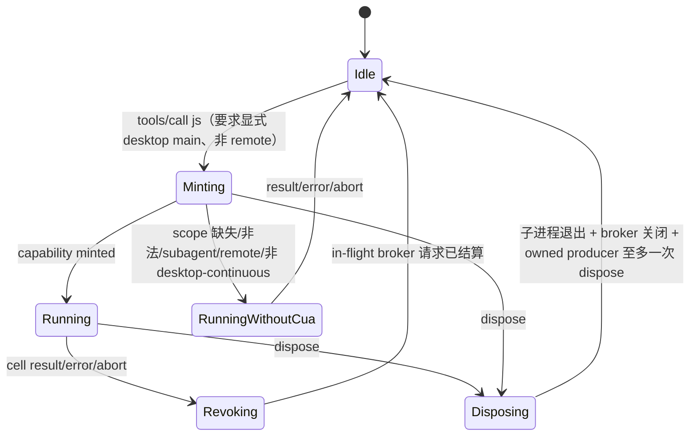
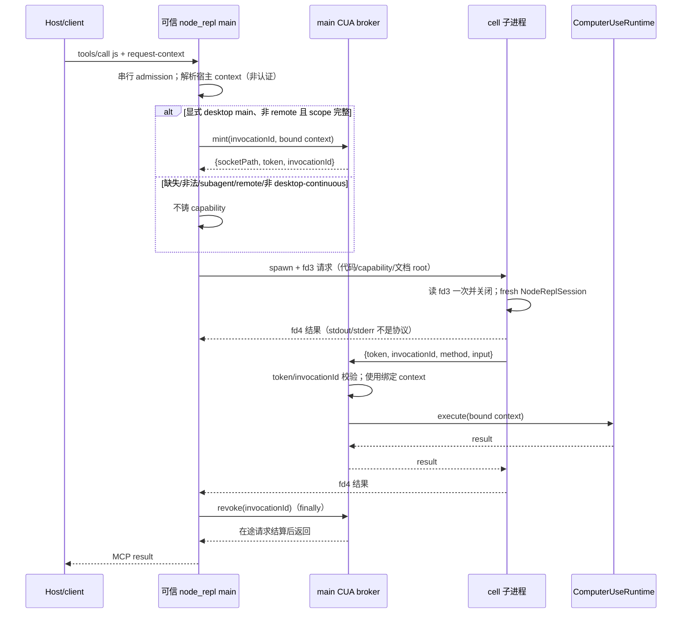
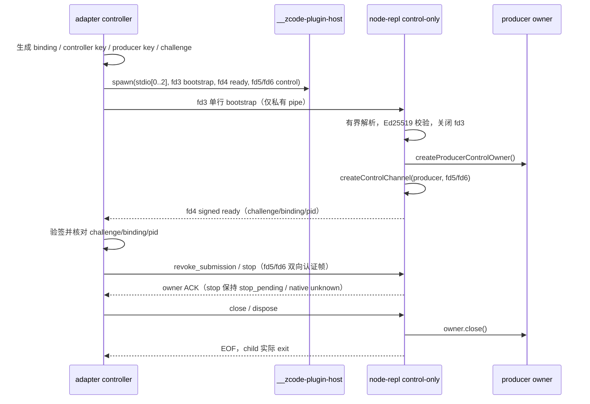

# node_repl cell executor 候选合同（工作包 B）

状态：候选实现，默认不接线，不表示 D06、正式隔离或真实 Computer Use 已通过。

本包只负责 `node_repl` 的调用隔离、能力传递和清理。产品规则仍以
`specs/computer-use-macos-phase1.md` 为准；本文记录候选实现的 owner、事件顺序和验收边界。

## Owner

| 状态/责任                       | 唯一 owner                   | 说明                                                                                                                            |
| ------------------------------- | ---------------------------- | ------------------------------------------------------------------------------------------------------------------------------- |
| MCP 请求上下文、CUA bridge 绑定 | 可信 node_repl main          | 从宿主写入的 `com.zcode/request-context` 读取；它只是现有宿主元数据，不是认证 sideband/lineage；缺失/非法 scope 不铸 capability |
| CUA capability 生命周期         | 可信 node_repl main          | 每次 `js` 调用 `mint` 一次，`finally` `revoke`；旧 token 不再可用                                                               |
| CUA producer / Helper 连接      | main 的 `ComputerUseRuntime` | borrowed 只关闭本次 broker；owned 由唯一持有者 await `dispose()` 一次                                                           |
| cell 执行与 bridge 客户端       | 独立子进程                   | 只得到本调用 capability、文档 root 和受限环境；不持有 producer/Helper 凭据                                                      |
| Browser bridge 连接             | main 显式注入                | 只传 socket/token 两个字段；不靠继承整个父进程环境                                                                              |
| 调用串行化                      | main 的 session key 队列     | 队列只等待已开始的调用；dispose 不等待尚未开始的排队项                                                                          |

## 调用与 capability 状态

不变量：

- 一个 `invocationId` 只对应一个 token；`revoke` 先同步封闭准入，再中止/等待在途请求，结算后才移除映射。
- token 只经私有 fd 传给子进程；CUA context、session、workspace、turn 由 main 绑定，cell JSON 不能改写。
- cell 结束不调用 `closeSession`。
- CUA 准入必须显式满足 `runtime_scope = main`、`client_mode = desktop-continuous`、
  `delivery_kind = desktop-continuous` 且没有 `remote_session_id`；任一缺失或非法都不铸
  capability，不默认成 `main`/`desktop-continuous`。这是开发期 bridge 绑定，不是原生输入授权。
- Browser Use 不套用上述 CUA 限制；合法 subagent/remote Browser 请求保持现有行为。

## 事件顺序

## 子进程协议

- 启动：复用现有 single bundle。SEA 下用 `process.execPath __zcode-plugin-host <server.js> --zcode-node-repl-cell`；
  非 SEA 直接 `process.execPath <server.js> --zcode-node-repl-cell`。不新增打包清单。
  候选 factory 的 `serverPath` 必填，必须是已构建的 `.js/.mjs` server bundle；不从
  `import.meta.url` 猜默认值。旧 Worker executor 的 `workerUrl` 同理必须由 bundle 入口显式传入。
- 请求：fd3 单行 JSON，异步读到首个换行后用异步 `close` 等待原始 fd 关闭，再执行模型代码；
  严格 `version` 与 `invocationId`。VM 的同步 timeout 资源可能复用 fd 编号 3，
  验收 probe 必须区分“原始请求 fd 已关闭”与“fd 3 被运行时复用”，不能禁止编号复用。
- 结果：fd4 单行 JSON，异步写完并等待 `close` 后才退出；stdout/stderr 只作有界诊断，不参与协议。
- 完整 frame 才算结果；先解析并传播结构化 `ok:false`，再拒绝“合法成功 frame + 非零退出/signal”。
- 限额：请求 1 MiB，响应 32 MiB，stdout/stderr 各 64 KiB；超限终止子进程并拒绝。
- 环境：显式白名单；不继承 `NODE_OPTIONS`、`NODE_PATH`、inspector、`ZCODE_*`、
  Helper/broker/token、云凭据或调试变量。
- Browser bridge：仅显式传入 `{socketPath, token}`；缺失即 unavailable。

## 清理与阻塞语义

- `dispose(): Promise<void>` 幂等；重复调用返回同一个 Promise。
- borrowed runtime 不调用 `dispose()`，也不会在 producer 缺席时从 env 补建；owned runtime 由持有者 await 一次。
- dispose 先封闭新调用、abort 已开始调用，再等待子进程实际退出和 broker 在途请求结算；
  不等待尚未开始的串行队列项。
- abort/timeout 必须杀死直接子进程并等待其退出；只让 Promise reject 不算通过。
  abort 时到达直接 `exit` 后立即收口父端 pipe 并拒绝，不等待后代释放继承的 fd。
- 成功以完整换行 frame + 直接子进程 `exit(0)` 且无 signal 为准；`close` 不作为进程退出证据。
- 正常退出但没有完整 frame 时等 fd4 `end` 判截断，或由调用方既有 signal deadline 结束，
  不用固定尾读时间窗口截断合法大响应。
- 仅保证直接 cell 子进程被杀并等待退出；其子孙进程、进程组和文件替换后的信任边界尚未证明，
  不宣称“所有执行都已清理”。后代若继承 fd4 仍可能存活，测试只验证取消不被它拖住。

## 验收矩阵

| 场景                                           | 证据                                                                       |
| ---------------------------------------------- | -------------------------------------------------------------------------- |
| 真子进程、不同 PID、fresh globals/module cache | 真实构建 bundle + 两次调用                                                 |
| 超时/abort 实际退出                            | 子进程写 PID 后 await 真实 timer；abort 后 `kill(pid, 0)` 失败             |
| 环境/调试/Helper 泄漏                          | 子进程内读取 `process.env`；父进程注入合成敏感变量对照，不读取真实用户凭据 |
| 原始请求 fd 关闭                               | 异步 fd probe 在 VM 资源结算后看到 EBADF；记录 fd 编号复用边界             |
| 错误 version/invocation/大小                   | 真实 fd3/fd4 协议 fixture + 超限请求/结果                                  |
| 伪造 context/旧 token                          | broker 严格请求 schema；revoke 后旧 token execute 计数为 0                 |
| borrowed/owned 清理                            | fake producer 计数；dispose 阻塞等待 gate                                  |
| 打包 import/MCP stdout                         | 现有 bundle smoke + cell 子进程 stdout 不进入 MCP stdout                   |
| Browser bridge 对照                            | 显式 capability 可调用；父进程 env 被剥离后 unavailable                    |
| Browser subagent/remote                        | 不套用 CUA 准入，保持现有 Browser Use 行为                                 |

## 非目标

- 不翻转产品默认 executor，不添加 env 开关，不宣称 D06/OS 沙箱/签名/TCC 通过。
- 不把 `child_process` 当安全沙箱；本候选只缩小默认继承面，不证明调试附加、原生模块、
  文件替换或子孙进程隔离。
- 不把 `request-context` 当认证凭据，也不把每调用 token 表述为 native 授权或 submission
  lineage；它们只限定一次 bridge 调用的开发期绑定。
- 只清理直接子进程；后代进程清理和进程组隔离尚未证明。
- 不修改 producer、公共协议、bootstrap、desktop 打包清单或顶层 spec/docs。

## Control-only 诊断启动器（R3-L）

状态：可运行诊断入口，默认工具面不变，不是完整 production CUA 开放。

### 所有权与入口

| 责任                         | 唯一 owner                        | 说明                                                                 |
| ---------------------------- | --------------------------------- | -------------------------------------------------------------------- |
| controller 启动材料与密钥    | 受信 adapter launcher             | 启动前生成 controller/producer binding、两把 Ed25519 key 和 challenge |
| child bootstrap 校验         | 本包 control-only 入口            | fd3 单行有界 JSON；缺失、EOF、超限、错 schema/key 一律失败           |
| 控制信道认证与 replay        | `@zcode/zcode-cua/control-channel` | 第二轮 endpoint；不在此复制验签或序号状态                            |
| producer 拒绝投影            | `@zcode/zcode-cua/producer-control` | 无 Helper 时只报 unknown/stop_pending，不生成 native fence          |
| 默认 MCP / JS / Browser      | 现有 node_repl main               | 不读取 control flag，不获得控制 key，不创建额外 Worker/cell          |

### 启动序列

### 不变量

- 控制 key 只存在内存和 fd3 bootstrap；不进入 argv、env、stdout/stderr、日志、磁盘或 MCP metadata。
- fd 所有权：fd3 在完整 bootstrap line 读取成功后关闭一次，再进行 JSON/字段校验；外层不能
  按旧数字重复关闭。EOF、超限或 fd 类型错误时由 control-only 进程立即非零退出回收剩余句柄，
  避免缺少 launcher 时误关该编号下的 libuv 资源。完整 frame 只表示有界单行读取完成，不构成
  身份证明；信任来自受信 launcher 直接建立的私有通道，再以 ready/channel 验签验证启动绑定。
- 启动必须使用真实 `child_process.spawn` 和继承 pipe。调用方必须在 ready 验签成功后才能发送请求；不采用端口、路径或首包 TOFU。
- 非秘密 mode flag `--zcode-node-repl-control` 是唯一 argv 开关；携带额外参数、缺少 fd3/fd4/fd5/fd6 或 bootstrap 非法时明确失败。
- control-only 分支在普通 `serveStdio`、MCP 注册、模型输入、cell/Worker 之前返回。
- child 环境使用白名单；清除 `NODE_OPTIONS`、`NODE_PATH`、inspector、`ZCODE_*`、Helper/broker/token 和云凭据。
- 该路径不 spawn 后代；不把额外 control fd 传给任何子孙。直接子进程退出是 dispose 完成的必要条件。
- 启动失败也通知 controller 的一次性 `onClosed`（`reason = startup_failed`），但不报告 drained/fenced/revoked。
- request/stop 的 ACK 只反映 endpoint 和 producer owner 的事实；缺少 Helper 时 native fence 为 unknown，stop 不得完成。
- 重复 close 返回同一个 Promise；旧 channel/binding 不重开；所有 pending request 在 EOF、超时、协议错误或 dispose 时结算。
