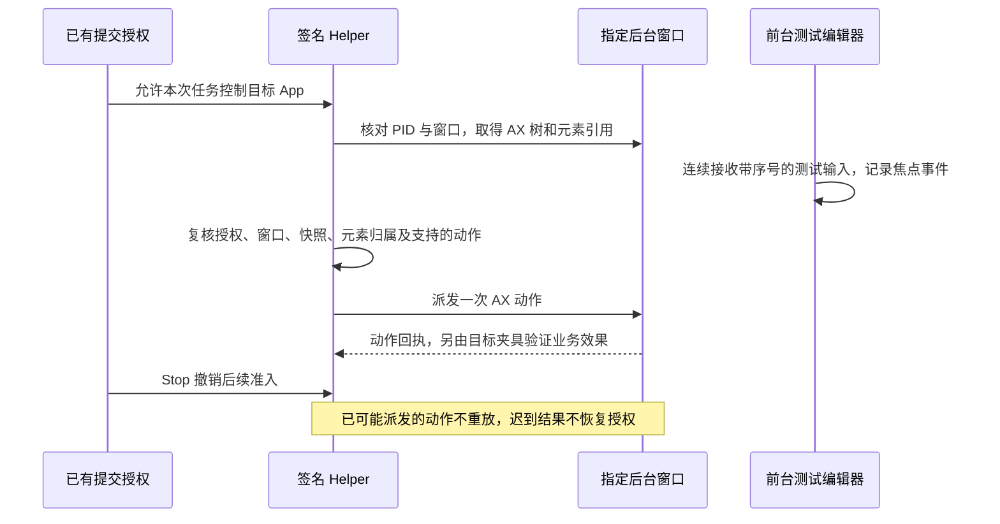

# macOS 后台操作可行性调研

2026-11-10。目标是用户持续使用前台 App 时，Zody 能操作另一个已授权窗口。Zody 基线为 `83a97a20` 加调研时的工作区，安装件以本机 Zody.app 的冻结清单为准。上游统一取 trycua/cua `2d2f99228d4d2508dc6fcc84c176b296e146714a`，下文的源码链接均固定在该版本。

## 2026-11-11 真机补充

独立签名 ObjC++ 探针已取得系统辅助功能授权。用户在前台手动输入时，AppKit 和 Electron 各有一轮通过全部实验判据。运行环境为 macOS 26.6.2 arm64，Electron 41.0.3。两轮均只改变指定后台窗口的按钮计数和字段值，同名兄弟窗口保持初值，前台收到完整的 26 字母样例，应用失活和 key window 丢失次数均为零。每轮有一枚前台按键落在后台事务内，事务结束后仍继续输入。controller 重新编译独立评分程序，逐一读入三份原始 JSON，复算出的完整 verdict 均与记录一致。[实验规格](../../specs/computer-use-macos-background-ax-probe.md) · [证据清单](evidence/macos-background-ax-2026-11-11/manifest.json)

| 轮次 | 目标效果 | 前台输入与焦点 | 最终结果 |
| --- | --- | --- | --- |
| AppKit 首轮 | 按钮 0→1，字段变为 probe-value，兄弟窗不变 | 26 个键事件，零失焦；字符轨迹不匹配固定样例 | 未通过，保留失败记录。[原始结果](evidence/macos-background-ax-2026-11-11/appkit-invalid-input.json) |
| AppKit 第二轮 | 按钮 0→1，字段变为 probe-value，兄弟窗不变 | 字符和内容均完整，零失焦，输入与事务交错 | 通过。[原始结果](evidence/macos-background-ax-2026-11-11/appkit-pass.json) |
| Electron | 按钮 click 计数 0→1，input/change 事件更新的模型值变为 probe-value，兄弟窗不变 | 字符和内容均完整，零失焦，输入与事务交错 | 通过。[原始结果](evidence/macos-background-ax-2026-11-11/electron-pass.json) |

首轮字符被探针脱敏为问号，现有证据无法区分输入法、输入内容或修饰键等原因。原判定器只在字符轨迹有效后计算 keysInsideAction，因此该轮该字段为 0；直接核对时间戳可见一枚按键位于事务内。字符不匹配仍足以使该轮失败。两个通过轮次的事务持续约 775 ms 和 383 ms，其中包含主动等待下一枚前台按键的时间，不能据此估计 AX 原生调用延迟。

这次结果支持在现有签名 Helper 内推进限定的窗口读取、AXPress 和可设置字段 AXValue 入口。ObjC++ 小切片在这两个夹具上可行。Electron 夹具显式启用了 Chromium AX，使用普通 HTML button/input；这一阳性结果补充了初期对 Electron 输入覆盖的判断，复杂编辑器、快捷键、富文本、Canvas 和其他 App 仍需逐项验证。实验没有执行固定版上游完整 Driver，因此无法推导它的所有后台 fallback 都满足相同判据。

本轮真实观测覆盖前台字符、应用激活和 key window。指针、剪贴板、Space、窗口层序未纳入测量；瞬时失焦等负例目前仅在评分单元测试中验证，监测器的真机故障注入尚待补充。独立探针也尚未经过 Zody 生产的 SDK、授权、Stop、frame 与 sealed 重建链路。每类当前只有一次完整通过，不能换算成长期稳定率。证据清单记录了已运行二进制和资源哈希，初次构建未生成源码哈希清单。以下章节保留 11 月 10 日初始调查及当时的限制。

## 裁决

| 问题 | 调研结果 |
| --- | --- |
| 今天安装的 Zody 能完成后台任务吗？ | 不能。sealed CLI 的实际运行入口只接受 `screenshot`，Helper 的视觉接口负责指定窗口的像素采集。安装件内的 CLI 和 node-repl-server 快照均保留方法名检查。 |
| 已选的 Cua Driver 有多少可复用？ | 有精确窗口解析、AX 树、元素快照和后台路由判定。操作按钮、设置原生字段有实现基础。上游公共写方法还包含合成事件、焦点恢复、菜单或 App 特例。接入整个方法无法直接给出持续无干扰承诺。 |
| 首个值得做的用户场景是什么？ | 用户在 A 持续打字时，Zody 读取 B 的指定窗口，操作一个可访问的原生控件，验证业务效果。优先验证已打开、当前 Space、非最小化的窗口。Electron 网页内容作为单独一组验证。 |
| 能承诺到哪里？ | 当前可以决定技术验证路线。后台操作完成率、具体 App 名单和签名 Helper 的辅助功能授权主体仍需候选产物实测。首个需要坐标、剪贴板、快捷键或前台激活的步骤，应在派发前暂停并说明原因。 |

## 现有安装件与接入边界

本机 macOS 26.6.2 arm64 上，Zody.app 与 Zody Preview.app 内的窄链清单 SHA-256 均为 `9a34469ef6e950d43c69ff5b3d876b293eefbe9c6ee62226434a311ec352318b`，与当前仓库的冻结 pin 一致。Zody.app 内四个 JS 资源逐个对照清单摘要全部相符，内嵌 Helper 的 `codesign --verify --strict` 成功。读取其中的执行代码确认了截图门控。11 月 10 日 phase1 记录还保留一次人工验收，内容是从当次重建版的 Allow 弹窗走到出图。[冻结 pin](../../packages/desktop/build/cua-narrow-frozen.json) · [runtime 实现](../../apps/zody-cli/packages/node-repl-host/src/cua-capture-runtime.ts) · [phase1 验收](../../specs/computer-use-macos-phase1.md)

构建脚本链接的是裁剪后的 Rust 视觉静态库 `libcua_macos_visual_round11.a`。它的 C 接口接收窗口身份，以一次操作返回 PNG，并支持取消和资源释放。扩展后台控制需要新的 native 接口、sealed CLI 适配、签名和整轮快照重建。历史上编译过的完整 SDK、当前 checkout、用户实际安装的 Helper 分属不同证据。[Helper 构建入口](../../packages/desktop/scripts/build-cua-desktop-session.mjs) · [当前视觉 ABI](../../packages/desktop/native/macos-cua-desktop-session/visual-stop/include/cua_r11_visual.h) · [二期草案](../../specs/computer-use-macos-phase2-ax-driver.md)

## 固定版本的后台能力

| 操作 | 源码行为与对选型的影响 |
| --- | --- |
| 读窗口 | 驱动先查 CG 窗口所属 PID，再匹配 AX 窗口。未匹配时不遍历兄弟窗口。普通窗口匹配成功后，树还可能含 App 菜单栏等顶层元素，因此动作前仍需验证控件归属。实现用私有 `_AXUIElementGetWindow` 做 AX 与 CG 的关联，Electron 树可能需要在 App 根设置辅助功能属性。只读切片要显式关闭上游默认截图，像素仍走现有采集链。[窗口观察](https://github.com/trycua/cua/blob/2d2f99228d4d2508dc6fcc84c176b296e146714a/libs/cua-driver/rust/crates/platform-macos/src/tools/get_window_state.rs#L171) · [树范围](https://github.com/trycua/cua/blob/2d2f99228d4d2508dc6fcc84c176b296e146714a/libs/cua-driver/rust/crates/platform-macos/src/ax/window_scope.rs#L154) · [窗口映射与 Electron 属性](https://github.com/trycua/cua/blob/2d2f99228d4d2508dc6fcc84c176b296e146714a/libs/cua-driver/rust/crates/platform-macos/src/ax/bindings.rs#L765) |
| 按钮、复选框、原生字段 | 可在精确元素上执行它公开的 AX 动作，或写入支持设置的属性。上游元素 click 在某些选中操作中仍会转为像素点击，set_value 处理下拉框时可打开菜单或合成输入。候选接口应只接入限定的原生操作，并用目标 App 的实际变化验收。App 收到 AX 动作后仍可能自行弹窗或激活。[Apple 元素动作枚举](https://developer.apple.com/documentation/applicationservices/1462053-axuielementcopyactionnames) · [元素点击的像素分支](https://github.com/trycua/cua/blob/2d2f99228d4d2508dc6fcc84c176b296e146714a/libs/cua-driver/rust/crates/platform-macos/src/tools/click.rs#L753) · [赋值与自激活](https://github.com/trycua/cua/blob/2d2f99228d4d2508dc6fcc84c176b296e146714a/libs/cua-driver/rust/crates/platform-macos/src/tools/set_value.rs#L202) |
| 文本、选区与快捷键 | 应分别验证字段整值赋值、选区编辑和按键。原生字段的值变了，不代表另一个控件收到了键入或提交。PID 投递的快捷键需要额外证明落到了正确窗口；两个窗口属于同一进程时尤为重要。Electron Web 内容或祖先关系不明时，上游会拒绝部分后台文本路径。网页的 AX 值回显不足以证明渲染进程收到 input/change。[文本路径与验证](https://github.com/trycua/cua/blob/2d2f99228d4d2508dc6fcc84c176b296e146714a/libs/cua-driver/rust/crates/platform-macos/src/tools/type_text.rs#L749) · [按键派发](https://github.com/trycua/cua/blob/2d2f99228d4d2508dc6fcc84c176b296e146714a/libs/cua-driver/rust/crates/platform-macos/src/tools/press_key.rs#L338) |
| 坐标点击、滚动、拖动 | 上游有按 PID 投递，也有使用私有 SkyLight 的路径。像素点击会处理目标自行激活并恢复旧焦点。滚动可能用 AX、滚轮或按键；拖动在允许短暂前台且调用方未显式要求后台时，有重新走前台的分支。不能凭动作名前的“后台”推断用户全程没有被打断。[焦点恢复](https://github.com/trycua/cua/blob/2d2f99228d4d2508dc6fcc84c176b296e146714a/libs/cua-driver/rust/crates/platform-macos/src/tools/click.rs#L228) · [滚动](https://github.com/trycua/cua/blob/2d2f99228d4d2508dc6fcc84c176b296e146714a/libs/cua-driver/rust/crates/platform-macos/src/tools/scroll.rs#L60) · [拖动](https://github.com/trycua/cua/blob/2d2f99228d4d2508dc6fcc84c176b296e146714a/libs/cua-driver/rust/crates/platform-macos/src/tools/drag.rs#L548) |
| 粘贴 | Zody 插件合同会拒绝后台 paste。即使事后恢复剪贴板，用户在操作期间复制或粘贴的内容仍可能受影响。后台切片可以用原生字段赋值覆盖一部分纯文本场景，富文本粘贴要单独处理。[插件合同](../../apps/zody-cli/packages/zody-cua-plugin/docs/computer-use.md) |

## 选型与首个实验

建议保留草案 A3/B1 的进程边界。优先复用经过核对的上游窗口匹配、快照和路由判定逻辑；原生写入口先只容纳可逐项审阅的 AX 动作。Rust 切片如果能在现有静态库闭包中独立编译，且从写入口无法到达通用输入派发，就优先复用。若切片必须拉入整套工具注册表、焦点恢复或事件注入，则在现有 ObjC++ Helper 内实现这几个原生调用，并复用上游的测试向量。这是一个可验证的选型条件，两条实现都要面对精确窗口映射和 App 自行激活的问题。A1 依赖私有上游源。A2 引入 Node 原生 FFI，本次没有发现它能扩大无干扰覆盖的证据。

首轮应把租约、Stop 和派发收据提前至第一个写动作。按草案 C2，在首次读取正文或首次写之前得到用户授权。已有“允许截图”的规则不能推导出控制授权；`list_windows` 的无标题窗口正文预览也应受读取授权约束。沿用现有 SDK 的方法名、`state_id`、模型可见 diff 基线和 `possibly_sent`。上游返回的 snapshot token 不能直接代替这些语义。首轮在实验组合中验证完整性，面向用户发布的工具合同仍需与二期草案对齐。

## 本轮执行证据

| 验证项 | 结果 | 证明范围 |
| --- | --- | --- |
| 冻结清单、JS 摘要与 Helper 签名 | 清单匹配，四项资源匹配，签名校验成功 | 已安装 Zody 的截图门控 |
| 源码工作区截图 runtime 的 Vitest | 10/10 | 方法门控与已有调用合同 |
| 固定版本 Rust 后台策略模块 | 16/16；源文件 SHA-256 为 `1902d8de107baf7280dc748a51dfa34450406da6d726771bd6463faacf76c221` | 同 PID 两窗口、兄弟窗口读回、失效窗口、锁屏、归属不明、隐藏与最小化等的纯逻辑。使用 Cargo 1.93.1 和本地缓存构建独立测试 crate |
| 固定版本 Bench v2 的 `multiplayer_score` | 8/8 合成用例结果符合预期 | 干净且任务成功判通过。短暂失焦后切回、失去 key window、输入字符丢失、按键泄漏、临时改剪贴板、缺少 Space 测量和目标无效果分别判失败。这验证了评分逻辑，尚未验证事件采集器 |
| 本机临时原生探针调用 `AXIsProcessTrusted()` | `false`，未弹系统授权框 | 只描述探针自身。已安装 Helper 对模型无 AX 操作入口，签名候选上的 AppKit/Electron 后台并发实测待执行 |
| 仓库检查 | `pnpm typecheck` 退出 0，`pnpm lint` 退出 0，321 warnings、0 errors | 调研时工作区基线 |

策略单测可在独立目录复现。用 `git show 2d2f992:libs/cua-driver/rust/crates/cua-driver-core/src/background_input.rs` 从上游仓库提取原文件，在最小 Rust 2021 crate 中以它作为 `[lib].path`，声明 `serde_json = "1"`，运行 `cargo test --offline`（需要本地依赖缓存）。Zody 测试从 `apps/zody-cli/packages/node-repl-host` 运行 `pnpm exec vitest run test/cua-capture-runtime.test.ts`。Bench 使用该 SHA 的原始评分函数，以完整且无干扰的观测为基准，每次只注入一个故障。[策略测试](https://github.com/trycua/cua/blob/2d2f99228d4d2508dc6fcc84c176b296e146714a/libs/cua-driver/rust/crates/cua-driver-core/src/background_input.rs#L454) · [评分函数与八项观测](https://github.com/trycua/cua/blob/2d2f99228d4d2508dc6fcc84c176b296e146714a/benchmarks/cua-driver-bench/automated-eval/macos_bench/bench_v2.py#L503)

## 签名候选的真机验收

使用同一交互登录会话中的前台测试编辑器和后台目标。目标分别为 AppKit 双窗口测试应用和 Electron 双 BrowserWindow 测试应用。兄弟窗口使用同一标题和不同内容标记。输入、标题、剪贴板均使用测试数据。用户授权完成、目标预先打开后开始计量；首次授权和冷启动另记。先校准监测，再运行以下场景。

| 场景 | 独立判据 |
| --- | --- |
| 前台持续输入，后台读取指定窗口 | 前台按序收齐预期字符；AX 树只绑定正确窗口的可操作元素；同名兄弟窗口未被选中 |
| 后台原生按钮、复选框、字段赋值 | 目标应用自行记录按钮计数、选择状态、字段模型值。只执行一次，兄弟窗口状态不变 |
| 后台 Electron 表单与编辑器 | 分别记录 DOM 事件与应用模型提交。只读到 AX 回显时记录效果未知，单独统计安全拒绝 |
| 假成功与瞬时干扰 | 故意短暂切焦点再恢复、丢一个字符、向兄弟窗口投递、让目标接收点击却忽略效果。监测必须逐项检出 |
| 窗口关闭或重建，焦点移动，Stop 与动作交错 | 无效目标零派发；Stop 后无新派发；已可能派发的动作不重放；第二会话不取得同一控制权 |

前台编辑器按单调时钟记录 active/key 进出、输入序号和最终内容；同时采样窗口层序、真实指针、剪贴板 change count、Space 和新弹窗。两端记录同一试次 ID。结果分列为“效果已证实且全程无干扰”“安全拒绝”“效果未知”“发生干扰”；任何必测信号缺失均不能计入首列。按 App、控件、操作分别报告次数和比例。只有同时通过目标效果与前台无干扰的组合，才有依据列入产品支持范围。
