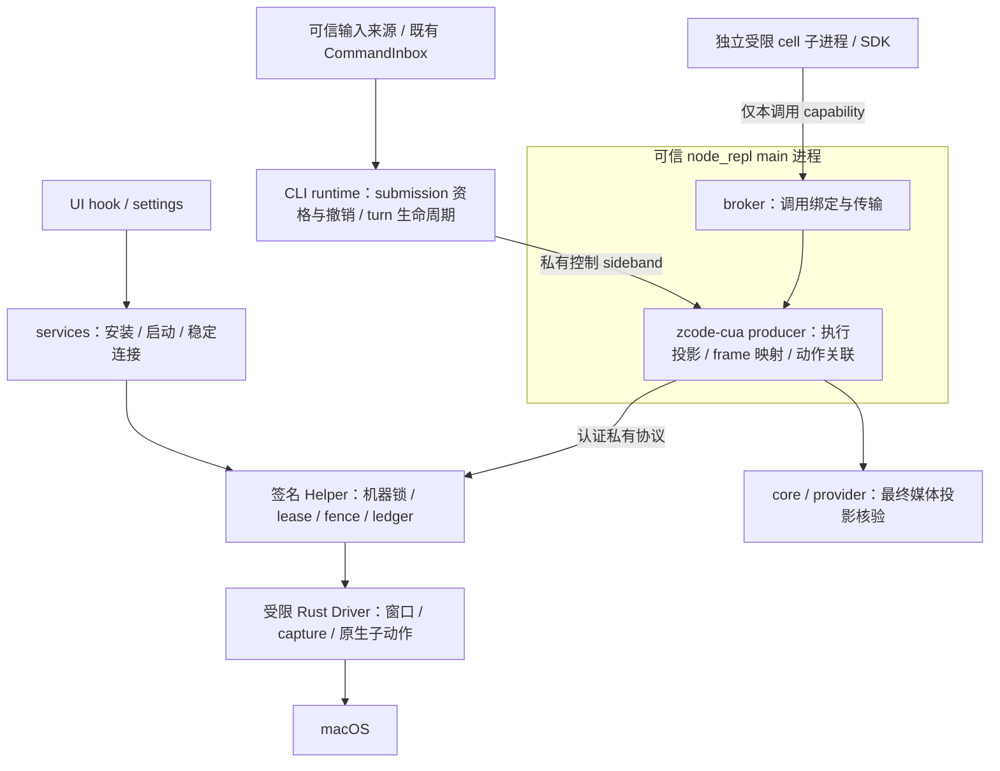
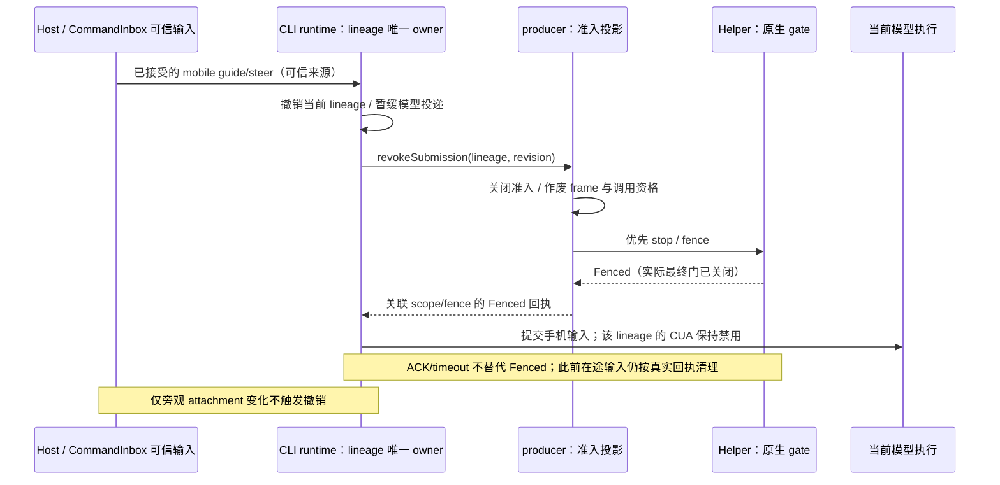
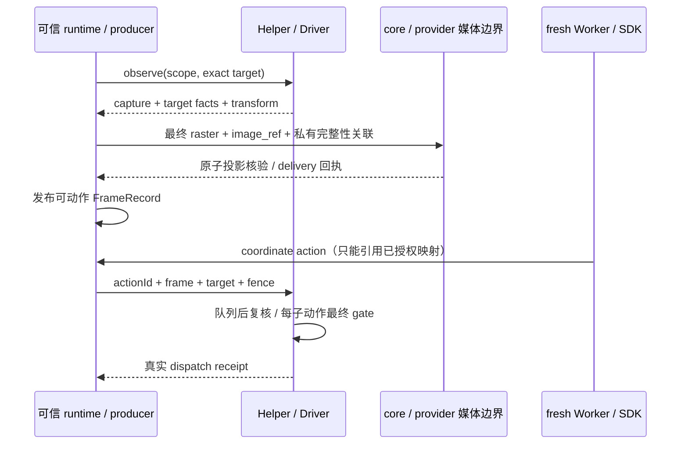
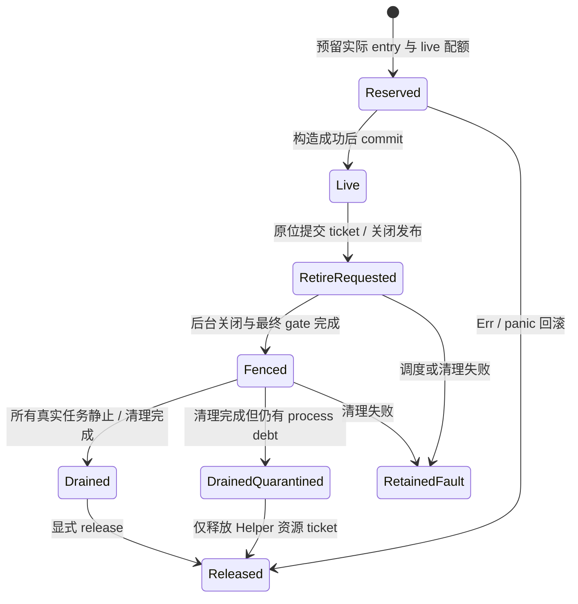

# macOS Computer Use 首期详细设计

2026-10-29 第十轮已完成开发验证：以R9冻结视觉树为只读基线，新增内核audit-token/Security动态peer诊断，并将单个完整submission ref借给现有control-only launcher作撤销接线。authority保持唯一，首次失效先封闭/撤销再等待cleanup；诊断输出不成为许可，机器lease、TCC与可执行Helper继续blocked。所有者、顺序及验收见[第十轮计划](../plans/computer-use-macos-phase1-round10.md)。

2026-10-29 第九轮：派生独立单窗口 Swift completion 桥，收窄 SCK/AppleMetal/录屏构建闭包；最终消费者显式闭合兼容库、系统runtime rpath与macOS14.2构建下限。采集owner只管有界资源/取消/桥像素资源归还，不证明OS回调退出，也不成为授权owner；当前没有可信Helper许可，公开入口继续拒绝。所有者及事件顺序见[第九轮计划](../plans/computer-use-macos-phase1-round9.md)，产品最低系统与真实原生验收仍blocked。

2026-10-28 第八轮：独立视觉构建根分离窗口事实/单帧像素与宽平台依赖；观察结果不构成授权，缺少可信 Helper 许可的公开采集入口继续拒绝。新旧根显式比较，不声称 SDK 功能等价。见[第八轮计划与验收](../plans/computer-use-macos-phase1-round8.md)。

2026-10-28 第七轮按独立候选推进最小依赖裁剪，先断开默认 feature 回流与不需要的导出依赖，实际图/编译/许可分别验收；复杂原生模块不以 stub 替代，功能仍默认禁用，见[第七轮计划](../plans/computer-use-macos-phase1-round7.md)。

2026-10-28 第六轮补齐固定归档重建、版本绑定许可材料与显式工具链准备；独立 staging 不改历史输入，材料门与产品采用分开，见[第六轮记录](../plans/computer-use-macos-phase1-round6.md)。

2026-10-27 第五轮先核验 Driver 固定来源、完整候选差额和实际 macOS 依赖/许可材料，并补充 D06 原生扩展、真实客户端资源与中断证据，见[第五轮记录](../plans/computer-use-macos-phase1-round5.md)。采用前审计不等于产品 Helper；实验工具链、许可材料及隔离缺口逐项保留，默认禁用不变。

2026-10-27 第四轮新增独立诊断 Helper 构建与 D06 真实进程验证工具，范围和逐层证据见[第四轮记录](../plans/computer-use-macos-phase1-round4.md)。诊断 `.app` 使用独立身份，不链接 Driver；隔离工具显式运行，不替换默认 executor。local-self-signed、完整 D06、原生 Helper 与真实 Fenced 门槛仍未关闭。

日期：2026-10-25。状态：**设计评审修订稿；技术采用与产品实施仍受 P0 门槛约束**。本次补齐模型执行隔离、混合来源输入准入与用户提交级撤销；均为待实现合同。本文不表示 Cua 已正式通过验收，也不授权真实系统输入。

产品规则和验收断言以 [首期 spec](../../specs/computer-use-macos-phase1.md) 为唯一来源；工作顺序以 [实施计划](../plans/computer-use-macos-phase1-implementation.md) 为准。本文确定模块边界、接口责任、时序和故障处理，收敛需要验证的工程选择。与旧实验描述不一致时，旧内容仅作为历史快照，不改写原报告与证据索引。

2026-10-26 开发进度：默认禁用的控制 IPC、runtime candidate/revoked 生命周期接线与自签名产物诊断已形成第二轮候选，具体范围与 controller 证据见 [第二轮验收](../plans/computer-use-macos-phase1-round2.md)。这不关闭原生 Helper、Host/launcher、手机 Fenced 和 D06 门槛。

2026-10-26 第三轮以 [接线契约](../../specs/computer-use-macos-phase1.md#第三轮接线契约2026-10-26) 和 [本轮验收](../plans/computer-use-macos-phase1-round3.md) 为增量事实。启动 identity、live admission 和 control 各有可信入口；在 D06 未通过前，控制诊断进程禁止运行模型 cell，无 Helper 不返回 Fenced。下文目标设计与历史差额不自动成为本轮通过记录。

## 1. 设计结论与证据边界

首期采用方向是 **Zody 自有签名 Helper 内嵌受限 Cua Driver，producer 负责可信调用与最终图像映射，Helper 负责唯一原生输入执行权**。模型继续使用现有 `node_repl` Computer Use SDK，不接入新的 Agent、MCP 服务或上游桌面应用。推荐 Rust SDK 窄桥；TS 默认连接/启动上游 daemon 的路径不进入产品。窄桥的正式采用必须满足下文 D01–D07，推荐方案本身不是通过记录。

范围固定为 macOS 原生 arm64/x64、本地 Desktop 主 Agent、单显示器、已经运行的精确前台应用窗口、视觉操作。AX/元素操作、后台输入、多屏动作、自动启动应用、远端或手机发起 CUA、subagent、PiP、Windows/Linux 均不进入首期。远端既有 attachment 和历史展示继续遵循原链路，不由本设计新增控制权。

| 事实层级     | 当前事实                                                                                                    | 不能推导的结论                                                             |
| ------------ | ----------------------------------------------------------------------------------------------------------- | -------------------------------------------------------------------------- |
| 实际产品源码 | `@zcode/zcode-cua` 0.6.3 带 placeholder 标记；execute 固定 unavailable；closeSession/dispose 空实现         | 公开导出、旧 SDK 文档或 UI 入口不等于能力已恢复                            |
| 最新独立候选 | Cua 0.37.0，SHA `2d2f99228d4d2508dc6fcc84c176b296e146714a`；同一 binary 644 唯一进程，另 3 个动态 ABI 进程  | 不是原生系统输入、最终制品或跨版本完整回归                                 |
| 确定性机制   | 旧 barrier-only 等待可在 worker 提前结束时永久等待；在途 ABI 可阻塞 stop；create 预留真实 retire entry 可行 | 历史 20.01 秒 watchdog 原因仍未确认；没有 stop 硬上限或无条件 destroy 保证 |
| 正式验收     | G1/G2、整体 D2、R3/R6、MCU1 blocked；G3/G4 未执行；P1–P6 planned                                            | 文档完成和开发测试通过不改变这些状态                                       |

最新事实入口：[stop/retire 报告](/Users/zhvala/SourceCode/scripts/experiments/zody-cua-p0-g2-stop-retire-reservation/REPORT.md)、[证据索引](/Users/zhvala/SourceCode/scripts/experiments/zody-cua-p0-g2-stop-retire-reservation/evidence-index.json)。前序入口：[publisher/drain 报告](/Users/zhvala/SourceCode/scripts/experiments/zody-cua-p0-g2-publisher-drain/REPORT.md)、[选型结论](/Users/zhvala/SourceCode/scripts/documents/Zody-Computer-Use-选型结论.md)。644 不累计旧 2723；最新轮未重跑旧窗口、生命周期完整矩阵与全部跨 crate 编译控制。Rust 1.93.1 的开发构建不能冒充上游固定工具链及正式可重建验证。

## 2. 当前链路与设计差额

已经存在的调用链是 SDK → Worker bridge → 本地 node_repl broker → `ComputerUseRuntime.execute` → unavailable。Helper 安装/权限装配在 services，UI 原生入口经 `IPlatformService`；两者不能替代执行时的可信 scope 校验。

| 复核入口                                                                                                                                                        | 当前行为                                                                                        | 必须补齐的差额                                                                                         |
| --------------------------------------------------------------------------------------------------------------------------------------------------------------- | ----------------------------------------------------------------------------------------------- | ------------------------------------------------------------------------------------------------------ |
| [producer 公开类型](../../packages/zcode-cua/index.d.ts)、[实现](../../packages/zcode-cua/index.js)                                                             | execute/closeSession/dispose 形状已存在，实现占位                                               | 保持兼容入口，恢复真实行为；逐个审计 exports 子路径，不能只替换 index                                  |
| [SDK](../../apps/zcode-cli/packages/zcode-cua-plugin/scripts/computer-use-client.mjs)                                                                           | 14 个工具的调用与绑定对象入口                                                                   | 视觉模式、unsupported 分支、最终 frame 与 fresh Worker 规则                                            |
| [cua-bridge](../../apps/zcode-cli/packages/node-repl-host/src/cua-bridge.ts)                                                                                    | 取当前调用 metadata、转发请求、读取 responseMeta                                                | 显式拒绝缺失/非法 scope；不把缺省 runtimeScope/clientMode 视为本地主 run；禁止模型自报授权             |
| [cua-broker](../../apps/zcode-cli/packages/node-repl-host/src/cua-broker.ts)                                                                                    | token 校验后直接把 method 转为 toolName；缺少 session 控制方法                                  | producer 独立 allowlist；稳定 actionId；认证控制通道、响应代际和 metadata                              |
| [node_repl server](../../apps/zcode-cli/packages/node-repl-host/src/server.ts)、[REPL loader](../../apps/zcode-cli/packages/core/src/repl/node-repl-session.ts) | main 持有 runtime，cell 使用 worker_threads；loader 可加载宿主模块，vm 不是安全沙箱             | 模型 cell 改为独立受限子进程；验证调试/FD/模块/文件边界；共享 producer 由 main 唯一清理                |
| [services 装配](../../packages/services/src/node.ts)、[权限服务](../../packages/services/src/cua-permission-broker/)                                            | 默认 Helper host 创建有 desktop-local/remote identity 门控；broker env 注入仅检查插件启用和平台 | env 注入与执行准入各自补齐可信 scope 门控；稳定 facade、懒 ensure、认证 generation；权限状态不授予输入 |
| [平台协议](../../packages/shared/src/platform.ts)                                                                                                               | OS 支持、权限引导、Helper 拖拽入口                                                              | 维持平台调度边界；不得成为 session/frame/输入事实 owner                                                |

`turn_id` 当前是关联字段，不是授权凭据。Worker 拥有 bridge token 也不等于拥有 Host/run 权限。当前产品执行仍被 placeholder 阻止；上表的默认值与生命周期问题属于恢复能力前必须关闭的缺口。

## 3. 模块、状态与唯一写入路径

图中接口为目标设计，不代表实线已实现。Main 只调度进程、原生窗口和消息，不保存业务状态；不增加 Desktop Host 或第二个任务 admission。

| 状态 / 事实                                              | 唯一 owner 与提交口                                     | 生命周期 / 持久化                                                  |
| -------------------------------------------------------- | ------------------------------------------------------- | ------------------------------------------------------------------ |
| task、用户 turn、run、workspace/Host 路由                | 既有 CLI runtime/CommandInbox、Host owner/lease         | 复用既有生命周期；CUA 不复制任务队列                               |
| 用户提交 CUA 资格与撤销（submission lineage）            | 可信 CLI runtime，经 CommandInbox admission/control     | 单调撤销；跨自动续跑与 producer 重启保留；runtime 恢复不继承旧授权 |
| CUA scope、target、final frame 映射、动作关联与撤销投影  | producer，经认证 execute/control port                   | 内存；同 turn 的 fresh Worker 可复用有效帧；不能清除 runtime 撤销  |
| Driver session、原生 capture/snapshot/token、原始变换    | Driver，由窄桥封装                                      | 单一原生 owner；不在 producer 再造 AX/token cache                  |
| 安装、启动尝试、稳定连接和已认证启动代际                 | services 实现 producer 定义的公开 lifecycle port 并注入 | 只存安装/制品元数据；generation 经握手确认，不能由 env 字符串声明  |
| 输入 lease、递增 fence、dispatch 序号、owned down ledger | Helper 的机器执行仲裁器                                 | 同一用户交互桌面唯一；任何 Host/data root 共享排他域               |
| 生命周期容量与 retire ticket                             | Helper Tables                                           | 创建前预留；资源静止且显式 release 后释放；故障不能驱逐            |
| 剪贴板所有格式及 changeCount                             | OS；Helper 仅持事务恢复副本                             | 内存短存；不落盘/日志；其他写入后不得覆盖                          |
| UI 可见开关、权限/错误投影                               | settings/UI hooks/store                                 | 展示不是授权；不缓存可复用的 input grant                           |
| 崩溃后输入不确定记录                                     | 同一机器仲裁域的恢复记录（D04 待验证）                  | 最小元数据；绝不持久化输入正文、图像、凭据或可重放动作             |

内部执行 scope 由可信上游产生：`hostInstanceId + runtimeInstanceId + sessionId + workspaceKey + runId + turnId`，并引用 runtime 持有的 `appIncarnation + submissionLineageId + authorizationRevision`。lineage 是用户提交的授权因果关联，不能按 turnId 重建；现有 inputId/sourceCommandId 只作为可信 admission 的关联证据，不直接作为凭据。`helperGeneration/fence` 是独立执行资格字段，递增只使旧资格失效，不能清除 lineage 的撤销。workspaceKey 由可信 `workspaceIdentity?.trim() || workspacePath` 规范化，客户端传入 key 不可覆盖可信身份。这些内部字段须通过私有认证注册及调用绑定传递，不能塞进模型 arguments 或依赖 `trace`。

runtime 是用户提交资格的唯一 owner；producer 的 admission latch 是其单调执行投影，Helper fence 是原生门事实。producer 可先关闭本地准入并向 runtime 请求撤销，但无权重新授予资格。runtime 死亡后不从历史恢复可用 grant；机器 dirty 记录只表达未清理输入风险，不能代替用户停止记录。具体转换见 §5.4 与 spec §3.1–3.2。

producer 的动作关联账本记录“哪个可信请求对应哪个 Helper receipt”；Helper ledger 记录真实派发与持有输入。两者不是同一事实的双写；producer 无权制造原生 terminal/Drained。

## 4. Helper 形态、构建与维护

2026-10-26 签名策略更新：按 [spec 当前签名策略](../../specs/computer-use-macos-phase1.md#当前签名策略2026-10-26) 持续使用 `local-self-signed` 本地自用 profile；无需先加入 Apple Developer Program。Developer ID 与 Apple 公证属于未来可选的对外分发 profile。自签名加载、权限与身份连续性仍须实测，本次策略更新不修改系统钥匙串或现有权限，也不宣告 G1 通过。

选择一个自有签名 Helper 可执行程序，静态链接经裁剪的 Rust 窄桥及 Driver 必需核心。应用内嵌固定资源和 manifest，services 首用验签后启动；不依赖用户 Node/pnpm，不下载上游 app、模型或运行时。优先静态链接减少动态卸载条件；开发 cdylib 仅作 ABI 研究，不能当作最终加载形态已验收。若 AppKit/TCC/打包阻断该形态，进入 D01 重新裁决，不悄悄替换入口。

最终 bundle ID、证书指纹、designated requirement、最低 macOS、两架构工具链与 entitlements 在 G1 固定；Team ID 按签名结果记录，自签名 profile 不假设具有 Apple Team ID。peer 校验不得仅依赖 Team 相等，须绑定选定证书和 Helper 身份。同 UID、PID 或 socket 路径均不足以认证 peer；本地 socket 权限、peer 身份/签名、启动关联凭据和 challenge 共同校验。凭据仅存在可信 supervisor/producer 与 Helper 控制关系，不进入 Worker、模型、Bash/hooks、其他 MCP 或日志。

复用上游窗口/capture/平台原语；Zody 自有代码承担 scope、最终 frame、机器仲裁、fence、回执、生命周期与能力裁剪。需要修改上游内核的 gate/custody 变更作为独立可审计 patch 集，不复制整仓产品。每个 patch 登记来源 SHA、原路径、原因、测试和升级冲突；一次升级只在新实验目录重建同源 SDK/native 制品。仅纳入 MIT 必需闭包；FSL 组件、感知模型、更新/遥测及未声明扩展入口排除。

当前研究基线包含 0.38.0 调研源码和 0.37.0 开发候选，不能混用版本结论。产品采用必须固定唯一源码、Cargo.lock、工具链、patch、制品摘要、profile 和签名身份。前台路径若仍依赖私有 SkyLight SPI，要记录实际调用及兼容性结果再裁决，不能因后台能力被裁剪就假定依赖已消失。

## 5. 接口、能力与准入

### 5.1 公开兼容与私有协议

保留 `ComputerUseRuntime.execute(input): Promise<unknown>`、`closeSession(context): Promise<void>`、`dispose(): Promise<void>` 及既有 exports。`ensureBrokerAvailable` 已有类型但当前 server 未注入，是拟接线的首用 seam。producer 定义窄 port，services 实现并注入、拥有 Helper 进程；producer 不反向 import services 实现。跨进程使用该 port 的认证代理，不把 services 对象直接传给 Worker。以下是待实现的私有语义接口，名称不是当前已有 API：

| 接口                                       | 调用者 → owner                          | 关键约束                                                                     |
| ------------------------------------------ | --------------------------------------- | ---------------------------------------------------------------------------- |
| registerScope / endTurn / closeScope       | 可信 runtime → producer                 | 不能由 Worker 伪造；事件携带 incarnation，重复幂等，迟到旧事件不能关闭新 run |
| revokeSubmission / requestSubmissionRevoke | runtime → producer / producer → runtime | runtime 唯一提交 lineage 撤销；producer 立即拒绝并行新调用，不能自行恢复资格 |
| ensureHelper / getConnection               | producer → services lifecycle port      | 单个启动尝试合并；返回认证连接/generation；不通过 Agent 重启恢复             |
| acquire / renew / observe / submit         | producer → Helper                       | 严格 scope、版本、代际、fence；新 grant 前核验机器锁与恢复状态               |
| stop / status / retire / drain / release   | producer → Helper 控制通道              | 独立于动作队列；保留 ticket；控制请求不等待普通队列清空才被处理              |
| deliverFrame / revokeFrame                 | core 媒体边界 ↔ producer                | 最终编码和投影回执；私有认证通道；失败时不发布可动作 frame                   |

可信生命周期的具体接线点如下。这里复用既有 owner 的事件，不另造 active-turn 轮询状态机；关联字段必须匹配已认证控制关系，缺失/无法验证即拒绝。消息序号和 incarnation 防止旧 endTurn/closeScope 关闭新实例；结束事件到达后，同实例后续 register 永不复活。以下 CUA 控制 port 尚未实现：

| 事实来源 / 当前源码入口                                                                                                                                                                                                                                                                   | 目标接线                                                                                                                                                                                          |
| ----------------------------------------------------------------------------------------------------------------------------------------------------------------------------------------------------------------------------------------------------------------------------------------- | ------------------------------------------------------------------------------------------------------------------------------------------------------------------------------------------------- |
| [runtime turn](../../apps/zcode-cli/packages/core/src/runtime/methods/turn.ts) 的 active-turn/finally，以及 [目标续跑](../../apps/zcode-cli/packages/core/src/runtime/methods/target.ts)                                                                                                  | registerScope 必须引用有效 submission lineage；endTurn 只结束执行子 scope，不删除提交撤销。自动续跑继承 lineage；所有成功/失败/取消分支均收尾                                                     |
| [Host 可信输入](../../packages/services/src/zcode-agent/zcodeAgentService.ts)、[V4 input intent](../../apps/zcode-cli/packages/bootstrap/src/zcode-protocol-v4/commands/input-intent.ts)、[runtime admission](../../apps/zcode-cli/packages/core/src/runtime/methods/prompt-admission.ts) | 贯穿可信 inputOrigin、原始 admission 关联与 queue/guide 来源；手机 steer 在模型可见前撤销 lineage 并等待真实 Fenced。恢复展示 metadata 不签发资格                                                 |
| [MCP adapter](../../apps/zcode-cli/packages/adapters/src/mcp/index.ts) 的 mcpRequestMeta                                                                                                                                                                                                  | 只透传已认证调用关联；普通 metadata 不能签发 scope。node_repl server 的 runtime_scope 默认值也须在 CUA 准入前显式拒绝缺失，不能只修 bridge                                                        |
| [协议 closeSession](../../apps/zcode-cli/packages/bootstrap/src/zcode-protocol/server-operations.ts) 的 record.app.close，以及 [resident pool](../../apps/zcode-cli/packages/bootstrap/src/zcode-protocol/session-resident-pool.ts) 的 host.deactivate                                    | 把 CUA closeSession 放到 app 所有者统一收尾中，覆盖显式关闭与驻留 runtime 撤销；不只加在 UI close 按钮。持久会话尚在时可重新建 runtime，但旧 incarnation/lease 不能继承                           |
| node_repl `server.ts` 的 main/shutdown                                                                                                                                                                                                                                                    | main 是共享 producer 的唯一进程 owner，借用的 NodeReplMcpRuntime 只关自己的 broker/局部调用；main await producer.dispose 一次后退出。单独创建的 runtime 必须显式标记 owned/borrowed，不能隐含共享 |

统一 app 收尾的实际入口为 [session-facade.ts](../../apps/zcode-cli/packages/bootstrap/src/app/session-facade.ts) 的 `close/closeSessionResources`。CUA 的 admission-close/stop 请求必须在 `beginShutdown` 后立即发起，不能排在 memory extraction 的长等待或其他资源关闭之后；资源 drain 可在后续收尾阶段等待。现有 [agent-runtime.ts](../../apps/zcode-cli/packages/core/src/runtime/agent-runtime.ts) 的 `closeBrowserSession` 只作为模式参考，新增 CUA 专属 port/收尾责任，不把 CUA 事实放进 Browser owner。其他任务关闭可以继续，但 CUA 清理失败必须保留 ticket/quarantine 与可观察失败，不能照搬“仅 warn 后视为安全关闭”。

**跨进程载体选择：** CLI 的受信 MCP 进程 supervisor 为官方 node_repl main 建立单独的本地控制 sideband，使用启动时继承的私有双向管道；它与 MCP 模型工具流、Worker bridge socket 分离，不新增模型可调用方法。CLI/runtime 实现 CUA control port 的发送端，node_repl main 实现接收端并调用 producer。该管道是拟新增接线，现有 cua-broker 仍只有 execute，不能把本地 mock port 当接线完成。

**模型执行边界：**目标保留可信 node_repl main 持有 producer，但每次模型 cell 必须运行于独立受限子进程；“fresh Worker”仅保留 SDK 的短生命周期语义，不再表示与 producer 同进程的 `worker_threads`。当前 `NodeReplSession` 的宿主 import/require 仅特殊处理 process，不能防止 inspector 等模块接触可信宿主；源码也明确 vm 不是安全沙箱。因此“私钥只留 main 内存”不能作为当前实现的安全证明。

子进程只得到本调用 bridge capability 和必要 SDK 数据；以显式 allowlist 装配环境和继承句柄，不传 sideband/Helper FD、密钥或调试端点。可信 supervisor、producer、SDK/启动资源不能由 cell 或其子孙进程改写；模型代码不得通过 inspector/调试附加、原生 addon/FFI、宿主模块或新建子进程进入可信执行域。D06 必须固定实际 OS/签名/运行时隔离机制和模块依赖 allowlist，并验证 Browser Use 在同一 node_repl 工具中的兼容性。仅 fork 进程、隐藏变量、关闭一个 import 名称或同 UID peer 检查都不能视为隔离完成；无法保持此边界则产品继续 unavailable。

在上述隔离成立后，启动 bootstrap 固定 CLI/main 进程 incarnation 与验证公钥；生命周期消息使用平台密码库标准签名验证（建议 Ed25519）。CLI 私钥只留可信 supervisor，producer ACK 私钥只留可信 main；验证密钥仅由受信启动链绑定。控制认证、cell 调用 capability、Helper peer 认证是不同边界。MCP launcher 中转、环境清理、FD 继承/关闭、签名与精确进程关系均须实测；D06 未通过不能退回未认证 metadata 或同进程隔离假设。

每个控制包绑定 `protocolVersion/controllerIncarnation/producerIncarnation/appIncarnation/sequence/requestId/method/scopeRef/payloadDigest`；涉及用户提交时还绑定 `submissionLineageId/authorizationRevision`。两个方向各有单调序号，接收端先验签和代际，按本方向序号顺序应用；同序号同摘要重送只返回缓存 ACK，不重复执行；异摘要、跳号或代际不匹配拒绝并阻止新的 action admission。register 的 `applied` ACK 到达后才允许关联工具调用；revoke ACK 只证明权威撤销或执行投影已应用，endTurn/close 的首个 ACK 只证明 admission 关闭，均不代表原生 Fenced/Drained。取消控制不排在普通动作队列后。ACK 丢失可重送同一个控制 requestId 或查询状态，不能重送输入 action。

每次 node_repl 调用还需可信 `beginCall/endCall` 绑定 invocationId 与已注册 scope。main 为该次 Worker 创建仅限本调用的 bridge capability，broker 从自己的映射表取权威 scope，不接受 Worker JSON 覆盖 session/workspace/run；结束时撤销该 capability，但不关闭整个 turn。注册/调用均核对 lineage revision；旧 revision 的在途 register/beginCall 在撤销后拒绝，不能新建 scope 绕过撤销。撤销后仍允许认证的 stop/status/retire/drain 收尾请求，不能因 action gate 已关闭而拒绝清理。当前按 MCP runtime 共享的 bridge token 不能单独承担此隔离。伪造 metadata、复用前一 Worker token 或在 endCall 后迟到调用列入 C01/C08 的零输入反例。

sideband 丢失时 runtime 撤销该关系已绑定的 submission lineage，producer 关闭对应 scope 并请求 Helper stop；producer 死亡同样触发 runtime 撤销，Helper 对应控制 lease 独立过期/fence。未确认 ABI/owned release 时保留 unknown/quarantine，不用控制通道 timeout 推导停止成功。新 producer incarnation 不得仅凭 active-run 重注册旧 lineage；须后续新的可信本地用户提交重新评估资格并满足机器恢复门槛。runtime 若也死亡，恢复的旧提交默认无资格；不能重播旧 register 或动作。

app 创建时由可信 owner 固定 `appIncarnation + sessionScopeHandle`，零参数 `app.close()` 闭包捕获该 handle；closeScope 精确关闭这个 incarnation 的所有 turn 子 scope。不能在 close 时仅按 sessionId 去 registry 查“当前实例”。[session-residency.ts](../../apps/zcode-cli/packages/bootstrap/src/zcode-protocol/session-residency.ts) 会先删除旧 record 再 await app.close，而显式协议 close 顺序不同，两条路径均使用捕获的旧 handle；迟到关闭不得影响同 session 的新 runtime。未曾创建 CUA scope 的 app 可幂等结束；有未决 handle 时不得因 registry 已删除就漏清理。

协议包络至少包含版本、认证连接绑定、requestId、method、scopeRef、generation、fence；动作额外带稳定 actionId 和 canonical payload digest，响应回显关联信息和真实阶段。schema 拒绝未知字段/方法、越界长度、非有限数值、非法枚举。协议大小上限以版本化 manifest 为准；现有 node_repl 的 1 MiB 传输上限不是输入文本或原生内存预算。

actionId 在 producer 接受一次可信调用时生成，不在每次 socket 重连时重建。同 ID/同 digest 返回原事实或在途状态；同 ID/不同 digest 拒绝。跨 generation 的旧 ID 不重新提交。账本释放后通过单调序号/关闭的 admission 水位拒绝旧 ID，而不是因“查无记录”重做；该机制须做有界存储与溢出拒绝测试。

### 5.2 准入顺序

1. producer 自身校验方法/schema、本调用 capability、显式本地 Desktop 主 run 身份、active turn 与未撤销的 submission lineage；runtime 环境不能代替逐输入可信来源。unsupported/remote/subagent/缺失字段在任何 Helper 安装、权限请求或原生 IO 前拒绝。
2. 读取发布能力和认证 Helper 能力交集；按需 ensure。权限查询仅返回实际快照；需要授权时由用户操作既有平台引导，工具不自行打开设置。
3. Helper 核验 peer、build/profile、机器锁/恢复状态，再签发 scope lease/fence；其他 session 返回 `CONTROLLER_BUSY`，不排队接管。
4. 观察/绑定目标；坐标输入额外核验已交付 frame，文本/按键也须核验精确目标 lease、时间和动作限制。任何接受的写入均使旧坐标帧失效。队列等待后再验，最后在唯一原生 handoff 重新验所有失效门。

能力是静态可支持范围；readiness 是当前可运行状态；两者分离。只有通过认证的制品能声明 input capability。旧数据、UI 开关、权限勾选或一次成功截图不能使能力变为 ready。

上述 acquire 只适用于需要控制权的路径：`list_apps/list_windows` 和纯元数据探针不申请输入 lease、不聚焦、不要求截图权限；`request_access` 只读权限快照。元数据成功不能签发可动作 frame。stop 走独立控制分支，不为一个已证明不存在的控制 scope 启动 Helper；若存在未决 ticket/失联在途动作，则继续报告未知与隔离，不能冒充“没有 scope”返回成功。

### 5.3 工具适配与参数冻结

保留全部 14 名称和位置参数。`set_value/select_text/perform_action`、所有元素 target、水平滚动和未声明格式明确 `ACTION_UNAVAILABLE`，不能走 generic native 逃逸口。`get_app_state` 输出真实 `state_id/app/window`、`elements: []` 和 AX unavailable；inventory 与隐藏绑定探针不签发 frame。

click 校验坐标包括合法 0，按钮/次数/修饰键来自能力清单；drag 两端属于同一 frame，分步检验；scroll 明确页数到像素/原生单位的换算及边界，不能固定滚动量忽略参数。type 保留空格、换行、中文、emoji，不附加 Enter；key 区分 Ctrl/Cmd。paste 仅纯文本，保存所有可恢复格式及 changeCount，只在仍拥有该剪贴板版本时恢复；无法完整取得恢复副本就拒绝事务。type 若使用剪贴板，遵循相同事务。

| 版本化参数组 | 必须固定的项                                                                      | 当前状态 / 关闭条件                                                                     |
| ------------ | --------------------------------------------------------------------------------- | --------------------------------------------------------------------------------------- |
| 生命周期预算 | live/creating/retired、session/frame/action/receipt、字节预算                     | 开发候选 32/64、session64/frame128/action256 仅作参考；D02 验证后随 manifest 固定       |
| 时间         | frame TTL、绝对/idle lease、renew、window 采样年龄、请求诊断时间、stop 验收上限   | 候选 1500ms/50ms 不是产品承诺；D03/D05 用最终链路测量后固定；缺参数拒绝激活             |
| 输入         | 文本字节/码点、key repeat/hold、drag 时长/步长、scroll 页数/单位、点击/修饰键集合 | D05 对每个边界及中途取消做契约与原生 oracle；不能只凭 click/drag 开发样本宣称全工具支持 |
| 帧与通信     | raster 像素/字节、压缩格式、frame 数、IPC 包大小、去重窗口                        | D05/D06 用实际 provider 链及内存预算冻结；溢出明确拒绝，不静默降采样后复用旧坐标        |

这是有限的待测参数清单，不以任意默认值填补。冻结前仅能继续独立开发验证，不能启用产品候选。

### 5.4 用户提交撤销与输入投递时序

产品规则以 spec §3.1–3.2 为准。runtime 在原有 admission 确认独立执行提交时创建 lineage，steer 仅关联当前 lineage 并保留自身来源。普通 turn 结束仅释放执行 lease/frame；已撤销 lineage 保留到其自动续跑、待投递输入及所有执行引用结束，不能因清空 producer cache 而变回有效。关闭 lineage 后，旧 ID 通过 incarnation/关闭水位拒绝；存储有界、溢出拒绝，不驱逐仍可能被引用的撤销事实。恢复任务、后台结果或 `goal-continuation` 不签发新 lineage。

本地新用户输入只有实际建立独立提交时才可重新评估 CUA；本地 steer 进入当前 lineage，不解除撤销。手机排队输入保留 mobile 来源，晋升为新 turn 也不获权。手机 guide/steer 进入有 CUA 资格的运行时，先撤销原 lineage，收到真实 Fenced 后才提交模型上下文；无活动 scope 时也须由 producer 按撤销 revision 确认 admission 已关闭且无未决注册/acquire 或失联动作，不能只查 runtime 缓存。未确认 fence 时保留既有输入待投递状态并展示原因，控制请求独立推进，不新建任务 admission 或 CUA 队列。

模型调用 `stop_computer_control` 时，producer 先关闭本地 admission，并行向 runtime 请求 lineage 撤销、向 Helper 请求 stop；本地用户紧急停止则直接从 runtime 撤销入口发起。只有 runtime 已应用撤销、Helper 原生停止条件均满足时才确认“已停止”。runtime ACK 丢失时保持 stopping/unknown 并幂等查询；不得因暂未收到 ACK 恢复 producer 准入。控制关系断开按 §5.1 撤销已绑定 lineage。producer 重建不影响普通任务运行，但其旧 lineage 不再自动获权；新本地提交也不能绕过机器 quarantine。

## 6. 图像、窗口与输入的同一授权链

Driver 产生原始 capture 和坐标变换；producer 完成最终编码后形成 `FrameRecord`：scope/generation/fence、target 的 PID 启动身份与窗口代次、native capture 引用、最终 bytes digest、宽高、裁剪/缩放矩阵、签发与到期时间、交付状态。原始 token 不独立授予输入权。

若 provider 重新编码、缩放、丢图或拆散 image_ref，必须在最后变换后重新证明映射；无法证明就不签发动作 frame。交付证明只说明应用实际提交了哪份模型输入，不宣称模型已理解/看见目标。不得用 UI 预览截图或 Worker 自报“已显示”代替。

仅同一完整稳定 scope、同一可信 delivery 关联、同一目标且 generation/fence 仍匹配的 fresh Worker 可重新绑定有效 frame。drag 两端全部校验后一次性消费授权，一次复合动作共享一个 custody，不能逐端或逐事件重新消费。任一写入被准入即作废该 scope 的坐标帧，accepted/possibly_sent 或同步失败均不复活；下一次坐标动作必须显式重观察。新观察开始即退休旧帧，即使新图交付失败也不恢复；并发观察/交付/消费由唯一顺序串行裁决，至多一个动作消费。换目标、run、generation、窗口事实变化、stop 或到期立即失效。`state_id` 只是观察身份，不能充当 frame grant。

目标核验覆盖同 PID 多窗口、PID/窗口 ID 复用、窗口关闭/重建、移动/缩放、焦点变化、最小化/遮挡/Space、锁屏/安全输入和显示器变化。已观察到的失效永久锁存，字段恢复旧值不复活租约。CG/AX/HID 非原子采样不能证明 sample→post 无竞态；真实 observer/ABA 与物理输入归因是 D05 门槛，不能将开发 replay 的已知事实套用于 live。

最后的普通输入 handoff 必须统一检查 scope/context/manifest deadline、frame/target lease、fence、cell/custody、process quarantine。lineage 撤销由认证控制路径关闭对应 scope 的 fence；runtime 不能只改本地标志就宣称原生已停。原生查询、延时、对象创建在短锁外；唯一 tag+post 与门校验处于同一个线性化域。禁止旁路 raw post/capture/token；默认制品不含开发 shim、replay 授权和通用脚本扩展。

## 7. stop、取消、retire 与资源完成

### 7.1 三种完成语义

| 阶段                            | 可以确认什么                                                             | 不可以确认什么                                                     |
| ------------------------------- | ------------------------------------------------------------------------ | ------------------------------------------------------------------ |
| AdmissionClosed / StopRequested | producer 已关闭准入；runtime lineage 撤销 ACK 与 Helper 收到请求分别记录 | 未取得最终 gate，不能宣称 native 已 fenced；投影关闭不代替权威撤销 |
| Fenced                          | 最终原生门已关闭，之后没有普通新 handoff；此前在途记录仍保留             | 不等于 OS 业务效果撤销、所有 owned 输入已释放或所有 worker 已静止  |
| Drained / DrainedQuarantined    | publisher/task/custody 静止，实际资源清完；后者仍有安全债务              | 不等于机器安全、可重新获权、可卸载或正式验收通过                   |

`stop_computer_control` 必须先关闭准入，并请求 runtime 权威撤销与 Helper 优先控制路径。“已停止”成功须同时满足：runtime 已确认 lineage 撤销、最终 gate 已关闭、该 lineage 所有执行子 scope 没有未决在途 ABI、owned 输入已安全收尾、lease 已释放。单独 Fenced 或 ACK 不够；其余返回明确 stopping/unknown/fault 及 receipt，UI 不能显示成功。成功停止也不自动代表所有资源已 Drained。控制协议的早期 ACK 是诊断状态，不降低 spec 中优先停止的要求。

当前候选 stop 在真实不转发 ABI gate 处会等待 cell/domain，**不能实现已证明的硬上限**。产品设计要求控制通道独立调度、短锁不跨查询/延时；已经进入 ABI 的同步调用仍需 D03 给出可接受的真实上限及恢复证据。线程 abort、超时、SIGKILL 不能当作 OS release 成功。若候选无法满足停止门槛，必须裁剪有风险输入或重新裁决后端；在 spec 明确变更并完成同门槛验证前不得启用。

动作结果使用独立轴：`dispatch_status = not_sent | accepted | possibly_sent`；资源/生命周期使用上表状态；目标应用业务效果另由观察确认。只有从未进入原生输入派发的证明才允许 not_sent；无法确定则 possibly_sent，不自动重放。Accepted 不等于应用已经完成输入或点击业务。ledger 中真实 owned down 的逆序释放只能在已证明归因与执行安全的条件下进行；物理持键或所有权未知时保留 debt/quarantine，不盲发 up。

### 7.2 创建预留和退役

推荐延续最新候选的同一生命周期 entry：`None` 仅为 creating/live 预留，`Some` 才是 retired ticket。容量条件是 `creating + live ≤ L`，`creating + live + retired ≤ T`；不存在额外一套可超售的 reserved 额度。构造前实际 try_reserve 表存储和 live 配额，锁外构造，RAII 处理 Err/panic，commit 同表锁发布。retire 原位转为 ticket、关闭 Life、移出 live，不再申请退役 entry。

图中 Released 不表示清除机器 quarantine。Pending/Fault/未 release 的 Drained 均占容量；None 不可 poll/release。上限达到时拒绝新 create，不能为了“恢复服务”驱逐欠债 owner。数字 token 单调、不复用、不作为凭据，溢出拒绝。

最新实验只证明容量维度可前移；构造前/commit 前注入不等于构造内部各分配点失败。仍需关闭“退役已提交但后台 runtime/spawn 失败而调用方只收到 0”的协议缺口。设计选择是在同一提交点先产生稳定 ticket 和 RetireRequested 事实，调度失败写入可查询 RetainedFault，响应明确 `committed=true`；响应丢失时按原 requestId 查询，不回退为 live 或重试创建。控制 executor 应随 Helper 建立并在创建可输入对象前验证可用；其故障路径也不能依赖再次成功分配/启动线程。OOM abort 无回执，归入进程死亡/恢复隔离，绝不承诺无条件 destroy。

drain/poll 只读取或调度状态，不同步等待 native ABI；一个 cleaner，清理闭包真实结束后才 Drained。observer future drop/timeout、终态 CAS、接收者退出都不能代替 blocking body 静止。动态库如保留，必须等全部 callable 引用、worker、callback 和 custody 清零后卸载；若无法证明就保留到进程退出，不把开发 ctypes 通过当作安全卸载证明。

## 8. 生命周期、独占与崩溃恢复

| 事件                           | producer 行为                                               | Helper / 其他模块行为                                                |
| ------------------------------ | ----------------------------------------------------------- | -------------------------------------------------------------------- |
| 普通 Worker/cell 结束          | 保留同 turn 的 session/有效 frame；单 action abort 独立处理 | 每次 socket 正常关闭不等于租约终止                                   |
| 用户停止 / 手机 steer 注入前   | 关闭准入并应用 runtime lineage 撤销；作废 frame             | stop/fence；手机输入待 Fenced 后投递；停止成功另须权威撤销与安全收尾 |
| turn 终态                      | 结束该执行 scope，作废 frame，关闭 lease                    | 不删除 lineage 撤销；自动续跑仍查同一 lineage，不自动获新授权        |
| session 关闭 / workspace 移除  | 可信 owner 调用 closeSession；幂等等待真实清理结果          | 保留未清理 ticket，故障可查询；不关闭其他 session                    |
| MCP server 销毁                | 仅释放该借用者与局部传输                                    | 共享 producer 由进程 owner 最终 dispose 一次，不由任意借用者销毁     |
| Host 控制关系丢失 / lease 失效 | 失效关联 scope，向 runtime 撤销关联 lineage，禁止重放       | Helper 独立过期/fence；普通 RPC 结束和手机观察者断开不触发误停       |
| producer 死亡 / sideband 丢失  | runtime 撤销已绑定 lineage；新 producer 不重注册旧提交      | Helper 独立 fence/清理；普通任务可继续，新的本地提交才可重评资格     |
| runtime 死亡 / 旧任务恢复      | 恢复的任务无 CUA 资格，不从历史重建 grant                   | 新本地用户提交与机器恢复检查均满足才可重新申请                       |
| Helper 崩溃 / generation 变化  | 旧 frame/请求全作废；在途 possibly_sent                     | 新代际不得仅因旧锁释放而恢复输入；进入恢复核验                       |
| runtime dispose / 应用退出     | 先拒绝新调用，await closeSession/retire/drain；报告未决状态 | 有界等待到期只记录 unresolved；不能返回已安全清理或先卸载库          |

`closeSession(): Promise<void>` 只在其资源关闭要求确实完成时 resolve；无法确认则以结构化错误/内部 ticket 保留诊断，不能伪成功。`dispose()` 同样须等待其拥有的资源；退出流程可以结束进程，但必须在日志/恢复记录中区别强制退出与已 drain。退出不重新启动 Agent，Helper 按需恢复也不改变现有普通任务的 runtime generation。

机器锁按 OS 用户及交互登录会话固定命名，不包含 workspace 或可配置数据根；创建/打开须防 symlink/替换，验证 owner、权限和锁对象一致性。锁授予的是“当前唯一执行者”，不是“前任输入已清理”的证明。机器 lease 不排队、不抢占其他 owner；本地紧急停止仅走明确受信入口，普通 session 无权停止他人。

推荐 D04 验证写前保守恢复记录：唯一机器 owner 先取得锁，在锁的整个持有期间维护同一保守 dirty 记录；允许可能留下按住状态的派发前先完成持久化，再进入原生 admission。只有该 owner 下全部相关动作真实收尾、worker 静止后可清除，不能因其中一个动作结束就清除其他在途动作的标记。记录包含 generation/fence、最小动作关联和恢复状态，不含输入 payload。IO 失败则不开始该危险派发；崩溃后 dirty/损坏/缺失但无法证明干净都拒绝新控制。持久化顺序、断电、两个 Helper、锁/记录替换必须注入验证，不能在最终 handoff 短锁里做文件 IO。

恢复记录解决“不能把进程死亡当安全”的检测问题，不解决物理输入归因。首期不自动补发旧动作或盲发 release；在独立验收环境证明安全恢复路径前，quarantine 只能阻止输入。不能通过删文件、换数据根、等待 TTL、启动新 Helper 或 UI 点“重试”解除债务。所需人工恢复步骤由 D04 实机验证后写入运维说明，当前不虚构通用解锁办法。

## 9. 最小 UI 与产品行为

复用现有设置、工具结果、权限引导和停控展示，不新增控制面板。展示层区分 unsupported、待授权、可用、控制中、停止中、输入结果不确定、恢复受阻；这些是事实投影，按钮不能自行写 ready/fence。

| 用户场景 / UI 入口        | 展示/草稿 owner 与默认来源                  | 校验 → 提交口                           | 权威 / 持久化 / 模式边界                                      |
| ------------------------- | ------------------------------------------- | --------------------------------------- | ------------------------------------------------------------- |
| 本地设置启用 CUA          | settings/UI；发布 profile 决定是否显示      | 显式用户设置；Helper ensure 仅按需      | 设置偏好可持久化，readiness 来自服务；占位/未签名构建保持隐藏 |
| 模型观察与动作 / 工具结果 | 既有会话组件；模型参数只是请求              | producer gate → Helper 唯一 handoff     | frame/receipt 私有事实；不能把历史图片变成当前授权            |
| 权限提示 / 用户打开设置   | permission hook；OS 快照                    | IPlatformService → 原生设置入口         | 用户显式操作；request_access 本身只读，不影响 Agent 启动      |
| 用户紧急停止              | 本地停控入口；无自动继承                    | 可信 runtime lineage 撤销 → Helper stop | 权威撤销且真实安全完成才显示“已停止”；unknown 不自动重试      |
| 手机/远端查看历史或发输入 | 既有 replayable attachment / 输入 admission | 历史只读；新输入按 §5.4 撤销与投递      | 旁观不误停；手机输入不能借本地 runtime/现有 turn 获权         |

共同复用布局、主题、i18n 和错误组件；能力来源统一取认证 profile。区别在于本地交互可以提交受信控制，远端仅能展示；draft/展示默认值永不继承输入授权。完整 UI 交互和 E2E 在 P5 按既有 DESIGN.md 落地，本轮无 UI 实现。

## 10. 有限决策清单与拒绝条件

| ID / owner                                      | 推荐方案与待验证问题                                           | 必需证据 / 关闭条件                                                                                                              | 失败时裁决                                                      |
| ----------------------------------------------- | -------------------------------------------------------------- | -------------------------------------------------------------------------------------------------------------------------------- | --------------------------------------------------------------- |
| D01 Helper/分发 owner；G1                       | 自有签名 Helper + 静态 Rust 窄桥；最终身份/两架构/最低 OS      | 同源重建、离线安装、所选 profile 签名/TCC、移动/升级；封闭入口与依赖清单                                                         | 形态重新评审；不能落回默认 daemon；产品继续隐藏                 |
| D02 Helper 生命周期 owner；G2/D2                | create 实际预留；稳定 retire ticket；预建控制 executor         | 构造内部失败、调度失败、提交后丢回执、并发/容量/poison、永阻塞；旧 owner 不复活                                                  | 修协议后重验；容量通过不能抵销调度失败                          |
| D03 原生执行 owner；G3/R4/R6（承接 G2 开发 D2） | 优先 stop + 唯一最终 gate；不将早期 ACK 当停妥                 | 最终签名 ABI 自然阻塞与查询阻塞、分步取消、物理按住/释放、明示时间上限；watchdog 保存阶段与线程栈                                | 达不到 spec 则缩小能力并改 spec 或转备选；禁止加 timeout 假通过 |
| D04 机器仲裁 owner；G4/R5（承接开发 D2）        | 单桌面 OS 锁 + 保守 dirty 恢复记录                             | 双 Host/双数据根/双 Helper、SIGKILL/重启/断电、记录损坏、锁替换；未知输入不重新获权                                              | 保留 quarantine；不能自动接管；验证可用性是否满足首期           |
| D05 frame/输入 owner；G2/R6                     | 精确窗口 lease、物理归因、各输入参数表                         | 窗口/PID 复用、ABA、焦点/Space/Retina、剪贴板并发、14 工具支持矩阵与边界                                                         | 对未证明能力 fail closed；不能把 replay 当 live 证明            |
| D06 runtime/执行隔离/media owner；G2/G3         | 独立 cell 隔离、可信输入 lineage/control、最终 raster 原子投影 | 真实隔离配置的 inspector/FD/模块/文件反例、mobile steer 撤销、跨进程/续跑停止锁存、node_repl→provider 链、close/dispose/去重水位 | 任一子门未过不启用动作；禁止退回同进程假隔离或关闭 attestation  |
| D07 release owner；G1–G4/P6                     | 固定最终制品/profile与验收矩阵                                 | 两架构包、零未声明外连、license/NOTICE、MCU1 必需场景及真实模型 canvas oracle                                                    | 不发布；UI-TARS/nut-js 只在显式新裁决后重走同门槛               |

这些 owner 是模块责任，不虚构具体负责人。D01–D07 是本文工程清单，既有实验的 D1/D2/D3/D4 与 R1–R7 编号保持原义，不混计。历史 watchdog 原因保持 unconfirmed；新增诊断只为下次自然失败保留现场，阴性重放不关闭它。

D06 分别记录执行隔离、输入来源与撤销、媒体交付三组证据；任何一组通过不能抵销另一组缺失。实现前固定子进程隔离机制、可信资源/依赖清单、lineage 与既有 admission 的映射及手机输入阻断展示。当前只有同进程 Worker/REPL 的源码反例与审查依据，没有新的隔离配置、手机联调或故障恢复通过记录。

## 11. 验证计划、反例与交接

本轮只完成文档和只读源码复核，不运行原生实验。后续先在新的独立目录完成 D02/D03/D04 的无系统输入故障验证，保留旧实验；任何需要真实输入、TCC/锁屏/权限重置的正式场景另在明确授权的专用环境执行。代码接入仍按实施计划 P0→P1…P6；不把“有设计可评审”写成“P0 已通过”。

| 场景               | 设置 / 动作                                                                  | 必需断言与证据                                                                                                                                                         | 对应 spec / 层次 / 当前状态                      |
| ------------------ | ---------------------------------------------------------------------------- | ---------------------------------------------------------------------------------------------------------------------------------------------------------------------- | ------------------------------------------------ |
| C01 scope 反例     | 缺失/非法 metadata、subagent、remote/replayable、伪造 turn 请求              | 原生/安装/授权调用计数均 0；非授权 context 不注入 CUA broker 凭据/env；不能缺省 main；可信 owner 日志关联                                                              | MCU1-23/24；contract；planned                    |
| C02 frame 链       | 最终图被缩放/重编码/丢弃；fresh Worker 重绑及换 run                          | 合法同 turn 可复用；变换不匹配/跨 run 零输入；最终 bytes/transform/delivery 关联                                                                                       | MCU1-10–13/28；contract + desktop/model；planned |
| C03 同机争用       | 两数据根、两 Host/Helper 同时 acquire                                        | 只有一个实际输入 owner；loser 无焦点/剪贴板副作用；释放后须新请求                                                                                                      | MCU1-17/23；双进程 + live；blocked               |
| C04 停止窗口       | 每个 query/delay/handoff 前后、ABI 在途发 stop                               | 分开记录 Requested/Fenced/Drained；早期 ACK/Fenced 不伪称成功；无后续普通事件；owned release、无未决 ABI、lease 释放有实际 oracle                                      | MCU1-18/19；dev seam 部分已有，正式 blocked      |
| C05 retire 故障    | 满额、构造中失败、retire commit 后调度失败/回执丢失                          | entry 无超售；失败无 live 复活；ticket 可查；worker 不静止不得 drain                                                                                                   | MCU1-20/21；dev fault 部分已有，完整 planned     |
| C06 崩溃恢复       | down 后 Helper SIGKILL；重启/不同数据根再申请                                | possibly_sent、dirty 保留；没有自动重放/盲释放/新获权；独立 OS 观察                                                                                                    | MCU1-18/20/22/25；双进程 + live；blocked         |
| C07 文本与剪贴板   | 空白/换行/CJK/emoji、Ctrl/Cmd；粘贴中用户写新内容                            | 不 trim/隐式 Enter；保真；不覆盖新剪贴板；正文不进日志                                                                                                                 | MCU1-14–16；contract + live；planned             |
| C08 生命周期       | cell 结束、turn 结束、session close/resident deactivation、共享 MCP dispose  | 不误关同 turn；不误停其他任务；借用者不销毁共享 producer；真实 CLI→sideband→producer 验证 ACK/断连/重送/乱序；旧 app 迟到 close 不影响新 incarnation；最终 owner await | MCU1-19–22；contract + 多进程/desktop；planned   |
| C09 制品封口       | 最终包断网/无用户 Node、错误 peer、旧/损坏 Helper                            | 默认无 dev/live 逃逸；签名/profile 匹配；两架构真实观察→动作→停止                                                                                                      | MCU1-23/26/27；packaged live；blocked            |
| C10 历史 watchdog  | worker 提前结束或下次自然卡住                                                | Join/phase/stack 先保存再 watchdog；故障仍计失败，不重试洗绿                                                                                                           | G2/D2；机制已有，历史触发 unconfirmed            |
| C11 模型执行隔离   | 真实 cell 及其子孙进程尝试调试 main、复用 FD、原生模块与可信文件替换         | 测试权威状态/密钥不可读写；control/Helper 请求不可伪造、零派发；合法 SDK 与 Browser Use 对照正常                                                                       | MCU1-23a；进程隔离 + packaged；planned           |
| C12 手机混合输入   | 桌面 CUA 运行中手机 queue/guide/steer，含并发 action、fence 阻塞与纯旁观对照 | 逐输入可信来源；模型可见前撤销且 Fenced；阻塞不丢已接受输入；前序在途单列；旁观不误停                                                                                  | MCU1-24a–c；contract + Desktop/手机；planned     |
| C13 撤销跨生命周期 | stop ACK 丢失、producer/sideband 中断、自动续跑、runtime 恢复、新本地提交    | runtime 唯一权威；旧 lineage 不复活；恢复任务默认无资格；新提交不能绕过 quarantine；有界回收                                                                           | MCU1-19a–c；contract + 多进程/desktop；planned   |

每条执行证据包含源码 SHA/工作树 patch、编译器和 lockfile、二进制 hash、profile、系统/架构、场景/故障 seed、输入派发 oracle、结果/失败、索引。负向“零输入”用原生计数和目标 oracle，不能仅看 Promise/toast；开发 shim、native object、真实 OS 输入分栏。跨制品、跨版本、重复重跑不累计成一个通过数。

### 11.1 范围裁剪与覆盖矩阵

四个高风险域：①可信 scope/生命周期；②frame/目标/原生执行；③stop/retire/恢复；④制品/权限。接受的组合是本地主 run × 受信制品 × 单屏精确窗口 × 视觉 frame；参数和值未知的组合为 undefined→拒绝，不是默认支持。remote/subagent/AX/多屏/后台/PiP 为明确 pruned 的首期输入场景，仍保留拒绝与非回归测试。

| 维度                | 重点组合                                                                 | 测试层次 / 用例                              |
| ------------------- | ------------------------------------------------------------------------ | -------------------------------------------- |
| 调用来源 × 生命周期 | fresh Worker 同 turn；mobile steer/queue；自动续跑/producer/runtime 重建 | contract/多进程/desktop；C01/C02/C08/C12/C13 |
| 执行域 × 逃逸入口   | 独立 cell/子孙进程；inspector/FD/模块/可信文件；合法 SDK/Browser 对照    | 真实隔离配置/packaged；C11                   |
| 目标 × 帧 × 时序    | 同 PID 双窗/ABA；末次编码；队列后失效；handoff 前后 stop                 | contract/seam/live/model；C02/C04            |
| 资源 × 故障         | 最后槽并发；提交后丢响应；spawn/cleaner 失败；native 永阻塞              | 确定性独立进程；C05/C10                      |
| 桌面域 × 崩溃       | 双数据根；旧 Helper 活着；死亡但 owned down 未知                         | 双进程/live；C03/C06                         |
| 制品 × 平台         | arm64/x64；最低 OS；物理 Retina；权限/升级                               | packaged live；C09，完整 MCU1                |

E2E handoff：C01/C02/C08/C13 先交接 node_repl/runtime contract fixtures；C11 必须使用真实隔离子进程配置，C12 必须经过 Desktop/手机共享 attachment 与 CommandInbox，不能直接伪造模型 metadata 替代；C03/C04/C06/C07/C09 需要受控应用和独立系统事件 oracle；C02 最后补真实模型 canvas lane。它们目前是 planned case definitions，尚未变成现成测试路径或正式 coverage pass。既有 [CUA 用例目录](../testing/cua-e2e-case-catalog.md) 仅作检索入口，旧 AX/PiP 用例不自动成为本期验收。

## 12. 影响范围复核与文档维护

本次变更模式为 planning；涉及的设计层是 validation、commit-effect、recovery，本轮修订仅修改设计、spec 和实施计划；前轮语义索引变更保持原样。主要种子为 producer 公开口、node_repl bridge/broker/server、services Helper 装配和平台协议。没有产品代码、状态迁移或新 UI。

| 优先级 / 关系                              | 必须保持的边界                                               | 源码 / 证据与后续证明                                                                  |
| ------------------------------------------ | ------------------------------------------------------------ | -------------------------------------------------------------------------------------- |
| must-inspect：CUA → node_repl              | 模型 cell 与可信 producer 隔离；调用 capability 不等于控制权 | §2/5.1 源码反例；C01/C08/C11 补真实进程验证                                            |
| must-inspect：CUA → lifecycle/Host         | 同一任务 admission；逐输入来源；runtime 唯一持有提交撤销     | services 的可信 inputOrigin、runtime admission/目标续跑与 spec §3；C01/C03/C08/C12/C13 |
| must-inspect：CUA → media                  | 最终 raster 才有授权；不能复制第二套 authority               | spec §4.3、core 媒体链为后续 D06 闭环，未宣称全链复核通过                              |
| should-inspect：CUA → settings/permission  | UI 仅投影；不因 Helper 恢复重建 Agent                        | platform.ts、权限服务；P4/P5 与 MCU1-01–04/22                                          |
| conditional：CUA → release/build           | placeholder 移除将影响资源构建；只在 P6 解锁                 | package.json/export 清单；D01/D07                                                      |
| invariant-only：CUA → Browser Use/手机历史 | 不扩展控制权、不另建 Host/远端会话                           | 本期裁剪；P5 代表性非回归                                                              |
| evidence-only：CUA → formal-proof          | 现有证明包不覆盖 native CUA 安全                             | 不引用 compact/fork/goal/queue 证明作为 CUA 通过证据                                   |

前轮未生成 codegraph depth-2/3 调用图或 affected-tests 结果；本轮沿用限定 `rg` 与源码读取，未重新探测 codegraph 可用性。已核对直接路径包括 server→broker→execute、Worker→bridge→socket、services→Helper 管理、UI→platform 契约，并补查 REPL 宿主 loader、Host inputOrigin→runtime intent/steer 与目标自动续跑。媒体/全平台构建/控制接线及真实隔离机制仍列入 D06/P1 受控发现，不声称已穷尽全仓调用者。

语义图漂移：`capability.computer-use` 原有 docs/codeSeeds 主要指向旧 UX/插件，未覆盖首期 spec/plan 和真实占位 producer/bridge。前轮仅增加已存在的这些锚点及本文；本轮不改语义索引，不把拟建 Helper port 当现有 symbol。旧 `open_application` alias 表示历史总能力检索，保留但明确本期剪裁；不因本期不支持就删除其他历史领域关系。

| 决策/交接     | 当前结论                                                                                                                                                          |
| ------------- | ----------------------------------------------------------------------------------------------------------------------------------------------------------------- |
| 澄清记录      | 用户已固定独立验证、Cua 优先、DeepSeek 调研、无产品接入/真实输入；首期范围继承 spec，无需再确认相同边界                                                           |
| 概念映射      | lineage=可信用户提交资格与撤销；scope=执行子身份；frame=最终交付授权；lease/fence=Helper 执行资格；receipt=派发事实；drain=资源静止                               |
| spec 更新     | §3.1/3.2 明确来源、撤销和手机投递；§4.1 明确执行隔离；§7.1 补必需反例；停止成功增加权威撤销确认                                                                   |
| graph delta   | 前轮 confirmed 的文档/公开入口种子保持；本轮仅修订文档，拟建隔离/lineage/control 待实现后再登记                                                                   |
| case/coverage | C01–C13 与上表提供规划；新增 MCU1-19/23/24 必需子用例，正式断言以 spec 为准，测试实现 planned                                                                     |
| 未决事项      | 仅 D01–D07 及其参数冻结；技术验证由对应模块 owner 承接，裁剪能力/转备选需显式设计裁决                                                                             |
| 评审证据      | [前轮设计复核目录](/Users/zhvala/SourceCode/scripts/experiments/zody-cua-phase1-design-review/README.md)保存 DeepSeek 调研、controller 复核、文档检查，不改旧实验 |

完成本文意味着可以围绕具体接口与拒绝条件评审方案。进入产品实现仍必须满足实施计划的前置条件；正式发布需全部必需 MCU1 层级和 R1–R7 证据，不以文档批准代替执行验收。
