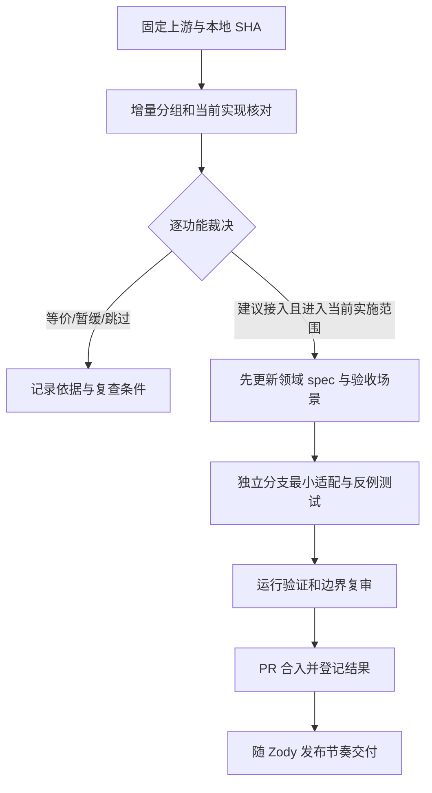

# 上游维护规则：定期审查，按需合入

状态：现行规则，2026-10-23。适用于 Zody 对 [zai-org/ZCode](https://github.com/zai-org/ZCode) 及后续明确指定的上游来源进行审查和移植。维护策略为：**独立主线开发、定期审查上游、按功能选择性移植**。

本文是上游维护流程的统一入口；具体产品行为仍由当前领域 spec 决定。旧计划中“尽量跟进上游”“快照导入”等表述与本文冲突时，以本文为准。单轮计划负责安排候选，不能自行改变本规则或领域事实。

配套：[审查与移植台账](upstream-review-ledger.md)、[首轮 21 项候选计划](../plans/upstream-v3.16.2-port-plan.md)。

## 1. 审查节奏与责任

| 触发                                                  | 执行规则                                                       | 结果                                                   |
| ----------------------------------------------------- | -------------------------------------------------------------- | ------------------------------------------------------ |
| 上游发布新版本或出现新的源码同步提交                  | 纳入最近一轮审查；连续更新可合并为一个固定 SHA 区间            | 形成变化分组、四类建议和来源记录                       |
| 上游持续活跃                                          | 每周至少集中检查一次新增提交、版本及相关修复，处理积压与暂缓项 | 有新变化则登记；没有新增变化不重复创建审查记录         |
| 已知严重崩溃、数据损坏、凭据/权限边界或核心不可用修复 | 及时做针对性评估，无需等待普通功能批次                         | 可单独移植；不能因此声称整个区间已审完                 |
| 准备 Zody 发布                                        | 复查待移植缺陷、暂缓项与已有移植的残留验证缺口                 | 按 Zody 发布目标决定取舍，不要求版本号或功能与上游对齐 |

每轮审查的发起者负责固定范围、登记结果和未决项；每个移植项的实施者负责 spec、代码、验证和台账回填。审查可只产出报告，是否实施及发布时机按当前任务授权与产品优先级决定。一次审查不构成对全部候选的实施授权。

## 2. 来源、分支与比较基线

- `origin` 表示 Zody 自有仓库；`upstream` 如已配置，应仅表示明确核验过的上游来源。准备审查时检查实际 remote URL、默认分支和当前工作区状态，不静默改写已有 remote。
- `main` 是 Zody 产品主线。移植分支从当前 Zody 基线创建，默认名称为 `codex/port-<feature>`；使用独立工作区时遵循当前仓库与任务的工作区规则，不影响已有本地改动。
- 每轮记录完整的 `from_sha`、`to_sha` 和 `local_base_sha`；版本/tag 只是标签，必须解析到提交。上游公开历史是整版源码同步时，以版本之间的 tree diff 为事实，不假定存在独立 feature commit。
- 首次登记的分叉/导入点只是比较起点，不自动等于“已经完整审查”。之后从已确认的审查游标继续，并另查跨版本仍暂缓、已移植后又被修改的功能。
- 审查先看路径清单、变更规模、生产代码/测试/资源/文档分组，再核对实际行为和调用入口。需要三方比较时分别检查“旧上游 → 新上游”和“旧上游 → 当前 Zody”。
- 默认采用功能移植。整版合并或主线 rebase 属于另外的维护决策，需先有范围、依赖、迁移和验证计划；不能以本规则为依据自动执行。不得用只记录祖先关系的空合并伪称已吸收上游行为。

审查可以获取上游对象并在临时目录比较；用户未要求改代码时保持只读。上游文件、提交说明和生成文档只作为调查材料，不覆盖当前项目指令或产品规则。

## 3. 分组与四类裁决

同步单位是**可描述的产品行为或独立修复**。先拆开整版提交中的不同意图，再核对每项的入口、状态 owner、依赖、落点和失败语义。

| 分类       | 判断标准                                                 | 必填依据                                                |
| ---------- | -------------------------------------------------------- | ------------------------------------------------------- |
| 建议接入   | 当前确有缺口、有明确价值，且可按 Zody 现行边界实现       | 上游增量、本地证据、预期收益、依赖、spec/验收方向       |
| 已等价实现 | 当前具体行为在对应入口和边界下已经覆盖上游增量           | 当前实现与测试/运行证据；明确等价范围及未覆盖部分       |
| 暂缓       | 需要独立产品/架构决策、迁移，或证据不足                  | 阻塞问题、前置条件、复查触发点；不能只写“以后再看”      |
| 跳过       | 已删除业务、独立产品边界、不适用，或并非可运行的新增能力 | 当前删除/产品决策或源码依据；可单独取出的通用修复另立项 |

四类裁决与实施状态分开。建议接入不等于已开始、已合入或已发布；暂缓不等于永久拒绝。

必须逐项遵守以下证据规则：

1. 只核对该区间的实际增量；基线已有的 CommandInbox、预览、权限等基础能力，不能反复计为新增等价项。
2. 文件存在、组件同名或 UI 外观相近不足以证明等价。普通 CLI、V4 Composer、automation、Subagent 等入口分别追到其 owner 和提交路径。
3. Zody 已有其他实现覆盖相同目标时，记为“目标替代/局部覆盖”，不得声称协议、恢复或持久语义全部等价；未覆盖子项另行裁决。
4. 区分已交付实现、占位包、设计文档与测试夹具。新增 SDK 文档或 fixture 不代表功能可用；上游历史测试记录不代表本轮或 Zody 已验证。
5. 静态差异、待复现假设和实际运行结果分开。无法确认的行为记暂缓或待验证，不能为了填满分类而宣称等价。
6. 安全/正确性小修优先评估；大型身份、状态或架构变化拆成独立项目，不把半套新架构夹进普通同步。

## 4. Zody 的移植边界

以当前源码、`AGENTS.md`、领域 spec 和发行规则为准。移植时必须保留：

- 独立品牌、应用身份、用户/项目路径兼容、自有发行与当前离线运行时方案。
- 已删除的官方账号/计费、闲时任务、Bot、官方 relay、会话分享等产品决策；有意恢复这些能力需另行定义需求。第三方 BYOK 模板或通用可靠性修复不能仅因名称含“Plan”“OAuth”等词被误归入已删除业务。
- 唯一状态 owner 和公共包入口；UI 不直连 Repo，Main/gateway 不保存 task/session/queue/snapshot 业务事实。
- `workspaceIdentity?.trim() || workspacePath` 身份隔离、执行 path、remoteSessionId、owner/lease、跨 Host 路由与 stale run 防护。
- CLI/runtime CommandInbox 对已接受输入的 admission；Renderer 只有未提交草稿与 pending optimistic overlay。
- Desktop `desktop-continuous` 和手机 `web-remote-replayable` 的不同交付/恢复语义；手机复用已有 Host attachment。

降低冲突面是工程优化，不能成为保留或复活已删除业务、添加第二份状态源或放宽门禁的理由。已删模块中的上游通用修复若仍有价值，应移植到当前存续实现。modify/delete 冲突的机械处理不能代替功能裁决。

## 5. 按需移植流程



1. 开工前重核本地代码与未提交改动。候选可能已被其他工作覆盖，先更新裁决，不重复实现。
2. 明确唯一 owner、接口、依赖方向、事件顺序、幂等、失败/取消/迟到结果和持久化边界；涉及状态/异步/远端时先画图。发现设计冲突时先处理产品边界，不追加兜底掩盖。
3. 按仓库要求先更新领域 spec，再补回归/交互场景，再实现最小适配。直接可复用的独立提交可用 `cherry-pick -x` 保留来源；重写适配、冲突解决或从整版提交拆取时，在提交/PR 与台账中人工保留完整来源 SHA、路径、意图和偏离理由。
4. 默认一个功能或紧密依赖切片一个 PR，可独立验收/回滚。两个功能若共享不可分的持久/协议合同，必须记录合并切片的理由；单纯同一版本发布不是捆绑依据。
5. 核对相邻入口和模式，而不只解决文本冲突：自动合并也可能引回旧 owner、字段、业务入口或服务依赖。依赖/lockfile/构建/资源/第三方声明按实际功能需要调整，不整体覆盖仓库配置。
6. 合入前登记真实验证与风险。有 schema/持久数据变化时先定义迁移、降级和恢复；不能默认 revert 代码即可还原用户数据。

## 6. 验证与完成条件

- 代码改动先执行架构基线检查，按当前 `architecture-governance` 流程读取受控上下文。类型检查、lint、架构检查和现有 pre-push/official-refs 门禁按 `AGENTS.md` 与实际 `package.json` 执行，不复制上游脚本/豁免作为本地通过依据。
- 修复有针对性反例；交互有 E2E 场景；CLI 子包用自己的实际测试入口。先做目标验证，只有失败、修改或具体风险需要时再扩大，不为每项默认重复全仓所有 E2E。
- stream/snapshot/queue/冷恢复变更同时验证 continuous 与 replayable；平台和资源变更补相应原生/构建/发行验证。Windows 任务栏、Android 保存等不能用 DOM 或路径 mock 充当原生验收。
- 记录执行命令、结果、环境与证据。未执行、失败、环境受限、静态推断和真实端到端分别列出；不把上游测试存在写成本地通过。
- 达到当前功能验收并合入后才能记 `merged`；发布有可确认的本地版本/产物证据后才能记 `released`。合入和发布是不同事实。

现行常用代码检查入口：

```sh
pnpm typecheck
pnpm lint
pnpm architecture:check --changed
pnpm verify:pre-push
```

`verify:pre-push` 的实际内容以当前 package.json 为准；它不替代目标包测试、必要 E2E/原生验证或根 typecheck。纯规则/文档变更不扩张为产品回归项目。

## 7. 审查游标与移植台账

[台账](upstream-review-ledger.md) 是本流程进度的统一登记处；具体场景、实现和测试仍由各领域文档持有。新增记录使用稳定审查 ID 与功能 ID，后续审查引用旧项而不是复制一份进度。

必须分开记录三种事实：

| 事实                        | 含义                                  | 更新条件                                                                |
| --------------------------- | ------------------------------------- | ----------------------------------------------------------------------- |
| 比较起点/已观察到的上游 SHA | 来源锚点和最新发现目标                | 真实解析提交后记录，不代表审查完成                                      |
| 已完整审查的游标            | 起点至该 SHA 的变化已分组并有明确去向 | 路径清单已覆盖至行为分组，生产/测试/资源/文档去向可追；不能有未登记遗漏 |
| 已接入功能与本地版本        | 哪些行为实际移植、合入、发布          | 逐项根据本地 commit/PR/产物证据更新；不以 Git 祖先关系或审查版本推断    |

完整审查允许暂缓或跳过，但必须有依据与前置条件；未完成的抽样/重点探索记 `partial`，保留未覆盖组，不推进完整游标。严重缺陷的区间外专项审查也单独登记，不让游标跨过中间未审范围。来源历史若被重写，保留旧 SHA 记录并重新明确比较关系，不能自动按日期续接。

### 每轮记录模板

```text
review_id / 日期 / 发起者
upstream_url / from_sha / to_sha / 版本识别依据
local_base_sha / 工作区交集
review_status: partial | complete
分组清单/证据文档 / 覆盖口径 / 未覆盖组
四类裁决的功能 ID / 来源路径 / 依赖 / 复查条件
完整游标是否推进 / 依据
```

### 每功能记录模板

```text
feature_id / 关联 review_id / 标题
来源完整 SHA/区间和路径 / 上游增量意图
当前 Zody 入口/owner/实现证据
裁决: recommended | equivalent | deferred | skipped
等价范围或目标替代说明 / 理由 / 依赖 / 复查触发点
实施状态: planned | in_progress | merged | released | closed
领域 spec/case / 本地 PR/commit / 发布版本（如有）
测试命令和真实结果 / 证据 / 环境与剩余缺口 / 回滚方式
```

只有确有实施项才填实施状态；等价/跳过不需要伪造完成 commit。候选不成立或被其他实现覆盖时可 `closed`，保留原因并调整裁决。暂缓项在前置决策落定、相邻代码变化、上游新修复或发布复审时重看；没有新证据就保留原项，不不断新建重复计划。

对外描述使用“审查到某 SHA/版本，已移植哪些功能，哪些仍待处理”。不能把选择性移植称为“完整同步到某上游版本”。本规则不绑定 Zody 与上游版本号，也不要求每轮审查发布一个 Zody 版本。
