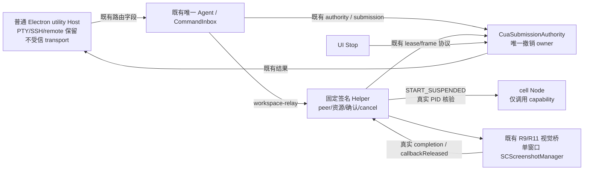
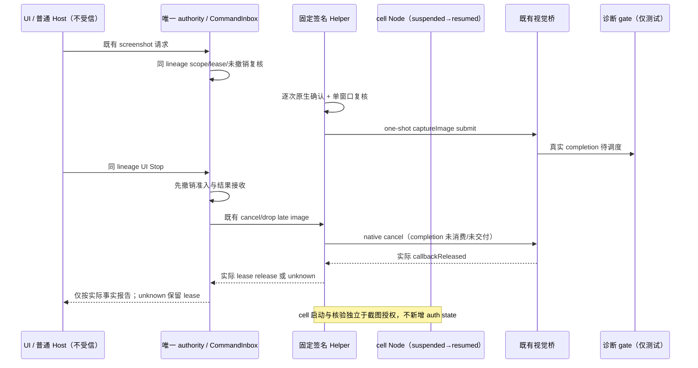

# macOS Computer Use Phase 1：arm64/macOS 窄截图 self-use 默认启用实施计划

2026-10-31。状态：本轮已批准的 arm64/macOS 窄范围完成；真实单窗口 PNG、actual OS completion-held 的同 lineage UI Stop、held completion discard、cell reap 与 lease release 均有实际证据。整体 Phase 1 仍 BLOCKED，产品尚未完整接受；本轮用户授权只把该已实测窄截图链作为 self-use 默认路径，普通 darwin/arm64 构建无需 opt-in env 或额外 demo 命令即选择固定 manifest/startup profile 与 presigned `cua-narrow` 资源。此前默认关闭约束仅在本窄功能内被取代；`zcodeCuaPlaceholder` 不得仅靠元数据翻转，实际 Host define/resource assembly 才是启用开关。本计划只服务于用户已对齐的窄方案，不扩大首期能力，不把开发候选、模拟测试或旧证据当作完整通过。

## 基线与只读材料

- 仓库：`/Users/zhvala/SourceCode/zody`，Node 固定 `24.14.0`。controller 已用指定 Node 实跑带 fetch 的 freshness 检查并通过：相对 `origin/main` ahead 32 / behind 0。该基线记录不是产品结论。
- 只读参考：`specs/computer-use-macos-phase1.md`、`docs/plans/computer-use-macos-phase1-closeout.md`、`packages/desktop/native/macos-cua-driver-closure/reports/2026-10-30-closeout/ACCEPTANCE.md`。
- 只读冻结：R11 源码/构建/验收，以及 `output/cua-helper-round11/`、`output/cua-phase1-closeout/`、`reports/2026-10-30-closeout/` 和既有 launchservices/desktop-session 产物。不得改写旧输出、旧报告、旧冻结源或旧结论。
- 本轮派生源码 patch、构建与运行输出：`output/cua-arm64-screenshot/`；产品阶段新产物：`output/cua-arm64-screenshot-product/`，旧 output/reports 只读。Stop 验收证据：`output/cua-arm64-screenshot-stop-2026-10-31/`；归档：`packages/desktop/native/macos-cua-driver-closure/reports/2026-10-31-arm64-screenshot-stop/`。
- worker ID 由 controller 另行登记；本文件不记录、不推定。

## 2026-10-31 状态账本

实现已落盘；以下仅记录执行层次，不构成整体产品验收或 blocker 关闭。详细链接见 [spec 状态账本](../../specs/computer-use-macos-phase1.md)。

- **编译/链接**：生产与诊断 visual 各自编译/Rust 46 项完成；fake-visual native harness 6 场景为模拟；新生产 Helper 编译/链接 10 个 native 程序完成，诊断复用同一 native source；生产/诊断签名与真实 prepare-narrow 资源校验完成；最新 production-audit 与 diagnostic-audit build input 独立 hash 核对为 2091 个 workspace input 引用、916 distinct、0 mismatch，7 个 virtual esbuild define 另行记账。日志：[helper-production.log](../../output/cua-arm64-screenshot/independent-checks/helper-production.log)、[visual-production.log](../../output/cua-arm64-screenshot/independent-checks/visual-production.log)。
- **模拟/单元**：Root 独立最终 Host 130、cell 66、narrow Node 35、Stop 15 项通过；CLI `node:test` 与 shared auth 早期通过；根 typecheck、lint 301 warnings/0 errors、architecture 0 violations；`desktop/services/zcode-cli` policy 为 `managed:false`，故 architecture 0 不证明 unmanaged runtime 边界，root diff review 另行记录。日志：[host-tests-final.log](../../output/cua-arm64-screenshot/independent-checks/host-tests-final.log)、[cell-tests-final.log](../../output/cua-arm64-screenshot/independent-checks/cell-tests-final.log)、[lint-final.log](../../output/cua-arm64-screenshot/independent-checks/lint-final.log)。
- **实际原生**：measured platform 为实际 arm64 macOS 26.6.2（build 25G83）、Node 24.14.0；suspended signedNode 前置 probe 正例与 **unsigned 映像**负例已独立实测；diagnostic-audit cell `990` 于 12:21:33.717 suspended、12:21:33.730 loaded verified 后才 resume（source 3,575,522 bytes）；独立 `SecCodeCopyGuest` 严格 fixed leaf DR/CDHash `3c57a9bb…`、flags 65536、空 entitlements 通过；最新 diagnostic Helper/Node strict `codesign` pass 的 hashes 保持 `4b3156…`/`14931e…` 不变。错 certificate、错 DR、非空 entitlements 以及 ready/socket fake endpoint/rebind/replay 负例仍未分别覆盖。attempt #1 native confirmation 120s timeout、cell SIGKILL/reaped，无 actual OS completion/UIStop。日志：[suspended-node-positive.log](../../output/cua-arm64-screenshot/independent-checks/suspended-node-positive.log)、[suspended-node-negative.log](../../output/cua-arm64-screenshot/independent-checks/suspended-node-negative.log)、[diagnostic-cell-independent-loaded-identity.json](../../output/cua-arm64-screenshot-product/diagnostic-cell-independent-loaded-identity.json)、[diagnostic-attempt1-native-events.log](../../output/cua-arm64-screenshot-product/diagnostic-attempt1-native-events.log)。
- **Stop/在途**：2026-10-31 live retry 的 main `99745`、Host `264`、Helper `350`、signed CLI `360` 与 fresh TextEdit PID `40077`/window `89384` 对齐；cell `19065` suspended→loaded verify→resume，source `3,575,522` bytes。generation 2 于 `12:49:32.118` 获用户批准，`32.175` lease acquired，`32.565` submit-return `targetMatches=true`，`32.622` actual completion-held `hasImage=true`/`captureError=false`。UI Stop 约 `39.5`；readonly ledger `39.554` completed/`cancelled_by_user=1`/`duration=37,942 ms`，CLI `39.560 TOOL_CANCELLED`；cell `39.576` SIGKILL/reaped，gate `39.639` `completionConsumed=false`/`heldCompletionDiscarded=true`，lease `39.694` released，capture-rejected `capture-canceled`；无 capture-delivered/gate-timeout。独立同 inode `149745182` flock 于 `45.398` acquired+unlocked 时 Helper `350` 仍存活。**本轮批准窄范围 PASS**；tool cancel 先于 cleanup，因此不声明 instant stop/nativeFence/hardSLA/all-descendants。无独立 actual `callbackReleased` receipt；仅记录源码审计的 release/destroy guard 与观测 lease/gate discard，owner revoke-before-abort 也只作代码审计排序。日志：[Stop ACCEPTANCE](../../packages/desktop/native/macos-cua-driver-closure/reports/2026-10-31-arm64-screenshot-stop/ACCEPTANCE.md)、[acceptance-facts](../../output/cua-arm64-screenshot-stop-2026-10-31/live-evidence/acceptance-facts.json)、[lease held](../../output/cua-arm64-screenshot-stop-2026-10-31/live-evidence/lease-held-before-stop.json)、[lease after](../../output/cua-arm64-screenshot-stop-2026-10-31/live-evidence/lease-after-stop.json)、[native/stop log](../../output/cua-arm64-screenshot-stop-2026-10-31/live-evidence/native-and-stop-events-final.log)。
- **产品**：此前 formal electron-builder `--dir` 与 narrow 资源装配 PASS（root pinned deps + recovered transient space；normal afterPack/afterSign 的 `assertPackagedCuaNarrowResource` livecodesign/tree/manifest exact 校验 PASS，child-audit ASAR statuses 0；outer Electron unsigned 为 test config，nested Helper/Node 仍为固定 local-selfsigned）。此前 2 次 large ASAR missing `.next` 原因未证，不声明 OOM/OS kill；低磁盘重试失败，最终 PASS 处于 diagnostic observation。2026-10-31 cleanup 后 63GB free、Mac unlocked；identity 修复后的产品候选已完成系统启动：main `79594`、Host `80007`、Helper `80104`、Node `80108`，启动快照匹配 `DeepSeek/deepseek-flash`、reasoning `max`；UI 实测得到单窗口 PNG `1172x976`、`108925` bytes、SHA-256 `e1bca9e1d32237e21bb07ad1e8655268fbab04557d87d330c14112ed062d523e`。该 PNG 来自先前 `controller-normal-host-production`，仍是独立的真实证据；最新 `controller-normal-host-production-audit` 以 production manifest 重建 PASS `30.511s`，但未启动、无新截图，仅构成 build/log 增量。首次候选 PID 49687 的 SIGTRAP 已定位为 unified log `electron_main_delegate_mac.mm:65 Unable to find helper app`，对应四个 Chromium Helper 名称未随父 identity 重命名；ASAR whole-archive/raw-header 与 afterPack stale hash 是另立的 packaging defect，candidate `fuse4EnableEmbeddedAsarIntegrityValidation` 实测 ASCII `48`（false），不归因于本次 SIGTRAP，也不改 fuse。native audit 已完成（2 文件 150 项：84 parser + 66 ProcessManager），audit 后根 typecheck、lint 301 warnings/0 errors、architecture 0 violations 通过。diagnostic-audit build `39.925s`，PIDs main `99745`、Host `264`、Helper `350`、signed CLI `360`；该当前同一 Host 的新 source 实际 run 已完成本轮 Stop 验收。W4 生产截图正例与 W5 completion-held Stop 正例均已成立；attempt #1 timeout 仍为历史 NOT PASS。日志：[formal-pack-child-audit.json](../../output/cua-arm64-screenshot/independent-checks/formal-pack-child-audit.json)、[formal-pack-child-audit.log](../../output/cua-arm64-screenshot/independent-checks/formal-pack-child-audit.log)、[native-audit-independent-tests.log](../../output/cua-arm64-screenshot-product/independent-checks/native-audit-independent-tests.log)、[产品阶段输出](../../output/cua-arm64-screenshot-product/)。

- **冻结/检查**：root 上一轮 177 项测试、typecheck、lint 301 warnings/0 errors、architecture 0 violations 通过，本轮未重跑；文档修改前 4275 个 source 文件匹配清单 SHA-256 `98a35c35cbd050e7c7d778720777d5a017965b6eabc153d0f78e8400b0868c4d`。最终 diff、source freeze 与证据归档由 root 在 status-doc 更新后完成。

Native cell 上限沿用既有 30 分钟 MCP max；actual per-tool 默认 600 秒与 `AbortSignal` 不变。

## 已对齐方案

保留普通、完整的 Electron utility Host 及其 PTY/SSH/remote。当构建期选中的 profile（darwin/arm64 默认 pinned profile，或显式 `explicit build profile` 覆盖）与 Agent 启动实际配置严格匹配时，将既有唯一 Agent 经现有 Helper `workspace-relay` 路由到 signedNode sealedCLI；复用既有 `CommandInbox`、`CuaSubmissionAuthority`、authority/lease/frame 与 Stop。profile 固定实验本地 workspace allowlist、已测 arm64/macOS 与 native 资源 hash，并须由 Host 既有 service 重读启动默认 selection、`providerRevisionSha256` 与 normalized `proxy`/`noProxy`/`CA` path digest 后严格比较。`providerRevisionSha256` 由既有 `ProviderSettingsView` 的公开非秘密 provider/model transport 事实规范化计算，不含 credential/header；Provider Registry numeric revision 是 process-local，不能跨启动 pin。profile 只保存该 digest 与默认 selection，不归档整份 provider 配置或内部 baseUrl；network digest 只证明 proxy/noProxy/CA path 配置相等，不证明 CA 文件内容 pin 或全面 proxy/custom CA。任一不匹配/读取失败时 Agent 启动 resolver 返回 `null`，保留 ordinary Agent 且 CUA 不可用。检查只在新的 Agent spawn 选择路径；已运行 Agent 不按 task 切换，不新增 task-time provider guard、UI 限制或自动 kill/restart。不满足 profile 的运行时构建继续走普通 Agent，不存在按 task 静默切换。

正式 electron-builder 资源链必须同时复制 Helper.app 与经 `validateNarrowManifest` 验证的原 `manifest.json` 精确 bytes 到 `Resources/cua-narrow/manifest.json`，afterPack/afterSign 复核摘要；darwin/arm64 默认装配 pinned 资源，非目标构建不装配；pinned 资源缺失、无效或摘要不符必须显式构建失败，临时 launcher SHA 生成的 pass manifest 不能替代正式验证。普通 Host 窄候选使用独立 `CFBundleIdentifier`、显示名和 Electron profile（system entry 不激活安装版），仅作 UI identity build-time seam；不设置 `candidateNativeHostLaunch`，不变固定受信 CUA Helper/Node 身份及既有 CLI store/authority，不加用户交互，`productDefaultDisabled=true` 与 `explicitCandidateOptIn=true` 分开记账，Hostworker 只做必要真实接线修复且不新增进程结构。

**候选 UI identity / Chromium Helper 重命名合同（2026-10-31 补充）。** candidate UI identity 变更必须在构建期一致重命名**既有** Chromium `Helper.app` 及其全部现有 variant 的 bundle、可执行文件与 `CFBundleExecutable`，使名称与父 app 的期望 parent name 一致。不得为此新增 helper 进程、launcher 或 wrapper，完整 ordinary Host topology 不变；固定受信 CUA Helper 与 Node 的既有 bytes/identity 不变。回归须验证：重命名后所有既有 helper 均能解析，framework 相对链接保持，native Helper identity 不变。该合同只修复候选 UI identity 装配，不改变运行时授权、进程结构或 CUA 能力。

普通 Host 仍是不受信 transport。`hostInstanceId`/`runtimeInstanceId` 只用于路由与关联，`intent.inputOrigin` 连接分类不能抵御被篡改的 Host。实际截图依赖既有逐次原生确认；该 Host 来源可信性缺口明确保留，不得以签名 Node、Helper peer 校验或来源分类宣称关闭。

**原生审计可观测性（2026-10-31 补充）。** 产品 Host 只在 `effectiveCommand.nativeLauncher` 实际成立时，把严格匹配现有 native source schema 的 `[cua-native]` 审计 marker 以 `info` 转发到既有 Host 日志；普通 CLI 与任意 raw stderr 仍仅 debug。拒绝未知 marker、额外字段、控制字符、畸形 JSON 和超长行，并从校验字段重建规范行。允许集合为 confirmation、cell、machine lease、capture、以及 stop-diagnostic 的 visual gate marker；`capture-resource-release` 当前不存在。该日志只提供运营证据关联，不证明身份/授权，Host 来源可信性缺口继续保留；不新增授权状态、进程/runtime、协议、UI 或签名路径。

sealedCLI 固定 `--jitless`，保留既有 shims/network 适配及其模块、WASM、代理、自定义 CA 等局限；不增加 JIT/LV/entitlement，不声称完整 CLI 兼容。本轮只支持单窗口 screenshot，不新增截图 runtime，不发布完整 CUA API。

## 所有权与请求时序

## 实施顺序

文档先于行为实现；每个工作流先补对应测试并记录 red/green，再实现。不得先写成功 stub、后补测试，也不得以模拟测试代替真实原生调用。

| 顺序 | 工作流                           | 先行测试                                                                                                                                                                                                                                                        | 实现/交付                                                                                                                                                                                                                                                                                                                                                                            | 完成边界                                                                                                                                                                                                                                                                                              |
| ---- | -------------------------------- | --------------------------------------------------------------------------------------------------------------------------------------------------------------------------------------------------------------------------------------------------------------- | ------------------------------------------------------------------------------------------------------------------------------------------------------------------------------------------------------------------------------------------------------------------------------------------------------------------------------------------------------------------------------------ | ----------------------------------------------------------------------------------------------------------------------------------------------------------------------------------------------------------------------------------------------------------------------------------------------------- |
| W0   | 规格与计划                       | 文档审查                                                                                                                                                                                                                                                        | 本文件与 spec 顶部章节                                                                                                                                                                                                                                                                                                                                                               | 仅文档，不宣称能力                                                                                                                                                                                                                                                                                    |
| W1   | 构建 profile 与 Agent 启动门     | darwin/arm64 默认构建选中 pinned 候选，非目标无候选；profile 限定实验本地 workspace allowlist、已测 arm64/macOS、native 资源 hash；启动默认 selection、`providerRevisionSha256`、normalized proxy/noProxy/CA path digest 不匹配/读取失败时 resolver 返回 `null` | 新 Agent spawn 时由 Host 既有 service 重读；digest 来自 `ProviderSettingsView` 公开非秘密 transport 事实，不含 credential/header；numeric revision 不跨启动 pin；不归档完整 provider 配置/内部 baseUrl                                                                                                                                                                               | 仅 spawn 选择路径；网络 digest 不证明 CA 内容 pin/全面 proxy；已运行 Agent 不按 task 切换，不自动 kill/restart，不加 UI 限制                                                                                                                                                                          |
| W2   | 普通 Host 路由                   | 普通路径 PTY/SSH/remote 回归；remote 与不满足 eligibility 时 CUA 不可用                                                                                                                                                                                         | 既有唯一 Agent 经 Helper `workspace-relay` 到 sealedCLI，保留单一 runtime                                                                                                                                                                                                                                                                                                            | 不替换普通 Host，不新增队列/Agent/授权                                                                                                                                                                                                                                                                |
| W3   | seal/CLI、cell 与 authority 启动 | 真实 `START_SUSPENDED` Node 正负例；错误 DR/CDHash/非空 entitlement 不执行、不投递、不释放 capability；同 UID fake cell/authority endpoint/rebind、错误/缺失/重放/跨角色 proof fail closed                                                                      | Helper `posix_spawn`、实际 PID 核验、resume/kill+reap；Helper 读取 pinned sealed server；`cell.sock` 与 capture authority socket 都做 `transportAuthenticationKey` 握手；仅 Helper proof，canonical `helper-proof` MAC、冻结 `role='cell'`/`role='authority'`、64hex challenge/sourceSha、decimal bounds；CLI `timingSafeEqual` 后才行；authority 握手后才进入原 `AuthorityFdReader` | 不新增进程/UI；suspended signedNode 前置 probe 正负例已独立实测；diagnostic-audit cell `990` 已有 suspended→loaded verified→resume 正例与直接 OS 身份 probe；错 certificate/DR/非空 entitlement 与 fake endpoint/rebind/replay 负例尚未分别覆盖；失败即阻断                                           |
| W4   | 单窗口截图与交付                 | 同一 lineage scope、真实单窗口、交付前复核、迟到结果拒绝；`captureCuaRuntimeOnce` 先固定本轮 turn scope 再 await connect，proof 失败关闭 scope，await 后不换绑；原 authority 协议字节无损                                                                       | 复用 R9/R11 视觉桥与既有 frame/lease owner                                                                                                                                                                                                                                                                                                                                           | 不新增截图 runtime；Host 来源仍不可信，仅逐次原生确认；产品生产单窗口 PNG 正例已成立                                                                                                                                                                                                                  |
| W5   | Stop 与在途验收                  | Stop 在未 admission、未 submit、completion 未消费/未交付、已交付等所有阶段都可 cancel/requestStop；在途验收仅在 completion 未消费/未交付时计数；实际 callbackReleased + lease release；unknown 保留 lease                                                       | authority 先撤销并关闭准入/结果接收，再 cancel/drop；诊断 gate 仅调度真实 completion                                                                                                                                                                                                                                                                                                 | Stop 功能不得受验收时点限制；本轮实际 completion-held UI Stop 已 PASS，但 tool cancel 先于 cleanup，故不声明 instant/nativeFence/hardSLA/all-descendants；attempt #1 timeout 仍 NOT PASS；无独立 actual callback receipt；不以交付后取消、pre-admission gate、不同 lineage 或 UI cancel 代替在途 Stop |
| W6   | 分层验证与归档                   | 根 typecheck/lint/architecture；必要 Host/CLI/CUA/原生测试                                                                                                                                                                                                      | 独立归档源码、派生 patch、构建、签名、命令输出与实测证据                                                                                                                                                                                                                                                                                                                             | 编译/链接、模拟、真实原生、产品分账，不互相替代                                                                                                                                                                                                                                                       |

**构建证据输入合同（2026-10-31 补充）。** 独立编译已见三组 compile PASS 但 evidence writer ENOENT；esbuild virtual `<define:NAME>` 是生成表达式而非磁盘路径。writer 必须固定 virtual input 的 name、精确 expression SHA-256、byte count，不转储原始配置/secret；filesystem input 仍按源文件 SHA-256，unknown/unresolved virtual 一律 fail closed。该修复不改变进程、UX、授权或验证矩阵；Host worker 在 spec 落盘后实施并通知 controller。

**ASAR integrity 装配合同（2026-10-31 产品阶段补充）。** 产品阶段首次系统启动 PID 49687 无 UI SIGTRAP；不得宣称 header metadata defect 是本次崩溃的根因。candidate 的 `fuse4EnableEmbeddedAsarIntegrityValidation` 实际读取为 ASCII `48`（false），保持 vanilla 未改，因此当前终止不能归因于 header 校验；实际 fatal 已在状态账本按 unified logs 记录，独立 launch 仍需复验。已确认的 packaging defect 是 candidate `Info.plist` 的 `ElectronAsarIntegrity` 使用了 WHOLE archive hash `4c73cb…`，而 raw header hash 为 `153d9c…`；上一轮 app 嵌入 `772740…`、当前 FINAL header 为 `fffcb7…`，差异来自 afterPack repack/sourcemap rewrite。官方 Electron ASAR integrity 文档与已安装 `app-builder-lib/out/asar/integrity.js` 的 `hashHeader` 均要求 raw header UTF-8 bytes 的 exact SHA-256。

合同：archive full SHA-256 与 header integrity hash 分账记录，禁止互相替代；`Info.plist` 的 integrity 值必须在 FINAL ASAR rewrite 之后、签名之前刷新；candidate 与 formal Darwin 构建路径必须由同一个 packager owner 执行同一刷新；不得修改 fuses/LV、Helper/Node 签名或既有身份，candidate fuse4 保持实测 ASCII `48`（false）的 vanilla 状态；unknown、missing ASAR 或 invalid header 一律 fail closed。该 metadata 格式与刷新修复仍然有效且必要，但当前 fuse 未启用，不能据此声称 header 校验导致本次崩溃。窄回归场景只覆盖：FINAL rewrite 后 header SHA-256 与 `Info.plist` 相等且 archive full SHA 单独记录；模拟 rewrite 后 header 变化时 stale `Info.plist` 被拒绝；candidate 与 formal Darwin 路径都由同一 owner 刷新；missing/invalid/unknown 全部 fail closed。该合同不改变进程、UX、授权，不新增平台/功能验证矩阵。

## 最小验收场景

只执行并记录以下场景，不增加矩阵。

1. **普通 Host**：完整 Electron utility Host 的 PTY/SSH/remote 保留；非 darwin/arm64 构建不选择窄 profile/resource，CUA 不可用。
2. **默认启用生效**：普通 darwin/arm64 构建无 opt-in env、无额外 demo 命令，默认使用固定已测 manifest `output/cua-arm64-screenshot/controller-prepared-production/manifest.json`、measured startup snapshot `output/cua-arm64-screenshot-product/startup-snapshot-production.json` 与 repo allowlist；profile 与启动实际配置全部匹配时，既有唯一 Agent 经 Helper `workspace-relay` → signedNode sealedCLI，复用既有 `CommandInbox`/authority/lease/frame，单窗口截图链可用。
3. **回退与构建失败**：profile 任一字段不匹配/读取失败、OS/arch/repo/startup 不匹配及 remote workspace 均使 resolver 返回 `null`、保留普通 Agent 且 CUA 不可用；不出现按 task 静默切换或自动 kill/restart。默认目标缺失或无效必要资源必须显式构建失败，不得静默宣称已启用；逐次 native confirmation 与 UI Stop 不变。
4. **suspended Node 正例**：前置 probe 已在本机 macOS 26.6.2 arm64 独立实测：真实 signedNode `SSTOP` → 核验实际 CDHash/DR/空 entitlements → `SIGCONT` → stdout `42` → `exit 0`/reap；日志为 `output/cua-arm64-screenshot/independent-checks/suspended-node-positive.log`。diagnostic-audit cell `990` 也已在 `SSTOP` 下完成 loaded verify 后才 resume，独立 `SecCodeCopyGuest` 的 fixed leaf DR/CDHash/flags/空 entitlements 通过；该正例不替代 W3 全部 ready/socket 负例。
5. **suspended Node 负例**：前置 probe 只独立实测 **unsigned 映像** loaded-code-invalid：同样 `SSTOP`，不 `SIGCONT`、不发送 stdin，`SIGKILL`/reap，marker 不存在；日志为 `output/cua-arm64-screenshot/independent-checks/suspended-node-negative.log`。错 certificate、错 DR、非空 entitlements 均未分别测试，不列作已通过。ready/socket 负例须覆盖同 UID fake cell/authority endpoint/rebind、错误/缺失/重放/跨角色 proof；均不发送 `CellRequest`/cap、不建立 wire authority session/发送 scope/ref/capture，且 fail closed；这些负例当前仍未分别取得证据。authority 正例须验证先固定 turn scope、await 后不换绑、proof 后原协议字节完整进入 `AuthorityFdReader`。
6. **截图 + 在途 Stop**：产品生产 UI 已取得真实单窗口 PNG `1172x976`、`108925` bytes、SHA-256 `e1bca9e1…`，W4 截图正例成立；最新 production-audit 仅构建、未启动、无新截图。2026-10-31 live retry 的 same-lineage completion 在未消费/未交付时被真实 UI Stop：actual completion-held `hasImage=true`，ledger `TOOL_CANCELLED`、cell SIGKILL/reaped、gate `heldCompletionDiscarded=true`/`completionConsumed=false`、lease released、`capture-canceled`，无交付/timeout，W5 本轮窄范围 PASS。tool cancel 先于 cleanup，故不声明 instant/nativeFence/hardSLA/all-descendants；无独立 actual callback receipt，保留源码 guard 与观测分账。diagnostic attempt #1 与旧截图 timeout 仍为历史 NOT PASS。
7. **仓库与分层检查**：根 `pnpm typecheck`、`pnpm lint`（301 warnings/0 errors）、`pnpm architecture:check --changed`（0 violations）及必要相关测试已通过，native audit 独立 2 文件 150 项通过；编译/链接、模拟测试、真实原生调用、产品验收分别记账。

执行受阻、未运行或环境不满足时如实记录 blocked/not-run；不写通过结论。真实 `SCScreenshotManager` one-shot 的 in-flight 证据必须来自真实 OS completion 调度，诊断 gate 只能控制其调度，不得合成 frame、completion 或成功；生产默认无 gate。

## 保留缺口与阻断项

- **前置 probe、cell 与 Stop 正例已测；负例/整体 Phase 1 仍未完成**：controller 在本机 macOS 26.6.2 arm64 独立实测 suspended signedNode 正例（CDHash/DR/空 entitlements 后 `SIGCONT`、stdout `42`、exit 0/reap）与 **unsigned 映像** loaded-code-invalid 负例（无 `SIGCONT`/stdin、SIGKILL/reap、marker 不存在），日志在 `output/cua-arm64-screenshot/independent-checks/`。diagnostic-audit cell `990` 与 live Stop cell `19065` 的 native audit 均记录 suspended→loaded verified→resume；controller 直接 loaded OS probe 的对象为 `990`，该独立探针通过，不混记为 `19065` 的探针；该正例不替代 W3 全部 ready/socket 认证。错 certificate、错 DR、非空 entitlements 与 fake endpoint/rebind/replay 负例仍未分别覆盖，不扩大列作已通过。W4 生产截图与 W5 completion-held Stop 的本轮窄范围正例已成立；attempt #1 timeout 不是 Stop。整体 Phase 1 与 full Phase 1 缺口仍 BLOCKED；self-use 默认启用仅限本文件声明的 darwin/arm64、macOS 26.6.2、固定 workspace/provider/network 与预签名资源。若无法稳定保持基础正负例区分，必须阻断，不得降级为 spawn 后检查或路径/普通 `codesign` 检查。
- 普通 Host 来源可信性缺口保留；不新增可抵御恶意 Host 的声明或代码路径。
- live task 配置兼容缺口保留：Host 启动时没有 task actual model，不能证明后续 task override、模型或 provider 配置变化兼容；独立验收只覆盖固定已测模型配置，用户自行切换模型不算验收。完整 CLI 兼容缺口继续保留。
- sealedCLI 的 `--jitless`、shims 与网络适配局限保留；不宣称完整 CLI 兼容，不增加 JIT/LV/TCC entitlement。
- 不宣称 `SCStream`（当前无）、OS 内部取消、nativeFenced、所有后代退出或 Stop 硬 SLA。
- 完整 D06/OS 隔离、输入 native Fenced、6 项 JS 许可 missing、Intel/最低 macOS 实机、升级后的身份/TCC 稳定性继续未验收，不因本轮扩大或关闭。
- 不得修改 R11/旧 output/旧报告，不得以旧截图、旧独立 Stop 或不同 lineage 证据替代本轮真实在途 Stop。

## 归档要求

`output/cua-arm64-screenshot/` 至少分开保存 opening/source 摘要、相对基线 patch、构建输入与签名/资源摘要、编译链接日志、模拟/单元测试结果、真实 suspended Node 正负例、ready/socket fake endpoint/rebind 与 replay 负例、真实单窗口截图与同 lineage 在途 Stop 证据；产品阶段新产物单独写入 `output/cua-arm64-screenshot-product/`。构建输入须区分 filesystem 精确 source SHA-256 与 esbuild virtual `<define:NAME>` 的 name/expression SHA-256/byte count；不得归档原始配置或 secret，unknown/unresolved virtual fail closed。ASAR 证据须分开记录 archive full SHA-256 与 `Info.plist` header integrity hash，并注明 FINAL rewrite 后、签名前的刷新结果；不得用其中之一替代另一个。真实 256-bit key 不得写入日志或归档，只保存 redacted 结果与命令摘要。`reports/2026-10-31-arm64-screenshot-product/ACCEPTANCE.md` 只汇总实际执行与保留阻断，明确区分编译/链接、模拟、真实原生调用和产品验收；未执行项不得留白或写成通过。

## 2026-10-31 App 内确认弹窗轮次（in-app confirm）

本轮把每次截图前 Helper 原生 NSAlert 逐次确认替换为 Zody App 内确认弹窗（用户已批准）。唯一规则来源是 [spec 顶部章节「2026-10-31 App 内确认弹窗替代 Helper 原生 NSAlert（用户已批准）」](../../specs/computer-use-macos-phase1.md)（wire 契约、CLI/Native/UI 合同、失效与幂等、构建与 pin、边界保留）；本节只登记工作流与最小验收，不另立规则。规格先行、测试先于实现：每个工作流先补对应测试并记录 red/green，再实现，不得先写成功 stub、后补测试。本轮不扩大 Phase 1 门槛：eligibility/profile/placeholder、CUA 工具集与验证矩阵均不变，普通 Host 来源可信性、完整 CLI 兼容等既有缺口全部保留。

| 工作流   | 范围                                                                                                                                                       | 先行测试                                                                                                                                                                                                  | 实现                                                                                                                                                                                                                  | 完成边界                                                                                                                                              |
| -------- | ---------------------------------------------------------------------------------------------------------------------------------------------------------- | --------------------------------------------------------------------------------------------------------------------------------------------------------------------------------------------------------- | --------------------------------------------------------------------------------------------------------------------------------------------------------------------------------------------------------------------- | ----------------------------------------------------------------------------------------------------------------------------------------------------- |
| W-Docs   | 本文件与 spec 章节                                                                                                                                         | 文档审查                                                                                                                                                                                                  | spec 顶部新章节 + 本节                                                                                                                                                                                                | 仅文档，不宣称能力；不新增授权 owner、不改 Stop 语义、旧输出只读                                                                                      |
| W-Cli    | `apps/zcode-cli`、`packages/adapters` contract/protocol/session、bootstrap `cua-runtime-native-capture`/types/`create-app` 接线、core runtime 新方法与测试 | confirm 帧校验（未 bootstrap/invalidated/关联不匹配、generation 非正整数或重复→`confirmation-duplicate` 不二次弹窗）、runtime 方法 turn/run 不匹配 fail-closed、Stop/scope invalidation 的 abort 级联测试 | `CuaNativeAuthorityMethod` 增加 `"confirm"`；`captureCuaRuntimeOnce` 提供 confirmRequest 回调 → `requestCuaNativeCaptureConfirmation` → 既有 permissionBroker（user-once/high/`requestId="cua-confirm-"+generation`） | 不新增授权 owner、不产生持久 permission 规则；无 attached client/broker/校验失败一律 `ok:false` 不截图；不改 Stop 语义、旧输出只读                    |
| W-Native | `packages/desktop/native/macos-cua-desktop-session` confirmation/session_supervisor、`packages/services` cuaNativeAuditLog reason 枚举与测试               | ConfirmationState late/invalidate/dismissAll、重复与迟到决定、supervisor 250ms 片等循环 stop\_/EOF/revoked、`app-confirm-failed` marker 与 `fixed_capture_failure_reason` 归桶测试                        | `confirmation.{h,mm}` 移除 NSAlert/NSWindow/sheet，新增 `resolveFromApp(generation, allowed)`；supervisor 确认段改 confirm 帧片等循环；`confirmationReasonSchema` 同步新增 `app-confirm-failed`                       | 不新增进程/线程结构；check/lease/capture/交付复核不变，`kAuthorityIoTimeoutMs=10s` 仍仅 bootstrap/check；不新增授权 owner、不改 Stop 语义、旧输出只读 |
| W-Ui     | `packages/ui` PermissionDialog 展示/i18n 与测试                                                                                                            | 恰两动作、Esc/关闭=拒绝、target 身份展示与桌面/移动布局测试                                                                                                                                               | target 应用/窗口身份（ownerName/windowName/pid/windowId）展示 + 新 i18n 文案键，复用既有 pending interaction kind permission 与主题                                                                                   | 不新增授权状态、store 字段或新协议事件类型；不新增授权 owner、不改 Stop 语义、旧输出只读                                                              |
| W-Build  | 原生重建、prepare-narrow 到 `output/cua-inapp-confirm/`、`macos-cua-demo-defaults.mjs` pin 与测试更新                                                      | pin/manifest 校验与旧目录只读测试                                                                                                                                                                         | 现有冻结工具链 + local-self-signed 身份重建 Helper；`manifestRelativePath`/`manifestSha256` pin 及对应测试更新；报告写入 `packages/desktop/native/macos-cua-driver-closure/reports/2026-10-31-inapp-confirm/`         | startup snapshot 与 identity pins 不变；不新增授权 owner、不改 Stop 语义、旧输出/旧冻结/旧报告只读                                                    |

### 最小验收

以下即 spec「失效与幂等（验收测试必须覆盖）」六条加上仓库检查与 controller 独立实测的完整清单，不增加矩阵；执行受阻或未运行时如实记录，不写通过结论。

1. UI Stop/turn 取消：broker 请求 abort、弹窗关闭，authority 关闭，Helper invalidate，无截图。
2. 会话终止/断连/EOF：同上收口，迟到允许不得触发截图。
3. 关闭弹窗/取消 = 拒绝：`allowed:false`，Helper 拒绝本次。
4. 重复 confirm 帧（同 generation）→ `confirmation-duplicate`，不二次弹窗。
5. 迟到/失效后的允许（state machine late）→ 不截图。
6. App 允许后：既有 lease/check/交付复核与真实单窗口截图链不变。
7. 根 `pnpm typecheck`、`pnpm lint`、`pnpm architecture:check --changed` 与必要相关测试。
8. controller 独立实测两条：App 内允许 → 真实单窗口截图成功；弹窗等待时 UI Stop 取消。迟到确认拒绝由相关测试覆盖，不单列独立实测。

### 2026-10-31 策略修订（用户已批准）

用户修订了本轮的确认策略，取代此前「恰两动作、不记住」的过度约束：App 内截图确认改为遵循既有工具权限策略——「允许本次截图」（allow_once，保留专用文案）/「总是允许（项目级持久规则）」（allow_always，经既有 suggestedPermissionUpdates 应答链落项目规则）/「拒绝」（deny）；会话支持时提供 Full access（既有 grantPermissionFullAccess 链）。默认动作与 Esc 仍为拒绝。confirm 发起前先用 runtime 内既有 PermissionService 查项目 allow 规则与会话 full access，命中即免交互放行；规则查询异常按未命中处理，仍走用户交互。turn/run/trace 失配 fail-closed、abort 透传、时长与 Stop 语义、Helper 侧 check/lease/交付复核均不变，也不新增第二套规则存储或授权 owner。W-Cli/W-Ui 的先行测试与实现按该修订更新；上表「user-once」「恰两动作」描述以本条为准。
