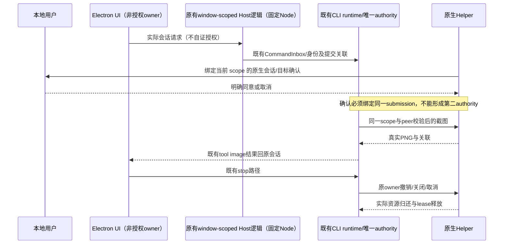

# macOS Computer Use 真实桌面会话接线

2026-10-30。状态：可信 Node/工具/原生确认接线及真实单窗口截图→原会话图片→UI Stop已验收通过（19:23—19:24）；产品激活仍受既有TCC归属等边界约束。默认禁用，旧归档与安装app保持不变。

## 已确认事实

- 前阶段组合候选的真实截图、现有owner撤销和机器lease释放已通过；Host/model输入仍是fixture。
- 当前Main用Electron `utilityProcess.fork` 建window-scoped Local Host（desktopHostProcess.ts:238）；Agent manager以`process.execPath + ELECTRON_RUN_AS_NODE=1`启动真实CLI（zcodeAgentProcessManager.ts:447）。
- 现有mac entitlements含关闭library validation和允许DYLD环境的选项，不能用作本轮验收。
- controller用已有Zody Local Computer Use证书独立签名：小型main/dylib和实际Electron main/Framework均strict verify通过；两组实际执行均SIGABRT（subprocess returncode -6），dyld显示`mapping process and mapped file (non-platform) have different Team IDs`。未安装证书，未改Keychain/TCC，未改原始Electron缓存或安装app；无DYLD覆盖或放宽权限。
- 同leaf证书不等于Apple Team ID；此限制与[Apple library validation文档](https://developer.apple.com/documentation/bundleresources/entitlements/com.apple.security.cs.disable-library-validation)一致。完整包签名不能消除该加载失败。

## 已批准边界

继续现有local-self-signed约束，保留已跑通的固定Node/原生Helper可信子链；Electron负责UI，不承担CUA授权来源证明。将需要信任的现有window-scoped Host与CLI运行逻辑改由固定Node+封装代码启动，保持既有Host/会话数量、identity、CommandInbox、CuaSubmissionAuthority、scope、stop链。实际依赖闭包必须在实施时编译运行确认，不能宣称现有fixture已验证全部Host。

Electron发来的desktop标志不足以证明本地用户同意。在原生Helper边界增加一次明确的会话/目标窗口确认；这不是新增system permission，亦不能取代原有authority。确认每次截图授权，不跨提交/目标复用；既有 candidate/turn scope 后确认，确认后和交付前重核同一 owner；remote/mobile身份仍由受信Host入口固定，确认不得重新标记来源。取消/到期/身份变化即拒绝。

## 实施拆分

1. 启动与资源：独立output开发包；固定Node可信启动现有Host/CLI，依赖实际封装、签名、peer与loaded code验证。不得改原应用或借env/path/FD建立信任。先解这一启动边界再做UI演示。
2. 运行时装配：从实际app取得scope接现有native authority adapter，保持唯一producer关联；真实Host输入来源不得fixture替代。测试先覆盖同一runtime的截图/停止/迟到结果拒绝。
3. 用户确认与图片：已批准的原生确认只绑定同一提交/目标，图片复用CallToolResult image→toMcpRunResult→node_repl_images回原会话；stop复用既有撤销链，只有真实归还证据才显示完成。
4. controller审查最终diff，执行根typecheck/lint/architecture、受影响测试，并仅做一个真实桌面截图停止流程。未接入前保持placeholder=true。

不创建一个已知无法启动的完整Electron严格LV开发包当“实施完成”，不加新的验证矩阵，不设Developer ID/公证迁移期限。

## 委派与证据

本轮routes实际为deepseek-flash / magpie / group/deepseek，已明确告知与前阶段模型标识不同；cwd为/Users/zhvala/SourceCode/zody，以下均read-only无UI grant：

- 接线调查：broker:deepseek-flash-ro-7e02c5e0e0181fbe:01a18b66-3888-7a93-88ed-83521ec35371。
- 打包调查：broker:deepseek-flash-ro-7e02c5e0e0181fbe:01a18b66-90d8-76c3-9635-7af2bc3d5bd5。

controller证据：output/cua-desktop-session/signing-probe/result.json、electron-load-probe/result.json；源码opening摘要和preimages已保存。用户已明确批准此进程结构及交互变更；实现 worker 与审查结果继续登记。

## 本次文件所有权与必要检查

- controller：spec、计划、验收与独立证据；先更新规则再派发。
- Host worker：desktop main/host 的 Node 传输/进程适配、services Agent command 装配及对应测试；不改 native、CLI 或文档。
- native worker：独立 `macos-cua-desktop-session` 原生候选、`cua-desktop-session-*` 构建工具及测试；原 R11 与 product-wiring 来源只读派生。负责原生确认、可信启动/资源边界，不改 Host/CLI。
- CLI worker：apps/zcode-cli 内真实 runtime 的显式 composition 与必要测试；不改 Host、native、root spec。与另两 worker 对齐协议后接线，不制造 fixture 授权。

接口未闭合前只能报告组件完成；完整 Host 闭包必须实际构建/启动，真实截图需用户在原生窗口作出本次确认。继续复用已批准的证书与 Helper TCC，不请求新权限、不修改全局工具链。

本次 workspace-write worker（均无 UI grant）：
- Host：`broker:deepseek-flash-rw-ec6bf2fd7be1a108:01a18b79-ddd4-7ac1-8175-fea629f41b57`。
- native：`broker:deepseek-flash-rw-ec6bf2fd7be1a108:01a18b7a-7ae3-7982-9592-bf4fdfb467d5`。
- CLI：`broker:deepseek-flash-rw-ec6bf2fd7be1a108:01a18b7a-f9b5-7c60-8ba8-6ad64c9ddd19`。

### 实施接口收口

原生 launcher 只接受签名资源中固定 entry 名称；Node stdin 用于已验证 sealed ESM，Host 桥使用独立 fd5，CLI 命令/响应使用 fd6/7，fd3 保留原生启动控制。FD 号或消息本身不是身份认证；每条 authority 连接仍检查本次真实 Node pid/audit token/固定代码身份。JS 内显式 composition 接收流，不从 UI/env JSON 注入可信配置。

一次 capture 使用独立 authority 连接并绑定原 scope；bootstrap 附精确 target pid/windowId，原生自行查询实际目标。正常截图不沿用旧诊断“截图后自动 revoke 再退出”的成功定义。native 必须在原 scope 仍有效时向 authority 提交 captureResult，JS 验证原绑定、PNG 字节/摘要及真实资源释放事实后，通过既有工具图片路径返回；取消/stop/EOF 先封闭，迟到结果丢弃。用户 stop 才复用原有撤销链，正常操作 close 不制造 owner-revoked。旧诊断源码保持只读，新行为以固定来源 patch 派生。

Host writer 所有权补充：`packages/desktop/src/common/nodeHostBridge*.ts` 共享传输合同；`packages/services/src/node.ts` 必要公开导出及现有工厂注入；`packages/desktop/tsup.config.ts` 新 Host entry 注册。无其他 writer 触及这些文件。原生结果固定为 `captureResult` 请求（完整绑定、target、png path/sha256/width/height/bytes、实际 resourcesReleased/machineLeaseReleased）；一连接一结果，32MiB 原始图上限，私有 captureRoot 直属 O_NOFOLLOW 普通同 uid 文件，读取前后重核原 scope。确认不在 turn_started 自动触发，仅明确截图调用触发；禁止伪造未执行的 node_repl 工具调用或直接写假工具图片进 transcript。

Host 接线补充：完整 InitLocal 必须通过现有 tasksStorageWorker 与 session prepare-storage 流程；资源位置通过 candidate 显式 DI，纳入 sealed 构建闭包。Host worker 负责接线和独立 UI 构建脚本，native worker 负责资源打包/校验；hello 后立即 Dispose 仅记为桥握手，不能记为完整 Host 初始化。

### 真实会话实测发现与收口

固定签名 Node 已通过真实 Host/Session 迁移、服务初始化与 Dispose；独立 Electron UI 通过 Main→可信 Host→真实 CLI 完成了实际模型回合。首次明确截图请求未执行：真实工具目录没有 node_repl，模型如实返回不可用。不能以已存在的 wrapper 或注入测试推定工具发现成功。修复仅在 native capture + 本地工厂的显式候选装配下注册工具，无需启用 CUA 插件或修改用户设置；显式 MCP disabled、普通启动继续不注册。补真实 createApp 无预设 server 的回归后，重新封装签名并执行同一单窗口截图/停止流程。

UI 构建补齐 Main eager 使用的 scheduler 资源，保持原业务；此前缺资源的 UI 已可完成上述回合，但最终运行使用完整候选布局。

实际封装复测补充：工具注册源码修复的10项检查通过，但 UI 第二次回合仍缺工具。controller 从本测试 session 的实际 model-io 只提取工具名，并核对 esbuild metafile：CLI 使用了1280个工作区 dist 输入，包括旧 create-app/protocol-entrypoint；Host 图无此问题。委派 native 构建 owner 修正公开包入口到当前源码的封装解析并拒绝旧 dist，CLI writer 只读协助；不重建/覆盖全局 dist，不改 registry。此失败单列保存，不能用源码测试掩盖。

### 本轮收口状态（2026-10-30）

最终候选为 `controller-build-capture-delivery` / `controller-signed-capture-delivery` / `controller-ui-capture-delivery`。controller 已修复审查中及实测中发现的工具注册、旧 dist 封装、确认窗口 ARC 释放、外层 MCP 超时合同缺失；由原有 app logger 记录经过 native ACK 和绑定复核的交付事实。最新相关CLI三套22 tests、构建工具11 tests、四个 native纯测试程序及root typecheck/lint/architecture通过，lint301warnings。旧native2079文件未变。

真实桌面最终调用已到原生确认，controller只批准模型工具的一次调用，没有代点native同意。原生确认窗口metadata已记录；120秒后内部工具超时，窗口关闭、Helper继续存活，没有截图交付事件或图片。用户随后回复已点击；该旧调用已经超时，后续新调用出现新的失败，见下节。后续只需本机用户准备好后重新发起同一单窗口流程，确认后检查真实PNG/同会话工具图，再点击Stop核对现有owner撤销；若出现新失败，再按实际证据修复，不增验收矩阵。

### 同会话重试的实际阻断

用户回复后，18:13重新发起同一目标调用；Helper的generation2记录明确`user-approved`，随后`capture-rejected:capture-failed`，工具2444ms返回`cua_native_capture_closed:eof`，原owner以`control-lost`撤销。不是未点确认，也不是Helper崩溃；Helper/Node继续存活。controller为收集既有stderrTail，随后明确SIGTERM结束失败Helper，此动作仅是诊断清理，不计作UI Stop验收。

现有固定错误映射把TCC/visual start/wait等原因合并为capture-failed，先由原native writer保留有限错误枚举，再定位并修复实际采集失败。旧来源与当前冻结candidate保留；新制品另建目录。系统TCC日志将该次请求的responsible/subject归于com.openai.codex，requesting才是Helper，因此本次不能证明最终Helper的独立TCC归属；不通过改权限掩盖这一差异。

诊断版本`capture-reason`已完整构建、签名并实跑；18:23新请求等待确认120秒超时，未再请求或代点同意。六入口JS实际inputs与原冻结候选完全相同；原生差异仅固定错误映射。根typecheck/architecture通过，归档副本lint问题经精确排除后重跑通过（301warnings/0errors）。新的实际失败阶段仍需一次及时的本机确认，不把旧回复复用到新generation。

### 19:17明确根因与修复范围

用户在场重试，原生generation2再次user-approved，精确失败为visual-start-denied。源码证据：accept_one_with_deadline强制新连接O_NONBLOCK；确认reader支持非阻塞，但交接后的冻结R11 AuthorityClient以阻塞recv逻辑读取，EAGAIN被当作关闭，触发首次checkpoint拒绝。native writer仅修desktop-session交接模式，保留旧R11只读，并以真实socket延迟响应/interrupt回归验证；不取消checkpoint，不放宽scope，不新增授权状态。

### 19:24本轮完成

DeepSeek完成FD读模式交接修复，controller独立重建签名并通过五个native测试及根typecheck/lint/architecture（301warnings/0errors）。最终`authority-fd`候选真实会话返回2400×1600 PNG，原会话工具图可打开且已独立下载目视验收；截图完成即确认资源与machine lease释放。随后真实UI Stop对同一lineage产生user-stop/revision2，并取消后续等待工具。单窗口截图/Stop流程通过；不把它扩大为native Fenced、输入屏障、Helper独立TCC或完整Phase1通过。证据见2026-10-30-desktop-session/ACCEPTANCE.md与evidence/authority-fd，旧冻结候选保留。
