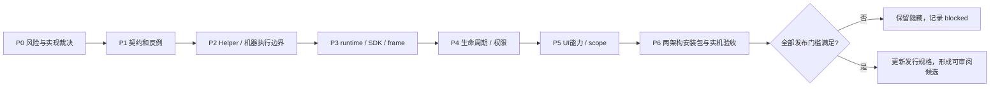

# macOS Computer Use 首期实施计划

2026-10-29 第十轮已完成本轮切片：真实peer身份诊断及既有runtime/control-only撤销生命周期通过独立验收，25文件249项自动化测试、根与CLI检查通过（根lint301项既有警告）；不变更第九轮冻结树、不新增授权owner，不把缺失的机器lease替换为布尔开关。默认禁用；见[第十轮计划](computer-use-macos-phase1-round10.md)。

2026-10-29 第九轮已完成本轮切片：收窄SCK Swift/AppleMetal/录屏源码闭包，实际图30→20；最终消费者编译/链接/纯启动、50项Rust纯测试、106项Driver工具测试及根检查通过。内部取消/桥资源归还不证明原生Fenced；真实Helper许可依旧缺证，公开路径保持HostNotApproved。见[第九轮计划](computer-use-macos-phase1-round9.md)。

2026-10-28 第八轮：独立视觉构建根分离窗口事实/单帧像素与宽平台依赖；观察结果不构成授权，缺少可信 Helper 许可的公开采集入口继续拒绝。新旧根显式比较，不声称 SDK 功能等价。见[第八轮计划与验收](computer-use-macos-phase1-round8.md)。

2026-10-28 第七轮按独立候选推进最小依赖裁剪，先断开默认 feature 回流与不需要的导出依赖，实际图/编译/许可分别验收；复杂原生模块不以 stub 替代，功能仍默认禁用，见[第七轮计划](computer-use-macos-phase1-round7.md)。

2026-10-28 第六轮的缓存、许可材料与工具链闭包见 [round6](computer-use-macos-phase1-round6.md)。功能保持默认禁用；不因审计/编译通过自动接通原生输入。

2026-10-27 第五轮范围与验收见 [round5](computer-use-macos-phase1-round5.md)：先推进 Driver 来源/patch/依赖/许可审计和 D06 剩余验证。完整闭包缺项、签名/系统权限依赖分别记录，不提前接通生产输入。

2026-10-27 第四轮的诊断 Helper 工程与 D06 验证见 [round4](computer-use-macos-phase1-round4.md)。本轮不接可执行生产链，默认禁用不变；诊断构建、OS 限制反例与正式签名/原生输入验收分别记账。

2026-10-26 第三轮增量接线与验收见 [round3](computer-use-macos-phase1-round3.md)。保持 local-self-signed、默认禁用；先验证可信身份/live admission 与私有 launcher，Helper/D06/真实 Fenced 单列依赖。

详细设计（2026-10-25）：[首期详细设计评审修订稿](../design/computer-use-macos-phase1.md)已形成模块所有者、私有协议、停止/退役/恢复时序，以及 D01–D07 决策和 C01–C13 验证交接。本次审查补充 cell 进程隔离、逐输入来源与用户提交撤销；D06 未关闭，不将这些目标视为已有能力。下一轮仍先在新独立目录验证调度失败后的退役回执、stop 的真实边界与机器恢复；产品 P1–P6 保持 planned，正式环境与真实输入不由本文档工作授权。

最新开发切片（2026-10-25）：[drag/stop watchdog 与创建预留 retire 容量](/Users/zhvala/SourceCode/scripts/experiments/zody-cua-p0-g2-stop-retire-reservation/REPORT.md)完成首轮独立开发验证。同一binary644唯一进程通过（14容量+7机制+40重放+583受影响回归），另3个动态ABI进程单列；未接产品、零系统输入。已复现worker提前结束导致旧barrier等待及在途ABI阻塞stop的机制，历史20秒事故具体触发仍未确认。create预留实际生命周期entry可行，但不承诺OOM/调度/永久阻塞下无条件destroy。正式G1/G2、整体D2仍blocked，Cua优先排序不变。

前轮开发切片（2026-10-25）：[publisher/retire/drain](/Users/zhvala/SourceCode/scripts/experiments/zody-cua-p0-g2-publisher-drain/REPORT.md)完成候选Helper的晚到发布拒绝、在途task/custody保留、异步fence与非阻塞drain开发验证。最终同一binary2723唯一进程通过（97专项+2626完整回归），46编译控制、14专项core函数及40既有授权测试通过；另3个独立cdylib动态ABI进程单列。系统post为0，正式G1/G2与整体D2仍blocked，G3/G4未执行，Cua优先、UI-TARS/nut-js备选不变。一次既有drag/stop watchdog失败原因仍未确认，40次诊断重放与最终重跑通过不抹掉该缺口。

日期：2026-10-25。状态：P0-G1 blocked；P0-G2 含真实对象actuator seam开发证据持续推进、正式验收 blocked；P1–P6 尚未进入产品实现。对应 [集成 spec](../../specs/computer-use-macos-phase1.md)；能力、状态和验收断言由 spec 唯一维护，本文负责依赖顺序、工作切片、风险验证和交付证据。

前轮授权为独立 Cua Driver 验证与 DeepSeek 只读调研，相关实验及索引保持原样。2026-10-25 用户进一步授权将本计划拆分给 DeepSeek 实现、由 controller 验收；具体文件边界与证据见 [sub-agent 分工台账](computer-use-macos-phase1-agent-work.md)。本轮先开发默认禁用的候选合同与隔离/生命周期切片；P0 继续约束原生产品采用与激活，真实输入、TCC、签名/发布不由代码委派自动开放。开发切片通过不改变正式 G1/G2、整体 D2 或完整 P1–P6 验收状态。

## 1. 实施目标和基线

形态的当前推荐为 [详细设计 §4](../design/computer-use-macos-phase1.md#4-helper-形态构建与维护) 的自有签名 Helper + 静态 Rust 窄桥；下表“嵌入形态”记录最初 TS 入口调研，不覆盖最新推荐，也不表示 P0 已采用。Rust 工具链、签名身份与制品仍由 P0 固定。

优先验证 Cua Driver，UI-TARS/nut-js 作为备选；是否采用以 spec §6 的 P0 四组裁决为准，不安排运行时自动 fallback。首期目标是 macOS arm64/x64、本地 Desktop 主 Agent、单屏、已运行应用的精确前台窗口视觉操作。AX、后台输入、多屏动作、自动启动应用、Windows/Linux、手机发起 CUA 与 PiP 不在首期交付中。机器控制权、frame 完整性、停止/取消及签名 Helper 不是后续加固项，必须随首期交付。

| 来源         | 调研基线与范围                                                                                                 | 使用方式                                                                                  |
| ------------ | -------------------------------------------------------------------------------------------------------------- | ----------------------------------------------------------------------------------------- |
| Zody         | `beb2f750c06252915155b853aeb40fb10ca0d33d`，并考虑调研时工作树                                                 | 开工复查 freshness/git status，不覆盖无关改动                                             |
| Cua 优先候选 | HEAD `ceb65a2659450b383fd27c0f09d56c5a134a5b7a`，源码 0.38.0                                                   | 仅 `libs/cua-driver` 必需核心，复用原生窗口/capture/输入，不导入整仓产品                  |
| Cua 分发差异 | 组件 0.38.0 release tag SHA `85e2b1318bd77ccf3cfa88ccdf875a4bb7eaed19`；调研时 npm latest/hosted 脚本仍 0.37.0 | P0 固定同 revision 的源码、SDK/native 制品、摘要和配置；HEAD 结论不自动适用于 release     |
| 嵌入形态     | TS 显式 embedded/配置可信授权 host 的进程内入口优先                                                            | 验证自有 Helper；不默认 create/connect 上游 daemon/app；必要时重新裁决自有子进程/Rust SDK |
| UI-TARS 备选 | `3ac2cb8d946d78d5ff92ad17b318eaafa18c178c`；operator、权限、截图与打包路径                                     | 仅抽取 nut-js 原语/实现经验，重写 frame/目标/取消语义                                     |
| 备选依赖     | nut-js/libnut `4.2.0`、libnut-darwin `2.7.1`                                                                   | 继续核验匹配源码/构建/NOTICE；不得继承 Cua 的实验结果                                     |

本轮是局部选型审查，不推进完整上游审查游标。真正移植时按 [上游维护规则](../fork/upstream-sync-policy.md) 登记来源 SHA/路径、适配理由和实际验证，不能把文档完成登记为 merged/released。

## 2. 影响范围与受控边界

以下路径是当前存在的调查入口，不表示本次已修改或所有文件都必须改动；新 producer 的内部目录与测试文件在 P1 决定。

| 区域                   | 当前入口                                                                                                                                                                                                     | 后续工作与边界                                                                                        |
| ---------------------- | ------------------------------------------------------------------------------------------------------------------------------------------------------------------------------------------------------------ | ----------------------------------------------------------------------------------------------------- |
| producer               | `packages/zcode-cua/`                                                                                                                                                                                        | 重建 runtime/broker 与最终 frame 映射；复用 Driver 原生状态；审计全部公开导出，保留非 CUA 启动兼容    |
| Worker bridge/生命周期 | `apps/zcode-cli/packages/node-repl-host/src/{cua-bridge,cua-broker,server}.ts`                                                                                                                               | 独立受限 cell 子进程、可信调用 capability、取消与 session close；真实验证调试/FD/模块/文件边界        |
| SDK/模型文档           | `apps/zcode-cli/packages/zcode-cua-plugin/scripts/computer-use-client.mjs` 与 `docs/`、`skills/computer-use/`                                                                                                | 视觉模式、14 名称/schema、错误映射、fresh Worker frame 绑定；无新 MCP server                          |
| 媒体保护               | `apps/zcode-cli/packages/core/src/tool/executor/`、`core/src/runtime/helpers/official-cua-media.ts` 与各 provider adapter                                                                                    | 验证 final raster 字节和 image_ref 原子投影；不新增较弱 authority 镜像                                |
| Helper 装配            | `packages/services/src/node.ts`、`packages/services/src/cua-permission-broker/`                                                                                                                              | 懒启动、安装、按需恢复、权限查询与 Agent 生命周期隔离；通过公开 port 装配                             |
| Desktop 平台           | `packages/desktop/src/main/`、`packages/shared/src/platform.ts`                                                                                                                                              | 原生窗口/授权调度由平台服务提供；不持有 session/frame/lease 业务状态                                  |
| 设置和 CUA 展示        | `packages/ui/`、既有 CUA hooks/store                                                                                                                                                                         | 静态能力与 readiness 分开，复用布局、主题与 i18n；UI 不成为 readiness 事实源                          |
| 构建/分发              | `packages/desktop/scripts/computer-use-producer.mjs`、`prepare-runtime-assets.mjs`、`packages/desktop/electron-builder.config.js`、`scripts/dev-desktop-env.mjs`、`scripts/stage-dev-cua-plugin-runtime.mjs` | 平台/profile 感知的资源准备，保留占位构建可用；不能只翻转 placeholder 标记                            |
| scope/远端             | 既有 workspace identity、Host registry、可信 inputOrigin、CommandInbox/runtime admission、目标自动续跑与 remote delivery 链                                                                                  | runtime 唯一持有 submission lineage 撤销；手机 steer 先撤销/Fenced 再投递；不新增 Host/Agent/输入队列 |

代码实施前按 `AGENTS.md` 使用 architecture-governance：先跑架构基线，再读目标模块的受控上下文，明确 port 与依赖方向；跨模块变更先更新边界材料。本轮产品仓库只更新文档；独立探针不改变产品模块边界，不编造已执行 codegraph/完整调用图分析。

## 3. 风险先行的 P0

2026-10-26 策略更新：当前按 [spec 当前签名策略](../../specs/computer-use-macos-phase1.md#当前签名策略2026-10-26) 使用 `local-self-signed`，不要求加入 Apple Developer Program、Developer ID 或 Apple 公证。先在现有 arm64 主机验证固定自签名 Helper；Intel/最低 OS 缺口单列，完整双架构验收仍需补齐。历史实验中的 Developer ID 前置要求由此更新，历史观测与失败不改写。

四组验证的给定/触发/通过/阻断断言唯一维护于 [spec §6.1](../../specs/computer-use-macos-phase1.md#61-p0-四组验证场景)，采用规则见 [§6.2](../../specs/computer-use-macos-phase1.md#62-采用阻断与备选裁决)。本节定义执行顺序和交付物。P0-G1 已在 `/Users/zhvala/SourceCode/scripts/experiments/zody-cua-p0-g1` 执行部分独立实验，整体 blocked；见 [P0-G1 独立验证报告](/Users/zhvala/SourceCode/scripts/experiments/zody-cua-p0-g1/REPORT.md)。G2 已有纯逻辑开发证据但正式验收 blocked，G3/G4 未执行，不把 G1 的模块 smoke 当作完整 MCU1 或产品通过。

先建立候选清单与版本化参数表，再在后续获准的隔离环境执行。最小探针不接入产品启动链，不翻转 placeholder。双架构按同一组合分别取证，任何组合更新需重跑受影响项。

| 组                               | 执行准备与实验组织                                                                                                                                                                                        | 必须交付的证据                                                                                                                                       | 关联风险 / MCU1 最小子集 |
| -------------------------------- | --------------------------------------------------------------------------------------------------------------------------------------------------------------------------------------------------------- | ---------------------------------------------------------------------------------------------------------------------------------------------------- | ------------------------ |
| P0-G1 自有 Helper/加载/身份/离线 | 固定源码/SDK/native 摘要、Helper 形态、自签名证书/身份、最低 OS；两架构按所选 profile 签名的产物，随包 Node 24.14.0 或选定原生运行时，hardened runtime 加载；冷启动、授权/重启、移动/升级、离线和网络观测 | 组合清单、源码/构建步骤、许可/资源闭包、签名验证、TCC 主体、进程树、加载文件与零外连记录；明确前台路径是否依赖私有 SPI                               | R1/R2/R7；02/03/23/26/27 |
| P0-G2 窗口/Retina/frame          | scratch 应用两个相似窗口和独立 marker；单屏 Retina/非 Retina/0 坐标；连接最终 raster/image_ref 与 native capture；逐一测试 click/drag/scroll 及错目标/旧帧/遮挡/焦点/拓扑/逃逸口                          | 映射与字节摘要、原生目标/事件 oracle、正例精确命中、拒绝样本零派发；列明 native 保证和 Zody guard 差距，不复建 AX/cache                              | R3/R6；05–13/15          |
| P0-G3 取消/断线/派发回执         | G1/G2 有可运行结果后，长输入/拖拽/按住键；派发前后 abort/断线/stop/session close/进程退出、重复 actionId；文本与剪贴板故障                                                                                | actionId/阶段/事件时间线，实际按键释放、停止上限实测、accepted/not_sent/possibly_sent 分类、未知送达不重放、清理未知时禁止接管；保真/并发写入 oracle | R4/R6；14/16/18–22       |
| P0-G4 跨进程仲裁                 | 两 Host/两数据根/两 Helper 独立启动，同时申请；旧进程未退、新 generation、迟到 fence、伪造 peer、锁屏/睡眠/切用户                                                                                         | OS 锁与 UID/登录会话边界、owner/fence 时间线、唯一执行者与忙拒绝；旧 owner/非授权 peer 零输入；不能用进程内 mutex 结果替代                           | R5；17/19/20/23/25       |

顺序为 G1 → G2 → G3 → G4；静态来源/许可和参数核验可先做，但没有所选 profile 的固定签名身份及实际验证，不把其他开发实验归成 G1 pass。G4 必须结合 G3 的清理事实，不能因为 OS 锁空闲就接管尚未清理的输入状态。

参数表每轮固定候选值与断言，P0 出口冻结实测通过版本；至少含源码 revision、SDK/native 包与 SHA-256、构建/运行时版本、Helper/launcher/证书指纹/实际 Team 信息、OS/架构、能力/协议版本、frame TTL/字节预算、lease/fence 失效、停止上限/可中断阶段、按键/文本/滚动/拖拽限制和动作账本生命周期。记录 Driver 默认值与选定产品值的差异；停止测量点和事件 oracle 在跑实验前定义，不能事后用超时当同步证明。

每组输出按架构列 `pass / fail / blocked / 未执行`、原始脱敏证据、已确认事实、剩余假设、adapter 所需工作和复测范围。P0 索引逐项映射 MCU1；表中“最小子集”不表示整个 MCU1 场景或 R6/R7 已通过，完整媒体链、安装包和升级验收留到 P3/P6。

出口裁决记录：

- **采用 Cua 进入 P1–P6**：满足 spec §6.2，四组同一冻结组合在两架构全部通过；边界可由可维护 adapter/Helper 补齐。记录选定入口、未进入首期的 Driver 能力与后续残余风险，不能标 product ready。
- **blocked**：缺材料/环境/证据或关键语义未证；可继续契约与文档，不开放产品原生输入。不能以单架构、mock 或上游签名替代。
- **不采用当前组合 / 转备选**：记录失败与不可接受的适配成本，显式重开 UI-TARS/nut-js；固定其来源/版本，再跑 G1–G4。不得放宽断言、自动换后端或重放 possibly_sent 动作。两者都未过则保留 unavailable。

## 4. 工作切片和依赖

每个切片按“先写对应反例/验收 → 最小实现 → 真正运行验证 → 回填证据”执行。下表的接口名/新测试为目标，不是已存在的实现。所有状态当前为 planned。

本次评审新增的 D06 工作按以下顺序交接；在独立环境形成契约/隔离可行性证据不等于获准接入产品。产品实施仍遵守 P0 出口，任何真实输入仍受既有授权与正式环境门槛约束。

1. **执行隔离先于持有凭据。**选定可信 node_repl main 与独立 cell 子进程的 OS/签名/调试/模块/文件隔离配置，先做 MCU1-23a 的真实进程反例及合法 SDK、Browser Use 对照。无法证明时阻断，不先把 Helper 凭据放回同进程 Worker 宿主再补安全。
2. **输入来源与撤销先于 scope 注册。**P1 定义 runtime 的 submission lineage、可信 inputOrigin/admission 映射、单调撤销与有界回收；覆盖新输入、queue/guide、自动续跑和本地 steer。runtime 环境字段、历史展示字段和客户端 ID 不能签发授权。控制与输入投递共用既有 owner，禁止另建 admission 队列。
3. **贯通投递与恢复反例后再做产品动作验收。**P3/P4 接通 cell capability、双向控制、权威撤销 ACK、Helper Fenced 和手机输入模型投递屏障；执行 MCU1-24a–c、19a–c，分别记录前序在途动作与撤销后零新增普通 handoff。producer/sideband 死亡撤销已绑定 lineage，runtime 重建的旧提交无资格；新本地提交也不能绕过 quarantine。

P5 负责以上状态的展示与非回归，不能把来源校验和撤销控制推迟到 UI 收口才实现。新增用例 C11–C13 目前无完成记录；实现时登记实际测试路径、进程配置、关联 ID/时序与原生 oracle，再交 P6 对最终包复验。

| 切片                       | 前置                                       | 工作与交付                                                                                                                                                          | 完成门槛 / 对应场景                                                                             |
| -------------------------- | ------------------------------------------ | ------------------------------------------------------------------------------------------------------------------------------------------------------------------- | ----------------------------------------------------------------------------------------------- |
| P0 技术风险裁决            | 最新源码/freshness、隔离环境与真实签名材料 | G1–G4 实验、冻结组合/参数与采用裁决；选定 Helper/Driver 入口并列出 R1–R7 后续缺口                                                                                   | 两架构四组有证据的采用/blocked/转备选裁决，不以猜测填通过                                       |
| P1 公共契约                | P0 的可执行范围和关键选择固定              | 严格 14 工具/schema 与导出兼容；固定 cell 隔离配置/依赖清单、可信输入→submission lineage、撤销/投递/重启协议及 frame/Helper RPC/receipt；先补 contract 与隔离反例   | MCU1-10/12/13/19/20/23/24 的确定性反例；上下游 schema 一致，unsupported 零副作用                |
| P2 Helper 与机器执行边界   | P1；R1–R5 关键阻断关闭                     | 自有身份 Helper 嵌入选定 Driver、最小能力配置、peer/凭据校验、OS 锁/lease/fence；复用原生窗口/capture/输入，补齐前台复核、全入口 frame guard、取消/剪贴板/优先 stop | MCU1-05/06/07/08/09/14–20/23/25；同时证明实际事件与错误回执                                     |
| P3 producer/SDK/frame      | P1、P2                                     | 重建 producer/SDK/frame；模型 cell 使用独立受限子进程，接每调用 capability 与 runtime 撤销投影；复用 Driver 状态；补齐回执/去重/close/dispose 与真实媒体链          | MCU1-10/11/12/13/20/21/23a；真实 cell 隔离与媒体路径通过，不关闭 attestation                    |
| P4 生命周期与权限          | P2、P3                                     | services port 与可信 runtime control 装配；懒启动/验签/权限；submission 撤销、mobile steer 投递屏障、producer/sideband 死亡与旧任务恢复；紧急停止                   | MCU1-01–04/18/19a–c/21/22/23/24a–c；非 CUA Agent 不重建、不等待 Helper                          |
| P5 设置、能力和 scope 收口 | P3、P4                                     | 模型文档、设置/i18n、visual/AX 区分；手机输入等待 Fenced 的状态展示；scope gate 与 Browser Use/只读 attachment 非回归；占位构建隐藏                                 | MCU1-01/04/13/24；既有 Browser Use 和手机 attachment/历史无回归                                 |
| P6 制品与全链路验收        | P0–P5                                      | 平台/profile 资源准备、两架构签名安装/升级、NOTICE、全部必需场景、真实模型 canvas lane                                                                              | MCU1-01–28（含 spec §7.1 的 19/23/24 必需子用例）全部所需层级；R1–R7 关闭，源码/制品/证据可关联 |



不要先在每个 Host 内各自直接创建可输入的 Driver 或调用 nut-js，再补锁或 Helper；这会建立错误 owner。Driver 原生 snapshot/token/capture 只有一套所有者，producer 只保存可信 scope、最终交付映射与动作关联，不另建第二套 AX/cache。也不要先删除 placeholder 标记触发全部旧平台资源步骤，再靠补文件让打包通过。P2/P3 可在接口固定后按文件边界拆分工作，但不得并行改写同一 producer 合约或让两套状态 owner 同时落地。

## 5. 验证入口与证据组织

### 5.1 当前已有入口

工具链以 `mise.toml` 的 Node `24.14.0`、pnpm `10.33.2` 为准；实施时重读 package.json。当前可确认入口如下，列出不表示本轮已运行产品验证：

```sh
node scripts/check-workspace-freshness.mjs
pnpm typecheck
pnpm lint
pnpm architecture:check --changed
pnpm --dir apps/zcode-cli typecheck
pnpm --dir apps/zcode-cli/packages/node-repl-host test
pnpm --dir apps/zcode-cli/packages/zcode-cua-plugin test
```

root typecheck 不替代 CLI 子工作区检查。`zcode-cua-plugin test` 当前只运行 SDK 检查脚本，不是原生/E2E 证明；新增 producer 的测试 runner/命令需在实现时建立。services/core/adapter 定向测试和 Desktop E2E 必须按届时真实测试文件、平台 runner 和 package.json 选择，不能用空文件选择、skip 或同名旧闭源用例冒充覆盖。

现有 `node-repl-host/test/cua-bridge.test.ts`、`computer-use-onboarding.test.ts`、core frame 契约和 `docs/testing/cua-e2e-case-catalog.md` 可作回归起点；旧 catalog 里的 producer 路径、已删除 open_application 等不作为当前 API 事实。新场景以 spec MCU1 ID 对照，正式维护/录制/晋级 E2E 时遵循 e2e-case-lifecycle 工作流，不在本次文档阶段创建伪录制 fixture。

### 5.2 测试层次与 oracle

| 层次          | 证明什么                                                                                         | 不能替代什么                               |
| ------------- | ------------------------------------------------------------------------------------------------ | ------------------------------------------ |
| contract/unit | schema、scope、frame 隔离、派发阶段、重复请求、generation、清理顺序与未知字段反例                | TCC、真实焦点/输入、真实签名模块加载       |
| 集成          | 真实 socket/bridge/node_repl、fresh Worker、producer envelope、core/adapter 媒体字节与 authority | 完整安装包与原生目标效果                   |
| desktop-e2e   | 现有 UI/Host/Agent 全链、onboarding、两 Host、设置与停控                                         | mock native 不替代 live-macos              |
| live-macos    | 签名 Helper、OS 权限、真实事件、marker/文本精确效果、故障与竞态                                  | Intel/Apple Silicon 不能相互替代           |
| packaged      | 离线安装、资源闭包、签名/TCC、升级和本地真实操作                                                 | 开发机源码启动不能替代                     |
| live model    | 模型仅根据最终 raster 完成 canvas 点击；记录真实轨迹与失败                                       | 不用于宣称通用任务成功率，不替代确定性反例 |

输入类断言使用独立 scratch 原生应用/marker 与系统事件计数，不能靠 producer 自报成功或 screenshot toast。模型 lane 不注入 AX/DOM 坐标答案。停止、锁屏、权限重置、故障注入在隔离机器执行，并记录停止后原生事件计数与按住状态，不操作用户真实业务窗口。

后续拟新增独立的 MCU1 覆盖/证据索引，记录每个 case 的所需 lane、文件/步骤、两架构结果及 blocker；证据可放入 `docs/testing/evidence/` 的专用子目录，但当前没有创建该子目录或测试产物。每个结果附源码 SHA、dirty 范围、安装包 SHA-256、签名验证、OS/架构、运行时版本、命令/步骤与脱敏 oracle。表格默认 planned/未执行，不能预填 pass。

## 6. 交付、回退与发布门槛

- 每切片独立可审阅，保留来源和适配理由；实现日志用现有 logger，bug 原因中文注释，截图/文本/剪贴板/凭据不落盘。
- 只打包选定 Driver 必需闭包；不带 Spaces/spacesd/DriverBench、perception/OCR 模型、上游 CuaDriver.app 或独立 daemon 自动发现。不引入 Tarko/GUIAgent、Python Agent-S、官方云服务或闭源 producer，不恢复已删除账号/计费/relay。
- 备选切换须按 P0 重新裁决；不是生产运行时 fallback。切换前隔离/清理旧 owner，旧 Driver capture/AX token、Zody frame 与 lease 不跨后端继承，不重放未知送达动作。
- 回退 producer/profile 后保留非 CUA 功能和占位构建。运行中的输入先 fence/清理并确认 owner 释放，再卸载/替换；不可只改 UI 隐藏而让旧 Helper 继续执行。
- 回退使旧 frame/action/lease credential 永久失效，不从持久历史恢复控制权，不删除用户 TCC 授权或系统配置，不回写旧用户数据目录。
- 只有两架构必需 case、真实安装/升级、许可证/源码/可重建性、完整性与身份门槛均完成，才形成首期可交付候选。当前自签名 profile 须在候选前固定并按该策略验收，不能将 ad-hoc 当固定证书签名；Developer ID/Apple 公证仅在未来选择相应对外分发 profile 时要求。
- 开放入口必须与更新后的发行规格、随包 profile、模型文档和实际能力一致；未签名 0.1.0 原规则继续有效。计划完成、实现合入、候选验收、公开发布分别记录，不互相替代。

## 7. 当前进度

2026-10-26 后续实施见 [第二轮计划](computer-use-macos-phase1-round2.md)：认证控制 IPC、runtime candidate/revoked 生命周期与自签名产物诊断。状态和结果分轮记录，不把独立模块测试换算为产品原生验收。

| 项目                              | 状态                            | 已有证据与缺口                                                                                                                  |
| --------------------------------- | ------------------------------- | ------------------------------------------------------------------------------------------------------------------------------- |
| 选型 review 与原生归档静态检查    | 已有调研记录                    | 已有 UI-TARS 及 Cua 的 DeepSeek 只读调研、controller 源码/分发/许可复核；未构建/加载 native、未做实机操作                       |
| 选型结论更新、首期 spec、实施计划 | 本轮文档产物                    | 文档本身不证明产品已发布或 P0 验证通过                                                                                          |
| P0-G1                             | 独立初验 / blocked              | 固定源码 2d2f992 + SDK/native 0.37.0；arm64 CLI/SEA 离线 smoke 通过；hardened 混合 Team 被拒绝，自有签名/TCC/x64/最低 OS 未验收 |
| P0-G2                             | 开发证据持续推进 / 正式 blocked | 最新独立stop/retire候选同binary644进程与另3动态ABI进程；容量预留可行，历史watchdog触发/停止上限、真实窗口/媒体/签名链仍未关闭   |
| P0-G3/G4、R1–R7                   | planned / 未关闭                | G3/G4未执行；G1/G2开发证据不关闭签名、OS/frame、取消或机器锁门槛                                                                |
| 默认禁用候选切片                  | 候选实现本机验收通过            | 控制协议、submission authority 与 cell executor；范围、worker 与实际结果见[分工台账](computer-use-macos-phase1-agent-work.md)   |
| P1–P6 / MCU1-01–28                | 正式阶段 planned / 未完成验收   | 候选代码不等于 P0 采用或正式产品完成；缺签名、跨架构实机与全链路证据，placeholder 保留                                          |

后续开始实现前先重核本表与源码；出现新证据后按具体 R/MCU1 ID 更新，不把计划文本或仓库全量静态检查当作原生能力完成。

### P0-G1 本轮裁决与下一步

本轮版本/制品摘要、上游发布 workflow 与 release 配对已有证据；原生模块在独立 Node SEA ad-hoc 包中可加载。hardened + allow-jit、保留上游 native 签名时，实际 dlopen 返回 different Team IDs；没有关闭 library validation。当时检查可见钥匙串无有效签名 identity。按 2026-10-26 用户决定，下一步固定本地自签名证书和最终 Helper 身份，在选定静态 Rust 窄桥形态下验证加载及 peer 校验，再做 LaunchServices/TCC、离线截图/受控输入；Intel 与最低系统实测单独补齐。不再以取得 Developer ID/Team 为前置条件。旧混合 Team 动态加载失败仍是有效历史证据，不能声称自签名必然解决，也不自动关闭 library validation。Node 24.14.0 本机二进制 minos=13.5，不能只按 Driver 的 13.0 target 声明支持。

保持 P0-G1 blocked；不转备选、不提前启动产品接入。完整 provenance 密码学验证、依赖许可/可重建性、联网环境外连观测和正式安装/升级尚无通过证据。结果索引与复现脚本见独立报告。

### P0-G2 本轮证据与统一 adapter 工作切片

[G2独立报告](/Users/zhvala/SourceCode/scripts/experiments/zody-cua-p0-g2/REPORT.md) 已有29项原始纯测试、6PNG/24像素坐标和24双阶段投影、16拒绝、8轮一次性并发证据；均为开发 harness。宏观 G2 仍 blocked，状态依据和所有者见 spec §4.3.1，不改P1–P6状态。

| 独立切片          | 操作与交付物                                                                                           | 通过含义 / 限制                                                              |
| ----------------- | ------------------------------------------------------------------------------------------------------ | ---------------------------------------------------------------------------- |
| A1 统一入口       | click/drag/scroll 单入口，原始 CaptureService；有效动作、缺帧/伪造/跨scope反例；drag两端预检且一次消费 | 真实core + 合成sink；不能证明SDK/generic逃逸口已封闭                         |
| A2 失效顺序       | staged/delivered/consumed、supersede、写入、生命周期/fence、TTL与并发；失败后不可恢复旧帧              | 单进程确定性线性化模型；不替代机器锁/跨进程竞态/真实OS事实                   |
| A3 最终媒体       | 最终PNG与紧邻image_ref；字节/尺寸/MIME/错ref/预算丢弃反例；可信resize后重建映射                        | 使用真实PNG/独立解码oracle；交付ack为合成可信端口，未接node_repl/provider    |
| A4 可维护入口裁决 | 静态核验native click/drag/scroll坐标阶段、是否二次scale和可用SDK入口；明确窄入口/fork成本              | 不能直接把raw pixel送入会再次scale的generic工具；需真实native oracle后才采用 |

顺序：先同步本文/选型/spec → 写独立实验断言 → 原始core驱动的adapter开发probe与故障注入 → controller审查差异/离线复跑 → 回写结果。所有文件、源码摘要、锁定依赖、拒绝原因、模拟sink调用计数与失败日志放在 [独立adapter目录](/Users/zhvala/SourceCode/scripts/experiments/zody-cua-p0-g2-adapter/README.md)。零sink调用只能算开发反例，不能写作零原生输入；正式native端和最终provider链未接通时保持blocked，不以只读审查结论替代验收。

### 统一 adapter 开发验证结果与下一步

[A1–A3报告](/Users/zhvala/SourceCode/scripts/experiments/zody-cua-p0-g2-adapter/REPORT.md)：258矩阵断言、29原始+5adapter单测、9PNG/12点独立解码、12轮混合工具竞争、8轮观察/动作竞争通过。A1–A3只取得开发证据，媒体ack/OS facts/sink与生命周期通知均为合成端口。滚动保留方向/数量但native单位尚未接通；异常送达只保证旧帧不复用，不替代G3 actionId去重。正式G2、R3/R6与MCU1仍未关闭。

A4静态复核找到Rust-only trusted native-pixel入口，可在限定window/非zoom路由消除重复screenshot scale；尚无公开TS/SDK等价桥。后续窄桥切片已有下文所列真实core开发证据，SDK/ABI与platform接线仍待继续；避免将临时daemon管理hook当桌面扩展契约。此前SDK/真实platform构建与派发未执行；本轮已新增SDK/C ABI与真实三工具入口截停证据，详见下文，原生正文仍未执行，不预设无需上游修改。随后仍须真实OS失效事件/代际、provider最终attestation与预算反馈，再结合用户准备的正式Helper/环境做live验收；当前不进入P1–P6。

### Rust窄桥专项前轮结果与后续依赖

[独立窄桥报告](/Users/zhvala/SourceCode/scripts/experiments/zody-cua-p0-g2-bridge/REPORT.md)：原版core/contract和candidate分别编译；仅新增18行explicit-context + native-pixel入口，0删除。46运行场景、9PNG/12点投影、6轮3任务Barrier混合调用、10外部编译控制通过。原版和candidate使用不同target，保留首次共享target污染控制的失败和修正。Rust1.93.1与上游pin1.97.1不同，core只开启yaml，315依赖版本/checksum与上游lock一致。

| 切片                      | 当前证据                                                                               | 下一步 / 不能继承的部分                                                        |
| ------------------------- | -------------------------------------------------------------------------------------- | ------------------------------------------------------------------------------ |
| B1 registry/capture owner | publisher/admit/GuardedSpy回到同一Arc真实registry与capture_service                     | 实际SDK/runtime/Helper owner接线尚未运行                                       |
| B2 explicit context       | 真实Bounded manifest、session冲突、跨context和consume后撤销；legacy deny对照           | Helper peer、Host/workspace/run/fence与窄ABI鉴权未证明                         |
| B3 消费/scale             | bridge一次core admit，Spy入口capture已死且无capture_id；真实SnapshotStore=1及纯Mac投影 | 真实三工具native分支、滚动单位/前台路由和事件oracle仍未执行                    |
| B4 封闭入口               | 新对象编译级封闭raw/generic；当前三个GuardedSpy用私有permit门控，typed形状反例通过     | 不代表现有SDK ABI或完整platform registry已封闭；必须把gate放到实际执行前       |
| B5 组合frame adapter      | 仅本桥未交付/越界/supersede/digest反例                                                 | 上轮image_ref/预算/5000ms TTL/OS/lifecycle/lease/fence未整体接入，不能拼接通过 |

最小opaque SDK/Helper窄ABI与platform前gate已由下文本轮实验继续验证；正式构造/生命周期与完整frame adapter组合仍待关闭。实际Helper/环境由用户准备；正式G1/G2、R3/R6仍blocked，P1–P6和产品入口不变，不将这个candidate API默认写成已采用的SDK方案。

本桥的6轮调用由Bridge.state锁串行化，锁一直覆盖到dispatch返回；这是开发模型的线性化边界，不是core/permit原子争用证明。本轮已在新目录拆分Control/Frame State并增加inflight/fence反例，原生长动作与逐事件收尾仍未验证；不能把前轮这把锁或新控制锁当G4跨Helper机器锁。

### 前轮 opaque ABI / platform gate 结果与后续依赖

[本轮报告](/Users/zhvala/SourceCode/scripts/experiments/zody-cua-p0-g2-opaque-gate/REPORT.md)：51个Rust场景组、58个真实C ABI客户端断言、独立C客户端、raw SDK链接拒绝与精确9符号导出通过。SDK0.37.0普通/绑定session的generic/typed经真实C ABI executor拒绝；真正macOS三工具已注册，入口proof后强制no-input截停。12个上游文件有实验改动、另加1个探针模块；559个resolved registry依赖版本/checksum与上游lock一致。已超出此前18行入口，须重新评估维护扩展面。

| 切片                   | 当前开发证据                                                                                                                           | 必须先补的采用条件                                                                                                                       |
| ---------------------- | -------------------------------------------------------------------------------------------------------------------------------------- | ---------------------------------------------------------------------------------------------------------------------------------------- |
| C1 ABI/构造/发行       | opaque token、固定opcode、owner检查、重放/supersede/8线程竞争；9个实验导出经nm/dlsym/C链接核验                                         | 可信Helper启动/peer和context factory；移除2个dev发布器，定义close/release/TTL/容量；默认构建及CI符号封口。现linker wrapper只证明本产物   |
| C2 platform capability | 前轮gate/入口反例；本轮零事件同参数child/一层递归及显式blocking capability通过开发矩阵                                                 | 原始focus/background retry、double-click仍拒绝；全部实际actuator与OS目标/副作用检查尚未接入，不能关闭intercept                           |
| C3 控制/worker owner   | 实际spawn_blocking、逐事件reserve、mouse-up/逆序modifier-up fake sink验证；abort保持实际core lane；cleanup/join panic先隔离并记Unknown | 实际OS释放/用户持键/焦点/overlay、revoke/expiry竞态、publisher/retire/drain、跨Helper机器owner与隔离恢复；开发收尾不关闭G3/G4            |
| C4 完整adapter与回执   | 重跑当前桥cap映射/一次admit/拒绝与scope；仅开发sentinel完成回执                                                                        | 将image_ref/provider最终attestation/预算/5000ms TTL/OS事件/lease/fence接入同一owner；正式ActionResult及scale/admit计数和native事件oracle |
| C5 正式环境            | 当前arm64/macOS26.6.2、Rust1.93.1、本地ad-hoc dylib加载；Swift rpath和导出失败已留档                                                   | 用户准备的Developer ID/Team、最终Helper/TCC、x64/最低OS与相似窗口/Retina；Mach-O minos11不构成最低系统证明                               |

后续仍在独立目录，先验证C2/C3的原生计划/能力传递和安全收尾，再固定C1可维护构造/构建契约及C4组合。正式采用须同时关闭本表和原P0四组门槛；Cua优先验证、UI-TARS/nut-js备选不变，P1–P6与产品入口保持未实现。

前轮仓库检查（历史）：typecheck退出2（MobileWorkspacePicker字符串联合类型及8处移动远控E2E配置缺allowMobileOpenArbitraryPath，本轮未改这些实现）；lint退出0，313 warnings/0 errors。此前通过不沿用；原始日志及源码/产物摘要在本轮报告链接的evidence中。

### 本轮 native capability / worker 结果与后续切片

[独立报告](/Users/zhvala/SourceCode/scripts/experiments/zody-cua-p0-g2-native-worker/REPORT.md)：固定0.37.0源码及source SDK，189场景组通过；独立Python校验180轨迹/974个fake sink样本；1个core能力树矩阵函数及8个跨crate控制通过。运行cargo --locked --offline，559 registry依赖版本/checksum一致；710原始blob中14修改、另加2模块。此前五个实验索引未变，上游工作树clean。真实CGEvent/AX与平台正文没有运行，前轮58 ABI/9符号封口没有在本轮回归；各轮证据分开记录。

已解决的开发缺口：成功proof与失败尝试标记分开；未知modifier拒绝；child委派消费父权且不可递归扩张；capability显式移动到blocking线程；实际core coordinator OwnedGuard由能力树/worker保有。observer abort后worker继续且supervisor写ledger，取消不依赖abort；普通reserve后可能落下一个事件，结果Unknown。清理顺序mouse-up→逆序modifier-up；cleanup/join异常先quarantine保留实际core lane，无先释放后隔离的间隙。DeepSeek只读审查与controller修正/实跑分别留证。

| 下一切片                | 先做的验证                                                                                                                  | 采用条件 / 当前状态                                                                                 |
| ----------------------- | --------------------------------------------------------------------------------------------------------------------------- | --------------------------------------------------------------------------------------------------- |
| D1 实际actuator seam    | 将事件创建/发送/延时与真实foreground入口纳入同一能力、逐事件fence和release ledger；对照原始click/scroll/modifier/drag语义   | fake sink不能代替OS；focus/background retry/double-click默认拒绝，改参数或已产生副作用须另裁决      |
| D2 lifecycle与隔离owner | revoke/expiry、断连/退出、publisher/destroy/retire/drain、全Helper/跨进程quarantine恢复；用户原有持键/焦点/overlay收尾      | 不靠超时/测试Engine销毁恢复，不重复Unknown动作；hard-kill/panic=abort及跨机器owner仍属正式G3/G4门槛 |
| D3 ABI与完整frame组合   | 将worker接入opaque ABI、可信peer/context factory、关闭dev publisher、默认CI导出白名单；与最终图像/TTL/预算/OS/lease组合重跑 | 本轮未构建Helper ABI产物，不继承旧封口；仅实际通过的同组合才可采用                                  |
| D4 正式环境             | 用户准备的Developer ID/Team和验收环境就绪后，做签名Helper/TCC、arm64/x64/最低OS、Retina/相似窗口、原生事件与停止上限        | G1/G2正式blocked；当前无CGEvent/AX/物理释放证据，G3/G4未执行                                        |

顺序为独立目录D1/D2开发证据 → D3组合回归 → D4正式验收；不接产品代码，P1–P6保持planned。Cua优先、UI-TARS/nut-js备选不变，证据不足不宣布采用。

本轮Zody检查：freshness通过（main ahead26/behind0）；pnpm typecheck退出0，pnpm lint退出0（311 warnings/0 errors），日志在本轮报告evidence。前轮9项typecheck错误仅为历史记录。文档格式检查另留本轮日志；这些检查不关闭原生门槛。

前轮最终复审新增的D2前置阻断：从commit起建立action-state RAII，覆盖capability取得前panic/取消、worker lane acquire失败及blocking闭包prestart取消。当前异常测试在WorkerLifetime构造后才触发，不能继承为prestart证明。还需将quarantine从Engine测试生命周期提升到稳定执行owner，并区分同进程双Bridge与不同Helper进程；static Mutex不提供跨进程机器隔离。补部分modifier已释放后的cleanup panic、revoke/expiry组合。上述未完成前不得扩大本轮worker已取得能力后的abort结论。

### 本轮D2 custody / prestart / 稳定owner裁决

[新独立报告](/Users/zhvala/SourceCode/scripts/experiments/zody-cua-p0-g2-dispatch-custody/REPORT.md)：110个独立子进程场景、200轨迹/700个fake sink样本、1个core能力矩阵函数、9个外部编译控制通过；559依赖版本/checksum一致。固定710原始blob中14已有文件候选改动、另加2模块；前六轮实验索引未变，上游clean。只做开发候选，不接产品，未重验旧189矩阵或58 ABI/9符号封口。

| 本轮阻断切片              | 状态与具体证据                                                                                                                                                          | 未关闭部分                                                                    |
| ------------------------- | ----------------------------------------------------------------------------------------------------------------------------------------------------------------------- | ----------------------------------------------------------------------------- |
| D2a commit→worker custody | 开发关闭；gate前接管实际coreguard，锁内/外commit panic、gap abort、entry/capability中断、队列关闭/提交前退出均终态唯一；共42个未启动场景零body/事件，新Bridge仍可动作   | 全部其他原生路径、context revoke/expiry、publisher/retire/drain与容量尚未组合 |
| D2b blocking prestart     | 开发关闭；12个真正单blocking线程池入队/abort组合；提交前捕获owner，闭包未进入仍析构并得到NotSentAfterGate，不因receiver关闭遗留Committed                                | 不承诺abort可终止Running worker；真实系统阻塞/停止上限/硬杀仍未验             |
| D2c 稳定quarantine        | 开发关闭；20个Started异常/清理债务场景，旧Engine/Bridge/registry Weak失效后仍保留实际guard；3例已有waiter被watch唤醒拒绝，进程唯一custody ID防actionId重开混淆，无reset | 仅同进程；不同Helper进程机器锁、崩溃重启/安全恢复、OS实际释放仍属正式门槛     |

后续依赖调整为：D1实际actuator seam与D2剩余生命周期/跨进程owner → D3认证opaque ABI/完整frame组合 → D4用户准备的正式签名环境验收。取消/stop本身仍只做短Control线性化，未开始的权威证明才可细化not_sent；已经Started而收尾不明保持Unknown/quarantine，不自动重试。focus/background retry/double-click改参仍拒绝。

确定性顺序用channel/Condvar及真实blocking队列，不靠sleep；隔离场景逐个新进程，不用test reset。保留前两次线程池fixture饥饿/退出挂起的失败证据，修正占位时点、池容量及Drop释放，并实际join supervisor后才验证Weak。DeepSeek只读设计/复审与controller实跑分别归档。

本轮freshness通过（main ahead26/behind0），pnpm typecheck退出0，pnpm lint退出0（311 warnings/0 errors）；文档格式检查另留日志。P1–P6保持planned；正式G1/G2 blocked、G3/G4未执行，Cua优先、UI-TARS/nut-js备选不变。

最终复审补强：Control/custody共用NativeActionCell，终态不用host回调；工厂/identity/cell端口只在commit前捕获且panic/缺失拒绝。正常返回时worker未终结，立即按owner_protocol_fault置Unknown并稳定隔离，旧能力不能再start/reserve；这与observer取消后允许worker收尾分开验证。最终110场景包含15个precommit拒绝/取消、42个postcommit未启动、6个故意停放cap后提前返回、3个活跃容量满后在同一Bridge恢复准入的场景；总200轨迹/700个fake样本，9个外部编译控制通过。诊断环128、活跃最多256、终态保留128；Unknown但仍有worker不回收。Frame锁内、capture消费前权威检查容量，终结旧cell后同帧可继续；不把该开发回收证明写成正式ABI/产品生命周期已完成。普通动作Unknown但owned release已明确清洁时不强制进程隔离，仍禁止自动重试；收尾不明或owner丢失则必须隔离。真实OS release确认仍为正式阻断。

回收反例补充：当前请求强持同一动作cell，Control目录仅管容量/保留，回执不按目录是否存在推断成功。新增9个retire场景在工具返回后删除目录条目再放行，NotSent/Unknown/债务仍返回原错误；owner协议故障即便未Started也按Unknown隔离，与清洁prestart取消区分。最终110个独立子进程、200轨迹/700 fake样本和9个外部编译控制通过，静态复审未代替运行证据；正式门槛不变。

## actuator seam 开发切片与下一步顺序

2026-10-24：[独立报告](/Users/zhvala/SourceCode/scripts/experiments/zody-cua-p0-g2-actuator-seam/REPORT.md)、目录 `/Users/zhvala/SourceCode/scripts/experiments/zody-cua-p0-g2-actuator-seam`。固定0.37.0/SHA `2d2f99228d4d2508dc6fcc84c176b296e146714a`，不改产品、前七轮或上游工作树。D1仍为partial-development，正式G1/G2 blocked，G3/G4未执行，P1–P6保持planned。

| 切片                       | 本轮证据/裁决                                                                                                                                                       | 下一步采用条件                                                                                                                |
| -------------------------- | ------------------------------------------------------------------------------------------------------------------------------------------------------------------- | ----------------------------------------------------------------------------------------------------------------------------- |
| D1a真实对象/统一capability | platform候选executor经实际Tool/core进入；claim一次，创建/派发双fence、私有ledger与真实延时；464 fresh进程通过，2,492对象/2,378边界attempt/2,332记录、54释放故障隔离 | 仅no-post开发关闭；尚无系统事件/实际释放证明，不整体关闭D1                                                                    |
| D1b真实transport与原始路径 | DeepSeek确认原始direct post、scroll双发、忽略release错误；本轮保留dev hook且未迁移原始工具正文                                                                      | 在独立目录绑定单transport，封闭raw bypass、warp/focus/overlay/AX与背景路径；再用受控窗口/OS oracle验收创建→handoff→释放与取消 |
| D1c事件/终态回执           | native对象/Step不公开，repeat execute零对象拒绝；可信host仍可传finish bool                                                                                          | 逐事件不可复用permit、完整handoff预算预检、ledger核验的不可伪造terminal receipt；默认构建/CI/ABI同样不能绕过                  |
| D2剩余owner生命周期        | 继承110 custody进程/200轨迹/700fake样本、core矩阵及11编译控制通过，取消/stop不等待阻塞seam                                                                          | revoke/expiry、publisher/retire/drain、跨Helper机器锁、崩溃与安全恢复；静态owner不能充当跨进程锁                              |
| D3组合                     | 本轮source SDK generic/typed/direct Tool proof回归继续拒绝                                                                                                          | 认证opaque ABI/peer/context、最终媒体/frame/image_ref/TTL/generation/lease同一Helper重跑；旧58 ABI/9符号证据不能拼接          |
| D4正式环境                 | 用户准备Developer ID/Team与验收环境；本轮未申请TCC、未清空当前TCC                                                                                                   | 最终签名/公证Helper、干净安装升级、TCC重授权、arm64/x64/最低OS、物理Retina/相似窗口、离线与OS事件oracle                       |

D1a矩阵细分：15 normal/repeat/source/observer；207事件创建与派发/构造器故障；34真实延时故障；208逐位置cancel/stop。Python独立重建前缀/owned release，核对字段及终态/保留guard。real2ms切片不当作停止硬SLA；control返回先于seam释放的事实只证明未持整段状态锁。当前plan只支持单左click/4步drag/≤5 LINE tick，cmd+shift已跑，option无本轮实跑；原始focus/background retry/double-click不得开启。

所有计数中的attempt均截停在私有no-post边界，Native CGEvent读回不证明真实窗口命中/焦点/用户持键/滚动距离/OS释放。预算普通step最多8，不能推广到上游200步drag/50ticks；先补预算预检再扩展计划。下一轮仍在独立目录，D1b/D1c和D2差额关闭后才进入D3/D4，不因本轮对象测试通过提前接入产品。

本轮freshness通过，typecheck/lint退出0（311warnings/0errors），三份文档格式检查另留证据。模型只读调研/复审与controller运行分开归档；R3/R6、MCU1未关闭。

复审修正与证据补充：明确NotSent的drag步骤恢复此前可能派发的位置，释放失败的modifier flag在后续清理中保守保留。最终464场景已包含新增26个source/event构造器Err替代注入（不是自然OS失败），独立oracle另有6个故障trace变异拒绝控制；首轮438场景只作历史失败/修正前证据，最终重跑计数不与其相加。

最终只读复审接受NotSent位置、失败modifier flag和合成constructor Err修正；controller另补完整464 case集/唯一PID/二进制SHA、非normal delay、cleanup error与原生零字段oracle断言并通过。该补强未修改Rust或扩大OS输入，正式采用门槛不变。

## 单一 transport / 核验回执切片与后续依赖

2026-10-25：[独立报告](/Users/zhvala/SourceCode/scripts/experiments/zody-cua-p0-g2-transport-receipt/REPORT.md)，目录 `/Users/zhvala/SourceCode/scripts/experiments/zody-cua-p0-g2-transport-receipt`。固定0.37.0/SHA `2d2f99228d4d2508dc6fcc84c176b296e146714a` 加候选patch；不改产品/上游/前八轮。默认SDK可以构建，但input固定禁用，不是产品接入完成。

| 切片                   | 本轮开发裁决                                                                                                                                                                               | 下一步采用条件                                                                                                       |
| ---------------------- | ------------------------------------------------------------------------------------------------------------------------------------------------------------------------------------------ | -------------------------------------------------------------------------------------------------------------------- |
| D1b唯一调用点与raw入口 | 有界子集绑定CGEventPost(HID)；真实对象进入C ABI拦截；vendor post/warp方法与原生声明封口、SkyLight禁用、interactive/focus/AX拒绝、三工具allowlist；default无批准binding且no-default编译拒绝 | 开发切片完成；真实exact-foreground/window generation/lease、用户持键与系统事件/释放oracle未验；不得移除guard直接post |
| D1c Rust完成权         | 移除public finish(bool)，私有执行器核验计划/in-flight/owned release/debt后自行settle并返回opaque只读receipt；Report完成输入编译拒绝                                                        | Rust host入口开发关闭；正式sealed artifact布局、无dev feature/shim/publisher、Helper wire事实投影与CI封口仍待做      |
| D2进程生命周期         | 实际prestart abort/cancel/stop、commit后abort、Started drop/Weak释放后隔离通过；poison也覆盖人为预取tree                                                                                   | 不是跨Helper机器锁；自然阻塞/stop硬上限、revoke/expiry/publisher/retire/drain、SIGKILL/恢复仍阻断                    |
| D3完整组合             | 当前SDK共享registry/context的generic/typed/direct反例继续拒绝                                                                                                                              | 认证opaque ABI/peer与最终raster/provider/image_ref/TTL/OS/window lease同一可发布Helper重跑，旧ABI记录不能拼接        |
| D4正式环境             | 不申请TCC、无Developer ID验收，仍由用户准备                                                                                                                                                | arm64/x64/最低OS、最终签名公证Helper、TCC干净安装/升级、物理Retina/相似窗口、离线和实际事件oracle                    |

最终顺序runner验证486唯一新进程：461主场景（12normal/source/observer、207事件/constructor错误、34延时错误、208cancel/stop）+25补充；同一binary，主矩阵2,469对象/2,355attempt/2,309 C ABI记录、54debt。30跨crate编译控制（含Report完成参数、消费复用、private receipt、public/原生post/warp/interactive接口）、2独立core矩阵、6个oracle变异通过。558registry版本/checksum未变；vendored core-graphics0.24.0保持28基线文件/许可证，仅event/display两处patch，源依赖变更需维护，不能称官方发行物。

原始body硬拒绝与private依赖接口是实验封口，不是完整上游App移植；macOS内核放到core只是本轮Rust私有性验证，产品分层需另裁决。下一步保持独立目录：D1b系统语义/可信窗口守卫与D1c正式artifact → D2差额 → D3组合 → D4用户环境。不得通过打开debug binding、复制测试build.rs、另起Helper或切换备选来绕过未知/debt。

源码复审发现并补齐move/associate高层及raw声明、interactive激活fallback、预取cap poison；NULL错误绑定例改为非空错地址，伪Report的实际提交由编译拒绝证明。最终全套重建后才计数，旧464/110不累计。root freshness/typecheck/lint通过（311warnings/0errors），正式G1/G2、R3/R6、MCU1仍blocked，G3/G4未执行，P1–P6保持planned。

## 窗口事实 / generation / lease 切片与后续采用条件

2026-10-25：[执行前契约](/Users/zhvala/SourceCode/scripts/experiments/zody-cua-p0-g2-window-lease/README.md)、[独立报告](/Users/zhvala/SourceCode/scripts/experiments/zody-cua-p0-g2-window-lease/REPORT.md)。Cua仍优先，UI-TARS/nut-js备选；独立候选不进入产品，正式G1/G2、R3/R6、MCU1未关闭。规范规则与所有者见 spec 末节，不将实验 worker 私有 lease 直接定为产品 registry。

| 顺序          | 当前开发验证                                                                                   | 下一步采用条件                                                                                                                |
| ------------- | ---------------------------------------------------------------------------------------------- | ----------------------------------------------------------------------------------------------------------------------------- |
| W1 只读事实   | CG窗口元数据、AX精确focused window、进程启动时间、HID状态与权限preflight；无激活/恢复/系统post | 最终Helper TCC身份下正向/拒绝矩阵，私有AX SPI兼容、arm64/x64和最低OS；当前AX/listen拒绝只能算开发拒绝证据                     |
| W2 单次guard  | 创建/派发/delay/最终handoff读取同一私有lease，观察变化单调撤销；bounds约束；用户干扰留债       | 实际窗口 registry 负责跨capture的代次与lease；确认frame、最终PNG、provider交付、授权context到执行同链，不能用当前采样重签旧帧 |
| W3 事件与持键 | 确定性focus/rebuild/PID复用/输入/expiry/revoke/observer-epoch replay；真实对象到不转发C ABI    | 真实observer事件流与失效通知、采样原子性/ABA和sample→post竞态策略；物理与合成输入归因、release与全局mouse-up的系统oracle      |
| W4 控制与收尾 | sampler边界barrier下cancel/stop先返回；已有ledger核验/稳定quarantine继续回归                   | 自然AX/CG阻塞、worker安全退出、机器级fence、跨Helper隔离、进程崩溃恢复，不能把边界barrier当作强杀同步系统调用                 |
| W5 正式组合   | 本轮仍无产品Helper/认证wire正向链；默认input禁用                                               | D2生命周期差额→D3认证ABI/媒体/窗口registry组合→D4用户准备的签名/TCC/物理Retina环境；P1–P6保持planned                          |

不能用仅轮询的字段指纹宣称解决同ID窗口重建或短暂焦点/键盘ABA；也不能把preflight允许等价物理归因已验证。正式采用前，必须以受控窗口、实际物理按键/按钮和独立OS事件观察验证；当前允许继续的工作是独立开发验证与失败证据，不开放真实产品输入。

本轮复审后的硬边界：native HID查询目前只作诊断，`flags_known`固定false，不能因监听preflight允许或查询全零而放行；live在任何事件对象创建前拒绝。正向/故障派发只允许显式dev replay，并仍截停于不转发C ABI。compound sample增加尾部CG字段、AX proxy连续性、进程启动时间复核，仍不能当作原子事实。最终cancel/stop与handoff共用同一动作cell的私有短锁，仅包围tag+CGEventPost；AX/CG查询、host callback和延时在锁外。已经进入ABI的调用可能影响stop返回上限，实际系统调用阻塞与安全恢复仍需正式验证。owned release可在stop后按账本收尾，用户持键/输入未知或live归因未证仍禁止。observer abort只取消观察者，detached worker继续收尾，不等于取消动作。

前轮window-lease复审保留的D2差额（历史快照；两项进程内竞态的本轮结果见末节）：context revoke/expiry以及跨cell process poison发布，当时尚未与最后handoff构成共同线性化点。当前只声明同一动作cell上的cancel/stop/finish顺序和已观察失效的lease拒绝，不宣称所有生命周期/进程级硬门已关闭。AX/listen preflight可用于负向拒绝，不能作为HID物理归因的充分条件；Screen Recording preflight只记录，截图交付仍按frame/provider权限规则。真实sampler拒绝与三条live执行零事件断言分别记录，不互相替代。

本轮最终验证：同一binary `c8c36735afcf9f4e…` 的2206唯一进程全部通过；1602窗口/输入/lease replay、114 sampler/Transport取消与stop、461+25回归、1真实采样和3live执行拒绝；34跨crate编译控制、8个core矩阵及默认构建/无dev入口/网络fork拒绝/imports/558依赖checksum审计通过。原生对象与ABI拦截不等于系统输入，真实采样与replay不拼接为正向证明。前九轮与上游保持原样。产品仓库freshness/typecheck/lint已执行，lint311warnings/0errors；源码与模型复审、实际执行结果分开归档。

只读CG补证另用1个独立native进程取得3个普通on-screen窗口的真实windowID/owner/bounds/layer与3个进程启动时间；该survey不选精确前台、不授予lease、不接frame/Guard，不计入2206同binary进程。主sampler虽可读前台PID，但本次没有可匹配的CG普通窗口candidate，AX/listen仍拒绝；不能以survey或“第一个窗口”补齐授权。详情见本轮报告的CG补证附件。

## context revoke/expiry 与跨cell隔离发布的本轮开发切片

2026-10-25：[独立执行契约](/Users/zhvala/SourceCode/scripts/experiments/zody-cua-p0-g2-lifecycle-handoff/README.md)、[报告](/Users/zhvala/SourceCode/scripts/experiments/zody-cua-p0-g2-lifecycle-handoff/REPORT.md)。固定0.37.0同revision候选；上一轮context失效与process poison到最后handoff的竞态在本轮独立验证，不接产品、不改前十轮。最终计数和证据以本轮报告为准，旧轮计数不累计。

方向为真实canonical context捕获、所有lifetime writer和quarantine发布与最终post共用private短域；原context/manifest共享事实仍唯一owner，域不另造授权状态。context和manifest用同一次monotonic grant时间判断/commit，manifest绝对deadline不依赖之后wall变化；已观察expiry不可复活。查询、事件构造、Host callback及延时留在域外。handoff已进入域获准视为在途，writer等待ABI返回再发布；之后普通event必须拒绝，owned release不能刷新idle或越过process隔离。规则、所有者和锁时序图由 [spec末节](/Users/zhvala/SourceCode/zody/specs/computer-use-macos-phase1.md)维护。

验证优先级：先用实际revoke_connection/host/all/runtime和context/manifest absolute/idle writer，在active之后、最终gate之前确定性关闭；再在真实不转发C ABI内暂停，证明指定writer实际竞争同域且发布不能越过在途post；最后核对发布后零新增普通ABI、受限release/debt、clone/rollback/失败不刷新以及原有native/window/SDK封口回归。跨cell人工publisher走真实custody settle/debt，不持第二条machine lane；不称两个真实机器worker同时派发实测。

通过只允许裁决本轮两项process-local开发竞态，不整体关闭D2：后续仍依赖自然ABI阻塞/取消上限、跨Helper机器锁和恢复、窗口/物理输入可信性、最终认证Helper与媒体frame链，以及用户准备的正式签名/TCC/arm64+x64/Retina环境。正式G1/G2、R3/R6、MCU1仍blocked，G3/G4未执行，P1–P6 planned，Cua优先与备选排序不变。

复审补强：core早期仅check，protected native的实际cell admission成功后才同Token刷新两份原lifetime；legacy路径也后移到session/lane/gate检查之后。Context/Manifest的commit及alias收为pub(crate)，外部不能直接续租。SDK源码shutdown在drain前close_runtime，Drop也关闭；context/manifest双idle写前先取得全部guard，避免写后一半失败。完整矩阵曾发现manifest在最后普通ABI后失效仍Completed，现active与同域settle均复核完整lifetime，并按权威terminal修正Report；新增BeforeSettle场景确认关闭后不能伪装成功。域内唯一native ABI派发是明确例外，不包含AX/CG窗口查询或延时，其自然阻塞风险仍未关闭。

本轮最终开发证据：binary `b6d02c099558abae…` 的2626唯一进程全部通过，含405生命周期竞态（153真实ABI在途、54 query/delay、27终态边界）+15 admission拒绝及2206完整回归；另42编译控制、13专项core函数、18+22原授权纯测试通过。所有计数来自最终同binary重跑，初版末事件manifest失效仍Completed的失败单独留存。默认SDK和无dev API封口、558依赖checksum、原十轮hash/upstream clean审计通过。native clock推进只作dev失效注入，真实窗口/物理输入与frame/provider/认证Helper仍未贯通；同进程domain不能代替机器级锁。域可等待真实ABI返回，未给出stop硬上限。正式G1/G2、R3/R6、MCU1与整体D2未关闭，P1–P6 planned。

## publisher / retire / drain 本轮执行前契约（2026-10-25）

仅在[独立实验目录](/Users/zhvala/SourceCode/scripts/experiments/zody-cua-p0-g2-publisher-drain/README.md)验证。Helper句柄准入/最终发布由同一owner关闭；destroy为RetireRequested，fence与drain另有状态，不把future/observer结束或cell终态当作worker退出。publisher租约、执行task和真实native custody全部静止且fence完成后才清理；隔离债务继续由process owner保留。drain为有界非阻塞查询，Pending不能超时强制回收；卡住的native调用仍是正式风险。固定容量与显式ticket release防止无界retired资源；故障保留不能伪装完成。验收交错包括句柄销毁、准备后晚到发布、commit与启动边界、ABI在途、settle后仍持cap、observer abort、panic/Unknown/容量满。正式门槛及Cua优先排序不变，最终结果见下文；前序记录按历史保留，不累计计数。

本轮publisher/retire/drain最终开发裁决：opaque Helper入口的lookup+publisher登记、最终session/frame/action提交与关闭共用Tables→Life短锁；slot在副作用前reservation。旧句柄销毁为RetireRequested，稳定retired owner先入表；后台close_runtime→stop结束后才Fenced。句柄数值全局单调不复用，旧owner数值在独立retired namespace作ticket，数值不是认证凭据。提交先于retire的响应可晚到，但旧句柄不能恢复Helper或自动重放；正式wire的请求/响应代际关联仍需验。publisher/task归零且真实cell terminal/custody静止后，poll只调度单个后台cleaner，不等待native ABI；显式清frame/capture/snapshot/context/Control/receipt与handles后才Drained。action release保守要求Helper所有observer task结束，并按core action id回收receipt；单次worker lifetime guard保留原Custody到实际blocking闭包body末尾。Unknown/terminal、future drop和observer结束都不能代替worker静止。查询/创建/await/延时/fence/cleaner不持Tables/Life锁，native domain的唯一tag+post例外沿用。

开发验收共97个独立进程，与2626完整回归同binary共2723唯一进程；46编译控制、14专项core函数、18+22原授权测试通过。涵盖准备后晚到发布、未poll task、worker启动/查询/派发/延时/settle/body边界、真实ABI在途与指定retire线程竞争、真实observer abort、fault保留、8路retire/poll唯一cleaner、last-slot reservation、256正常Completed容量、257次正常Completed循环receipt 1→0。另3个外部动态ABI进程单列，不拼接主binary计数。测试shim trace固定4096，超限仍abort且不转发；原十一轮/upstream/558依赖审计通过。

retired ticket上限64、live Helper32、session64/frame128/action256；满额明确拒绝，不丢弃仍活跃owner。当前retired满额时retire失败、原live句柄仍有效；正式采用前需裁决create是否预留退役槽，不能把destroy当作无条件关闭承诺。drain Pending需继续观察，完成后显式release；RetainedFault禁止release/自动重试。DrainedQuarantined只表示Helper资源清完，实际process debt/lane永久保留，不能推导机器安全、系统release或可卸载。若native ABI/publisher永久阻塞，owner保持Pending且容量可能耗尽；查询调用返回有界状态不等于底层阻塞已解决，旧stop/cancel仍无硬SLA。

复审修正了stop先取cell而无法进入domain的fence次序、receipt循环增长及临时视觉资源回滚。另保留一次既有stop_slice/drag/5的20秒watchdog失败，原因未确认；新增诊断后40次重放及最终全套通过，不据此宣称根因已修复。正式还需sealed Helper/认证peer与全部writer同链、SDK shutdown/retire/drain、动态卸载时机、自然阻塞与恢复、跨Helper机器锁、真实窗口/物理持键与OS release、最终frame/provider、签名/TCC/arm64+x64/最低OS/物理Retina。G1/G2、R3/R6、MCU1、整体D2未关闭，G3/G4未执行，P1–P6 planned。

## drag/stop watchdog 与创建预留 retire 容量：首轮结果（2026-10-25）

[新独立报告](/Users/zhvala/SourceCode/scripts/experiments/zody-cua-p0-g2-stop-retire-reservation/REPORT.md)、[执行前契约](/Users/zhvala/SourceCode/scripts/experiments/zody-cua-p0-g2-stop-retire-reservation/README.md)。本节是最新候选结论，之前各轮章节和数字作为历史证据保留，不累计。原publisher-drain目录6550个非构建文件哈希一致，12轮历史报告/证据索引锚点继续保留；候选full-source未变，只改本轮harness及探针。

watchdog机制已分开验证：Port保留Pause Sender时，worker在DelaySlice/5前因source/constructor/window/expiry结束，旧barrier-only wait仍Pending；当前继承的select Join能诊断提前结束。真实1.5秒lease下人为停顿1.6秒可触发同类提前结束，但不证明历史事故有此停顿。FactsBefore/5暂停时stop可返回；真实不转发C ABI/5在途持cell锁时stop会等待，解除后返回。这是两种机制证据，不是已确定历史根因、锁环或停止硬上限。

Tables为唯一owner：create构造前预留实际None entry和live额度，Err/panic回滚；creating+live≤32，creating+live+retired≤64。成功创建保留同一entry，retire原位None→Some并关闭live，不再临时申请retire容量；None不可作为ticket查询，Pending/Fault/Drained未release仍占槽，只有完成后的显式release归还。64个未释放ticket将拒绝新create，不能驱逐债务。try_reserve CapacityOverflow、构造/提交故障、Weak清理、最后槽/live上限并发、32路retire及Pending/Fault满额均有确定性证据。此方案只关闭容量维度；继承的后台调度panic/返回歧义、永久阻塞和OOM等不在成功承诺内。

最终同一binary644进程（14容量、7watchdog机制、40原场景重放、461native、25补充、97publisher）通过，新7/native6/publisher4个oracle变异拒绝；另3个外部动态ABI进程单列。本轮未重跑前轮完整窗口/生命周期矩阵与46编译控制，不拼接为同制品验收。产品freshness/typecheck/lint在Node24.14.0/pnpm10.33.2下通过（lint311 warnings/0errors）；开发失败、模型复审和运行证据分开留档。

历史事故触发原因、自然阻塞/停止上限、正式sealed Helper/认证wire及全部writer同链、SDK shutdown/drain/动态卸载、跨Helper机器锁/崩溃恢复、真实窗口/物理持键/OS release、最终frame/provider、签名/TCC/arm64+x64/最低OS/物理Retina仍是阻断。G1/G2、整体D2、R3/R6、MCU1未关闭，G3/G4未执行，P1–P6 planned，Cua优先、UI-TARS/nut-js备选不变。
