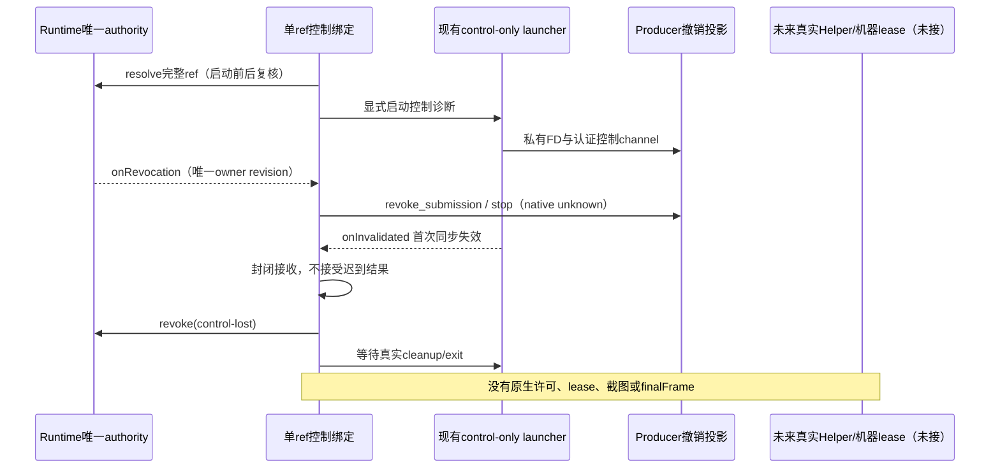

# macOS Computer Use Phase 1 第十轮

2026-10-29。状态：本轮可实施切片完成并经 controller 独立验收。默认禁用，产品采用 blocked。

## 基线与边界

R9树 `421530ae2c2cab7b537226e459905916c849c1cf76095db0a45f574f9c49e02e`，776文件；已从清单独立核实。R9的20包图、50项纯Rust、106项工具测试只作为历史基线，不宣称本轮重跑。前轮冻结目录/归档全部只读，本轮不修改Rust视觉候选，不重造授权状态。

开工freshness main ahead31/behind0，Node使用mise.toml指定24.14.0、pnpm10.33.2。架构检查0violations；desktop/zcode-cli受控上下文均managed=false，无已发现依赖合同，检查通过不是认证安全证明。开工文件摘要保存至`output/cua-helper-round10/controller-baseline/`。

源码依据：`scripts/lib/cua-helper-local-*.mjs`只有静态产物doctor；`macos-cua-helper-diagnostic`仅health/退出，未链接Driver；`adapters/src/mcp/control-only-launcher.ts`目前只有清理完成后的onClosed；`core/src/runtime/cua/cua-submission-authority.ts`是唯一runtime授权owner，提供窄resolve/revoke port；`producer-control`只拥有撤销投影；R9旧core内`window_lease::Guard`是私有物理观察guard，不是产品机器级lease。没有可接入的真实lease所有者，因此本轮不构造leaseGranted/approved开关。runtime尚未把producer incarnation通过bindTurn绑定成执行资格；本轮单ref接线仅使用既有port撤销该ref，不新增bindTurn授权入口。

## 实施切片与所有者

N：新增独立原生peer诊断，真实Unix socket内核audit token→Security动态代码检查→固定local-self-signed身份策略。只运行自有无输入测试进程。保留无证书/ad-hoc/错身份的真实拒绝；正向签名Helper缺证继续blocked。不得对现有diagnostic Helper、钥匙串/TCC或R9源码作修改。构建选择本机SDK27.0、arm64/min14.2，缺工具失败，不改全局配置。controller只读验证本机Node24.14.0已有证书签名，可作为实际Security API正向对照；只读取公开证书，绝不把该对照或其JS代码当作Zody Helper身份。

L：在现有control-only launcher增加首个关闭时的同步失效通知，保留最终cleanup回执；新增显式选择的单ref runtime/control绑定，使用现有ProducerPort和onRevocation，只传递撤销，不铸造许可。通过公共入口完成跨包边界；不将adapter导入core生产实现，测试组合可在本地使用真实authority。无自动启用/模型schema/默认executor改动。

原生peer诊断输出不能充当B的认证能力；两项证据未被接成真实Helper执行链。实际签名身份、TCC、机器锁与lease尚缺，不能用注入的测试对象隐去这些门槛。

## 委派台账

使用`deepseek-flash`，provider `magpie`，model `commandcode-plan/deepseek/deepseek-v4.1-flash`。cwd `/Users/zhvala/SourceCode/zody`，无UI grant；普通付费开发已获用户授权。

|任务|权限|文件所有权|worker|
|---|---|---|---|
|R源码调查及独立复审|read-only|无写入|broker:deepseek-flash-ro-989625ff4f43c3ef:01a18588-5494-7133-9b14-86364715b91b|
|N原生peer诊断|workspace-write|新native/macos-cua-peer-diagnostic、对应新build/test脚本及新desktop测试；output/cua-helper-round10/native-work|broker:deepseek-flash-rw-c2d541bc0c4e8861:01a18592-53bb-77b2-81f4-065f66c4f037|
|L runtime/control绑定|workspace-write|adapters/mcp的control-only launcher/contract与新绑定模块、公开mcp入口、对应adapters测试；可新增core/tests/cua-submission-control-binding.test.ts作真实owner组合验证|broker:deepseek-flash-rw-c2d541bc0c4e8861:01a18592-5417-72f2-9b76-5ada47e28f4b|

独立复审补充了反向撤销保留上限、ACK操作语义、authority失败传播与终态竞态；裁决见`packages/desktop/native/macos-cua-driver-closure/reports/2026-10-29-round10/REVIEW.md`。反向回执最多保留requestTimeoutMs，只是资源上限，不证明flush/drain。

controller拥有spec/design/plan、最终验收目录和独立验证runner；并发writer不共享文件。实现先补测试；对发现的竞态修复写中文原因注释。所有worker报告都须独立复核。

## 验收与后续

R10-01..06以spec为准。分开记录纯测试、真实控制IPC、内核peer观察、Security签名检查、正向签名Helper、TCC/lease/原生采集/Fenced/完整D06。必须重新执行pnpm typecheck、lint与架构检查，区分基线问题；本轮产物保存`output/cua-helper-round10`及独立round10报告，不覆盖前轮。

持续采用local-self-signed，无Developer ID或公证期限。先完成本轮代码与无权限变更验证；涉及证书安装/权限变更再说明操作与影响并获确认。下一步为固定签名Helper与真实peer双向验证、既有runtime撤销到真实Helper资源/机器lease的绑定，然后真实TCC/采集/取消，再完整D06、native Fenced/手机屏障、Intel/最低macOS/升级稳定性。

## 最终结果

[第十轮验收与可复核材料](../../packages/desktop/native/macos-cua-driver-closure/reports/2026-10-29-round10/ACCEPTANCE.md)：25文件249项自动化测试通过，根及CLI typecheck/lint通过，根lint301 warnings/0 errors与开工一致，架构0violations。真实authority+正式control-only入口的stop/mobile撤销组合通过；真实内核peer/Security及socket边界诊断通过。正向local-self-signed Helper、lease、TCC、原生截图与Fenced仍blocked。

原生最终产物arm64/min14.2、SDK27.0、clang21.0.0，SHA-256 `0f9c78bc691d5c6044854ce3b1d3c620b110a8b2bcb2e38b311645c8a5b65cb0`。真实测试在macOS26.6.2运行，未冒充最低系统验收。R9树与前轮归档无变化；3986文件开工快照无缺失/意外变化。68个本轮源码与材料的增量补丁已实际重建比对；中间编译、fixture、断言及公开入口解析失败分别保留，最终状态以ACCEPTANCE为准。
