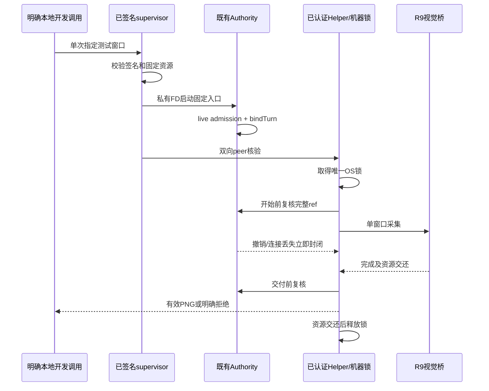

# macOS Computer Use Phase 1 第十一轮

2026-10-29。用户批准证书安装后，本轮开发链已真实完成签名 Helper、单窗口截图与随后撤销；未修改 TCC。目标为真实 Helper → 既有 submission/lease → 一次截图与撤销。产品保持默认禁用。

## 决策和实施

只实现一条显式开发纵向链。R9视觉冻结树421530ae2c2cab7b537226e459905916c849c1cf76095db0a45f574f9c49e02e及R10归档只读；全部构建/派生位于output/cua-helper-round11。开工Node24.14.0、pnpm10.33.2；freshness ahead31/behind0，architecture 0 violations，desktop/CLI managed=false。

提交授权唯一owner为既有CuaSubmissionAuthority；机器锁唯一owner为设计既定的Helper机器执行仲裁器（本轮补实现）。native supervisor负责签名资源及子进程封装，不保存另一份业务授权。Helper执行R9窄截图桥，producer/frame发布维持现状。

本轮开发 bundle 实例化并执行既有 authority 类，建立本次明确开发调用的 submission；它尚未接入运行中 Desktop/CommandInbox 的 submission 实例。因此该链路通过也只证明原生纵向接线，不能记作生产会话授权接线完成。

无模型执行、不发布finalFrame、不宣称输入Fenced。证书或 TCC 变更必须先获批。开工时0个有效签名身份；用户批准后已安装固定身份并完成真实采集。当前启动链已有可用 TCC 权限，未修改权限，也未据此宣称 Helper 独立拥有 TCC。

## 必要检查与委派

使用broker和broker-workspaces，路由deepseek-flash / magpie / commandcode-plan/deepseek/deepseek-v4.1-flash；cwd为本仓，无UI grant。调查worker `broker:deepseek-flash-ro-989625ff4f43c3ef:01a1878e-35a7-7b72-9c4f-3782df955531`；实现worker `broker:deepseek-flash-rw-c2d541bc0c4e8861:01a18792-92ca-77a3-b7f8-850df5f37767`（native main/lease/build；分步实施）。controller拥有spec/计划/验收记录，只由DeepSeek写实现。

必要检查为实际编译/链接、未签名拒绝、完整ref与撤销、实际锁竞争/释放；获批后一次截图与撤销。根typecheck/lint/architecture以及触及CLI时的CLI检查为仓库必需。不开新验证矩阵；最终仅记录已完成、实际阻断与下一动作。

实现拆分：authority worker `broker:deepseek-flash-rw-c2d541bc0c4e8861:01a1879c-a91c-73b2-918a-cf913200d58d` 独占 core/src/cua-submission.ts、core/package.json、新native/authority-entry.mjs及macosCuaHelperRound11Authority.test.ts。native worker不写这四个文件。只读调查已结束；controller独立复核，不以worker报告替代验收。

视觉worker `broker:deepseek-flash-rw-c2d541bc0c4e8861:01a187a2-62ce-7891-9ea8-73711f6e2e32` 独占新增visual-overlay、cua-helper-round11-visual.mjs、Round11Visual测试及visual-worker输出，派生R9 private staticlib；其余writer不写这些文件。

视觉overlay独立构建及43项Rust纯测试通过后冻结。该worker继续独占新增`cua-helper-round11-final-build.mjs`、`build-round11-final.mjs`、native/BUILD.md，收敛完整bundle编译与可选签名准备；native worker继续修src及直接测试，不写这三个文件。旧step1构建只作为早期证据，不能冒充最终链接。

最终未新增第二个CLI：V实现final-build与BUILD.md；N将原build-round11 CLI和兼容模块委托至final-build，并调整既有3项Lease测试。所有worker已结束，controller独立验收后冻结57文件源码快照。最终结果见[第十一轮验收](../../packages/desktop/native/macos-cua-driver-closure/reports/2026-10-29-round11/ACCEPTANCE.md)，证书操作见同目录CERTIFICATE-PROPOSAL.md。签名和实际运行续验收见同目录 SIGNING-ACCEPTANCE.md。当前剩余：生产 Desktop/CommandInbox owner 实例接线，以及独立启动/升级时的 TCC 归属。

## 收尾调查补充（2026-10-29）

同一签名 Helper 经 LaunchServices 独立启动未取得屏幕读取许可，系统确认 TCC 主体为 Helper；已单独请求权限确认，未变更 TCC。产品侧还缺 runtime 真实 turn binding 与可信 Helper transport，不能把开发 authority 实例当作产品 owner。详见验收目录 CLOSEOUT-STATUS.md。此次只读调查已结束，未下发新的实现任务。
