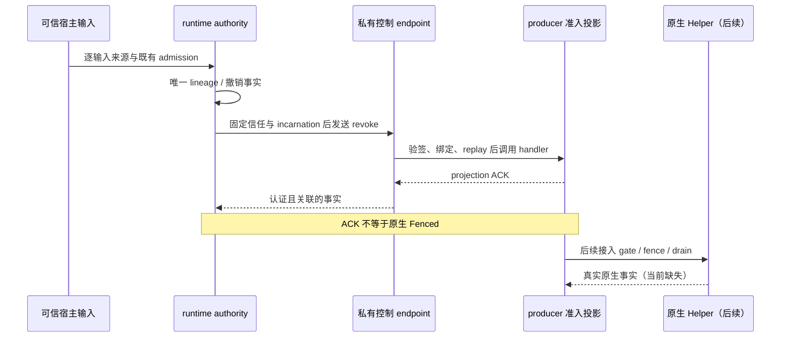

# macOS Computer Use 第二轮：运行接线与自签名验证

日期：2026-10-26。用户授权继续规划并由 DeepSeek 实施、controller 最终验收。规则以 [首期 spec](../../specs/computer-use-macos-phase1.md) 为准。当前采用 `local-self-signed`；Developer ID/Apple 公证不作为本轮条件。先补可验证的运行边界，再进入原生 Helper，不以开发测试替代真实输入证据。

## 分工与验收

| 工作包                | 交付范围                                                                                       | 验收重点                                                                                     | 当前状态                        |
| --------------------- | ---------------------------------------------------------------------------------------------- | -------------------------------------------------------------------------------------------- | ------------------------------- |
| R2-C 认证控制连接     | `packages/zcode-cua/control-channel*`、公开子入口、合同与测试                                  | 真实子进程 IPC、双向 revoke、验签/绑定/replay/ACK、重复与断连、异步关闭、不冒充 native fence | 已交付，controller 定向验收通过 |
| R2-R runtime 提交接线 | 可选可信依赖注入协调器，接 admission/steer/queue/stop/shutdown；实例内 live 凭证防止历史重授予 | 可信来源缺失时不授予、自动续跑不生成新资格、撤销/退出不复活、普通聊天非回归                  | 已交付，controller 定向验收通过 |
| R2-S 自签名产物诊断   | 只读 doctor、显式 profile、合同与反例测试                                                      | 自签名与 ad-hoc 区分、证书/DR/摘要/架构/权限匹配、缺产物明确 blocked                         | 已交付，controller 定向验收通过 |
| R2-V controller 验收  | 审查实际 diff，独立运行定向与必需检查，回填证据                                                | 保留无关改动；发现问题交回修订；静态/IPC/实机证据分开                                        | 待实施交付                      |

并发写入按上述目录隔离。controller 单独维护顶层 spec、设计与计划；worker 先更新自己负责的合同，再写实现。不修改钥匙串/TCC、不启用真实输入、不翻转 placeholder 或默认 executor，不提交其他既有改动。

实施 worker（路线均为 `deepseek-official-flash`，显式 `workspace-write`）：

- R2-C：`broker:deepseek-official-flash-rw-c2d541bc0c4e8861:01a173f4-a0ad-7152-afb2-d9d6495b1567`。
- R2-R：`broker:deepseek-official-flash-rw-c2d541bc0c4e8861:01a173f6-9bf4-7532-8222-140dd1b9b4c0`。
- R2-S：`broker:deepseek-official-flash-rw-c2d541bc0c4e8861:01a173f3-5359-7bc3-a69c-05cc6c125e9e`。

## 所有者和连接顺序

控制连接只接受可信启动方显式传入的流、密钥和 incarnation，不从环境变量、MCP metadata 或首个网络消息建立信任。runtime 仍是用户提交资格唯一 owner；通道只拥有 framing、sequence、pending 请求和有限重送缓存。产物 doctor 不拥有安装/权限状态，诊断结果也不触发安装或启动。

## 后续依赖与交付门槛

1. 本轮完成控制连接、runtime 切片和产物诊断的可执行验收。对尚缺可信来源/launcher 的路径保持无资格，不补默认值。
2. 在真实 Host admission 与官方 plugin launcher 贯通可信来源、启动身份及控制通道，连接手机 steer 的 Fenced 屏障；验证 Desktop continuous 和手机 replayable 两种语义。
3. 固定静态 Rust Helper 的来源、工具链、窄桥与 profile；实现 peer 校验、机器锁、原生 fence/drain、窗口和最终 frame 链。对照既有独立实验，不复制已删除实现或继承上游 Team。
4. 使用固定本地自签名身份完成 arm64 加载、TCC、受控 scratch 输入、停止、冷启动和升级验收。缺证书/产物的实际诊断记录为 blocked；不能把合成测试写成通过。
5. 补齐 Intel/最低 macOS 与完整 packaged 矩阵，最后接 services/UI 并按发行规则决定开放入口。未完成项不因本轮测试通过而关闭。

## 基线与结果

- freshness 通过：main，ahead 30 / behind 0。
- 架构基线：0 violations / 0 new；zcode-cli、services 的 context 标记 unmanaged，不构成完整安全边界证明。
- 开工文件快照已保存；后续改动须与本轮基线比较，不能仅用 Git HEAD 将此前候选代码算作本轮成果。
- 三个实施 worker 均已结束；controller 在最终实现上独立运行下列验证。所有结果使用 Node 24.14.0 / pnpm 10.33.2。

### Controller 审查记录

- 控制连接初稿的 close 只等待逻辑状态，已要求等待真实流关闭；背压等待须可被清理取消，不能使用忙轮询或固定延时证明关闭。
- runtime 初稿重放旧关联可能返回当前新 lineage，已要求严格 source/queue/current 匹配和消费 tombstone。producer 窄接口撤销后，coordinator 的当前引用也须跟随 owner revision，不能复制第二份撤销状态。
- 直接 `steerTurn` / `enqueueDeferredInput` 不能依赖 `admitPrompt` 包装层代为撤销；必须在目标/输入校验后、写 pending 前执行。错误目标的被拒绝输入不得撤销另一任务。
- doctor 固定 `/usr/bin` 工具路径；DR 同时核对内嵌要求、显式 profile 和实际证书叶，不能靠关键词存在判断。实际执行复现 `--extract-certificates <prefix>` 将前缀误当目标，改为 `--extract-certificates=<prefix>`；使用 `/bin/ls` 公钥证书提取验证，临时目录已清理。
- 初跑真实 socket fixture 曾把请求写到 endpoint 一侧，导致对端将 request 误读为 ACK；已交回修正方向。队列 fixture 曾把 turn completion 当 runtime idle；须按实际 drain 状态收口。失败记录不替代最终复跑。

### 最终定向验收

| 范围 / 命令                                                                                                      | Controller 实际结果                                                               |
| ---------------------------------------------------------------------------------------------------------------- | --------------------------------------------------------------------------------- |
| control-protocol、control-channel、framing/replay、真实子进程 IPC、placeholder detection                         | 5 文件 / 63 tests 通过                                                            |
| runtime lifecycle、lineage、controller 新增 authority + socket 集成、prompt admission、command queue、MCP bridge | 6 文件 / 96 tests 通过                                                            |
| 自签名 doctor                                                                                                    | 1 文件 / 36 tests 通过                                                            |
| 定向测试合计                                                                                                     | **12 文件 / 195 tests 通过**；不代表全仓或 native 验收                            |
| `pnpm --dir apps/zcode-cli typecheck`                                                                            | 30/30 任务通过；Turbo 仍报告 workspace/lockfile closure 警告，本轮未修改 lockfile |
| `pnpm exec tsc -p packages/zcode-cua/tsconfig.json --noEmit`                                                     | 通过                                                                              |
| `pnpm --dir apps/zcode-cli lint`                                                                                 | 14/14 任务通过，59 warnings / 0 errors                                            |
| 改动 JS/TS 定向 `oxlint --no-ignore`                                                                             | 45 文件，0 warnings / 0 errors                                                    |
| 改动文件 `oxfmt --check --ignore-path /dev/null`                                                                 | 57 文件通过                                                                       |
| `pnpm architecture:check --changed`                                                                              | 0 violations / 0 new；unmanaged 范围限制不变                                      |

worker 的真实 socket 测试曾受沙箱 `listen()` EPERM 限制；上述 IPC 结果来自 controller 本机完整复跑。途中 doctor 重构造成的导出不匹配、旧 export 白名单未包含新 channel 等失败均在最终复跑前修正；未把中间失败登记为通过。

只读实机诊断另行记录：

- 选定 bundled Helper 路径缺失、示例 profile 尚未填证书与产物信息：退出码 2，`blocked`（4 pass / 0 fail / 3 blocked）。
- 将现有 `packages/desktop/dist/mac-arm64/Zody.app` 主应用作为错误产物负样本：退出码 1，`fail`（10 pass / 5 fail / 6 blocked）；识别 bundle 身份不符、签名破损、ad-hoc、无证书叶和架构不符。它不是 Helper 或自签名正样本。
- controller 对 `/bin/ls` 实测等号形式可提取证书叶，临时文件已清理；这只验证 codesign 提取语法，不证明自签名 Helper 加载/TCC。doctor 的完整正路径仍由合成 fixture 覆盖。
- 测试包含公钥 DER 证书 fixture；未创建用户代码签名身份、未导入证书/修改钥匙串或 TCC，未发送原生输入。

### 仓库全量检查的外部阻断

最终 `pnpm typecheck` 退出码 2，剩余两处错误均在本轮未修改的 UI 文件：

- `packages/ui/src/components/ai-elements/message.tsx:163`：`size` 可能为 null。
- `packages/ui/src/mobileNavigationHistory.ts:42`：可能为 undefined 的 entry 传入必需参数。

最终 `pnpm lint` 退出码 1：303 warnings / 2 errors；两个 error 为本轮未修改 UI 文件的 max-lines：`packages/ui/src/WebRemoteControlMobileShell.tsx` 与 `packages/ui/src/v4/conversationTurnRenderUnits.ts`。这些文件在本轮期间仍有外部改动，因此最后复查后记录当前结果，不将早先 4 个类型错误/307 warnings 的快照当作最终状态。本轮未修复或回退这些无关改动；不能宣称全仓门槛通过。

### 验收结论与剩余工作

本轮三个候选包和跨模块回归完成，默认禁用策略保持。runtime 已挂接真实 admission/steer/queue/stop/shutdown 方法，但生产 Host 尚未注入固定身份和 live 登记能力；控制 endpoint 已真实 IPC 验收，但未接官方 plugin launcher 或原生 producer。下一阶段必须把这两条可信链连起来，并补手机 Fenced 投递屏障；不能靠开放工具面绕过缺口。

原生 Helper/Driver、机器锁、frame/provider、TCC、受控输入、停止硬边界、安装升级与 Intel/最低 macOS 仍未验收。`zcodeCuaPlaceholder: true` 保留；不需要 Developer ID 即可继续本地自签名开发，但当前没有合格 Helper 产物可做原生正例验收。完整首期产品尚未通过验收。
