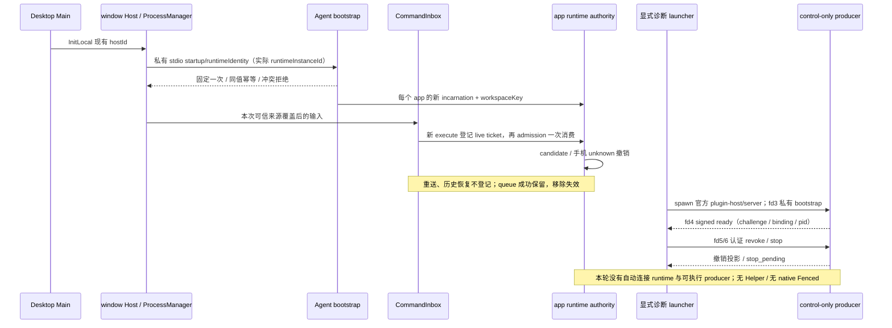

# macOS Computer Use 第三轮：可信启动与生产接线

日期：2026-10-26。状态：第三轮默认禁用的代码切片通过 controller 验收；完整首期仍未验收。用户授权 DeepSeek 实施、controller 拆分、审查及实际验证。沿用 local-self-signed，无 Developer ID/Apple 公证迁移期限，不安装证书、不修改 TCC。

## 已确认基线

- Node 24.14.0 位于本机 fnm 安装目录；pnpm 10.33.2。freshness：main ahead 30 / behind 0，通过。
- 开工 `pnpm typecheck` 退出 0；`pnpm lint` 301 warnings / 0 errors，退出 0。上轮 UI 类型/行数失败当前未复现。
- `pnpm architecture:check --changed` 0 violations；CLI/services context 为 unmanaged，不能据此推导完整边界已受检。
- 16466 个工作区文件在 `/tmp/zody-cua-round3-baseline` 保存本轮快照，以区别前两轮和其他任务的未提交内容。不得恢复/覆盖无关变更。
- 开工时 authority/endpoint 已是第二轮成果；production create-app 尚未注入可信身份/live registrar，MCP transport 为 SDK stdio，node_repl 默认 Worker 与 producer 同进程。新增控制 key 不能直接装入这个默认执行环境。

## 本轮完成内容与验收边界

- **生产身份接线**：复用 Main 的真实 Host ID，ProcessManager 用实际 spawn 的 runtimeInstanceId 初始化 Agent；私有 startup 帧只固定一次。每个 ZCodeApp 自建 incarnation，local workspace key 规范化，remote/subagent 排除。缺身份不构造 candidate。
- **live 提交入口**：services 从可信连接覆盖 sendText 和 createSession.firstInput 来源；无可信载体删除客户端自报来源。CommandInbox 新 execute 才登记实例内 ticket，失败取消、queue 提升一次消费、删除失效；恢复、重送、历史 intent、后台续跑不重新授权。
- **官方 launcher 控制诊断**：显式调用真实 plugin-host/server，私有 fd3 传启动 key、fd4 返回签名 ready、fd5/6 承载认证控制帧。launcher 拥有 key/绑定/子进程退出，producer owner 拥有有限撤销投影；模型 cell 不进入该进程，默认 MCP 不携带控制 key。
- **producer 撤销与 stop**：有界、单调的 lineage 撤销投影；容量耗尽拒绝新项且不驱逐旧 tombstone。无 Helper 的 stop 只能 pending，不能返回 Fenced/Drained。手机/unknown 已接 runtime 保守撤销，真实原生投递屏障尚未完成。

| 场景 | 本轮判定 |
| --- | --- |
| R3-01 身份入口 | 源码调用点、真实 ProcessManager 子进程与真实 CLI stdio 分层验证通过；未做签名 Desktop 包端到端 |
| R3-02/03 live 与队列 | 新输入、首输入、重送、恢复、失败取消、自动/显式提升与用户移除回归通过 |
| R3-04/05 私有 launcher | control-only 真实 IPC、启动失败、错签名/绑定/challenge、异常退出、FD 复用和重复 close 通过；不是可执行 CUA 模式 |
| R3-06 撤销/stop | endpoint 双向机制与 producer 投影通过；没有自动贯通 runtime→可执行 producer，原生 stop 未验收 |
| R3-07 手机屏障 | runtime 撤销与不伪造 Fenced 的反例通过；真实 Fenced 后投递仍 blocked |
| R3-08 默认非回归 | node_repl/Browser bridge、CLI launcher、普通聊天与默认插件配置测试通过 |

## 所有者与顺序




## 调查与实施分工

只读调查使用 `deepseek-official-flash`（provider `magpie`，model `commandcode-plan/deepseek/deepseek-v4.1-flash`），cwd 固定本仓。工作区授权仅本连接、本项目。

- identity/live 调查：`broker:deepseek-official-flash-ro-989625ff4f43c3ef:01a17826-30b5-7020-b2c3-59740bdad3ab`。
- launcher/control 调查：`broker:deepseek-official-flash-ro-989625ff4f43c3ef:01a17826-3168-75a1-b561-dd0b7ed9e5d4`。

实施包按 spec R3-01–08 增补测试；并发写入按下列文件范围互斥，worker ID 均已登记。controller 独占顶层 spec/design/plan 和 tool change chain。

### 已下发实施包

| 包 | 文件写入边界 | 交付与验收 |
| --- | --- | --- |
| R3-I | desktop Main/Host、shared identity/protocol、services Agent 启动/可信输入、CLI bootstrap，必要 core 公共导出/凭证清理 | 真实 Host 身份贯通；app incarnation 属于每次 ZCodeApp；CommandInbox 新 admission 登记，首输入、queue、失败、replay 反例 |
| R3-P | 仅 `packages/zcode-cua/` | 复用 endpoint 的有界撤销投影 handler，stop 没有 Helper 时明确 pending；不开放执行 |
| R3-L | CLI adapters、cli plugin-host、node-repl-host | control-only 私有 FD launcher、真实进程认证启动、退出清理；默认 MCP 不加载密钥 |

R3-I worker：`broker:deepseek-official-flash-rw-c2d541bc0c4e8861:01a1782c-5a59-7bb2-9d51-d05e926fcc84`。
R3-P worker：`broker:deepseek-official-flash-rw-c2d541bc0c4e8861:01a1782b-6546-7613-b42d-db3dbf09ee43`。
均为指定 DeepSeek route、显式 workspace-write。R3-L 独占 adapters/cli/node-repl-host，不能与以上目录重叠。

开工确认并在本轮修复的 Host 缺口：既有 hostId 曾仅 taskRealtime 分支发 InitLocal、未注入 services；Agent process manager 的实际 runtime identity 曾未进入 bootstrap；createSession 首输入曾缺少逐输入可信来源。`appIncarnation` 属于 ZCodeApp 生命周期，不能复用整个 Electron Main 的代际替代冷恢复的新 app。

## 依赖与范围裁决

本轮完成方向是可信生产调用点的默认拒绝接线与控制启动生命周期。SDK 的 stdio 固定三条流，因此实现独立 control-only launcher；没有把密钥塞进普通 MCP 环境。Host→Agent 身份使用私有 stdio startup 帧，不放进 createSession 命令，也不从持久化 intent 恢复。缺少 Host 身份时普通聊天继续且无 candidate。

原生 Helper 当前仍缺产品实现：固定 Rust 来源/工具链/patch 与 license 闭包、静态签名制品、peer 校验、机器锁、最终原生 gate、ledger、retire/drain、frame/provider 链与 TCC 归属需后续完成。D06 独立进程不等于 OS sandbox；在验收前禁止控制诊断进程运行模型代码。手机原生 Fenced 与停止安全完成无法凭现有投影验收。Intel/最低 macOS 环境缺口继续保留，不阻止 arm64 开发。

## controller 验证记录

以下由 controller 实际运行，不沿用 worker 报告或第二轮计数。去重后的定向测试共 **35 文件、459 tests 通过**；同一文件的诊断重跑和单项复跑不累计。另有真实 CLI 私有 stdio smoke 通过。

| 检查 | 结果 | 证据层级 |
| --- | --- | --- |
| `pnpm typecheck` | 退出 0；收尾变更后重跑通过 | 根项目 TS |
| `pnpm lint` | 退出 0，301 warnings / 0 errors | 根项目静态检查；上轮 UI 类型/行数失败未复现 |
| `pnpm --dir apps/zcode-cli typecheck` | 30/30 tasks 成功，退出 0 | CLI 各包 TS / 所需构建 |
| `pnpm --dir apps/zcode-cli lint` | 14/14 tasks 成功，退出 0，仍有既有 warnings | CLI 静态检查 |
| `pnpm architecture:check --changed` | 0 violations / 0 new | 当前策略覆盖；CLI/services 为 unmanaged，不扩大结论 |
| CUA 包 + local-self-signed doctor 单测 | 6 文件 / 103 tests 通过 | 进程内 endpoint + 既有真实子进程 IPC；无原生输入 |
| Host/process manager/连接/service/shared 协议 | 6 文件 / 188 tests 通过 | Electron mock、真实 ProcessManager→fixture child、services 可信来源 |
| 实际 CLI `app-server --stdio` smoke | 首次初始化、同值幂等、冲突 -32600 通过；stdin EOF 后退出 0 | Node 24.14.0 + tsx 启动真实 CLI 源码入口，独立临时 HOME/storage，无模型请求 |
| bootstrap identity/live + runtime CUA | 5 文件 / 51 tests 通过（21:15:47 最终组合复跑） | 实际 bootstrap/Core + 测试模型；非 Desktop 签名包 E2E |
| control-only launcher | 2 文件 / 10 tests 通过 | 真实官方 plugin-host→built node_repl；异常场景另用 fixture child |
| node-repl-host 全部 test | 12 文件 / 91 tests 通过 | 默认 Worker、Browser bridge、cell、MCP、control-only；无 OS sandbox 证明 |
| CLI plugin-host | 2 文件 / 4 tests 通过 | Node/Desktop bundle 启动非回归和 broker 凭据隔离 |
| bootstrap 默认插件配置 | 2 文件 / 12 tests 通过 | 默认禁用 / 官方插件配置回归 |
| `pnpm exec tsc -p packages/zcode-cua/tsconfig.json --noEmit` | 退出 0 | CUA JS/类型合同 |

定向命令（根目录运行，CLI 命令注明 cwd）：

```sh
pnpm exec vitest run packages/zcode-cua/test packages/desktop/test/macosCuaHelperLocalSelfSignedDoctor.test.ts
pnpm exec vitest run packages/services/test/zcodeAgentProcessManager.test.ts packages/services/test/zcodeAgentService.v4.test.ts packages/services/test/zcodeAgentConnectionScope.test.ts packages/desktop/test/desktopHostProcess.test.ts packages/shared/test/zcodeProtocolRuntimeIdentity.test.ts packages/shared/test/zcodeProtocolV4Command.test.ts
# cwd: apps/zcode-cli
pnpm exec vitest run packages/bootstrap/tests/cua-host-live-submission.test.ts packages/bootstrap/tests/cua-startup-identity.test.ts packages/core/tests/cua-control-channel-integration.test.ts packages/core/tests/cua-submission-runtime.test.ts packages/core/tests/cua-submission-lineage.test.ts
pnpm exec vitest run packages/bootstrap/tests/official-plugin-runtime.test.ts packages/bootstrap/tests/plugin-runtime-features.test.ts
# cwd: apps/zcode-cli/packages/adapters
pnpm exec vitest run tests/control-only-launcher.test.ts tests/control-only-launcher-boundary.test.ts
# cwd: apps/zcode-cli/packages/node-repl-host
pnpm exec vitest run test
# cwd: apps/zcode-cli/packages/cli
node --disable-warning=DEP0205 --import tsx --test tests/zcode-cua-plugin-host-authority.node-test.ts tests/plugin-host-entry.test.mjs
```

日志在本机 `/tmp/zody-cua-r3-*.log`。静态门禁与测试都不能替代真实 Helper/TCC/签名包/系统输入验收。

真实 CLI smoke 脚本为 `/tmp/zody-cua-r3-real-startup.py`，日志为 `/tmp/zody-cua-r3-real-startup.log`；身份由测试调用方提供，用于验证真实私有 stdio 入口与一次固定语义，不能冒充已运行真实 Electron Host 的签名包验收。首轮 smoke 因测试脚本错误假设 tsx 位于 CLI 子目录而启动失败，改用实际解析的根 node_modules loader 后通过。

### 审查修正与过程失败

controller 对照本轮开工快照逐个阅读增量，保留前两轮和其他任务的未提交内容。审查推动以下修正：

- identity 从业务 createSession payload 移至实际 ProcessManager 私有 startup 帧；app incarnation 改为每个 ZCodeApp 独立拥有。
- 并发 getClient 等待身份初始化；失败/冲突/超时回收同一受管进程，旧失败不删除新代际。只有明确 `-32601` 的旧 Agent 兼容普通聊天；旧代码无 candidate 接线。
- 失败 admission 取消未消费 ticket；用户删除/清空队列时失效，promotion 不提前删除，持久化失败不能留下已移除项的票据。
- launcher 修正父子 FD 方向、覆盖整个 bootstrap 的启动 deadline、重复关闭、异常退出和清理失败事实；避免按已释放 FD 的旧编号再次 close。
- producer 分开 observedRevision 与已确认撤销 revision，stop 不借用旧 revision 的撤销事实。
- 新 bootstrap fixture 曾因缺 reasoningLevel、错误方法 spy、遗漏 CommandInbox settle，以及错误假设自动排队提升而失败，均属于本轮测试实现问题；修正为实际模型开始事件与 sendQueuedNow 路径后，最终 51 项组合复跑通过。
- worker 报告过一次 MCP token 期望失败；controller 在所需 CLI 构建后完整 node-repl 91 项通过，未复现该失败。
- worker 的两个既有进程树测试受 `ps EPERM` 沙箱限制；controller 在本机运行完整 Host/services 组合共 188 项通过，不把 worker 环境限制写成仓库测试通过依据。
- 定向格式检查仍报告两个既有文件：Host 的 mobile notification 片段、v4-bridge 的 I19 history 片段；均与开工快照格式化 diff 相同。保留无关代码原状，本轮其余受检文件通过，`git diff --check` 通过，不声称格式检查全部通过。

### R3-L 范围裁决

SDK stdio transport 固定三条标准流，无 extra FD 注入口。新增显式 control-only 诊断 launcher，真实 spawn 官方 plugin-host/server bundle，经私有 bootstrap FD 和独立控制 FD 传递密钥与绑定，不改默认 MCP transport。control-only 禁止启动模型 cell/Worker；该路径验证启动、认证撤销与退出，不是可输入的生产 CUA 模式。默认 node_repl 仍不持控制 key。

R3-L worker：`broker:deepseek-official-flash-rw-c2d541bc0c4e8861:01a17830-6d37-76c2-aa2a-64fb1a17409d`。验收覆盖真实 launcher 子进程、startup 校验/EOF、错代际、请求失败、close 等实际退出；缺 Helper 的 stop 保持 unknown/pending。可执行模式受 D06 与原生 Helper 阻断，不能由控制诊断通过推导开放。

只读 Helper 诊断已重跑：目标 `packages/desktop/resources/cua-helper/Zody Computer Use.app` 缺失，示例 profile 未填，退出码 2，blocked（4 pass / 0 fail / 3 blocked）。仅静态诊断，未创建证书/修改钥匙串或 TCC，未执行系统输入。

### R3-P controller 审查细节

已亲自阅读 producer-control JS/类型、合同、测试与 export 增量。初稿 stop 未推进水位、旧revision撤销可能被用于新请求、closed未知lineage projectionApplied 过度确认等问题已交回修正并复核。现在 observedRevision 与已确认撤销revision分开；容量耗尽锁存准入关闭，保留旧tombstone用于清理；缺Helper的stop不会完成。

controller 在 Node 24.14.0 实际执行 `pnpm exec vitest run packages/zcode-cua/test packages/desktop/test/macosCuaHelperLocalSelfSignedDoctor.test.ts`：6文件/103 tests通过；`pnpm exec tsc -p packages/zcode-cua/tsconfig.json --noEmit` 退出0。新producer测试使用真实endpoint和进程内Duplex，既有control-channel-child测试使用真实子进程；二者不等于Helper/native验收。

## 原生 Helper 依赖复核与下一阶段

本机为 arm64，`xcrun --show-sdk-version` 返回 27.0，仅证明当前 SDK 可查询，不证明 Helper 可构建。当前 `packages/`、`apps/`、`scripts/` 没有产品 Helper 的 Cargo.toml/Cargo.lock/rust-toolchain，已有独立实验不等于产品来源闭包。打包入口和 local-self-signed doctor 已存在，但目标 `.app` 缺失，示例 profile 的证书指纹、designated requirement、版本、最低系统和二进制 hash 仍为空。

后续顺序：

1. 固定原生来源、patch、Cargo 锁定/工具链及许可闭包，建立产品 Helper 构建与不可执行诊断制品；沿用 local-self-signed，不要求 Developer ID/公证。
2. 明确固定签名证书的生成/安装位置与影响后再请求相应系统操作；真实验证固定签名、Helper 加载、peer 校验、TCC 归属和升级稳定性。不得使用 ad-hoc、伪造 Team ID、关闭 library validation。
3. 完成 D06 模型执行环境隔离；把本轮 control-only 合同接入不泄露控制 key 的生产执行拓扑，再接 runtime→producer 的实际控制关联。
4. 接原生唯一 gate、机器 lease、ledger、retire/drain、owned input 释放；取得真实 Fenced 才接手机待投递屏障与 stop 完成。
5. 做 arm64 签名包端到端验收及授权后的真实输入；Intel/最低 macOS 测试环境继续登记缺口，不能宣称通过，也不阻止前述本机开发。

无上述证据时继续 `zcodeCuaPlaceholder: true`、默认禁用、execute unavailable。本轮未安装证书、未改钥匙串/TCC/系统权限、未产生真实系统输入。
