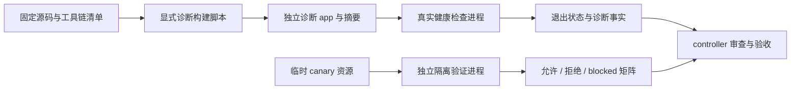

# macOS Computer Use 第四轮：Helper 工程化与 D06 验证

日期：2026-10-27。状态：第四轮默认禁用的开发切片已通过 controller 验收；完整首期、产品自签名 Helper 与 D06 仍未验收。

## 范围

用户授权按 Helper 工程化 → D06 隔离验证推进，继续 DeepSeek 实现、controller 拆分、审查并实际验证。遵循 [spec 第四轮边界](../../specs/computer-use-macos-phase1.md#第四轮工程化边界2026-10-27)。保留 local-self-signed 策略，默认禁用与 placeholder，不进行证书安装、TCC 变更或真实系统输入。

本轮先建立无输入能力的诊断 Helper 构建与进程证据。完整 Driver 来源/patch/许可闭包尚未完成，不把独立实验复制成已验收产品。随后建立实际进程的隔离反例和候选验证；不能以 fork、Node 权限模型或测试替身单独关闭 D06。

## 开工证据

- Node 24.14.0，pnpm 10.33.2；freshness main ahead 30 / behind 0，通过。
- `pnpm typecheck` 退出 0；`pnpm lint` 退出 0，301 warnings / 0 errors。
- `pnpm architecture:check --changed` 0 violations / 0 new；desktop context 为 unmanaged，不覆盖 native 工程安全性。
- 16493 个文件摘要及可复核源码快照保存于 `/tmp/zody-cua-round4-baseline`；现有未提交内容保留。
- 本机 Rust 为 1.93.1；既有实验来源 `rust-toolchain.toml` 声明 1.97.1，产品工具链闭包不能继承为通过。
- Broker routes 仅返回 `deepseek-flash`，provider `magpie`、model `commandcode-plan/deepseek/deepseek-v4.1-flash`。旧指定 `deepseek-official-flash` 不存在；用户已明确确认使用当前 `deepseek-flash`，本连接只授权项目绝对路径。

## 所有者与顺序



以上均为显式开发入口，不接 production launcher、runtime 授权或 native fence。

## 拆分与待办

1. Helper：调查现有资源布局及候选来源；确定无外部 Driver 的诊断骨架边界，先测试再实现固定构建、清单和健康退出。
2. D06：调查现有 cell launcher/loader 的权限与 Browser 需求；独立测试临时资源越界，验证本机可用 OS 策略及不能覆盖的边界。
3. controller：独占顶层 spec/design/plan；登记 worker ID 与互斥写入范围，逐文件审查，运行根 typecheck/lint/架构和相关 native/CLI 测试。

只读调查 worker（cwd 均为 `/Users/zhvala/SourceCode/zody`）：Helper `broker:deepseek-flash-ro-989625ff4f43c3ef:01a17d8e-f4cb-7b71-978c-f737a31e0c0f`；D06 `broker:deepseek-flash-ro-989625ff4f43c3ef:01a17d8e-f571-78e1-8bca-edb83fee5a2f`。

R4-H 实现 worker：`broker:deepseek-flash-rw-c2d541bc0c4e8861:01a17d92-fbc6-7b41-aa59-43dc52a2ccf6`，workspace-write。仅拥有 `packages/desktop/native/macos-cua-helper-diagnostic/`、desktop scripts 下诊断 build/test 与 `lib/cua-helper-diagnostic*.mjs`、`macosCuaHelperDiagnostic*.test.ts`、desktop package.json 的显式诊断命令。controller 独占顶层文档。

诊断构建冻结：std-only Rust 1.93.1、`--locked --offline`；bundle ID `io.github.zclaudia.zody.cua-helper-diagnostic`、名称 `Zody Computer Use Diagnostic`；输出 `output/cua-helper-diagnostic/darwin-arm64`。minos 12.0 仅为构建目标，不代表最低系统测试通过。签名按实际检测记录；arm64 linker ad-hoc 不作为 local-self-signed，通过真实子进程健康测试也不改变签名门槛。标准库/系统链接依赖与未链接 Driver 的许可范围分别记录。

R4-D 实现 worker：`broker:deepseek-flash-rw-c2d541bc0c4e8861:01a17d95-a482-7133-83c9-044ea91acc7f`，workspace-write。仅拥有 node-repl-host 的 `test/d06/`、`scripts/d06-*`、`D06-DIAGNOSTIC.md` 与 package.json 的显式诊断命令。不改生产 src，和 R4-H 文件互斥。复用现有 launch 注入口，临时 canary、严格拒绝默认策略、逐项允许清单与机器可读结果；完整 D06 仍 blocked。

两个实现 worker 均已完成并冻结；controller 已亲自审查所有最终增量、实际执行检查。没有提交 commit，没有清理或回滚前几轮及其它任务的未提交文件。

环境证据须区分：只读 worker 的 sandbox_apply 探针返回 EPERM；controller 在本机执行 `/usr/bin/true` 的 deny-default 加载探针退出 0。后者只证明当前 controller 可加载策略，不证明最终 cell 策略可用，也不能将 worker 的环境限制当成本机必然阻断。

## 尚未关闭

正式 Driver/patch/license 闭包、固定自签名身份与 peer/TCC/升级、完整 D06 和 Browser 兼容、runtime→可执行 producer→Helper、原生唯一 gate/机器锁/ledger/retire/drain、真实 Fenced 手机屏障、arm64 签名包输入验收。Intel 与最低 macOS 环境仍不可用。

## controller 审查与实际验证

R4-H 已冻结交付；controller 逐文件阅读新增 Rust/构建/manifest/验证源码，对照开工快照确认只新增显式诊断命令，没有接入默认产品路径。审查修正了清单虚假能力声明、冻结源清单不完整、Cargo 祖先配置注入面，以及 `otool -L` 解析漏掉 `@rpath`/`@loader_path` 依赖的问题。最后使用固定 rustfmt 格式化一行 Rust 常量，再实际重建验证。

最终 Helper smoke：`node packages/desktop/scripts/test-macos-cua-helper-diagnostic.mjs` 退出 0，真实构建 `.app`、核验 manifest/Info/许可/源码/可执行文件摘要，然后直接启动六种参数组合。`--health`、`--help`、`--version` 退出 0；缺参数、未知参数、多余参数退出 2，未回显 canary。输出位于 `output/cua-helper-diagnostic/darwin-arm64`，不在默认产品资源目录。

本机 arm64 / macOS 26.6.2（25G83）、SDK 27.0；Rust/Cargo 固定 1.93.1 及各自 commit。独立临时源码与 CARGO_HOME 下执行 locked/offline 构建，检查 7 层祖先目录无 Cargo 配置。实际 minos 为 12.0，未在 macOS 12 运行。二进制 SHA-256 为 `e13f176f7e7a7a41c06109edd5467b6d4c53e57e8e9e7e31fd1bdac1be4aa53a`，前后重建一致；不据此宣称跨机器可重现。

**签名没有通过**：binary/app 探测均为 linker ad-hoc、`verified=false`、无证书 Authority；`signatureIdentityVerified=false`。诊断 smoke 的 pass 仅表示诊断合同符合预期，不表示 local-self-signed 或产品 Helper 通过。没有执行签名、证书安装、钥匙串或 TCC 操作；诊断程序不含截图/输入 API。

D06 的 controller 迭代证据：

- 原始 fork 确实可读写临时可信 canary、动态加载模块并启动短命子进程；环境凭据清理和父额外 FD 不继承单列通过，不能抵销文件/进程越界。
- 最小 Node 策略曾 SIGABRT；补充根目录本身读取后版本探针通过。完整 cell 初轮因祖先目录 lstat 拒绝而未启动，第二轮因缺 HOME 的系统目录查询失败；仅增加已允许路径的祖先目录 metadata 与临时 HOME/TMPDIR，没有开放真实 HOME 或 workspace 子树。
- 第三轮 14/17 满足；剩余为 Node 模块拒绝包装、inspector 不抛异常、spawn 同步抛错等采证问题。第四轮本机 17/17 满足：真实 cell、文件读写拒绝、精确 docs/client 只读、TCP 与额外 Unix socket 拒绝、synthetic Browser bridge 允许及子进程拒绝。
- inspector 使用同一策略下独立 Node 进程采集 stderr 和无 URL 事实；不是 debugger attach 测试。模块拒绝需同路径真实读取拒绝、未改 hash、fork 成功对照及限定的错误码组合，不能把任意异常当作隔离成功。
- 父 FD 按 dev/ino 比较资源身份，避免 FD 数字被 libuv 复用导致误判；已退出子进程不再按旧 PID 发信号。

完整 D06 继续 blocked：没有 native addon/FFI、调试附加、真实 Browser、SEA/签名包、后代中断回收及可信资源完整性闭包证据。当前允许的 client/docs 为合成 fixture，不是实际 Browser skill 的完整依赖；现有 subprocess 清理 ZCODE_PLUGIN_ROOT 与 skill 的资源定位需求仍需生产方案裁决。

已运行静态与回归检查：根 `pnpm typecheck` 退出 0；`pnpm lint` 301 warnings / 0 errors；CLI typecheck 30/30 tasks、lint 14/14 tasks 成功。架构检查 0 violations / 0 new（native/scripts 不在完整受管模块覆盖内）。Helper/旧 doctor 2 文件 47 tests、placeholder 1 文件 4 tests、node-repl-host 13 文件 102 tests 通过，共 **16 文件 / 153 tests**，不累计诊断重跑。独立进程诊断的 **17 项矩阵 + 2 项启动失败反例**另列，不能与单测合并成原生能力计数。

过程失败保留：Helper 初稿两项测试因字符串误匹配和 fixture 缺字段失败，修正后通过；D06 首个 pnpm 入口找不到 tsx bin，改用已有依赖的 `node --import tsx`；前三次矩阵的初始化/采证失败不归为仓库既有问题。最终日志与 JSON 保存在 `/tmp/zody-cua-r4-*`，它们不是生产日志或原生输入验收证明。

R4-07 最终真实反例：损坏 SBPL 返回语法错误（exit 65），缺失 launcher 返回 ENOENT；两项均未得到 cell 结果，写入 canary 前后 SHA 相同。最终诊断 JSON `status=satisfied`、17/17 case、2/2 failureTests、`cleanup.removed=true`，同时 `d06Gate=blocked`。退出 0 表示本工具已实现的矩阵满足预期，不关闭完整 D06。

| 场景            | 判定与证据限制                                                                       |
| --------------- | ------------------------------------------------------------------------------------ |
| R4-01 固定构建  | 诊断骨架 locked/offline 与工具链 commit 校验通过；Driver 工具链/源码闭包未通过       |
| R4-02 制品      | arm64 `.app` 布局、摘要、动态依赖、minos 可复核；ad-hoc/无有效身份，非产品自签名验收 |
| R4-03 诊断进程  | 六种真实参数组合与实际退出通过；无 Helper peer 或系统输入                            |
| R4-04 默认边界  | placeholder 回归通过；只增加显式诊断命令，没有修改默认 executor/打包/安装            |
| R4-05 fork 反例 | 真实读写/import/子进程可达，明确证明 fork 单独不足                                   |
| R4-06 OS 候选   | 本机限定矩阵通过；Browser fixture、独立 Node inspector 与完整产品链分层记录          |
| R4-07 失败清理  | 两项真实启动拒绝、无 fallback 与临时资源清理通过；后代 abort 回收仍缺证据            |

可复跑命令（使用 mise.toml 的 Node 24.14.0）：

```sh
# 仓库根目录
node packages/desktop/scripts/test-macos-cua-helper-diagnostic.mjs
node --import tsx apps/zcode-cli/packages/node-repl-host/scripts/d06-diagnostic.ts
pnpm exec vitest run packages/desktop/test/macosCuaHelperDiagnostic.test.ts packages/desktop/test/macosCuaHelperLocalSelfSignedDoctor.test.ts packages/desktop/test/placeholderProducerDetection.test.ts
pnpm --dir apps/zcode-cli/packages/node-repl-host exec vitest run test
pnpm typecheck
pnpm lint
pnpm --dir apps/zcode-cli typecheck
pnpm --dir apps/zcode-cli lint
pnpm architecture:check --changed
# cwd: apps/zcode-cli/packages/node-repl-host；原包 tsconfig 只覆盖 src，故额外检查 scripts
pnpm exec tsc --noEmit --module NodeNext --moduleResolution NodeNext --target ES2023 --skipLibCheck --strict --allowJs --checkJs false --esModuleInterop scripts/d06-*.ts
```

脚本级 tsc 初次使用 ES2022 时，既有 shared 的 findLastIndex 不在目标 lib 中；改用 ES2023 后通过。这是 controller 检查命令错误，不是新代码或旧 UI 类型失败。没有沿用第三轮的检查结果。

收尾复跑：根 typecheck、lint（301 warnings / 0 errors）和 architecture 均通过。新增 Helper/D06 代码的定向 lint、格式检查及 Rust rustfmt 通过，`git diff --check` 通过。这里仅声称本轮定向格式检查通过，没有把全仓既有格式问题写成已修复。

## 下一阶段顺序

1. 关闭正式 Driver 固定来源、patch、工具链和许可闭包；将已审查窄桥纳入产品 Helper，诊断骨架不代替这一步。
2. 准备固定 local-self-signed 的证书位置、用途与安装影响，再就具体系统操作取得确认；验证 Helper 加载、peer 身份、TCC 归属和升级稳定性。无 Developer ID/公证迁移期限。
3. 补齐 D06 的 native addon/FFI、调试附加、可信资源完整性、真实 Browser/SDK 资源加载、SEA/签名包与后代中断回收；在此之前禁止控制密钥与模型代码共享可信进程。
4. 接通 runtime→可执行 producer→产品 Helper，并实现原生唯一 gate、机器 lease、ledger、retire/drain 和 owned input 释放；实际 Fenced 才可接通手机待投递屏障和 stop 完成。
5. 在授权的测试环境做 arm64 签名包及真实输入验收。Intel/最低 macOS 缺口继续明确保留。
