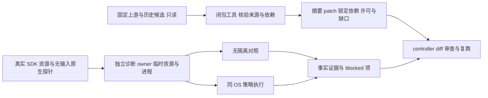

# macOS Computer Use 第五轮：Driver 依赖闭包与 D06 补证

日期：2026-10-27。状态：第五轮可实施的审计与补证切片已完成；完整 Driver 依赖闭包、Phase 1、产品 Helper 与完整 D06 均未验收。

## 范围与基线

用户授权继续 DeepSeek 实现，controller 拆分、审查和验收。routes 返回并使用此前获准的 `deepseek-flash`：provider `magpie`、model `commandcode-plan/deepseek/deepseek-v4.1-flash`。cwd 固定 `/Users/zhvala/SourceCode/zody`；只读调查与 workspace-write 实现分开授权，普通付费委派已获准。

Node 24.14.0 / pnpm 10.33.2；freshness main ahead 30 / behind 0，通过。根 typecheck 通过，lint 301 warnings / 0 errors；architecture 0 violations / 0 new。desktop 与 zcode-cli context 为 unmanaged，不以静态门通过证明 native 安全。开工快照 `/tmp/zody-cua-round5-baseline` 共 16520 文件；已有未提交内容全部保留。

先更新 [spec 第五轮](../../specs/computer-use-macos-phase1.md#第五轮依赖闭包与隔离补证2026-10-27) 与 CLI tool change chain，再实现测试与代码。明确区分来源核验、依赖/许可闭包、编译与原生能力验收。保持默认禁用和 placeholder；不安装证书、不更改 TCC/系统权限、不运行系统输入。

## 所有者与证据顺序



## 分工

只读调查：Driver `broker:deepseek-flash-ro-989625ff4f43c3ef:01a17dbd-7393-76a0-ac74-4e66d8391a90`；D06 `broker:deepseek-flash-ro-989625ff4f43c3ef:01a17dbd-7408-7de1-91c5-0a2354de9d08`。实现边界如下；controller 独占顶层 spec/design/plan，不与 writer 重叠。

实现 writer（workspace-write）：

- R5-D：`broker:deepseek-flash-rw-c2d541bc0c4e8861:01a17dc3-e59b-7542-b3e4-71874783d5cd`。仅 node-repl-host `scripts/d06-*`、`test/d06/`、`D06-DIAGNOSTIC.md` 及 package.json 的显式诊断命令；不改 production src。
- R5-C：`broker:deepseek-flash-rw-c2d541bc0c4e8861:01a17dc4-dd9c-7180-aee5-c086ad78c47e`。仅新增 desktop `native/macos-cua-driver-closure/` 审计材料、`scripts/audit-macos-cua-driver-closure.mjs`、`scripts/lib/cua-driver-closure-*.mjs`、`test/macosCuaDriverClosure*.test.ts` 及 desktop package.json 的显式审计命令。与 R5-D 无重叠。

## 调查后的范围裁决

历史候选仍有实验 feature、非首期组件以及工具链差额。完整源码目录含未进入依赖图的 perception/模型材料，不整包复制；现有 patch 不包含全部新增源码/vendor，须重新按固定上游对象核验。registry lock 总数不等于 macOS normal/build 图。UniFFI 的 MPL-2.0 和部分 crate 许可正文缺失需要独立审查，不从上游主许可证 MIT 推导全部依赖均 MIT。

controller 独立读取最新 `stop-retire-reservation/full-source`：710 原始 manifest 文件，23 个摘要改变、0 缺失；另有 42 文件（28 vendor、5 顶层文件、9 新增源码）。当前 Cargo.lock 是 569 条，其中 558 registry、11 path。旧轮 19 修改/5 新增/559 registry 等数字不可当第五轮当前事实。固定上游 `2d2f99228d4d2508dc6fcc84c176b296e146714a` 的根许可文件实际为 `LICENSE.md`。spec 的“MIT 核心与经审计依赖闭包”并非要求所有依赖都为 MIT；MPL 存在本身不记作政策禁止，材料及义务审查未完成则如实阻断。

本轮 Driver 先交付采用前的真实审计工具、固定来源清单、完整差额与依赖/许可证据，不自动裁决新许可政策、不把未经裁剪的实验树当产品 Helper。若依赖图或材料无法闭合，输出可复跑的 blocked 原因；工具执行成功与产品闭包通过分开。现有 std-only 诊断 Helper 不变。

D06 单列 R5 原生探针、真实客户端资源与合成 broker、临时资源完整性和直接 abort。保留第四轮 17 项与 2 项失败反例。真实 Browser skill 依赖 `ZCODE_PLUGIN_ROOT`，但 subprocess 环境剥离该变量；绝对路径导入的诊断不修复或关闭生产 bootstrap 缺口。后代清理由现有测试揭示的未回收事实继续阻断。

## 验收记录

controller 已独立运行第四轮真实诊断：17/17 矩阵、2/2 启动失败反例通过，清理成功，D06 仍 blocked。第五轮新增诊断与 Driver CLI 已由 controller 独立复跑；下列记录区分中间失败与最终结论。

### Driver 真实审计

controller 使用固定 upstream、当前 `stop-retire-reservation/full-source` 与它的离线 cargo-home，在独立临时目录运行新增 audit CLI；来源核验与 patch 重建通过。752 个候选文件由 710 个固定 baseline 文件加 42 个新增文件组成，其中 23 个 baseline 文件有冻结差额。patch SHA-256 为 `a4e1da2751e2449317e906dde99798c73b3ebf826a6e00fecc413ebbc23f93f0`，587106 bytes。这里的“新增”相对所选 baseline，不表示整个 upstream commit 不存在同名顶层文件；差额冻结不等于 native 语义验收。

实际 `cargo tree --locked --offline --target aarch64-apple-darwin --package cua-driver-sdk --edges normal,build` 解析 **298 个包：290 registry / 8 path**。这是当前未裁剪候选的图，不是正式产品最小依赖集；与只读调查的旧计数不同，采用 controller 实跑结果。Cargo.lock 有 569 条 / 558 checksum。

严格缓存核验发现 `adler2@2.0.1` 解包目录缺少归档中的 `Cargo.lock`，依赖门为 **blocked**，不得引用早期豁免版的 pass。该失败不等于已证明其余缓存完全一致。报告保留已解析的图，不把失败之后的未完成核验记为通过。

包级许可材料归档 **485 文件**并提供内容摘要及索引；**33 个包缺包级正文、6 个 UniFFI 包需 MPL-2.0 义务审查**。上游根 MIT 正文单独归档；同源 workspace crate 与根许可的关系列待核验，不把包级文件缺失直接解释为没有许可。此处只报告仓库材料，不作法律结论。工具链实测 1.93.1 与声明 1.97.1 不同，工具链/许可/产品采用门均 blocked。退出 0 仅为来源审计可完成且无已分类 verification failure，不能理解成完整闭包通过。

### D06 真实进程补证

最终 JSON：`/tmp/zody-cua-r5-d06-accepted.json`，exit 2 / status blocked，**8 项中 7 passed、0 failed、1 blocked**；`cleanup.removed=true`。exit 2 对应未关闭的 debugger 门，不能写成全部通过。

| 场景           | 真实结果与限制                                                                                                                                         |
| -------------- | ------------------------------------------------------------------------------------------------------------------------------------------------------ |
| R5-03 N-API    | 本机 clang 编译 addon，同一摘要二进制在 fork 可读取、截断写与 posix_spawn；在 seatbelt 加载后 read/write/spawn 返回 EPERM                              |
| R5-03 FFI      | 现装 Koffi 2.15.6 精确 staged，摘要绑定清单；libc 对照读写成功，隔离后同调用返回 EPERM，canary 不变                                                    |
| R5-04 Browser  | 真实 builder/client/docs 经 built cell 执行 setup/list；synthetic broker 校验 token/schema/计数，client/docs/README 写拒绝且摘要不变；无真实浏览器 E2E |
| R5-05 资源     | 缺失、摘要改变、符号链接、逃逸拒绝；真实篡改 guard 为 executed=false、executeCalls=0、canaryUnchanged=true；仍不是不可变安装或 TOCTOU 证明             |
| R5-06 abort    | 握手后终止直接 fork cell，executor 拒绝结算时 PID 已退出；不涉及原生 Fenced 或后代回收                                                                 |
| R5-07 debugger | 只读状态 disabled，blocked；未 attach、未改变系统权限                                                                                                  |

profile 加载与执行前重验分别另列 case；实际 Node 24.14.0 与最终 profile 全文/摘要记录在 JSON。第四轮 17 项 + 2 反例本轮也实际回归通过，没有用新增单元测试替代这些进程证据。

### 审查发现及修复

- 临时目录并行创建存在父目录竞态；修复目录创建顺序并补初始化失败清理。首次实跑遗留的单个自有临时目录由 controller 确认后删除，没有清理其他任务目录。
- FFI 写入原使用 Darwin O_CREAT，未截断较长 canary，导致对照写入检查失败；以真实磁盘内容定位，保持精确内容检查。
- 原生拒绝必须来自已加载后的 EPERM/EACCES；不能把加载失败、任意非零进程状态或缺少 checks 算作边界成立。
- 校验摘要必须绑定执行资源；篡改负例必须阻止 execute。该预检仍不能证明同 UID 下 TOCTOU 安全或安装目录不可变。
- abort 不按可复用的 PID 文件发 SIGKILL，由持有 ChildProcess 的 executor 负责直接子进程退出；不声称后代回收或 native Fenced。
- Driver patch 必须包含新增文件/vendor 并逐字节重建；registry archive 哈希和解包文件须分别核验，不能豁免缺失 Cargo.lock 后声称完全相等。
- 工具链与依赖图报告采用实测字段，保留来源、依赖、许可、产品采用的独立结论；MPL 清单不构成法律审查结论。

两个实现 worker 均已完成并冻结。controller 亲自审查脚本、测试、清单和相对开工快照的最终 diff，独立运行最终 CLI 和 D06；再次校验仓库及独立输出中的 485 个归档文件全部存在、无路径逃逸、摘要一致，manifest/config/index/patch 摘要均匹配。旧中间输出 `/tmp/zody-cua-r5-driver-controller-final/` 曾有临时目录别名导致的 4 个归档路径失效，已修复并由 `controller-accepted/` 独立复跑替代，不将旧结果作为最终证据。

### 静态与回归检查

- 根 `pnpm typecheck`：开工通过；中途两项并行 UI/Web 改动错误；收尾仍有 `packages/web/src/mobile-remote/bootstrap.tsx:588` TS2353（`onOpenConnectionSettings` 不在 `RenderWebRemoteControlFailureOptions`）。`Root.tsx` 的中间错误已随其它任务改动消失。本轮未修改 UI/Web，开工快照与增量审查可证明；不将收尾检查报告为通过，也未改动其它任务代码。
- 根 `pnpm lint`：301 warnings / 0 errors；本轮新增代码定向 lint 0 warnings / 0 errors。
- CLI `pnpm --dir apps/zcode-cli typecheck`：30/30 tasks；lint：14/14 tasks。原包 tsconfig 不覆盖 scripts，因此另以 ES2023 / NodeNext / strict 对 `scripts/d06-*.ts` 执行 tsc，通过。
- `pnpm architecture:check --changed`：0 violations / 0 new；desktop/native/scripts 没有完整受管安全覆盖，不把该结果当原生隔离验收。
- node-repl-host 17 文件 / 125 tests、Helper/旧 doctor/placeholder 3 文件 / 51 tests，通过；Driver 2 文件 / 12 tests，通过；总计 **22 文件 / 188 tests**。单测与真实进程矩阵分开计数。
- 定向格式检查通过；根 oxfmt 默认忽略 CLI 树，首次命令没有匹配目标，已改为 node-repl-host cwd 实际检查，不把空检查算通过。`git diff --check` 通过。

审查仅保留本轮增量：两个 package.json 仅各增加显式开发命令，没有 production src/launcher/default executor/placeholder 变更。前几轮及并行手机 UI/settings 的未提交改动全部保留，没有 commit。Driver patch 为来源材料，不表示其中历史 native 修改已经完成产品语义审查。

### 本机边界与下一阶段顺序

1. 先处理 Driver 离线缓存与归档逐文件差异，补齐包级许可材料及与上游根许可的关系，审查 UniFFI 等许可义务。固定工具链：上游声明 1.97.1，本机只有实际审计的 1.93.1；未安装新工具链、未编译或执行上游候选。
2. 在来源/依赖闭合后裁剪实验 feature、cursor-overlay/PiP 等非首期依赖，建立正式 Driver 构建；再接原生 Helper。当前工具与材料属于采用前审计，不是正式 Driver 上线。
3. D06 继续验证真实 Browser/生产 plugin-root 解析、隔离下 debugger、后代 abort 回收、SEA/签名包资源完整性与 TOCTOU。当前 Browser 使用真实客户端与合成 broker，没有真实浏览器 E2E。
4. 原生 Helper 的 peer/签名/TCC/输入及真实 Fenced 验收随后进行。持续采用 local-self-signed；未安装证书、未变更系统权限，没有用 ad-hoc 冒充验收。若下一步需要安装具体证书或改变权限，先说明证书/权限目标与影响。

本机 macOS 26.6.2 (25G83) arm64。只读 DevToolsSecurity -status 返回 Developer mode is currently disabled；lldb 可发现，但未执行 attach 或启用 Developer Mode。Intel 与最低支持 macOS 仍缺测试环境。产品功能默认禁用、zcodeCuaPlaceholder 仍 true。

## 复跑入口与证据

使用 mise.toml 的 Node 24.14.0，在仓库根运行：

```sh
node packages/desktop/scripts/audit-macos-cua-driver-closure.mjs \
  --source-repo /Users/zhvala/SourceCode/3rd-party-repositories/cua \
  --candidate-root /Users/zhvala/SourceCode/scripts/experiments/zody-cua-p0-g2-stop-retire-reservation/full-source \
  --cargo-home /Users/zhvala/SourceCode/scripts/experiments/zody-cua-p0-g2-stop-retire-reservation/build/cargo-home \
  --output-dir /tmp/zody-cua-driver-review-new-output
node --import tsx apps/zcode-cli/packages/node-repl-host/scripts/d06-round5.ts
node --import tsx apps/zcode-cli/packages/node-repl-host/scripts/d06-diagnostic.ts
pnpm exec vitest run packages/desktop/test/macosCuaDriverClosure.test.ts packages/desktop/test/macosCuaDriverClosureDependencies.test.ts
pnpm --dir apps/zcode-cli/packages/node-repl-host test
pnpm typecheck
pnpm lint
pnpm --dir apps/zcode-cli typecheck
pnpm --dir apps/zcode-cli lint
pnpm architecture:check --changed
```

Driver 固定清单位于 `packages/desktop/native/macos-cua-driver-closure/`；归档与复跑说明见 [AUDIT.md](../../packages/desktop/native/macos-cua-driver-closure/reports/2026-10-27/AUDIT.md)。controller 独立输出 `/tmp/zody-cua-r5-driver-controller-accepted/`；D06 证据 `/tmp/zody-cua-r5-d06-accepted.json`；第四轮回归 `/tmp/zody-cua-r5-d06-r4-regression.json`。本轮静态与单测日志统一为 `/tmp/zody-cua-r5-*`。临时日志不是持久产品验收数据库，结论与剩余依赖以本页及仓库归档为准。
