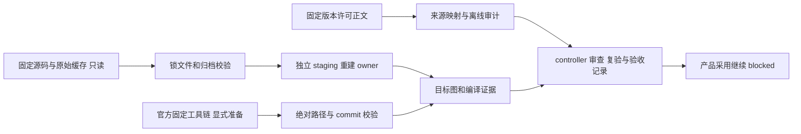

# macOS Computer Use 第六轮：Driver 缓存、许可与工具链闭包

日期：2026-10-28。状态：本轮可实施工作已完成并经 controller 验收；许可与产品采用仍 blocked，产品默认禁用。

## 最终结论

| 项目             | 第六轮结果                                             | 边界                                                     |
| ---------------- | ------------------------------------------------------ | -------------------------------------------------------- |
| 原缓存差异       | 317归档；250目录仅缺Cargo.lock，0 extra/内容或mode改写 | 原缓存仍blocked，不修写历史输入                          |
| 安全重建与依赖图 | 316锁定归档重建通过；298目标包中290 registry全部核验   | core-graphics path patch单列，不要求其它目标的全部锁归档 |
| 固定工具链       | 独立Rust1.97.1、commit/host/sysroot/二进制摘要通过     | 不改变默认stable或旧Helper1.93.1                         |
| 本机库编译       | Cargo exit0，SDK rlib/dylib保存并独立核验摘要          | 未运行候选应用；无OS沙箱保证；非正式产品Helper           |
| 许可材料         | 22包补充映射验证；488份正文/通知归档逐一核验           | 14包缺正文、2包partial、6个MPL义务待审，许可证门blocked  |
| 回归/静态检查    | 9文件97tests；根typecheck、lint、architecture通过      | lint仍301既有warnings；定向lint为0；非原生功能验收       |
| 产品采用         | blocked；zcodeCuaPlaceholder=true                      | 未安装证书、未改系统权限；D06/Helper/Fenced缺口保留      |

完整验收与两次独立审计证据见 [归档说明](../../packages/desktop/native/macos-cua-driver-closure/reports/2026-10-28/AUDIT.md) 和 [机器可读摘要](../../packages/desktop/native/macos-cua-driver-closure/reports/2026-10-28/acceptance-summary.json)。原生功能尚未验收通过。

## 合同与基线

先更新 [spec 第六轮](../../specs/computer-use-macos-phase1.md#第六轮缓存许可材料与固定工具链闭包2026-10-28)，再改行为与测试。沿用第五轮固定 upstream `2d2f99228d4d2508dc6fcc84c176b296e146714a` 和候选来源清单；不覆盖历史输入/报告，不安装证书或更改系统权限。

Node 24.14.0 / pnpm 10.33.2。freshness main ahead30/behind0 通过；architecture 0 violations/0 new；desktop 为 unmanaged。开工快照 `/tmp/zody-cua-round6-baseline` 17060 文件。根 typecheck 当前通过，不沿用第五轮 UI/Web 错误结论；lint 301 warnings/0 errors。

Broker route `deepseek-flash`，provider magpie，model `commandcode-plan/deepseek/deepseek-v4.1-flash`；用户已批准普通付费委派。cwd `/Users/zhvala/SourceCode/zody`，连接授权仅此目录。只读调查 worker：缓存/工具链 `broker:deepseek-flash-ro-989625ff4f43c3ef:01a18072-bbc8-75c3-9a63-ac6bcef7596e`；许可 `broker:deepseek-flash-ro-989625ff4f43c3ef:01a18072-bc5a-7931-8bd8-0f0a8d46f115`。

## 所有者与顺序



## 范围裁决

原缓存差异与重建结果独立记录。固定工具链可显式准备到本项目独立输出目录，不变更默认 stable、旧 Helper 1.93.1、系统权限或钥匙串。官方1.97.1发行可取得，不能因为本机未预装而重复留下可解决缺口。许可正文补齐不等于义务审查完成；网络取材必须固定版本/commit并冻结摘要，审计默认离线。

workspace-write writer：

- R6-L `broker:deepseek-flash-rw-c2d541bc0c4e8861:01a18077-9432-7433-9640-fbc18dbb2272`：许可库、license-_ 新模块、macosCuaDriverLicense_ tests、license-supplements 材料，禁止主审计/依赖/缓存/旧报告写入。
- R6-C `broker:deepseek-flash-rw-c2d541bc0c4e8861:01a18078-8cb1-7e71-ba7b-d48d51c73c06`：缓存/固定工具链/主审计接线；仅 cache/dependencies/report/core/command/patch/source 及新增非 license 模块、专属 Cache/Toolchain/Round6 tests、round6 配置/README。禁止许可库、补充材料、旧报告、D06/生产 src 修改。

controller 独占顶层 spec/design/plan，负责最终 diff 和真实验证。两条实现路径文件互斥，旧 Helper 固定工具链与产品 producer 不变。

## 验收

最终验收见下表及文末证据入口。两个 DeepSeek writer 已完成并冻结，controller 已独立审查最终增量及复跑。

## 显式环境准备

controller 从官方 `https://static.rust-lang.org/dist/channel-rust-1.97.1.toml` 获取发行清单并核验 SHA-256 `03569b1886ceb5c05276b50c8431ab111de944cd6140fe1fa7d821dd8e0f29cf`。使用独立 RUSTUP_HOME/CARGO_HOME 将 1.97.1 minimal + rustfmt 安装至 `output/cua-driver-round6/rustup`；准备日志 `/tmp/zody-cua-r6-toolchain-prepare.log`。该安装仅改变独立输出目录，`rustup show active-toolchain` 在默认环境仍为 stable。未更改 shell profile、系统默认工具、证书/钥匙串/TCC。

rustc commit `8bab26f4f68e0e26f0bb7960be334d5b520ea452`，cargo commit `c980f4866141969fab6254a680546a277789d6f0`，host arm64 Darwin。原始manifest及实际bin摘要/version输出保存于 `output/cua-driver-round6/toolchain-preparation.json`。官方发布记录 https://blog.rust-lang.org/2026/07/16/Rust-1.97.1/ 。安装成功不等于候选编译成功。

## 调查收敛

只读调查发现当前缓存317份归档；第五轮目标图290个registry归档全部与锁checksum相符，其中231个解包目录仅缺顶层Cargo.lock，59个本就不含该文件且逐字节相同。全部缓存250处缺lock、无其它已观察的extra/changed；删除动作执行者没有证据，不能猜测根因。实现针对实际macOS目标图/构建闭包，不要求下载其它目标的全部558个锁条目；缓存额外包须显式排除/记录。vendor/core-graphics是已冻结path patch，不能声称等于原crate。

许可调查指出copying.rs/copyrights.yml误命中，旧33计数必须重算。材料准备按crate内vcs固定SHA和上游真实路径取材，不靠同名正文或兄弟包推断。controller静态枚举目标图发现43个build script与18个proc-macro；实际编译闭包将以Cargo JSON记录，不用这些静态计数替代实际执行证据。

controller 独立复核 `/tmp/zody-cua-r6-cache-inventory-controller.json`：317归档、250仅缺Cargo.lock、67完全相同、0extra/changed；316个有registry lock checksum且全部相符，core-graphics path patch单列。原始full-source(752)、harness(15)、cache registry(15334)共16101文件摘要保存于 `/tmp/zody-cua-r6-external-input-hashes.json`，收尾必须比对。

## 中间验证与审查

controller 首次真实 `--rebuild-cache --toolchain-root` 在 `output/cua-driver-round6/controller-audit-first/` 完成：source/dependencies/toolchain pass，316归档重建、290目标registry核验；originalCache仍blocked，before/after treeSHA `00bb75b975a0b81793603d117fe118c6c4c09684e3dfe3a7d21cde43523d9e0f` 相同。此输出尚使用旧许可扫描，不作为最终许可结论。

`controller-build-first/` 的Cargo build exit0，实际43个build-script-executed、18个proc-macro编译产物，SDK rlib/dylib存在；审计器未识别 `path+file://…/cua-driver-sdk#0.37.0` 简写identity，故报告build=fail、未保存SDK产物。此为本轮审计器错误，需修复后独立复跑，不改写旧失败报告。平台实测macOS SDK27.0、Apple clang21.0.0；不等于最低macOS验收。

审查要求已反馈DeepSeek：归档避免重复全量解压，独立检测路径/重复/链接/大小/保留marker；原缓存与重建状态分离；摘要先于工具执行；依赖门拒绝时不得编译；失败编译保留日志；现代Cargo身份解析；proc-macro产物不冒称执行证明；许可manifest/version/checksum/vcs/正文关联严格校验，通知或partial覆盖不自动关闭材料门。

## Controller 已取得的编译与保留证据

修复Cargo简写package ID后，以冻结的缓存/工具链/构建实现运行 `output/cua-driver-round6/controller-build-accepted/`：Cargo与审计退出0，source/dependencies/toolchain/build为pass；产品采用仍blocked。使用 `--rebuild-cache --toolchain-root …/1.97.1-aarch64-apple-darwin --build-library`，未传补充许可参数；该报告的许可计数只反映包内扫描，最终许可结论以随后带固定supplements的独立审计为准。许可模块变更不影响此次编译输入、工具链或构建实现。

实际43个build-script-executed事件、18个proc-macro编译包、319个产物记录；SDK保存为 `build-artifacts/libcua_driver_sdk.dylib`（61262696 bytes，SHA-256 `518f0c30a81409c8fc6435bc0329003bde26dd9eec59f057a74d77441981b73d`）和 `.rlib`（65928096 bytes，SHA-256 `7d3adba2efac8d85aaf8d521ebe77351858acc27d979ce337f1586bef81ef1dd`），controller再次读取文件校验摘要一致。使用SDK27.0、Apple clang21.0.0，部署目标变量强制unset，采用工具默认值；此结果不覆盖最低macOS。

编译使用隔离的HOME/CARGO_HOME/TMPDIR/target及绝对工具路径，Cargo locked/offline；build-script/proc-macro没有OS网络或执行沙箱保证，报告osSandbox=false。未启动上游应用、未运行其测试、未申请TCC、未安装证书。worker所在外层沙箱的SwiftPM构建曾被sandbox-exec拒绝；controller独立本机实跑成功，保留两种环境事实，不让worker结果代替本机验证。

历史输入收尾复核：16101文件0变更/缺失、0新增；旧Helper/D06/第五轮报告/producer共583个开工文件0变更。默认 `rustup show active-toolchain` 仍stable，placeholder仍true。无commit、无清理/回滚其它任务改动。

## 许可最终验收与剩余依赖

固定补充manifest共22条：6个CUA workspace包，6个旧objc2/block2/objc-sys/framework包，6个UniFFI包，以及jsonschema-regex、rquickjs-core、uuid-simd、vsimd。7个正文文件有6种不同摘要；相同正文仍分别记录真实repo/commit/path关系。绑定实际Cargo.toml、workspace继承version/license、Cargo.lock checksum、VCS commit及VCS文件SHA-256，不把版权通知、源码文件、token或截断正文当材料闭包。

controller从官方固定commit raw独立复核，另只读下载objc2的4个固定commit codeload归档并枚举license/copying命名文件。较新objc2的1339B根LICENSE.md是许可选择/链接与Apple SDK衍生材料说明，不能替代正文；其它匹配是copying.rs等源码。这里只证明许可命名文件枚举未找到完整正文，不宣称任意源码内容中绝无正文。通知、来源及归档枚举已保存在 [license-supplements](../../packages/desktop/native/macos-cua-driver-closure/license-supplements/README.md)，与body manifest隔离。

剩余项目明确保持blocked：

- **14个包缺正文**：13个较新objc2/block2/framework/encode包及siphasher。objc2还需审查上游说明中的Apple SDK衍生材料关系；siphasher固定版本只有COPYING指引，已试固定commit LICENSE-MIT/APACHE均404。
- **2个包partial**：msvc_spectre_libs和shlex声明MIT OR Apache-2.0，目前只有完整MIT正文；shlex Apache文件仅566B通知，msvc固定commit相应文件404。本审计保守记录全部表达式分支的材料覆盖，不自动代选OR许可，也不把partial等同非法使用。
- **6个UniFFI包**：完整MPL-2.0正文已补，义务/产品分发判断仍pending，不作法律结论。

最终冻结后显式传入supplements重跑 `controller-final-accepted/`，source/dependencies/toolchain pass，licenses/productAdoption blocked，build=not-requested。与独立 `controller-build-accepted/` 的build=pass分开保存；两份报告的来源清单/patch摘要一致。许可manifest格式化后的SHA-256为 `6b75bf6283798de5d363835e6db41a0ff92948d3f47dac9034807d5f1e0515c8`，与最终报告完全一致。中间 `controller-license-accepted/` 记录的是格式化前manifest摘要，已由冻结后的复跑替代，未篡改旧报告。

## 最终验证与审查范围

- Node24.14.0执行 `pnpm typecheck`：exit0。第五轮UI/Web类型错误本轮已消失；本轮未为通过检查改动UI/Web。
- `pnpm lint`：301 warnings / 0 errors，与开工基线一致。本轮中间的license模块超行数与unused import已修复；不能把中间失败写成全程通过。
- 定向 `oxlint`：23文件，0 warnings/0 errors；定向 `oxfmt --check`通过；`git diff --check`通过。
- `pnpm architecture:check --changed`：0 violations/0 new。desktop脚本不受完整原生安全覆盖，结果不代表OS隔离或签名验收。
- Driver6文件46tests + Helper/doctor/placeholder3文件51tests = **9文件97tests**，controller在两个writer冻结后独立复跑通过。涵盖归档路径/重复/链接/权限mode/保留marker/大小、原始差异、工具链漂移、依赖门拒绝编译、Cargo真实身份格式/失败日志，以及许可来源/摘要/VCS漂移、通知/partial/正文识别负例。
- 真实归档复核：488份索引文件全部存在、无路径逃逸、SHA-256一致；索引/manifest/patch摘要一致，压缩报告解压后与原始报告字节一致。最终code摘要与校验日志随验收归档保存。
- controller审查的是相对开工快照的16个代码/测试文件增量及本轮材料/文档；未将前几轮已有未提交内容当本轮新增。旧Helper/D06/producer/第五轮归档583个文件和外部历史输入16101文件未改动。没有commit或回滚/清理其它任务文件。

## 下一阶段顺序

1. 在正式Driver最小构建方案中裁决并裁剪实验feature、cursor-overlay/PiP等非首期组件，重新生成实际依赖图；同步补证/审查本轮14缺正文、2partial、6MPL及objc2 SDK关系。当前编译成功的是冻结的历史候选，不是裁剪后的正式Driver。
2. 建立正式Driver与原生Helper的构建/打包和接口边界，再做固定local-self-signed身份、Helper加载、peer、TCC主体及升级稳定性验收。Developer ID/公证不是当前本地阻断；需要具体证书安装或系统权限变更时先列明操作及影响。
3. D06保留第五轮缺口：真实Browser/生产plugin-root解析、隔离下debugger、后代abort回收、SEA/签名资源完整性与TOCTOU。本轮未重跑或升级这些原生验收结论。
4. 原生输入/停止/撤销/手机输入屏障必须拿到真实Fenced再结算。Intel与最低macOS环境缺口保留；本机arm64编译不替代跨架构/最低系统验收。全部必要门通过前功能仍默认禁用。

## 复跑命令

```sh
node packages/desktop/scripts/audit-macos-cua-driver-closure.mjs \
  --source-repo /Users/zhvala/SourceCode/3rd-party-repositories/cua \
  --candidate-root /Users/zhvala/SourceCode/scripts/experiments/zody-cua-p0-g2-stop-retire-reservation/full-source \
  --cargo-home /Users/zhvala/SourceCode/scripts/experiments/zody-cua-p0-g2-stop-retire-reservation/build/cargo-home \
  --output-dir /tmp/zody-cua-round6-new-audit \
  --rebuild-cache \
  --toolchain-root /Users/zhvala/SourceCode/zody/output/cua-driver-round6/rustup/toolchains/1.97.1-aarch64-apple-darwin \
  --license-supplements packages/desktop/native/macos-cua-driver-closure/license-supplements/manifest.json
# 显式追加 --build-library 可同时重做库编译，使用新的output-dir。
pnpm exec vitest run packages/desktop/test/macosCuaDriver*.test.ts packages/desktop/test/macosCuaHelperDiagnostic.test.ts packages/desktop/test/macosCuaHelperLocalSelfSignedDoctor.test.ts packages/desktop/test/placeholderProducerDetection.test.ts
pnpm typecheck
pnpm lint
pnpm architecture:check --changed
```

审计不下载工具/依赖/许可。复跑前须按已记录的显式准备步骤具备固定工具链；缺工具链或归档时fail-closed，无stable回退。退出0仅表示来源审计完成且无verification failure，必须读取各独立gate；不表示许可或产品采用通过。

平台补证：本机macOS26.6.2(25G83)，CLT Swift6.4（swiftlang-6.4.0.34.1），swift-driver1.168.6，xcrun解析到CommandLineTools。xcodebuild -version明确失败：当前是CLT而非完整Xcode；这是实际环境记录，不掩盖为通过，也未安装Xcode。真实候选库使用现有CLT编译成功。详见归档platform-tool-versions.json；系统CLT/Swift仅记录实测，尚不构成跨机器可复现的平台工具链pin。
