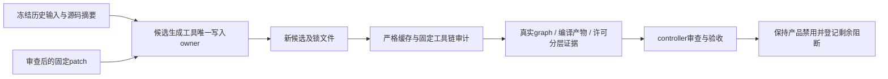

# macOS Computer Use Phase 1 第七轮：最小依赖裁剪与重新审计

日期：2026-10-28。状态：本轮可实施切片完成；controller独立审查与验收通过，正式最小Driver及产品采用仍blocked；功能默认禁用。

## 目标与边界

以第六轮冻结源码、工具链、缓存和许可记录为基线，在新候选中推进正式Driver的最小依赖裁剪。先处理可独立移除的feature/导出依赖；AX、overlay/PiP、录屏等共享平台耦合需根据代码证据分期，不以重写或空实现完成数字目标。最终采用、原生Helper、签名/TCC、真实Fenced及完整D06不由依赖图/库编译通过推导。

controller维护spec/计划并审查实际diff、独立运行验收；DeepSeek实现。没有证书安装、钥匙串/TCC变更、真实系统输入或启动上游应用。local-self-signed持续政策不变。Intel/最低macOS环境缺口保留。

## 基线

- Node24.14.0；freshness main ahead30/behind0通过。architecture changed 0 violations/0 new；desktop仍未受完整原生边界策略覆盖。
- 本轮开工typecheck通过；lint 301warnings/0errors。未沿用上轮UI失败结论。
- 仓库开工快照17605文件在 `/tmp/zody-cua-round7-baseline/`；保留所有已有未提交变更。
- 历史实验full-source752、harness15、registry15334共16101文件摘要独立复核，无变更。第六轮真实图298包=290registry+8path；许可14missing/2partial/6MPL pending。
- 固定上游 `2d2f99228d4d2508dc6fcc84c176b296e146714a`，Rust1.97.1使用第六轮项目内工具链，不改变系统默认。

## 任务与所有者

已调用routes，使用用户已授权canonical `deepseek-flash`（magpie / commandcode-plan/deepseek/deepseek-v4.1-flash），cwd均为 `/Users/zhvala/SourceCode/zody`。

- 只读A：`broker:deepseek-flash-ro-989625ff4f43c3ef:01a180bb-fded-72c1-be35-b5d786e819fc`，源码/feature耦合与最小裁剪边界。
- 只读B：`broker:deepseek-flash-ro-989625ff4f43c3ef:01a180bb-fe2c-7800-b7ef-b2c439dc85f2`，候选重建、审计复用和许可子集。
- 写入A：`broker:deepseek-flash-rw-c2d541bc0c4e8861:01a180c4-b99e-7b93-b796-b152fc45cecb`；独占round7 profile/patch/源manifest/supplements（comparison-policy除外）、prepare入口及其lib/test、output候选。
- 写入B：`broker:deepseek-flash-rw-c2d541bc0c4e8861:01a180c4-b9d9-78d3-8589-624841fe3b3d`；独占comparison入口/lib/test/policy，仅对既有report入口增加防覆盖校验。
- controller独占本计划与顶层spec/design；两个writer不得重叠，不改旧报告或原实验。



## 本轮裁决

保留SDK与手写ABI入口，本轮不新增空facade。platform-macos引用core时关闭默认feature并显式保留yaml；SDK也显式保留yaml。script/rego的源码可以保留为未编译模块，但实际目标图不得出现rquickjs/rquickjs-core/rquickjs-sys/regorus，现有条件注册保证run_script不开放。显式配置不支持的Rego必须失败。contract与SDK引入默认关闭的UniFFI feature，所有derive/export/constructor/default/scaffolding按feature门控，保留Rust类型与手写ABI；若原生库实际编译未通过，不得记录UniFFI已关闭成功。

拒绝只读建议中的移除platform no-input/strict-frame默认限制：这会涉及原生安全路径，本轮保持两个feature与原生实现原样。AX/overlay/PiP/录屏/剪贴板等仍在图中时明确保留。保留Cargo.lock所有未改变的registry source/checksum，不借裁剪升级版本。

候选在 `output/cua-driver-round7/.../full-source`，由仓库内固定增量patch和生成工具从原752文件候选重建；从workspace排除外部harness，workspaceExternalMembers为空。不写外部experiment目录。旧到新来源关系、锁差额与新source manifest随round7 profile保存，正式审计仍显式传review-config/source-manifest。

## 验收计划

按spec R7-01至R7-06：重建正反例、feature与依赖排除断言、实际离线库编译、逐包新旧图/许可差额、保留历史输入与默认禁用。必须重跑相关测试、pnpm typecheck、pnpm lint及架构检查。目标图、编译闭包和锁文件分别记数；许可材料缺口不能被包数缩减掩盖。

## 最终结果

| 项目                        | 第六轮                       | 第七轮实测                                                                                          |
| --------------------------- | ---------------------------- | --------------------------------------------------------------------------------------------------- |
| macOS SDK实际目标图         | 298包（290 registry+8 path） | 259包（251 registry+8 path），移除39、无新增                                                        |
| 目标图内QuickJS/Rego/UniFFI | 存在                         | rquickjs/rquickjs-core/rquickjs-sys/regorus/uniffi及uniffi\_\*全部不在图中                          |
| Cargo.lock                  | 569条、558 registry          | 字节完全相同，无版本/checksum升级；锁内仍含可选/其它目标依赖                                        |
| 手写C ABI导出               | 15                           | 15个名称全部保留；没有调用这些ABI                                                                   |
| UniFFI命名导出              | 276                          | 0；仅检查真实库符号表，不是Helper加载证据                                                           |
| 实际库编译                  | Rust1.97.1 pass              | 同版本arm64 locked/offline pass，37个build-script-executed事件、16个proc-macro编译包、261个产物记录 |
| 许可缺正文                  | 14                           | 13；siphasher随依赖图移除                                                                           |
| 许可partial                 | 2                            | 1（shlex）；msvc_spectre_libs随图移除                                                               |
| 图内MPL包                   | 6                            | 0；UniFFI包退出本候选，不等于法律义务审查完成                                                       |
| 固定supplements             | 22条                         | 保留15、删除图外7条；5个正文文件字节不变、6个workspace映射更新Cargo摘要                             |

候选由历史752文件重建为753文件：相对历史输入20个文件修改、1个纯测试文件新增；相对上游选定baseline为672 unchanged、38 modified、43 added、0 removed。controller核对了全部21文件差额：15个既有Rust文件仅调整UniFFI属性/derive/scaffolding及格式，函数正文和原生执行实现保持；另外5个Cargo清单和1个纯测试文件。没有把未编译的script/rego源码、其它平台、AX/overlay/PiP/录屏等写成已删除。

增量patch SHA-256 `2798b890e4293147652b9994579404383b3aa70e8d434287ddd11e8524c7e64f`；candidate tree `f110f6466d06036ff9a028c7e35bd4f3b6fe312b67607c2a3f930f1c250f8d48`；source manifest `53fc08d9835f27c07ae756f93a345b9d0a0cf6d9197aa01db03796fc605f5267`。完整上游到候选patch `78618010631ffb93d34ebf984b770d392c6b595ae0dc3e415b4587dfbcf08947`由正式审计生成并逐文件重建核验。

## Controller独立验收

- R7-01：实际运行prepare，从冻结输入重建 `output/cua-driver-round7/candidate-work/controller-first/full-source`；源码/patch/清单/树摘要一致。测试覆盖已有输出、源/patch漂移、路径逃逸、symlink、重复manifest与发布清理。
- R7-02/R7-03：对上述自建候选运行 `controller-build-first`，严格重建316份已锁归档、核验251个目标registry包，来源/依赖/工具链/真实build均pass；原cache仍因缺Cargo.lock记blocked且未修改。库为debug制品，不代表正式签名/发布制品或性能结论。
- dylib 34,986,104 bytes，SHA-256 `128742959b2ce979c9ff2ec4ba6ccd35ea7c4877593a904b95c67bfb3b3f1185`；rlib 36,046,752 bytes，SHA-256 `24ca20ca609bfbd46cb1204ccbf7521e7b3f887cd37b4590cdc0a32add09641c`。controller读取真实文件核验并以nm检查导出。
- R7-04：独立 `controller-final-audit` 显式传入冻结supplements，随后真实运行 `controller-comparison`，来源/依赖/工具链/子集/差额核验pass，licenses/productAdoption仍blocked。431份索引许可材料及1份upstream根正文均逐文件复核摘要。
- R7-05：**11文件125项Vitest通过**；另用controller新建严格缓存、固定工具链和独立target运行**3项Rust纯函数回归通过**：Rego明确拒绝、YAML deny保持、run_script不注册。未执行上游整个测试集或任何原生工具。显式opt-in UniFFI兼容构建未在本轮验收。
- R7-06：Node24.14.0下 `pnpm typecheck` exit0；`pnpm lint` 301warnings/0errors；`pnpm architecture:check --changed` 0violations/0new；16个新增/修改代码测试文件定向lint 0/0、format通过。架构工具未覆盖全部native安全边界，不据此关闭OS隔离或签名门。
- 收尾复核外部16101输入文件0变更/缺失、0新增；开工时旧报告/Helper/producer/node-repl-host的1175文件0变更。所有其它任务既有未提交改动保留，无commit/reset/清理。

编译与纯测试使用绝对Rust路径、独立HOME/CARGO_HOME/TMPDIR/target；Cargo offline/locked不是OS执行或网络沙箱。SDK27.0、Apple clang21.0.0使用本机已有CLT；未安装证书/软件或请求系统权限。worker外层沙箱的SwiftPM编译被sandbox-exec拒绝；controller本机真实编译成功，两种环境结果分别记录。默认Rust未被切换。部署目标保持unset，不能证明最低系统。

## 审查修正与证据分层

controller要求并复核：同版本材料变化与版本替换/图移除分开；多版本集合变化不漏记；所有包的zody-dev-probe均拒绝；旧输出防覆盖同时保留macOS /var、/tmp父路径兼容；root symlink/重复manifest拒绝；合法cfg_attr不误报；实际从base应用patch而非预置正确输出；补充映射registry不可漂移、workspace仅更换已验证Cargo摘要。测试fixture移到test/fixtures，复用既有命令执行/环境owner。

第一次广泛测试碰到两个新测试文件已写而实现模块尚未创建，既有97项通过、两个新增suite报缺模块；最终125项统一复跑通过，未将中间失败抹掉。编译报告未传supplements，所以其中28missing仅是包内扫描；最终13missing以随后显式带材料审计为准。review config的描述性baseSourceManifest相对路径修正前后摘要不同，最终为`73171d6112f54c2541f2905f96310e04c3d5b15e49c313d5484b354ecf359ac0`；候选/增量patch/source manifest/完整patch均未变化，编译结果与最终审计对应同一源码。

## 剩余阻断与下一阶段顺序

1. 继续抽取精确前台视觉窄接口，拆分AX、剪贴板、overlay/PiP、录屏、Browser/daemon/remote等共享依赖；现有SDK候选仍不是完整最小Driver，也不是可直接发布的产品Helper。优先核对clipboard-rs等引入新版objc2的路径；删除能力必须先明确调用方与拒绝行为，不能塞成功stub。
2. 剩余13个缺正文包：block2@0.6.2、objc2@0.6.4、objc2-encode@4.1.0，以及objc2-app-kit/cloud-kit/core-data/core-foundation/core-graphics/core-image/core-text/core-video/foundation/quartz-core@0.3.2。上游许可选择通知和Apple SDK衍生材料关系仍需补证；shlex@1.3.0为MIT OR Apache-2.0，只有MIT完整正文，保守全分支审计保持partial。不能因旧MPL包退出图就宣称许可整体闭包。
3. 正式Helper构建/打包、固定local-self-signed身份、加载与peer校验、TCC主体和升级稳定性另行验收。Developer ID/公证不是当前本地阻断；证书安装或权限变更前说明具体操作与影响。
4. D06沿用第五轮未关闭项：真实Browser/生产plugin-root、隔离下debugger、后代abort回收、SEA/签名资源完整性/TOCTOU。本轮未重跑或升级D06结论。
5. 原生输入、撤销/stop与手机屏障必须绑定真实Fenced证据；缺Helper继续fail-closed。Intel/最低macOS缺环境，本机arm64编译不能替代。功能默认禁用，zcodeCuaPlaceholder仍true。

## 证据与复跑

冻结证据见 [第七轮归档](../../packages/desktop/native/macos-cua-driver-closure/reports/2026-10-28-round7/AUDIT.md)：完整报告压缩副本、真实build日志/摘要、图与许可差额、逐文件许可材料、源差额复核、符号表比较、原输入/旧产物核验与测试日志。库二进制留在独立output目录，不进入产品打包。

```sh
node packages/desktop/scripts/prepare-macos-cua-driver-round7.mjs \
  --base-source /Users/zhvala/SourceCode/scripts/experiments/zody-cua-p0-g2-stop-retire-reservation/full-source \
  --output output/cua-driver-round7/candidate-work/new-run/full-source
node packages/desktop/scripts/audit-macos-cua-driver-closure.mjs \
  --source-repo /Users/zhvala/SourceCode/3rd-party-repositories/cua \
  --candidate-root output/cua-driver-round7/candidate-work/new-run/full-source \
  --cargo-home /Users/zhvala/SourceCode/scripts/experiments/zody-cua-p0-g2-stop-retire-reservation/build/cargo-home \
  --output-dir output/cua-driver-round7/new-audit \
  --review-config packages/desktop/native/macos-cua-driver-closure/round7/review-config.json \
  --source-manifest packages/desktop/native/macos-cua-driver-closure/round7/source-manifest.json \
  --rebuild-cache \
  --toolchain-root /Users/zhvala/SourceCode/zody/output/cua-driver-round6/rustup/toolchains/1.97.1-aarch64-apple-darwin \
  --license-supplements packages/desktop/native/macos-cua-driver-closure/round7/license-supplements/manifest.json \
  --build-library
node packages/desktop/scripts/compare-macos-cua-driver-closure.mjs \
  --baseline-report packages/desktop/native/macos-cua-driver-closure/reports/2026-10-28/report.json.gz \
  --candidate-report output/cua-driver-round7/new-audit/report.json \
  --policy packages/desktop/native/macos-cua-driver-closure/round7/comparison-policy.json \
  --candidate-supplements packages/desktop/native/macos-cua-driver-closure/round7/license-supplements/manifest.json \
  --output-dir output/cua-driver-round7/new-comparison
```

每次使用全新输出目录；退出0只表示相应审计/比较完成，必须读取独立gate，不表示许可、原生或产品通过。
