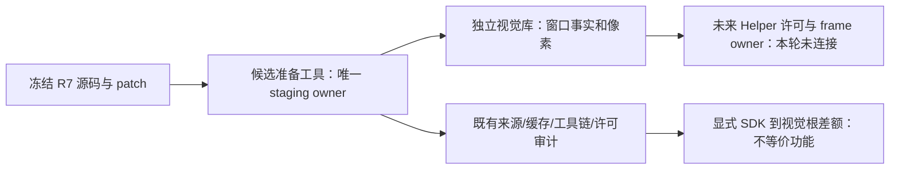

# macOS Computer Use Phase 1 第八轮

开始：2026-10-28；最终验收：2026-10-29。状态：本轮视觉窄接口候选、依赖裁剪与工具验收完成；功能默认禁用，完整首期仍 blocked。

## 基线与本轮裁决

使用第七轮冻结树 `f110f6466d06036ff9a028c7e35bd4f3b6fe312b67607c2a3f930f1c250f8d48`，路径 `output/cua-driver-round7/candidate-work/controller-first/full-source`。上游固定 revision `2d2f99228d4d2508dc6fcc84c176b296e146714a`，不追随当前 checkout。R7 实际 SDK 图为259包，许可13 missing/1 partial；本轮开始已复核457份归档证据无变更。

开工 freshness main ahead30/behind0；Node24.14.0。全仓 typecheck 通过，lint 301 warnings/0 errors，架构检查0 violations；desktop 未受模块合同管理，架构检查不证明原生安全。

源码证据：platform capture 同时调用 windows、input::skylight、cursor::overlay、capture_consent 和 core::image_utils；windows 连接 AX 过滤与 SkyLight Space 查询；平台默认依赖 clipboard-rs、cursor-overlay、pip-preview、SCK macos_15_0。旧 capture_consent 对裸进程/部分未知状态放行并有环境绕过，不能移植为可信许可证明。

本轮选择新增独立视觉 crate 构建根，保留旧树但不编译其宽入口，避免一次改写所有平台生命周期。抽取真实单窗口 SCK/CG 事实与 PNG 实现，公开入口无可信 Helper 许可时明确失败。原生实现内部可编译；不运行，不冒充已验收的 finalFrame/前台授权/进程身份。AX 语义树、剪贴板、overlay/PiP、平台录屏及输入不进入新图；SCK 自身内部依赖按实际证据记录。

## 能力裁剪与尚存依赖

| 能力/依赖              | 本轮新根的目标                                     | 验收边界                                           |
| ---------------------- | -------------------------------------------------- | -------------------------------------------------- |
| 剪贴板                 | 不链接 clipboard-rs                                | 13项新版objc2缺口是否离图以实际graph为准           |
| AX                     | 无语义树、动作或私有AX窗口SPI                      | CG事实不构成精确前台/进程incarnation证明           |
| overlay/PiP            | 不链接cursor-overlay/pip-preview，不注册UI生命周期 | 不把旧SDK的呈现能力算作新根能力                    |
| 平台录屏               | 不导入video_sckit/recording_hooks                  | SCK8.0.1仍构建Swift bridge，录屏源码耦合未完全切除 |
| 截图                   | 内部真实SCK单窗口+PNG；公开入口未批准即失败        | 无实机截图、TCC或无弹窗证明                        |
| 输入、lease与frame发布 | 本轮不连接                                         | 不生成授权、Fenced或finalFrame成功证据             |

## 场景与工作边界

验收按 spec R8-01 至 R8-06。纯测试先于实现；不执行上游全套 native tests。不安装工具链、证书、修改系统权限或运行截图。controller 独立审查最终 patch 和 JS diff、重新构建、复核实际 graph/许可，执行相关测试、pnpm typecheck/lint/architecture。旧实验/缓存/归档只读，输出仅本项目 round8 新目录。

## DeepSeek 台账

实际路由 `deepseek-flash`，provider `magpie`，model `commandcode-plan/deepseek/deepseek-v4.1-flash`；用户已授权。cwd `/Users/zhvala/SourceCode/zody`。

| 任务                    | access          | worker ID                                                                      | 文件边界                                                      |
| ----------------------- | --------------- | ------------------------------------------------------------------------------ | ------------------------------------------------------------- |
| A 平台视觉耦合调查      | read-only       | broker:deepseek-flash-ro-989625ff4f43c3ef:01a182f2-f951-79e2-9edf-7aa0a11e43f2 | 无写入                                                        |
| B 根/许可/审计调查      | read-only       | broker:deepseek-flash-ro-989625ff4f43c3ef:01a182f2-f9ca-74c0-ae86-f4e9aa28528c | 无写入                                                        |
| N 视觉原生候选/冻结材料 | workspace-write | broker:deepseek-flash-rw-c2d541bc0c4e8861:01a182fd-d69b-7961-b8e4-65dde35f8272 | round8 native-work、round8冻结材料，排除comparison-policy     |
| C 换根比较与回归        | workspace-write | broker:deepseek-flash-rw-c2d541bc0c4e8861:01a182fd-d70b-77a2-a25f-1bcd023ab087 | comparison core/graph/report/transition、新R8比较测试与policy |
| P 冻结候选重建与回归    | workspace-write | broker:deepseek-flash-rw-c2d541bc0c4e8861:01a182fe-b547-73a3-acf8-d89de3feba2f | 新R8 prepare入口/helper/测试                                  |

并行写任务使用互斥文件边界；controller 只编辑 spec/design/plan 和独立验收输出。

## 尚未完成与依赖

真实截图/前台与进程 incarnation/finalFrame 发布、Helper 可信许可与加载、local-self-signed 固定身份/peer/TCC/升级、原生输入/Fenced、手机屏障及 D06 剩余项不由本轮编译关闭。Intel 与最低 macOS 环境缺失；当前 arm64 编译不证明最低系统兼容。许可正文缺项、Apple SDK 衍生材料关系与完整产品采用分别判定，不能将裁剪解释为法律审查完成。

## 审查与中间验证记录

controller 已审查并要求修正：TOML 依赖检查复用 tomllib，覆盖 rename/table/workspace alias；视觉 crate 加入原 workspace 而非嵌套 workspace；比较报告从 source.files 验证旧源码保留，不能只相信声明；窗口必需字段不补零、不截断；采集编排内部化并测试失败截断；PNG解码前设输入/分配预算，完整容器闭合校验；移除本轮无可信调用方的unchecked屏幕坐标转换。

工具侧独立87项Driver测试、根pnpm typecheck/lint/architecture通过（301 warnings/0 errors）。初次真实Rust诊断编译失败：SCK8.0.1 content_rect 需要macos_14_2，最初14_0特性不足；保留该次失败日志，最终结果另记。此时未运行原生函数。

工作中检测到另有 icon.icns/icon.png/icon_installer.icns/icon_installer.png 与 specs/fork-app-icon-integration.md 的并行变化，不纳入本轮，也不覆盖。

第二次controller独立编译通过Rust但测试Mach-O链接失败：AppleMetalBridge的`__swift_FORCE_LOAD_$_swiftCompatibility56`未解析。当前CLT已存在对应兼容库，未安装任何工具；本轮在新crate内补当前工具链的局部搜索路径，禁止靠屏蔽符号、修改registry或跳过native编译规避。根spec已补充构建owner规则，后续真实链接和启动结果见最终验收表。

首个冻结树 `fad2292f…b229e2` 的独立 audit 已真实构建rlib成功、实际图30包/29registry、62份包内许可材料覆盖30包（0missing/0partial/0reviewRequired/0MPL）。但其测试Mach-O启动时dyld缺少`@rpath/libswift_Concurrency.dylib`，测试尚未执行，不能算通过。继续在最终消费者链接补固定系统Swift rpath；完整日志留存，不用环境变量覆盖规避。

## 最终验收

全部 DeepSeek worker 已结束写入。controller 亲自审查 JS diff、原生 patch、锁文件、许可来源与最终格式差额，并从冻结 R7 重新应用 patch 至 `output/cua-driver-round8/candidate-work/controller-accepted/full-source`。最终树没有依赖 worker 的构建结果：单独重建缓存、编译、链接、启动纯测试并复核图和许可。

归档：[第八轮验收摘要](../../packages/desktop/native/macos-cua-driver-closure/reports/2026-10-28-round8/ACCEPTANCE.md)。该目录按本轮开始日期命名，最终记录跨至10月29日；包含完整报告压缩件、自包含上游 patch、包级许可正文、比较结果、失败日志及逐文件 SHA-256 索引。增量 R7→R8 patch 与冻结输入位于 [round8](../../packages/desktop/native/macos-cua-driver-closure/round8/README.md)。

| 检查                         | 实际结果                                                                                               | 结论范围                                                            |
| ---------------------------- | ------------------------------------------------------------------------------------------------------ | ------------------------------------------------------------------- |
| 精确重建与来源               | 767文件；R7的753路径全部保留，751文件字节不变；仅根Cargo.toml/Cargo.lock改变，新增视觉crate14文件      | 无旧代码删除，无旧安全feature改写                                   |
| 锁文件                       | 569→570条；569条旧记录完整不变、558个registry checksum不变，仅新增本地视觉包                           | lock数量不代表目标图                                                |
| 实际目标图                   | SDK259→视觉30（29registry+1path）；230移出、1新增、9项feature变化                                      | 新根功能缩减；接口/ABI/tool等价性未建立                             |
| 缓存                         | 316归档严格重建pass；实际目标29registry逐文件校验pass                                                  | 原缓存仍blocked，不修补或隐藏其Cargo.lock等差异                     |
| 许可材料                     | 新图0missing/0partial/0reviewRequired/0MPL；62份包内材料+固定upstream根许可                            | 无补充映射需求；旧图13missing/1partial仍存在，不是法律/产品采用结论 |
| 固定工具链库构建             | Rust1.97.1、locked/offline、aarch64-apple-darwin通过；8个build-script包、0proc-macro、30项编译产物记录 | 真正编译了SCK/Swift桥；HOME/缓存隔离不是OS sandbox                  |
| Mach-O链接与纯Rust测试       | 最终树16单元+16集成=32项通过；两个实际测试程序链接/启动成功，均有系统Swift rpath                       | 未调用窗口枚举、截图、输入或权限API；模拟观察只检验编排规则         |
| Driver工具测试               | 10文件87项通过；其中新增13项，旧比较回归仍通过                                                         | 不复用R7的125项计数，不代表整个首期所有测试                         |
| pnpm typecheck               | 通过                                                                                                   | 当前全仓入口；未沿用历史UI类型失败                                  |
| pnpm lint                    | 通过，301 warnings/0 errors，与开工基线相同                                                            | 定向11文件0warnings/0errors；未沿用历史行数失败                     |
| architecture:check --changed | 0violations/0new                                                                                       | desktop无受控模块合同，不能据此宣称原生安全通过                     |
| 格式与保留                   | 定向JS/TS、最终新crate rustfmt通过；原实验16101文件、R7归档457证据文件摘要不变                         | 并行图标任务改动保留，不归本轮                                      |
| 默认禁用                     | zcodeCuaPlaceholder仍true；未修改产品入口/默认executor                                                 | 公开截图请求验证参数后仍返回HostNotApproved                         |

最终树 SHA-256：`4cbad8776947504f9883bf5370d6802177090d7a01075c5640b64a730950d9de`。
增量 patch：85499字节，`9117756a71b9324cd0444848692a973a3c86972e9f8763470f6c5c5c529f9ed8`。
source manifest：`2e6311683b23ed5d33470202d70fcaab313a60fe0fae01b116c3408a19f905bb`。
本次rlib：979200字节，`93408d54bfcdc5b1a74343fecc7adf65640bbd37aacbbbf218766a9062e60953`；这是本次产物摘要，不承诺跨路径字节复现。

中间失败均保留：SCK feature不足、SwiftCompatibility56链接失败、缺系统Swift rpath导致dyld在测试前终止。另一次冻结清单排序导致树摘要错误被准备工具拒绝，修正后才进入验收。语义修正树`43fb7585…`曾通过；最后一次只调整rustfmt与build.rs说明注释，最终`4cbad877…`仍重新完成全套原生验证，没有沿用旧树结果。

## 剩余阻断与下一阶段顺序

1. 继续审查SCK8.0.1内部Swift bridge、AppleMetal及录屏源码闭包；当前仅排除了平台video_sckit/recording_hooks，未切掉SCK内部录屏代码。固定最终消费者的Swift链接/rpath与部署目标规则，最低系统尚无实机证明。
2. 接入真实Helper许可生命周期和取消/退出，再连接既有frame owner。当前内部SCK回调可能无限等待，未验收有界取消；窗口事实只有on-screen/layer0范围，不含off-space/minimized支持，也不证明前台、display或进程incarnation。
3. 以local-self-signed验证固定身份、Helper加载、peer、TCC归属及升级稳定性；本轮没有安装证书或更改权限。需要具体系统操作时再明确操作和影响，不以ad-hoc或关闭library validation绕过。
4. 继续D06后代终止、调试附加、不可篡改打包资源、SEA及真实Browser E2E；随后验收原生Fenced/Drained和手机输入屏障。runtime revoked、控制ACK和测试进程退出均不能代替它们。
5. 补齐Intel、最低macOS和真实Retina/多显示器环境。当前macOS26.6.2/SDK27.0的arm64构建与纯测试不关闭这些缺口。

下一阶段能直接开始的是第1项源码/构建闭包与第2项可信接口设计和纯回归；本轮不提前开放原生采集或生产功能。
