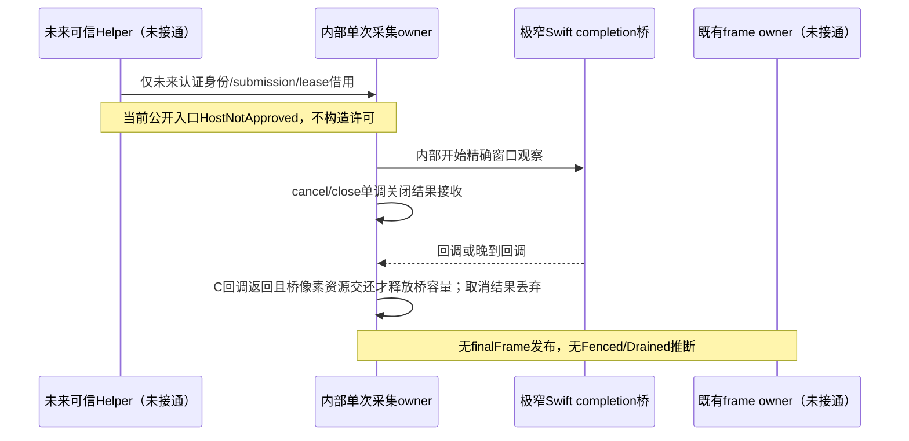

# macOS Computer Use Phase 1 第九轮

开始：2026-10-29。状态：本轮可实施范围完成并独立验收；默认禁用，产品采用 blocked。

## 基线与调查裁决

R8冻结树 `4cbad8776947504f9883bf5370d6802177090d7a01075c5640b64a730950d9de`，本地 `output/cua-driver-round8/candidate-work/controller-accepted/full-source`；上游固定 `2d2f99228d4d2508dc6fcc84c176b296e146714a`。旧归档、registry与其他未提交改动只读。本轮材料仅 round9；不追上游HEAD。

开工freshness main ahead31/behind0；shell Node24.21.0，mise未安装，实际验证显式使用本机已有Node24.14.0路径，pnpm10.33.2。开工根typecheck通过，lint301warnings/0errors，架构0violations。desktop受控上下文为managed=false，架构通过不证明native安全。

已核实 SCK8.0.1 Swift Package 的主target依赖CoreMedia和Metal，目录隐式纳入Stream/RecordingOutput/AudioDevices/picker；Rust wrapper也引入apple-metal。R8 capture使用SCShareableContent::get与SCScreenshotManager::capture_image，经SyncCompletion等待；没有可信许可接线。系统SDK提供completion handler API，因此可派生独立最小桥，避免把裁剪整套wrapper当成本轮前置条件。

只读调查与controller复核补充：SCK crate记录VCS `2a9f13bcbeadb0aabc5596f0ff3d2ba71da8c1d0`；R8最终两测试Mach-O的LC_BUILD_VERSION均为minos11.0。新消费者必须与Swift对象的14.2下限闭合；14.2是本轮保守构建选择，不是把SCK Rust feature名当作Apple API最低版本。completion源码不使用Task仍可能由SDK module autolink引入Swift concurrency/框架，实际符号与动态依赖必须如实登记。移出AppleMetal wrapper不声称系统ScreenCaptureKit内部不用Metal。

## 实施边界与所有者

先更新spec R9-01..06，再委派实现。保持R8所有旧文件路径；仅新视觉crate及必要根lock变化，新增消费者探针与冻结材料。真实Swift桥负责单次精确窗口选择、截图与RGBA交付，Rust操作owner负责取消/退出观察和内存/容量，不拥有授权。最终消费者构建入口负责Swift链接/rpath/部署目标。候选准备工具负责精确重建，既有审计工具负责实际graph/缓存/许可。

## 工作拆分

实际路由 `deepseek-flash`，provider `magpie`，model `commandcode-plan/deepseek/deepseek-v4.1-flash`。cwd `/Users/zhvala/SourceCode/zody`；无UI grant。worker ID随派发登记。

| 任务                              | access          | 文件所有权                                                      | worker ID                                                                      |
| --------------------------------- | --------------- | --------------------------------------------------------------- | ------------------------------------------------------------------------------ |
| A桥与构建闭包调查                 | read-only       | 无写入                                                          | broker:deepseek-flash-ro-989625ff4f43c3ef:01a18559-1ba2-7093-aa18-05b917269ddb |
| N原生窄桥、取消资源、消费者及冻结 | workspace-write | output/cua-driver-round9/native-work、native/.../round9冻结输入 | broker:deepseek-flash-rw-c2d541bc0c4e8861:01a1855d-af45-7b01-86e8-22c8ee30fc93 |
| P严格重建工具与负例               | workspace-write | 新增prepare round9脚本/helper/test/fixture                      | broker:deepseek-flash-rw-c2d541bc0c4e8861:01a1855d-b1e4-75b3-9b78-df04b7a92f6a |

controller拥有spec/design/plan、独立验收目录，负责最终diff审查、从冻结输入重建、原生真实编译/链接/纯测试、图/许可核验及根检查。并发writer不共享文件。

## 不在本轮关闭的门槛

不运行真实窗口枚举/截图/输入或权限请求；不装证书、不改TCC。持续local-self-signed，无迁移期限；固定签名身份/Helper加载/peer/TCC归属/升级稳定性仍需单独真实验收。缺可信Helper生命周期，不能接生产或开放捕获。取消接收不是取消OS工作，callback永久丢失仍占容量。Intel、最低macOS实机、原生Fenced/手机屏障、完整D06仍blocked。

后续顺序：本轮源码/构建闭包→真实Helper认证许可与资源寿命→经确认的证书/权限操作与签名/TCC验收→完整D06和原生Fenced/手机屏障→两架构/最低系统与视觉场景。

## 验收记录

最终冻结树 `421530ae2c2cab7b537226e459905916c849c1cf76095db0a45f574f9c49e02e`，776文件；相对R8修改10/新增9/删除0。controller从冻结输入重建到 `output/cua-driver-round9/candidate-work/controller-final/full-source`，所有worker已停止写入。

| 项目                | 独立结果                                                                                                          |
| ------------------- | ----------------------------------------------------------------------------------------------------------------- |
| 实际视觉图          | 30→20，19registry+1path；probe图21；10移出、0新增registry、0feature变化                                           |
| 许可材料            | 0missing/0partial；44份包内材料，另保留派生原始Swift/许可/摘要；不是法律通过                                      |
| 真实构建/最终消费者 | 固定Rust1.97.1 arm64 locked/offline库、Swift对象、消费者链接和纯逻辑启动通过；minos14.2/SDK27.0/runtime rpath明确 |
| 测试                | 50项Rust纯测试、106项Driver工具测试通过；未运行真实枚举/截图/输入                                                 |
| 根验证              | Node24.14.0，typecheck通过，lint301warnings/0errors，架构0violations；定向格式通过                                |
| 保留性              | 3208文件快照仅三份计划内文档改变，201registry源码未变，R8树仍精确匹配                                             |

审查中修正了observer Drop未封闭、取消句柄跨线程唤醒、桥C ABI释放回调、交付前复核和重复回调像素分配边界。独立SDK27全桥编译推翻早期不兼容判断，不采用15.2回退。审计配置初次缺字段、格式中间失败均保留，最终树重新执行构建/测试，未用中间通过替代。

Swift系统Metal/其他overlay仍有实际autolink，不能声称系统无Metal。探针linker ad-hoc不是local-self-signed Helper；现有diagnostic Helper目标12.0不自动继承本候选14.2闭包。内部取消只封闭接收且不释放未归还的容量，非native Fenced/Drained。真实Helper许可、TCC、完整D06、Intel/最低系统仍blocked。

完整分层记录、复跑命令及可复核证据见[第九轮验收](../../packages/desktop/native/macos-cua-driver-closure/reports/2026-10-29-round9/ACCEPTANCE.md)。
