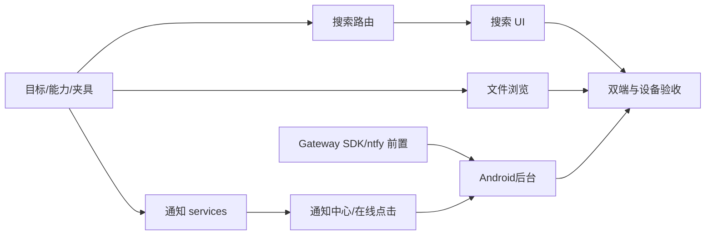

# 手机远控第一批：影响分析与实施计划

日期：2026-10-23。本文保留首轮影响分析，并追加当前实现证据。对应 [产品 spec](../../specs/mobile-remote-phase1.md)、[用例/覆盖矩阵](../testing/mobile-remote-phase1-cases.md)。状态仅按实际代码、测试和运行记录填写；pending UI fixture 不代表真实 Gateway、Host 或 Android 验收。

### P8 续验结果（2026-10-23）

以下条目记录此前已通过的分项证据；最终多端点击续验见下文“本轮续验”。这些子项通过不代表当前 P8 整体达到发布验收。

- [通知全链路](../testing/mobile-remote-phase1-p8-push.md)：真实runtime事件、隔离Gateway、自建ntfy、Android14/API34模拟器后台进程退出后接收、系统卡片点击、正确task及1条已读回执均通过；WDIO 1 pass。使用case-local provider replay，没有直接写通知库或注入receiver。
- [Doze/系统权限与 IPC](../testing/evidence/mobile-remote-phase1-p8-doze-permission.json)：受 DUMP 保护的 Debug APK `c772feb78b96da781c8c706a9ac37263c86dd1b100e4386bc146865795fc4e28` 在强制 deep IDLE、无电池豁免、应用进程不存在时完成真实 CLI→Gateway→ntfy→独立 root bridge→系统卡片→点击目标任务→1 条 read receipt。第一次点击轮次遇到 system_server watchdog reset；第二轮通过。撤销 POST_NOTIFICATIONS 得 0 卡片，恢复后得 1 卡片。普通 UID 10195 的严格探针因 `android.permission.DUMP` 被拒绝，见[IPC 证据](../testing/evidence/mobile-remote-phase1-p8-ipc.json)。
- [多 Host 隔离](../testing/mobile-remote-phase1-p8-host-isolation.md)：两个独立 Electron 窗口/Local Host、同路径不同 SSH identity 的真实 Gateway 搜索1项通过（0 failed/skip）。修复聚焦窗口恢复占位遮蔽有效 owner 的目录问题；同一任务重复投影跟随选定 owner；没有新增 Host。手机侧为协议探针，通知点击UI不在此结果内。
- [Gateway 撤权](../testing/mobile-remote-phase1-p8-revocation.md)：真实ntfy订阅、scope收窄、保留scope重连及整个device撤销均通过；对应持久证据不包含凭据。
- [Android 发布构建检查](../testing/mobile-remote-phase1-p8-release.md)：正常 `assembleRelease` 因缺少四个 `ZODY_ANDROID_*` 签名变量而 fail closed；此前 unsigned inspection release（SHA-256 `77a4a58a1048bb7a51eab5c0b188fc02e7667a5f9836734340823d557406461d`）与当时的 lint 检查通过，且 APK manifest 已包含 DUMP gate，但该 APK 不可发布且未安装。该 hash 早于本轮最新变更，不代表当前源码检查包。
- [Downloads](../testing/mobile-remote-phase1-p8-downloads.md)：真实APK三案通过，两个正例按字节与SHA-256验收，超限精确错误toast及无Downloads产物通过；测试下载已清理。
- 修复Debug APK HTTP策略不一致、daemon状态JSON截断、Downloads失败残留及Host通知reader未注册RPC；新增回归覆盖。
- 此前通知/Host/目录/点击路由回归14个文件130项通过；此前17个文件86项属于较早且不同选集，不累加为本轮计数。最新Android35项JVM测试通过；typecheck、typecheck:e2e、lint（0 errors/310 warnings）、architecture（0 violations）通过；mobile-web-isolation沿用前轮已通过证据。Gateway按自身Node22.20配置，在真实ntfy opt-in与每worker独立临时DB下最终测试201 pass/3 skip/24 files；撤权目标用例1 pass。
- 真实SSH搜索、文件、断线隔离与重连换session已通过，见[远程记录](../testing/mobile-remote-phase1-p8-remote.md)。WSL、OEM真机、Shizuku、正式签名release安装仍未完成；本轮 Android 撤权/换凭据及多Host卡片点击续验通过；scope-shrink UI 与完整 MC 矩阵仍待验收（Gateway真实ntfy撤权及双窗口Host搜索亦已通过）。不将这些子集通过等同于P8全部完成。

### 本轮最终续验（2026-10-23；P8 发布验收仍未完成）

停测后仅对齐文档状态，没有重新启动设备/E2E。文档整理后 Node 24.14.0 的 `pnpm typecheck` 通过，`pnpm lint` 为 0 errors/310 warnings；该静态检查不增加 P8 场景覆盖。

### 2026-10-24 续验（owner 边界设备验收 + 三线组件补齐）

- 设备：`mobile-notification-owner-boundary.test.ts` 通过（WDIO 1 case，artifact `desktop-e2e-20261023-173919-955`）。同 identity 双窗口（A connected owner / B 无 session 恢复占位）系统卡点击经 owner 打开任务并 receipt=1、桌面 active tab 与 Host PID 集合不变；删除 task 旧卡点击弹窗拒绝 receipt=0；关闭 workspace 旧卡 receipt=0/pending 保留/未开任意任务（"不可用"弹窗缺失记录为待跟进）。证据 [owner-boundary JSON](../testing/evidence/mobile-remote-phase1-p8-owner-boundary.json)、记录 [owner 边界](../testing/mobile-remote-phase1-p8-owner-boundary.md)。设备配置恢复并字节校验。
- 产品修复：MN01 local capture source eager 注册（spec §4.1 同步）；搜索 worker 旧轮请求级早退、码点 tie-break、canShowMore 打满判断、单 source 重试、overlay 状态保持；office 预览 16 MiB gate、文件错误三分类+stale 标识、保存取消、Android saveSessions 孤儿回收；`searchMobileHistory` catch 补 onSourceError。
- 回归：通知可靠性 136 tests（14 files）、搜索 97 tests、文件 192 tests、Android JVM 39 tests 全部通过；三线合并复跑无冲突。`windowHostControllerService.test.ts` 18 tests 在 onSourceError 修复后通过。

- 最终 WDIO A/B/C/D 续验通过，Android 进程跨 Desktop 重启保留。Fresh A/B/D 从真实 OS 通知卡片点击后到达精确 DOM session/body；网络记录核对 identity 与 `remoteSession`，read=1 且 native pending=null。C 撤权后 task DOM、bridge、read、subscription 均为 0，旧卡保持 pending；经真实 Settings 更换凭据后，C 路由至正确 Host A 并 read=1。脱敏持久证据：[P8 credential-click JSON](../testing/evidence/mobile-remote-phase1-p8-credential-click.json)。
- 本轮 APK SHA-256：`e708716d946bb06a6624e2e1ecc385fd2345e10ec3b21dd09f99b3cf57db58ad`。验证：8 suites/75 tests、Android 35 JVM tests、Android lint 0 errors/36 warnings；全仓 typecheck/lint 0 errors/310 warnings、architecture 0 violations。未发布或部署。
- P8 剩余通知可靠性/授权、搜索、文件、双端交互及环境发布门禁，统一见[剩余验收交接](../testing/mobile-remote-phase1-cases.md#p8-剩余验收交接2026-10-23-停测后的状态)。因此 P8 不标记为发布通过。历史 unsigned inspection SHA-256 `77a4a58a1048bb7a51eab5c0b188fc02e7667a5f9836734340823d557406461d` 早于本轮最新变更，不代表当前源码的检查包。

### 实施状态快照

| 车道        | 已落地的实现/证据                                                                                                                                                                                             | 尚未通过的验收                                                                                        |
| ----------- | ------------------------------------------------------------------------------------------------------------------------------------------------------------------------------------------------------------- | ----------------------------------------------------------------------------------------------------- |
| P0 共享边界 | shared target/capability/generation 与 bootstrap 一次性导航；60 项 focused 测试由集成记录确认通过                                                                                                             | 双端恢复/真实 Gateway/Android 全矩阵仍未验收                                                          |
| P1/P5 通知  | services feed/reader、延迟读回执、UI与原生点击；Doze、OS权限、DUMP及最新多Host卡片点击/整个凭据撤销与更换均有设备证据                                                                                         | Android scope-shrink UI、同identity owner切换、通知可靠性及完整 MC 矩阵仍待验收                       |
| P2/P3 搜索  | mobile history service/UI/scope 更新；3 focused suites、31 tests、search UI pending harness 通过；RA-SET-07；P8 隔离真实 SSH 搜索/断线 outcome/重连新 session 1 pass                                          | WSL、发布环境及双窗口/多 source 的完整场景仍待验收                                                    |
| P4 文件     | bounded listing/preview/save已实现；P8 MF08真实APK三案通过；隔离真实 SSH 文件RPC及断线/重连换 session 1 pass                                                                                                  | WSL、更多文件类型与故障场景待验收                                                                     |
| P6/P7 推送  | Gateway在其Node22.20运行环境201 pass/3 skip/24 files（真实ntfy opt-in）；最新Android35项JVM测试；API34强制deep IDLE完整后台通知/点击/已读回执、DUMP shell正向和普通UID拒绝、POST_NOTIFICATIONS撤销/恢复均通过 | 未生产部署/正式签名发布；OEM/Shizuku、scope收窄UI、同identity多窗口点击及其他后台矩阵仍是首批发布门槛 |

## Feature Summary

| 字段     | 内容                                                                                                                                                     |
| -------- | -------------------------------------------------------------------------------------------------------------------------------------------------------- |
| 用户目标 | 手机通知闭环、历史搜索、文件浏览；说明复用、模块改动和 E2E                                                                                               |
| 改动层   | presentation、option-source、validation、commit-effect、persistence、recovery                                                                            |
| 主域     | mobile replayable、task index/notification persistence、文件服务、UI shell                                                                               |
| 主种子   | WebRemoteControlMobileShell、WebRemoteControlMobileTaskHome、useTaskNotifications、IWindowControllerService.listTaskList、WorkspaceFileTree、PreviewPane |
| 暂不交付 | 发布部署、新建项目/远程会话、文件写入、精确 messageId 搜索；Gateway SDK 改动见当前状态快照与 P6 记录                                                     |

## UI Surface Matrix

| 用户场景/入口            | 复用点                                                                | 本地展示/默认                                                 | gating                                               | 提交动作及权威落点                                   | 模式/隔离                                  |
| ------------------------ | --------------------------------------------------------------------- | ------------------------------------------------------------- | ---------------------------------------------------- | ---------------------------------------------------- | ------------------------------------------ |
| 首页通知入口             | MobileTaskHome、现有任务状态/权限 UI                                  | 手机只保留 feed projection；按安装实例读状态                  | 新 capability、授权 backend、Host 可达               | 新 feed/read RPC → services repo；任务事实仍 runtime | Web在线/Android系统；不改 task unread      |
| 系统通知点击             | IPlatformService、native event dispatcher、task-open/switcher         | bootstrap 持有一次性 target                                   | 当前凭证、identity、当前 pending interaction         | 查询通知 → bridge → snapshot → markRead              | 不批准、不启动 Agent、不切桌面 tab         |
| 首页历史搜索             | task list/index/snippets、V4 find/highlight                           | query/kinds/source status/limit 由新 hook；默认 active+pinned | workspace directory、source online、query generation | app read route → owning Host → listTaskList → SQLite | 全 App 已打开 workspace；不访问其他电脑    |
| 文件页入口/目录链接      | WorkspaceFileTree 数据/行；PreviewPane                                | mobile file route 持有目录/预览/返回栈                        | 已取得目标 bridge；不可用不调用 home-only stub       | IFileService readdir/stat/read\*                     | executionWorkspace 与 viewDirectory 分离   |
| 文件保存                 | IFileService.readFileRange、IPlatformService.saveFile、Android 文件桥 | 临时 bytes/进度，由一次 save operation 拥有                   | capability、16 MiB 新预算、目标 generation           | bounded range → native save；结果通知 UI             | 不复用上传限额冒充保存限制；不写 workspace |
| 桌面已有通知/搜索/文件树 | 同一服务及共享组件                                                    | 保持当前默认项、focus policy、搜索 kind                       | 原桌面入口不受手机 capability 影响                   | 原有 API 或兼容适配                                  | desktop-continuous 与 mobile 恢复分别验证  |

## Shared And Divergent Behavior

| 关注点        | 复用                                                    | 有意区别                                                            |
| ------------- | ------------------------------------------------------- | ------------------------------------------------------------------- |
| UI/component  | 任务打开、片段高亮、文件树数据/行、PreviewPane、权限 UI | 不整体搬 Command Center/WorkspaceSidebar；mobile 需全屏导航和返回栈 |
| Option source | SQLite 正文索引、现有 membership、workspace directory   | 手机所有窗口；逐 source outcome；包含置顶、不改变桌面 active        |
| 默认/继承     | workspace identity helper、主题/i18n、文件隐藏项策略    | 搜索无持久历史；系统通知默认不带任务私密正文                        |
| 校验          | owner/lease/stale run、bridge generation、平台能力      | 通知点入重新查询 pending；旧桌面用 capability 控制                  |
| 提交          | 查询只读；审批回到原 UI/命令                            | 通知已读为新派生持久事实，不能借 task markRead 表达                 |
| 持久/恢复     | runtime/SQLite 为事实源，沿用 replayable 恢复           | 新 feed/outbox 不由 Renderer/Main/Gateway 持有；本机安装实例读状态  |

## State Owners And Commit Sinks

| 状态/事实                       | 唯一逻辑 owner                                  | 存储/投影与写入                                                                   |
| ------------------------------- | ----------------------------------------------- | --------------------------------------------------------------------------------- |
| 任务终态、pending interaction   | CLI/runtime                                     | V4 event/snapshot；原有 task index 只做已有投影                                   |
| 通知 feed、read receipt、outbox | 新 services 通知模块；本机数据域内一个逻辑 repo | SQLite 唯一事务 + claim fencing；Window Host 为运行载体，不各存一份互不同步的副本 |
| ntfy 传输状态                   | services outbox owner                           | Main 是注入 port；Gateway receipt 只表服务接收，Android 展示去重另属平台          |
| 搜索索引                        | 对应 workspace 的 task service/index            | UI 只提交查询；不解析 session JSON，不另建手机全文索引                            |
| 搜索结果/路由/目录栈            | mobile hook/store + bootstrap navigation owner  | ephemeral projection；跨 Root 的意图只有 bootstrap 一条写入路径                   |
| 文件内容                        | 目标 Host 文件系统                              | IFileService 读取；native saver 仅拥有手机 Downloads 的输出                       |

## Feature Relationships / Must-Preserve Invariants

| Rank           | 关系                                         | 必须检查的原因/证据                                                                                                                                      |
| -------------- | -------------------------------------------- | -------------------------------------------------------------------------------------------------------------------------------------------------------- |
| must-inspect   | 新手机入口 → workspace bridge → owning Host  | shared target 丢 identity 会串同路径 workspace；`webRemoteControlWorkspaceBridgeSession.ts`已有新旧 services 清理保护                                    |
| must-inspect   | 通知持久写入 → adapter 的稳定 V4 event       | `SessionSummary.phase` 不含稳定 eventId；不可用重连 phase 边沿补造事件                                                                                   |
| must-inspect   | App 搜索 → Window Controller → remote source | 当前 Controller 吞 source failure；不修就会把部分查询伪装为空结果                                                                                        |
| must-inspect   | 目录链接 → mobile shell early return         | `WorkspaceShellLayout` 手机分支不挂 WorkspaceSidebar，是实际入口断点                                                                                     |
| should-inspect | 原通知路由/focus policy → 新平台 callback    | 不给桌面重复弹通知；兼容现有 taskId callback 调用者                                                                                                      |
| should-inspect | 共享文件树 watchers/preview → 手机可见性     | 关闭/切 workspace 释放 watcher，迟到内容不可污染新页                                                                                                     |
| must-inspect   | ntfy → Android receiver / 外部 Gateway SDK   | P8 隔离 Gateway→ntfy→Android 系统卡片→任务→read receipt 与强制 deep IDLE 均通过；生产部署、Android完整scope-shrink UI、完整MC矩阵及 OEM/Shizuku 仍待验收 |
| invariant-only | 桌面 tab、CLI CommandInbox、任务运行态       | 三项浏览动作不能发送 prompt、改变 Agent cwd、启动额外 runtime 或更改桌面选中态                                                                           |
| evidence-only  | 既有 desktop E2E、web unit、Gateway 集成     | 只能证明各自断言，不能替代真实 mobile viewport/Android/remote Host                                                                                       |

## Codegraph Evidence

本会话未提供 codegraph 工具；已查询可用工具列表，未发现。以下是用精确路径/符号搜索和调用点阅读建立的深度 2 手工链，关键 owner 扩至 3。没有声称执行过 codegraph 或完整调用图分析。

| Seed                                | 直接调用/关键链                                                     | 深度 | 解释                                          |
| ----------------------------------- | ------------------------------------------------------------------- | ---- | --------------------------------------------- |
| `WebRemoteControlMobileShell`       | WorkspaceShellLayout early return → chatContent/sidePaneContent     | 2    | 手机不挂下面另一个 return 的 WorkspaceSidebar |
| `listWorkspaces`                    | mobile bootstrap → workspace-list payload → Main directory snapshot | 2    | 摘要列表不等于正文搜索服务                    |
| `listTaskList`                      | Window Controller → scoped taskService → taskIndexRepo              | 3    | 单窗口路由；remote source 执行在对应 Host     |
| `useTaskNotifications`              | sessions-index/pendingInteractions → orchestrator → platform        | 2    | 已有展示路径，不是持久通知 owner              |
| `connectViaProtocol`                | mobile openWorkspaceBridge → RemoteServiceAccess → IFileService     | 2    | 已连接服务与 homeOnlyServices 必须区分        |
| `WorkspaceFileTree` / `PreviewPane` | useWorkspaceFileTreeData → IFileService / useWorkspaceServices      | 2    | 可复用读取，mobile 导航与上限需要补           |

## Initial Graph Findings / Current Delta

以下记录首轮实施前的 graph drift 检查结果，说明原始问题及本次是否已经修复；首轮“当时不存在”的描述不是当前代码状态。

| 项                                       | 当前证据                                                   | 本轮处理                                                                    |
| ---------------------------------------- | ---------------------------------------------------------- | --------------------------------------------------------------------------- |
| 手机首页旧文档仍写扫码窗口范围           | 当前 Gateway spec 和 Main directory 已是 App 级            | 在旧文档加当前权威说明；graph 的既有 remote/home 节点补当前 spec 链接       |
| mobile 文件树目录请求无 UI 消费者        | early return 与 Sidebar 独立 return                        | 已由 mobile shell file feature 消费；MF-COMP-01 和 MC-SHELL-01 fixture 通过 |
| 新通知 service/search API 首轮审查时缺失 | 首轮只见计划接口                                           | 现已有 services notification/search route 与 UI hooks；验证见上方快照       |
| 既有 graph 有 4 条 dangling edges        | 指向缺失 desktop-user-data-root/customize surface 的旧关系 | 记录基线，不修本任务外节点；本轮要求不新增 dangling/重复 ID                 |

本轮 graph 变更限于已确认的 mobile remote、mobile task home、workspace file tree 节点的 docs/alias；业务服务/API的存在与状态以源码和本计划验证表为准，不通过 graph 推断。校验 YAML、ID/edge 基线差异、新增 doc 链接及触及节点的 seed 文件/符号；codegraph seed check 因工具不可用如实标明。

## 模块改动清单

以下是首轮影响分析列出的关键实现位置；实际实现状态以本文顶部快照和测试记录为准。服务模块与接口已按本轮范围落地，P6 外部改动仅在本地工作树，未发布部署。

| 模块                       | 可复用                                                                                                                           | 计划改动                                                                                                                                                                 |
| -------------------------- | -------------------------------------------------------------------------------------------------------------------------------- | ------------------------------------------------------------------------------------------------------------------------------------------------------------------------ |
| shared                     | `packages/shared/src/web-remote-control.ts`、`web-remote-control-channel.ts`、`platform.ts`、V4 event schema                     | 加 target/search/feed/read/click 的严格类型和 runtime validation；协商可选功能。需 V4 变更时同步 `zcode-protocol/index.ts`，不靠任意 JSON                                |
| services notification      | `packages/services/src/mobile-notifications/*`；`zcodeTaskServiceAdapter.ts` 原始 V4 envelope                                    | 已有 notification module/contract/reader/event conversion 与存储；持久化/恢复的完整 runtime matrix仍须按 MN cases 验收；不从 UI 导入 runtime 实现                        |
| services task / Controller | `session/taskIndexRepo.ts`、`session/zcodeTaskListTypes.ts`、`window-controller/windowController.ts`                             | 新带 outcome 的 mobile 查询方法；逐source/kind显式 limit=N，不能沿用当前Controller的limit=undefined；复用SQL，手机合并；超过4个source排队执行                            |
| desktop Host               | `packages/desktop/src/host/windowHostControllerService.ts`、`host/index.ts`、`remoteWorkspaceServiceCollection.ts`               | 组装 notification service、订阅权威事件、暴露 read API；每 source 查询状态；local/remote 注入与释放                                                                      |
| desktop Main               | `webRemoteControlManager.ts`、`remote-access/remoteWorkspaceDirectory.ts`、`remoteGatewayBackend.ts`、`desktopNotifications.ts`  | 按授权 workspaceKey 路由 typed 请求，从认证channel注入通知读状态主体（不信payload实例ID），Gateway push port、回执转发；兼容旧通知 target；不加业务 feed/排序索引/outbox |
| client                     | `packages/client/src/remoteServiceAccess.ts` 和公开服务入口                                                                      | 暴露新增服务或读方法，兼容旧端；不额外建立 runtime                                                                                                                       |
| web mobile                 | `mobile-remote/bootstrap.tsx`、`payloadRequester.ts`、`requestRecovery.ts`、`mobileRemoteNativeHost.ts`、`webPlatformService.ts` | app reads、pending navigation、query generation、native click/权限能力；旧端 gate；复用 bridge 和已有恢复                                                                |
| ui shell/search/feed       | `WebRemoteControlMobileShell.tsx`、`MobileFeatureOverlay.tsx`、feature hooks、task home、`root/types.ts`                         | mobile search/notification routes、hooks、shared target navigation 已集成；桌面 Command Center 未重写                                                                    |
| ui files / services files  | `app-shell/WorkspaceShellLayout.tsx`、`workspace-file-tree/*`、`PreviewPane.tsx`、`services/src/file/file.ts`、`fileService.ts`  | 已实现目录/reveal容器、readonly actions、symlink标识、5000/1 MiB listing budget、虚拟行、PDF 256 KiB默认range、16 MiB移动预览/保存上限                                   |
| Android                    | `MainActivity.kt`、`bridge/ZcodeMobileBridge.kt`、`MobileBridgeEventDispatcher.kt`、`MobileFileSaver.kt`、Manifest               | 原生 task notification/click、ntfy receiver/bridge 状态、去重记录、冷启动 pending target；保活 service 不能冒充 push                                                     |
| 相邻 Gateway/SDK           | `/Users/zhvala/SourceCode/zclaudia-gateway` protocol/server/validation/push adapter                                              | 已改通知 DTO、验证、临时 HTTP upstream 与 server adapter；SDK 测试 6 pass/1 skip、test-notification route 12 pass；尚未发布或部署；RA-SET-07 第二轮 PASS1                |

## 实施拆分与依赖

| 步骤                    | 交付                                                                       | 依赖       | 完成标准/对应用例                                                                                                                                                                                                                                                                     |
| ----------------------- | -------------------------------------------------------------------------- | ---------- | ------------------------------------------------------------------------------------------------------------------------------------------------------------------------------------------------------------------------------------------------------------------------------------- |
| P0 共同契约与测试夹具   | 先 target/generation/capability 的测试；定义 mobile 双端 harness 真实边界  | 本 spec    | MC01–04；旧端继续聊天；配置缺失报 blocked/skip，不能绿灯                                                                                                                                                                                                                              |
| P1 通知事实与持久化     | services module、稳定事件采集、feed/read/outbox/claim                      | P0         | 已有模块及契约 tests；MN01–05/10 的 runtime 重放/多 Host 覆盖仍待验收                                                                                                                                                                                                                 |
| P2 搜索 Host/read route | app→owning Host→scoped index 查询与source outcome                          | P0         | 代码与31 focused tests已验；真实 Main/Host RA-SET-07第二轮 PASS1，正式发布环境验收待执行                                                                                                                                                                                              |
| P3 手机搜索 UI/导航     | 输入/结果/更多/归档开关/高亮/返回                                          | P2         | UI/hooks 与 pending search UI harness 已通过；该 fixture 不代替正式 Gateway/SSH 验收                                                                                                                                                                                                  |
| P4 手机文件浏览         | mounted mobile container、directory/reveal、budget、read-only preview/save | P0         | MF-COMP-01 两条 fake fixture 路径通过；RA-SET-07 另实际经 RPC 读取 fixture 文件；MF08真实APK三个Downloads场景通过                                                                                                                                                                     |
| P5 通知中心与在线点击   | feed 查询/分页/读状态、platform scoped click                               | P1、P0     | MN-UI-01 fake UI 与 RA-SET-07 空 feed 页面通过；既有单 Host P8 run 的 Gateway→ntfy→Android 14/API 34 卡片→任务→read receipt 子链路通过；本轮 A/B/D 点击与 C 撤权/换凭据点击链路通过；完整 scope-shrink UI 与 MC 矩阵待验                                                              |
| P6 Gateway/ntfy         | Gateway SDK notification protocol、HTTP upstream、最小订阅授权/回执        | D1 已确认  | Node 22.20.0 下 Gateway 全套 201 pass/3 skip/24 files（真实 ntfy opt-in、worker 独立临时 DB）；撤权目标1 pass，SDK 6 pass/1 skip 为子集；两个仓库代码均未发布或部署                                                                                                                   |
| P7 Android 后台接入     | receiver、native notification、权限状态、事件去重/点击                     | P5、P6     | Android 14/API 34 强制 deep IDLE 下通知卡片→正确任务→1条回执通过；POST_NOTIFICATIONS撤销0卡/恢复1卡；普通UID由DUMP拒绝；最新35 JVM tests；OEM/Shizuku与正式签名release安装待验收                                                                                                      |
| P8 回归与发布验收       | 真 Gateway手机UI、SSH/WSL代表、双delivery、APK设备矩阵                     | P3、P4、P7 | 通知/Doze、最新多Host卡片点击与撤权换凭据子集、隔离真实 SSH 搜索/文件/断线重连、MF08 APK Downloads三案通过；WSL、Gateway生产部署、OEM/Shizuku、Android scope-shrink UI、同identity owner切换、通知可靠性及完整 MC 矩阵仍待验收；签名release构建因缺四变量失败，unsigned检查包不可发布 |



原始实现按 shared DTO、bootstrap、MobileShell 与 WorkspaceShellLayout 冲突点先合 P0，再并行处理通知/搜索/文件。当前这些车道已集成；状态按上表、测试证据和用例矩阵维护。

每步先补行为测试再实现；代码阶段先 `pnpm architecture:check --changed`，跨模块读 `pnpm architecture:context session` / `services` / `desktop` / `ui` / `web` 的相关包。当前这些大模块为 legacy，不能把架构 gate 通过等同于运行时正确；新增 managed 通知模块必须先在策略中声明公开入口及 module/contract/example/test/CONTRACT。

## Clarification / Boundary Decisions / Unresolved Questions

| 项                                | 当前处理                                                      | 来源/状态                             |
| --------------------------------- | ------------------------------------------------------------- | ------------------------------------- |
| 通知/搜索/文件三项                | 已实施第一批代码；剩余验收与发布门禁见状态快照和用例矩阵      | 用户明确要求                          |
| App 级跨窗口、既有 Host、identity | 固定不变量，不再询问                                          | 当前 Gateway spec/AGENTS/源码         |
| 背景推送 vs 仅在线                | 2026-10-23 用户确认第一批含后台/系统回收后推送，采用自建 ntfy | D1 已确认；P6/P7 为必需工作           |
| archived/分页/定位                | 建议 active+pinned 默认、显式 archive、上限扩容、片段定位     | D2/D3；可审阅建议，不伪称稳定消息锚点 |
| 文件读写/外部根/隐藏项            | 只读；未知外部目录不新增入口；沿用隐藏项及 symlink；有界保存  | D4；不额外发散成权限沙箱改造          |
| Gateway回执/订阅凭据              | 确认存在集成缺口；P6补齐，不能靠UI兜底                        | 相邻当前源码；非用户授权问题          |

## Implementation Handoff / 验证

| 产物                     | 位置                                               | 状态                                                                                  |
| ------------------------ | -------------------------------------------------- | ------------------------------------------------------------------------------------- |
| 产品 spec                | `specs/mobile-remote-phase1.md`                    | 已实施基线与当前剩余门禁                                                              |
| 用例目录、剪枝、覆盖矩阵 | `docs/testing/mobile-remote-phase1-cases.md`       | 已回填部分单测、UI fixture、临时 upstream 和失败的 Main/Host 证据；完整端到端仍未完成 |
| 会话/文件覆盖入口回填    | 现有 conversation catalog/matrix、file tree matrix | 仅导航链接，不把旧覆盖算到新功能                                                      |
| 实施交接                 | 本文 P0–P8                                         | 代码已实现；模拟器实际点击及撤权子集通过；剩余功能矩阵、物理设备和发布环境仍有门禁    |

实施验证命令与结果见下方“当前实施验证”；历史规划期记录仍保留供基线参考，不作为当前环境结果。

实现与回归命令（从仓库根目录）：

```sh
pnpm exec vitest run packages/ui/test/taskNotificationOrchestrator.test.ts packages/ui/test/conversationFindSearch.test.ts packages/ui/test/workspaceFileTreeData.test.ts packages/web/test/mobileRemoteFileBridge.test.ts packages/desktop/test/mobileRemoteGatewayIntegration.test.ts
pnpm --filter @zcode/desktop typecheck:e2e
pnpm typecheck
pnpm lint
pnpm architecture:check --changed
pnpm build:mobile-web
pnpm check:mobile-web-isolation
```

此外，mobile case-local UI fixtures `mobile-shell-routing.mjs`、`mobile-notification-center.mjs`、`mobile-history-search.mjs` 和 `workspace-file-tree/manual-review/pending/mobile-file-browser.mjs` 分别验证手机界面接入 fake service 的交互，不证明这些用例自身走真实 Gateway 路由。历史 RA-SET-07 真 Gateway + Electron Host + 375×812 Chromium mobile.html 场景通过 1 项：登录、搜索空结果和正文片段命中、点击任务显示持久消息、RPC 读取 fixture 文件、通知中心空 feed；该场景没有覆盖通知卡片点击。随后 P8 push 与 Doze case 在隔离 Gateway、自建 ntfy、真实 Desktop Host/runtime 与 Android 14/API 34 `sdk_gphone64_arm64` 模拟器 Debug APK 上通过：强制 deep IDLE、应用进程不存在且无电池豁免时收到卡片，点击打开正确任务并写入 1 条 Host read receipt。第一轮唤醒遇到 system_server watchdog reset，第二轮通过。POST_NOTIFICATIONS 撤销/恢复分别得到 0/1 张卡片；DUMP 保护后普通 UID 10195 strict probe 被拒绝。Android JVM tests 34 项通过。完整脱敏证据见 [Doze/permission](../testing/evidence/mobile-remote-phase1-p8-doze-permission.json) 和 [IPC](../testing/evidence/mobile-remote-phase1-p8-ipc.json)。正常 `assembleRelease` 因缺少签名四变量 fail closed；unsigned inspection APK SHA-256 `77a4a58a1048bb7a51eab5c0b188fc02e7667a5f9836734340823d557406461d` 是早于本轮最新变更的历史检查制品，未签名、未安装且不可发布，不能代表当前源码。生产 Gateway、OEM/Shizuku、WSL、scope-shrink UI 与完整 MC 矩阵仍未验收。

### 后台路线确认更新

2026-10-23 用户明确选择自建 ntfy 后台推送，P6/P7 与 MN07/MN08/MN11 是第一批发布门禁。既有强制 deep IDLE P8 子项在未 force-stop、未加电池豁免且进程不存在时通过了 Gateway/ntfy/系统卡片/任务点击/read receipt；首轮 watchdog reset、次轮成功均保留记录。OS 通知权限撤销后无卡、恢复后有卡，普通 UID DUMP gate 负向探针通过。P8 Doze/IPC凭据见 Android evidence。本轮最终 A/B/C/D 多端卡片点击续验通过；仍不代表 P8 整体达到发布验收。正式签名 APK 尚不可构建（缺签名四变量），unsigned inspection 包不可发布且未安装。生产 Gateway、OEM/Shizuku、WSL、Android scope-shrink UI 和完整 MC 矩阵仍未完成；force-stop 不承诺送达。Gateway SDK 在邻接仓库的代码变更未发布、未部署。

### 规划起始审查记录（基线，不代表当前实现验证）

- freshness：通过，当前 main 相对 origin/main ahead 11 / behind 0。
- `pnpm typecheck`：退出码 0；`pnpm lint`：退出码 0，310 warnings、0 errors。
- 环境限制：上述命令实际使用 Node 24.21.0；`mise.toml` 固定 24.14.0，但本机未安装 mise/该 Node 版本。不能把本轮结果当作固定版本验证；代码实施前须补齐固定版本环境。
- 三份新文档通过定向 oxfmt 检查；改动中四份旧文档的格式检查仍失败，已从 HEAD 提取原文复查，四份基线同样失败，仅增加交叉引用，未全文件重排。
- 新增及本轮交叉引用的本地链接、触及 graph 节点的 seed 文件/符号均存在；graph 无重复 ID，仍有基线的 4 条 dangling edges，本轮未新增。codegraph 不可用，未宣称索引检查通过。
- `git diff --check` 通过；三位 Luna 对通知、搜索、文件分别复核，修正了 scope 分批查询、原始 eventId 采集、读状态认证上下文、远端 IDE guard、软链接标识和 PDF chunk 口径。
- 产品实现、新 E2E、APK/真机和外部 Gateway 变更均未执行；原有模型供应商相关本地改动保留。

### 首轮实施验证（历史选集；最新续验见本文开头）

- 最终定向集成回归：54 个文件、574 个 Vitest 测试通过，涵盖 shared/protocol、Main/Host、notification SQLite、session/runtime、UI、Web、client。以下子集记录不与该总数相加。
- Desktop `build:no-runtime-assets` 构建通过；没有生成签名发布安装包。
- Android 完整 `assembleDebug` + `testDebugUnitTest` 通过，34 tests；包含 mobile Web 构建及 assets 同步。设备边界见 [Android 证据](../testing/mobile-remote-phase1-android-evidence.md) 与 [P8 push evidence](../testing/evidence/mobile-remote-phase1-p8-push.json)。

- `fnm exec --using=24.14.0 pnpm typecheck`：通过。
- `fnm exec --using=24.14.0 pnpm exec vitest run packages/services/src/mobile-notifications/contract.test.ts packages/ui/test/mobileNotificationCenter.test.ts packages/ui/test/previewPane.test.ts packages/ui/test/mobileFileBrowserSave.test.ts packages/ui/test/mobileWorkspaceFileBrowser.test.ts`：5 个文件、79 个测试通过；此前 shell/search/file focused suites另有 80 个通过。
- `fnm exec --using=24.14.0 pnpm exec tsx packages/desktop/test/e2e/workspace-file-tree/manual-review/pending/mobile-file-browser.mjs`：两项 MF-COMP-01 UI+fixture 路径通过，含超限/target scope rejection；不证明真 Gateway/Android。
- `fnm exec --using=24.14.0 pnpm exec tsx packages/desktop/test/e2e/mobile-remote/manual-review/pending/mobile-shell-routing.mjs`：通过 MC-SHELL-01，使用 fake services。
- `fnm exec --using=24.14.0 pnpm exec tsx packages/desktop/test/e2e/mobile-remote/manual-review/pending/mobile-notification-center.mjs`：通过 MN-UI-01，检查分页去重、recovered/resolved 标签、路由失败保留未读、延迟成功路由后的读回执。使用 fake reader/route。
- `fnm exec --using=24.14.0 pnpm --filter @zcode/web build`、`pnpm build:mobile-web` 与 `pnpm check:mobile-web-isolation`：通过；isolation 增加 3 个 Node regression tests，避免 `sourcesContent` 注释被误判为实际 SDK 导入。
- `fnm exec --using=24.14.0 pnpm lint`：0 errors，310 warnings；改动 UI 文件的定向 oxlint 无警告。最后一次 `pnpm architecture:check --changed`：0 new violations、0 baseline violations。
- `mobile-history-search.mjs` pending UI harness 已通过，运行记录在 `/tmp/zody-mobile-search-e2e.log`，产物位于 `.tmp/mobile-history-search-e2e`；使用 case-local fake service，不替代真实 Gateway 验收。
- RA-SET-07 真 Gateway + Electron Host + 375×812 Chromium mobile.html：1 pass、16.6s；覆盖真实 UI 登录、搜索空结果及正文片段命中、点击任务显示持久消息、RPC 文件读取和通知中心空 feed；该 run 的通知卡片 click 未覆盖。首次尝试曾在 test body 前因 notification service ESM 裸 `require` 导致 Host `transport_closed`，修复为 `createRequire` 后通过。较早的 P8 notification push case 在真实 runtime completion 后通过隔离 Gateway/ntfy delivery、Android 14/API 34 模拟器系统卡片点击、目标任务及 Host read receipt；第一次 P8 click 因 reader channel 未显式注册而失败，修复并加 ChannelServer 回归后通过。此历史分项不替代本轮最新多端续验，见上文。
- Gateway 相邻仓库 Node 22.20.0 最终全套测试 201 pass/3 skip/24 files（真实 ntfy opt-in，vitest worker 使用独立临时 DB）；撤权目标1 pass，SDK 6 pass/1 skip 与 test-notification route 12 pass 均为子集。初次全量测试共用 `ZCLAUDIA_DATA_DIR` 导致 admin-session 计数竞态（1 failed/200 passed/3 skipped），按既有隔离规则 unset 后重跑通过，未改产品代码。Zody 与 zclaudia-gateway 当前改动均未发布、未部署；P8 push/Doze、隔离 SSH R01/R02 与 MF08 Downloads 三案通过。生产部署、WSL、签名release、OEM/Shizuku，以及 Android scope收窄、同identity多窗口点击和其他未覆盖矩阵仍待验收；整个凭据撤销/更换和不同identity的多Host实际点击已在后续通过，详见各自记录。
