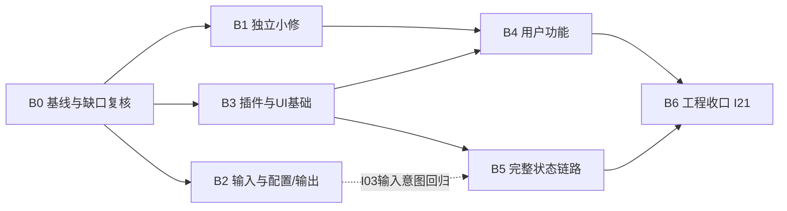
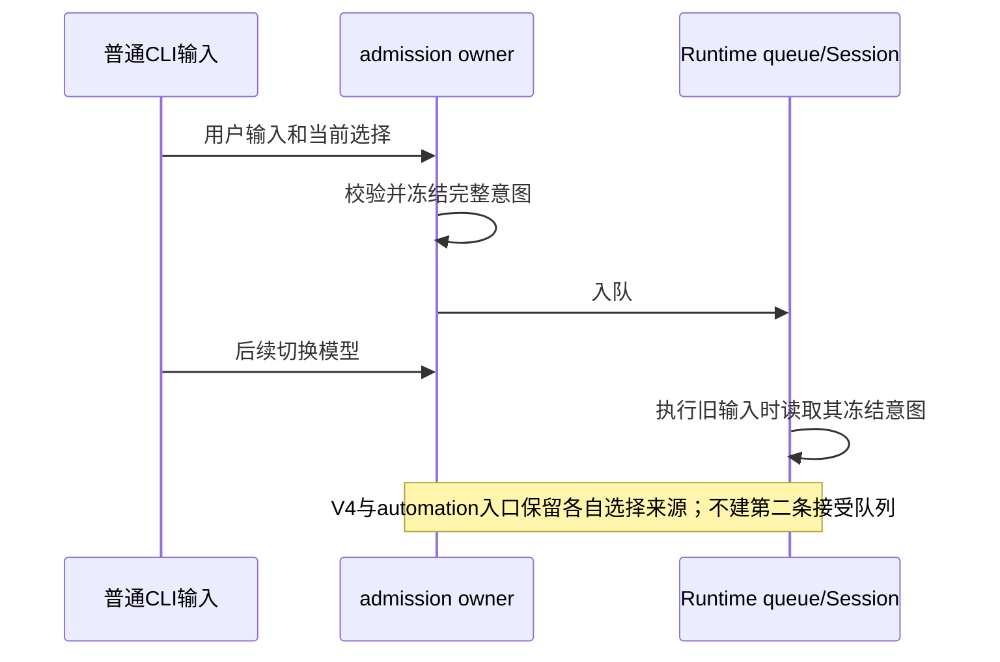
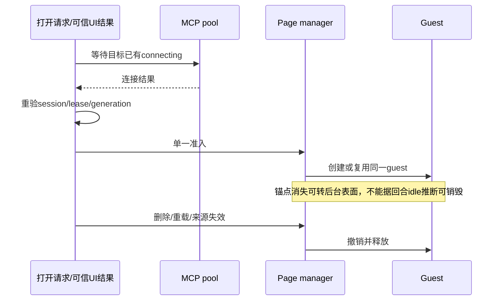

# 上游 v3.16.2：21 项候选补全计划

状态：规划，2026-10-23。本文保留前序审计的 I01–I21 编号，只安排需求补全、实现切分和验收，不代表任何候选已实现或已通过测试。本次仅新增本文，不修改产品代码、既有领域 spec 或功能图。

执行遵循 [上游维护规则](../fork/upstream-sync-policy.md)；跨轮审查游标与每项实施进度统一登记在 [审查与移植台账](../fork/upstream-review-ledger.md)。本文负责工作拆分和验收规划，不另设一份完成状态。

## 1. 目标、来源与当前基线

- 上游固定范围：[v3.15.1 `aac47556` → v3.16.2 `3c5b2276`](https://github.com/zai-org/ZCode/compare/aac4755666d09fdcd70272fcf063c077a639015f...3c5b227649371507ddc4eb46ac5133afe6db1cab)。中间 v3.16.1 为 `0a1fc56d`；版本依据相应提交中的 package.json，不用可移动分支充当来源。
- 本地 HEAD：`0b9644c62be5b346698023931c5275e9cc3f8283`。实施前按实际 HEAD 重核，不把旧调查行号当永久事实。
- 当前存在用户未提交的手机远控第一批、Android 保存/通知、平台文件接口、Provider 空态及图谱/架构策略等改动。保持原样；本计划引用它们只用于识别交集，不把工作区实现算作已合入或已发布。
- 本轮使用 feature-boundary-planner 的规划口径；当前没有 codegraph 工具，证据来自前序固定差异审计及本轮针对文档、入口和包脚本的检查，不声称完整调用图或 E2E 已验证。
- 范围仅限 21 项候选。R3、ProjectSidebar、项目级草稿、ToolSearch、Office runtime、统一 SQLite 迁移等暂缓项不混入本轮；共享代码中已有必要边界仍需保留。

**补全的含义**：每项都有当前缺口复核、领域 spec/契约、反例测试、最小适配、真实验证和来源台账。候选最终可能变成“当前已覆盖”或“复现不成立”；这时记录反证并关闭，不为凑齐 21 项制造代码。

## 2. 批次、交付与依赖

批次是风险和验收顺序，不是一次大合并。默认一个候选一个可回滚 PR；I21 可拆为“算法/测试”和“接入门禁”两次。每批完成后可以独立发布，不必等全部完成。

| 批次               | 候选                                   | 本批目标                                                           | 出口                                                                     |
| ------------------ | -------------------------------------- | ------------------------------------------------------------------ | ------------------------------------------------------------------------ |
| B0 准备            | 全部，不计新增候选                     | 固定上游/本地基线；重核当前缺口；记录工作区交集、用例及执行环境    | 每项有来源、owner、spec 落点和可执行验证入口；不要求先升级工具才能修 bug |
| B1 小修与信任边界  | I01、I02、I04、I05、I08、I09、I11、I18 | 空凭据、编码、工作流权限/配额、图片错误、TUI、launcher、旧配置上限 | 独立反例通过；既有随机密钥、权限、重试和发行行为保持                     |
| B2 输入与配置/输出 | I03、I16、I17                          | 普通 CLI 入队冻结、Bash 输出临时根、MiMo 模板精确增量              | 各入口/持久化边界明确；不迁整份模型目录或覆盖历史输出语义                |
| B3 插件与界面基础  | I06、I07、I10                          | 插件读写调度、MCP 首开屏障、隐藏折叠测量                           | 并发与取消反例、真实 UI 打开、可见动画回归通过                           |
| B4 用户功能        | I12、I13、I14、I15                     | 图片操作、按格式打开、Windows 未读提示、整卡打开                   | 桌面/手机适用路径、来源隔离、键盘/主题/国际化及原生平台证据齐备          |
| B5 完整状态链路    | I19、I20                               | 冷历史先展示后激活、MCP 后台页面生命周期                           | continuous/replayable、冷恢复、迟到事件和资源释放端到端验证通过          |
| B6 工程收口        | I21                                    | 采用已验证的治理/测试选择算法，适配本仓 main 与现有策略            | 选择器不漏测、门禁不放宽；保留 official-refs；来源与验收台账完整         |

规模用“小/中/大”表示相对影响面，不承诺工期。B1 主要为小项；I03/I06/I12/I13/I14/I16/I17 为中项；I19/I20 为大项。每项的调查反例可能改变实际规模。



硬依赖只有：I20 必须复用 I07 确定的连接等待与 lease/generation 合同；I12/I13 必须基于实施时实际可用的 IPlatformService/文件来源能力。其余箭头主要是推荐顺序，不能把无关候选捆绑成合入条件。

I03 与 I19 都接触 admission，建议顺序合入并在第二项上重跑前一项回归；I12/I13/I15 共享预览和打开入口，涉及同一文件/接口时顺序合入。I07/I20 可共用夹具，仍分别验收。I21 的算法调查可早做，实际门禁切换在本仓夹具验证后进行。

## 3. 每项实施清单

下列 spec 路径是实施前的更新/创建落点；“新建”文件本轮不生成，避免把待确认的候选预期冒充当前产品事实。已有文档只补差异，不重复建一套规则。

| ID  | 具体补全工作                                                                    | spec / 契约落点                                                                                        | owner 与实现边界                                                                    | 主要验收                                                                                                      |
| --- | ------------------------------------------------------------------------------- | ------------------------------------------------------------------------------------------------------ | ----------------------------------------------------------------------------------- | ------------------------------------------------------------------------------------------------------------- |
| I01 | 区分密文第三段缺失与合法空字符串；保留其他格式检查                              | 更新 `specs/zody-credential-key.md`                                                                    | Services cipher；不改随机 key、文件锁、密文版本或旧明文兼容                         | 空值往返、非空往返、缺段/错误 tag/错误 key 拒绝；store/key 不被重建                                           |
| I02 | 补齐编码探测样本的 UTF-8 尾部并正确处理短读                                     | 新建 `docs/runtime-tools/read-encoding-sample-boundary.md`                                             | adapters 文件读取；探测字节不混进真实输出                                           | 多字节字符跨采样边界、连续短读、EOF、UTF-16/GBK、abort、文件句柄关闭                                          |
| I03 | 普通 CLI 进入队列时冻结完整 ModelSelection，排除已有显式执行选择                | 更新 `docs/chat/send-prompt-model-resolution-chain.md`；必要时补 CLI 入口合同                          | 普通 CLI input facade/admission；V4、automation、临时 modelExecution 各自保持 owner | A 模型入队后切 B，旧输入仍用 A、新输入用 B；显式选项、取消/重试、无模型行为明确                               |
| I04 | 从规范化绑定计算本次新 provider，不能接受模型伪造事实；新 provider 退出免确认   | 更新 `docs/dynamic-workflow/launch.md` 和契约                                                          | amend resolver 产生事实，permission service 决策，handler 执行                      | 同 provider 不额外询问、新 provider Ask/Deny、拒绝零执行、伪造 predecessor 无效                               |
| I05 | governor 复用现有模型失败策略，Stop 与可重试 throttle 分流                      | 更新 `docs/dynamic-workflow/concurrency.md`                                                            | workflow concurrency governor；不另建额度/重试状态                                  | quota/auth Stop 不污染冷却桶，普通 429 保留冷却，reset/resume 后继续运行                                      |
| I06 | 读请求绕长写队列；缓存命中读不持写锁；缺 manifest 的 lazy 写入保留锁            | 更新 `docs/claude-code-marketplace-plugin-compat.md` 与插件生命周期目录/矩阵                           | CLI plugin dispatcher/storage owner；seed/init/config 等实际写者逐一核对            | 安装 A 被闸门挂住时详情/list/overview 返回；写请求仍串行；缺 manifest 并发不丢写                              |
| I07 | 等待目标 MCP 的既有 connecting，结束后重验会话、代际、lease                     | 新建 `docs/plugin-ui-connection-readiness.md`；更新 pool/protocol 合同                                 | adapter/pool 持连接任务，protocol 只在验证后创建页面；UI 不轮询                     | 首开/冷恢复等待后成功；失败有终态；释放/换源/换会话后旧请求不能签发页面                                       |
| I08 | 内嵌图片失败收口；结果绑定路径与服务身份，切源不能闪旧图                        | 更新 `docs/ui/tool-display-rendering.md`                                                               | UI 投影与来源文件服务；不恢复分享页依赖                                             | reject 有失败态、空结果非永久 loading；切 A→B 与迟到 A 回包不显示错图                                         |
| I09 | StartupScreen 与 TuiApp 在同一 React root 内切换                                | 新建 `apps/zcode-cli/docs/tui-startup-lifecycle.md`                                                    | TUI renderer；卸载清理订阅，不改 Session 业务状态                                   | 启动后热键/退出只处理一次；启动失败/取消可退出；终端恢复和 root 销毁正常                                      |
| I10 | 在锁定 Radix 版本上移植隐藏节点测量补丁，同时补 CJS/ESM 回归                    | 新建 `docs/performance/collapsible-hidden-measurement.md`                                              | Radix 适配层；不改可见展开/收起动画                                                 | hidden 不读几何，展开/defaultOpen/forceMount 正常；大工具列表测量数据前后可比                                 |
| I11 | launcher 用物理路径匹配 release 根；保留路径约束与 Zody 标识                    | 更新 `docs/architecture/r2-server-cli-and-daemon.md`                                                   | Server launcher/install adapter；不迁 R3 或改更新 owner                             | symlink HOME/安装根、空格路径、正常路径可启动；非法 releaseDir 仍拒绝                                         |
| I12 | 图片复制 PNG、保留原格式下载、加引用到焦点 Composer 而不发送                    | 新建 `docs/ui/preview-pane-image-actions.md`；引用当前手机文件保存 spec                                | 来源 Host 文件服务；平台保存/clipboard；Composer 只接未提交引用                     | 原 SVG bytes、像素尺寸、无焦点/忙态、同路径不同 identity、远端来源、下载失败与字节校验                        |
| I13 | 扩展当前平台打开接口，按文件类型发现已安装应用并参数化启动                      | 更新 `docs/ui/windows-workspace-editor-menu.md`；新建跨平台 `docs/file-preview-open-apps.md`           | Main/平台 adapter 做发现与启动；UI 经 hook/platform 接口                            | PDF/Office/媒体格式、本机不存在应用、中文空格路径、参数注入、远端路径不被当本机路径                           |
| I14 | Windows overlay/托盘提示、归零与 DPI/窗口销毁处理                               | 更新 `docs/desktop/unread-badge.md`                                                                    | TaskIndex 持任务未读事实；Main 只投射图标；保留现行 per-window 汇总                 | 未读→显示、查看→归零、多窗口关闭、Win10/11；macOS/Linux 不回归；不混用手机通知事件已读                        |
| I15 | 文件卡片主体可打开，split 菜单和键盘动作不重复触发                              | 更新 `docs/ui/assistant-preview-cards.md`                                                              | 复用 OpenSplitButton；保留网站 URL/文件来源与 workspace scope                       | 整卡/按钮/菜单分别只触发一次，键盘可操作，localhost 路由保留，远端文件来源正确                                |
| I16 | 执行前确定隔离临时输出位置，失败回落与取消清理；保持查询/历史语义               | 更新 `docs/tmpdir-storage-paths-spec.md`、`docs/background-bash-output-details.md`                     | execution adapter 持文件生命周期，runtime 继续持 Bash 工作状态                      | 并发隔离、临时盘失败、spawn/abort/shutdown、后台读输出、历史结果与重启后行为不退化                            |
| I17 | 只迁 MiMo v2.6 与 API/Token Plan 模板差异，复核厂商当前参数                     | 新建 `docs/provider-mimo-templates.md`，补 Provider 回归目录                                           | Built-in 配置声明；现有 resolver 合成 Personal 覆盖；不引入新 Provider 类型         | 旧 v2.5 配置不被静默改写；两端点分开；模型规则不串命中；个人名称/Key/URL/禁用态保留                           |
| I18 | 旧配置导入保留正整数 maxOutputTokens，明确字段优先级                            | 更新 `docs/model-provider-opencode-config.md` 的适用导入合同，若不属同入口则新建 CLI importer 专项文档 | legacy CLI importer；只迁一次/幂等，不覆盖当前用户值                                | 多字段冲突、0/负数/小数/字符串、已导入重跑、已有个人覆盖均有断言                                              |
| I19 | 历史加载/初始化状态先发布，再激活 runtime；命令去重后在 session gate 准备冷会话 | 更新 `docs/v4-refactor/17-cold-resume-runtime-activation.md`、协议声明、会话目录/矩阵                  | CLI gateway/CommandInbox 与现有冷恢复 owner；Main/gateway/Renderer 不加业务队列     | 历史先可见；初始化失败有终态；重复订阅/断线/删除/取消/迟到结果不重启旧 runtime；两种交付均验证                |
| I20 | 本地可信 UI 结果与手动打开复用同一页面 owner；离屏/停回合不错误销毁 MCP guest   | 新建 `docs/plugin-ui-background-execution.md`，补 managed-page/bridge 合同                             | 页面 manager 管 guest/资源，MCP pool 管连接，Main 只执行受控原生活动                | 卡片与后台结果并发仅建一个；无锚点继续执行；返回复用原 guest；删除/重载/失效后撤销；手机/Web/远端无创建副作用 |
| I21 | 采用模块登记、变更基线与测试选择的有效算法；写本仓规则和夹具                    | 更新 `docs/architecture/architecture-governance.md`、`docs/testing/pre-push-hook.md`                   | scripts/policy 是门禁 owner；按当前 main/default branch 与实际包脚本处理            | 首推/重推/显式 base/rename/脏工作区行为明确；不能漏测、吞错误、复活旧能力或放宽现行规则                       |

## 4. 状态所有者与关键事件顺序

| 状态                       | 唯一 owner                                       | 其他层职责                                | 必须保持                                                      |
| -------------------------- | ------------------------------------------------ | ----------------------------------------- | ------------------------------------------------------------- |
| 未提交正文/文件引用        | 当前 Composer 草稿                               | 文件入口只追加引用                        | 不自动发送，不把草稿写成服务端接受事实                        |
| 已接纳输入与模型意图       | CLI admission/CommandInbox → runtime queue       | UI 仅 pending optimistic overlay          | 同 commandId 幂等；在约定入口固定选择；不跨 Host/Session 串队 |
| MCP 连接任务、代际与 lease | 既有 adapter/pool                                | protocol 等待并校验，UI 展示准备态        | 等待期间失效后不得创建或复活新页面                            |
| MCP 页面及 guest           | 既有 page manager/registry                       | Main 执行页面原生活动，卡片只绑定展示锚点 | 同逻辑页面一个准入 promise；显式销毁撤销资源/凭证             |
| 工作流权限/并发            | resolver/permission 与现有 governor 各持本职事实 | UI 展示审批/运行结果                      | 模型不能伪造信任事实；Stop 不能变成长冷却                     |
| task unreadAt              | TaskIndex/task service                           | Renderer 统计窗口投影，Main 显示图标      | 不与手机通知事件已读、安装实例已读混为同一事实                |
| 文件原始 bytes             | 对应 workspace Host 的文件服务                   | 平台 adapter 保存/复制/外部打开           | identity 用于隔离，path 用于 IO，remoteSessionId 与来源贯穿   |





I19 的顺序必须在领域 spec 里写清：历史载入 → 初始化事实/响应交付 → 激活现有 runtime → ready 或 failed。重复 command/subscribe 如何加入同一 flight、何时允许取消以及冷历史组织操作如何经过 admission，均先补反例；不能照搬一个 hook 名称就认定完成。

## 5. 候选场景、状态维度与剪枝

以下 ID 是计划中的场景锚点，全部为 `planned`；它们不是已获产品确认的 accepted case，也不是已存在的测试文件。实际实施时将明确规则映射到领域 catalog；只有 accepted 场景才能进入 E2E 编写/晋级。

| 场景 ID   | Setup → action                                                     | 必须断言                                                        | 证据与入口                                                      |
| --------- | ------------------------------------------------------------------ | --------------------------------------------------------------- | --------------------------------------------------------------- |
| UP316-I01 | 隔离密钥/store，保存空值与普通值后读取；再破坏密文                 | 空值合法，缺段/错 key/tag 拒绝，文件不被重置                    | cipher/service 单测 + 文件状态                                  |
| UP316-I02 | UTF-8 字符跨样本末尾，注入短读/EOF/取消                            | 编码正确、原文 bytes 不变、无多读泄漏、句柄关闭                 | adapters fs 单测 + 真实文件                                     |
| UP316-I03 | A 模型运行时排入两条输入，切 B，再加入新输入                       | 旧输入用 A、新输入用 B；显式 intent 不被覆盖                    | bootstrap/core 单测 + CLI provider request capture              |
| UP316-I04 | 已授权 workflow 同 provider 修订，再尝试新 provider                | 免确认边界正确；新 provider 可拒绝且零执行；模型伪造无效        | contracts/core 权限用例 + 请求/执行记录                         |
| UP316-I05 | quota Stop 带长 Retry-After，随后 reset/resume；对照 retryable 429 | 前者不遗留冷却，后者仍限流；并发上限不绕过                      | governor/adapter 单测 + workflow 状态                           |
| UP316-I06 | 下载闸门挂住安装 A，读其他插件详情；并发初始化缺失 manifest        | 纯读及时返回；写入串行、manifest/known state 完整               | 协议/锁单测 + Desktop 插件 pending E2E + 存储快照               |
| UP316-I07 | MCP initialize 被闸门阻塞时打开页面；等待中释放/换源               | 放行后无需人工重试；旧 lease 失效不得签发；并发一个实例         | pool/protocol 单测 + Electron 页面与实例计数                    |
| UP316-I08 | 图 A 读取慢，切 B；A迟到/读取reject/返回空                         | 无旧图泄漏，无永久 loading/unhandled rejection                  | UI hook/组件夹具 + DOM终态                                      |
| UP316-I09 | 进入 TUI 启动页后成功/失败/取消，再按退出热键                      | 处理一次、监听释放、终端状态恢复                                | TUI 包测试 + 真正终端 smoke                                     |
| UP316-I10 | 批量 hidden ToolLayout，再展开、forceMount、defaultOpen            | hidden 不读几何，可见测量/动画正常；记录测量前后值              | 浏览器夹具 + layout指标 + DOM                                   |
| UP316-I11 | symlink HOME/安装根与空格路径启动；构造非法 releaseDir             | 合法路径命中同一物理根；越界路径拒绝                            | launcher/Server 集成 + 子进程退出/路径                          |
| UP316-I12 | 本地/SSH 图片，复制/保存/加草稿；无焦点与失败路径                  | PNG像素、原格式bytes正确；来源匹配；仅加引用不发送              | UI pending + 平台适配测试；Android复用实际Downloads/SHA证据口径 |
| UP316-I13 | 本机PDF/Office/媒体、无匹配app、特殊路径、远端路径                 | 菜单匹配，参数不经shell插值；远端不误开本机文件                 | 平台发现/启动夹具 + 三平台实际打开                              |
| UP316-I14 | 任务后台完成→未读→打开→清零；窗口关闭/多窗口                       | 使用现行task未读数；overlay/托盘消失；不改变非Windows           | 单测/像素 + Win10/11人工OS证据，不能用DOM冒充                   |
| UP316-I15 | 卡片主体、打开按钮、下拉菜单、键盘分别操作                         | 各动作一次；菜单不冒泡开文件；URL/文件来源保留                  | 组件/浏览器 + Desktop/手机适用UI                                |
| UP316-I16 | 并发Bash、临时根不可写、取消/退出、历史查询                        | 路径隔离、有效降级、对外路径稳定；查询/保留合同不退化           | exec/child-runtime单测 + 输出文件/生命周期                      |
| UP316-I17 | 旧MiMo个人实例、两新模板、海外覆盖URL、禁用态                      | 个人配置保留；模型/端点不串；不静默替换用户选择                 | config/resolver单测 + 设置UI；真实请求若未跑则单列              |
| UP316-I18 | 多种旧字段并存且含非法值，已导入后重跑                             | 合法优先级、幂等、不覆盖当前Personal                            | importer单测 + 迁移前后文件                                     |
| UP316-I19 | 冷历史可读但runtime初始化慢/失败；重连、重复订阅、删除             | 历史先可见，ready前命令依guard处理；一个flight；旧结果失效      | 协议/CLI + Desktop continuous 与手机 replayable E2E             |
| UP316-I20 | UI结果与卡片并发、离屏/最小化/停回合、返回、显式删除               | 单实例；后台可执行；返回同guest；销毁后不复活；不支持端无副作用 | page manager/lease + 真Electron页面、资源计数与协议             |
| UP316-I21 | 首推/force-push/显式base/rename/脏工作区/失败工具                  | 选中应测范围，不吞退出失败；规则不放宽，official-refs保留       | scripts隔离Git仓库夹具 + 当前main工作流                         |

代表维度：本地/SSH、Desktop continuous/手机 replayable、首次/冷恢复、当前/迟到代际、成功/失败/取消、单/并发请求；原生能力额外覆盖适用 OS。只对会改变行为的交叉维度展开，不做全产品笛卡尔积。

剪枝：I09 不枚举 Web UI；I14 不为手机发明任务栏；I13 对不支持端不提供原生启动；I20 的手机/Web/远端只测“不创建本地guest”的边界。WSL/Windows、Android、真实SSH需要相应环境，未执行必须单列，不能用路径mock当平台验收。

## 6. 需要在对应项开工前落定的少量规则

此处记录待决，不向当前计划请求强制确认；不依赖这些规则的小修可先实施。以下推荐口径是规划建议，未写入产品事实。

| 决策                   | 关联项 | 推荐口径                                                                             | 影响                                  |
| ---------------------- | ------ | ------------------------------------------------------------------------------------ | ------------------------------------- |
| 手机图片复制的能力范围 | I12    | 各端只展示实际可用的平台动作；优先复用现有Android保存，不新造clipboard桥来凑平台一致 | 决定手机UI/E2E与是否需要原生接口扩展  |
| 临时Bash输出保留多久   | I16    | 不缩减当前后台查询/历史取回承诺；先记录原合同，再定临时文件清理所有者和时点          | 决定重启/历史路径是否需要稳定存储策略 |
| 模板更新如何处理旧模型 | I17    | 不静默改写Personal/历史意图；厂商最新能力和旧模型状态在实施时核验                    | 决定新建模板默认值与旧配置显示        |
| MCP后台页面的资源上限  | I20    | 沿用/显式调整page owner的现有准入预算，不因回合停止或离屏推断可销毁编辑器            | 决定超限拒绝/提示及资源验收           |
| 冷初始化期间允许的命令 | I19    | 沿用现行协议逐命令分类，明确ready/failed guard，不加Renderer已接受队列               | 决定协议目录、拒绝反馈与恢复用例      |

## 7. 文档回填、E2E交接与完成定义

| 产物                             | 实施时动作                                                                              | 当前状态                                           |
| -------------------------------- | --------------------------------------------------------------------------------------- | -------------------------------------------------- |
| 每项领域spec/contract            | 按第3节先更新，记录唯一owner、事件顺序、接口及失败终态                                  | 计划落点已列；未修改领域事实                       |
| 会话case catalog/coverage matrix | I03/I04/I05/I19及相关输入/恢复交互，只回填确认的accepted组合                            | planned；已有工作区改动需保留并重核                |
| 插件生命周期目录/矩阵            | I06/I07/I20补读写并发、握手和guest生命周期                                              | planned                                            |
| Preview/文件/手机专项矩阵        | I12/I13/I15复用当前mobile phase1能力与证据，不复制第二套保存机制                        | planned；实施前核对其他工作成果                    |
| 功能语义图                       | 对确认后的CLI输入、MCP屏障/页面、预览动作等补owner/入口/提交边；检查悬空种子            | 本轮只列proposed delta；当前图已有他人改动，不覆盖 |
| E2E fixture与晋级                | accepted后走manual-review/pending、capture/review、case-local fixture，再按现行流程晋级 | 本轮不写测试、不晋级                               |
| 同步台账                         | 每个PR记录来源完整SHA/路径、适配理由、spec/case、实际命令/结果、平台缺口、回滚方式      | 后续每项必填；本计划的编号是关联键                 |

涉及 E2E 的项目交给当前 `e2e-case-lifecycle` 工作流；provider响应使用受控replay，网络/握手/安装时序用确定性闸门，不用固定sleep证明同步。文件下载记录来源bytes/最终SHA，原生任务栏记录OS证据，MCP后台页面记录实例/连接代际和实际执行结果。

每个候选只有同时满足以下条件才能记为完成：

1. 按实施时工作区重核缺口，领域spec和实际实现一致；原先静态假设不成立则有关闭依据。
2. 有有意义的反例/回归，实际跑过对应入口；交互项有对应E2E或明确的原生验收证据。
3. 没有第二份事实owner/接受队列、身份串用或已删除官方功能回流；全部跨包依赖通过公开入口。
4. 记录本地验证与剩余平台缺口；单测、mock、上游历史报告不冒充真实端到端。
5. 有独立PR/commit与回滚方案。若改持久数据，先补迁移和降级合同；不能默认revert提交就能还原数据。

## 8. 验证入口与本轮结果

以下是当前仓库存在的入口。实施时先跑有针对性的测试，再运行必要门禁；不为小修默认跑全仓所有E2E，也不把CLI tests假定为根Vitest覆盖。

```sh
# 根workspace测试示例
pnpm exec vitest run packages/services/test/credentialService.test.ts
pnpm exec vitest run packages/ui/test/previewPaneImageContent.test.ts

# CLI子包使用自己的配置与cwd，指定实际存在的测试
pnpm --dir apps/zcode-cli/packages/adapters exec vitest run tests/fs-context.test.ts
pnpm --dir apps/zcode-cli/packages/core exec vitest run tests/amend-workflow-permission.test.ts
pnpm --dir apps/zcode-cli/packages/bootstrap exec vitest run tests/workflow-concurrency-governor.test.ts
pnpm --dir apps/zcode-cli/packages/tui test

# 每项收尾必跑；代码改动前也先执行架构基线检查并读取对应受控上下文
pnpm typecheck
pnpm lint
pnpm architecture:check --changed
pnpm test:unit:affected
pnpm check:official-refs
```

根typecheck不等于覆盖CLI所有包；修改CLI时补目标包当前typecheck。I10依赖patch要检查锁文件和可重复安装；I11/I16及产物变化补Server/CLI发行smoke；I12涉及Android保存时补原生对应测试与真实Downloads证据；I14需真实Windows；I19同时验证Desktop与mobile交付；I20需真实Electron guest，不能仅用DOM模拟证明后台执行。

本轮仅规划，未写实现或测试。已执行当前工作区基线检查：

- `node scripts/check-workspace-freshness.mjs`：通过，main相对origin/main ahead 11 / behind 0。
- `pnpm typecheck`：通过，exit 0。
- `pnpm lint`：exit 0，0 errors、313 warnings；这是当前工作区的实际结果，未清理无关告警，不称零告警。
- 未执行单测/E2E或架构代码变更检查；只有新增规划文档，本轮没有产品行为/依赖修改。
