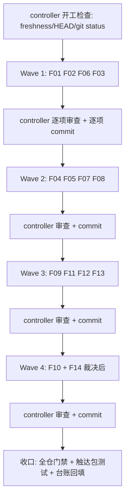

# 上游 v3.17.1 第一梯队：sub-agent 拆分执行方案

状态：规划，2026-11-02。本文把 [第一梯队修复设计](upstream-v3.17.1-tier1-fix-plan.md)（F01–F14）拆成可独立派发给 sub-agent 的任务卡与调度规则，进度登记在 [台账 UR-20261102-01](../fork/upstream-review-ledger.md)。本文存在不等于任何项已开始实施；派发前 controller 按当前 HEAD 重核各项现状。

## 1. 执行模型与角色

| 角色       | 职责                                                         | 禁止事项                                        |
| ---------- | ------------------------------------------------------------ | ----------------------------------------------- |
| controller | 派发任务卡、审查 diff、执行 git commit、跑全仓门禁、回填台账 | 不代替 worker 实现；不跳过审查直接提交          |
| worker     | 按单张任务卡实现 + 定向验证，产出结构化报告                  | 不 commit、不越出卡内文件、不自行再派发子 agent |

- 上游只读源：`/Users/zhvala/SourceCode/3rd-party-repositories/ZCode`，其工作区即 `a60ba6a7`（v3.17.1），可直接读文件；`git -C <上游> show a60ba6a7:<path>` 作为等价回退。
- **同一工作区约束**：所有 worker 在 `/Users/zhvala/SourceCode/zody` 同一工作区工作。安全性由三条规则保证——(1) 同波次任务卡文件集两两不相交；(2) 只有 controller 执行 git 操作（避免 index.lock 争用）；(3) 同波次 ≤4 个 worker（控制测试缓存与 CPU 争用）。
- worker 类型要求：具备 Read/Write/Edit/Bash 的实现型 agent；不限定具体型号，controller 按会话可用类型选择并在台账登记执行方式。
- 派发协议：worker 收到的 prompt = 本文 §3 共同约束 + §4 汇报格式 + 单张任务卡全文，三段拼接，不依赖会话历史。



## 2. 调度：lane、波次与顺序约束

lane 按"主包 + 关键文件"划分，同 lane 内串行，跨 lane 可并行。顺序硬约束只有三条：F03 合入后才派 F04（准入面回归重跑）；F03→F05→F11 同包串行；F09→F10 同包串行。

| lane        | 项（lane 内顺序） | 主包                                            | 关键文件                                                                                                   |
| ----------- | ----------------- | ----------------------------------------------- | ---------------------------------------------------------------------------------------------------------- |
| rpc         | F01               | packages/rpc                                    | serialization.ts、channels.shared.ts、channelClient.ts                                                     |
| server      | F02               | packages/server                                 | remote/{closeEvent(新), ssh-backend, docker-backend, wsl-backend, sshAuth}.ts                              |
| server-cli  | F06               | packages/zcode-server-cli                       | runtime/{lock, immutableRelease, updateCommand, updateHandoff, statusSnapshot, shutdownWait, contracts}.ts |
| adapters    | F03 → F05 → F11   | apps/zcode-cli/packages/adapters                | model/runner-retry.ts → context/git-snapshot.ts + exec/windows-executable.ts → model/reasoning-history…ts  |
| core        | F04               | apps/zcode-cli/packages/core(+bootstrap 绑定点) | subagent 运行时组装处、runtime/methods/subagent.ts、bootstrap 绑定文件                                     |
| services    | F07               | packages/services                               | fileWatcher/{fileWatcher, fileWatcherService}.ts                                                           |
| config      | F08               | config/provider + provider 测试                 | zcode-builtin.json、zcode-builtin.test.json                                                                |
| contracts   | F09 → F10         | apps/zcode-cli/packages/contracts(+core hooks)  | tools/send-message.ts → hooks/ 声明与 workspace-hook-trust、core/src/hooks/                                |
| cua         | F12               | packages/zcode-cua                              | broker-helper-constants.{js,d.ts} + broker 调用链                                                          |
| desktop-ui  | F13               | packages/desktop + packages/ui                  | desktopWindowChrome.ts、preload、renderer bridge、UnifiedBrowserView.tsx                                   |
| ui-terminal | F14（blocked）    | packages/ui                                     | Terminal.tsx                                                                                               |

| 波次 | 并行任务                | 前置条件                      |
| ---- | ----------------------- | ----------------------------- |
| W1   | F01、F02、F06、F03      | 开工检查通过                  |
| W2   | F04、F05、F07、F08      | F03 已由 controller commit    |
| W3   | F09、F11、F12、F13      | F05 已 commit（F11 前置）     |
| W4   | F10；F14 仅在产品裁决后 | F09 已 commit；F14 已拿到裁决 |

每波开始前 controller 必做：`git status` 复查无关本地改动仍在且未被覆盖（当前已知无关改动：`.gitignore`、`docs/plans/zody-full-divergence-rename-survey.md`，属另一工作流，保持原样）；记录本波开始时 HEAD。

## 3. 共同约束（拼入每个 worker prompt）

1. 仓库：`/Users/zhvala/SourceCode/zody`（唯一可写目标）；上游参考只读：`/Users/zhvala/SourceCode/3rd-party-repositories/ZCode`（工作区即 v3.17.1）。
2. 只允许修改任务卡"落点"列出的文件、其对应测试文件和"spec"条目指定的文档。发现必须改动卡外文件才能完成时：停止该步，在汇报中写明原因与建议，不自行扩大范围。
3. 行为改动前先完成 spec 步骤（卡内指定；无既有 spec 的小修按修复设计 §5 以契约说明随 PR，不新建大文档）。修复处用中文注释说明原因与修复依据（引用来源 SHA）。
4. 禁止：跟随上游删除任何测试；改动根配置/lockfile/无关模块；使用 `console.log`（服务侧用 `createServiceLogger(scope)`，UI 侧用 `packages/ui/src/logger.ts`）；引入与任务无关的上游重构。
5. 测试放目标包既有测试目录（如 `packages/*/test/`、`apps/zcode-cli/packages/*/tests/`），遵循该包现有命名。每个修复至少一个反例：先确认它在修复前失败（可临时 stash 修复或断言旧输出），再确认修复后通过。
6. Node 以 `mise.toml` 为准（engine 要求 ≥24）。若默认 shell 为 node 22，用 `mise exec -- <命令>` 运行测试，避免越界环境 flake。
7. 验证命令必须真实执行并粘贴真实结果（files/tests passed/failed、exit code）。环境受限或失败如实报告，不虚报通过，不把上游测试存在写成本地通过。
8. 不执行任何 git 写操作（add/commit/stash/push 均禁止；`git diff`/`git log` 只读允许）。不触碰他人未提交改动。
9. 任务卡中的行号是 2026-11-02 基线（HEAD `6ae791ee`）证据，允许漂移；但若现状语义与卡片描述不符，结论标 `mismatch` 并停止，不猜。
10. 遇到需要产品/架构决策的分叉（卡片已标注的除外）：按卡片默认规则执行并显著登记；卡片无默认规则的，标 `blocked` 上报。

## 4. worker 汇报格式

```text
Fxx | done | blocked | mismatch
变更文件：（逐个路径，标注 新增/修改）
spec：（更新了什么/为何不需要）
反例证据：（测试名 + 修复前失败/修复后通过的证据）
验证：（命令 → 真实输出摘要，含 exit code）
偏离设计：（与任务卡/上游实现的差异与理由；无则写"无"）
未验证项/风险：（真实平台、E2E、环境受限等）
台账素材：（一句话实现摘要 + 来源 SHA + 落点，供 controller 回填）
```

## 5. 任务卡

卡片字段：目标 / 上游参考 / 落点（本卡唯一可改文件）/ 实施要点 / spec / 验收（完成定义）/ 验证入口。验证入口未写死命令的，以目标包 `package.json` scripts 为准；包内无测试入口时用 `tsc --noEmit` + 仓库根 `pnpm exec vitest run <file>` 定向，并如实登记方式。

### F01 RPC 二进制序列化修复与事件错误回传

- 目标：replacer 按 holder 原值（`this[key]`）识别二进制，修复 Node Buffer 经 `toJSON` 展开后归档体积 ~3.6× / 超 WS 上限；引入 `ResponseType.EventError`。
- 上游参考：`packages/rpc/src/serialization.ts`（根因注释在 `original instanceof Uint8Array` 一段）、`channels.shared.ts`、`channelClient.ts`。
- 落点：上述三个本仓对应文件 + 包内新测试。
- 实施要点：先写"嵌套 Buffer 字段经现行 replacer 编码"的体积/形态断言（预期失败）再移植；保持顶层 Uint8Array 分支与既有 wire 形态不变，只修嵌套对象路径；EventError 最小接入（枚举 + 分发），不扩展错误处理面。
- spec：packages/rpc 无既有契约文档则契约说明随 PR。
- 验收：嵌套 Buffer/Uint8Array roundtrip 内容一致且为 base64 标记形态；归档编码体积显著小于现行输出；事件订阅错误可达对端；`ResponseType` 既有值不变。
- 验证入口：查 `packages/rpc/package.json`；无则 `tsc --noEmit` + 根 vitest 定向。

### F02 远程命令 exit code 与 SSH 认证修复

- 目标：退出码语义修复——signal→`128+n`、无信息→`255`、有 status 透传；替换三个 backend 共 8 处 `code ?? 0`；顺带 sshAuth 2FA 文字识别、keepalive/握手超时分阶段、docker daemon 诊断细分。
- 上游参考：`packages/server/src/remote/closeEvent.ts`（`resolveRemoteExitCode`）、`sshAuth.ts`、`docker-backend.ts`、`wsl-backend/`。
- 落点：`packages/server/src/remote/`（closeEvent 新增 + 三 backend + sshAuth）+ 包内新测试。
- 实施要点：先落 closeEvent 与 8 处替换（必做）；`rg` 复查 server 包内按退出码判成功的调用点（下载/解包/update/远端命令包装），把清单写进汇报；sshAuth/docker/wsl 诊断增强若与本仓结构差异过大，可缩减为 exit code + 最小诊断，缩减项如实登记；wsl backend 结构差异最大，放最后。
- spec：查 docs/ 远程/server 既有 spec，无则在 PR 契约说明。
- 验收：三分支退出码单测；被杀命令在调用方判定为失败；正常码透传不回归。
- 验证入口：查 `packages/server/package.json`；无则 `tsc --noEmit` + 根 vitest 定向。

### F03 Retry-After 抖动

- 目标：合理 Retry-After 直返分支追加 ≤20%、5s 封顶抖动，防同批限流请求同毫秒醒来再撞限流。
- 上游参考：`apps/zcode-cli/packages/adapters/src/model/runner-retry.ts`（`RETRY_AFTER_JITTER_RATIO = 0.2`）。
- 落点：本仓同文件 + adapters 既有测试目录新用例。
- 实施要点：只动直返分支；`retry.jitter` 关闭时保持旧值恒等；unreasonable 值的指数退避路径不动。
- 验收：同 retry-after 多次采样退避值不全等且增量 ≤20%/5s；`jitter=false` 输出与旧版逐值一致；超上限值仍拒绝。
- 验证入口：`pnpm --dir apps/zcode-cli/packages/adapters test`（I16 先例）或定向 vitest。

### F04 Subagent 模型请求准入 observer（W2，F03 后）

- 目标：subagent 不再直接继承父 runtime 准入端口；经 `subagentModelRequestAdmission(sessionId)` 工厂让同一父会话的全部 subagent 共用一条准入队列；无绑定时回退父端口。
- 上游参考：`apps/zcode-cli/packages/core/src/subagent/runner.ts`、`runtime/methods/subagent.ts`。
- 落点：zody 的 subagent runtime 组装处（先定位 deps 组装点，上游为 runner.ts deps）、`core/src/runtime/methods/subagent.ts`（替换 `:317-320` 直接继承）、bootstrap 组装 deps 的绑定文件 + 测试。
- 实施要点：deps 增可选工厂字段（contracts 如需同步加类型）；bootstrap 按"父会话 → 队列"绑定，V4/automation 各自准入 owner 不动；完成后重跑 F03 反例（回归要求写进汇报）。
- spec：查 admission/并发既有 spec（如 `docs/chat/send-prompt-model-resolution-chain.md` 一族），补 subagent 分支语义。
- 验收：并行 N 个 subagent 请求经同一队列（不再父为 observer 即全部直通）；父限流时 subagent 排队；无工厂回退父端口；F03 回归通过。
- 验证入口：core 包定向 vitest + bootstrap 相关用例（I19 先例命令形态）。

### F05 git-snapshot 加固（W2，F03 后）

- 目标：in-repo 判定改纯文件系统（realpath 向上找 `.git`，含 worktree/submodule gitdir 文件）；5 条 git 命令并行 + AbortSignal；`symbolic-ref --short -q HEAD`；status `--ignore-submodules=dirty`；Windows git 安全化；非仓库结论记忆。
- 上游参考：`apps/zcode-cli/packages/adapters/src/context/git-snapshot.ts`、`exec/windows-executable.ts`。
- 落点：本仓两同路径文件 + 测试；core `context/sections/env-info.ts` 仅在编译/契约必需时最小联动。
- 实施要点：对照上游逐段移植，注意 zody 调用方签名差异；记忆缓存 key 用目录 realpath 身份，"没读到"与"确定非仓库"分开存。
- 验收：无 git/超时/取消仍出 in-repo 结论；worktree、submodule、symlink 正确；并行命令取消不悬挂；非仓库二次调用不重查且与 Environment 结论不矛盾。
- 验证入口：`pnpm --dir apps/zcode-cli/packages/adapters test` + 定向 context 用例。

### F06 server-cli 事故级修复

- 目标：五件套——lock 进程身份判活（旧锁回退 PID 兼容）、damaged release 两态替换、`--allow-downgrade` 门禁 + downgrade 标记、失败 status 透出 state/lastExitReason、`SERVER_READY_WAIT_TIMEOUT_MS = CORE_READY + 10s`。
- 上游参考：`packages/zcode-server-cli/src/runtime/{lock,immutableRelease,paths,updateCommand,updateHandoff,statusSnapshot,shutdownWait,contracts}.ts`。
- 落点：本仓同包对应文件 + 包内测试（先例 `pathsAndRelease.test.ts`、`releaseInstaller.test.ts`）。
- 实施要点：同包强耦合一次移植；锁新写格式带进程身份字段、旧格式读取回退 PID 判定（已部署锁文件必须可读）；**不动 stableLauncher（I11 已移植区）**。
- spec：先更新 `docs/architecture/r2-server-cli-and-daemon.md` 再动代码。
- 验收：残留锁+进程不存在→可启动；损坏 release 强制重装可成功；无 flag 拒绝降级；失败 status 含原因；旧锁文件兼容读取。
- 验证入口：查 `packages/zcode-server-cli/package.json`；无则 `tsc --noEmit` + 定向 vitest。

### F07 fileWatcher 稳定性

- 目标：持续写入 max-wait 强制刷新；rename 身份校验收口一次；symlink 按 stat 身份比对；失效 watcher 发最终刷新后关闭。
- 上游参考：上游 `packages/services/src/fileWatcher/` 同构模块。
- 落点：`packages/services/src/fileWatcher/{fileWatcher,fileWatcherService}.ts` + `packages/services/test/` 新用例。
- 实施要点：四项独立小改一次完成；沿用该文件现行 logger 惯例。
- 验收：持续写入场景最终收敛；rename/移动单次上报且新路径可查；symlink 目标替换按身份判定；watcher 失效后清理并推送末次刷新。
- 验证入口：根 `pnpm exec vitest run packages/services/test/<file>.test.ts`（I07 先例）或包内入口。

### F08 provider 配置 rev33→43

- 目标：内置配置升级——13 个新模板（Kimi/MiniMax/Qwen/腾讯/火山/StepFun/SiliconFlow 等）+ 既有模板新模型（`glm-5.3-flashx`、claude-5.5 系、gpt 新款、grok-4.7、openrouter 一批）+ providerSiteRules 4 条。
- 上游参考：`config/provider/zcode-builtin.json`、`zcode-builtin.test.json`（rev 43）。
- 落点：本仓两份 config + provider/provider-node/ui 模板测试 + 模板文档。
- 实施要点：**默认全量对齐 rev43**（含新模板，BYOK 模板与 I17 先例一致）；不收录项必须逐条列明并交 controller 裁决 revision 编号（全量对齐则沿用 43）；MiMo 区（I17）上游未变，不得改动；spec 按 I17 增量式记录（`docs/provider-mimo-templates.md` 先例，跨模板可扩写新文档）。
- 验收：I17 同款三入口测试通过（provider、provider-node、ui providerTemplatePicker）；新模板与既有 Personal 覆盖不串命中；不支持的厂商不出现在入口。
- 验证入口：`pnpm --dir packages/provider test`、`pnpm --dir packages/provider-node test`、`pnpm --dir packages/ui exec vitest run test/providerTemplatePicker.test.ts`（I17 先例）。

### F09 SendMessage 契约校验（W3）

- 目标：message 去空白后非空；summary 截断按代理对留位（不切 emoji 半个）。
- 上游参考：`apps/zcode-cli/packages/contracts/src/tools/send-message.ts`。
- 落点：本仓同文件 + 测试（contracts 无测试入口则放引用方包并说明）。
- 验收：空白 message schema 拒绝；含 emoji summary 截断后仍合法。
- 验证入口：按包实际入口；无则引用方包定向 vitest。

### F10 Hook `onError: "deny"`（W4，F09 后）

- 目标：hooks 声明 `onError: "deny"` 入 workspace-hook-trust 摘要；PreToolUse hook 真实运行出错（用户中断不算）按退出码 2 同路径拒绝工具。
- 上游参考：上游 `contracts/src/hooks/`（声明 + digest 字段）、`core/src/hooks/{runner,configured-runner}.ts`。
- 落点：`apps/zcode-cli/packages/contracts/src/hooks/`（含 `workspace-hook-trust.ts` digest）、`core/src/hooks/` + 测试。
- 验收：hook 抛错→工具拒绝；用户中断不触发 deny；修改 onError 声明后信任摘要变化需重信任。
- 验证入口：core 包定向 vitest + contracts 相关用例。

### F11 reasoning-history 归一化修复（W3，F05 后）

- 目标：删除纯 reasoning/空白 assistant 段后，只合并删除点两侧一对相邻 user，不再全量重合并。
- 上游参考：`apps/zcode-cli/packages/adapters/src/model/reasoning-history-normalization.ts`。
- 落点：本仓同文件 + adapters 测试。
- 验收：多对相邻 user 输出不多补 `\n`；删除点两侧合并语义保持。
- 验证入口：`pnpm --dir apps/zcode-cli/packages/adapters test` 或定向。

### F12 CUA ghost-cursor overlay 参数

- 目标：`broker-helper-constants` 新增 `--ghost-cursor-overlay` 并在 broker→helper 链路传递，防漏传导致 OverlayEnabled 恒 false、agent 光标不渲染。
- 上游参考：`packages/zcode-cua/broker-helper-constants.{js,d.ts}` 与 broker 调用链。
- 落点：本仓 `packages/zcode-cua/` 对应文件与调用链（含 desktop CUA 引用处，以实际引用为准）+ 常量同步测试（如包内有测试形态）。
- 实施要点：核对 zody 自研 computer-use 链路是否已支持 overlay 参数；helper 侧不识别时在汇报登记（不擅自改 helper 二进制/协议）。
- 验收：常量与 d.ts 同步；引用链类型检查通过；**Windows 真机光标渲染列为未验证项**（controller 收口缺口）。
- 验证入口：`tsc --noEmit`（触达包）+ 引用链编译。

### F13 内嵌浏览器下载导航修复

- 目标：desktop main `will-download` → IPC 上报；渲染层下载与加载失败对账（不误报 ERR_FAILED）；restorable URL 只记主框架已提交 URL（修附件恢复重复下载）。
- 上游参考：上游 `packages/desktop/src/main/desktopWindowChrome.ts`、`renderer/src/desktopBrowserPlatformBridge.ts`、`preload/index.ts`、`packages/ui/src/browser-use/UnifiedBrowserView.tsx`。
- 落点：本仓 desktop main/renderer/preload 对应文件（以实际路径为准）+ `packages/ui/src/browser-use/UnifiedBrowserView.tsx`（替换 `:229` initialUrl 旧逻辑）+ 测试。
- 实施要点：IPC 走本仓既有 preload bridge 模式（UI 经 `IPlatformService`/既有 bridge，不直连 `window.zcode`）；先核对本仓 desktopWindowChrome 与 preload 的实际结构再落点。
- 验收：附件 URL rebind/恢复不重复触发下载（单测模拟）；下载进行中不显示加载失败；正常导航 restorable URL 不回归；**真实 Electron E2E 列为未验证项**。
- 验证入口：desktop/ui 包测试入口 + 定向 vitest。

### F14 终端末 tab PTY 销毁（blocked，裁决后进 W4）

- 状态：**产品裁决未落，默认不派发**。裁决 A=跟随上游（关最后 tab 先删 session 再收起，PTY 真正 dispose）；裁决 B=保留本仓现状（收起保活），登记 `closed` 并记录依据。
- 上游参考：上游 `packages/ui/src/Terminal.tsx`。
- 落点（仅裁决 A 时）：`packages/ui/src/Terminal.tsx`（`closeAction === "close-panel"` 分支）+ 测试。
- 验收（裁决 A）：末 tab 关闭后 PTY dispose、重开新建；面板关闭按钮行为不变；裁决 B：无代码改动。
- 验证入口：`pnpm --dir packages/ui exec vitest run test/Terminal*.test.ts`（以实际文件为准）。

## 6. controller 收口与完成定义

1. 逐卡审查：对照验收反例 review diff（重点：未越界改文件、未删测试、注释与来源 SHA 齐全）；对存疑汇报抽查重跑其验证命令。
2. 提交：每项单独 commit，格式 `upstream-v3.17.1: Fxx <标题>`，正文含来源（`a60ba6a7` + 上游路径）、偏离说明、验证摘要。W2 开始前确认 F03 已 commit；以此类推波次前置。
3. 台账回填：F01–F14 行 `planned` → `implemented`，登记提交 SHA、反例与测试结果、缺口（粒度参照 I07/I16 行）。
4. 全量门禁（全部波次完成后一次）：`pnpm typecheck`、`pnpm lint`、`pnpm architecture:check --changed`、`pnpm fmt:check`。基线已知事项不计在项上——`docs/electron` vendored HTML 的 oxfmt 报错与 Node engine 警告（要求 ≥24）为既有现象；但本批新增/修改文件必须 `pnpm exec oxfmt --check <file>` 通过。
5. 触达包全量测试重跑一次（adapters/core/bootstrap/rpc/server/zcode-server-cli/services/provider/provider-node/ui/desktop 中实际触达者）。
6. 真实平台缺口清单如实写入台账：F12 Windows 光标、F13 真实 Electron、F06 真机残留锁/降级、F02 真实 SSH 2FA/信号场景。
7. 完成定义：14 项中除 `blocked/closed` 外全部 `implemented` 且全量门禁通过；`blocked` 项保留裁决问题，不阻塞其余项收口。

## 7. 风险与回滚

- 同工作区并行风险：若出现文件争用或测试缓存冲突，立即降级为逐 lane 串行；git worktree 隔离仅作最后手段（需独立安装依赖，成本高）。
- worker 汇报失真：controller 以"反例测试名 + 命令输出"为审查锚点，抽查重跑；发现虚报即整卡打回。
- 中途外来改动：每波前 `git status`；若本波目标文件被其他工作流先行修改，该项按最新工作区重核后再派发，不覆盖他人改动。
- 回滚：每项独立 commit，`git revert` 单项即可还原行为；F01（wire 编码）与 F02（退出码语义）回滚时在 PR 写明新旧版本混连窗口的处理。
