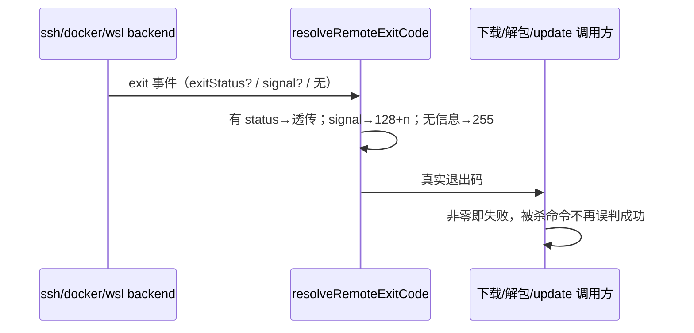

# 上游 v3.17.1：第一梯队修复设计（F01–F14）

状态：规划，2026-11-02。本文是 [台账 UR-20261102-01](../fork/upstream-review-ledger.md) 第一梯队候选 `F01`–`F14` 的修复设计：固定来源、复核现状缺口、给出设计方向与验收反例。本文不代表任何项已实施或已通过测试；实施时逐项重核并回填台账。第二梯队（F15–F28）为成套功能，各自立项时另行设计，不在本文范围。

执行遵循[上游维护规则](../fork/upstream-sync-policy.md)。上游为整版 squash 同步，无逐功能提交可 cherry-pick；移植以文件级 diff 为事实，PR 与台账中保留完整来源 SHA 与偏离理由。

## 1. 目标、来源与当前基线

- 上游固定范围：`3c5b227649371507ddc4eb46ac5133afe6db1cab`（v3.16.2）→ `a60ba6a7e5a06742270ca605f5d2cc2766afa7e1`（v3.17.1，2026-10-30 源码同步）。
- 本地 HEAD：`6ae791ee`（另有未提交 `.gitignore` 改动，与本文无关）。下文"本仓现状"证据为本轮审查抽查复核的 file:line，实施前按实际 HEAD 重核，不把本文行号当永久事实。
- 第一梯队入选标准：小而独立的行为修复或纯配置增量，无跨模块状态重构，可单独验收与回滚。共 14 项，默认一项一个可回滚 PR。
- 上游此区间删除约 2000 个 packages 层测试（测试体系重组为脚本化 E2E）。**不跟随删除**本仓任何测试；上游 `engineering-tests` 更名与 pre-push 链变更也不引入（工程收口归 I21）。

## 2. 批次、交付与依赖

| 批次                  | 候选                    | 本批目标                                                        | 出口                                             |
| --------------------- | ----------------------- | --------------------------------------------------------------- | ------------------------------------------------ |
| T1-A 基础设施与远程   | F01、F02、F06           | RPC 序列化正确性、远程命令退出码语义、server-cli 现场事故修复   | 反例测试通过；既有序列化协议与远程成功路径不回归 |
| T1-B 模型请求与运行时 | F03、F04、F05、F11      | 限流风暴、subagent 准入队列、git 上下文准确性与卡顿、归一化小修 | 模型请求时序反例；上下文快照行为可断言           |
| T1-C 服务与配置       | F07、F08                | 文件监听稳定性、provider 配置升级 rev43                         | watcher 反例；provider 全套解析测试通过          |
| T1-D 工具与界面小修   | F09、F10、F12、F13、F14 | 契约校验、hook 拒绝语义、CUA 参数、浏览器下载、终端关闭语义     | 每项独立反例；F14 先落产品裁决再实施             |

依赖关系：

- F03 与 F04 同触模型请求重试/准入面，建议顺序合入，第二项合入时重跑前一项回归。
- F02 的 exit code 语义变化会影响"按退出码判成功"的调用方（下载、解包、update），同一 PR 内完成调用点复查，不拆两半。
- 其余各项互相独立；无硬依赖，不把同批捆绑为合并条件。

## 3. 每项实施清单

"上游来源"均为 v3.17.1（`a60ba6a7`）内路径；"本仓现状"为缺口证据。

| ID  | 修复内容与设计                                                                                                                                                                                                                                                                                                                                                                                                                                                               | 上游来源                                                                                                                                                                 | 本仓落点与 owner                                                                                                                                                                                 | 主要验收反例                                                                                                                                                                          |
| --- | ---------------------------------------------------------------------------------------------------------------------------------------------------------------------------------------------------------------------------------------------------------------------------------------------------------------------------------------------------------------------------------------------------------------------------------------------------------------------------- | ------------------------------------------------------------------------------------------------------------------------------------------------------------------------ | ------------------------------------------------------------------------------------------------------------------------------------------------------------------------------------------------ | ------------------------------------------------------------------------------------------------------------------------------------------------------------------------------------- |
| F01 | RPC replacer 改按 holder 原值（`this[key]`）判断二进制：Node Buffer 先被 `toJSON` 展开成对象再到 replacer，旧逻辑把展开对象按普通对象编码，归档体积 ~3.6×、大插件可超 WebSocket 上限；同批引入 `ResponseType.EventError` 回传事件订阅错误                                                                                                                                                                                                                                    | `packages/rpc/src/serialization.ts`、`channels.shared.ts`、`channelClient.ts`                                                                                            | `packages/rpc/src/serialization.ts`（`:221` 起嵌套标记缺 `original` 判定、无 EventError）；owner：rpc 包                                                                                         | 嵌套 Buffer/Uint8Array roundtrip 内容一致且编码为 base64 标记形态；技能/插件归档跨进程传输体积断言；事件订阅错误可达对端                                                              |
| F02 | 新增 `resolveRemoteExitCode`：有 exit-status 透传；被信号杀死 → `128 + 信号值`；完全无退出信息 → `255`。替换三个 backend 全部 `code ?? 0`；同批移植 sshAuth 2FA 提示按文字识别（不按轮数）、keepalive 与握手超时分阶段、docker daemon 不可用原因细分、wsl 身份探测抗 echo 干扰                                                                                                                                                                                               | `packages/server/src/remote/closeEvent.ts`、`sshAuth.ts`、`docker-backend.ts`、`wsl-backend/`                                                                            | `packages/server/src/remote/ssh-backend.ts:297,303,370,373`、`docker-backend.ts:204,207`、`wsl-backend.ts:364,367`；owner：server remote 层                                                      | 信号终止 → 128+n 且下游判失败；无 exit-status → 255；正常码透传；下载/解包/update 调用点不再把被杀命令当成功；2FA 提示不误判轮数                                                      |
| F03 | provider Retry-After 直返分支追加最多 20%、5s 封顶抖动：同批限流请求拿到同一 retry-after，不加抖动会在同一毫秒集体醒来再撞限流（1302 风暴）。 unreasonable 值继续走指数退避既有路径不变                                                                                                                                                                                                                                                                                      | `apps/zcode-cli/packages/adapters/src/model/runner-retry.ts`                                                                                                             | 同路径 `:47-48`（直返 `retryAfterMs`）；owner：adapters model 层                                                                                                                                 | 同批同 retry-after 的退避值不再全等（分布断言）；超大/非法 retry-after 仍拒绝；jitter 关闭时行为不变                                                                                  |
| F04 | subagent 不再直接继承父 runtime 的模型请求准入端口：runtime deps 新增 `subagentModelRequestAdmission(sessionId)` 工厂，bootstrap 绑定"同一父会话的全部 subagent 共用一条准入队列"；父端口仅作回退                                                                                                                                                                                                                                                                            | `apps/zcode-cli/packages/core/src/subagent/runner.ts`、`runtime/methods/subagent.ts`                                                                                     | `apps/zcode-cli/packages/core/src/runtime/methods/subagent.ts:317-320`（现为直接继承，注释即上游已删除的旧语义）；owner：core runtime + bootstrap 绑定点                                         | 一轮并行 N 个 Agent 调用全部经同一 admission 队列（不再因父为 observer 全部直通）；父会话限流时 subagent 排队；无工厂绑定时回退父端口                                                 |
| F05 | git 快照加固：(a) "是否在仓库"改纯文件系统判定——从 realpath 向上找 `.git`（目录或 worktree/submodule 的 gitdir 文件），不再依赖 `git rev-parse`；(b) 5 条 git 命令 `Promise.all` 并行 + AbortSignal 贯穿；(c) 分支改 `symbolic-ref --short -q HEAD`；(d) status 加 `--ignore-submodules=dirty`；(e) Windows git 安全化（PATH 条目去引号、裸名 git 从绝对路径解析、净化 `.git/config` 的 fsmonitor/hooks 注入环境）；(f) 确认非仓库的目录结论记忆，"没读到"与"确定非仓库"区分 | `apps/zcode-cli/packages/adapters/src/context/git-snapshot.ts`、`exec/windows-executable.ts`（配套 core env-info/context-refresh）                                       | 同路径（`:29,66` 仍 rev-parse 串行）；owner：adapters context 层                                                                                                                                 | 无 git 环境/超时/取消仍能判定 in-repo；worktree、submodule、symlink 目录正确；并行命令取消不悬挂；非仓库目录二次调用不重查且 Environment 与 gitStatus 不再互相矛盾                    |
| F06 | server-cli 修复五件套：(a) 锁判活从仅 PID 改为核对进程身份（容器/WSL 重启后残留锁不再判存活；旧格式锁回退 PID 判定保持兼容）；(b) 同 id release 判定 match/damaged 两态，损坏副本自动替换（先移隐藏名再 rename、失败回滚如实上报）；(c) update 降级需显式 `--allow-downgrade`，方向按持锁后真实 current 判定并写 downgrade 标记；(d) 失败等待结果追加本次启动 state/lastExitReason（显式错误码）；(e) `SERVER_READY_WAIT_TIMEOUT_MS = CORE_READY + 10s`                      | `packages/zcode-server-cli/src/runtime/{lock,immutableRelease,paths,updateCommand,updateHandoff,statusSnapshot,shutdownWait,contracts}.ts`                               | `packages/zcode-server-cli/src/runtime/`（均旧版；stableLauncher/I11 区域上游零改动）；owner：zcode-server-cli runtime                                                                           | 残留锁+进程不存在 → 可启动不再 "already running"；损坏 release 强制重装可成功；无 flag 拒绝降级；失败 status 含原因；就绪等待不再早于 Supervisor 自身预算超时；已部署旧锁文件可被读取 |
| F07 | fileWatcher 稳定性：持续写入不再永久推迟刷新（独立 max-wait 定时器）；rename 身份校验推迟到收口一次（不重复/不丢事件）；符号链接按 stat 身份比对；失效 watcher 发最终刷新后关闭                                                                                                                                                                                                                                                                                              | `packages/services/src/fileWatcher/`（上游同构模块）                                                                                                                     | `packages/services/src/fileWatcher/{fileWatcher,fileWatcherService}.ts`；owner：services 文件监听                                                                                                | 持续写入场景最终收敛一致；rename/移动只报一次且新路径可查；symlink 目标替换按身份判断；watcher 失效后清理并推送末次刷新                                                               |
| F08 | provider 内置配置 rev33 → rev43：13 个新模板（Kimi/MiniMax/Qwen/腾讯/火山/StepFun/SiliconFlow 等 coding-plan/token 类）+ 既有模板新模型（zai `glm-5.3-flashx`、moonshot kimi-k3.1、anthropic claude-5.5 系、openai 新款、xai grok-4.7、openrouter 一批）+ providerSiteRules 4 条。按本仓实际支持厂商挑选收录；revision、test json、parity 测试同步                                                                                                                           | `config/provider/zcode-builtin.json`、`zcode-builtin.test.json`                                                                                                          | 同路径（现为 rev33）；owner：builtin 配置声明 + resolver 不变                                                                                                                                    | provider/provider-node 模板解析全套测试通过；新模板与既有 Personal 覆盖不串命中；不支持的厂商不出现入口                                                                               |
| F09 | SendMessage 契约：message 去空白后非空（空白消息被 provider JSON Schema 拒收却回报 queued）；summary 截断按代理对留位（不切 emoji 半个）                                                                                                                                                                                                                                                                                                                                     | `apps/zcode-cli/packages/contracts/src/tools/send-message.ts`                                                                                                            | 同路径（无 trim/refine）；owner：contracts 工具 schema                                                                                                                                           | 空白/纯空白 message 拒绝；含 emoji 的 summary 截断后仍是合法字符串                                                                                                                    |
| F10 | Hook `onError: "deny"`：声明字段进 workspace hook 信任摘要（改声明需重新信任）；PreToolUse hook 真实运行出错（用户中断不算）时按退出码 2 同路径拒绝工具调用                                                                                                                                                                                                                                                                                                                  | 上游 `contracts/src/hooks/`（声明+digest）+ `core/src/hooks/{runner,configured-runner}.ts`                                                                               | `apps/zcode-cli/packages/contracts/src/hooks/`（无 onError）；owner：contracts + core hooks runner                                                                                               | hook 抛错 → 工具被拒；用户中断 hook 不触发 deny；修改 onError 声明后信任摘要变化需重信任                                                                                              |
| F11 | reasoning-history 归一化：删除纯 reasoning/空白 assistant 段后，只合并删除点两侧的一对相邻 user；其余相邻 user 已由请求层拼好，整段重合并会给每对多补 `\n`                                                                                                                                                                                                                                                                                                                   | `apps/zcode-cli/packages/adapters/src/model/reasoning-history-normalization.ts`                                                                                          | 同路径（旧版全量 merge）；owner：adapters model 归一化                                                                                                                                           | 构造多对相邻 user 的历史，输出不多补换行；删除点两侧合并语义保持                                                                                                                      |
| F12 | CUA helper 常量新增 `--ghost-cursor-overlay` 参数并在 broker→helper 链路传递：漏传时 helper OverlayEnabled 恒 false、agent 光标不渲染。本仓 computer-use 链路同源，需核对 zody helper 侧是否已支持 overlay 参数                                                                                                                                                                                                                                                              | `packages/zcode-cua/broker-helper-constants.{js,d.ts}`、broker 链路                                                                                                      | `packages/zcode-cua/broker-helper-constants.js`（无该常量）；owner：zcode-cua + desktop CUA 链路                                                                                                 | Windows 链路 OverlayEnabled 恒 true；agent 光标渲染可见；常量与 d.ts 同步                                                                                                             |
| F13 | 内嵌浏览器下载导航修复：desktop main `will-download` → IPC 上报，渲染层把下载响应与页面加载失败对账（不再误报 ERR_FAILED）；restorable URL 只记录主框架已提交 URL（修附件 URL 每次 rebind/恢复都重复下载）                                                                                                                                                                                                                                                                   | 上游 `packages/desktop/src/main/desktopWindowChrome.ts`、`renderer/src/desktopBrowserPlatformBridge.ts`、`preload/index.ts`、`ui/src/browser-use/UnifiedBrowserView.tsx` | `packages/ui/src/browser-use/UnifiedBrowserView.tsx:229`（initialUrl 初始化旧逻辑）、`packages/desktop/src/main/desktopWindowChrome.ts`（无 will-download）；owner：desktop main + UI 浏览器面板 | 附件 URL rebind/会话恢复不重复触发下载；下载进行中不再显示加载失败；正常导航的 restorable URL 不回归                                                                                  |
| F14 | 终端末 tab 关闭：上游改为先删除 session 再收起面板（PTY 真正 dispose、资源释放）。**本仓现状是有意保活**：`Terminal.tsx:189-199` 注释明示最后 tab 关闭语义=收起面板保活 session，与右上角关闭一致。属产品语义分叉，非纯 bugfix                                                                                                                                                                                                                                               | 上游 `packages/ui/src/Terminal.tsx`                                                                                                                                      | `packages/ui/src/Terminal.tsx`（closeAction === "close-panel" 分支）；owner：UI Terminal                                                                                                         | 裁决改为销毁：末 tab 关闭后 PTY dispose、重开新建；裁决保留现状：登记 closed 并记录依据，不实施                                                                                       |

## 4. 状态所有者与事件顺序

| 状态/事件               | 唯一 owner                                        | 其他层职责                  | 必须保持                                                       |
| ----------------------- | ------------------------------------------------- | --------------------------- | -------------------------------------------------------------- |
| 远程命令退出码          | backend close 路径 → `resolveRemoteExitCode`      | 调用方只按返回码判定成败    | 信号/无信息不再折叠为 0；调用方成功判定不因修复而放宽          |
| subagent 模型请求准入   | 父会话 admission 队列（经工厂按 sessionId 绑定）  | subagent runtime 只消费端口 | 同父会话共享一条队列；无绑定点回退父端口；不新建第二套准入状态 |
| server 运行锁与 release | zcode-server-cli runtime（lock/immutableRelease） | Supervisor/CLI 只读判定结果 | 旧格式锁可读；身份判活失败宁可判 stale 也不误判存活            |
| git 上下文结论          | adapters git-snapshot（含非仓库记忆）             | core context 消费快照       | "没读到"与"确定非仓库"不混写；记忆随目录身份失效               |
| 文件监听收口            | services fileWatcher                              | 各服务订阅刷新事件          | max-wait 保证最终刷新；失效 watcher 不再分发                   |



```mermaid
flowchart LR
    Bo[bootstrap 绑定 subagentModelRequestAdmission(sessionId)] --> Q[父会话共享准入队列]
    Q --> S1[subagent 1]
    Q --> S2[subagent N]
    S1 --> P[provider 请求]
    S2 --> P
    S1 -.无绑定时回退.-> F[父 runtime 端口]
```

## 5. spec、验证与门禁

- spec 落点：F06 更新 `docs/architecture/r2-server-cli-and-daemon.md`；F08 更新 provider 模板文档（参照 `docs/provider-mimo-templates.md` 的增量式记录）；F02/F04/F05 实施时先确认既有领域 spec，无对应文档则新建专项 spec 后再动代码；纯契约小修（F09/F10/F11/F12）随 PR 补契约说明即可。
- 全仓 `pnpm typecheck`、`pnpm lint`、`pnpm architecture:check --changed`；目标包测试入口以各 `package.json` 为准（adapters/core/bootstrap 用各自 vitest 入口，rpc/server/zcode-server-cli/services/ui/desktop 同理）。
- 每项至少一个针对性反例：修复前失败、修复后通过。涉及远程/异步/并发的 F02、F04、F06、F07 补并发或取消用例；F06 涉及锁文件格式时先定义旧数据兼容与降级读取。
- 记录执行命令、真实结果与环境；未执行或环境受限如实登记，不把上游测试存在写成本地通过。
- 回滚：每项独立 PR，revert 代码即可还原行为。F01（序列化格式）与 F02（退出码语义）回滚时需同步考虑新旧版本混连窗口，PR 中写明混连策略。
