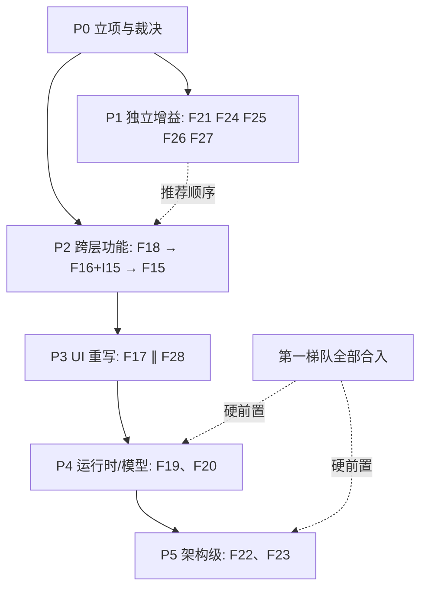

# 上游 v3.17.1 第二梯队：分阶段执行方案

状态：规划，2026-11-02。本文是 [台账 UR-20261102-01](../fork/upstream-review-ledger.md) 第二梯队候选 `F15`–`F28` 的阶段划分、顺序依赖、立项门槛与 P0 裁决清单，与第一梯队 [修复设计](upstream-v3.17.1-tier1-fix-plan.md)/[执行方案](upstream-v3.17.1-tier1-execution.md) 衔接。本文只定阶段与门槛，不替代各项立项时的实施设计；本文存在不代表任何项已开始实施。

## 1. 目标、来源与基线

- 上游固定范围与本地基线同第一梯队文档：`3c5b2276`（v3.16.2）→ `a60ba6a7`（v3.17.1）；本仓现状证据截至 HEAD `6ae791ee`，立项时按实际 HEAD 重核。
- 第二梯队入选标准：成套产品功能或跨模块行为改进。每项立项时先补领域 spec 与验收场景，默认一项一条可回滚 PR 线；项内确有依赖链的按本文内部分步拆成串联 PR（如 F17/F19/F20/F28）。
- 阶段划分三依据：**风险递增**（P1→P5）、**依赖方向**（被依赖项先落）、**包冲突面**（阶段内可并行、不与第一梯队抢 lane）。阶段是推荐排布而非硬门控；硬依赖只有本文明确列出的几条。

## 2. 阶段总览

| 阶段 | 项                      | 性质         | 进入门槛                       | 出口                               |
| ---- | ----------------------- | ------------ | ------------------------------ | ---------------------------------- |
| P0   | 全部 14 项              | 立项与裁决   | 无                             | 四项裁决落定；各阶段实施文档就绪   |
| P1   | F21、F24、F25、F26、F27 | 独立增益     | 对应 spec 补全                 | 各项独立验收合入                   |
| P2   | F18 → F16(含 I15) → F15 | 跨层用户功能 | spec + E2E 场景                | 每项 E2E 通过                      |
| P3   | F17 ∥ F28               | UI 核心重写  | 性能/回归基线先建              | 分步合入且基线不回退               |
| P4   | F19、F20                | 运行时与模型 | 第一梯队全部合入；验证手段就绪 | 模型可见行为反例通过               |
| P5   | F22、F23                | 架构级链路   | P0 裁决 1/2 落定；独立项目文档 | 双 delivery profile / 安全评审通过 |

说明：P2 的 F18 在 spec 与 sandbox 通道核验完成后即可开工，不必等 P1 收尾；图中实线为推荐顺序，硬前置只有 P4/P5 对第一梯队、以及 §5–§8 列出的项内/跨项依赖。

## 3. P0 立项与裁决清单

四项裁决必须在对应阶段写 spec 前落定，否则返工：

| #   | 裁决                           | 选项与影响                                                                                                                               | 产出物                                                     |
| --- | ------------------------------ | ---------------------------------------------------------------------------------------------------------------------------------------- | ---------------------------------------------------------- |
| 1   | **F22 移植形态**               | 整链（session-lifecycle owner + gateway 五点 + inbox reset + cold-resume 移交）vs 只挑修复点（isSessionStopping、释放屏障、inbox reset） | I19 与上游 v3.17.1 生命周期链差距盘点文档；P5 工作量据此定 |
| 2   | **F23 `untrusted` 枚举冲突**   | workspace MCP 信任用新状态名 vs 扩展现有官方 origin 信任语义；影响协议 schema 与 UI 状态机                                               | 信任状态模型小节（进 F23 spec）                            |
| 3   | **F27 restartTask 能力核验**   | services/host 已有任务级重启则直接接；无则 P1 内先做 services 侧小切片                                                                   | 核验结论与（如需）切片任务卡                               |
| 4   | **F15/F16 与本仓既有实现共存** | 图片标注 vs 自有 `ChatMediaAttachmentPreviewDialog` 的边界；按格式打开 vs 既有静态编辑器菜单（`getInstalledEditors`）的排序与共存        | 两项 spec 的共存章节                                       |

通用前置（各阶段进入条件的一部分）：对应阶段实施文档（参照第一梯队 fix plan 粒度）；F20 的真实 GLM 流量验证手段（analyze_image / webReader 会话样本）；F17/F28 的性能与回归基线方案；交互项的 E2E 场景清单。

## 4. P1 独立增益项（F21、F24、F25、F26、F27）

五项互相独立、可并行，各自独立验收。与第一梯队的关系：F21/F24 触 adapters/bootstrap 包，需避让第一梯队对应 lane（tier1 W2/W3 合入后开工）；F25/F26/F27 包面基本不重叠，可在第一梯队收尾期并行。

| 项  | 内容与上游来源                                                                                                                                          | 本仓落点                                                                                         | 验收方向                                                                                   |
| --- | ------------------------------------------------------------------------------------------------------------------------------------------------------- | ------------------------------------------------------------------------------------------------ | ------------------------------------------------------------------------------------------ |
| F21 | OutputCollector 请求级 `requestedTailBytes`/`ByteTail` 分块（摊还 O(总输出)）、result `tail`、`outputLimit.tailBytes`、超时转后台记 `timedOutAfterMs`   | adapters `output-collector.ts`、`node-execution-adapter-base.ts` + core bash handler + contracts | I16 基座上增量；tail 语义反例（多次请求摊还、超预算截断）；转后台后 `timedOutAfterMs` 可见 |
| F24 | `dynamic-workflow-quota-resume.ts`（journal 行 `resetAt` 为唯一数据源、到点 +60s 自动 resume、不循环、min spacing→翻倍→封顶）+ 未识别业务码连续计数停机 | bootstrap `dynamic-workflow-quota-resume.ts` + adapters `workflow-model-failure-policy.ts`       | 到点续跑反例；重置时刻不动不再续；未知码连续 N 次停 run、限流/5xx 仍内重试                 |
| F25 | `shared/userInstructions.ts`（`~/.zcode/AGENTS.md` 100KB 上限）+ services 路径 + UI PersonalizationSection 分区                                         | shared + services + ui settings；Web/手机显示"请前往本地桌面端"                                  | 100KB 上限、读写往返、与 CLI adapter 读取截断一致                                          |
| F26 | 完全访问模式风险确认弹窗（三类说明 + 勾选 + 不抢输入框焦点），复用 confirmDialogStore                                                                   | ui ConfirmDialog/useConfirmDialog + 模式切换三入口                                               | 菜单/快捷键/权限对话框三条路径都先确认一次；确认后不重复弹                                 |
| F27 | 任务菜单"重启任务" + `/reload` 本地斜杠命令（模型配置前截获）+ Agent 进程恢复确认框；host 范围任务搜索/按未读视图随任务列表改版跟进                     | ui + services zcodeTaskService（依 P0 裁决 3）                                                   | 重启后任务续跑语义明确；`/reload` 不进入模型输入；进程恢复确认只在资源无法安全释放时出现   |

## 5. P2 跨层用户功能（F18 → F16（含 I15）→ F15）

三项都是 desktop + UI 协同、用户可见的交互改动，**E2E 场景必须**。内部顺序链及理由：

1. **F18 最先**：spec `docs/plugin-ui-background-execution.md` 已入库（2026-10-24 已决口径），只差代码。实现 `pluginUiBackgroundRetention`（默认隐藏即停、上限 4 页/闲置 30 分钟、最小化暂停计时、busy 不回收、claim/finish 预占 + Agent 端 tryRecycle 原子裁决、可见且有锚点自动重建）+ `resourceMeta.backgroundRetention` 字段（desktop registry + shared 同步）。开工核验点：本仓 sandbox `tryRecycle`/`setExecutionActive` 通道是否存在，不存在则先补通道切片。
2. **F16 带 I15**：desktop `file-open-apps/*`（系统关联为唯一事实源、Windows ProgID/AppsFolder 图标、WPS suite 特判）+ ui `file-menu/*`（useFileApplications、另存为 ≤50MiB 分块读取防截断）+ `OpenSplitButton.renderCard` 扩展。**I15 整卡打开必须在此落地**：它改 `AssistantPreviewCards`，必须赶在 F17 时间线重写之前，避免同一文件两改相撞；本仓 OpenSplitButton 版本较旧，需先对齐组件或手写同等透明按钮层。与静态编辑器菜单的共存排序按 P0 裁决 4。
3. **F15**：`image-preview-editor/*` 全模块（画笔/文字/矩形/椭圆/箭头/橡皮擦、撤销重做、平移缩放、自然尺寸 PNG 导出）+ 焦点 Composer 捕获（上游用 DOM CustomEvent）→ `addAttachmentFiles` 入草稿；无接收方给出提示。**必须先于 F28**：后到的 F28 草稿事务要把"附件插入"纳入 claim/restore 测试，顺序反了会漏。与 `ChatMediaAttachmentPreviewDialog` 的边界按 P0 裁决 4。

## 6. P3 UI 核心重写（F17 ∥ F28，双轨道）

两项 UI 区域不同（会话时间线 vs composer），可并行推进；但都是对已分叉区域的回归敏感重写，**必须先建基线**：F17 建长会话流式性能与滚动/挂载回归基线；F28 建草稿丢失类 bug 清单与复现用例。每步独立可合入、基线不回退才继续。

- **F17 内部三步 + 收尾**：①冻结历史 + 尾轮分区（`getConversationRowsPartition`/`memoizeByRows`，流式帧只算尾轮）→ ②ROW_OVERSCAN 收紧与未知长轮一屏估高 → ③批量测高与 `measuredLayoutRevision`（含前插锚点期间抑制逐行补偿、宽度校正后发布 revision）→ ④查找改进（命中索引分区缓存、宽度校正后定位、activeIndex 不触发整 App 更新）。
- **F28 内部四步**：①staged 暂存热路径（不触发父级 render/localStorage）→ ②scope incarnation token → ③claim/restore/finalize 提交事务（防失败恢复写入已切换 scope）+ createSession 信封 `sess_` UUID 幂等 → ④IME composition 抑制发布与 compositionend 前切任务不丢草稿。测试必须覆盖 P2 F15 引入的附件插入路径。

## 7. P4 运行时与模型链路（F19、F20）

**硬前置：第一梯队全部合入**（同包冲突面：core/adapters/bootstrap）。两项内部各有依赖链，链内串联、链间可并行。

- **F19 两步链**：①`read-file-state` 单条最新视图重构（`file_unchanged` 不存快照副本、hydrator 按 part 落盘序、rewind 只重建删除点后、Read 行号按视图实际起始行、空文件判定）→ ②compact 文件补回（≤5 文件、每文件 5k token、总 50k；只补 Read/Write/Edit 来源，排除 plan/指令/MEMORY.md/权限 deny 文件；超限转引用提示；重读当前文件后整表替换 read-state）。第二步依赖第一步的单条视图。
- **F20 两步链**：①adapters 流兼容层 `provider-builtin-tool-compat`（GLM 服务端工具流中 markdown 头/`server_tool_use`/结果 markdown/裸 `tool_result` 改写为 SDK 原生 `mcp_tool_use`/`mcp_tool_result`，按 message 维护状态、缓冲未确认帧、流结束补发）→ ②core 切轮 `provider-tool-rounds`（遇 providerExecuted 收起当前轮、工具卡片、回放 entries、compactGroupKey 用持久化 assistant 消息 id、有轮次响应不挂 `tokens`、冷恢复重切轮）。验证需要真实 GLM 流量（P0 准备）。

## 8. P5 架构级链路（F22、F23）

最高风险、最后执行，各自按独立小项目节奏（专项比较文档先行、不与任何其他项捆绑合入）。

- **F22 会话生命周期换代链路**：形态依 P0 裁决 1。整链 = `session-lifecycle` owner（存在性/初始化/停止预检/释放/观察、faulted 隔离、operation lease 防容量回收抢占）+ gateway 五点（`isSessionStopping`、`residentRowsRange` residency、释放屏障 `releaseSessionProjection`/`finishSessionRelease`、`forgetIndexedSession`、`prepareSessionHistory` 直激活）+ CommandInbox `resetReleasedSession` + cold-resume 单飞移交；挑点 = 其中三个修复点。无论哪种形态，验收都必须覆盖**双 delivery profile**（desktop-continuous / web-remote-replayable）下换代期间的迟到命令与迟到终态不串代。
- **F23 workspace MCP 信任门**：依 P0 裁决 2 定状态模型后实施：协议 `workspace/mcp/trust` + CLI guard（inspect 不连接、decide 锁内重读原子写、allows 连接准入重验、未知/陈旧/损坏记录默认拒、guard 包整个 lease）+ UI 双横幅（待信任摘要、撤销在新建/重启会话生效）。验收含安全评审：未信任 server 工具数 0、digest 变更需重信任、撤销生效路径。

## 9. 验证与门禁

- 通用：spec 先行；每项针对性反例；全仓 `pnpm typecheck`、`pnpm lint`、`pnpm architecture:check --changed`、`pnpm fmt:check`（基线既有 docs/electron vendored HTML 报错与 Node engine 警告不记在项上）。
- 交互项（P2 全部、F26、F17、F28）：E2E 场景必须，按当前 E2E 用例生命周期规则登记。
- F17/F28：性能与回归基线的前后对比数据，无基线不得声称改进。
- F20：真实 GLM 流量回放验证；F22：双 delivery profile；F23：安全评审。
- 台账逐项回填实施状态（`merged` 与 `released` 分开），阶段完成不等于项完成，不整阶段捆绑登记。

## 10. 与第一梯队的交接

| 项            | 与第一梯队关系                     | 可开工时机                           |
| ------------- | ---------------------------------- | ------------------------------------ |
| F21、F24      | 同 adapters/bootstrap 包           | 第一梯队对应 lane 合入后（W2/W3 后） |
| F25、F26、F27 | 包面基本不重叠                     | 可在第一梯队收尾期并行               |
| F18、F16、F15 | 不重叠                             | P0 对应裁决落定 + spec 就绪即可      |
| F19、F20      | 重触 core/adapters                 | 第一梯队全部合入后（硬前置）         |
| F22、F23      | bootstrap/gateway；F22 是 I19 演进 | P0 裁决 + 第一梯队全部合入（硬前置） |

## 11. 收缩策略

资源收缩时的延后顺序建议：**F22 首选**——用户价值最间接，且 P0 裁决 1 很可能得出"挑修复点即可"的结论，届时降级为小项；其次视产品优先级评估 F27（若 restartTask 能力缺失导致范围扩大）与 F24。其余项均有直接用户或模型可见收益，不建议整体延后；已进入实施阶段的项不中途冻结，按项收口。
