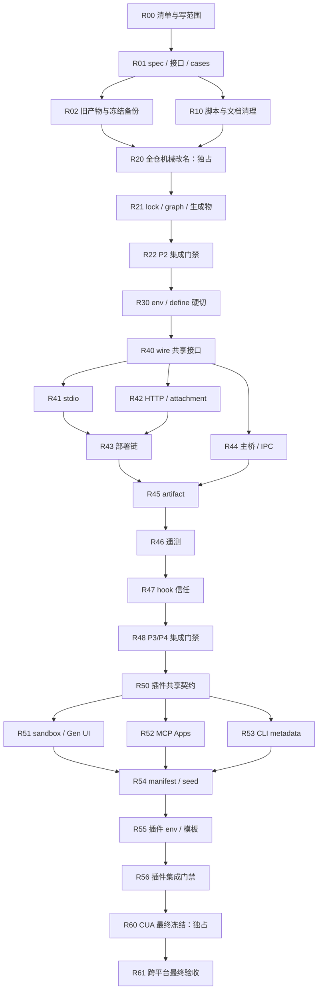

# Zody 全面改名：子代理实施任务计划

状态：实施中。编制日期：2026-11-02；子任务细化：2026-11-03。各任务真实状态以 [任务账本](zody-rename-execution/task-ledger.md) 为准；实施中不代表远端部署、签名或发布已完成。

产品规则以 [改名设计与调查](zody-full-divergence-rename-survey.md) 为输入；本文负责执行顺序、文件所有权、任务交付与验收。遇到设计缺口先回到 spec，不允许子代理自行改变硬切、不迁移、插件 1.0 退役或 CUA 信任根等已定规则。

派发规模：26 个父任务，拆为 56 个可派发单元（§7.4 的 55 个子任务，加单独派发的 R10）。每次派发结合父任务卡、子任务检查点和 §7.2 的精确文件/命令合同；不能直接把整张波次表交给一个代理自由修改。

编制参考基线：`033f91783901e6adaf968d3d4b8ca34c41d89442`。工作区另有未提交的设计修订及其他本地改动。实施必须先保全并纳入所需设计输入，不得直接以此 SHA 建 worktree 后遗漏修订，也不得带入或覆盖无关改动。所有路径以下述仓库根为相对起点；派发时必须给出实际工作区绝对路径。本文描述任务定义；实际执行状态以专用工作区的任务账本为准，已有执行记录时先对账，不重复派发。

## 1. 执行约定

### 1.1 角色与共同任务合同

- **主控**：唯一任务账本、共享文件锁和集成分支负责人；派发、审查 diff、整合、复验和报告。默认最多 3 个 Terra 子代理同时运行，主控占第 4 个槽位。模型不得静默替换。
- **实施子代理**：只写任务卡与派发包交集中的文件；新增文件也需落在明确的 `writeSet` 内。发现越界修改需求时返回路径和理由，由主控调整分配，不能自行扩大范围。
- **验收子代理**：默认不改产品源码，可写自己的报告并在隔离目录生成测试/构建产物。发现失败交回原任务修复，不能为通过而改测试门禁。
- **原生冻结执行者**：R60 独占活动冻结资源、签名和 pins；其他子代理不得并行调用会改写相同资源的构建或复原命令。
- 每个代码任务开工先读根及目标目录 AGENTS.md，运行 freshness 与架构基线检查，使用 architecture-governance 技能读取对应受控上下文；跨模块接口遵守公开入口。UI/React/E2E 分别遵循 DESIGN.md、相关 React 技能及 e2e-case-lifecycle，插件商店涉及领域词汇时读取 CONTEXT.md。
- **行为改动先更新 spec 和测试，再实现**。机械改名同步更新原有路径/包名断言，不为单纯字符串替换添加镜像测试。bug 修复按仓库要求用中文注释说明原因。
- 子任务完成必须返回 diff 范围、测试命令/退出码、未验证项与残余风险。执行自身目标测试及 `pnpm typecheck`、`pnpm lint`；跨任务未集成导致的失败如实记录，由集成门禁在完整批次重验。
- 中间接口任务可以处于未集成状态，不能单独宣布 P2/P4/P4.5 通过。主控审查并完成门禁后才标记 `integrated`；任何 `done`、`verified` 均不等于已发布。

### 1.2 文件所有权与工作区

默认由主控管理一个专用集成工作区。并行任务必须使用互不重叠的精确文件集合；需要 worktree 时所有子任务从已冻结的同一接口基线创建，主控按依赖顺序合入并复验。不能认为 worktree 自动消除了同文件语义冲突。

| 资源                                             | 唯一写者/约束                                                           |
| ------------------------------------------------ | ----------------------------------------------------------------------- |
| 任务账本、派发 `writeSet`、总验收结论            | 主控；子代理只写自己的报告                                              |
| 全仓目录移动、包名和 import 重写                 | R20 独占；所有其他产品源码写者停止                                      |
| 根与 CLI 独立工作区的 `pnpm-lock.yaml`           | R21；其他任务只提出 manifest 需求，不自行 install 改锁                  |
| feature graph                                    | R21 更新路径；需要语义变更时由主控串行交接，不并行重写                  |
| 根 package.json、workspace/CI/toolchain 配置     | R10 → R20 → R30 串行接力；各自只改所属阶段                              |
| shared wire/schema/exports                       | R40 先固定接口，R41/R42/R44 只消费；后续 R45/R47/R50 分批取得对应文件锁 |
| `remote/connect.ts`、远端部署配置                | R43；R41 交付握手函数接口，不并行改调用端                               |
| `bootstrap/src/app/official-plugin-runtime.ts`   | R54 → R55 串行交接                                                      |
| 公共测试 helper、WDIO 配置、共享 replay fixture  | 由主控指派单一写者；禁止多个子任务顺手修 helper                         |
| `output/cua-*`、原生冻结目录、demo-defaults pins | R02 只读/备份活动输入，R60 才写新资源；备份永不覆盖                     |

R00 将广义文件范围展开为具体清单，包含生产文件、测试、生成输入/输出和旧→新路径。路径表、公共接口表、测试 runner 未明确时，只能领取调查/设计任务，不能直接启动对应写任务。

### 1.3 交付物与状态

以下是**计划新增**的执行资料，由相应任务创建；现在不存在不代表已完成：

| 路径                                                     | 写者                          | 内容                                                                               |
| -------------------------------------------------------- | ----------------------------- | ---------------------------------------------------------------------------------- |
| `docs/plans/zody-rename-execution/manifest.json`         | R00，后续由主控维护           | 每个标识的旧/新值、分类、owner、方向、阶段、路径、保留原因/期限、验收 ID           |
| `docs/plans/zody-rename-execution/file-assignments.json` | R00，后续由主控维护           | 每个任务展开后的 readSet/writeSet/excludeSet、允许新增文件、文件锁与串行交接顺序   |
| `docs/plans/zody-rename-execution/task-ledger.md`        | 主控                          | ID、基线、agent ID、writeSet、依赖、状态、diff/提交与证据                          |
| `docs/plans/zody-rename-execution/test-map.md`           | R01，门禁任务报告后由主控更新 | case ID→真实测试文件、cwd、命令、平台/资源与状态                                   |
| `docs/plans/zody-rename-execution/contract-map.md`       | R01，主控协调接口任务更新     | wire 名称/schema、发起/接收端、版本门禁、错误与旧/新键策略                         |
| `docs/plans/zody-rename-execution/reports/<ID>.md`       | 对应任务                      | 基线、实际操作、测试、限制、交付；并行任务不得共写一个报告                         |
| 隔离的证据/产物目录                                      | 对应验收者                    | 日志、录屏、fixture、制品和摘要；Git 文档只引用可验证位置，不保存凭据/真实用户数据 |

状态按 `planned → ready → running → review → integrated → verified` 推进；`blocked` 必须说明具体输入/资源缺口，`failed` 必须保留失败证据。真实发布状态单独维护。下列 26 项是任务定义，首次创建账本时初始状态为 `planned`；本文不替代已有执行记录。

## 2. 依赖与派发波次



| 波次 | 同时可派发                  | 收敛条件                                                                 |
| ---- | --------------------------- | ------------------------------------------------------------------------ |
| W0   | R00，随后 R01               | 清单、协议/测试位置和写范围固定                                          |
| W1   | R02 + R10                   | 一个处理隔离备份，一个改源码脚本；备份以 R00 指定旧基线为准              |
| W2   | R20 → R21 → R22             | 全仓屏障；禁止并行 install、rename、codegen                              |
| W3   | R30 → R40                   | env 成套切换，共享协议接口进入统一基线                                   |
| W4   | R41 + R42 + R44             | 仅在具体 writeSet 无交集时并行；否则主控串行冲突项                       |
| W5   | R43 → R45 → R46 → R47 → R48 | 默认串行，避免 session/shared/CLI 文件交叉；可在清单证明无交集后重新编排 |
| W6   | R50，随后 R51 + R52 + R53   | 三消费者只能消费已固定接口，不修改 shared contract                       |
| W7   | R54 → R55 → R56             | manifest 与 env 共用 official runtime，必须串行                          |
| W8   | R60 → R61                   | 最终 sealed inputs 冻结；产品代码再变则失效重验                          |

各箭头既表示交付依赖也表示默认调度顺序。代码合入单元仍对应设计中的 P1/P2/P3/P4/P4.5/P5，不能把 26 张任务卡当作 26 个可独立发布版本。P3/P4 一起对外切换，macOS arm64 CUA 从 P2 起暂停发布到 R60/R61 通过。

## 3. 任务卡：准备、机械改名与环境变量

下面每张卡均继承 §1 合同。标为“当前路径”的内容在 P2 后用 manifest 映射到新路径，不能为沿用旧任务描述而恢复旧目录。`G` 表示 §7 的公共代码检查；具体测试从 `test-map.md` 复制已核实命令，禁止把测试 seed 当作已通过证据。

### R00 — 基线、改名清单与文件分配

- **依赖/模式**：无；只读源码，写规划资料。入口为设计全文、根 package.json、各目标 AGENTS.md、架构策略及已有三个领域复核。
- **写范围**：新增 `manifest.json`、`file-assignments.json`、`reports/R00.md`；不改产品源码、现有 spec、lock 或 `.gitignore`。R00 在报告中提供初版任务状态建议，`task-ledger.md` 始终由主控创建和维护。
- **操作**：固定包含最新设计修订的实施基线；展开包/目录/脚本/资产/env/wire/插件/持久化各类别，特别列出 builtin、两套 bootstrap/shared protocol 副本、CUA 18 处引用；给每项分配唯一任务。记录已完成 endpoint 改名，防止重复实施。
- **交付**：每个任务的精确 `readSet/writeSet/excludeSet`；每个重命名的旧/新路径；全部保留项和来源证据；重叠文件的串行顺序。数量重新统计，不复制旧调查数作为验收值。
- **验收**：所有生产残留均有任务或明确例外，待定项有 owner；并行 writeSet 交集为空；不以泛化 `zcode*` 豁免代替逐项分类。缺口仅阻止关联任务。

### R01 — 固化领域 spec、共享接口与验收案例

- **依赖/模式**：R00；文档写任务。
- **写范围**：`specs/zody-brand-residual-cleanup.md`、`docs/fork/upstream-sync-policy.md`、当前 `apps/zcode-cli/docs/design/v2/zody-path-compatibility.md`、AGENTS.md 对应规则，以及 manifest 指定的协议/插件/hook spec；新增 `contract-map.md`、`test-map.md`、`reports/R01.md`。会话目录/coverage 只增改本次 case。
- **操作**：定义兼容代际字段、schema、stdio/HTTP/attachment 拒绝位置、双方错误与清理；确定插件方法名称选择与能力依据、冲突处理和历史读取；固化 hook 原来源信任及 CUA 发布门禁。按 §8 case 的 setup/action/assertions 更新对应目录和矩阵。未定义行为记为待决设计项，不让实施者猜测。
- **交付**：接口表须列出每个字段/方法的生产者、消费者、文件 owner 和原子切换集合；验收表须列出精确命令/cwd/平台、真实旧产物需求和尚需新增的 fixture。把 1.0 警告/移除登记为未来里程碑，本次不提前删别名。
- **验收**：设计中的所有 RENAME-\* 均有实现任务、测试落点和证据层；连续/重放两种模式不能合为一例。已裁决事项不再向用户重复确认；仅对确实会改变产品范围的未决设计请求决策。

### R02 — 旧制品、冻结输入与回滚基线

- **依赖/模式**：R01；源码只读，允许在隔离目录备份/复原。
- **写范围**：独立旧产物/冻结备份目录及 `reports/R02.md`；不写活动 `output/cua-*`、native 冻结输入、pins，不重签名。
- **操作**：固定兼容切换前的 Desktop/Host、Agent、Server、Web 产物组合；记录来源 SHA、构建/获取命令和 SHA256。保存可用 CUA 归档、四 pin、签名身份元数据和匹配源码，在隔离目录执行 restore 演练；不复制私钥、凭据或真实会话。
- **验收**：旧组合可运行且来源可追溯；复原结果与旧源码/pins 匹配。无法取得真实旧制品可先补单测，但 R48 的真实混布验收保持阻塞；冻结材料不足则不进入会使其无法重建的 R20。

### R10 — P1 脚本、分发目录与现行文档清理

- **依赖**：R01；可与 R02 并行。
- **写范围**：manifest 列出的 `scripts/zcode-distribution/`、17 个命名脚本、所有直接调用者/对应测试、CI 与三份过时文档；不改包 scope、env、wire、lock、冻结资源。
- **操作**：以入口和调用者为原子集合移动脚本；更新 package scripts/CI 指向；修复现行路径说明，历史文档保留原作事实。
- **验收/交付**：RENAME-PATH 中脚本链目标测试、G、CI 准备检查；返回旧→新脚本映射与未改的 P2/P3 条目。dry-run 不记为真实产包。

### R20 — P2 全仓目录、包身份与内部符号改名

- **依赖/锁**：R02、R10；唯一全仓源码写者。
- **写范围**：manifest 明列的包 manifests、目录与内部源码/测试 basename、TypeScript 内部声明及引用、imports/exports、相对引用、noExternal、alias、构建资产定位、架构 roots、lint/format ignore、CI、对应测试；含调查所列 CUA 构建脚本路径/alias/断言及经核实的活跃源码入口。**排除** lock、feature graph、third-party inventory（R21）、P3 env/define、P4 wire/持久化值、P4.5 插件外部契约、历史冻结证据与冻结输出。
- **操作**：先审查 dry-run 改动清单，再应用按类别约束的 codemod；每次目录移动同步所有调用者。修改的是内部 `@zcode/zcode-cua` 包身份，不是外部 `zcode-cua` MCP/PyPI 名。shared/bootstrap 两套 protocol 副本与构建 alias 同步。
- **符号边界**：内部 class/type/function/binding 按真实声明与引用改名，使用 TypeScript 语言服务或符号引用工具核对；根项目与 CLI 子包均须覆盖。不能用标识符文本匹配推断成员、反射或对象 shorthand 的对外含义；改局部变量时保留既有外部键，例如 `{ zcode: zody }`，外部键另交所属契约任务。`.d.ts` 先确认是维护源码还是生成物，生成物从实际输入重建，旧 dist 不得掩盖调用者漏改。
- **交付**：完整改名 diff、可复核的替换规则、残留分类结果、路径断言结果；相关 runner 清单按新路径更新并交主控维护。
- **验收**：无未登记的旧内部包/路径引用；现有路径/构建工具测试通过。G 若因 lock 尚未更新不能完成，记录事实并交 R21/R22；R20 不单独合入主线。

### R21 — P2 lock、生成物与 feature graph 收口

- **依赖/锁**：R20 写入停止；唯一 lock/graph 写者。
- **写范围**：根 `pnpm-lock.yaml`、当前 `apps/zcode-cli/pnpm-lock.yaml`（P2 后按新路径）、`third-party/inventory.json` 及其同源生成 notices 的必要变化、feature graph 路径和同源生成物，以及报告；不改包 manifest/生产实现，不改第三方作者归属。生成物路径由 R00 展开，不能自行扩展到全部 NOTICE/LICENSE。根与 CLI 的 `skills-lock.json` 纳入残留审计，只有实际引用需要变化时才由主控授予写权限，不因包名改动重生成外部技能来源/hash。
- **操作**：按当前 mise/packageManager 固定 Node/pnpm；先诊断根和 CLI 的 manifest、workspace 与锁是否在改名前一致，再基于旧 lock 增量更新，审查第三方版本/integrity/peer 差异。改名前即存在的失步应独立复现；删除嵌套 workspace/lock、改变安装 owner 或重新解析第三方依赖均不是机械改名，须先明确方案和文件授权，不能为通过 frozen install 顺手实施。按真实现有工具生成 inventory；graph 保持节点 ID 和产品语义，仅映射已移动 codeSeeds/docs。若图为手工维护则按现有校验方式更新，不臆造“再生成”命令。
- **验收**：主控先把 R20+R21 的完整结果制成临时集成提交，记录 commit/tree SHA；从该提交建立干净验证工作树，在根和移动后的 CLI 独立工作区分别运行 `pnpm install --frozen-lockfile`（如已批准更改安装 owner，则按修订后的唯一入口及 CLI 子目录脚本场景验收），不得检出未包含改动的旧 HEAD 代验。检查实际 workspace symlink 的目标、包名及 bin，而非只检查锁文件文本。不存在无关依赖升级；图路径与 exports 校验通过。R22 通过后以相同内容原子合入，修复改变内容时重新建立并验证集成版本。包 manifest 需要修正时交回 R20，禁止这里临时扩权。

### R22 — P2 集成与构建门禁

- **依赖/模式**：R21；产品源码只读，写报告/隔离产物。
- **执行**：G、`pnpm knip`、`pnpm test:unit`、`pnpm build:zody --all`；设计 §6.3 的 narrow 测试及三个补充 node tests；RENAME-PATH 的开发/发行 CLI 启动、provider 配置加载与 Desktop 资源准备。
- **验收**：所有改名链路可解析，第三方依赖无漂移；真实结果和基线失败分开。macOS arm64 Desktop 最终 CUA 出包留到 R60，当前不能用旧冻结资源把 P2 标为发行通过。
- **交付**：P2 批次合入建议、剩余发行阻塞、失败归属；失败由 R20/R21 串行修复后重跑受影响检查。

### R30 — P3 环境变量与 define 原子硬切

- **依赖/锁**：R22；该批单写者。
- **写范围**：manifest 所列 A/B/C/D 变量和 `__ZCODE_*__` 的全部读取/注入/构建定义处、测试、README/.env.example、mise/CI、远端启动配置；不改插件兼容变量、握手和别名层。
- **操作**：测试先覆盖仅新名、仅旧名、并存、未设置；生产者/消费者同批改。特别验证 data root、credential secret、认证、代理与 provider 配置传入子进程/远端的值，避免旧名失效掩盖错误默认值。
- **验收**：RENAME-ENV、目标构建/启动测试、G；插件 `ZCODE_PLUGIN_*` 留待 R55。交付远端配置更新清单；P3 不独立发布，后续 R48 共同验收。

## 4. 任务卡：P4 运行时契约

### R40 — 共享 wire 名称、schema 与兼容门接口

- **依赖**：R30、R01 接口决策。
- **写范围**：shared 的 handshake、channels/validation 中登记项、protocol 公共导出及 bootstrap 对应副本；`packages/rpc/src/protocol.ts`/序列化中登记的控制标记；其单测。排除具体 stdio/HTTP/部署调用端、artifact、插件 contract、hook 来源枚举。
- **操作**：严格 schema 与名称切换；定义兼容检查 API、错误类型、业务前门禁语义。主桥/IPC channel 常量也由本任务统一改，R44 消费。原子改名集合和保留字段必须来自 contract-map。
- **验收**：新/旧/缺失/非法代际与序列化测试；不放宽鉴权/权限 schema。接口未消费导致的中间集成失败记录在案。交付冻结后的函数签名/字段与调用端迁移说明，主控建立 W4 基线。

### R41 — stdio 握手双端接入

- **依赖**：R40；可与 R42/R44 并行。
- **写范围**：`packages/server/src/entry-stdio.ts`、`remote/handshake.ts`、services 的 Agent stdio transport、CLI stdio 对端及对应测试；不写 shared、rpc、`remote/connect.ts`、HTTP 或插件沙箱。
- **操作**：接入 R40 门禁，新旧两向不进入业务；明确握手失败、EOF、取消与残余数据处理，关闭所属流/进程，不用延迟绕过同步问题。
- **测试 seed**：`packages/server/test/{stdioLifecycle,remoteConnect}.test.ts`、`packages/services/test/zcodeStdioTransport.test.ts`；R41 独写新增 `packages/server/test/stdioHandshake.test.ts`，覆盖 server strict ack、新旧、EOF/取消和剩余缓冲。RemoteServer hello/ack 与 Agent LF JSON 协议分别处理，不给 Agent 套用该 schema。`remoteConnect.test.ts` 在本任务结束后交 R43，不允许并行编辑。
- **验收**：同代成功、双向不兼容可见拒绝、零 admission/业务写入、资源释放；真实旧产物组合留 R48 集成执行。返回调用接口给 R43。

### R42 — HTTP/Web/手机 attachment 门禁

- **依赖**：R40；W4 并行候选。
- **写范围**：`packages/server/src/http.ts`、当前 `packages/zcode-server-cli/src/server-core/http.ts`、`packages/desktop/src/host/serverRemoteConnection.ts`、`packages/client/src/websocket.ts`、`packages/web/src/main.tsx`、`packages/web/src/mobile-remote/gatewayTerminalTransport.ts`、`packages/desktop/src/main/remote-access/gatewayDeviceTransportHello.ts` 及相应测试；不写 shared、stdio、部署代码或 R44 主桥文件。两套 HTTP 实现与各自发行启动入口必须在 R00/R01 分别登记，P2 后映射到新目录。
- **操作**：在 `/ws/host` 和 `/ws` 各自业务通道前校验兼容；认证/capability 单次消费继续有效；新客户端对旧 Server 也须在业务前拒绝。手机连接已有 Host attachment，不为版本检测创建第二套 runtime。
- **测试 seed**：`packages/desktop/test/serverRemoteConnection.test.ts`、当前 `packages/zcode-server-cli/test/coreHttp.test.ts`、`packages/web/test/mobileRemoteGatewayTerminalTransport.test.ts`；planned `packages/client/test/zodyRenameWebsocket.test.ts`、`packages/web/test/zodyRenameBootstrap.test.ts` 由 R42 独写；手机 E2E 从 `docs/testing/mobile-remote-phase2-e2e-plan.md` 与本次 test-map 领取。
- **验收**：连续与可重放模式分别覆盖同代连接、旧缓存页、双向混布、断线恢复和清理；字段/token/身份伪造不能提升成 trusted host。测试真实组合由 R48 收口。

### R43 — 部署、启动与运行版本验证

- **依赖**：R41、R42、R30；W4 对应写入已停止。
- **写范围**：`packages/server/src/remote/{connect,deploy,serverBundleDeployCheck}.ts`、manifest 的部署调用者/配置、相关测试及本次发布 runbook；不再修改 shared 或握手函数实现。
- **操作**：保留连接时部署机制但增加计划要求的运行版本/能力验证；`skipDeploy` 不绕过门禁。补并发、中断、旧部署者尝试、离线重连和环境配置一致性场景；marker 仅是静态线索。
- **测试 seed**：`packages/server/test/{remoteDeploy,remoteDeployLock,remoteConnect}.test.ts`。
- **验收**：失败不开放业务，不遗留错误可复用状态；目标清点/暂停旧自动部署/逐个验证/回退步骤写成 runbook。只在隔离测试目标演练，不把本任务当作生产远端部署授权。

### R44 — 主应用桥、IPC 与内部 builtin 属性

- **依赖**：R40；W4 并行候选。
- **写范围**：manifest 的 preload 主桥、client globals、desktopPlatform 消费端、Main IPC handlers、内部 scheme/debug globals、provider-node builtin 剩余属性和相应测试；排除 iframe/plugin bridge、R42 HTTP/attachment、shared 常量。
- **操作**：统一使用 R40 channel 名称，主桥两端同版本切换；endpoint/title 已完成项只回归。内部 URI/调试入口按清单处理，不触碰 artifact（R45）或外部插件命名空间。
- **验收**：主应用平台操作、IPC 请求/响应/事件路径的目标测试和真实 Desktop 冒烟；builtin 配置构建与读取同源；平台适配仍走 IPlatformService。若发现与 R42 同文件，先交主控拆分或串行。

### R45 — artifact URI 硬切与历史会话可加载

- **依赖**：R43、R44；独占相关 schema/projection 文件。
- **写范围**：manifest 的 artifact 生成、解析、投影、存储引用消费、UI 呈现和相邻测试；shared/CLI protocol 只取得本任务明确的 artifact 字段锁。已删分享能力不得借改名恢复。
- **操作**：新 URI 统一生成/访问，旧 URI 不迁移；旧媒体不可用时历史会话仍可读取。保留真实历史 URI fixture，禁止批量改断言使旧数据场景消失。
- **测试 seed**：当前 bootstrap 的 `workflow-driver-artifacts.test.ts`、`dynamic-workflow-run-artifacts-projection.test.ts` 及动态 workflow artifact 测试；UI/E2E 由 test-map 绑定。
- **验收**：新媒体成功；旧媒体明确失效、不误识别为可执行/可访问新 URI；session load 与其他文本块正常。交付 RENAME-DATA 证据。

### R46 — 遥测断代与单次上报

- **依赖**：R45；默认串行避免共享 projection 文件冲突。
- **写范围**：manifest 的 emit 点、telemetry schema、OTel 配置/接收测试及监控说明；不修改真实外部看板、不增加双发兼容。
- **操作**：事件/agent/startupKind/service.name/metric 等逐项切换；同步记录新旧口径断点与看板重建配置说明，不上传真实用户日志。
- **测试 seed**：`packages/services/test/telemetryService.test.ts`、CLI telemetry 的 `tests/otlp-integration.test.ts`。
- **验收**：隔离收集器观测新事件与标签、每次操作计数一次、无旧口径双发；不宣称外部看板已更新。交付可供发布负责人使用的新口径映射。

### R47 — hook 来源身份、信任与异常回归

- **依赖**：R46；读取当前 `docs/specs/workspace-hook-trust-persistent-only.md` 及路径 spec，不能按旧 MR 说明恢复 soft gate。
- **写范围**：workspace-hook digest/类型及真实信任 owner 的必要实现、CLI 对应合同/测试、services 信任损坏测试与已登记交互 case；不写 shared 通用 validation，不机械改旧来源枚举。
- **操作**：先补保留旧来源/原摘要、路径移动、内容篡改、未知 schema、拒绝批准的反例。现有实现已满足就只补有价值的覆盖和允许清单，不强行重写信任链。
- **测试 seed**：当前 bootstrap `workspace-hook-trust-reload.test.ts`、`packages/services/test/workspaceHookTrustCorrupt.test.ts`、Desktop hook trust E2E。
- **验收**：旧记录按原来源验证；新路径不继承旧批准；未知/损坏记录可恢复且未授权不执行；重启后行为一致。保留 workspaceIdentity 与 remoteSessionId 隔离。

### R48 — P3/P4 全链路集成门禁

- **依赖/模式**：R47 及 W4 所有交付集成；源码只读，隔离测试资源可写。
- **执行**：G、RENAME-ENV/REMOTE/DATA/TRUST 全矩阵；R02 真实旧/新产物在 stdio、trusted host continuous、Web/手机 replayable 上双向测试；分别核销 packages/server 与独立 server-cli 两套 HTTP 发行入口。记录版本、摘要、连接结果、业务零副作用与进程/连接清理。
- **验收**：同代恢复正常，混布在业务前拒绝，失败部署与离线未升级不被记为成功；P3 新 env 与 P4 启动链配套。真实制品缺失、平台不可用或 E2E 未执行均为发布阻塞。
- **交付**：P3/P4 联合可合入结论、部署 runbook 审核、待发布目标清单与回退演练证据；不执行生产切换。

## 5. 任务卡：P4.5 插件兼容

### R50 — 共享插件兼容规则与公共接口

- **依赖**：R48、R01 插件契约已定。
- **写范围**：`packages/shared/src/{mcp-apps,gen-ui}/contract.ts`、MCP Apps `toolMeta.ts`、相应公开 index/测试；不改消费者或 CLI 私有实现。
- **操作**：登记可适配字段与方向；双键同 schema 校验，相等接受、冲突拒绝；CSP/权限字段 fail-closed。分别定义方法别名与单次名称选择，不实现失败后重发；不泛化替换未知字段前缀。
- **测试 seed**：`packages/shared/src/{mcp-apps,gen-ui}/contract.test.ts`。
- **验收**：旧/新/等值/冲突/非法值的契约测试；公开入口遵守架构方向。交付冻结 API 给 R51/R52/R53，规则变化必须回到本任务统一处理。

### R51 — 沙箱桥与 Gen UI 单次副作用

- **依赖**：R50；可与 R52/R53 并行。
- **写范围**：Desktop `renderer/src/plugin-sandbox/` 的 alias/aliasRuntime/genUi 相关文件、`packages/ui/src/gen-ui/adapters/page.ts`、其单测；独占计划新增的 `packages/desktop/test/e2e/plugins/manual-review/pending/zody-rename-plugin-wire.test.ts` 及 R01 分配的 case-local fixture/manifest。不写 shared 或普通 MCP Apps host。
- **E2E 交接**：R51 是 RENAME-PLUGIN-WIRE 跨 sandbox/MCP Apps/CLI metadata 交互用例的唯一编写者，R52/R53 交付边界数据与断言需求但不共写该文件。可按冻结接口先编写，依赖实现尚未齐备时记录未执行/失败；全部集成后由 R56 执行，缺项退回 R51。R01 如确认应复用既有 spec，则在派发前以精确旧路径替换上述计划新路径，保持单写者。
- **操作**：window.zody 与只读 zcode 引用同一 API、ready 和保存队列；通知双名来自一次投影；新旧方法进入同一 handler，发送端只发一个请求。保留既有 Service 状态 owner。
- **验收**：保存、follow-up、外链、通知订阅在旧插件、新插件和迁移插件场景中的副作用次数符合 spec；双监听去重/只选一个源有覆盖；sandbox origin/partition 不改。

### R52 — MCP Apps 资源、hostContext 与结果边界

- **依赖**：R50；与 R51/R53 的精确 writeSet 不相交。
- **写范围**：`packages/services/src/plugin-ui-bridge/`、`packages/ui/src/plugin-ui/{domain,app}/` 中清单指定的入站/出站与测试；排除 shared、Gen UI page 和 sandbox aliasRuntime。
- **操作**：实际接收边界调用 R50 解析；出站从同一规范值产生登记的两种表示。widget state、订阅和 UI 刷新不能创建重复业务写入。
- **测试 seed**：plugin-ui-bridge contract 测试、`buildPluginUiHostContext.test.ts` 与相关 controller 测试，由 R01 校验 runner。
- **验收**：旧/新键、冲突、权限拒绝、单次订阅与状态投影；错误可见且不扩权，不能仅测 contract 函数。

### R53 — CLI request-context、tool result 与历史读取

- **依赖**：R50；可与 R51/R52 并行。
- **写范围**：当前 CLI `contracts/src/tools/tool-result-metadata.ts`、`core/src/mcp/`、`adapters/src/mcp/` 及 manifest 指定的历史读取/测试；排除 `adapters/src/plugins/`、`core/src/hooks/`、shared 和 bootstrap official runtime。
- **操作**：request-context 两种表示从可信宿主上下文生成；结果 errorPresentation/CUA metadata 在真实输入/回放边界适配。通过 CLI contracts 公开入口复用规则，不反向引用 shared 实现。
- **验收**：新/旧结果、冲突、非法值、历史回放；插件伪造 context 不获得新权限；live 与 stored 读取保持相同解释。不能假定这些值会经过 MCP Apps contract。

### R54 — manifest 发现、同步、seed 与安装升级

- **依赖**：R51/R52/R53 已集成；独占插件发现与 official runtime。
- **写范围**：CLI adapters 的 `plugins/{index,zip-source,marketplace}.ts`、skills 发现引用；bootstrap `app/{bundled-plugins,official-plugin-runtime}.ts`；services `plugin-sync/pluginSyncService.ts`、`skills/skillsService.ts`、`commands/commandsService.ts`、`subagents/subagentsService.ts`、`settings-sync/settingsSyncService.ts`、内置 seed/打包调用者及测试。独占 R01 分配的 RENAME-PLUGIN-INSTALL 交互 spec 与 case-local fixture；排除 R51 的 wire spec、插件 `mcp.ts` 和 core hook env。
- **操作**：新 manifest 优先；新文件存在但非法直接失败；仅缺失才回退旧格式，其余格式相对顺序保持、不合并字段。发现/同步/seed/打包/安装升级使用同一优先规则。
- **测试 seed**：bootstrap `plugins.test.ts`、`official-plugin-runtime.test.ts`、Server `remoteAssetInstaller.test.ts` 及 plugin-sync 测试。
- **验收**：新旧并存、非法新清单、仅旧清单、更新/重装、内置插件首次 seed 都覆盖；市场 id、外部 CUA 名、签名/来源信息不变。交付 official runtime 文件锁给 R55。

### R55 — 插件 env 与模板展开

- **依赖**：R54、R30；不可与 R54 并行。
- **写范围**：CLI adapters `plugins/mcp.ts`、core `hooks/configured-runner-input.ts`、bootstrap `custom-command-shell-expansion.ts` 与 `app/{official-plugin-runtime,built-in-node-repl}.ts` 及测试；`UI_PLUGIN.md`、`UI_PLUGIN.en.md` 的插件 env/模板条款；独占 R01 分配的 RENAME-PLUGIN-ENV 交互 spec 与 case-local fixture/manifest。R00/R01 须逐项列明实际文件，不允许覆盖 R51/R54 的用例或公共 fixture。
- **操作**：从权威插件上下文生成两组 ROOT/DATA/ID/NAME，保留 CLAUDE 的 ROOT/DATA；模板识别设计登记的新旧前缀，外部 env 不能分别覆盖两组身份值。保留原模板支持范围，不把所有 ZCODE env 重新兼容。
- **测试 seed**：bootstrap `plugin-runtime-features.test.ts`；现有 `plugin-runtime-env-agent-projection` pending E2E 只作为输入，不能当作已准入/已通过。
- **验收**：插件子进程、hook、模板中的两组值一致，真实 env 覆盖顺序有断言；普通 B 组旧变量仍无效；公开文档与 fixture 同步。

### R56 — 插件集成、官方插件与退役资产清单

- **依赖/模式**：R55；源码只读，写本任务报告和退役清单。
- **执行**：G、RENAME-PLUGIN 全矩阵、固定版本官方插件 smoke、新版 native fixture 与真实 sandbox E2E；同时覆盖 CLI MCP 结果和历史 tool result，不能只测 Desktop iframe。只执行 R51/R54/R55 已交付的交互用例；脚本或 fixture 缺失时分别退回唯一写者，不由本验收任务越界补实现。
- **验收**：副作用次数、manifest 优先/失败、双键冲突与权限边界均有实际证据；未具备原生环境的场景不记通过。外部官方插件版本、来源、安装方式可追溯。
- **交付**：1.0 前警告和移除的受影响插件/缓存/历史数据清单及未来任务，不在本轮自动删除别名；所有 sealed input 变化归拢给 R60。

## 6. 任务卡：P5 冻结与最终交付

### R60 — 最终 CUA 封存、签名、归档与恢复

- **依赖/资源**：R56、R02 备份可恢复；最终源码与所有 sealed inputs 不再变；具备原签名身份、SDK、交互会话/系统权限的 macOS arm64。
- **写范围**：manifest 指定的原生冻结目录与新 `output/cua-*` 产物、`macos-cua-demo-defaults.mjs` pins、新归档与报告。禁止修改 bundle ID、证书 leaf/DR、Node CDHash，禁止覆盖 R02 旧归档。
- **操作**：按设计 §6.2 的顺序重建 sealed entries/pins→Helper/native tests→controller 重签→stage/manifest→demo pins→新归档→隔离复原→真实 Desktop bundle/afterPack→截图。
- **验收**：每步命令和退出码记录完整，源码 SHA、entries、native binary、manifest、归档和最终安装包摘要关联；真实截图与恢复演练通过。只读副本上的摘要校验不替代新源码重建。
- **失败处理**：保持发布暂停，定位到失败步骤；源码输入变化须使受影响后续证据失效。不得临时换信任根或跳过签名断言。

### R61 — 跨平台最终验收与发布交接

- **依赖/模式**：R60；源码只读，可在目标主机生成隔离产物。
- **执行**：G、最终残留允许清单审计、CLI/Web 全目标与 R01 固定的 Desktop 发布矩阵；复用同 SHA 的已有效证据，只重跑变化影响项。检查远端 runbook、回滚产物组合、遥测新口径说明、插件兼容/退役说明。
- **验收**：所有强制 case 通过，或明确列为阻止发布的未完成项；全平台不能由一个 macOS 结果代替。不可用的平台不得悄悄从范围中删除。
- **交付**：最终变更清单、版本/源码与产物摘要、测试报告、未完成项、发布与回滚步骤；主控给出可发布/不可发布结论。**本计划的执行终点是可审查的发布候选与交接；真实远端切换、上传 Releases 或发布由当时用户授权范围决定，不由本次“拆分方案”自动触发。**

## 7. 验证命令与派发模板

### 7.1 命令约定

公共 `G`：在任务实际工作区根运行 `pnpm typecheck`、`pnpm lint`、`pnpm architecture:check --changed`。当前架构检查的 `--changed` 只读取相对 HEAD 的工作区 diff 与未跟踪文件，没有任意基线 SHA 参数。必须在提交前检查改动；对已提交候选运行全量 `pnpm architecture:check`，不能用空检查宣称通过。全量既有失败与本次引入失败分别列出，并保留比较依据，不修改 baseline 来掩盖失败。

根项目 Vitest 的目标测试命令为 `pnpm exec vitest run <已核实的测试文件>`。CLI 子包用 `pnpm --dir <P2 后实际包目录> exec vitest run <包内测试文件>` 并核对本包配置；不要直接调用 watch 型 `test`。E2E 不用 Vitest 冒充，R01 必须从当前 desktop package.json/skill 绑定专用 runner、env、fixture 和 spec。

已知构建/冻结入口：

```sh
pnpm install --frozen-lockfile
pnpm knip
pnpm test:unit
pnpm build:zody --all
pnpm bundle:desktop -- --os mac --arch arm64
pnpm bundle:desktop -- --os win --arch x64
pnpm bundle:desktop -- --os linux --arch x64
pnpm --filter @zody/desktop test:macos-cua-narrow-resources
node --test packages/desktop/scripts/restore-cua-narrow-frozen.test.mjs packages/desktop/scripts/cua-desktop-session-bundle.test.mjs packages/desktop/scripts/cua-desktop-session-candidate-fetch.test.mjs
```

此代码块是按任务选取的入口清单，**不是一个子代理可以顺序全部执行的脚本**；install/build/签名需取得对应锁，P2 前 Desktop filter 为旧 scope。具体平台/资源与 mac x64 是否发布以 R01 为准。dry-run 仅检查准备情况。

### 7.2 可直接填充的派发包

```text
任务：<Rxx 和任务卡标题>；只执行这一项。
模型：Terra；工作目录：<实际绝对路径>。
基线：<包含已完成依赖的 SHA + 必要工作区 diff 摘要>。
状态：前置 <ID...> 已 integrated；本任务 writeSet 无其他 writer。

必读：根/目标 AGENTS.md、对应技能、survey 的相关章节、当前任务卡、
manifest 中 <条目 ID>、contract-map 的 <接口>、test-map 的 <case ID>。
readSet：<精确文件和文档>。
writeSet：<生产/测试/文档/生成物文件完整列表，含允许新增路径>。
excludeSet：<共享文件、其他任务所有文件、保留标识、真实用户数据>。

目标与不变量：<任务卡的结果和禁止副作用>。
依赖接口：<名称、schema、错误、owner、已固定版本>。
先测试再实现：<测试文件、反例、命令、cwd、平台/fixture>。
完成检查：<本任务目标命令 + G；已知中间失败及集成负责人>。
交付：只写 reports/<Rxx>.md；返回变更文件、diff/提交、命令退出码、
证据位置、残留/未验证项、共享文件后续请求。主控负责总账本与整合。
发现设计缺口/文件越界：停止依赖该问题的修改，报告主控；不要扩大范围、
削弱测试、恢复已删功能或擅自签名/部署/发布。保留他人未提交改动。
```

例如 R51 必须收到 R50 已冻结接口的真实文件内容/基线、其 sandbox/UI `writeSet` 和单次副作用 fixture 后才能开始，不能只派一句“完成插件兼容”。R20 必须先确认没有其他写任务或 install/build 进程占用同工作区。

### 7.3 从任务卡到实际派发

主控逐项检查以下条件，全部满足才把任务设为 `ready`：

1. **输入可定位**：实际工作区、源码 SHA、未提交输入摘要和依赖交付已登记。任务卡使用旧路径时已应用 R00 路径映射；不能从原工作区读取实现、却在新 worktree 上报告验收。
2. **范围可检查**：`file-assignments.json` 已展开生产、测试、文档和允许新增文件。目录描述只是调查范围；写任务不得只收到“相关调用者”或通配整个仓库的授权。移动文件同时登记旧、新路径。
3. **接口已决定**：需要消费的契约已固化；每个阻塞问题有 owner。前置为 `integrated` 仅表示进入候选基线，不表示相应平台已经 `verified`。
4. **验证可执行**：目标测试是真实文件或明确分配给本任务的新文件；命令、cwd、工具链、fixture、平台与权限已写入派发包。环境缺口只阻止关联步骤，不能用静态检查代替运行证据。
5. **资源无冲突**：源码写锁之外，分别核对 lock/install、codegen、共享 build 输出、端口、用户数据目录、冻结资源与签名资源。测试共享资源时由主控串行安排，即使源码 writeSet 无交集也不能盲目并行。

首次启动只派发 R00；R00 完成后主控审查清单并派发 R01。R01 固化接口后才按 W1 同时启动 R02/R10。已有账本时从第一个未完成且满足条件的任务继续，不重建已存在的清单或覆盖证据。

冻结基线前保存完整 `git status --short`，逐路径选择本任务需要的设计输入；不使用 `git add -A` 混入其他计划、spec 或用户改动。子步骤检查点记录规则/清单摘要、HEAD/tree 或可恢复补丁、实际变更文件、执行命令及暂时失败；续做先校验这些记录，再执行剩余步骤。

### 7.4 大任务的可续做子步骤

以下子步骤可作为单次 sub-agent assignment；它们继承父任务全部排除项和文件锁，按表内顺序串行。主控可让同一个 Terra 连续执行，也可在完成检查点后换代理；换代理必须传递最新候选 SHA/diff、剩余文件和未通过检查。**子步骤完成不是独立合入或发布许可**，父任务仍由原门禁整体验收。

| 子步骤 | 可单独派发的动作                                            | 交付检查点 / 下一步前置                                         |
| ------ | ----------------------------------------------------------- | --------------------------------------------------------------- |
| R00.1  | 扫描包、路径、env、wire、插件、存储与冻结输入               | 带基线的原始清单；每项有位置与分类，尚不替换                    |
| R00.2  | 分类保留项、分配任务、展开文件集合并查重                    | manifest、file-assignments、冲突交接表；主控核定 ready 集合     |
| R01.1  | 固定协议门禁、插件兼容和信任规则                            | spec 与 contract-map；未决项明确阻止哪些后续任务                |
| R01.2  | 将 accepted cases 绑定 runner、fixture、平台和唯一测试写者  | test-map 与用例目录交接；不把测试 seed 写成通过                 |
| R02.1  | 保全旧产物、源码、pins 与签名元数据                         | 摘要及来源清单；备份位置独立于活动输入                          |
| R02.2  | 隔离 restore、验证旧安装基线与真实旧组合                    | 旧 lock/manifest 诊断与 restore/运行证据；分别说明 R20 重建门槛与 R48 混布资源是否满足 |
| R20.1  | 基于 manifest 生成受约束的移动/替换预览                     | codemod 规则与 dry-run 清单；主控核对保留项、嵌套移动和路径碰撞 |
| R20.2  | 移动目录、修改内部包名与 imports/exports                    | 完整旧→新路径对照；父子目录只移动一次，相关调用者同步           |
| R20.3  | 收口构建 alias、provider 资产、bin/CJS/SEA、CI/架构 roots 与 CUA 活跃输入引用 | 从生产到 Desktop/分发/远端消费的路径闭合；实际构建与启动证据；不改 wire/env 或旧冻结证据 |
| R20.4  | 内部符号与源码/测试文件名改名：清点绑定→逐组改名→重建声明 | 声明/引用对照、文件移动及 exports/动态路径调用者清单；根与 CLI 类型检查；契约残留有独立 owner |
| R20.5  | 审计残留、当前文档与测试路径，交接 lock/graph 需求           | 每条残留有归属或精确保留理由；写入停止后把锁交给 R21            |
| R21.1  | 根/CLI 锁基线诊断，按旧→新映射增量更新并 relink             | 原有失步与改名错误分开；第三方版本/integrity/peer 差异；实际 workspace/bin 链接有效 |
| R21.2  | 更新 inventory/同源 notices 与 graph 路径                   | 生成命令、输入摘要、差异审查；节点语义不变，失效 seed 有具体归属 |
| R21.3  | 从完整候选提交建立干净目录，执行批准的安装入口               | candidate SHA、工具链、frozen install 日志；没有未批准的依赖漂移 |
| R22.1  | 执行静态检查与构建链目标测试                                | G、残留/exports/路径检查与目标测试结果；失败归到唯一实现任务     |
| R22.2  | 干净候选实际构建、CLI 启动、provider/Desktop 资源 smoke      | 产物摘要与启动日志；P2 结论和仍需 R60 的发行条件分别列出        |
| R30.1  | 环境变量/define 读写对照与反例测试                          | 本进程/子进程/远端四种输入组合；插件变量排除集合固定            |
| R30.2  | 原子切换读取、注入、构建与运行配置                          | 反例变绿、实际启动传值证据、配置更新清单；不可单独发布          |
| R40.1  | 实现 shared/bootstrap/rpc 共享 schema、名称与兼容检查 API  | 新/旧/缺失/非法输入测试；副本一致，未放宽认证 schema            |
| R40.2  | 固定公共导出、错误与消费者接入合同                          | 接口基线 SHA、生产者/消费者表；交 R41/R42/R44 的精确消费文件    |
| R41.1  | RemoteServer 接入双向门禁；Agent 按 R01 的 NDJSON 合同处理 | RemoteServer 同代/双向拒绝；Agent 按已定合同验证，不预设 hello/ack 或混用证据 |
| R41.2  | 补取消、EOF、残余帧和失败清理                               | 零业务 admission、进程/流释放证据；remoteConnect 测试锁交 R43 |
| R42.1  | 两套 HTTP 服务端接入既定门禁                                | 两个入口的拒绝/同代测试；保持既有鉴权与 capability 消费规则     |
| R42.2  | Desktop Host、Web/手机客户端及 attachment 接入              | 双向拒绝和清理测试；continuous/replayable 各自保留恢复语义      |
| R43.1  | 部署/启动接入运行版本验证，补 skipDeploy 与并发失败场景      | marker 不等于运行版本；失败不开放业务，旧部署者不绕过门禁      |
| R43.2  | 隔离演练中断、离线重连、回退并写 runbook                    | 目标状态和资源清理证据；真实生产部署仍是独立操作                |
| R44.1  | 主桥、IPC、内部 scheme 与 debug globals 两端切换            | request/response/event 测试与 Desktop smoke；插件桥不受硬切    |
| R44.2  | builtin 内部属性及读取链切换                                | 构建配置与实际读取同源；env 留 R30，外部或持久字段按 contract-map |
| R45.1  | 新 artifact URI 的生产、投影与读取闭合                      | 新 URI round-trip；旧 URI 不迁移，旧会话仍可加载               |
| R45.2  | 交付媒体交互 fixture 与 E2E                                 | 新媒体成功/旧媒体不可用的 UI 与持久化证据，无批量改写用户数据   |
| R46.1  | 遥测事件、指标与 schema 单次切换                            | 收集器断言只发新名、一次操作计数一次，无双发                    |
| R46.2  | 补启动/运行采集验证与口径交接                               | 原始脱敏收集结果及旧新口径表；看板配置不能冒充本地代码验收      |
| R47.1  | 来源枚举、发现及摘要验证保持真实旧来源语义                   | 原批准来源不被重写；移动/篡改/未知 schema 不继承批准            |
| R47.2  | 验证既有信任 UI 与执行链，补登记的交互 case                 | 批准/拒绝、重启、身份隔离证据；拒绝零执行；UI 实现修改另交主控授权 |
| R48.1  | 用真实旧/新产物执行 stdio、continuous、replayable 混布矩阵 | 每条链路双向拒绝且零业务副作用；旧产物来源可追溯                |
| R48.2  | 收口部署/env/artifact/遥测/信任场景与阶段报告                | 同一候选的有效证据，环境缺口单列；失败退给 R30/R41—R47         |
| R50.1  | 插件共享规范值、旧新映射、冲突与方法选择规则                 | 旧/新/双键等值/冲突/非法输入测试；权限不扩大                    |
| R50.2  | 固定 exports、边界 helper 与三消费者合同                    | 统一规则基线；R51/R52 用 shared，R53 经 CLI contracts 公开入口，禁止反向依赖 |
| R51.1  | sandbox/Gen UI 双名称接入同一状态和处理入口                 | alias 同源、订阅/注销正确、保存/follow-up 各执行一次            |
| R51.2  | 真实 sandbox 交互与权限反例                                 | E2E 及操作计数；不以 helper 单测代替 iframe 生命周期            |
| R52.1  | MCP Apps 的 metadata/hostContext/方法边界接入共享规则       | 入站归一化；登记的 metadata/hostContext 双表示同源，方法单发；未知字段不重写 |
| R52.2  | MCP Apps 生命周期和工具操作集成                            | 连接/关闭/订阅及单次副作用证据；实际入口使用 R50 helper         |
| R53.1  | CLI MCP metadata 与 tool result 边界适配                    | 当前结果与历史结果均覆盖；存储读取不新增第二份状态              |
| R53.2  | CLI 插件实际调用与冲突/非法值回归                           | 真实工具结果链路、错误传播和操作计数；非 Desktop 专用替身       |
| R54.1  | manifest 发现与各 reader 优先级统一                         | 仅旧、新旧并存、非法新文件测试；保留其他格式原有相对顺序        |
| R54.2  | 同步、seed、打包、安装升级接入                              | 各真实入口的集成证据；结束后将 official runtime 锁交给 R55      |
| R55.1  | 插件 env、hook、模板双注入并固定覆盖顺序                    | 旧新身份来自同一规范值，外部冲突不能分别覆盖                    |
| R55.2  | 子进程与模板实际展开验证                                    | 两套值一致；普通旧 env 仍失效；同步公开说明                     |
| R56.1  | 固定版本官方插件、native fixture 与 sandbox/CLI 兼容矩阵   | 安装/seed/升级/历史结果及副作用次数的实际证据                    |
| R56.2  | 收口阶段结论与 1.0 退役清单                                | 受影响插件/缓存/历史数据有 owner；当前不提前删除旧别名          |
| R60.1  | 固定最终源码与 sealed inputs，重建并运行原生测试            | 输入/二进制摘要与测试证据；此后输入变化使下游证据失效           |
| R60.2  | 原身份重签、stage/manifest、pins 与新归档                   | 签名验证和关联摘要；不覆盖 R02 的旧备份                         |
| R60.3  | 隔离恢复、真实 Desktop bundle/afterPack 与截图              | 恢复/包内资源/系统交互证据；交给 R61 做跨平台最终验收           |
| R61.1  | 按固定平台矩阵验证最终候选                                  | 各平台源码/产物摘要与测试；缺少平台明确阻止对应发行             |
| R61.2  | 最终残留、证据有效性、发布与回滚交接                         | 精确允许清单、可审查候选与完整交接；不自动上传或部署            |

R10 的任务卡本身作为一个派发单元；其余父任务使用上表子 ID 派发。子任务各写 `reports/<子ID>.md`，主控合并父任务状态，避免重派代理覆盖同一报告。任务卡与本表共同构成合同；本表不扩大父任务的写入范围。

R20.1—R20.5 仍是全仓唯一写者，不按包拆成并行代理。若 R20.2 后旧依赖链接阻碍验证，主控可暂停 R20 写锁，仅交 R21.1 做中间 relink，再把锁交回 R20.3；对照 R00/R02 保存的旧安装基线，不能现场猜测原有失败。这不改变 R21 父任务的最终依赖，也不是 P2 通过，最终仍执行 R21.2/3 与 R22。重命名 bin 后必须再次核对实际链接。

R20.4 可按共享包→CLI 子包→services/server→Desktop/UI 的实际依赖顺序串行拆成更小 assignment；每组包含声明、所有消费者和相关测试，不能只按目录把同一公共符号切给多名写者。新增 basename 先查碰撞与大小写敏感文件系统差异；测试文件也纳入 runner、fixture 和动态路径引用检查。运行时字符串按已有 owner 分流：env/define→R30，wire/header→R40—R43，builtin 属性/主桥→R44，artifact→R45，遥测→R46，hook 来源→R47，插件 alias→R50—R55，不能全丢进“后续处理”。

R42.1/2 若共享测试 helper 也不得同时写。R60.1—R60.3 全程保留冻结资源锁，缺少原签名身份或交互环境时报告缺口，不改信任根来继续。

**每次派发的停止点**：完成该子任务的一个可复核检查点即回报；遇到越界文件或未决产品规则只暂停依赖它的步骤。报告包含已完成/剩余子步骤、精确变更路径、候选 SHA 或可恢复 diff、每条命令的 cwd/退出码、仍在运行的进程/锁和下一代理必须读取的输入。中间失败允许交接，不允许标成 `verified`。审查只针对冻结候选；作者继续写入时，验收者必须在该候选的隔离副本上复验。

### 7.5 实施与独立验收的闭环

每项实施交付后，由另一代理验收明确的候选 SHA/diff；验收者默认源码只读。其派发包为：

```text
验收任务：<Rxx>；不承担实现，不修改被测源码或放宽断言。
工作区与候选：<绝对路径、base SHA、candidate SHA / tree、必要 diff>。
输入：任务卡、manifest 对应项、contract-map、test-map、实施报告。
检查：实际 diff 是否越界；生产者/消费者是否闭合；保留项是否误改；
      测试是否覆盖关键反例；报告是否与实际命令和产物一致。
复验：<主控指定的目标命令、隔离输出与可用资源>。
返回：PASS / CHANGES_REQUIRED / BLOCKED；逐项给出路径/证据、
      影响、最小修正建议、实际执行命令与退出码、未验证项。
PASS 只覆盖本任务列明的验收范围，不代表父阶段或发布通过。
```

主控检查 diff 和验收证据后更新账本。`CHANGES_REQUIRED` 返回原实施者，保留原报告并记录新候选；验收结论不能沿用到修改后的未知内容。`BLOCKED` 记录具体平台、旧制品或接口缺口，继续不依赖该缺口的任务。子代理中断时先确认已写文件、运行中的命令和资源锁，再决定续做；不在执行状态未知时重复派发相同写任务。

## 8. Impact Brief 与 case 交接

### 8.1 功能摘要和影响边界

本计划采用 feature-boundary-planner 的 planning 模式，主域为构建/进程边界、远端交付、插件生态、持久化信任。改动层包括 validation、commit-effect、persistence、recovery；包/路径改名是构建身份变化，不新增产品能力。presentation 只涉及错误/不可用状态与既有桥消费，不借此改 UI 布局或会话业务。

| 用户场景/UI 入口          | 共享实现、显示/草稿与默认来源                                 | 校验/提交动作与权威 owner                                         | 模式边界与隔离                                     |
| ------------------------- | ------------------------------------------------------------- | ----------------------------------------------------------------- | -------------------------------------------------- |
| Desktop 主窗口平台操作    | desktopPlatform/preload；UI 局部显示状态与平台注入不变        | IPC handler 执行平台动作，Main 不成为 task owner                  | 主桥改名；iframe 桥独立，不能一起硬切              |
| 远端 workspace / 手机重连 | Host 连接注册表与客户端连接状态；目标配置仍来自既有配置       | 握手/认证门→原 Host/Server 通道；任务 admission 仍归 CommandInbox | continuous 与 replayable 分开；手机复用 attachment |
| 插件页面/Gen UI           | alias/Gen UI API 与现有 widget 投影；不创建第二份 ready/state | UI adapter/Service owner 执行保存/follow-up，MCP runtime 执行工具 | 双名称共享状态；一次用户操作只提交一次             |
| 插件商店安装/seed         | 已安装状态/marketplace projection；manifest 发现规则调整      | plugin-sync/Agent 插件安装 owner 写缓存与配置                     | 市场 id 不变；目标 workspace/remote Host 不串线    |
| hook 信任设置/运行前审查  | renderer 仅展示来源与待审批项，默认不扩大信任                 | Agent 重新发现来源并校验摘要；trust store 持久化                  | 同路径不同 identity 不互信；新路径不继承批准       |
| 历史会话媒体              | UI 从已有消息/结果投影展示，没有新草稿默认值                  | artifact 解析器消费历史引用，原 session 持久化不迁移              | 新 URI 可访问、旧媒体失效但会话可加载              |

共享与差异：UI/桥可以复用 API，但普通平台操作与插件操作的权限入口不同；manifest 是 option-source，用户选择的已安装记录仍是独立状态；默认/继承规则除明确的新 manifest 优先外不改；远端握手共享兼容规则但两种交付恢复语义不能统一；信任与 session/artifact 存储不能合并迁移。

| 影响级别       | 语义关系/证据种子                                                                                    | 执行归属                              |
| -------------- | ---------------------------------------------------------------------------------------------------- | ------------------------------------- |
| must-inspect   | scope/path → 构建定位与 sealed input；survey §1/§6                                                   | R20/R21/R60                           |
| must-inspect   | handshake/http → 通道建立前验证 → 既有 runtime；`server/src/remote/handshake.ts`、`http.ts`          | R40—R43                               |
| must-inspect   | Gen UI request → `ui/src/gen-ui/adapters/page.ts` → 单次 follow-up；metadata → 实际 CLI MCP 结果边界 | R50—R53                               |
| must-inspect   | 配置来源 → `shared/src/workspace-hook-digest.ts` → trust store                                       | R47                                   |
| should-inspect | provider 配置文件 → build define → 实际读取                                                          | R20/R30/R44                           |
| conditional    | 平台原生资源 → CUA 签名/截图                                                                         | R02/R60，按目标 OS/arch               |
| invariant-only | workspaceIdentity、remoteSessionId、owner/lease、CommandInbox；原 spec/AGENTS                        | 全部行为任务                          |
| evidence-only  | 现有单测/E2E 文件与历史报告                                                                          | test-map 的测试种子，不是当前通过证据 |

状态 owner/commit sink 与持久化以以上矩阵为准；新 compat 层只转换边界值，不新增 store、runtime 或信任所有者。必须保留身份隔离、两种交付语义、单次副作用和原 CUA 信任根。

### 8.2 图谱与证据限制

本次沿用前轮 Terra 源码复核并核实当前文件入口；当前工具清单无可用 codegraph，未执行 callers/impact 深度查询，不能宣称完成完整调用图扫描。优先种子为 `NodeMcpAdapter`、`loadMarketplaceFromSource`、`WorkspaceHookReviewController`、`useWorkspaceHookInlineTrust` 及 shared/Server 协议入口。R00 在可用时做 depth 2 查询；仍不可用则记录受控文本/导入分析替代及未覆盖项。

graph-drift-candidate：P2 后包/目录/codeSeeds/docs 路径将漂移；现有图中的旧业务节点不因文本改名自动判为现存功能。graph delta：R21 保留节点 ID、只迁移有事实依据的路径；新增兼容语义边须经 R01 确认后记录。当前只有计划、源码未搬迁，因此不预先把图改成不存在的新路径。

### 8.3 澄清记录、维度与剪枝

已固定边界来自 survey §8 及本轮请求：env 硬切、artifact 不迁移、遥测断代、远端禁止混布、插件适配到 1.0、CUA 信任根不变；本轮只规划执行。不再请求重复确认。待实施前固定的工程选择由 R01 负责：具体兼容代际/方法选择信号、真实错误传播、目标平台清单与签名输入；存在产品取舍时明确提问，未定项不能直接编码。

| 维度/跨域组合                      | 纳入值                                            | 剪枝或待定理由                                                   |
| ---------------------------------- | ------------------------------------------------- | ---------------------------------------------------------------- |
| 客户端/服务端代际 × 链路           | 新/新、新/旧、旧/新 × stdio/continuous/replayable | 全覆盖高风险拒绝边界；旧/旧只作 R02 基线验证                     |
| 插件表示 × 输入合法性              | 旧、新、双键等值、双键冲突、非法                  | 不能仅双 happy path；未知字段不得泛化改写                        |
| manifest × 安装阶段                | 新旧并存/仅旧/非法新 × 发现/seed/安装升级         | 共用解析函数不足以剪掉实际入口集成                               |
| 信任来源 × 变化                    | 原路径/新路径、未变/篡改/未知 schema、批准/拒绝   | 保留旧摘要是 invariant，新路径自动继承批准剪枝为禁止             |
| env × 进程边界                     | 仅旧/仅新/并存/未设置 × 本进程/子进程/远端        | 插件 env 另测，不能回退恢复全部旧变量                            |
| 用户配置/主题/语言/模型 × 纯包改名 | 选现有代表 smoke                                  | 不改这些产品规则，剪去全笛卡尔积；实际错误 UI 保持既有国际化要求 |
| 分享/身份/队列等已删除或不变功能   | 不新增                                            | 改名不授权恢复已删能力或更换状态 owner                           |

### 8.4 Accepted cases 与覆盖交接

下列是**已接受语义、测试尚待执行**的代表 case，继承 survey 的 RENAME-\* 编号；细分 ID 由 R01 固定并同步已有 catalog/matrix，禁止把本表存在记为 covered。

| Case ID                  | Setup                                 | Action                           | Assertions                                            | 证据/任务                               |
| ------------------------ | ------------------------------------- | -------------------------------- | ----------------------------------------------------- | --------------------------------------- |
| RENAME-PATH              | 干净检出新包/目录与固定工具链         | 安装、构建、启动 CLI/Desktop     | imports/资产/真实 provider 配置可用，第三方依赖无漂移 | lock diff、构建/运行日志；R22           |
| RENAME-ENV               | 分别只设旧/新或同时设置可区分值       | 本地/子进程/远端启动             | 只认新名且值贯穿；插件例外不扩散                      | 进程配置断言与启动证据；R30/R48         |
| RENAME-REMOTE-STDIO      | R02 真旧产物与新产物两向组合          | 建立握手并尝试业务请求           | 业务前拒绝、零 admission、资源回收；新新成功          | wire/进程/业务计数；R41/R48             |
| RENAME-REMOTE-CONTINUOUS | trusted Host 与 Server 新旧两向       | capability 获取/消费并连接       | 代际拒绝不绕鉴权；同代 continuous 与重连正常          | HTTP/通道/owner 证据；R42/R48           |
| RENAME-REMOTE-REPLAY     | 旧缓存 Web/手机与新 Server，及反向    | 连接/断线恢复                    | 不兼容无订阅/业务重放，同代恢复；无第二 Host/Agent    | UI、协议、进程证据；R42/R48             |
| RENAME-REMOTE-DEPLOY     | 离线、并发、部署中断、skipDeploy      | 升级/重试/运行版本校验           | 未验证目标不开放；失败可回退，不把 marker 当运行版本  | 隔离部署轨迹；R43/R48                   |
| RENAME-DATA              | 新 artifact 与带旧 URI 的历史会话     | 打开媒体与会话                   | 新媒体成功、旧媒体失效、其余会话可加载                | UI+持久化 fixture；R45/R48              |
| RENAME-DATA-TELEMETRY    | 隔离收集器和可计数操作                | 产生事件/指标                    | 只发新口径，计数一次                                  | collector 数据；R46/R48                 |
| RENAME-TRUST             | 旧来源已批准，另设移动/篡改/未知记录  | 重启/执行 hook，批准或拒绝       | 原来源按原摘要；新/异常不自动批准；拒绝零执行         | 文件+执行次数+交互；R47/R48             |
| RENAME-PLUGIN-WIRE       | 旧/新插件，双键等值/冲突/非法         | 保存、follow-up、工具结果、订阅  | 规范值一致；冲突可见且不扩权；每操作一次              | boundary 单测+真实 sandbox；R51—R53/R56 |
| RENAME-PLUGIN-INSTALL    | 新旧 manifest 组合和缓存/seed fixture | 发现/安装/升级/首次 seed         | 新优先、非法新不回退、不合并；市场 id 不变            | 安装与持久化证据；R54/R56               |
| RENAME-PLUGIN-ENV        | 真实插件上下文及外部冲突 env          | 子进程/hook/模板展开             | 两套身份同源且不被分别覆盖                            | 子进程/fixture；R55/R56                 |
| RENAME-CUA               | 最终源码与原信任根，独立旧备份        | 封存、签名、隔离恢复、出包、截图 | 所有摘要绑定正确，新资源实际进入包，权限归属不变      | 原生/签名/截图；R60/R61                 |

E2E handoff：R01 将交互 case 写入对应 catalog/coverage 后，由各行为任务按 e2e-case-lifecycle 编写 pending 用例。provider fixture 仅在场景真实需要模型交互时使用现有 replay；旧制品、插件及数据 fixture 使用脱敏合成数据；时序用协议/文件/状态屏障，禁止靠固定 sleep；Docker preset、平台原生 runner 与准入状态分别登记。未完成 capture/review/replay 的用例不得直接提升为正式 CI 用例。

最终完成条件：R61 的可审查发布候选、所有强制验收证据、精确残留允许清单和回滚组合均齐备；未满足项有具体阻塞而非笼统“后续验证”。生产发布与未来 1.0 别名退役另行执行。
