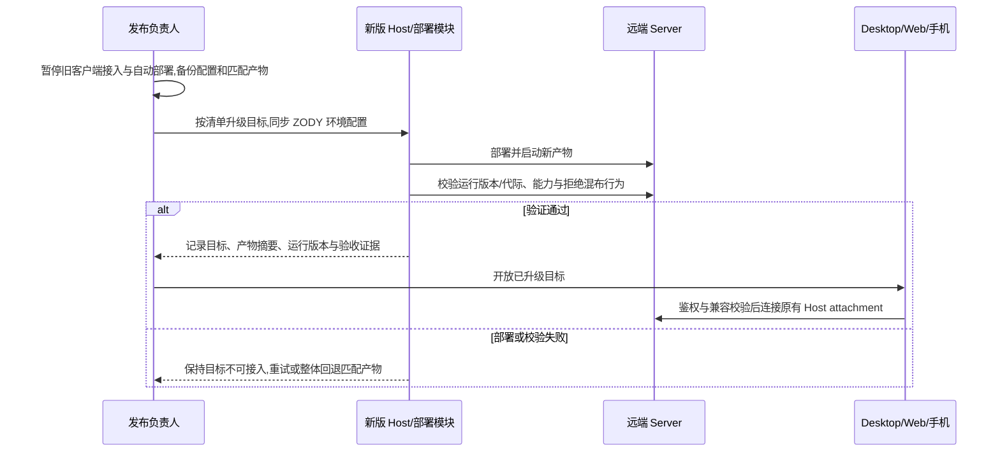

# Zody 全面分叉:zcode→zody 改名影响盘点与实施方案

状态:调查完成(2026-10-31)，实施中(2026-11-02)。本设计保留 §8 的既有产品裁决；R01 已更新 [品牌规格](../../specs/zody-brand-residual-cleanup.md)、[上游策略](../fork/upstream-sync-policy.md) 与 [路径契约](../../apps/zcode-cli/docs/design/v2/zody-path-compatibility.md)。R10 脚本阶段已有验收候选；全面改名尚未完成，实际进度与门禁以 [执行账本](zody-rename-execution/task-ledger.md) 为准。

调查方式:六个并行只读子代理分别扫描 workspace 结构、引用分布、运行时协议、环境变量/对外入口、插件生态、测试/CUA 冻结链,本文为汇总。

执行拆分见 [子代理实施任务计划](zody-full-divergence-rename-execution-plan.md):26 个任务的写入范围、前置依赖、并行约束、派发模板与集成验收。本文继续作为产品规则和改名边界的设计输入。

2026-11-02 复核方式:三个 Terra 子代理按插件、构建、远端契约只读核对源码。下文数量保留 2026-10-31 的调查口径,不代表重新全量统计;实施批次需记录基线 SHA、执行命令、目标与结果。静态检查不能代替真实构建、混布拒绝或插件兼容的运行证据。

## 0. 结论速览

| 层                                        | 规模                                         | 风险                         | 建议                                                     |
| ----------------------------------------- | -------------------------------------------- | ---------------------------- | -------------------------------------------------------- |
| 包 scope `@zcode/*`→`@zody/*`             | 46+4 个包名,约 **6180 处**功能字符串         | 低(纯机械,编译器兜底)        | 改                                                       |
| 目录名(`apps/zcode-cli` 等 11 个)         | 硬编码引用约 **210 处**(集中在构建/打包脚本) | 中(断的是构建链,不是 src)    | 改                                                       |
| `zcode-protocol`/`-v4` 模块目录名         | **879 处** import + 2 处副本 + exports 键    | 低                           | 改(与 scope 同批)                                        |
| `ZCODE_*` 环境变量 + `__ZCODE_*__` define | 真实读取约 **200 个**变量                    | 中(公开变量硬切影响外部配置) | B 组硬切;插件变量按 §5 双注入                            |
| 运行时契约(URI/IPC/握手/遥测)             | 151+7 IPC 通道、`zcode-artifact://` 等       | **高**(持久化数据/对端/看板) | 分批;逐项规定保留、失效或迁移,不得推定自动兼容           |
| 插件生态兼容面                            | 市场 id、iframe API、manifest 格式           | **高**(第三方插件契约)       | **适配器**:3 项外部/存储身份保留 + 显式 compat 层(见 §5) |
| CUA 冻结链                                | 18 处硬编码 + 整链重做                       | **高**(影响签名资源与发布)   | P2 适配路径,P5 完成冻结;期间暂停 macOS arm64 CUA 发布    |
| 测试面                                    | 1564/2922 测试文件含 zcode 标识              | 低(大头可脚本化)             | 随各批机械替换                                           |

总原则:**插件生态走适配器(外部 id 保留 + 双命名空间 compat 层、带退役策略),内部标识按清单 zody 化,持久化数据按明确策略处理;有副作用的操作只执行一次,冻结链最后重走。**

### 0.1 改名清单与完成标准

P0 建立版本化改名清单,以下为必含类别;实施前按具体标识、文件和边界展开,不能直接把本表的宽泛类别作为全仓豁免。

| 标识/类别                                      | 唯一 owner 或边界                  | 策略/批次                        | 验收与保留期限                            |
| ---------------------------------------------- | ---------------------------------- | -------------------------------- | ----------------------------------------- |
| 包 scope、源码路径、exports、构建资产定位      | workspace 与构建配置               | P1/P2 机械改名                   | 干净安装、编译、构建及路径断言;无兼容别名 |
| `ZCODE_*` / `__ZCODE_*__`                      | 各变量读取者与注入者               | P3 硬切,插件变量除外             | 旧名不生效;新名贯穿子进程与远端启动       |
| IPC、主桥、握手、远端 header                   | Main/preload、Host/Server 对应边界 | P4 同版本切换                    | §3.3 链路矩阵;业务前拒绝不兼容对端        |
| artifact URI、AppSettings、遥测                | 各持久化与投影 owner               | §3.1 明确失效/已完成/断代        | 不承诺旧媒体恢复或遥测连续                |
| hook 来源枚举、路径与信任摘要                  | 配置发现与信任校验 owner           | P4 保留真实旧来源,新来源独立校验 | §3.4;路径兼容期保留,不随插件 1.0 退役     |
| 插件桥、事件、manifest、env、MCP metadata/方法 | §5.2 各真实入站/出站边界           | P4.5 显式适配                    | 兼容矩阵及单次副作用;1.0 退役门禁         |
| 市场 id、外部 CUA 名、安全存储名、沙箱 origin  | §5.1/§5.3 对应存储或外部系统       | 保留原值                         | 精确列出用途;无退役计划                   |
| 来源署名、LICENSE/NOTICE、历史文档             | 法律声明及文档                     | 保留原作归属与历史事实           | 不作为品牌字符串机械替换                  |

每条记录包含旧值、新值、实际 owner、调用方向、文件范围、策略、批次、验收用例、退役条件及当前状态。涉及 `zcode-builtin` 资产与属性的条目必须分配到 P2/P3/P4,不能遗漏为无日期的“后续批次”。

P0 同时定义残留检查输入和精确允许清单;P2 起对受 Git 追踪的文件检查旧标识,按生产代码、配置、兼容测试和历史资料分类。每个允许项须有理由、路径范围和期限;新增未登记残留阻止该批完成。扫描结果与基线 SHA 随验收保存,不以“搜索结果为零”误删外部身份、信任来源或来源署名。

## 1. Workspace 与包身份

### 1.1 包名(50 个)

- `@zcode/` scoped 包 **46 个**:apps/zcode-cli 下 29 个(adapters/bootstrap/core/cli/contracts/tui/i18n/telemetry/node-repl-host/各 plugin…)、packages/ 下 17 个(shared/rpc/services/ui/desktop/web/server/client/provider/provider-node/zcode-cua…)。
- 非 scoped 含 zcode 的 **4 个**:`zcode-cli`(apps 主体)、3 个 e2e fixture 包(`zcode-*-e2e`)。
- 双重 zcode:`@zcode/zcode-cua`、`@zcode/zcode-cua-plugin`、`@zcode/zcode-guide-plugin`。
- 附加身份:`packages/zcode-server-cli/package.json` 的 `bin: { "zcode": ... }`(private 包,不发布 npm,无外部影响)。

### 1.2 workspace/lockfile

**当前决定**：根工作区与根锁为唯一安装所有者，移除 CLI 嵌套 workspace/lock；保留 `pnpm --dir apps/zody-cli …`，CLI Turbo 从根上下文选择 CLI 包及其真实依赖。下列计数保留调查时历史基线。

- `pnpm-workspace.yaml`:3 行 glob 含 `apps/zcode-cli`。
- `pnpm-lock.yaml`(v9):importer 键 37 处路径前缀 + 92 处 `@zcode/` workspace 链接键。保留现有 lock 基线,由固定工具链增量更新 importer/workspace 链接,不删除 lock 后重新解析整个依赖树。当前工具链为 `mise.toml` 的 Node 24.14.0、根 `package.json` 的 pnpm 10.33.2,实施时复核。第三方版本、integrity 与 peer 解析变化必须逐项说明,无关依赖升级移出本批;最后在干净检出执行 `pnpm install --frozen-lockfile`。
- 根 `package.json`:name 已是 `zody`,但约 25 处脚本引用 `@zcode/*` filter、`pnpm --dir apps/zcode-cli`、`build:zcode`/`build:zody` 双别名指向 `scripts/build-zcode.mjs`。

### 1.3 git 追踪的 zcode 目录(11 个)

`apps/zcode-cli`、`apps/zcode-cli/packages/{zcode-cua-plugin,zcode-guide-plugin}`、`packages/{zcode-cua,zcode-server-cli}`、`packages/services/src/{zcode-agent,zcode-session}`、`packages/shared/src/{zcode-protocol,zcode-protocol-v4}`、`scripts/zcode-distribution`、`.agents/skills/zcode-large-task-fixture`。

### 1.4 构建与治理配置的隐性耦合(改名漏改不报错、直接失效或静默扩权)

| 配置                                                                          | 耦合点                                                                                                                                                             | 失效形态                                           |
| ----------------------------------------------------------------------------- | ------------------------------------------------------------------------------------------------------------------------------------------------------------------ | -------------------------------------------------- |
| `.oxlintrc.json`                                                              | ignorePatterns 含 `apps/zcode-cli`                                                                                                                                 | **静默失效**:改名后整个 CLI 子树突然进入 lint 范围 |
| `architecture-policy.yaml`                                                    | 模块 id `zcode-cli`/`zcode-server-cli` + roots 8 处                                                                                                                | `architecture:check` 直接失败                      |
| `apps/zcode-cli/turbo.json`                                                   | task 键按 `@zcode/*` 包名键控 7 处;inputs 硬编码 `config/provider/zcode-builtin*.json`                                                                             | 构建图断裂                                         |
| `config/provider/zcode-builtin.json`                                          | 被 turbo inputs、tsup define `__ZCODE_BUILTIN_PROVIDER_CONFIG_JSON__`(×2)、electron-builder 复制、`packages/provider-node/src/zcode-builtin-release.ts` 四条链引用 | **最隐蔽耦合点**,需沿 define 追到运行时读取处      |
| `packages/desktop/tsconfig.e2e.json`                                          | 全仓唯一 TS paths 别名 `@zcode/e2e-report`                                                                                                                         | typecheck 失败                                     |
| tsup noExternal(×3 配置)/vite define                                          | 全部 `@zcode/*` 依赖列表 + `__ZCODE_*__` define 家族                                                                                                               | 打包内容缺失                                       |
| `pnpm-lock.yaml` / `third-party/inventory.json`                               | 生成物                                                                                                                                                             | 重装/重建再生                                      |
| `.github/workflows/zody-release.yml`                                          | 12 处:`pnpm --dir apps/zcode-cli`×3、`scripts/zcode-distribution/*.mjs`×6、`ZCODE_ENV`/`ZCODE_ENABLE_MAC_SIGN`                                                     | CI 断                                              |
| `mise.toml`                                                                   | `[tasks.dev]` 设 `ZCODE_DATA_BASE_DIR`                                                                                                                             | dev 环境变量名跟批改                               |
| `.agents/skills/feature-boundary-planner/references/zcode-feature-graph.yaml` | **约 1000+ 行路径数据**                                                                                                                                            | 改名后整图失准,需再生成                            |

## 2. 引用面统计(@zcode/ 与目录路径)

### 2.1 `@zcode/` 引用(按所在包)

总量 8211 处(git 追踪,含 docs);**真实机械改动约 6180 处**:

| 形态                                                           | 次数 |
| -------------------------------------------------------------- | ---- |
| 静态 import/export                                             | 5584 |
| 动态 `import()`                                                | 181  |
| `vi.mock/jest.mock`                                            | 29   |
| 代码内字符串(tsup externals/esbuild alias/SEA 包名表/部署清单) | 204  |
| JSON(package.json deps、turbo 任务键、根脚本)                  | 182  |

分布:apps/zcode-cli 2968、packages/ui 1761、desktop 990、services 548、server 192(前五占 ~80%)。被引最多:`@zcode/shared` 3362、`@zcode/contracts` 1375。

### 2.2 目录路径硬编码(改名即断,已逐条核实)

- **`apps/zcode-cli`**:功能引用约 185 处,核心在构建/打包链:
  - 仓库脚本:`scripts/prepare-prebuilds.mjs`(15+2 处插件路径表/turbo dir)、`build-desktop-agent-cli.mjs`×6、`build-zcode.mjs`×4、`bootstrap.mjs`、`third-party-npm.mjs`、`audit-*`×2 等;
  - desktop 脚本:`prepare-agent-node-bundle.mjs`(17 个插件路径表)、`stage-agent-bundle.mjs`(AGENT_BUNDLE_SOURCE_RELATIVE=`apps/zcode-cli/packages/cli/dist/zcode.cjs`)、`gen-ui-*`、`mcp-apps-host-e2e`、`ttft-otlp-receiver`;
  - 运行时代码 3 处:`packages/services/src/zcode-agent/zcodeAgentProcessManager.ts:451,474`(findUpward 找 `apps/zcode-cli/packages/cli/dist/zcode.cjs`)、`packages/server/src/remote/zcodeAgentDevDeploy.ts:109,281`、`packages/zcode-server-cli/src/packaging/stageCli.ts:109,142,198`;
  - 配置:pnpm-workspace、根 package.json×4、CI×3、architecture-policy、.prettierignore/.oxfmtrc/.oxlintrc、Dockerfile×2、wdio.conf(ZCODE_CLI_ENTRYPOINT)。
- **`packages/zcode-server-cli`**:9 处功能引用(根 typecheck、architecture-policy、vitest exclude、构建测试)。
- **`packages/zcode-cua`**:目录本体引用极少(workspace 靠 glob);但包名 `@zcode/zcode-cua` 以 node_modules 路径段硬编码在 4 个 desktop 脚本 + 3 个测试 + electron-builder 深 import(`@zcode/zcode-cua/broker/helperConstants`)。
- **`scripts/zcode-distribution`**:CI 6 处 + `build-zcode.mjs` 5 处 + 混名测试对(`scripts/zody-distribution.test.mjs` 从 `./zcode-distribution/` import)。

⚠️ **勿混**:`zcode-cua` 作为 **MCP server 名/外部 PyPI 包名**有 250+ 处(`packages/shared/src/mcp.ts:228-249` 匹配器、`LEGACY_CUA_PLUGIN_ID`),这是产品能力标识不是路径,**不在改名范围**,动了会破坏 MCP 匹配与用户存量配置。

### 2.3 `zcode-protocol`/`zcode-protocol-v4` 模块目录(第二触面)

- 两处副本:`packages/shared/src/{zcode-protocol,zcode-protocol-v4}` 与 `apps/zcode-cli/packages/bootstrap/src/{...}`(bootstrap 自带),共 ~189 个 ts 文件;
- import **879 处**:`@zcode/shared/zcode-protocol-v4` 子路径导出 497 处(ui 295 文件为最大户)、相对路径 347 处、字面路径串 ~20 处;
- 连带:`packages/shared/package.json` 的 `./zcode-protocol-v4` **exports 键**、`apps/zcode-cli/packages/cli/scripts/build.mjs:149-151` esbuild alias、dev-docs protocolDocs 数据;
- 另有 `packages/services/src/{zcode-agent,zcode-session}` 目录、`zcode-protocol-legacy-types.ts`、`zcode-protocol-entrypoint.ts`、`zcodeEndpoint.ts`/`zcodeEndpointOrigin` 字段(见 §4)。

## 3. 运行时协议与桥接面

### 3.1 分级清单

**纯仓内原子可改(低风险,两端同仓同装):**

- 主 renderer 桥 `window.zcode`(`packages/desktop/src/preload/index.ts:252` 单点暴露 + `packages/client/src/globals.d.ts` 类型;26 文件 186 处消费,已收敛到 desktopPlatform 适配层);
- `zcode:*` IPC 通道 **151 个**(PlatformChannels)+ 7 个(InternalChannels)——两端同版本;
- `__zcodeRpcControl` 控制帧字段(`packages/rpc/src/protocol.ts`)、`zcode-media`/`zcode-browser-restore://` 进程内 scheme;
- `__zcode*E2E` 调试全局(7 个,需同步 e2e 断言);
- 已完成(2026-10-31):endpoint 页内 title 通道已切换为 `zody-endpoint-submit/cancel`,本轮保留回归、不重复实施。`interfaceMode.ts` 旧键注释与读键不一致问题仍需在 P4 核对。

**跨进程/跨部署契约(已裁决:随 P4 切换并全量重部署远端,切换后禁止新旧混布,混布即握手失败 fail-closed):**

- `zcode-hello`/`zcode-hello-ack` stdio 握手帧(`packages/shared/src/handshake.ts`);
- `x-zcode-rpc-host-capability` header(desktop↔远端 server)、`x-zcode-intranet-token`;
- `__zcode_rpc_nested_uint8array_v1` 序列化标记——兼作远端 bundle 能力探测(`serverBundleDeployCheck.ts`);新标记缺失可触发连接时重部署判定,不代表所有远端均已升级。全量切换和逐链路 fail-closed 按 §3.3 执行与验收。

**持久化数据契约(逐项确定保留、失效或迁移):**

- **`zcode-artifact://`**(最高风险):存进历史会话消息 block、workflow artifact ref(`workflow-artifacts.ts:112`,投影时还要重写为 `zcode-artifact://share/:id`);13 处生产代码做 startsWith 判定。已裁决(2026-10-31):**直接切换 `zody-artifact://`,不迁移**——符合 0.1.0 破坏性升级政策,切换日前的旧会话媒体引用失效(含本机 dogfood 会话);
- workspace-hook 信任存储 `workspace-hook-trust-v1.json` 内 `configFileKind` 枚举值 `"zcode.json"`、`".zcode/config.json"`:属于来源身份,不是品牌展示串;P4 按 §3.4 保留旧来源语义并验证信任失效边界;
- AppSettings 字段已于 2026-10-31 改为 `zodyEndpointOrigin`;旧字段随 zod 剥离,按此前裁决不迁移(production 构建无该字段存量)。`zcode-builtin` 家族的同名属性尚未统一,由 §0.1 清单归属到对应批次;
- 遥测口径:`zcode_protocol.*` 事件名(54 个产生点)、`agent: "zcode-agent"`、`startupKind: "zcode_protocol_agent"`、OTel `zcode.local_ttft.*`/`service.name: zcode-local-ttft`、`zcode.telemetry.schema_version`、`metric_kind: "zcode_data_bytes"`——写进持久日志并上报 ARMS,改名=外部看板口径断代;已裁决(2026-10-31):**接受断代,随 P4 一次性改名**,看板重建,不双发(双发会重复计数污染数据);
- 随发行包固化的资产名:`zcode-provider/zcode-builtin.json`、SEA 前缀 `zcode-tui-runtime/`、`zcode-runtime-tools/`、`zcode-playwright-runtime/`、`agent/zcode.cjs`、`zcode-<platform>-<arch>` SEA 中间产物。

**本轮不改**:已迁移的深链 `zody://`、localStorage 键、cookie、SQLite session-store schema、NSIS/Finder/注册表(按 identity 派生)。普通 Electron 分区已迁移;插件沙箱 origin/partition 是 §5.3 明确保留的例外,不能声称分区全部 zody 化。

### 3.2 MCP 面

已改 zody:clientInfo/clientName、`MCP_APPS_HOST_NAME`、cookie。
仍为 zcode 且属插件契约:`zcode/*` \_meta 命名空间、`com.zcode/request-context`、`zcode.cua/*` tool-result meta 键。按 §5.2 的实际字段、调用方向与信任边界适配;结果中落盘的 metadata 另覆盖历史读取,不笼统要求所有字段双读双写。

### 3.3 远端切换与混布拒绝(P4)

**当前证据与目标分开**:当前 `packages/server/src/http.ts` 只在 `/ws/host` 消费 capability header,普通 `/ws` 直接建立 `web-remote-replayable` 通道;stdio 握手校验帧形态不能替代全链路兼容版本检查。`remote/connect.ts` 连接时按需部署且允许 `skipDeploy`;`serverBundleDeployCheck.ts` 检查 bundle 字符串存在性,不能证明运行进程版本或离线目标完成升级。

另有独立发行入口 `packages/zcode-server-cli/src/server-core/http.ts`,同样承接 `/ws` 与 `/ws/host`;门禁实现及新旧真实产物验收必须分别覆盖两套入口,不能仅凭其中一套通过关闭验收项。

P0 在协议 spec 中定义本次兼容代际/能力要求及每条链路的拒绝位置;P4 实现时保留鉴权、owner/lease、workspaceIdentity/remoteSessionId 和 stale run 校验。版本门禁不能替代身份鉴权,不得为了识别旧客户端开放 trusted host 能力。

| 链路                                                 | 校验 owner/时机                                          | 必须覆盖的验收                                                                 |
| ---------------------------------------------------- | -------------------------------------------------------- | ------------------------------------------------------------------------------ |
| Desktop/Host ↔ Agent stdio、Host ↔ 远端 Server stdio | 双端握手处理者;业务 RPC/admission 前                     | 新→旧、旧→新均不能进入业务;同代成功;失败进程/流回收,错误可见                   |
| trusted Host ↔ `/ws/host`                            | Server 升级入口及 Host 连接端;建立 continuous 通道前     | capability 一次性消费语义保持;旧 header/旧代际被拒绝;重连不复用失效 capability |
| Web/手机 ↔ `/ws` 与 Host attachment                  | Server/attachment 入口及客户端连接端;订阅/重放业务数据前 | 旧缓存页面与新服务端、反向组合;replayable 恢复正常;不另建 Agent 或 Host        |

每条链路都需新旧真实产物组合测试,验证无任务 admission、无业务写入/重放,并有明确错误与清理结果。仅更换 header、测试超时或通过同版本联调不能记为“禁止混布已验证”。对于无法修改的旧对端,由新端在发送业务前拒绝;无法提供此证据的入口不能开放本次发布。

发布负责人维护目标清单和升级记录,连接/部署模块负责技术门禁,Server/Host 继续拥有既有业务状态:



- P3 的远端启动命令、配置注入与 P4 新产物成套交付,旧名不生效不应静默导致数据根、凭据或代理配置回到错误默认值。
- 离线/未触达目标标记未升级,在首次重连完成部署和验证前不恢复业务;不能登记为全量升级完成。`skipDeploy` 不得绕过运行时兼容校验。
- 验收加入旧客户端再次尝试部署、两个客户端并发部署、部署中断、重试和版本回退。旧部署者须在切换窗口停用;marker 不能被当作防旧包覆盖机制。
- P3/P4 是同一次对外发布切换单元。失败时恢复相匹配的客户端、Server、环境配置与冻结资源;代码 revert 不恢复已经接受的 artifact 失效、遥测断代或用户新增数据。恢复流量前重新执行对应链路矩阵。

### 3.4 workspace-hook 来源与信任(P4)

当前 `packages/shared/src/workspace-hook-digest.ts` 把来源相对路径和 `configFileKind` 纳入 bundle digest;CLI contracts 中的历史 snapshot schema 也记录这些来源枚举。直接替换持久化字符串会改变信任身份。

本方案保留既有路径兼容:旧 `zcode.json` / `.zcode/config.json` 的枚举只表示真实旧来源,读取旧配置时保留原值、原路径和原摘要规则,列入残留允许清单。新 `.zody` 来源使用其真实身份,不得把旧批准记录机械改名后套用到新文件。内部类型/模块可以改名,来源值不是品牌改名对象。

配置发现是来源身份的唯一 owner;信任 owner 根据实际来源和内容验证既有授权。来源路径、内容或摘要版本改变导致授权不再匹配时,按既有信任流程重新审批,审批前不得执行。无法解析的历史记录不能导致整个应用无法启动或自动批准,应显示信任需重建的状态。若实现必须改变存储 schema,先在 P0 规定版本识别与旧记录失效规则,禁止默默扩大旧授权。

验收:旧配置/旧记录重启后按原规则读取;新旧来源并存按路径 spec 的优先级选取;移动到新路径、内容篡改、摘要不匹配与未知 schema 不继承旧信任;用户拒绝或尚未批准时不执行 hook。该规则与插件别名 1.0 退役独立。

## 4. 环境变量与对外入口

### 4.1 `ZCODE_*` 分组(真实读取约 200 个;总 token 约 470)

| 组                                        | 代表变量                                                                                                                                                                   | 改名策略                                                                                                                                 |
| ----------------------------------------- | -------------------------------------------------------------------------------------------------------------------------------------------------------------------------- | ---------------------------------------------------------------------------------------------------------------------------------------- |
| A 构建期(~40)                             | `ZCODE_ENV`(325 处,最高频)、`ZCODE_TARGET_OS/ARCH`、`ZCODE_ENABLE_MAC_SIGN`、`ZCODE_VERSION`、下载镜像族                                                                   | 与 CI/mise 同 commit 一次性切换,无需别名                                                                                                 |
| B 运行期公开文档化(**7 个,外部依赖最高**) | `ZCODE_DATA_BASE_DIR`、`ZCODE_SERVER_AUTH_TOKEN`、`ZCODE_BASE_URL`(及变体)、`ZCODE_HTTP_PROXY`/`NO_PROXY`、`ZCODE_BUILTIN_PROVIDER_CONFIG_FILE`、`ZCODE_CREDENTIAL_SECRET` | **已裁决(2026-10-31):直接硬切**,只认 `ZODY_*`,不设别名期;`.env.example:2` 与 `README.md:30` 的"保留承诺"声明、mise/CI 脚本同 commit 修改 |
| C 宿主↔子进程内部(~25)                    | `ZCODE_AGENT_SERVER_*`、`ZCODE_PLUGIN_ROOT`、`ZCODE_DATA_BASE_DIR`(内部管道)、`ZCODE_{BFS,RG,UGREP}_BINARY`                                                                | 除 `ZCODE_PLUGIN_*`(插件契约,§5)外可改,两端同版本原子切换                                                                                |
| D 测试/E2E(~100+)                         | `ZCODE_E2E_*`、`ZCODE_TEST_*` 等                                                                                                                                           | 随测试批机械替换                                                                                                                         |

### 4.2 对外命令与分发

- 对外命令唯一是发行包 `zody`(runner 已 zody);`zcode` bin 仅两个 private 包内部使用;SEA 中间产物 `zcode-*` 为内部名。
- 无 npm publish 渠道(全 private),纯 GitHub Releases——二进制层改名成本低。
- CI(唯一 workflow `zody-release.yml`):文件名/任务名已 zody,残留 12 处(见 §1.4);Android 签名已用 `ZODY_ANDROID_*` 新前缀(说明 env 已在向 ZODY\_ 演进)。
- 文档同步:必须改的十余个(README×2、.env.example、UI_PLUGIN×2、docs/fork/build.md、docs/zcode-env-consolidation.md、docs/desktop/zcode-preview-packaging.md、AGENTS.md)+ 三个已过时文档(configurable-data-directory.md 仍写 `~/.zcode/v2`、两个 deep-link 文档仍写 `zcode://`);历史 plan/归档 266 文件豁免。

## 5. 插件生态兼容面(适配器方案,2026-10-31 已裁决)

**前提**:1.0 前 Zody 继续消费上游 `zcode-plugins-official` 市场插件,兼容验证以记录版本的官方插件集为准;1.0 后的支持范围按 §5.3 公布。裁决:不做"整体保留 zcode",改为「**3 项外部/存储身份保留 + 显式兼容适配层**」。兼容规则集中定义,在实际协议边界调用,不得将“集中”理解为所有数据仅经过两个 contract 文件。

### 5.1 主动保留的外部标识(不进适配层,无退役计划)

1. **市场 id `zcode-plugins-official`**:外部生态的**地址标识**(类似 registry 名),不是品牌泄漏。上游 manifest `name` 校验(`marketplace.ts:527-546`)、`marketplaces/`+`cache/` 落盘目录名、UI 图标 key 与 `builtinSkillI18n` 路径段匹配、建议提示词里持久化的 `plugin://…@zcode-plugins-official` 引用全部钉在这个字符串上;适配它 = id 映射表 + 持久化引用迁移,复杂度无收益。展示名与逻辑 id 已分离,商店 UI **展示名**照常 Zody 化。
2. **`zcode-cua` MCP server 名/外部 PyPI 包名**(`packages/shared/src/mcp.ts:228-249` 匹配器、`LEGACY_CUA_PLUGIN_ID`):上游产品能力标识,250+ 处,不在改名范围(见 §2.2 ⚠️)。
3. `zcode_mobile_secure_store`(Android 凭据文件名,改名丢已存凭据)。

### 5.2 兼容适配层(双命名空间过渡)

**宿主注入面**——复用现有机制,同时明确状态与副作用边界:

| 面            | 实现                                                                                               | 先例/说明                                                                                                          |
| ------------- | -------------------------------------------------------------------------------------------------- | ------------------------------------------------------------------------------------------------------------------ |
| iframe 桥     | `window.zody` 主命名空间与 `window.zcode` 只读别名引用同一 API 对象,共用唯一状态、ready 与保存队列 | 覆盖 alias 与 Gen UI 两条注入链;参考既有 openai 别名机制,不创建第二个 bridge/runtime                               |
| manifest 发现 | 优先 `.zody-plugin/plugin.json`,缺失才尝试旧格式;其余既有格式相对顺序保持                          | 首个存在的清单无效即报错,不回退、不合并字段;统一发现、同步、seed、打包与安装升级入口                               |
| 页内事件      | 展示/状态通知双名称派发,内容为同一次状态投影,不重复写入 owner                                      | 新插件只订阅新名,旧插件只订阅旧名;同时监听两名的迁移插件须选择一个事件源或去重,并补用例;禁止用兼容事件再次触发请求 |
| 插件 env/模板 | spawn 时从同一权威插件上下文生成两套 ROOT/DATA/ID;模板展开两种前缀                                 | 两组值必须相同,不得被外部同名 env 分别覆盖;不扩展至所有 `ZCODE_*` 变量                                             |

**wire 协议按实际方向适配,方法名与 metadata 分开处理:**

| 契约                                     | 实际边界与 owner                                                                               | 适配规则                                                                                                             |
| ---------------------------------------- | ---------------------------------------------------------------------------------------------- | -------------------------------------------------------------------------------------------------------------------- |
| `zcode/*` MCP Apps metadata、hostContext | shared MCP Apps contract 定义规则,宿主资源/结果接收与 hostContext 输出边界调用                 | 入站新旧键归一为内部 zody 形态;出站仅对清单登记字段从同一规范值生成两份                                              |
| `zcode/gen-ui/*` request/notification    | shared Gen UI contract 定义名称;Desktop sandbox 发起,UI adapter handler 承接既有 Service owner | 新旧方法名注册到同一 handler;发送端按自身协议/已确认能力选择一个名称,一次操作只发送一次,不得双发或失败后盲目重发旧名 |
| `com.zcode/request-context`              | CLI adapters MCP 出站上下文构造者                                                              | 由可信宿主上下文生成两套表示,不把插件传入的别名键当作新增权限来源                                                    |
| `zcode/errorPresentation`、`zcode.cua/*` | CLI core MCP 结果入口、contracts tool-result metadata 与相应投影/历史读取者                    | 在实际结果边界解析;覆盖在线结果和持久化回放,不假定经过 shared MCP Apps contract                                      |

规则函数通过各包公开入口复用,不得反向跨包导入实现。两种键只出现一种时按相同 schema 校验;同时出现且规范化后相等时接受,不相等时按该契约返回可见错误并拒绝应用冲突字段,不得任意“新键优先”。CSP、权限与来源字段冲突必须 fail-closed,不得合并出更宽权限。对未登记字段不做泛化前缀替换,保留原有 schema 与权限限制。

当前 `genUi.ts` 的 follow-up request 会在 UI `gen-ui/adapters/page.ts` 调用实际 follow-up;兼容测试必须证明保存、follow-up、外链打开、资源订阅等操作每次只产生一次对应副作用。兼容入口的双名称不等于业务 owner、状态或授权存在两份。

P4.5 验收矩阵包括:旧插件、新插件、双键相等、双键冲突、无效 payload、新旧 manifest 并存/新 manifest 无效、仅旧 manifest、seed 安装与升级、历史 tool result 回放。每项记录插件版本/fixture、调用方向、预期状态和副作用次数;不能只以“两套 happy path”证明兼容。既有旧 API 提供别名;新增加的 API 是否属于兼容承诺必须登记,不默认所有未来 API 永久维护两套。

### 5.3 退役策略(适配层不得成为永久债)

- 双命名空间维持到**触发点**后,移除对外运行时 `zcode` 别名与旧 manifest 发现兼容,并按破坏性变更公告。历史记录读取另按清单逐项决定迁移、保留只读解析或明确失效;保留历史解析不能重新开放已退役的运行时入口。
- 触发点已裁决(2026-10-31):**固定版本 1.0**;1.0 前一个 minor 版本发出"别名将移除"警告。
- 退役前每个 release 的插件兼容验证必须包含**上游官方插件集在 zody 宿主的冒烟**;移除批次需先发一个"别名将移除"的警告版本。
- 1.0 退役前列出官方插件、内置插件、已安装缓存及历史结果的受影响清单:已迁移、需要升级/重装、明确不再支持。内置插件和 seed 必须先切换;保留市场 id 不等于承诺所有旧插件永久可用。1.0 发布说明须明确仅依赖旧 API/manifest 的版本不再受支持,并给出可用替代版本或保持旧版宿主的路径。
- 固定 1.0 退役点不变,但上述清单、前一个 minor 的实际警告记录、迁移验证和历史数据处置是 **1.0 发布门禁**;条件不满足时不能一边删除别名、一边继续宣称旧插件即装即用。运行时别名与历史记录解析的影响必须分别验收,不能把移除 runtime compat 直接当作历史数据已迁移。
- `zcode-sandbox://` scheme 与 `persist:plugin-sandbox-v2-*` partition 是无退役计划的存储/origin 例外,不随 1.0 compat 移除(scheme 改名会重置插件 origin 与状态)。它们单独登记在允许清单,不以“插件不可见”作为保留依据。

## 6. 测试、E2E 与 CUA 冻结链

### 6.1 测试面

- 含 zcode 标识的测试文件 **1564/2922(53%)**:`@zcode/` import 1381 个文件(编译器兜底,可脚本化)、`zcode-protocol` 295、需人工核对的路径断言约 220 个(`apps/zcode-cli` 字面路径 81、`.zcode` 目录 137、`zcode.cjs` 22);
- E2E 录制资产 124 个含 zcode;`.e2e-home/.zcode`、`.zcoder` 是被测 app 自建的遗留目录(非手工 fixture,legacy 读兼容测试覆盖);
- 无 vitest snapshot 文件,无 `.snap` 大面积 diff 风险;
- 密集自测:`cua-desktop-session-bundle.test.mjs`(~20 处)、`tsupChunkIsolation.test.ts`(断言 noExternal 含 `@zcode/*`)、`scripts/test/cli-release`、`builtin-provider-config-build` 等。

### 6.2 CUA 冻结链(高风险工序,必须整链重走)

**18 处硬编码**(核心 5 处):

1. `cua-desktop-session-config.mjs:91` — auxiliary 密封资源源路径 `apps/zcode-cli/packages/node-repl-host/src/server.ts`;
2. `build-cua-desktop-session.mjs:193-197` — cli-entry alias `@zcode/node-repl-host/cua-node-repl-mcp-port`;
3. `cua-desktop-session-workspace-source.mjs:10,53` — workspace 根判定 + `onResolve(/^@zcode\//)` 正则;
4. `cua-desktop-session-bundle.mjs:300-303` — 密封 entry 禁止残留 `from "@zcode/"` 的断言本身;
5. 其余:product-wiring/round11 链 7 处 fixture/evidence/alias 路径、`@zcode/zcode-cua` 身份探测 4 处(computer-use-producer/sharp/windows-helper/electron-builder 深 import)、agent-bundle 邻接 4 处。

**失效机理**:路径/包名改名而脚本未适配会阻断从源码重建;适配后重新生成的 sealed entries 若字节变化,将沿 pins 头、Helper 二进制、签名、manifest 与 demo-defaults 四 pin 传播,必须重走冻结链。旧归档可能仍通过自身摘要校验并被打包,因此 afterPack 通过不能独自证明冻结资源对应当前源码;发布证据必须绑定源码 SHA、sealed entries 摘要、产物摘要与冻结归档。

**重做工序(依赖顺序)**:P2 更新 18 处硬编码及配套测试 → P5 在最终源码上重跑 `build-cua-desktop-session.mjs`(新 entries+pins 头)→ Helper 重编译+native tests → controller 重签(身份 pins 常量不变,`io.github.zclaudia.zody.cua-helper` bundle id **不动**——它被 DR 字符串钉死,动它=换信任根)→ 窄资源 stage/manifest 重出 → demo-defaults 四 pin 重录 → 冻结归档重导出+`restore-cua-narrow-frozen` 复检 → 主 app 重打包过全部 afterPack 断言。

注意：R02 preflight 纠正：native 冻结目录并非全部在 git 外，当前有 3770 个 tracked 文件；`output/` 被忽略，旧归档存在。tracked 内容与本地忽略材料均需核实，不能凭 git diff 判定输入齐全。重走工序前确认对应源码、摘要和归档，并在隔离目录演练恢复。

P2 前保存可复原的旧归档、摘要、签名身份与匹配源码版本;复原演练写入隔离目录,不覆盖现有冻结材料。P2 至 P5 通过前暂停 macOS arm64 CUA 发行,不得复用旧冻结包把中间版本标为已发布。P5 后若再修改 sealed inputs,重新执行受影响冻结链,不沿用此前发布通过结论。

### 6.3 可执行验证矩阵与证据

下列入口已按 2026-11-02 的 `package.json` 与脚本帮助核对。P2 后 Desktop filter 改为 `@zody/desktop`;重命名命令/路径时同步更新本表。每批保存命令、源码 SHA、工具链、主机 OS/arch、输入资源摘要、退出码及证据路径。未运行、环境受限和已有失败单独记录,不得以静态阅读替代通过。

| 阶段                          | 命令/场景                                                                                                                                                                                                    | 通过条件与环境                                                                                          |
| ----------------------------- | ------------------------------------------------------------------------------------------------------------------------------------------------------------------------------------------------------------ | ------------------------------------------------------------------------------------------------------- |
| P1—P5 代码批次                | `pnpm typecheck`; `pnpm lint`; `pnpm architecture:check --changed`                                                                                                                                           | 记录基线与改后结果;架构检查范围必须覆盖实际变更                                                         |
| P2 workspace                  | 根 `pnpm install --frozen-lockfile`（唯一安装 owner）；核对 CLI `--dir` 包集合与 links；`pnpm knip`; `pnpm test:unit`                                                                                                                                              | 干净检出安装;无未解释的依赖漂移、失效导出或新增失败                                                     |
| P2 CLI/Web                    | `pnpm build:zody --all`                                                                                                                                                                                      | 当前支持 darwin-arm64、darwin-x64、win32-x64、linux-x64 的 CLI/Web 产物;不含 Desktop                    |
| P2 Desktop 准备 / P5 最终出包 | `pnpm bundle:desktop -- --os mac --arch arm64`                                                                                                                                                               | P2 记录准备检查与冻结阻塞,不能记最终出包通过;P5 在具备签名身份、SDK 与冻结输入的 macOS arm64 上真实执行 |
| 其他发布 Desktop 目标         | `pnpm bundle:desktop -- --os win --arch x64`; `pnpm bundle:desktop -- --os linux --arch x64`;如发布 mac x64,执行对应 `--os mac --arch x64`                                                                   | 使用具备目标依赖的 CI/主机;脚本接受参数不代表跨平台构建或签名已经验证。P0 固定本次实际发布目标          |
| P2 路径适配 / P5 CUA          | `pnpm --filter @zody/desktop test:macos-cua-narrow-resources`                                                                                                                                                | P2 后名称;改名前使用 `@zcode/desktop`;只覆盖该脚本的 glob                                               |
| P2/P5 冻结工具补充            | `node --test packages/desktop/scripts/restore-cua-narrow-frozen.test.mjs packages/desktop/scripts/cua-desktop-session-bundle.test.mjs packages/desktop/scripts/cua-desktop-session-candidate-fetch.test.mjs` | 显式运行未纳入上述 narrow glob 的测试                                                                   |
| P5 原生与发行                 | Helper native tests、签名/DR 校验、真实 bundle afterPack、真实截图                                                                                                                                           | P0 从当前冻结工序记录精确命令与资源;macOS arm64 具备交互会话及系统权限,不以其他平台或 mock 替代         |

归档复原入口(占位参数必须替换为本批记录的实际值,这是会写目标目录的演练):

```sh
node packages/desktop/scripts/restore-cua-narrow-frozen.mjs \
  --archive <narrow-frozen.tar.gz> \
  --sha256 <归档SHA256> \
  --repo-root <隔离的仓库路径>
```

P0 为下列验收 ID 绑定实际测试文件、fixture、运行命令及平台,缺项阻止对应批次开工;需要新增的用例先补测试再实现。这里的 ID 是本方案验收编号,不冒充仓库已有测试命令。

| 验收 ID       | 批次  | 必须证明的行为                                                                                              |
| ------------- | ----- | ----------------------------------------------------------------------------------------------------------- |
| RENAME-PATH   | P1/P2 | CLI 发现与启动、Desktop 打包资源定位、exports/noExternal、provider 配置实际加载;开发与发行路径均可用        |
| RENAME-ENV    | P3    | 新变量单独生效;旧变量单独不生效;两者并存只认新变量;子进程与远端传递保持值,插件双变量按 §5.2 例外            |
| RENAME-REMOTE | P4    | §3.3 每条链路双向混布拒绝、同代连接、断线恢复、部署失败/并发/旧部署者尝试;同时覆盖 continuous 与 replayable |
| RENAME-DATA   | P4    | 新 artifact 可访问;旧 URI 按已裁决策略不可用但会话仍可加载;遥测只发新口径;endpoint 改名既有回归             |
| RENAME-TRUST  | P4    | §3.4 来源身份、重启、移动/篡改、未知 schema 与审批拒绝                                                      |
| RENAME-PLUGIN | P4.5  | §5.2 完整矩阵、单次副作用;固定版本官方插件及 native fixture;真实 plugin sandbox E2E                         |
| RENAME-CUA    | P5    | 从最终源码封存、原生测试、签名、归档复原、真实截图与 afterPack;源码及所有摘要关联完整                       |

`--dry-run` 只能作为准备检查,不能代替真实产包、签名或系统交互。P2 的完整 macOS CUA 发布验收明确延后至 P5;任何批次的阶段性通过都不能被写成整个改名已验证。

## 7. 分阶段实施方案

前置:**Phase 0(spec 先行)**——更新 `zody-brand-residual-cleanup.md`(替代"保留内部标识"决策、固化 §5 兼容与退役语义)、`upstream-sync-policy.md`(全面分叉,不再常规移植,仅按需安全修复,保留来源证据)、`zody-path-compatibility.md`(env 硬切、来源与信任规则),同步 AGENTS.md 等现行说明。补齐 §0.1 清单、§3.3 协议门禁、§6.3 验收映射和冻结输入备份。

**提交、合入与发布分开**:按下列批次审查,批内紧密耦合改名保持原子性;只有该阶段验证通过才可合入。P2—P5 是有依赖的实施序列,不承诺每批可独立发布或任意顺序 revert。P3/P4 不分开发行,macOS arm64 CUA 待 P5 完成后发布。回滚按依赖逆序或恢复整套已验证版本,涉及远端、配置、持久数据和冻结资源时按 §3.3/§6.2 另行恢复与验证。

| 批次                     | 内容                                                                                                                                                   | 验证                                                                                                     |
| ------------------------ | ------------------------------------------------------------------------------------------------------------------------------------------------------ | -------------------------------------------------------------------------------------------------------- |
| P1 低风险清理            | distribution 目录及 17 个命名脚本改名,调用者/CI 同批;修正过时文档。endpoint/title 已完成项只保留回归                                                   | §6.3 基础检查、RENAME-PATH 对应脚本与 CI 准备检查                                                        |
| P2 包 scope+目录(最大批) | 50 包名、约 6180 引用、剩余目录、protocol imports/exports、§1.4 配置;§6.2 十八处 CUA 路径/alias/断言及其测试同步改;lock 增量更新、feature graph 再生成 | §6.3 干净安装、基础检查/knip/unit、CLI/Web 全目标、RENAME-PATH;Desktop 准备检查,最终 CUA 发布验收延后 P5 |
| P3 环境变量              | A/B/C/D 组及 `__ZCODE_*__` define 的生产者和消费者同批硬切,插件契约除外;README/.env.example、mise、CI、远端启动配置同步                                | RENAME-ENV、对应构建与启动测试;对外发布必须包含 P4                                                       |
| P4 运行时契约            | 主桥/IPC/control frame、artifact 硬切、遥测断代;§3.3 链路门禁与全量重部署流程;§3.4 hook 来源与信任校验;builtin 剩余内部属性按 P0 清单改名              | RENAME-REMOTE、RENAME-DATA、RENAME-TRUST;双向拒绝证据、同版本恢复与目标清单核销                          |
| P4.5 插件兼容适配层      | §5.2 共享桥对象、manifest 优先级、通知双名称、env 双注入、metadata 适配与单次方法调用;旧插件外部契约在此批之前保持                                     | RENAME-PLUGIN 完整矩阵、官方插件集与 sandbox E2E;记录 1.0 退役资产                                       |
| P5 CUA 冻结与发布        | 最终源码重构建→原生测试→重签→重 pin→归档→隔离复原→真实打包;关联源码与产物证据                                                                          | RENAME-CUA、§6.3 完整 Desktop 发布矩阵;全部门禁通过后解除发布暂停                                        |

顺序依据:P1/P2 先稳定源码与构建定位,P3 将 define 与 env 的定义/消费端一起切换,P4 再切业务契约,P4.5 改插件边界,P5 吸收所有 sealed inputs。define 名没有天然依赖包 scope 的要求;若必须提前到 P2,其全部生产者/消费者须成组迁移并在清单标明,不能分两批留下半切状态。P4 的主桥不含第三方 iframe 桥,后者保持至 P4.5 适配完成。

## 8. 决策点(全部已裁决,2026-10-31 用户逐项确认)

1. **插件生态**:适配器方案(§5)。**退役触发点:固定版本 1.0**,1.0 前一个 minor 版本发"别名将移除"警告(§5.3)。
2. **B 组环境变量**:**直接硬切**,只认 `ZODY_*`,不设别名期;README/.env.example 的"保留承诺"声明、mise、CI 同 commit 修改。
3. **遥测口径**:**接受断代**,`zcode_protocol.*`/`zcode-agent`/`zcode.local_ttft.*` 等随 P4 一次性改名,看板重建,不双发。
4. **`zcode-artifact://`**:**直接切换 `zody-artifact://`,不迁移**;切换日前旧会话媒体引用失效(含本机 dogfood 会话)。
5. **远端部署**:**随 P4 切换握手帧/能力 header 并全量重部署远端**,此后禁止新旧混布(混布握手 fail-closed)。
6. **CUA 信任根**:**确认永久不动**——`io.github.zclaudia.zody.cua-helper` bundle id、证书 leaf/DR、Node CDHash(当前已是 zody 命名,仅组织名 zclaudia 保留);动它=换信任根,需重走证书安装与 TCC 归属,零收益。

## 9. 工作量量级(粗估)

- P2 是绝对大头:50 包名 × ~6180 引用可脚本化(codemod + 编译器验证),但 210 处目录硬编码与 §1.4 配置耦合需人工核对;测试面 53% 文件受波及(1381 个纯 import 可自动)。
- P5 工序最长但路径已完全文档化(本仓 10 月各轮已演练过全链)。
- 全程预计需要一个相对干净的窗口(未提交工作流落定后),P2/P5 各占用一个独立变更单元。
