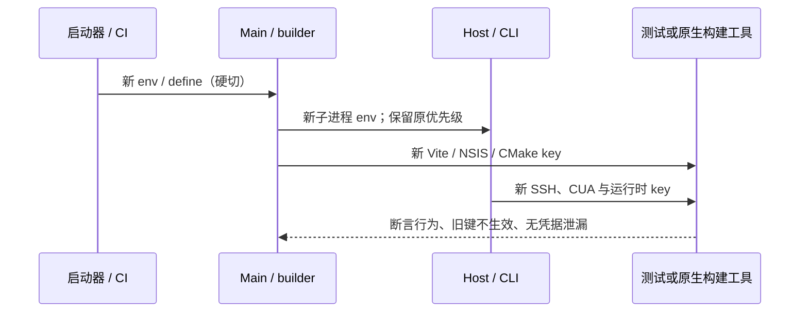

# R30 resumed dispatch at 7089

固定源码 `7089ad3e095ec10727772107100d3e019b78d456`。R22 与前序阶段门禁完成后，主控以 `output/zody-rename-r30/resume-dispatch-7089/R30-merged-writeset.json` 为逐文件派发清单：580 个既有路径、一个 test-map 计划新文件，2732 条行/token 操作。每个既有路径带 Git blob；这些是指定 token 的上下文操作，不授权整文件搜索替换。`verification.json` 证实这 580 个 blob 和逐行旧 token 在固定源码均匹配；实施基线发生变化时重新比对。

文档 128 路径的 398 命中分别在 `docs-reviewed-batch-{1,2,3,4}.json` 给出行、上下文、映射或历史保留；15 条 specs 另在 `spec-occurrence-decisions.json` 裁决。测试角色与保留例外见 `test-role-review/`：通用 dotenv/logger 虚构值、移除 CDN/OFFPEAK 的旧键负例、已跳过的历史场景不得被全局替换。真实 env 测试需要同步输入、清理和断言，不改变值与断言极性。旧 secret ID、R55 插件身份/project/skill 键、冻结资源与历史材料保留。

`source-reviewed-*.json` 与 `source-reviewed-binding-config.json` 给出环境读取、生产、define、源内文档和绑定/config 行级操作。`refs-ZCODE_{VERSION,COMMIT,ENV}.json` 是 `scripts/dep-refs.mjs` 生成的静态声明和跨包引用：这三个共享绑定分别来自 version/env 模块的构建 define，按主控决定与其引用一起改名；保留外部数据字段和协议值，审视对象简写。引用工具不覆盖动态导入或字符串。首次尝试 `pnpm -s` 被本机 wrapper 拒绝，`mise` 不在 PATH；随后直接运行同一 Node 脚本成功，仅用于只读引用调查。

`vite-bridge-closure.json` 补齐 `VITE_ZCODE_E2E_STORE_BRIDGE → VITE_ZODY_E2E_STORE_BRIDGE` 的 14 路径与逐行 blob；构建 producer、fingerprint、WDIO 验证、shared/UI/renderer 消费和测试同批，历史执行记录保留。SSH 动态 A/B 八键、NSIS `/D` 及 CMake `-D`/动态 source-dir 也已并入；`eight-closure-disposition.json` 区分实际 token 与经常量间接访问：不要机械改写仍有效的绑定。`ZCODE_<ENV>_BASE_URL` 模板随展开键同步。

派发时 spec `S-spec` 首先独占更新合同并补红测；其余按文件单一写者分为 `A-cli` 112、`B-desktop-scripts` 224、`C-shared-server-root` 133（含一个新测试）、`D-docs` 111。共享文件只归清单中的一个 writer；每个跨组闭包须在所有生产、消费与测试完成后统一集成和验收，不能把独立子组提交视为硬切完成。共享 spec 先完成后释放，不与其他写者并发修改。

依既有合同验证仅新、仅旧、并存、均无四类隔离环境；覆盖打包 override、四个 child env、SSH、Vite bridge、NSIS/CMake 生产消费和明确的旧键负例。Windows installer/CMake 需对应 Windows 证据；实际运行受影响包测试及根 `pnpm typecheck`、`pnpm lint`、`pnpm architecture:check --changed`，说明任何既有失败或平台限制。依阶段要求 Terra 实施、DeepSeek 独立审查、主控核验后清理。此准备未运行测试、构建、安装，未修改产品源码、ledger、file-assignments 或提交；没有新增需用户裁决的产品设计问题。
