# 独立 review 修复与验收补登（2026-11-06）

## 基准与结果

工作树 `/Users/zhvala/SourceCode/zody/.worktrees/zody-full-rename`，分支 `codex/zody-full-rename`。基线/当前 HEAD 均为 `277f9fb034e6485f4a998b22fb7c932185844e43`，修复为未提交工作区变更，不存在新的 commit SHA。用户授权范围：修复独立 review F1/F2/F3/F6；F4/F5 只单独登记。

本轮完成三个改名引入的 P2 修复及测试门禁遗漏，先改 spec 与回归、保存 red，再改实现、保存 green。原生 `gpt-6.1-terra` 独立只读复审限定通过；[独立回执](independent-review-fixes-terra.md)。不代表全量套件或发布通过；未提交、合并、签名、部署或发布。

## 修复与回归

| ID / 归属 | 当前行为与文件 | red → green / 证据 |
|---|---|---|
| F1 / R54 | `packages/services/src/plugin-sync/pluginSyncService.ts` canonical 仅 ENOENT 回退；名称值域与 CLI 加载端一致；候选/归档导入在落目标和配置前拒绝非法 manifest | sync 新4例先失败，修后24/24通过；原始服务复现现返回 `candidates: []`；`logs/red-sync`、`green-sync`、`original-repro-sync-after` |
| F2 / R55 | `apps/zody-cli/packages/core/src/hooks/configured-runner-input.ts` 六种 ROOT/DATA 模板无插件上下文时抛配置错误，shell command、argv file/args 都在 ExecutionPort.run 前失败 | 六前缀+三执行位置零执行断言；hook23/23通过；原始真实callback复现现为 threw=true、无执行请求；`red-cli`、`green-final-cli`、`original-repro-hook-after` |
| F3 / R54 | `apps/zody-cli/packages/bootstrap/src/app/official-plugin-runtime.ts` 快慢路径共用严格读取；合法无MCP legacy只读复用；非法对象/错name/EACCES不回退；有launcher的MCP legacy即使同渲染字节也首次写canonical | runtime12+storage6+hook23=41通过；原有真实warm seed锁断言恢复0次；复审额外red4例、EACCES red1例均后续转绿；`red-review-seed`、`red-review-seed-read`、`green-final-cli` |
| F6 / R51–R52 | 根 `vitest.config.ts` 纳入三个插件源码目录；新 `scripts/test/zody-rename-plugin-test-collection.test.mjs` 自身也入默认集合，真实list/related验证指定3文件且保留E2E排除 | 初始list仅control1文件；初版两回归red后green；最终root5文件37例通过，含gate2例与实际consumer3文件24例；`gate-final`；Terra独立 `gate-list.json`、`gate-vitest.log` |

spec 已先行更新：`specs/zody-rename-plugin-install.md`、`specs/zody-rename-plugin-env.md`；`test-map.md` 同步准入合同与已核实的当前路径/变量。没有新增状态owner、队列、fallback运行时或环境变量；seed marker、锁和原子写仍由现有bootstrap owner负责。

```mermaid
sequenceDiagram
  participant Caller as 插件发现/Hook调用方
  participant Owner as 现有同步或bootstrap/core owner
  participant IO as 文件/ExecutionPort
  Caller->>Owner: 同一既有入口
  Owner->>Owner: canonical身份或上下文校验
  alt 非法/缺上下文
    Owner-->>Caller: 既有null/失败通道，零执行/零安装
  else 合法无MCP已提交seed
    Owner-->>Caller: 只读复用，不获取seed锁
  else MCP需升级
    Owner->>IO: 现有锁内重验及原子写canonical
    IO-->>Caller: 当前manifest
  end
```

R55 的 ID/NAME 保持 env-only，不增加模板承诺。没有launcher（非SEA且缺 argv[1]）的嵌入式发现沿用既有无MCP运行配置语义，不承诺该形态MCP升级/零锁，不纳入本轮产品入口通过结论。

## 实际检查

固定 Node24.14.0、pnpm10.33.2、现有依赖、短隔离TMP与合成HOME/USERPROFILE/XDG。没有安装依赖或访问真实用户数据。完整argv/cwd/退出码/耗时与输出在 `output/zody-rename-review-fixes/logs/<label>.json/.log`。

| 检查 / 最终证据label | 结果 |
|---|---|
| 根 `pnpm typecheck` / root-typecheck、root-typecheck-final | exit0；未提交overlay完整副本先全量70.07s、最终增量通过，避免在原树写声明 |
| CLI `pnpm --dir apps/zody-cli typecheck` / cli-typecheck-final | exit0，34 tasks / 0 cache，37.91s；同一overlay副本 |
| 根 `pnpm lint` / root-lint-final | exit0，303 warnings / 0 errors，与原基线相同 |
| CLI lint / cli-lint-final | exit0，14 successful tasks；0 errors |
| changed architecture / architecture-changed-final | exit0，violations/baseline/new=0/0/0；源码模块多为unmanaged，不等于运行语义证明 |
| 全量 architecture / architecture-full-final | exit1，既有 `gen-ui-service` 缺 contract.test.ts，未改baseline |
| 根/CLI变更代码 oxfmt --check / format-check-final、cli-format-check-final | exit0 |
| 同步公共入口 / green-sync | 1文件24 passed |
| runtime/seed/hook / green-final-cli | 3文件41 passed（runtime12、storage6、hook23） |
| Hook调用方和插件 / hook-caller-regression | 4文件133 passed；与上行部分重复，不累计总数 |
| 默认收集与related / gate-final | 5文件37 passed，包含gate2与consumer3文件24、bridge11；嵌套测试执行不累计成独立总数 |
| 许可 / licenses | 基础check exit0；19项材料仍待strict，未将其称为合规完成 |
| Terra独立复审 | F1/F2/F3/F6限定PASS；独立runtime12/12及最终Vitest gate2/2通过；初轮发现均先补red再修 |

最终类型检查副本的产品源文件与当前工作区一致，元数据 `snapshot-info.json`、`typecheck-current-code-match.json`。根门禁配置与gate脚本在全量typecheck后完善，未改变类型检查的产品输入；同步后另跑最终根typecheck通过。当前代码/文档SHA及工作区patch见 `source-manifest.json`、`working-tree-code.patch`。

## 不掩盖的失败与未覆盖

- 扩大默认收集后，插件目录17文件为103 passed/5 failed。失败均在未改的 `pluginUiPageManager.test.ts`；取HEAD的该测试和唯一被测纯TS实现，在独立目录重跑同样5 failed/6 passed，`baseline-page-manager`日志与保留的两源文件提供依据。未缩小include或修改其断言来制造绿灯；这五项作为另一个既有验收缺口保留。
- 六文件插件集成组 `plugin-integration` 为148 passed/2 failed。两失败为R61已登记的 `bundled-plugins-resilience.test.ts` 故障注入仍使用旧 `.zcode-plugin` 目标；与本轮seed快路径故障分开，本轮未修改该测试/断言。热读锁那一例已被本轮修复，不能把三项旧失败继续笼统登记为都未修。
- 两个用户要求暂不修改的既有行为问题见 [独立登记](independent-review-deferred-existing-issues.md)：F4 UTF-8分片和F5在途订阅重挂。对应生产文件及断言无diff，不记通过。
- 未重跑全量root/CLI测试。旧R61的78失败只作为历史基准，不能当作修改后工作区全量结果；本轮没有宣称全量绿。
- affected仍按现有packages变更触发，gate自身持续准入为根默认单测；单独修改scripts下文件不会由affected单独触发。实际related消费三份插件回归已验证，未伪造整个pre-push差异范围执行。
- Windows/Linux实机、手机、真实SSH、真实iframe/E2E及最终CUA签名/封存/恢复/截图均未验证。本轮CLI源变化意味着旧构建/冻结摘要不能无条件代表当前工作区；没有重建全平台或更新原pins、签名和旧归档。原R60/R61发布阻塞保持。

## 工具与副产物透明记录

- 首次Vitest list探查误将测试路径用作JSON输出，已在该文件尚未开始修改时从已核HEAD精确恢复；原文件没有最终diff。
- 首次临时副本准备因系统Python缺少tarfile filter参数中止，旧runner错误把未知cwd标签落至CLI；相关日志改名为 `initial-misrouted-cli-typecheck`，其元数据真实cwd为CLI，不算根检查。修正为显式cwd映射和系统tar后，根/CLI副本验证分别实际执行。
- 早期CLI typecheck依赖build再生了R61已知7份tracked node-repl-host声明。保存 `generated-dist-types.patch` 后只精确恢复本轮再生文件，没有调整声明入库策略；后续类型检查在隔离副本运行。生成物滞后仍属原登记事项。
- 最终仅清理本轮创建的验证副本和临时根；red/green、复现源、基线源、独立复审、摘要与原实施产物保留。
