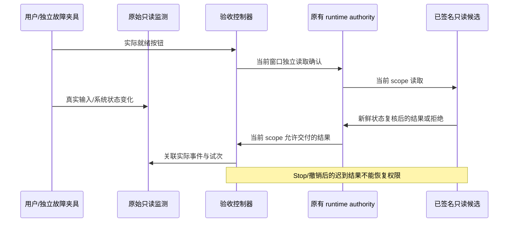
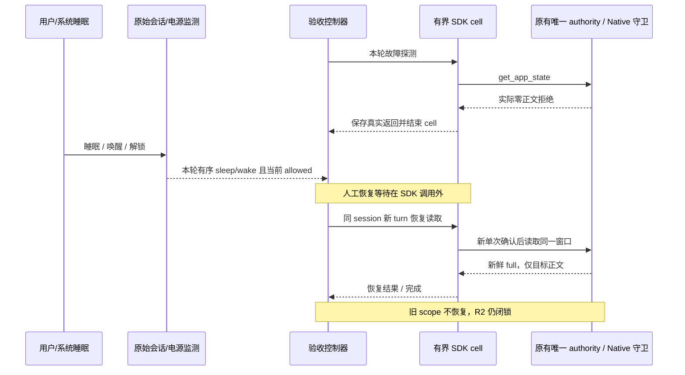

# R1 单用户 macOS 收尾记录

范围：用户于 2026-11-15 明确同意按本机单用户正常 macOS 桌面验收；不新建账户、不增加窄屏/手机任务，R2 继续闭锁。R1-A/B/C 技术验收已齐；用户已确认人审，四项本期用例已晋升并通过事务审计和晋升后检查。R1 按本机单用户正常桌面范围收尾完成；不宣称 R2/R3 或最终发布完成。

## 已独立核验

| 项目                            | 结果                                                                                                                     | 原始证据（仓库根目录下）                                                                     |
| ------------------------------- | ------------------------------------------------------------------------------------------------------------------------ | -------------------------------------------------------------------------------------------- |
| 默认 AppKit 03a                 | full → diff → silent → full → diff，五次独立确认；远端系统视图不透明截止，本地投影截断提示；无兄弟正文                   | `output/cua-appkit-opaque-r1-20261114/independent-acceptance.json`；最终产品源码复验见下一行 |
| Stop/撤销交付                   | 撤销先于交付时零正文；真实迟到 AX 回复在撤销后释放，不恢复旧权限；同 session 新 turn 默认拒绝后重新允许 full             | `output/cua-read-delivery-r1-20261114/independent-acceptance.json`                           |
| AppKit 前台真实输入与后台读取   | 20/20 成功交错；所有必测原始信号稳定，真实硬件重复键有效                                                                 | `output/cua-r1-closeout-20261114/evidence-r1-c-appkit-v8/`                                   |
| Electron 前台真实输入与后台读取 | 23 次总试次，20 次成功交错，3 次未证明交错；不删除分母                                                                   | `output/cua-r1-closeout-20261114/evidence-r1-c-electron-v1/`                                 |
| 监测真机故障校准                | 五次真实硬件键入中丢弃一次，实际插入四字；短暂 key 焦点丢失、自身弹窗与层序、真实指针、剪贴板计数和已有 Space 切换均检出 | `output/cua-r1-closeout-20261114/final-measurement-review.json`                              |
| 锁屏拒绝与解锁恢复              | 7 次原生拒绝零正文，解锁后 93 次正常读取；旧测试计数器失败保持失败                                                       | `output/cua-r1-closeout-20261114/lock-native-independent-review.json`                        |
| 睡眠/唤醒后的拒绝与恢复         | 实际 sleep/wake；锁屏阶段严格四字段零正文拒绝；重新绑定同一候选 PID 56130，新单次确认后目标 full、无兄弟标记             | `output/cua-r1-closeout-20261114/sleep-fix-20261115/final-sleep-independent-review.json`     |

锁屏旧轮没有持久化 SDK 原始错误对象，拒绝代码来自实际 native audit 与严格锁屏事实；不声称验证了 MCP `isError` 标志。新回归覆盖 raw computer API 返回固定错误 JSON 而不抛异常的形态，严格校验四个字段，不把“未抛异常”视为读取成功。

真实迟到测试释放的是 AX 回复；迟到正文候选帧的拒绝由组件回归覆盖，不能将两种证据混写。实际键入只在独立夹具中记录；监测不读取剪贴板正文、其他窗口标题或正文。

监测校准已独立核验。首轮剪贴板计数未变化，保留为未观察到；第二轮用户复制固定测试数字，计数从 3676 到 3677。未读取剪贴板正文。实际采集核心与 40 次成功读取采用的核心逐字相同，摘要保存在独立复核中；新增故障命令与复制按钮只在校准夹具中使用，不把校准算作成功读取。指针恢复请求保留原坐标，系统将小数坐标量化到像素；原始差异保留。

## 睡眠退出的已确认原因与最小修复

v19 的内核信号帧记录：候选 PID 5169 收到 signal 15，sender PID 4459；原生退出诊断解析该发送者为本轮 ChromeDriver 146.0.7680.80。首个原生 before-quit 时 JS quit 调用计数为零。应用随后执行既有正常退出链，不能将“没有 ChromeDriver Quit 命令”当作验证器未参与退出的证明。

先用受控 Electron 窗口切断调试传输复现：旧配置由 ChromeDriver 发送 SIGTERM 并结束候选；`detach: true` 配置下，同一候选 PID 保持存活，显式清理前没有信号。回归不执行睡眠、不输入字符、不读取窗口正文。实际内核发送者、退出来源和回归结果见 `output/cua-r1-closeout-20261114/sleep-fix-20261115/confirmed-root-cause.json`；上游实现来源及版本保存在同目录 `chromium-source/sources.json`。

最小修复限于验证器：仅显式启用的 macOS R1 系统状态用例设置 detach；故障请求先锁存，等本轮真实 sleep → wake 且当前系统资格恢复后才发下一次 UI 读取确认。监测进程独自保存 sleep/wake 序号，控制器不创造资格。最终验收撤下诊断 addon，不改产品退出逻辑、读取合同、窗口归属或系统状态守卫。真实信号 handler 转发及默认/忽略 disposition 的单元验证通过；原始失败和所有诊断轮均保留。

v21 已证明同一候选跨睡眠存活，但评分器漏认 CLI 重建的固定消息 `Computer use observation failed`，因此仍是 failed（blocked=0），不能追认为通过。先补回归复现，再让评分器严格识别原生/CLI 两种已定义消息及四字段错误对象；未知返回只保留诊断、不计拒绝。没有修改 CLI 脱敏或 SDK 返回合同。

v22 取得真实四字段错误对象（`element_unavailable`、`action_sent: false`、`dispatch_status: not_sent`），零正文；同一 PID 65976 存活至实际 resume。原始系统样本先 sleep、后 wake、再 allowed，实际 suspend→resume 约 418 秒。验证器误把暂停时间计入 40 秒资格等待，先于解锁启动失败收尾，未取得恢复 full，因此整轮仍失败。独立复核：`output/cua-r1-closeout-20261114/sleep-fix-20261115/v22-independent-review.json`。

随后先补确定性回归，模拟 420 秒睡眠、唤醒仍 locked、5 秒后 allowed；旧等待失败，新等待通过。开始按钮与人工唤醒/解锁各用显式人工预算，外层及监测期限从同一函数计算；SDK、原生及新读取的机器时限不变。预算充足仍不准许陈旧 wake、unknown 或结束样本。可维护的实际 ChromeDriver 断连回归也已通过：`sleep-fix-20261115/portable-regression-v1/driver-disconnect-regression.json`，旧配置的 SIGTERM sender 再次精确匹配 driver PID，新配置保留同一进程。

v23 在开始前由控制器取消，未执行睡眠，取消归属单独留存，不记为用户暂停。进一步补回归复现旧负例 cell 等待恢复 ACK 而不结束的问题，再改为取得故障后返回即结束。控制器在 SDK 外等待人工恢复，再于同一候选/session 的新 turn 独立读取并确认；新卡 requestId 必须不同。这样保持 node_repl 的默认/最大超时，不把长睡眠塞进 SDK 调用。相关 red/green 为 `sleep-fix-20261115/split-sleep-cell-{red,green}.log`。

v24 再次取得严格零正文拒绝，同一 PID 15327 存活至 resume 和 unlock；但原 ChromeDriver session 已因 DevTools 连接关闭而被删除，恢复的第一次 UI 命令报 invalid session id，未进入新读取确认。后续退出是失败收尾；整轮仍失败。独立复核见 `sleep-fix-20261115/v24-independent-review.json`。

先用实际调试断连复现旧 client 无法恢复，再实现一次显式 attach：只用已保存的回环 debugger 地址，核对同一可执行文件、bundle ID、内核启动时间及 CDP browser PID；不传 app binary/启动参数，不退出或重启候选，不重放旧输入。旧 WebDriver client 更新到新协议 session 后，重建既有 Electron bridge 并复核 main PID。自动断连恢复回归已通过：`sleep-fix-20261115/reattach-green-v3/driver-disconnect-regression.json`，同一 PID 49261，恢复后实际读取受控窗口标题。非回环、PID/启动身份改变均先拒绝。

v25 是无睡眠准备失败：driver 直接启动的候选没有 LS launchDate，不能套用 AppKit 夹具身份检查器。验证器统一改用已验证的内核启动身份检查器，不在生产 AX 路径增加 fallback。v26 无睡眠/无 SDK 正文诊断通过，协议 session 更换但候选与 bridge 均为 PID 54280；仍明确 `acceptance:false`，不当作睡眠通过。证据 `evidence-r1-system-v26/driver-rebind{,-diagnostic}.json`。

## 最终睡眠证据

v27 真机与独立原始复核均通过。原始 sleep/wake 序号为 3611→3613，候选 suspend→resume 通知间隔约 1.36 秒；用户快速唤醒后，锁屏样本 3617 收到真实 `element_unavailable` 四字段错误，零正文、零派发。其后重新绑定同一候选，新的读取卡从 `cua-read-confirm-2` 变为 `cua-read-confirm-3`，仍无 always/full-access；卡片 PID/window ID 精确对应原夹具。新 turn 的真实 SDK 返回 full，仅目标标记，最终 PID 复查仍为 56130。

独立复核不只读取 passed 字段：重新核对原始 SDK 结果、native resolve_before 拒绝、实际窗口卡、系统序号、driver/bridge PID、故障前后进程启动身份及原始日志。真正采用的恢复资格是拒绝样本之后的当前 allowed，不能使用 didWake 后、随后锁屏前的瞬时 allowed。该不可用区间没有 WebDriver UI 命令。最终轮未加载诊断 addon；测试完成后才进入明确收尾。CPU 暂停区间无法执行采样，本次短睡眠通过不声称验证了长时间休眠或休眠全过程持续采样。

## 历史失败与支持限制

- 睡眠历史：v7、v10、v11 均记录到实际 sleep/wake 通知，但候选进入正常退出流程使 WebDriver 会话关闭，未完成恢复读取；不追认其为通过，也不归因于用户操作。v11 的退出回调没有实际注册收据，不采信其未生成诊断文件为根因证据。v12/v26 是仅诊断轮，不算睡眠通过。v13/v17 就绪超时，v18/v20/v23 由控制器取消准备，均未执行睡眠；v21 评分漏认、v22 人工恢复预算错误、v24 driver session 失效及 v25 检查器不匹配均保留原失败。新通过只指 v27。
- 跨用户切换：按用户批准列为本机未验证支持限制，不是通过，不额外阻塞本次单用户范围。
- R1-D：用户已明确答复“已审阅，完成 R1 晋升”。只读观察、截图隔离、输入无干扰、系统状态四项均完成 `--reviewed` dry-run → apply，各自事务审计通过；额外手机用例未晋升。正式用例仍仅显式定向执行，默认全量排除，未进入 Docker 套件。

## 验证与保留边界

产品修复已有 18 项 native、59 项相关 Vitest 与根/CLI 类型检查、lint、架构证据，见只读撤销交付独立验收记录；这些已通过项没有重跑。既有 17 项输入评分回归复用。睡眠收尾扩展的 5 项 driver/人工等待回归、3 项重绑定身份负例及 3 项系统错误/调用边界 Vitest 均通过，相关 red 保留；实际 ChromeDriver 断连恢复和签名候选 bridge 诊断分别记账。根/E2E 类型检查、lint、架构均通过，晋升后最终真实退出码见 `sleep-fix-20261115/post-promotion-checks.json`；lint 为 321 项已有 warning、零 error。四项 formal fixture check 均通过。默认全量入口隔离先红后绿，4 项准入回归通过；它们与 v27 真机通过是不同证据。按用户要求不重复已通过的真机测试，晋升后只核验路径、fixture、代码与覆盖审计，不声称执行了默认 replay 或 Docker 验收。

本轮未改变既有产品文件：`baseline-comparison.json` 对照开工 SHA。最终实际读取与监测复核见 `final-measurement-review.json`，相关原始文件附 SHA-256。所有路径均位于 `output/cua-r1-closeout-20261114/`；日期跨午夜后仍沿用同一证据目录。

现存各轮失败、原始日志、签名/闭包与 CLI EPERM、引擎格式失败归档均保留，不重放已有写入。历史工作树中的部分原始 CLI 日志已经缺失，保留的是实际引擎快照与逐字工具记录，不声称恢复了那些原始日志。只复用固定候选槽，未恢复 `.mixagents-workflows` 大体积工作树；新夹具与诊断不改变读取合同、系统状态守卫、窗口归属守卫或 R2 状态。

历史失败索引仍可读取：`output/cua-r1-r3-workflow/retained-r1-failures-20261114.json`、`03a-owner-worker-format-failure-20261114.json` 与 `r1-remediation-preflight-failure-20261114.json`（后两项在同目录）。本轮未重试或重新绑定这些运行，也未以本地验收状态声称已更新 workflow 引擎 gate。

按输出保留策略清理被新候选取代的两份 Helper `.app` 构建树，回收约 447 MB；当前候选、准备件和独立证据保留。回执：`output/cleanup-receipts/cleanup-2026-11-14T17-07-20-848Z.json`。

## R1-D 完成记录

最终入口位于 `packages/desktop/test/e2e/conversation-session/`：`conversation-session-cua-r1-observation.test.ts`、`conversation-session-cua-r1-screenshot.test.ts`、`conversation-session-cua-r1-noninterference.test.ts`、`conversation-session-cua-r1-system-state.test.ts`。人审、八次晋升 dry-run/apply 退出码及最终汇总见 `output/cua-r1-closeout-20261114/final-r1-acceptance.json`。用户所审阅的 diff 保留为 `r1-review-diff.patch`，晋升后的最终 diff 另存；未覆盖审阅快照。
