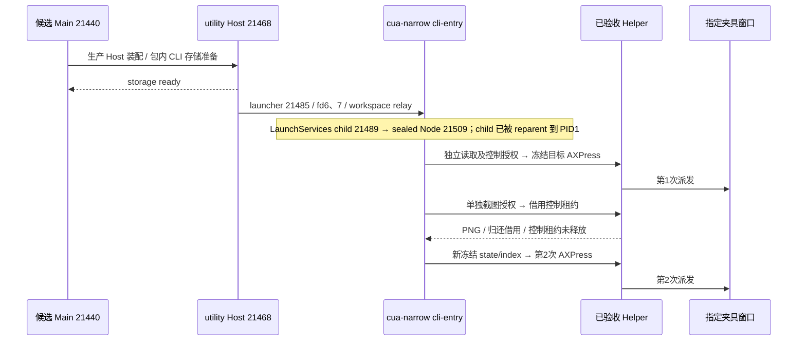

# R3 正常生产 Host 装配接线验证

状态（2026-11-16）：**CUA-AX-R3-01 接线单案机器验收通过**，主控核验及 Terra 独立只读审阅完成。发现并修复一处真实启动缺口。复用 R1/R2；未重复完整矩阵、租约或18笔人工输入。正式 pin、公证、上传和发布均未启动，未自动提交。

## 范围与候选

用户授权使用 [配对输入](../../output/cua-r3-preparation-20261115/paired-build-inputs.json)，只构建一个独立候选，验证正常 Electron utility Host 与已验收 Helper 的接线差异。

- 唯一 App 槽：`output/cua-r3-normal-host-20261115/run-slot/mac-arm64/Zody CUA Normal Host Candidate.app`。
- 独立 bundle ID：`io.github.zclaudia.zody.cua-r3-normal-host-candidate`；实际单案使用隔离的 `e2e-home-20261116-v2`，不安装或覆盖正式 App。
- 沿用生产 tsup、electron-builder 和 beforePack/afterPack/afterSign 资源断言；正常 Host 编译配对 profile，candidate NativeHost seam 未启用。关闭正式签名发布、公证和上传，只使用已有本地证书签名候选外层。
- manifest `9bcea0ea…`、launcher `00c91110…`；固定 `cua-narrow/Zody CUA Desktop Session.app` 的12份 Helper 资源与 R2 原字节一致，未重签 Helper。
- 为现有验收器启用既有 `VITE_ZODY_E2E_STORE_BRIDGE=1`。结论覆盖正常生产 Host 加测试观察 renderer，不代表纯发布 UI 制品验收。provider 为合成回放，实际 SDK、授权、原生动作和截图没有 mock。

## 实际差异与最小修复

已确认产品问题：从仓库 cwd 启动打包 App 时，命令解析先发现仓库源码；其存储准备入口缺失，导致 `unsupported_runtime`，尚未到 SDK。utility 探针证明 Electron/resourcesPath 正常，包内 CLI 的隔离 storage worker 预检也通过，因此未增加资源根注入、权限旁路或等待时长。

spec 先明确规则，再补回归并修复 `zodyAgentProcessManager.ts`：可信 native 和显式 command 仍优先；仅将当前 `process.resourcesPath` 内实际存在的 CLI 提前，绑定同源 storage worker。缺包内 CLI 时，开发源码仍优先于旧 staged bundle，原回退顺序保留。两条回归均先证明失败，再通过；合并既有进程管理回归共 **68项通过**。Terra 审阅发现最初方案会提前旧 bundle，已收窄并保留其红灯证据。

只更新同一未封存候选的 Main/Host/scheduler，刷新 asar integrity 并重新本地签名；原观察 renderer 的6590份文件不变。没有创建第二个 App，也没有热改 R2 封存包。当前 asar SHA256：`fb9d0d25781b0b4da34b50bf0089dc5e97df27ad83e6d94093a206752371ac22`。

## 实际验收证据

本轮 `e2e-20261116-v2.log`：**1个单案通过，退出0**；fresh preflight 录屏权限为 granted，准备门在 SDK 外释放，无需再次操作系统设置或人工输入。重载后的本轮 Main21440、utility NodeService Host21468、launcher21485及原生审计相互对应。workspace-child21489 经 LaunchServices 被 reparent 到 PID1，不能声称 launcher→child 是直接 OS 父链；旧 v1 进程树不用于本轮证明。

| 验收点 | 实测结果 |
| --- | --- |
| 精确窗口与业务效果 | PID38451、目标142335、同标题兄弟142337；目标 requests/presses 均0→2，兄弟请求/计数/文本不变，前后双窗口身份一致 |
| 两次真实收据 | 两条 `action_sent=true / dispatch_status=sent`；compact观察synced，none为not_requested；同scope、不同attempt的 admitted/completed 原生审计齐全 |
| 真正 PNG 交付 | 620×404、31277字节；provider图像与native capture审计SHA256均为 `fb4241f0a7d6f11e283405dda33c9cdbedd79d1679cb9af1c707397fdc630be8` |
| 截图借锁 | `machineLeaseReleased=false`、`machineLeaseBorrowReturned=true`、`resourcesReleased=true`；无 capture rejection |
| 授权与回放 | 读取/控制卡均指向精确目标且默认拒绝；截图独立请求；3个合成provider请求全部完成，无网络错误；已派发动作未重放 |
| 构建闭包 | 配对profile摘要匹配；Helper12份与R2相同；12个依赖根/39个传递包存在，缺失及native-policy违规0；外层deep/strict签名通过 |
| 必需检查 | `pnpm typecheck`、`pnpm lint`、架构检查、E2E类型及fixture检查通过；lint保留320条已有warning，fixture保留2条marker warning |
| 独立核验 | Terra只读复核运行链/收据/业务效果/PNG/借锁/范围，无阻断；主控重新计算正式pin3份、R2最终收据、配对输入及Helper12份摘要，全部不变 |

最终回执：[normal-host-acceptance.json](../../output/cua-r3-normal-host-20261115/normal-host-acceptance.json)。实际收据：[r2-capture-receipt.json](../../output/cua-r3-normal-host-20261115/e2e-evidence-20261116-v2/r2-capture-receipt.json)。运行链：[runtime-process-witness-20261116-v2.json](../../output/cua-r3-normal-host-20261115/runtime-process-witness-20261116-v2.json)。

## 保留的失败与结论边界

- 最初包装 spec 未被 runner 识别、生产 renderer 缺观察桥，以及后续仓库 cwd 引发的 storage 启动失败，均发生于 SDK 前；保留原日志/失败收据，不追认为通过。
- 首次 asar 读取沿用 repack 前缓存而误报 chunk 改变；fresh process/uncache 已查明验证器原因，原失败保留。早期“142份Main/Host不变”只描述启用观察桥那一步；之后已明确修改生产 Host 入口解析。
- 用户授予当前候选录屏权限后 fresh preflight 已证实 granted；没有重复盲调权限。构建的依赖查找、Vite大chunk、DEP0190等原warning保留。
- 本案 `liveAcceptance=false`、`humanReviewComplete=false`；未进行新的人工输入体验确认或用例晋升。R2已有人工验收保持原身份。

D3 的正常 Host 接线缺口已关闭。R1/R2既有功能证据继续复用；完整R3重复/故障矩阵、纯发布renderer和最终冻结分发验收仍未完成，未将本单案换算为稳定率或发布完成。

后续状态（2026-11-16）：已按用户授权收敛旧重复/故障门槛，无store观察桥生产renderer的CUA-AX-R3-02和最终闭包复核完成。当前候选身份与旧R3-01分开记账，参见[最小发布前准备收尾](cua-r3-prepublish-closeout-20261116.md)；本记录原始收据保持不变。
