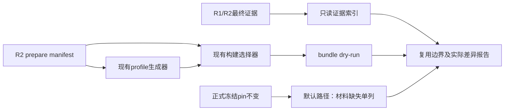

# macOS R3 发布前准备

状态：本轮证据基线整理与分发链缺口核对完成；配对构建输入和dry-run已生成。正常生产装配的定向接线验证已于2026-11-16完成，见[后续记录](cua-r3-normal-host-20261115.md)；不宣称R3发布验收通过。正式pin、公证、上传、发布均未启动，未自动提交。

用户授权：复用R1/R2证据，不重复已通过测试；发现缺口按实际差异处理。本轮只新增规格、报告与本地审计文件，没有修改产品源码、旧收据、候选App或正式pin，也未整体还原归档、构建新App、启动UI或改变TCC。

## 证据基线

机器可读索引：`output/cua-r3-preparation-20261115/evidence-baseline.json`，细项分别为 `r1-evidence-baseline.json`、`r2-evidence-baseline.json`、`candidate-resource-baseline.json`、`workspace-baseline.json`。

| 证据 | 本轮核对 | 复用范围 |
| --- | --- | --- |
| R1最终验收、人审、睡眠独立审阅、撤销交付、不透明边界，共5份JSON | 从清理归档直接读取，逐项核对manifest SHA-256/大小；压缩归档SHA亦匹配清理回执；还原文件0 | 单用户macOS正常桌面；读取/撤销/系统资格及原监测信号校准按原候选身份复用 |
| R2最终验收与人审 | 17份最终关联文件及9份嵌套试次文件摘要一致，晋升后的spec摘要一致 | 原生/CLI安全合同、Stop、租约、截图借锁；两平台18条路径/19次写尝试，1失败保留 |
| 当前原生源码与Helper | 57份源码及已验收Helper的12份资源摘要一致；prepare stage同12份资源一致；SDK client/docs源码与内嵌资源一致 | 支持复用相同原生与SDK字节的功能证据，不换算为另一个Host装配已通过 |
| 当前未提交工作区 | 记录HEAD及dirty文件逐项内容摘要 | HEAD仅作定位；不把HEAD视作已验收的全部未提交源码，不覆盖、重置或提交本地改动 |

R1的AppKit 20/20、Electron 20/23中的3次未证明、R2的1笔输入取证失败及其他历史失败不改记。远端系统视图仍不读取正文/生成索引；跨用户和长时间休眠继续未验证。不同阶段的候选身份及人审时点分别保留，较早JSON中的未完成/闭锁是历史事实。

## 分发链与处理结果

| 编号 | 已确认事实 | 本轮处理 | 后续受影响项 |
| --- | --- | --- | --- |
| D1 默认输入与R2候选不同 | 默认pin为2026-11-09冻结manifest `9a34469e…`；R2显式manifest为 `9bcea0…`；本地默认 `output/cua-narrow-frozen/controller-prepared/manifest.json` 不存在，选择器以 `cua-demo-default-resource-missing` 拒绝 | 保留正式pin原字节；记录缺失恢复条件；不下载或恢复旧实现来冒充R1/R2 | 将来确需默认旧构建时按原pin恢复；推进R1/R2候选则使用显式配对输入，不改默认pin |
| D2 显式manifest不自动激活Host | 单传manifest时选择器返回 `profileJson:null`，Host define会是undefined；这是既有资源装配语义 | 复用 `createNormalHostNarrowProfile` 生成profile，显式同时传入两者；验证manifest及launcher摘要配对，通过现有 `bundle --dry-run` | 配对输入已准备，未更改runtime规则或新增信任根；生产构建时必须使用同一对输入 |
| D3 验收与生产Host装配不同 | R2 run-slot为 `zody-cua-launchservices-candidate-app`，编译 `__ZODY_CANDIDATE_NATIVE_HOST_LAUNCH__`，槽位为 `cua-helper/Zody Computer Use.app`；正常生产Host编译profile并使用 `cua-narrow/Zody CUA Desktop Session.app` | 明确记录制品及路由差异，禁止把run-slot通过当作正常生产装配通过 | 2026-11-16新装配profile/资源同源及实际接线单案已通过；复用既有native/SDK功能矩阵，未重跑18笔/20次矩阵 |

输入和结果：

- `paired-host-profile.json`：由现有profile生成器产出，绑定本轮manifest和签名launcher；既有 `screenshot.single-window` profile标识保持不变，不把这个历史标识当作新增能力授权。
- `paired-build-inputs.json`：目标、manifest、环境profile及**仅dry-run**命令；此文件不是正式pin或发布配置，不自动执行构建。
- `distribution-selection-audit.json`：prepare清单、资源树、实际签名身份核验通过；配对选择通过，默认材料缺失如实记录。
- `bundle-dry-run.log`：退出0，打印构建方案，实际build/sign/公证/上传/发布均0次。

默认读取、profile生成、构建选择和资源校验分别复用既有所有者，没有第二条打包路径：

## 下一段准备的边界

最初准备轮未发现必须修改产品行为的源码缺陷。后续D3真机运行确认仓库cwd抢选源码入口导致存储准备失败，已按实际差异最小修复并通过68项定向回归及1个正常Host接线单案。D2通过正确配对既有输入处理；D1不是现在更新正式pin的理由。D3范围与失败保留见[正常Host记录](cua-r3-normal-host-20261115.md)。

后续若继续装配生产候选，应先固定当前未提交源码及配对输入，复用现有构建/prepare流程，只生成一个独立、可审阅的候选；不得热改R2已验收App。先比较编译进Host的profile、包内manifest与Helper摘要，再按实际入口差异确定最小接线冒烟。若原生/SDK字节不变，不重跑其安全矩阵、租约120秒、Stop、R1系统状态或18笔人工轮。若真的出现产品源码变化，仅补缺口回归及受影响检查，不自动扩展整套验收。

上述为最初准备时点的处理。2026-11-16用户已授权收敛spec，旧固定20次/全故障矩阵改记未执行且被按差异门槛取代，CUA-AX-R3-02及最终闭包复核已完成；见[最终准备收尾](cua-r3-prepublish-closeout-20261116.md)。正式freeze/pin、公证、上传、发布继续关闭。

## 本轮验证与交付

本轮执行的是摘要/资源/选择校验与dry-run，没有功能或真机测试重跑。仓库产品/测试源码未变，复用R2最终的typecheck、E2E类型、fixture、架构及lint结果（320 warnings/0 errors）；不把旧检查标成新执行。文档差异检查及独立Terra只读审阅另记本轮收据。

最终准备回执：`output/cua-r3-preparation-20261115/preparation-receipt.json`。R1/R2原证据和正式pin保持原字节，R3发布验收及实际发布未开始。
