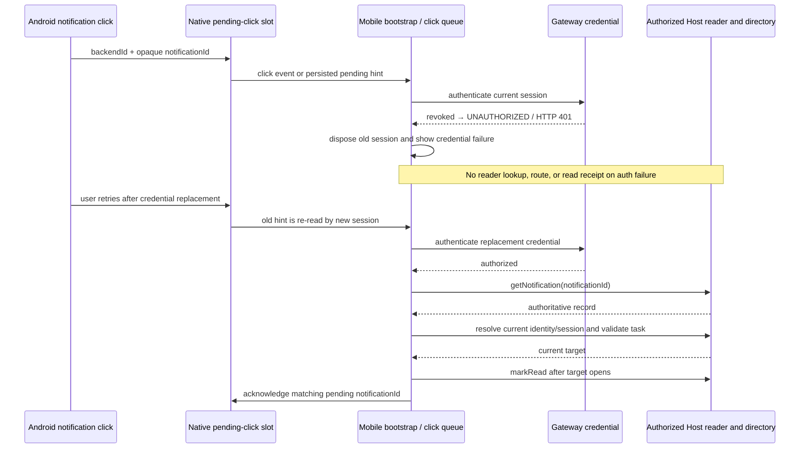

# P8 Android credential revocation and notification click cases

Date: 2026-10-23. This document defines the remaining device acceptance for
MN06, MN08, MC01, and MC03. It is kept separate from the central case catalog
and evidence summaries so the Android operator can append device results here.
The Gateway + real ntfy revocation evidence is in
[`mobile-remote-phase1-p8-revocation.md`](./mobile-remote-phase1-p8-revocation.md).

Latest device run: Android 14 / API 34 emulator (`sdk_gphone64_arm64`), APK
SHA-256 `e708716d946bb06a6624e2e1ecc385fd2345e10ec3b21dd09f99b3cf57db58ad`.
Fresh actual system-card clicks A, B, and D passed, including same Android PID
across a Desktop restart. C verified revoked-credential behavior and successful
retry after replacing the credential. The durable evidence bundle is
[`mobile-remote-phase1-p8-credential-click.json`](./evidence/mobile-remote-phase1-p8-credential-click.json).

## Product rules and owners

- Gateway credential authorization owns whether a backend may be discovered,
  subscribed to, and accessed. A revoked credential is terminal for that
  mobile session. HTTP 401 or the authenticated WebSocket `UNAUTHORIZED`
  response must lead to `gateway-credential-invalid`; it must not enter an
  unbounded reconnect loop or leave the old workspace page actionable.
- The mobile bootstrap owns the active connection generation and navigation.
  A successful credential replacement disposes the old transport, bridge,
  click listener, notification notice, and queued click work before creating a
  new session with the new configuration.
- Android's native pending-click slot contains only `{backendId,
notificationId}`. It is a navigation hint, not permission to read a
  notification or workspace. The authenticated Host reader owns the record;
  the current backend directory and task metadata own the latest route.
- A click may mark the notification read only after the authorized record is
  resolved, its current workspace attachment and task are validated, and the
  target is opened. Authorization or route failure leaves it unread. Closing a
  failure notice may acknowledge the native click slot, but it does not mark
  the business notification read; a later tap still goes through auth.
- On terminal credential failure the pending click remains in native storage,
  because the user may replace the credential and retry the same opaque hint.
  The disposed session queue cannot carry work into the replacement session;
  the new session re-reads the native slot and reauthorizes it. Successful open
  acknowledges the matching click after read commit; closing an unavailable
  notice acknowledges only that click slot.
- Android currently tracks one push subscription for the selected backend.
  A Gateway 401/403 or 404 may disable only that backend's subscription. The
  native bridge compares the requested backendId with its currently owned ID
  before deleting, so a delayed old-session cleanup cannot remove a newly
  selected backend subscription. Switching backends keeps the existing
  selected-backend cleanup behavior; it does not represent a multi-backend
  push subscription promise.
- Multiple windows may project the same remote workspace. Notification
  navigation uses the current authorized owner/lease and current
  `remoteSessionId`; it must not create another Host or fall back to a
  same-path, different-identity workspace.



```mermaid
sequenceDiagram
    participant Native as Native pending slot
    participant Queue as Mobile click queue
    participant Old as Old bridge RPC client
    participant Web as Bootstrap bridge owner
    participant New as New bridge RPC client
    Native->>Queue: click ID A
    Queue->>Old: getNotification(A), remains pending
    Web->>Web: recovery receives new bridge
    Web->>Old: dispose owned client
    Old-->>Queue: reject outstanding getNotification
    Web->>Queue: finish recovery; re-read native slot
    Queue->>New: getNotification(A)
    New-->>Queue: authorized record and current route
    Queue->>Web: open task, then markRead and acknowledge A
```

## Accepted cases

| Case              | Setup and action                                                                                                                                                                             | Required result                                                                                                                                                                                                                                                                                                                                                                                | Existing coverage and device evidence                                                                                                                                                                                                                                                                                                                                      |
| ----------------- | -------------------------------------------------------------------------------------------------------------------------------------------------------------------------------------------- | ---------------------------------------------------------------------------------------------------------------------------------------------------------------------------------------------------------------------------------------------------------------------------------------------------------------------------------------------------------------------------------------------- | -------------------------------------------------------------------------------------------------------------------------------------------------------------------------------------------------------------------------------------------------------------------------------------------------------------------------------------------------------------------------- |
| MN06-R1 / MC03-R1 | On an authenticated Android session, display a notification for a valid task. Revoke that device credential in Gateway while the app is open, then tap the already displayed card.           | The active session reaches the stable credential-invalid screen. The previous task page is no longer interactive. Reader lookup and `markRead` do not occur. The pending native click remains for credential replacement; business read state is unchanged. No automatic reconnect loop continues.                                                                                             | Passed on latest APK: `revoked-foreground.json` shows task DOM 0, bridge-ready-after-revoke 0, read receipt 0, no active subscription; after actual old-card tap `revoked-after-click.json` shows the matching native pending ID retained and read receipt 0.                                                                                                              |
| MN08-R1           | With notification subscription active, revoke the Gateway credential and observe the running app, daemon subscription, and old OS notification.                                              | Credential revocation stops further authorized stream delivery and feed access. Already-rendered cards may remain visible; tapping one cannot reveal private details or bypass auth. Remove only the revoked subscription.                                                                                                                                                                     | Passed on latest APK: revoked foreground state reports `subscriptions: []`; old OS card tap did not reopen the Host or mark read.                                                                                                                                                                                                                                          |
| MN06-R2 / MC03-R2 | Leave an old card pending, then replace the credential in mobile settings with a valid credential for the same backend. Tap/retry the old card.                                              | The old session/queue is disposed. The new session authenticates independently, re-reads the opaque ID through its reader, and opens only if the record remains authorized and current. Exactly one read receipt occurs after successful open. The old credential is never reused.                                                                                                             | Passed on latest APK: actual Open settings → replacement credential → backend selection/connect → pending C card opened in Host A; exact identity/session observed, one read receipt, native pending cleared (`verified-revoked.json`).                                                                                                                                    |
| MN06-R3           | Tap an old card after its notification was deleted/expired, its workspace closed, or its task removed.                                                                                       | Show a recoverable unavailable notice; do not navigate to an arbitrary path, create a Host, or mark read. Retry may use only current authorized state.                                                                                                                                                                                                                                         | `mobileNotificationNavigation.test.ts` covers missing record, missing workspace, identity mismatch, and missing task. 2026-10-24 device acceptance passed deleted-task and closed-workspace old-card clicks (receipt 0, no arbitrary open, Host set unchanged); the closed-workspace variant retained the pending click without surfacing the unavailable notice — recorded as a follow-up finding in [owner-boundary](./mobile-remote-phase1-p8-owner-boundary.md). Deleted/expired-notification remains device-pending (no product UI entry, TTL not reachable).                                                                                                                                                                                                                      |
| MN06-R4 / MC01-R2 | Android resumes from background while a card click is in flight. The Gateway reconnect negotiates the same app protocol and invalidates the click's captured connection generation.          | After the recovery owner confirms the channel is ready, re-read the still-pending native click and run authorization/routing again. Do not silently drop a `stale-notification`; do not use a timer or retry while recovery is incomplete. Refresh mobile capabilities from the newly negotiated channel so Search/Notifications remain available. Commit read only after the task is mounted. | Focused regression passed. Fresh A card click passed on the latest APK after Desktop restart with the same Android PID; exact target route opened, one read receipt, native pending cleared.                                                                                                                                                                               |
| MN06-R5           | On Gateway channel recovery, the `ready`/`paired` callback starts a desktop-version/bootstrap check before the `hello_ack` negotiation callback invalidates the prior connection generation. | Ignore the pre-negotiation result, then let the original bootstrap/recovery caller consume a fresh check on the ready channel and continue mounting the Root. The UI must leave `Connecting` and restore current mobile capabilities without waiting for another transport state transition or detached recovery owner.                                                                        | Focused bootstrap-continuation test passed. Latest cold startup and same-Android-PID recovery across Desktop restart passed representative device paths; the exact ready/negotiated callback interleaving is asserted by the focused test, not independently forced on device.                                                                                             |
| MN06-R6           | A native notification click starts `getNotification` on the old Host bridge while lifecycle recovery replaces that bridge; the old RPC never responds.                                       | The bridge owner disposes its owned RPC client synchronously when replacing the bridge. Pending and not-yet-initialized calls reject; the old response cannot be observed or route. The click queue releases, then re-reads the durable native slot through the new bridge and authorizes/routes once. No timeout or protocol-wide close event is used.                                        | Implemented owned-client disposal on bridge replacement/teardown. Owned connection, queue/navigation and recovery regressions passed within the final 8-suite/75-test selection; final A click across Desktop restart passed with the same Android PID, read=1 and native pending cleared. The exact permanently pending old-RPC interleaving is covered by focused tests. |
| MC01-R1 / MC03-R3 | Two Desktop windows expose the same remote identity; one attachment is current/connected and another is stale, offline, or a recovery placeholder. Tap a notification targeting that task.   | Route through the current authorized owner/lease and current `remoteSessionId`; open exactly one existing task. No extra Host/runtime is created, no desktop selection changes, and read is committed only after open. Same path with another identity is rejected.                                                                                                                            | Passed 2026-10-24 on the API 34 emulator: window A connected owner plus window B stale recovery placeholder for the same identity; the real system-card click routed via the current owner (task body visible, one read receipt, native pending cleared) with the desktop active tab and the Host PID set unchanged. See [owner-boundary evidence](./evidence/mobile-remote-phase1-p8-owner-boundary.json).                                                                                                                |
| MN08-R2           | A credential has scope A+B. Start a delayed subscription response for B; switch Android to still-authorized A before the response reports B is outside scope.                                | A remains subscribed and usable. The stale B response is ignored by the connection-generation guard and cannot delete A's active native subscription. When B is current, a definitive 404 may clean only B.                                                                                                                                                                                    | Source test and actual native owned-backend guard passed; full Android scope-shrink UI scenario remains pending.                                                                                                                                                                                                                                                           |

## Suggested device selectors and observations

Use semantic roles and visible content so the operator can use Appium, browser
accessibility, or manual inspection without adding test-only UI hooks:

- Credential failure: heading `设备凭证已失效` (English `Device Credential
Invalid`), followed by the primary button `打开设置` / `Open settings`.
- Setup replacement: settings screen heading and the credential input; after
  submit, assert the selected backend and new authenticated session become
  available before retrying the card.
- Failed notification click: dialog heading `暂时无法打开通知` /
  `Could not open notification`, with `重试` / `Retry` and `关闭` / `Close`.
- Successful click: task heading or known task marker from the isolated fixture,
  then verify the Host-side notification reader reports exactly one read
  receipt. Verify the native pending slot is cleared only for that
  `notificationId`.
- Multi-Host: record current `workspaceIdentity`, current `remoteSessionId`,
  selected owner/window, number of Host/runtime instances, and read-receipt
  count before and after the click.

Do not use the number of WebSocket reconnect attempts alone as proof that the
old page is inert. Confirm the failure screen is visible and the prior task
controls are absent or disabled, and confirm no reader/read RPC was sent after
Gateway rejected the credential.

## Device evidence and remaining coverage

| Run                                | Evidence                                                                                                                                                                        |
| ---------------------------------- | ------------------------------------------------------------------------------------------------------------------------------------------------------------------------------- |
| Revoked while foreground           | `revoked-foreground.json`: stable `Device Credential Invalid`, task DOM 0, bridge-ready-after-revoke 0, read count 0, subscriptions empty.                                      |
| Tap old card after rejection       | `revoked-after-click.json`: actual tap, no read, native pending retains the exact backend and notification ID.                                                                  |
| Replace credential and retry C     | `verified-revoked.json`: actual settings flow; exact Host A identity/session and task observed; read count 1; native pending cleared.                                           |
| Fresh multi-Host card B            | `verified-B.json`: fresh system-card tap routed to Host B with exact identity/session/task observation; read count 1; native pending cleared.                                   |
| Fresh card A after Desktop restart | Durable evidence: same Android PID across Desktop restart; actual A card tap routed to the correct network identity/session and DOM task; read count 1; native pending cleared. |
| Fresh multi-Host card D            | Durable evidence: actual D card tap routed to the expected identity/session and DOM task; read count 1; native pending cleared.                                                 |

The evidence is from an Android 14 API 34 emulator. The latest APK is
`e708716d946bb06a6624e2e1ecc385fd2345e10ec3b21dd09f99b3cf57db58ad`. Physical
OEM hardware and Shizuku deployment were unavailable; an isolated root daemon
was used. WSL was unavailable on macOS, and a signed release APK could not be
produced because the four release-signing environment variables were absent.
MN06-R3's deleted/expired notification, closed-workspace, and removed-task
device matrix remains pending; the A/B/C/D runs do not establish those cases.
MN08-R2 has native ownership guard coverage, while the full Android scope-shrink
UI flow remains pending. The remaining cold-start variants and other scenarios
without explicit device evidence in this document also remain pending.
