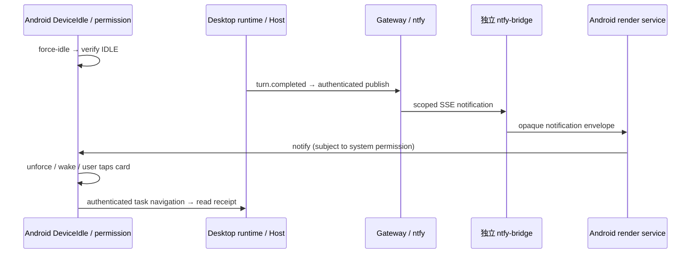

# P8 Android Doze 与系统通知权限续验

状态：Doze 完整链路和系统通知权限撤销/恢复实测通过（2026-10-23）。设备为 API34 Android emulator；不将 emulator 结果推导为 OEM 真机支持。

## 验收规则

- 使用真实 Desktop runtime 完成事件，经隔离 Gateway、自建 ntfy、独立 ntfy-bridge 到 Android render service。禁止直接插入通知数据库或 receiver 注入代替完整链路。
- Doze 用 `dumpsys deviceidle force-idle` 控制，记录 `get deep=IDLE` 后才触发事件。停止本应用 keep-alive、HOME 后普通 `am kill`，独立 bridge 保持运行；不使用 force-stop。记录通知到达时的深度休眠状态；若只在恢复后到达，必须如实记录延迟。
- 退出 Doze 后通过真实系统卡片点击，验证同一 task 与 read receipt。Gateway accepted 不能替代 OS notification 证据。
- 系统 POST_NOTIFICATIONS 撤销与 Gateway credential 撤销属于不同所有者。撤销系统权限后 bridge 状态必须为 permission-denied，新通知不应显示系统卡片；原任务/feed 不因系统权限变化被删除。恢复权限后以一个新事件确认系统卡片恢复；不能把拒绝期间无卡片称为网络丢失或 Gateway 撤权。
- 对系统权限的补充验证可使用 Gateway 的正式 test-notification 入口，记录其 test kind，不声称创建了新的 runtime task。
- 测试前记录权限、deep idle、battery、原应用 preferences；完成后恢复系统状态和逐文件校验 preferences，移除独立测试 daemon、订阅、凭据和端口转发。

Android 测试步骤参考 [官方 Doze 验证文档](https://developer.android.com/training/monitoring-device-state/doze-standby)。独立 root daemon 的身份、权限豁免与物理设备差异应随实测证据记录，不能因 root daemon 能联网就声称普通应用 socket 不受 Doze 限制。

## 本轮实际结果

持久证据：[Doze / permission JSON](./evidence/mobile-remote-phase1-p8-doze-permission.json)。APK SHA-256 为 `c772feb78b96da781c8c706a9ac37263c86dd1b100e4386bc146865795fc4e28`，包含通知 Service 的 DUMP 调用权限保护。未添加电池优化白名单。

- 停止 KeepAliveService、HOME、普通 `am kill` 后确认应用 PID 消失；`dumpsys deviceidle get deep` 确认 IDLE，随后真实 CLI/runtime 完成任务。
- Gateway/ntfy accepted 一次；深度状态仍为 IDLE 时，Android `NotificationRecord` 中出现本任务通知，通用正文为 `A task has finished.`。独立 root daemon 持续运行，使用 shell UID 路径调用受保护服务。
- 退出 Doze 并唤醒后点击真实系统卡片，APK 展示 `sess_190a100c-94e3-446e-9daa-2fe42092d3a1` 的 `P8_RUNTIME_COMPLETION_OK`；pending click 清除，Host 记录 1 条 read receipt。WDIO 1 pass / exit 0（含设备等待时间）。
- 撤销 POST_NOTIFICATIONS 后，native status 为 permission-denied；调用正式 Gateway test-notification 接口，真实 ntfy 到达 render service，系统卡片计数为 0。恢复权限后，native status 为 ready；新 test notification 到达并显示 1 张系统卡片。此补充路径为 test kind，不声称新增 runtime 任务。
- 首轮旧 APK 同样在 IDLE 收到卡片，但唤醒时 emulator 的 system_server 发生 watchdog reset；当时的点击没有完成。保留该轮失败记录，后续受保护 APK 全链路重跑通过，未将环境异常改写成首次通过。

原始截图与去凭据结果在 `.tmp/mobile-remote-p8-doze/`。未覆盖物理 OEM、Shizuku 安装模式、普通非特权 daemon 在 Doze 中的联网、force-stop 保证或正式签名发布设备；root daemon 的成功不能外推到这些环境。
