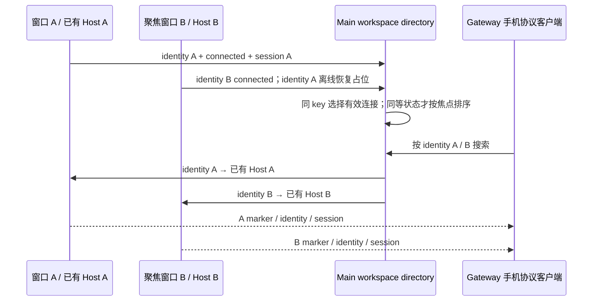

# P8 Host / workspace identity 隔离验收

状态：代码与双窗口 Desktop/Gateway 搜索验收通过，2026-10-23。此记录只验收 Host 通知 reader、Host controller 搜索和 Main Host 路由边界；与 central spec/case catalog 互补，不修改它们。

## 规则与状态所有者

- 通知业务记录、feed、outbox 与安装实例 read receipt 由 Host 中的 `IMobileNotificationService` 持有；每条 attachment 的 `IMobileNotificationReader` 由 Host 显式注册，principal 由 Main 注入，客户端不能在 payload 中选择 backend、device subject 或 instance。
- 通知目标与 search scope 使用 `workspaceKey = workspaceIdentity?.trim() || workspacePath`。相同路径但 identity 不同的 workspace 必须保持为不同目标；远程 target 还携带当前 `remoteSessionId`。
- 同一 `workspaceKey` 在多个窗口重复出现时，聚合列表与 `resolveWindow` 必须选择同一 owner：具有 `connectionState=connected` 且有 `remoteSessionId` 的远程投影优先于无 session 的恢复占位项；显式 disconnected/reconnecting 的 target 即使残留 session 也不算健康候选。多个健康连接仍按聚焦窗口、最近同步顺序选择；全部不可用时保留原排序且明确离线。重复 `workspaceKey + taskId` 的任务副本优先选择同一 workspace owner 的窗口，避免列表与 search/attach 的 owner 不一致。
- reader feed/read 授权按 principal 的 backend 与安装实例执行；feed 可列该 backend 下多个 workspace 的通知。此行为不能误称为 workspace 级 feed 授权。
- 点击先由 attachment reader 读取 notificationId，再按最新 workspace identity/owner/lease 解析路由；成功打开正确任务后才标记安装实例已读。失效 Host/旧 session 不得写入新会话。

```text
Host A service ── attachment A principal ── reader A ── backend A feed/read
      └── records keyed by backend + workspaceKey(identity)
Host B service ── attachment B principal ── reader B ── backend B feed/read
      └── same workspacePath, different workspaceIdentity
Main directory ── workspaceKey ── owner window ── Host controller scope/search result
mobile click → reader.getNotification → latest identity/session route → open success → reader.markRead
```



## 验收场景

1. 两个独立 Host ChannelServer/service/SQLite 数据库及 attachment reader 使用相同 `/repo`、不同 workspace identity 和相同 task/session/source event ID。feed、getNotification、read receipt 不能因路径或 task ID 相同合并/串读。
2. A 上 markRead 不得改变 B 的 unreadCount/read。A reader 对 B 的 notificationId 返回 null；额外伪造 backend/workspaceKey 字段不能改变可信 principal 或通知目标。
3. Main 的真实 owner directory 将同路径不同 identity 分别 attach 到对应 Host/window 和 remoteSession。伪造 backend 返回 offline；未登记的路径冒充 workspaceKey 返回 closed，不能触发 Host attachment。
4. 各 Host controller 经真实 RPC 搜索时只向自己的 task service 查询自己的 identity；向 A Host 伪造 B identity 返回 closed。
5. 真实双窗口/Gateway/mobile.html 后续验收应另证通知点击路由的最新 remoteSessionId、owner/lease/stale-session 以及成功打开后才写 read receipt 的顺序。
6. 双 Host 窗口中，B 可能恢复出 A identity 的无 session 占位 tab；聚合不能因 B 聚焦而让占位项遮蔽 A 的 connected target。两边 connected 时仍保留 focus→最近同步优先；所有副本均 disconnected/reconnecting 时不能伪装在线；相同 path、不同 identity 必须仍为两个 key。

## 当前证据分层

- **Host RPC + service**：`packages/desktop/test/hostMobileNotificationReaderChannel.test.ts` 使用两套独立 SQLite-backed notification service 和真实 ChannelServer/Client/ProxyChannel，验证跨 backend feed/read/get 隔离、read receipt 不串写、target identity/session 保留。另以单个 service 测试同 backend、同 path、相同 task/session/event 但不同 identity 会产生两条 feed 记录；read receipt 按通知 ID 独立，点击读取分别返回 alpha/beta identity/session。附加伪造 backend/workspaceKey 字段不能覆盖 attachment principal 或通知 target。Feed 的授权边界仍是 backend+安装实例，因此同 backend 的两个 workspace 都出现在 feed 是预期行为。该测试证明 RPC reader 与 service 边界，不证明 Main/Gateway/手机导航。
- **Host controller 搜索**：`packages/desktop/test/windowHostControllerService.test.ts` 使用两套 controller runtime、task service 与 ChannelServer，验证同路径不同 identity、同 taskId 下搜索不串结果；A 收到 B identity 返回 closed，查询 scopes 只含本 Host identity。
- **真实 Main 路由 + 两个 Host RPC server**：`packages/desktop/test/webRemoteControlManagerExternalRelay.test.ts` 通过真实 manager、owner directory 和两个 ChannelServer 验证 identity-alpha/beta 分别 attach 到 window 21/22，controller scope 与结果都保留对应 identity/session；伪造 backend 返回 offline，路径冒充 workspaceKey 返回 closed，且不 attach。
- **此前缺口**：以上为真实 RPC/Host/Main 组件集成，没有启动真实 Electron 双窗口和 Gateway；没有在手机 UI 中执行通知点击、owner/lease/stale-session 检查或“打开成功后 markRead”完整顺序。reader `getNotification` 的 backend 隔离不能替代完整导航证据。

## 双窗口 Desktop/Gateway E2E 实现与边界

用例放在 `packages/desktop/test/e2e/mobile-remote/manual-review/pending/`，复用隔离 SSH/Gateway 与真实 Electron 窗口。当前实际覆盖是两窗口不同 SSH target、同一 workspace path 下创建带 case marker 的任务，并经 Gateway phone probe 搜索；通知生成、真实 `mobile.html` 页面和点击导航留待后续验收。

验收用例在 `packages/desktop/test/e2e/mobile-remote/manual-review/pending/mobile-host-identity-isolation.test.ts`，独立 runner 在 `scripts/run-mobile-host-identity-isolation-e2e.mjs`。runner 自建隔离 Gateway、两个 SSH 容器、随机密码文件和临时 E2E home；两个容器内路径相同、SSH endpoint 不同。WDIO case 使用 `openSubagentHostWindow()` 创建两个实际 Electron 窗口，并从专用 Host preload 的 `ready` 边界分别记录 Local Host pid，断言窗口 ID 与 Host pid 均不同。随后各窗口连接一个 SSH target，复用 `ssh-remote-lifecycle.ts` 用 replay 完成带共同查询 marker 的任务，再通过 `connectFakePhone` 向真实 Desktop→Gateway relay 发起按 identity 定界的搜索。Runner 入口为 `fnm exec --using=24.14.0 node scripts/run-mobile-host-identity-isolation-e2e.mjs`。

修复前真实 WDIO 运行（artifact `desktop-e2e-20261023-095440-008`）发现：A 窗口 tab 保留 A identity 与 remoteSessionId；当前聚焦的 B 窗口同时有 B 的 connected tab 和 A 的恢复占位 tab（相同 A identity、无 remoteSessionId）。`RemoteWorkspaceDirectory` 原本按 focused window 去重，因此 A 的 Main workspace projection 变成 `disconnected` 并导致 A 搜索返回 offline，尽管 A Local Host 仍有连接和会话。修复后重建 Desktop 的双窗口 WDIO 运行通过（artifact `desktop-e2e-20261023-100101-344`）：两个 search result 均包含各自 marker、workspace identity 和 session；搜索前后 Host PID 集合没有增长。此处不是 remoteSessionId 的全局唯一性要求。

该 case 通过 Desktop→Gateway 实际 relay 与 Main owner Host RPC 路径，但手机侧使用协议探针而不是 `mobile.html` UI；不能声称通知点击导航 E2E。已尝试运行 `e2e:fixture:check`，仓库 checker 当前明确只支持 formal/pending conversation-session 与 plugin specs，无法校验 mobile remote spec；fixture JSON 语法和 WDIO TypeScript 已分别静态检查通过。

Fake Phone 协议探针验证 Desktop→Gateway app payload；此候选不执行真实 `mobile.html` 页面，也不覆盖 Android 通知点击导航，因此不能声称手机 UI/通知点击 E2E 通过。WDIO 运行使用当前源码构建 Desktop 主进程（`ZCODE_E2E_SKIP_AGENT_BUILD=1`），并执行 remote runtime assets staging；未复用旧 Desktop build。

## 本轮验证

- `fnm exec --using=24.14.0 pnpm exec vitest run packages/desktop/test/hostMobileNotificationReaderChannel.test.ts --project unit`：3 tests passed。
- `fnm exec --using=24.14.0 pnpm exec vitest run packages/desktop/test/windowHostControllerService.test.ts --project unit`：17 tests passed。
- `fnm exec --using=24.14.0 pnpm exec vitest run packages/desktop/test/webRemoteControlManagerExternalRelay.test.ts --project unit`：60 tests passed。
- 三个聚焦 suites 合计：80 tests passed。目录修复专项15项通过；最终与通知/点击路由等一起执行的14个文件共130项通过，上述专项包含于该选集，不能相加。
- 修复后双窗口 runner：`fnm exec --using=24.14.0 node scripts/run-mobile-host-identity-isolation-e2e.mjs`，1 passed / 0 failed / 0 skipped；WDIO case 43.8s，整体 run 72.4s。两个窗口的 Local Host PID 独立；两种 identity/session 搜索到各自 marker；搜索过程没有创建额外 Host。证据目录：`packages/desktop/.e2e-artifacts/desktop-e2e-20261023-100101-344/`。
- `fnm exec --using=24.14.0 pnpm typecheck`：通过。
- `fnm exec --using=24.14.0 pnpm --filter @zcode/desktop typecheck:e2e`：通过，包含 pending WDIO candidate。
- `fnm exec --using=24.14.0 pnpm exec oxlint packages/desktop/test/e2e/mobile-remote/manual-review/pending/mobile-host-identity-isolation.test.ts`：通过，0 warnings / 0 errors。
- 双窗口 Host PID 断言加入后重新运行 `typecheck:e2e`：通过；`pnpm architecture:check --changed`：0 violations；runner `node --check` 与 `git diff --check`：通过。
- `fnm exec --using=24.14.0 node --check scripts/run-mobile-host-identity-isolation-e2e.mjs`：通过。
- 两份 `mobile-host-identity-isolation.json` fixture 文件通过 Node JSON parse。
- `e2e:fixture:check`：失败，checker 报告 mobile remote spec 不在其支持范围；不是 fixture 断言运行失败。
- `fnm exec --using=24.14.0 pnpm lint`：退出成功，0 errors / 310 仓库 warnings。
- `fnm exec --using=24.14.0 pnpm architecture:check --changed`：0 violations。
- `git diff --check`：通过。

持久摘要：[Host 隔离证据](./evidence/mobile-remote-phase1-p8-host-isolation.json)。用例容器、专属数据卷及私有 HOME/凭据已清理，生产 Gateway 未改动。

## Later Android evidence and remaining boundary

The later [credential/click run](./evidence/mobile-remote-phase1-p8-credential-click.json) passed real Android system-card clicks across different identities with the same workspace path, plus whole-credential revocation/replacement. This document's two-window search run remains protocol-probe evidence, not Android UI evidence. The same-identity current-owner/stale-placeholder notification click still needs device acceptance; see the [remaining checklist](./mobile-remote-phase1-cases.md#p8-剩余验收交接2026-10-23-停测后的状态).
