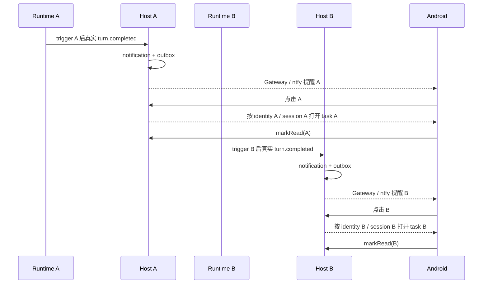

# P8 多 Host 通知点击验收

状态：最终 fresh Desktop + Android 实际系统卡片验收通过，覆盖两 Host、多 identity/task/session、凭据撤销和恢复；两个注入测试 Host 的 PID 集合在点击阶段保持不变（另有初始配置窗口 Host，不能解读为应用总共只有两个 Host）。本记录不把协议探针或 mobile.html 点击写成 Android 系统卡片证据。

## 产品规则与所有者

两个独立 Window Local Host 连接相同 SSH workspace path、不同 SSH identity。每个 Host 的真实 V4 runtime completion 写入通知 service/outbox，并通过当前 owner/session 路由。手机按 opaque notificationId 点击；当前已认证 attachment 解析最新 identity、remoteSessionId 与 task，打开成功后才按 backend、安装实例和 notificationId 写 read receipt。Receipt 不绑定产生通知的 Window Host 对象。

具体验收规则和事件顺序见 [phase1 spec §4.2.1](../../specs/mobile-remote-phase1.md)。本 case 不直接写通知数据库、不构造 feed 行。数据库只以只读连接检查真实 runtime 产物与 read receipt。



## 执行入口与 Android handoff

root 先启动隔离 push harness，保留其凭据文件路径于私有环境变量 `ZODY_P8_CREDENTIAL_FILE`。再从仓库根运行：

```bash
fnm exec --using=24.14.0 node scripts/run-mobile-p8-multihost-notification-click-e2e.mjs
```

Runner 只创建和清理本 case 的两个 SSH 容器、私有密码文件和 Electron E2E home；Gateway/ntfy 由 push harness 所有。WDIO 连接同一 `/workspace/p8-multihost-notification` path 的两个 SSH endpoint，在两个真实 Window Local Host 建立远程 identity/session 后写 `ready.json` 并等待 Android 操作。协作目录为 `.tmp/mobile-remote-p8-multihost-click/`，权限为当前用户私有，不能把凭据复制进该目录或证据文件。

阶段顺序：

1. `ready.json` 出现后，Android 登录并连接 Gateway，确认 ntfy 订阅 ready。
2. 写 `trigger-A.json`；WDIO 经 A 窗口真实 composer/runtime 生成 A 通知，等 Host outbox accepted 后写 `result-A.json`。
3. 点击 A 系统卡片，确认实际打开的任务正文为 `P8_MULTIHOST_A_RUNTIME_COMPLETION_OK`，然后写 `click-A.json`。其字段必须与 `result-A.json` 中的 `label`、`notificationId`、`workspaceIdentity`、`remoteSessionId`、`taskId`、`sessionId` 完全一致。
4. WDIO 验证 A 恰好一条 read receipt 后才等 `trigger-B.json`。随后同样完成 B 通知、系统卡片点击和 `click-B.json`。
5. B 点击后断言 B 恰好一条 receipt，A 仍恰好一条。之后写 `trigger-revoked.json` 生成 C 卡；撤销设备 credential 并点击旧卡，写 `click-revoked.json`（`rejected: true`，当时 C receipt 必须为 0）。
6. Android 重新配对/授权后写 `trigger-recovered.json` 生成 D 卡，再写包含目标 identity/session/task 和 notificationId 的 `click-recovered.json`。如果 Android 把 C 点击暂存到登录后恢复消费，C 可在重新认证后增加 receipt；验收只保证它在撤销状态下未写 receipt。最后写 `release.json`。

这些 JSON 只记录标记、身份和随机 ID，不包含凭据。Android 操作人员应在确认真实系统卡片和目标 task 后才写对应 click acknowledgement；ack 文件本身不能替代界面观察。

## 持久结果

`ready.json` 记录 backend ID、两个 Host PID、identity/session、隔离 E2E home 和只读通知 DB 路径。`result-*.json` 记录 Host SQLite 中 notification/outbox 的只读原始行与 identity/session/task/event/notification ID。`verification.json` 与 `final-receipts.json` 记录点击 ack 与回执数。完成后把不含凭据的结果摘要、WDIO artifact 目录、Android build/API/OEM 和点击截图引用补在此处；临时 Gateway/ntfy/凭据及 SSH 容器清理由各自 harness 完成。

## 当前验证

- `pnpm --filter @zcode/desktop typecheck:e2e`：通过。
- 针对新 WDIO case 和 runner 的 Oxlint：0 warnings、0 errors。
- `pnpm architecture:check --changed`：0 violations。
- 首次 Desktop run `desktop-e2e-20261023-104207-595`：两个注入 Host PID 为 64566、64845，均连接了同路径不同 SSH identity/session；A 阶段 composer/runtime helper 到达通知等待，但 60 秒内没有对应 accepted notification/outbox，WDIO 失败 `Host A runtime completion did not reach an accepted notification outbox state`。测试产物见 `packages/desktop/.e2e-artifacts/desktop-e2e-20261023-104207-595/test-results.ndjson` 与 `runtime-logs/0-0/desktop/2026-10-23.log`。该 run 自动清理其 SSH 容器和私有 Electron home；不作为通知点击通过证据。
- 中间 run `desktop-e2e-20261023-105719-531`：全仓 `tsc -b` 与 WDIO 并行写入共享 `packages/desktop/out/host`，导致 Host bundle 被 typecheck 输出覆盖，Host import `./hostDatabaseStartup.js` 失败并造成 `transport_closed`。这属于验证编排冲突；后续 Desktop build 与 E2E 串行执行。
- 串行重建后的 run `desktop-e2e-20261023-110131-769`：两个注入 Host PID 为 87490、88232；A 任务的 renderer task store identity 检查通过，Host 记录 remote source lifecycle `registered` 与 capture source `attached`，但无 terminal capture 回调日志、通知数据库为空，最终再次因 A 没有 accepted notification/outbox 失败。产物见 `packages/desktop/.e2e-artifacts/desktop-e2e-20261023-110131-769/test-results.ndjson`、`runtime-logs/0-0/desktop/2026-10-23.log` 和 `.tmp/mobile-remote-p8-multihost-click/diagnostic-A.json`。runner 已清理本轮 SSH 容器和私有 Electron home；该轮当时继续调查 terminal capture；后续修复 source 生命周期/已有 session 发现并刷新 remote assets 后，真实 capture/outbox 与最终 122526 点击全链路通过。此失败记录保留。
- Desktop/Android 完整交接 run `desktop-e2e-20261023-111856-451`：串行运行 `pnpm --dir packages/desktop prepare:remote-assets` 后再启动 WDIO，1 case / 1 passing（21m20.8s）。两个真实 injected Local Host PID 为 14030、14457；它们连接同一 SSH workspace path `/workspace/p8-multihost-notification`，identity、remoteSessionId、task/session 均不同。Host 日志先后记录 remote source `registered`、capture `attached`、session discovery 和 `turn.completed` accepted；早期一次 task-meta probe 为 `missing`，随后 completed task 出现在 `listTasks`，且实际系统卡点击成功。
- 此 run 中 A、B、D 均由真实 runtime composer 生成通知，Android 系统卡点击后正确打开对应 identity/session/task，receipt 分别为 1、1、1；A 与 B 点击未串写。撤权下点击旧卡 C 被拒绝，点击时 receipt 为 0；更换凭据后 pending C 可被消费，因此最终 C receipt 为 1，这是规范允许的结果。验收协作 `verification.json` 保留撤权时的 0 receipt 及每卡路由；`final-receipts.json` 保留最终计数。
- Android foreground recovery 修复是在 A 点击 pending 期间安装的：A 的原始点击被保留，并由最终 APK 恢复消费；B、D 在最终 APK 下完成新卡片点击。该 run 证明真实端到端行为成功，但升级与 A 点击交错，因此单独作为跨版本恢复证据；干净矩阵结果见后续 `122526` run。
- Artifact：`packages/desktop/.e2e-artifacts/desktop-e2e-20261023-111856-451/summary.md`、`test-results.ndjson`、`runtime-logs/0-0/desktop/2026-10-23.log`。WDIO 收到 `release.json` 后退出 0；成功路径已清理本 run SSH 容器和私有 Electron E2E home。`ready.json`、`result-*.json`、`click-*.json`、`verification.json`、`final-receipts.json` 已由 root 复制到其私有 handoff 归档。
- 当时 APK 干净复跑 `desktop-e2e-20261023-114207-360` 失败（后续修复与通过见下文）：两 Host PID 47780/48223 建立成功；A 的真实 runtime terminal capture/outbox accepted，但 Android 实际点 A 后没有导航，native pending click 保留。root 的定向证据显示 route 只有 local workspace recovery bridge，没有目标 task route。Host 完整日志中 source `registered`、capture `attached`，terminal capture `accepted`；本轮没有 `getTaskMeta`/`task-meta-probe` 日志。该 run 不写 `click-A.json`，不计为通过。
- root 在 `114207` 现场定位到 bridge 持有的旧 RPC ChannelClient 生命周期未被 dispose，导致点击队列等待未完成；修复按 relay protocol dispose client，没有增加 timeout/abort fallback。更新 APK 后 root 曾以 evidence-only 方式验证 pending A 恢复（不写 click ack）；修复后的完整 fresh matrix 见 `122526` run。失败 artifact 与私有 handoff 由 root 保存。
- 最终 clean run `desktop-e2e-20261023-122526-934` 使用 APK SHA-256 `e708716d946bb06a6624e2e1ecc385fd2345e10ec3b21dd09f99b3cf57db58ad`，WDIO 1 case / 1 passing（49m40.2s）。A、B、C、D 都由本轮真实 composer/runtime 产生；Android 持续运行最终 APK，A/B/D 新系统卡片点击分别打开对应 identity、remoteSessionId 和 task/session，并各写 1 条 receipt。撤权后点 C 返回 rejected、receipt 0；重新认证后旧 pending C 被合法消费，最终 receipt 1。最终 receipts 为 A=1、B=1、C=1、D=1。
- `final-host-pids.json` 断言点击阶段 Host 集合未变化：初始与最终都为 `[8306, 8658]`。`verification.json` 记录 A/B/C/D 的路由/点击 receipt，其中 C 记录的是撤权状态下 0；`final-receipts.json` 记录重认证后 C 的最终 receipt。真实 Desktop artifact：`packages/desktop/.e2e-artifacts/desktop-e2e-20261023-122526-934/summary.md`、`test-results.ndjson` 和 `runtime-logs/0-0/desktop/2026-10-23.log`。handoff evidence 由 root 保存到私有归档，不含凭据。
- 最终 case runner 收到 release 并 exit 0，清理本轮两个 SSH 容器与临时 Electron home。另清理确认属于此前同一 runner 的残留容器 `40760752ed` 及其私有临时目录；只删除该 runner label 的容器和临时目录，没有触碰 Gateway/ntfy。

完整剩余范围见[交接清单](./mobile-remote-phase1-cases.md#p8-剩余验收交接2026-10-23-停测后的状态)。本次通过的是同路径不同 identity 的通知点击；同 identity 多窗口 current-owner/stale-placeholder 点击未覆盖。最终停测清理已完成，原设备配置恢复并校验；隔离 Gateway/ntfy、daemon/forward 与临时凭据也已移除，新 session 需重新建环境。
