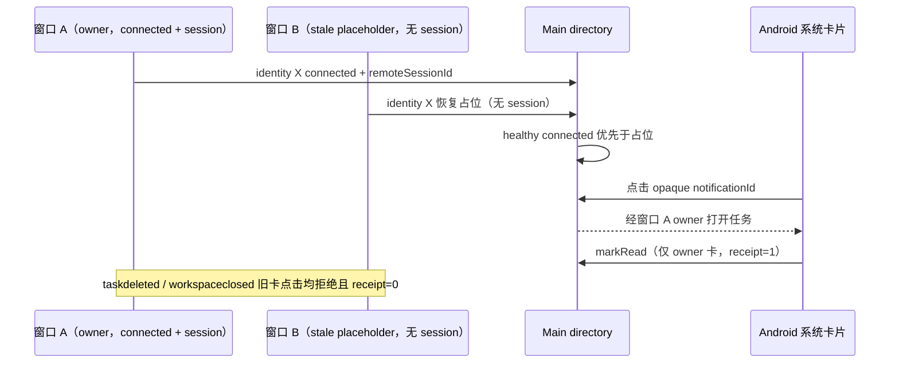

# P8 通知 owner 边界与旧目标点击验收

状态：设备验收通过（2026-10-24，WDIO 1 case pass，artifact `desktop-e2e-20261023-173919-955`）。覆盖 MC01-R1/MC03-R3（同 identity 多窗口 current owner vs stale placeholder 点击）与 MN06-R3 的删除 task、关闭 workspace 两个旧卡变体；workspace 关闭变体存在一项记录在案的反馈偏差（见下文发现）。持久脱敏证据：[owner-boundary JSON](./evidence/mobile-remote-phase1-p8-owner-boundary.json)。

## 规则与状态所有者

- 同一 remote workspace identity 在多个窗口投影时，通知点击必须经当前授权 owner/lease 与当前 `remoteSessionId` 路由；恢复占位 tab（无 `remoteSessionId`）不是健康目标，不得遮蔽连接中的 owner，也不得因点击新建 Host。
- 旧卡点击在任务被删除、workspace 被关闭时不得打开任意路径、不得写 read receipt；成功打开目标并完成路由才允许 markRead。
- 桌面选中 tab 不因手机点击改变；Host 进程集合不变。

## 执行入口

- WDIO case：`packages/desktop/test/e2e/mobile-remote/manual-review/pending/mobile-notification-owner-boundary.test.ts`（单 SSH 容器、同 identity 双窗口）。
- Runner：`ZODY_P8_CREDENTIAL_FILE=<push-harness 凭据> node scripts/run-mobile-p8-notification-owner-boundary-e2e.mjs`。
- Android 操作 driver：`ZODY_P8_CREDENTIAL_FILE=<同上> node scripts/mobile-remote-p8-owner-boundary-android-driver.mjs <backup|setup|click <label>|release|status|restore>`。
- 设备端 ntfy-bridge daemon：推送 `ntfy-bridge/dist/module/bin/ntfy-bridged` 后以 root 运行 `-listen 127.0.0.1:9595`。

阶段：owner（真实 runtime turn → 系统卡 → 点击 → 经 owner 打开任务 → receipt=1）→ taskdeleted（归档+真实删除后点旧卡 → 失败弹窗 → receipt=0）→ workspaceclosed（移除 workspace tab 后点旧卡 → 拒绝 → receipt=0）→ Host PID 集合终检 → release。

## 结果与证据

| 阶段 | 结果 | 关键证据 |
| --- | --- | --- |
| 同 identity 双窗口建立 | 通过 | 窗口 A 带 `remoteSessionId` 的连接 tab；窗口 B 同 identity 无 session 占位 tab（placeholder-evidence.json） |
| owner 点击 | 通过 | zody:// ACTION_VIEW 深链（logcat）、WebView DOM 显示 `P8_OWNER_CURRENT_OWNER_ROUTING_OK`、native pending 清空、receipt=1、桌面 active tab 不变 |
| taskdeleted 旧卡点击 | 通过 | "Could not open notification" 弹窗出现并关闭、receipt=0、owner receipt 保持 1 |
| workspaceclosed 旧卡点击 | 通过（含偏差记录） | receipt=0、未打开任意任务、Host PID 集合不变；native pending 保留待重连消费 |
| Host 进程集合 | 通过 | 初始与最终均为 `[22914, 23210]` |

截图与 logcat 深链记录在 `.tmp/mobile-remote-p8-owner-boundary/artifacts/`（click-owner-task.png、click-taskdeleted-notice.png、deep-link-start-logcat.txt、r7-wc-state.png）。

## 记录在案的发现

1. **workspace 关闭旧卡点击缺少"不可用"反馈（待跟进）**：点击后 read receipt 保持 0、未打开任意任务、pending 保留等待重连，核心不变量全部成立；但预期出现的 "Could not open notification" 弹窗没有出现，页面停在 workspace 聊天空态。与 MN06-R3 的选择器指引不符，需在 mobile click 队列对"目录中 workspace 不健康且短期内不可恢复"补用户可见反馈。
2. **通知分组对点击自动化的影响（工具侧经验）**：保活通知与任务卡同 app 自动归组后，折叠 summary 的 contentIntent 是 launcher intent；必须先展开分组再点子卡，并以 logcat 中 `dat=zody://` 深链作为命中证据。driver 已内置该逻辑。
3. **跨轮次 WebView 状态**：Desktop 后端换代会让页面停在 "Desktop Timed Out" 失败屏且 Retry 无法恢复；driver 的 setup 现在会校验 web 会话健康并在需要时要求重启 app（force-stop 会清除系统卡片，需在生成通知前进行）。

## 本轮范围外

- 通知"删除/过期"设备变体：产品 UI 无删除通知入口，1 小时/24 小时 TTL 无法在设备上自然到达；missing-record 路径由 `mobileNotificationNavigation.test.ts` 组件测试覆盖，设备矩阵保持待验收。
- MN08-R2 scope 收窄 A+B→A 完整 UI 与迟到 B 响应：需要第二个真实 backend 与确定性延迟订阅编排，本轮未执行，保持待验收。
- OEM 真机、Shizuku、Windows/WSL、生产 Gateway/ntfy HTTPS、正式签名 release：环境与材料缺失，保持 blocked。
