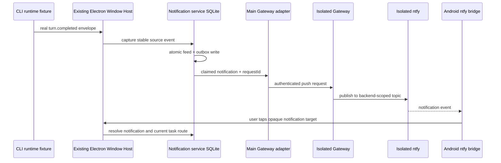

# P8: isolated Gateway and ntfy push harness

This harness prepares the infrastructure for the pending MN07 real-device
acceptance. Its passing startup checks do not count as an MN07 pass: the
runtime event, Android background receipt, and notification click must be
observed separately on the real app and device.

The intended event path is:

The click path resolves `mobile-notification-reader` on the authenticated
Host attachment. Host registers that channel explicitly for each attachment:
the reader is bound to the Gateway-authenticated backend/device/client identity
and is never stored in the shared service collection. Attachments without a
trusted notification principal still receive a rejecting reader channel, so a
click reports authorization failure rather than an unknown RPC channel.

The harness owns only its `zody-p8-push-*` Docker container, Gateway process,
random temporary data directory, and credential file. The Gateway namespace is
unique per run, its notification publisher points to the local ntfy container,
and its database is isolated with `ZCLAUDIA_DATA_DIR`. The device credential is
short-lived and stored only in a mode-0600 JSON file under a mode-0700 temp
directory. The script never prints credential values.

Run `node scripts/mobile-remote-p8-push-harness.mjs start` to create the
infrastructure and issue backend/device credentials. The output contains only
the Android-reachable Gateway URL and private credential-file path. The pending
WDIO case uses its own `ZODY_E2E_HOME_DIR`, configures the backend credential
through the desktop UI, waits for the Android device to connect, and then waits
for `trigger-task.json` before sending a marker prompt through the real V4
composer/runtime. Its case-local provider replay returns a deterministic text
completion. It reads the Host SQLite feed/outbox and read-receipt rows without
writing them, and writes only redacted IDs/statuses to `desktop-ready.json` and
`desktop-result.json`.

Run it with the private credential-file path in `ZODY_P8_CREDENTIAL_FILE` and
both `common.json` and
`fixtures/upstream/mobile-remote/mobile-notification-ntfy.json` in
`E2E_PROVIDER_REPLAY_FIXTURE_PATH`. Once `desktop-ready.json` appears, connect
the Android app using that Gateway URL/device credential, scope the credential
to the reported backend with `node scripts/mobile-remote-p8-push-harness.mjs
scope <backend-id>`, then background the app and write `trigger-task.json`.
After `desktop-result.json` reports an accepted notification, tap it and verify
the routed task before writing `click-verified.json`. The WDIO case holds the
Electron Host until `release.json`, so the operator can complete other device
checks against the same case-owned workspace. Keep the harness running until
the device acceptance ends, then run `stop` to revoke credentials, stop the
Gateway, remove the ntfy container, and erase its temp directory and workspace.
Do not place credentials in shell history, test output, screenshots, or logs.

This is a pending manual-review harness. It does not register the case in the
formal E2E suite or claim that the desktop runtime event and Android click path
passed by itself.

## Android emulator evidence — 2026-10-23

The third isolated run completed the push and click path on an Android 14 / API 34
`sdk_gphone64_arm64` emulator. The APK SHA-256 was
`6ed904aeedc3b2051b838bb638f12d3df00060d43d9ba0f788c888b74835dd0b`. The real
replayed CLI turn produced a `turn.completed` Host notification; the persisted feed
row and outbox both reached `accepted` with one attempt. The app's KeepAliveService
was stopped separately, then Android was sent HOME; after the app left foreground,
its process was `am kill`'d. The independent `ntfy-bridge` 0.4.0 daemon remained
connected. The OS then displayed the
generic notification. Tapping that System UI card opened the matching task, where
the `P8_RUNTIME_COMPLETION_OK` response was visible; the native pending click was
consumed and the Host recorded one scoped read receipt for the same notification.
`force-stop` was not used.

The credentials-free, persistent acceptance record is
[`mobile-remote-phase1-p8-push.json`](./evidence/mobile-remote-phase1-p8-push.json).
It records `notificationId=90a827b9-bbb9-402b-aa8b-f2c95d9585ab`,
`taskId=sess_ea3c1979-1080-4d93-8256-2d08128669da`,
`sourceEventId=d6897950-f33c-4be0-956b-b1681fb99712`, and
`readReceiptCount=1`. The complete Host row is included in that record. The original
redacted Host row is in `.tmp/mobile-remote-p8-android/delivery-result.json`;
click/read-receipt JSON and
screenshots are under the same directory (`click-result.json`,
`background-notification.png`, and `click-task.png`). The final desktop result keeps
the successful read receipt. No credential or ntfy publish secret is included in
those files.

The second run also displayed the system card, but its click failed because the
Host had only placed the attachment-scoped reader in `ServiceCollection` overrides;
`exposeOnChannelServer` only enumerates registered services, so the RPC endpoint was
missing. Host now explicitly registers the reader channel per attachment. The
focused `ChannelServer` regression test verifies the registered endpoint, backend-
scoped reads for a trusted principal, and rejection without a principal. The third
device run confirms that clicking now resolves the task and records its read receipt.
The pending WDIO case passed after its post-click hold, following two passing
positive Android Downloads checks on the same case-owned workspace. The 16 MiB+1
case then passed in a final isolated Gateway/Host run using the same real Files UI;
the exact limit-error toast appeared, the Save button re-enabled, and Downloads had
no matching row. This result supersedes the earlier fixed-delay observation. The isolated Gateway,
ntfy container, credentials, and harness-owned temporary workspace were then
removed. The adjacent Gateway suite passed under its declared Node 22.20 runtime:
23 test files passed, 199 tests passed, and 3 were skipped.
