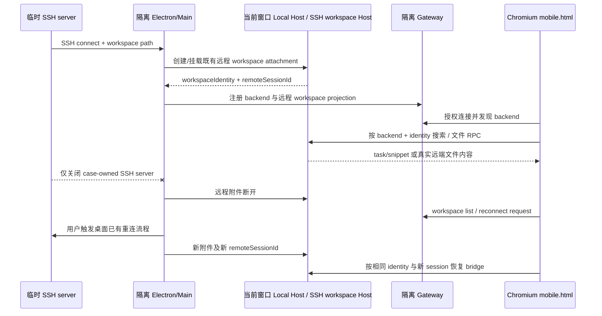

# P8 真实 SSH workspace 远控验收

状态：SSH 场景 PASS（2026-10-23，1 WDIO case）；待按生命周期流程 review/promotion。使用独立 Gateway、隔离 Electron profile、case-owned SSH server 与移动 Web 页面；不覆盖 Android SSH/WSL 或发布 Gateway。

关联规则：`specs/mobile-remote-phase1.md` §3.1/§3.2；场景目录 `docs/testing/mobile-remote-phase1-cases.md` 的 MS01、MS02、MF01、MF04；重连规则 `docs/web-remote-control/mobile-remote-workspace-reconnect.md`。

## 目标与边界

证明现有桌面 SSH workspace 能通过 Gateway 被移动 Web 正确寻址：远程历史搜索命中打开对应 identity/task；文件浏览读取实际 SSH 目录内容；SSH 断开并重连后 `remoteSessionId` 更新，旧 session 请求不串入新附件，且失败路径不回退到本机文件系统。运行时继续复用当前 Desktop Host/SSH Host；手机只通过 `web-remote-replayable` Gateway bridge 读取和恢复，不新建 Agent、Host 或 SSH 会话。

本验收不触及已有 `.env.gateway.local`、用户 Desktop profile、用户 SSH 配置/密钥、现有 Gateway 服务或远程机器。所有 Gateway/SSH 容器、Electron `HOME`、workspace、provider 与 device/backend credentials 均由本用例临时创建并清理。凭据仅写入权限为 0600 的临时文件，不进入日志或 artifacts。

## 状态所有者与事件顺序

Desktop/Host 持有 SSH 连接与 workspace 路由；Gateway 只鉴权和转发；移动页仅持有当前连接 generation 与导航目标。`workspaceKey = workspaceIdentity?.trim() || workspacePath`。旧 generation 的响应必须被丢弃；断开期间不得用同路径本地 workspace 代替远程目标。

## 验收场景

| Case   | Setup                                                                                                    | Action                                                                                                                                                                                                    | Assertion                                                                                                                                       |
| ------ | -------------------------------------------------------------------------------------------------------- | --------------------------------------------------------------------------------------------------------------------------------------------------------------------------------------------------------- | ----------------------------------------------------------------------------------------------------------------------------------------------- |
| P8-R01 | 临时 SSH workspace 中有专属文件；桌面通过 provider 创建含唯一搜索 marker 的完成任务；隔离 Gateway 已连接 | Chromium mobile.html 登录隔离 device credential，搜索 marker 并打开结果；从远程 workspace 浏览文件                                                                                                        | 搜索结果归属同一 backend、identity、remoteSessionId、taskId；真实远端 RPC 文件内容匹配 SSH sentinel；本机同路径文件设为不同 sentinel 且不被返回 |
| P8-R02 | P8-R01 远程 workspace 已打开，记录旧 `remoteSessionId`                                                   | 停止 case-owned sshd；确认手机显示断开、隐藏 Files，且没有可操作任务行（若首页保留任务行则必须禁用）；搜索显示该 scope 离线且无远端命中；通过桌面现有 reconnect action 恢复同一 workspace；重新搜索和浏览 | 断开期间不打开任务/文件，且同路径本地 sentinel 不可见；identity/path 保持，`remoteSessionId` 改变；新 bridge 命中同任务并读取真实 SSH 文件      |

### 实际证据

持久、无凭据的执行记录见 [P8 SSH evidence](./evidence/mobile-remote-phase1-p8-ssh.json)。

2026-10-23 在 macOS 上以 Node 24.14.0 实跑 1 个 WDIO case，`1 passing`（106525 ms）：报告位于 `packages/desktop/.e2e-artifacts/desktop-e2e-20261023-085128-021/summary.md`。Desktop 使用临时 HOME；Gateway 与 sshd 由本用例独立 Docker container 持有，Chromium 连接真实 `mobile.html`。WDIO 子进程通过父进程解析到的 Docker context endpoint 操作仅本用例 sshd；本机无 Windows/WSL，故 WSL 未测。

实测覆盖：Gateway 登录后按远程 identity 搜索完成任务并读取 case-owned SSH 文件；同路径 local sentinel 从未显示。停止 sshd 后首页显示断开、Files 隐藏、没有可操作任务行；搜索将远程 scope 标为 offline 且没有远端命中，本机 sentinel 未显示。通过桌面现有重连 action 恢复后，identity/path 保持、`remoteSessionId` 更新；移动页重新命中该任务并经远端 RPC 读回 SSH 文件。WDIO 完成后确认没有 `zody.p8.remote=true` 容器，临时 credential/workdir 已删除。

验收脚本只在 P8-R01/R02 的 SSH、身份、隔离与重连断言全部通过后关闭 mobile Chromium，并写入权限为 0600 的临时 `handoff.json`。手工 Android 下载复核可使用该文件中的隔离 Gateway、backend、device credential 文件和 workspace；runner 在同一桌面/Gateway 保留最多 5 分钟，收到 case-owned release 文件后才清理容器与凭据。此交接不记录 credential 内容。

本轮桌面 reconnect 全自动完成并已验证新 session。该结果只代表本地隔离 SSH/Linux 容器及移动 Chromium；不代表 WSL、Android SSH UI、发布构建、真实 Gateway 部署或其他 Host/文件边界组合。
