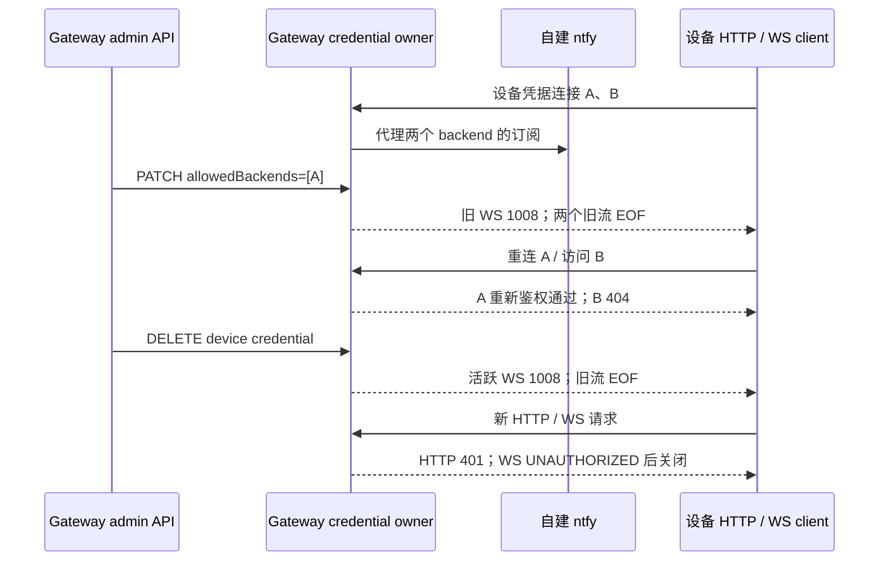

# P8 权限撤销验收记录

日期：2026-10-23。Gateway device credential 撤销及 scope 收窄，已通过真实本机 HTTP / WebSocket 服务与自建 ntfy 2.14.0 的网络链路验证。系统 POST_NOTIFICATIONS 撤销另见 [Doze 与系统权限记录](./mobile-remote-phase1-p8-doze.md)，两者不混为同一个权限状态。

## 真实 ntfy 验收

相邻 Gateway 的 `src/__tests__/notification-revocation.real-ntfy.test.ts` 通过 `ZODY_P8_REAL_NTFY_URL` 显式启用。使用仅绑定回环地址的用例专属 Docker ntfy、随机 topic、隔离 Gateway 数据库和临时测试凭据；没有 fetch stub，不使用生产配置。

1. 为 A、B 创建两个 backend credential，设备初始可访问两者。建立已认证 WebSocket，以及 A、B 两条真实 ntfy JSON 流；经正式 test-notification 接口发布并确认各自的 opaque backend ID。
2. `PATCH /api/admin/credentials/:id` 将 scope 收窄至 A。旧 WebSocket 以 1008 关闭，A、B 旧订阅均 EOF；B 的订阅配置、流、新测试推送均为 404。A 能重新建立订阅和 peer，并收到新的测试事件。
3. `DELETE /api/admin/credentials/:id` 撤销设备。重新建立的 peer 以 1008 关闭，A 流 EOF；后续订阅配置、流及测试推送均为 401。新 WebSocket 握手返回 `gateway_error / UNAUTHORIZED`，随后关闭（现有协议不携带 close status，客户端观察为 1005）；它没有成为已认证 peer。

这些消息明确为 `kind=test`，用于验证授权与传输，不声称运行了 Android runtime task 或撤回已显示的通知。



## 回归与重放

- 真实 ntfy 专项：1 个文件、1 项通过。
- 开启真实 ntfy 专项后的 Gateway 全量：24 个文件通过，201 passed、3 skipped；3 项为既有套件的跳过项。
- `notification-subscription.test.ts` 保留受控 upstream 回归（3 项通过），额外断言 Gateway 的上游 AbortSignal 被触发。真实 ntfy 专项断言客户端 EOF，不将其表述为观察到了 ntfy 服务内部连接状态。
- 两个变更测试文件的 ESLint 通过。

在相邻 Gateway 仓库、Node 22.20.0 下执行。先启动用例自有 ntfy，再将其回环地址传入；不得设置所有并行 worker 共用的 `ZCLAUDIA_DATA_DIR`，由已有 `vitest.setup.ts` 创建各 worker 的独立目录。可将 `TMPDIR` 指向本次自有目录以便完整清理：

```bash
env -u ZCLAUDIA_DATA_DIR TMPDIR="$case_temp_dir" \
  ZODY_P8_REAL_NTFY_URL="$case_ntfy_url" \
  fnm exec --using=22.20.0 pnpm test
```

未提供 `ZODY_P8_REAL_NTFY_URL` 时新增真实网络专项显式 skip，不能将默认套件通过视为真实 ntfy 验收。该 URL 必须属于测试服务；测试向其写入临时消息。

本轮初次全量命令错误地让所有 worker 共用一个临时数据库，导致 admin overview 计数出现并发干扰（1 failed / 200 passed / 3 skipped）。改用仓库已有隔离机制后全量通过，没有为此修改生产代码。初次专项也修正了过长测试 topic 和将新握手错误地等同于存量 peer close code 的测试预期。

持久摘要：[撤权证据](./evidence/mobile-remote-phase1-p8-revocation.json)。去凭据执行日志在 `.tmp/mobile-remote-p8-revocation/`。

## 验收边界

本次覆盖 Gateway + 真实 ntfy + HTTP/WS 客户端；不等于 Android 端在凭据撤销后的界面、旧通知点击、通知清理和重新配对均已通过。也未覆盖生产部署、物理 OEM、Shizuku、长时间断网后的恢复。Doze 及 Android 系统权限是独立设备实测，见上述链接。
