# 手机远控架构（zclaudia-gateway，App 级）

本文描述当前有效实现。旧的二维码配对、外部 relay、设备注册/HMAC 挑战、`pass_hash`/`device_sid`
和 `/web-remote` 页面路由都已删除，不再作为兼容路径。方案与决策见
[specs/mobile-remote-control-via-gateway.md](../../specs/mobile-remote-control-via-gateway.md)。

## 产品概览

手机远控让手机访问目标桌面**已打开的所有 workspace 和任务**。桌面应用承载实际服务与 Agent
runtime；手机只 attach 桌面已有的 Host attachment，不启动独立 Agent、Local Host 或远程会话。

与旧形态的关键差异：

- 远控从「按窗口、按 workspace 开启」改为 **App 级**：桌面只有一个总开关，手机连上这台电脑后
  看到它所有窗口的 workspace 和任务。
- 传输层从官方 relay 改为自建的 **zclaudia-gateway**（Gateway Protocol v4）。gateway 只做鉴权、
  配对、心跳和帧级转发，不保存任务队列、快照等业务状态。
- 手机页面不再从官方域名加载，而是打进 Android APK 的 assets（PC 浏览器开发模式除外）。

### 使用流程与页面

1. 桌面设置 → 「远程访问」：填写 gateway 地址、namespace 和 backend 凭证（`zgb_`），打开总开关。
2. 手机首次使用：填写 gateway 地址、namespace 和设备凭证（`zgd_`），从 `discoverBackends` 列表
   里选择电脑并保存。
3. 进入手机任务首页：按工作区分组浏览所有已打开的 workspace 和任务，点击进入聊天；权限审批、
   交互请求、附件和工作区切换复用现有 V4 会话组件。
4. 首页「最近项目」区列出桌面 `recentProjects`（最多 10 条，仅本地）中尚未打开的项目。点击后
   请求桌面在主窗口新开标签页，之后手机正常进入。
5. 桌面没有窗口时（例如 macOS 关窗后驻留托盘），手机显示空态并提供「在电脑上打开窗口」。
6. 窄屏使用独立的首页/聊天两页 shell；宽屏远控使用侧栏布局。手机主题使用浏览器本地偏好，
   与桌面主题独立。

### 能力与边界

- 可浏览、打开、新建桌面已打开 workspace 中的任务，发送输入，处理会话中的权限和交互请求。
- 远程工作区复用桌面已有连接与服务 scope；手机不能新建 SSH/WSL/Docker 连接，也不能访问未在
  桌面窗口中打开的项目（最近项目除外，见下文）。
- 同一 task 仍由既有 runtime owner 执行。桌面使用 `desktop-continuous`，手机使用
  `web-remote-replayable`；手机恢复不会改变桌面的 continuous 主链路。
- 一台电脑同一时刻只服务一部手机；后到者取得控制权，先到者进入 `session-conflict` 终态。
- 手机不能传入任意路径：打开项目只接受桌面当前下发的最近项目 id。

```text
手机（Android WebView / 浏览器开发模式）
  │  channel: zcode-remote（WebSocket 帧，strict schema）
  v
zclaudia-gateway（鉴权、配对、心跳、帧级转发；无业务状态）
  ^
  │  backend 连接（zgb_ → zga_），不依赖窗口
桌面 Main
  ├─ RemoteGatewayBackend（App 级 gateway 连接 + channel 账本）
  ├─ GatewayDeviceTransport（channel 帧协议、心跳、背压、替换时序）
  ├─ webRemoteControlManager（App 级单 runtime、payload 路由）
  └─ RemoteWorkspaceDirectory（各窗口快照的只读投影）
  │  MessagePort attachment（web-remote-replayable）
  v
目标窗口 Window Host → 已有 workspace scope → 同一 CLI/runtime owner
  ^
桌面 renderer（desktop-continuous）─┘
```

### 专题导航

| 内容                               | 文档                                                                      |
| ---------------------------------- | ------------------------------------------------------------------------- |
| 手机首页、聊天、新建任务与页面状态 | [手机任务首页](./mobile-task-home-design.md)                              |
| 手机任务时间线与排序               | [移动端任务时间线](../ui/web-remote-control-mobile-task-timeline.md)      |
| 宽屏任务列表、搜索与归档           | [宽屏任务列表](./wide-screen-task-list.md)                                |
| 手机主题与浏览器表面               | [主题控制](./mobile-theme-control.md)                                     |
| 远程工作区断开与重连               | [工作区重连](./mobile-remote-workspace-reconnect.md)                      |
| 实时同步、snapshot 与 gap 恢复     | [任务实时同步](./task-realtime-sync.md)                                   |
| snapshot 字节预算                  | [Snapshot 字节预算](./snapshot-byte-budget.md)                            |
| 单一 owner 的流式渲染              | [Single Owner Stream Rendering](./single-owner-stream-rendering.md)       |
| 输入 admission、队列与跨端命令路由 | [任务命令队列](../web-remote-control-task-command-queue.md)               |
| Android 壳与自建部署               | [Android 远程控制壳](../mobile-remote-control-android.md)                 |

[最小跑通规划](./web-remote-control-minimal-plan.md)仅作为历史记录，其中描述的仓库内 relay、
专用 mobile host 和旧配对流程已不适用于当前链路。

## 模块与分层

| 层 / 模块                       | 位置与职责                                                                                                                                                                                                                          |
| ------------------------------- | ----------------------------------------------------------------------------------------------------------------------------------------------------------------------------------------------------------------------------------- |
| channel 帧协议与 payload schema | `packages/shared/src/web-remote-control-channel.ts`（帧、心跳、版本协商、引入版本清单）、`packages/shared/src/web-remote-control.ts`（`zcode_type` 与 strict schema）、`packages/shared/src/remoteAccess.ts`（App 级配置/状态类型） |
| 桌面 gateway 连接               | `packages/desktop/src/main/remote-access/remoteGatewayBackend.ts` + `packages/desktop/src/main/remote-access/remoteGatewayChannelHub.ts`                                                                                            |
| 桌面 channel 适配               | `packages/desktop/src/main/remote-access/gatewayDeviceTransport.ts`（及 `gatewayDeviceTransport*` 拆分文件）                                                                                                                        |
| 桌面窗口目录                    | `packages/desktop/src/main/remote-access/remoteWorkspaceDirectory.ts`、`packages/desktop/src/main/remote-access/recentProjects.ts`                                                                                                  |
| 桌面 App 级 runtime             | `packages/desktop/src/main/webRemoteControlManager.ts`                                                                                                                                                                              |
| 桌面 IPC 与设置                 | `packages/desktop/src/main/desktopRemoteAccessIpc.ts`、`packages/ui/src/settings/RemoteAccessSection.tsx`、`packages/ui/src/WebRemoteControlDialog.tsx`                                                                             |
| 手机页面与 transport            | `packages/web/src/mobile-remote/bootstrap.tsx`、`packages/web/src/mobile-remote/gatewayTerminalTransport.ts`、`packages/web/src/mobile-remote/mobileRemoteSetup.tsx`、`packages/web/src/mobile-remote/mobileRemoteConfigStore.ts`   |
| 手机入口                        | `packages/web/mobile.html`（Vite 独立 entry，构建到 `packages/web/dist-mobile-remote/`）                                                                                                                                            |
| Android 壳                      | `packages/android`（详见 [Android 远程控制壳](../mobile-remote-control-android.md)）                                                                                                                                                |

依赖方向保持 `desktop/web/ui → shared`；`ui` 不直接 import gateway SDK。

## 配置与连接

### 桌面配置

`AppSettings.remoteAccess` 是非敏感配置的唯一持久化位置：

```ts
interface RemoteAccessSettings {
  enabled: boolean;
  gatewayUrl: string; // 空串表示未配置
  namespace: string; // 默认 "zcode"
}
```

- backend 凭证（`zgb_`，换票后为 `zga_`）由 Main 的凭据服务保存，key 是
  `remote-access:gateway:backend-credential`。它不出现在 settings、IPC 返回值或日志里；
  renderer 只能通过 `GetRemoteAccessCredentialStatus` 读到 `{ configured }`。
- 开关打开但地址或凭证缺失时，状态是 `error(unconfigured)`，不发起连接。
- 旧设置迁移：存在 `webRemoteControlLastEnabledContext` 且没有 `remoteAccess` 时，写入
  `remoteAccess.enabled = false`（旧 relay 配置无法沿用，需要重新配置 gateway）。

`RemoteGatewayBackend` 是 gateway 连接的唯一所有者，配置变更串行执行，连续变更合并为最新值：

1. 有手机连着时先发 `close{desktop-stopping}`；
2. 调用 SDK `close()`，等待进入 `closed`；
3. 新配置完整且开关打开时 `connect()`，否则停在 `disabled`。

只有 `enabled`、`gatewayUrl`、`namespace` 和凭证真正变化才触发重连。连接在 app ready 后立即
建立，不依赖窗口；退出时先 `dispose()` 再走进程回收。

设置页「测试连接」使用表单里尚未保存的值：

- 表单值与生效值完全相同时直接复用现有连接，不重连；
- 值不同且没有手机连接时，暂停现有连接、测试、再恢复；
- 有手机连接时禁用：同一张 `zgb_` 只能有一个进程在线，测试会拆掉手机正在使用的 channel。

桌面侧连接状态：

```text
disabled | connecting | online{backendId, epoch} | error(unconfigured | credential-invalid | replaced | unreachable)
```

`replaced` 表示同一张 backend 凭证在另一个进程登录，SDK 不再重连。

### 手机配置

- gateway 地址、namespace、设备凭证（`zgd_`）和所选电脑由 `MobileRemoteConfigStore` 经
  `IPlatformService.secureStore` 保存。
- `clientInstanceId` 按 `backendId` 分别生成并持久化，key 是
  `client-instance-id:<backendId>`；它是桌面判定「同一部手机重连」的依据。
- 只有浏览器开发模式允许降级为 `localStorage`；release 构建缺少原生桥时保存凭证直接失败，
  `localStorage` 降级代码不会进入生产产物。
- 选电脑页把 `discoverBackends` 与 registry 合并：`online` 以 registry 为准，`supported` 只在
  registry 明确缺少 `zcode-remote-control` 能力位时为 false。离线电脑仍可选择，等待恢复。

### 地址归一化与 gateway 约定

- gateway 地址去掉尾部斜杠；`https` 推导 `wss`，`http` 推导 `ws`。release 构建要求 `https`，
  只有本地开发运行形态允许 `http`。
- Channel kind 固定为 `zcode-remote`；桌面只注册这个 kind，其余由 backend SDK 自动回
  `channel_reject`。
- 桌面在 `peer_hello.backend.capabilities` 里自报 `zcode-remote-control`。手机在开 channel 前
  先查 registry：电脑在线但没有这个能力位时进入 `backend-unsupported`，不发起 channel。
- namespace 默认 `zcode`；设备凭证的 discovery 接口不返回 namespace，所以手机设置页可编辑。
- 手机页面来自 APK 内置的 origin `https://appassets.androidplatform.net`。如果 gateway 设置了
  `GATEWAY_ALLOWED_ORIGINS`，必须包含这个 origin，否则 `discoverBackends` 会被拦截。

## Channel 帧协议

gateway 的数据面只做帧级中继：保序、区分 text/binary、不解析帧内容。ZCode 只使用 text 帧，
每帧一个 JSON。协议常量集中在 `packages/shared/src/web-remote-control-channel.ts`。

| 帧               | 方向                    | 字段与语义                                                                                                                        |
| ---------------- | ----------------------- | --------------------------------------------------------------------------------------------------------------------------------- |
| `hello`          | 手机→桌面，channel 首帧 | `protocolVersion: 1`、`appProtocol: {min, max}`、`clientInstanceId`、`clientName`、`appVersion`；桌面 10 秒内没收到就关闭 channel |
| `hello_ack`      | 桌面→手机               | `appProtocol`（协商结果）、`desktopAppVersion`；之后双方进入 ready，各自触发 `onSendReady`                                        |
| `data`           | 双向                    | `{type:"data", payload, client_ts?}`，`payload` 即 `WebRemoteControlAppPayload`                                                   |
| `ping` / `pong`  | 双向                    | `{id}`。应用层每 15 秒发一次；45 秒没有收到任何入站帧就判定 channel 已死并关闭                                                    |
| `close`          | 双向，关闭前发出        | `reason`：`superseded`、`incompatible-version`、`desktop-stopping`、`client-leaving`；`incompatible-version` 必带 `upgrade`       |
| `close_ack`      | 手机→桌面               | 收到 `close` 后立即回，不带字段；只用于确认 `close{superseded}` 已送达                                                            |
| `protocol_error` | 双向                    | `{code, offendingType?}`；目前只有 `unsupported-version`，只记日志，不改变连接状态                                                |

- 所有帧都走 strict schema；未知类型或多余字段一律丢弃，只记录安全元数据。
- 单帧物理上限 1 MiB（沿用 rpc transport 常量），超限帧由接收方丢弃并报告 raw fault。
- 背压：两侧在注入的 `socketFactory` 里扣住 channel 数据 socket，发送前读 `bufferedAmount`。
  桌面侧超过 4 MiB 返回 `unavailable`；发送前必须先判 `channel.isOpen`，否则 WebSocket 会静默
  丢帧而调用方误以为已发出。手机侧上限同样是 4 MiB。
- gateway 不在数据 socket 上发 ping，心跳完全由应用层维护。

### 替换时序：`superseded` 必须确认送达

gateway 的 channel 是「任一端关闭数据连接即关闭整个 channel」，且通知对端时 reason 固定为
`closed`，不会带应用层原因。桌面收到新 channel 的合法 `hello` 后，前三步同步完成：

1. 旧 channel 进入 `closing`：除 `close_ack` 外丢弃其入站帧，也不再向它发 `data`；
2. `clientInstanceId` 不同时向旧 channel 发 `close{superseded}`；
3. 新 channel 立即挂接为当前 channel，立即回 `hello_ack` 并触发 `onSendReady`；
4. 异步收尾：收到旧手机 `close_ack` 或等满 2 秒后，关闭旧 channel 的数据连接。

手机收到 `close{superseded}` 时立即回 `close_ack` 并进入 `session-conflict`；该终态下禁止自动
重开 channel，否则 SDK 的退避重连会把控制权抢回来。

### 关闭原因来自 gateway

gateway 下发的 `channel_closed.reason` 取值是 `closed`、`rejected`、`timeout`、`epoch_changed`、
`backend_offline`。两侧把它映射到各自状态机：

- 桌面从 backend SDK 的 `onMessage` 直接读 `channel_closed{channelId, reason}`；
- 手机从数据 socket 的 `close(1000, reason)` 读取；`code` 不是 1000 或 `reason` 为空（例如
  1006）按本地网络中断处理；
- `epoch_changed` 与 `backend_offline` 都表示「电脑侧连接断了一次」，不能只处理后者；
- `rejected` 丢失了 backend 的 `no_handler`/`dial_failed` 区分，所以不能作为终态依据。

## 版本兼容

手机页面打进 APK 内置 assets 后，APK 与桌面各自升级、不再配套，因此有两层版本：

- **`protocolVersion`**：channel 帧格式版本，当前为 `1`。不相等直接 `close{incompatible-version}`。
- **`appProtocol`**：应用 payload 版本，整数区间 `[min, max]`。当前为 `min = 1`、`max = 2`
  （v2 增加了最近项目、打开项目、打开窗口 payload 和 `bootstrap-response` 的新字段）。

协商规则：

- 桌面取两个区间交集里最大的值，写入 `hello_ack.appProtocol`；
- 交集为空时发 `close{incompatible-version, upgrade}`：手机 `max` 小于桌面 `min` 时
  `upgrade: "mobile"`，反之 `"desktop"`；
- 新类型/新字段必须登记在 `WEB_REMOTE_CONTROL_APP_PROTOCOL_FEATURES`，发送方只在协商版本达到
  引入版本时才写入；收到越界类型或字段时丢弃该帧并回 `protocol_error{unsupported-version}`；
- 删除字段/类型或改变语义时提高 `min`。

## 应用 payload

`data.payload` 用 `zcode_type` 区分业务消息，全部走 strict schema：

- `bootstrap-request` / `bootstrap-response`（含 `desktopWindowState`、`recentProjects`）
- `workspace-list-request` / `workspace-list-response` / `workspace-list-updated`
- `recent-projects-updated`、`workspace-open-request` / `workspace-open-response`
- `desktop-window-open-request` / `desktop-window-open-response`
- `workspace-bridge-open` / `workspace-bridge-ready` / `workspace-bridge-error`
- `workspace-reconnect-request` / `workspace-reconnect-response`
- `platform-request` / `platform-response`
- `mobile-view-state-update`、`telemetry-report`、`mobile-diagnostic`
- `rpc-frame` / `rpc-frame-ack`（transport-only）
- `bridge-degraded`、`app-error`

### 最近项目与打开窗口

- 最近项目的唯一事实源是 `AppSettings.recentProjects`（renderer 写入，最多 10 条，仅本地）。
  Main 只读，并为每条生成本次进程内有效的不透明 id；id 不携带路径，进程重启后失效。
- 已打开的 workspace 不出现在最近项目列表里，它们的 id 也不被接受。
- `workspace-open-request` 只接受当前下发的 `recentProjectId`。桌面校验通过后复用
  `OpenWorkspacePath` 的内部路径在主窗口新开标签页（不弹 deep link 原生确认框）；没有窗口时
  先执行 `ensurePrimaryWindow("remote-control")`。成功标志是该 workspace 出现在聚合列表里，
  超时 10 秒。
- `desktop-window-open-request` 同样走 `ensurePrimaryWindow("remote-control")` 及其
  `canCreateWindow` gate。

### rpc-frame 切片与重放

- 逻辑消息按 `messageSeq/fragmentIndex/fragmentCount/messageBytes/CRC32` 切片，每片连外层
  `{type:"data",payload,client_ts}` 的未压缩 JSON 不超过 1 MiB；单逻辑消息上限 16 MiB / 64 片。
- 接收侧只 staging 一个 message，完整校验后原子交付一次；`rpc-frame-ack` 是 cumulative ACK。
- 同一 bridge 每次重新 send-ready 时重放未 ACK 批次；new bridge、terminal fault 或 dispose
  清空旧 transport 状态。gateway channel 本身不重放，恢复完全靠这一层。
- raw frame/ACK 不进入 Main 普通 50 项 app payload buffer。

## 状态归属

| 状态                                                                        | 唯一所有者                                                                                                                               |
| --------------------------------------------------------------------------- | ---------------------------------------------------------------------------------------------------------------------------------------- |
| 远程访问开关、gateway 地址、namespace                                       | 桌面设置 `AppSettings.remoteAccess`                                                                                                      |
| backend 凭证                                                                | 桌面 Main 凭据服务；不写 settings、不写日志                                                                                              |
| gateway backend 连接、epoch                                                 | `RemoteGatewayBackend`（每个 Electron 进程一个，订阅开关和配置）                                                                         |
| 当前 channel（最多一条）及手机的 `clientInstanceId`                         | App 级 runtime 的 `GatewayDeviceTransport`                                                                                               |
| 各窗口 workspace 标签页和任务索引                                           | 事实源是各窗口 renderer；Main 的 `RemoteWorkspaceDirectory` 只保存每个窗口最近一次的整份只读投影                                         |
| bridge、rpc-frame 序号、ACK 与重放缓冲                                      | 现有 payload/rpc transport 层                                                                                                            |
| 最近项目                                                                    | `AppSettings.recentProjects`；Main 只读并生成会话内 id                                                                                   |
| 手机 gateway 配置、设备凭证、所选电脑、按 `backendId` 的 `clientInstanceId` | Android 原生安全存储（Keystore + EncryptedSharedPreferences），经 `IPlatformService.secureStore` 访问；浏览器开发模式才允许 localStorage |
| 会话与任务事实                                                              | CLI `ConversationSnapshot`                                                                                                               |

## App 级聚合与窗口路由

- **同步条件**：只要远程访问开关打开，每个窗口在完成标签页恢复（`hasCompletedFullTabRestore`）
  之后都同步整份 workspace 目标和任务索引；窗口关闭时 Main 删除该窗口的快照。
  「无远控会话时只推送已连接的远程 workspace」的行为保留（fork 注：原措辞「供 Bot 绑定」随
  bot channels 移除删除，行为本身服务手机远控自启恢复，见 removal spec 保留面第 7 条）。
- **聚合**：workspace 列表按 `workspaceKey`（`workspaceIdentity?.trim() || workspacePath`）去重；
  任务列表按 `workspaceKey + taskId` 去重。同一个 `workspaceKey` 出现在多个窗口时，
  `resolveWindow` 依次选择「当前聚焦窗口 → 最近同步窗口」。聚合结果变化时按签名去重后推送
  `workspace-list-updated`。
- **bridge 路由**：`createWorkspaceBridge` 先 `resolveWindow(workspaceKey)` 拿到 `windowId`，
  再调用现有 `attachWorkspaceHost(windowId, …)`；`currentBridge` 记住这个 `windowId`。
- **id 空间不变量**：对外一律使用 `BrowserWindow.id`。renderer 同步到达的就是它，
  `attachWorkspaceHost` 和 `desktopRemoteSessions` 的窗口校验也都吃它；`webContents.id` 只在
  attach 内部转换一次。
- **按窗口转发的请求**：`workspace-reconnect-request` 解析出窗口后转发给该窗口 renderer；
  `failRemoteSession` 只作用于 App 级 runtime 的 `currentBridge`；`platform-request` 与窗口无关。
- **窗口关闭**：`disposeWindow` 不再停止整个远控，只释放属于该窗口的 bridge（并发送
  `workspace-bridge-error`）、删除该窗口快照，然后推送 `workspace-list-updated`。
- **状态广播**：`zcode:web-remote-control-status-changed` 广播给所有窗口。

## 时序

```mermaid
sequenceDiagram
    participant R as Desktop Renderer(s)
    participant M as Desktop Main (runtime + RemoteGatewayBackend + Directory)
    participant G as zclaudia-gateway
    participant P as Phone (Android WebView)
    participant H as Window Host

    Note over M: App 启动，remoteAccess.enabled=true
    M->>G: peer_hello(client+backend, zgb_→zga_)
    G-->>M: peer_ready{backendId, epoch}
    R->>M: 每个窗口完成标签页恢复后同步 workspace/task 整份快照
    M->>M: Directory 按窗口存快照并聚合

    P->>G: discoverBackends（首次设置后保存 backendId）
    P->>G: peer_hello(client-only, zgd_)，waitForBackend
    P->>G: channel_open(backendId, kind=zcode-remote)
    G-->>M: channel_offer{ticket}
    G-->>P: channel_ready{ticket}
    M->>G: 拨 /channel/:id
    P->>G: 拨 /channel/:id
    P->>M: hello{clientInstanceId, appProtocol}
    M->>M: 旧 channel（如有）进入 closing：丢弃入站帧、停止发送
    M->>M: clientInstanceId 不同时对旧 channel 发 close{superseded}
    M->>M: 新 channel 立即挂接为当前 channel
    M-->>P: hello_ack（不等旧 channel 确认）
    M->>M: onSendReady → flush 缓冲 / 重放未 ACK
    M->>M: 异步：收到旧手机 close_ack 或 2 秒超时后关闭旧 channel

    P->>M: data{bootstrap-request}
    M-->>P: data{bootstrap-response: 聚合 workspaces/tasks/recentProjects/desktopWindowState}
    P->>M: data{workspace-bridge-open(workspaceKey)}
    M->>M: Directory.resolveWindow(workspaceKey) → windowId
    M->>H: attach(windowId) → MessagePort attachment (web-remote-replayable)
    M-->>P: data{workspace-bridge-ready / rpc-frame…}

    P->>M: data{workspace-open-request(recentProjectId)}
    M->>R: 主窗口内部打开该路径为新标签页（无窗口时先 ensurePrimaryWindow）
    R->>M: 同步新快照
    M-->>P: workspace-open-response + workspace-list-updated

    Note over P,G: 手机断网或切后台：控制连接断开，gateway 拆除 channel
    P->>G: SDK 重连 → 重新 channel_open
    P->>M: hello{同一 clientInstanceId} → 静默替换，onSendReady → 重放未 ACK

    Note over M,G: 桌面休眠：租约 30 秒过期，channel 以 backend_offline 关闭
    P->>P: 显示「电脑离线，恢复后自动重连」，监听 registry
    M->>G: 唤醒后重连（epoch+1）
    P->>G: registry 显示在线 → channel_open → hello

    Note over M,G: 桌面控制连接短抖后立即重连（租约未过期）：旧 channel 以 epoch_changed 关闭，手机按同一可恢复分支处理
```



## 失败原因与恢复（手机）

`WebRemoteControlFailureReason` 当前取值：

| 原因                                                                                                                     | 触发                                                                                                                     | 恢复                                                 |
| ------------------------------------------------------------------------------------------------------------------------ | ------------------------------------------------------------------------------------------------------------------------ | ---------------------------------------------------- |
| `gateway-unreachable`                                                                                                    | 控制连接持续失败超过 30 秒                                                                                               | 可恢复：SDK 退避重连，成功后自动回到首页             |
| `gateway-credential-invalid`                                                                                             | 首次 `connect()` 被 `UNAUTHORIZED` 拒绝，或关闭后 `discoverBackends()` 复核得到 401/403                                  | 终态，跳转设置页                                     |
| `desktop-disconnected`                                                                                                   | 电脑离线、收到 `close{desktop-stopping}`，或 channel 以 `backend_offline`/`epoch_changed`/`timeout` 关闭且超过 60 秒宽限 | 可恢复：registry 显示在线后自动重连                  |
| `session-conflict`                                                                                                       | 收到 `close{superseded}`（先回 `close_ack`）                                                                             | 终态，提供「重新连接」；此状态下禁止自动重开 channel |
| `incompatible-version`                                                                                                   | 收到 `close{incompatible-version}`                                                                                       | 终态，按 `upgrade` 提示升级 App 或电脑端             |
| `backend-unsupported`                                                                                                    | 选中的电脑在线，但 registry 能力位里没有 `zcode-remote-control`                                                          | 终态，提示这台电脑不支持 ZCode 远控，不再自动重试    |
| `desktop-bootstrap-timeout`、`connection-recovery-timeout`、`workspace-closed`、`unsupported-action`、`unexpected-error` | 语义不变                                                                                                                 | 现有逻辑                                             |

判定终态需要比 close code 更具体的证据：

- gateway 用 1008 表达多种情况（凭证吊销、每 IP 连接数超限、认证超时、`peer_hello` 非法），
  不能只按 1008 判终态；
- 手机只在首次 `connect()` 被 `gateway_error{UNAUTHORIZED}` 拒绝，或关闭后用
  `discoverBackends()` 复核得到 401/403 时才进入 `gateway-credential-invalid`；
- 每次关闭最多复核一次，两次复核至少间隔 30 秒；复核得到 429、5xx 或网络错误时按可恢复处理；
- channel 被 reject 时按退避重试；连续 3 次后显示可重试错误，但不把电脑标记为不可用；
- `session-conflict` 终态必须锁住自动重连，等用户主动重新连接。

「电脑上没有窗口」不算失败，属于首页空态（`desktopWindowState: "none"`）。

## 实时同步语义

桌面端和手机端连接的是同一个 service/runtime，delivery profile 由可信 attachment 决定：

- 桌面端（包括远程 workspace 桌面窗口）固定 `desktop-continuous`，保持完整实时数据流。
- 手机 Web 远控固定 `web-remote-replayable`，用于断线重连、页面刷新、晚订阅和 gap 恢复。

replayable 不是 gateway 级别的重放：gateway 只透传帧；topic seq、subscriber buffer、fragment
assembly、gap/resync 和 snapshot 都由 Host facade 与 CLI publisher/client apply 维护。

手机端 gap 或 attachment 重建后的恢复顺序：

1. 重新 attach bridge，完成 V4 `hello/clientHello`，获得新的可信 connection context；
2. 自动按活跃 topic 重订阅；有合法 `{logEpoch, seq}` 时尝试 resume，否则 snapshot；
3. snapshot 完整分片 assembly 后整体替换；`toSeq <= localSeq` 静默丢弃；
4. gap 只触发一次 `v4/conversation/resync`；resume 再断档强制 snapshot；
5. 从 projection 恢复 permission/elicitation、queue/guided row 与 pending command summary；
   ACK 不明时用 `commands/query` 对账。

CLI runtime restart 会改变 `logEpoch` 并触发 snapshot。上一进程已 admitted 但未进入 transcript
的输入明确返回 `fault.command.inputDiscardedOnRestart`，不能自动重放。

## 开发与部署

### 本地开发

```bash
# 1. 启动本地 zclaudia-gateway，并签发 backend/device 凭证
#    默认使用 ../zclaudia-gateway 的 docker-compose；凭证写入 .env.gateway.local
pnpm dev:gateway

# 2. 起桌面开发进程 + 手机页面 Vite dev server（http://localhost:5173/mobile.html）
pnpm dev:mobile-remote
```

`pnpm dev:gateway` 不会把凭证打印到 stdout，只输出写入的 `.env.gateway.local` 路径；脚本可重复
执行，仍有效的凭证会复用。已有 gateway 实例时用 `ZCODE_GATEWAY_IT_URL` 和
`ZCODE_GATEWAY_IT_ADMIN_TOKEN` 跳过 docker。

手机浏览器开发模式在设置页手动填写本地 gateway 地址、namespace 和 `zgd_` 凭证；页面在
`http://localhost:5173/mobile.html`，桌面进程用 `pnpm dev:desktop` 另起也可以。

### 构建与隔离检查

```bash
# 手机页面（Vite mobile entry，产物在 packages/web/dist-mobile-remote）
pnpm build:mobile-web

# 校验普通 Web 客户端产物不含 @zclaudia/gateway-client，手机产物存在
pnpm check:mobile-web-isolation
```

隔离检查要求先分别构建普通 Web 客户端：

```bash
pnpm --filter @zcode/web build
pnpm build:mobile-web
pnpm check:mobile-web-isolation
```

### 测试

```bash
# 真实 gateway 集成测试（环境缺失时跳过）
ZCODE_GATEWAY_IT_URL=... ZCODE_GATEWAY_IT_ADMIN_TOKEN=... pnpm vitest run packages/desktop/test/mobileRemoteGatewayIntegration.test.ts

# 两侧 transport / backend / 目录单测
pnpm vitest run packages/desktop/test/gatewayDeviceTransport.test.ts \
  packages/desktop/test/remoteGatewayBackend.test.ts \
  packages/web/test/mobileRemoteGatewayTerminalTransport.test.ts

# 桌面设置页 E2E（wdio --spec 指定单个用例）
pnpm --filter @zcode/desktop test:e2e:serial -- --spec test/e2e/settings/remote-access-settings.test.ts
```

自建 gateway 的完整部署、TLS、CORS 和凭证签发见
[Android 远程控制壳 · 部署与运维](../mobile-remote-control-android.md#部署与运维)。

## 日志与诊断

桌面 Main 使用现有 main logger，renderer 使用 `packages/ui/src/logger.ts`，手机页面复用 Web 端
logger；`telemetry-report` 回传桌面的路径保持不变。

| 级别    | 事件                                                                                                                                                                               |
| ------- | ---------------------------------------------------------------------------------------------------------------------------------------------------------------------------------- |
| `info`  | gateway 连接、断开、被顶替（REPLACED）和凭证无效，带 `backendId`、`epoch`；channel 挂接、替换、关闭，带原因和 `clientInstanceId` 短摘要；协商出的 `appProtocol`；打开项目/窗口结果 |
| `warn`  | 心跳超时；背压导致 `unavailable`；可恢复的重连                                                                                                                                     |
| `error` | 握手失败且不再重连；凭证被吊销                                                                                                                                                     |
| `debug` | 帧类型、字节数和序号摘要（生产环境不落盘）                                                                                                                                         |

不记录凭证（`zgb_`/`zga_`/`zgd_`）、ticket、payload 原文和完整路径；`clientInstanceId` 只记录
sha256 的前 8 位。

## 安全边界

- gateway 凭证是唯一的信任根。持有某台电脑范围内有效 `zgd_` 的设备可以操作这台电脑上所有已
  打开的 workspace、打开最近项目并重新打开主窗口。
- 手机不能传入任意路径：打开项目只接受桌面下发的最近项目 id；channel 的 `kind` 和首帧内容都是
  客户端自报的，必须严格校验。
- 手机凭证只存 Android 原生安全存储；release 构建禁止 localStorage 降级。
- Android `allowBackup=false`，WebView 调试只在 debug 构建开启，且只加载 APK 内置页面 origin。
- 远控相关代码中不出现任何官方域名或默认地址；gateway 地址只来自用户配置，没有回落值。

## 清理与遗留

旧 relay 体系已从仓库删除，包括 relay transport/auth、旧窗口级启停 IPC、HMAC 证明向量、二维码
构造与解析、心跳、`zcodeEndpoint` 的 relay 地址，以及构建/开发脚本
`build:web-remote-control*`、`dev:web-remote-control`。对应的历史文档
（[最小跑通规划](./web-remote-control-minimal-plan.md)、
[mobile-stability-analysis.md](./mobile-stability-analysis.md)）只作为背景资料保留。
