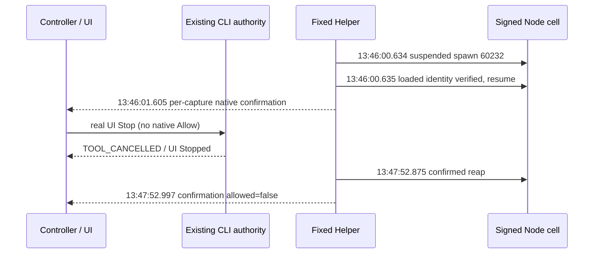

# arm64/macOS 单窗口截图默认启用（2026-10-31）

**本轮窄范围 PASS。** 用户授权将已测 self-use demo 默认启用；普通 darwin/arm64 构建无需 CUA opt-in 环境变量即可装配固定资源、编译 Host profile。原生逐次确认、UI Stop、既有 authority/lease 与进程结构不变。先前报告的“默认启用 BLOCKED”是历史状态，本轮仅在此窄范围取代该结论。

## 实现与审查

- DeepSeek 路由已由 `routes` 实际核实：`deepseek-flash` / name `deepseek` / provider `magpie` / model `group/deepseek`。调查 worker 为 read-only，实现 worker 为 workspace-write，cwd 均为本仓库，无 UI grant。完整 ID 见 [worker-ids.json](evidence/worker-ids.json)。
- 先更新 spec、验收场景和收尾计划，再补测试与实现。增量为 7 个修改文件和 2 个新文件，见 [changed-files.json](evidence/changed-files.json)。controller 亲自审查最终 diff、执行检查、构建、打包及 UI smoke。审查发现的 tsup 配置打包重定位问题已由 worker 修复为现有 absolute-URL 动态加载方式，并补回归。
- 共享构建选择器把已测 manifest/startup snapshot 接入 `tsup`、`electron-builder` 和普通 `bundle:desktop`。继续执行真实资源/签名验证，缺少或损坏默认资源显式构建失败；显式输入覆盖仍保留。运行时原有匹配门和回退不变。
- 范围仍限 arm64 / macOS 26.6.2、本仓库 allowlist、已测 DeepSeek startup/network profile。未扩大鼠标键盘能力；通用 producer 的 `zcodeCuaPlaceholder:true` 不负责该单窗口截图链，未翻转它。
- runtime/native/CLI 源码与此前冻结一致；Helper、Node 实际 bytes 和可信身份保持不变，无证书、TCC 或工具链变更。普通完整 Host 保留；Host 来源可信性缺口继续保留。

## 独立检查与构建

Node 24.14.0；freshness PASS（ahead 32 / behind 0）。所有命令、耗时、退出码和完整日志见 [independent-checks](evidence/independent-checks)。

| 层次 | 本轮结果 |
| --- | --- |
| 模拟/单元 | node:test 12/12；5 个 Vitest 文件 36/36，共 48 项通过 |
| 静态检查 | `pnpm typecheck` PASS；`pnpm lint` 301 warnings / 0 errors；`pnpm architecture:check --changed` 0 violations；`git diff --check` PASS |
| 编译 | 普通 `build:no-runtime-assets` PASS（20.740s），未重编译 native |
| 正式装配路径 | 普通 `bundle:desktop --os mac --arch arm64 --skip-prepare --skip-build --dry-run` PASS；真实 electron-builder dir pack PASS（92.083s） |
| 资源/签名 | afterPack、afterSign 验证通过；包内精确 manifest、可达 Host profile chunk、asar integrity 及 Helper/Node strict codesign 独立核对通过 |

第一次 build/Vitest 因本地既有嵌套 esbuild 0.27.7 缺文件失败，日志原样保留；仅从本机完整的同版本副本恢复缺失文件后，失败项重跑通过。未改 package.json、lock 或版本，见 [local-esbuild-repair.json](evidence/local-esbuild-repair.json)。

实际装配产物：`output/cua-arm64-default-enable/ordinary-app/mac-arm64/Zody Preview.app`。Preview identity 仅避免干扰正在运行的安装版；未设置 CUA opt-in 或 candidate native Host launch。外层 Electron 使用本地测试打包配置；可信 Helper/Node 继续固定 local-self-signed，不以外层测试签名冒充可信身份。摘要见 [packaged-default-verification.json](evidence/packaged-default-verification.json)。

## 实际 UI smoke

重新识别 main 58923、完整 Host 59359、relay 59385、LaunchServices Helper 59428、signed CLI 59429；重新识别受控 TextEdit PID 40077 / window 89384。普通 Host 实际日志显示默认选择 `screenshot.single-window`，见 [default-runtime-startup.log](evidence/default-runtime-startup.log)。

本次直接观察原生确认框与正确受控目标；controller 点击产品 UI Stop，ledger 为 `cancelled_by_user=1` / `TOOL_CANCELLED`，cell 已 reap，未批准或交付图像。仅为**确认阶段 Stop smoke**，没有冒称新的 OS 在途截图实测。原生事件见 [smoke-native-events.log](evidence/smoke-native-events.log)，独立只读 ledger 见 [smoke-tool-ledger.json](evidence/smoke-tool-ledger.json)，controller 观测事实见 [acceptance-facts.json](evidence/acceptance-facts.json)。退出后本次已识别角色均不存在，用户原安装版仍在运行；不扩称所有后代退出保证。

真实单窗口 PNG 与 actual OS completion-held 后的 Stop 使用[前轮独立验收](../2026-10-31-arm64-screenshot-stop/ACCEPTANCE.md)：生产 PNG 为 1172×976 / 108925 bytes；在途 Stop 已观察 held completion discard、cell reap 和 lease release。本轮只改变构建选择，相关源码与签名二进制未变，因此不重复要求用户原生批准、不扩大验证矩阵。native Fenced、完整 Phase 1 等旧缺口仍按前轮记录保留，不作为此次自用默认启用的新门槛。

## 冻结与复核

- 开工时前轮 4275 个文件均匹配，保留全部原有未提交改动；本轮仅上述 9 个增量文件。根 package/lock 摘要未变。
- 新冻结 `output/cua-arm64-default-enable/frozen-default-final/`：4277 个 source 文件；`source-sha256.json` 摘要 `52dfd1bc7e9d53ba1c8e2ffe0fed042e4494ee398ac030041e575ce3742c9c7d`（源文件清单摘要，不是 Rust 冻结树摘要）。
- [source-and-patch.tar.gz](evidence/source-and-patch.tar.gz) 保存完整冻结源码、本轮增量 patch 和完整工作树 tracked diff；4280 个文件成员逐一复核，0 mismatch。
- archive SHA-256：`f98f6b44035371916d985dd3e4b5dab1d1d1cf2124b2f81b3572bf6ee1a671bc`；[证据清单](evidence/sha256.json) 覆盖 48 个文件，复核结果见 [archive-verification.json](archive-verification.json)。旧冻结和报告只读。
