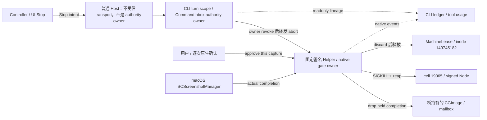
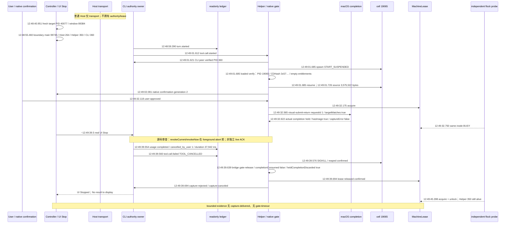

# macOS CUA arm64 在途 Stop 验收（2026-10-31）

状态：**本轮已批准的 arm64/macOS 窄范围完成**。真实单窗口截图的 actual OS completion 已在消费/交付前 held，用户完成逐次原生确认后，由 controller 点击真实 UI Stop 取消；held completion 被丢弃、cell 已 reaped、machine lease 已释放，且无 capture-delivered/gate-timeout。该结论只覆盖本轮批准窄范围；**整体 Phase 1 与默认启用未通过（BLOCKED）**，见保留缺口。

## Provenance 与范围

- verified route：`routeVerifiedFromRoutes=deepseek-flash`、`routeName=deepseek`、`provider=magpie`、`model=group/deepseek`、`backend=app_server`；access 为 `workspace-write`，CUA grant 为 `false`。
- 本轮 readonly lineage：`sessionId=sess_ad74841c-d28f-4fd1-92d1-665ec3831688`、`turnId=turn_ac225e36-7a75-4370-827d-9932b737415e`、`toolCallId=call_00_bNYR3HbKozBkt7DfVxs77644`。
- Worker ID 取自 `output/cua-arm64-screenshot-product/broker-dispatch-provenance.json`：

| role | exact broker ID |
| --- | --- |
| `reportWorker` | `broker:deepseek-flash-rw-ec6bf2fd7be1a108:01a18d81-c662-7252-bf8e-dc961bb1e948` |
| `hostPackagingAndAuditWorker` | `broker:deepseek-flash-rw-ec6bf2fd7be1a108:01a18d85-0a94-7153-8dec-4d8ce186ab96` |
| `cellImplementationPriorWorker` | `broker:deepseek-flash-rw-ec6bf2fd7be1a108:01a18d85-b240-7390-875a-7fd2a92d04ad` |
| `stopImplementationPriorWorker` | `broker:deepseek-flash-rw-ec6bf2fd7be1a108:01a18d86-25a4-7961-bb9e-18f16365c014` |

- Actual Stop retry 与独立检查由 controller 执行（provenance 记录 `controllerReviewedDiffAndRanIndependentChecks: true`）。
- 旧输出、旧 `2026-10-31-arm64-screenshot-product` 报告与既有冻结树只读；本轮证据根为 `output/cua-arm64-screenshot-stop-2026-10-31/`。

## Owner 图

普通 Host 只负责既有 transport；`hostInstanceId`/`runtimeInstanceId` 不构成授权。Native gate 持有的是真实 OS completion 与真实 CGImage，不是 fake/pre-admission gate，不是合成 frame，也不是 OS 内部停止屏障。

## 时间顺序

## 窄范围结论

- **PASS（仅本轮批准窄范围）**：真实单窗口 PNG 链路此前已成功（`1172x976`、`108925` bytes、SHA-256 `e1bca9e1…`）；本轮 live retry 在真实 submit 返回后持有 actual OS completion（`hasImage=true`），UI Stop 发生在 completion 消费/交付前，`heldCompletionDiscarded=true`、`completionConsumed=false`、`noCaptureDelivered=true`，随后 lease 释放且有实际 inode 复核。`acceptance-facts` 另记录 UI `Stopped; No result to display`、`uiExecutionCodeMatchesFreshTarget=true`、`cellNoLongerPresent=true`。
- **不是 instant stop / native Fence**：CLI cancellation 先到（usage `39.554`、ledger failed `39.560`），cell reap 在 `39.576`、gate discard 在 `39.639`、lease release 在 `39.694`。因此不声明即时停止、nativeFence、硬 SLA 或所有后代退出。
- **callback release 证据有限**：没有单独的 actual `callbackReleased` receipt/log。可声明的是源码审计的 guarded path 在 release/destroy 未确认时不释放 lease（`capture_owner.mm` 的 `wait_callback_release`/`cua_r11_visual_destroy` 与 `session_supervisor.mm` 的 `resources_released` 分支），再叠加本轮观测到的 gate discard 与 confirmed lease release；不得写成独立 callback receipt。
- **owner 撤销顺序来自源码审计**：真实 UI Stop 使用 `runtime-command-queue.ts::stopActiveForegroundExecution`，先调用 `CuaSubmissionCoordinator.revokeCurrent("user-stop")`，其同步复用唯一 `CuaSubmissionAuthority.revokeNow`，然后才调用当前 foreground controller 的 `abort`；本轮没有导出的独立 authority ref/ACK snapshot，故只把该顺序记为代码审计事实，并与 UI/native/ledger 观测分账。
- cell `19065` 的 suspended → loaded verify → resume、source `3,575,522` bytes、SIGKILL/reap 均有真实事件；handler/Helper 在 lease 释放后仍存活，未被错误终止。

## 产品与审计增量

- 先前 `controller-normal-host-production` 的真实 PNG 正例保持有效；最新 `controller-normal-host-production-audit` 仅以 production manifest 重建 PASS `30.511s`，**未启动、无新截图**，是 build/log-only 增量。
- 当前 diagnostic-audit 使用同一 Host 的新 source，实际 main `99745`、Host `264`、Helper `350`、signed CLI `360`；fresh target 为 TextEdit PID `40077` / window `89384`。
- 本轮 Stop 的 actual cell 为 `19065`，loaded verify 是 native audit；前轮 controller 的直接 SecCode 身份探针对应 cell `990`，不混记为 `19065` 的独立探针。独立 OS flock probe 为同一 lock inode `149745182`。TCC 观测的实际请求者为 Helper PID `350`、identifier `io.github.zclaudia.zody.cua-helper`。
- root 上一轮已有 `177` 项测试、typecheck、lint `301 warnings/0 errors`、architecture `0 violations` 通过；本轮未重跑测试/构建。文档修改前 `4275` 个 source 文件与清单 SHA-256 `98a35c35cbd050e7c7d778720777d5a017965b6eabc153d0f78e8400b0868c4d` 匹配；controller 已完成 status-doc 最终 diff 审查、源码冻结和逐成员证据核对，见下节。

## 保留历史失败与完整阻断

- 历史失败不重写：先前截图请求的 `120033 ms` timeout、diagnostic attempt #1 的 native confirmation `120s` timeout，均保持 **NOT PASS**；不能因本轮新 lineage 成功而追认通过。
- **整体 Phase 1 / 默认启用仍 BLOCKED**：普通 Host 可伪造来源缺口、D06/OS/env sandbox、native input Fenced、all-descendants 退出、6 项 JS license missing（不构成法律采纳）、Intel/minOS/upgrade TCC、完整 CLI 兼容性均未关闭。
- 默认仍禁用：`zcodeCuaPlaceholder:true`、`productDefaultDisabled:true`；本轮不改变 flags、授权、进程结构或默认启用状态。
- 源码已独立冻结；完整 Phase 1 / 默认启用仍未通过。

## 证据索引

- `output/cua-arm64-screenshot-stop-2026-10-31/opening.json`
- `output/cua-arm64-screenshot-stop-2026-10-31/live-evidence/acceptance-facts.json`
- `output/cua-arm64-screenshot-stop-2026-10-31/live-evidence/boundary.json`
- `output/cua-arm64-screenshot-stop-2026-10-31/live-evidence/fresh-target.json`
- `output/cua-arm64-screenshot-stop-2026-10-31/live-evidence/opening-processes.json`
- `output/cua-arm64-screenshot-stop-2026-10-31/live-evidence/lease-held-before-stop.json`
- `output/cua-arm64-screenshot-stop-2026-10-31/live-evidence/lease-after-stop.json`
- `output/cua-arm64-screenshot-stop-2026-10-31/live-evidence/tool-usage.json`
- `output/cua-arm64-screenshot-stop-2026-10-31/live-evidence/cli-turn-tool-events.jsonl`
- `output/cua-arm64-screenshot-stop-2026-10-31/live-evidence/native-and-stop-events-final.log`
- `output/cua-arm64-screenshot-stop-2026-10-31/live-evidence/tcc-subject-filtered.log`
- `output/cua-arm64-screenshot-stop-2026-10-31/live-evidence/tcc-subject-summary.json`

## Controller 最终冻结与核对

- 本次未改实现代码，仅修改两份 status 文档。4275 个源码文件重新冻结；清单 SHA-256 为 `e01cf79931f8c493195f7b01765cb76b8612fe6e74a8cac2ccb5ddd7d65454fe`（source-file manifest，不是 Rust frozen-tree 摘要）。源码压缩包 4275 个成员逐项 SHA-256 核对，0 mismatch。
- 当前 production-audit 与 diagnostic-audit 的每组 2091 个 workspace build input 引用（916 个不同源文件）与实际编译时记录完全一致，0 mismatch；因此复用上一轮通过的 177 项相关测试、typecheck、lint、architecture 结果，没有重复扩大验证矩阵。本轮 pinned Node 24.14.0 freshness 通过，ahead 32 / behind 0；最终 `git diff --check` 通过。
- [源码及差分](evidence/source-and-patch-stop-final.tar.gz) SHA-256 `535b9b95c843f8422ba13ba7eefbe91187e3d822a057c30498205097a0ab9eed`；[构建及 Stop 实测证据](evidence/build-and-stop-evidence.tar.gz) SHA-256 `eb7bb9f1ed26cd814493a3837dcc2b3bf027a821b6c950d2fe44926339572e9c`，68 个成员逐项核对，0 mismatch。完整索引见 [SHA256SUMS.json](evidence/SHA256SUMS.json)。
- 前轮报告、冻结清单和源码压缩包的 4 个只读 pin 均未改变。历史 PENDING/timeout 报告原样保留，由本报告提供此次新 lineage 的通过结论。
- 在 Helper 仍存活时完成 lease 释放验证后，controller 才退出本次专用候选；[退出观察](evidence/candidate-quit-observation.json) 单独记账，不用进程退出证明 Stop 释放，也不声称所有后代已退出。
