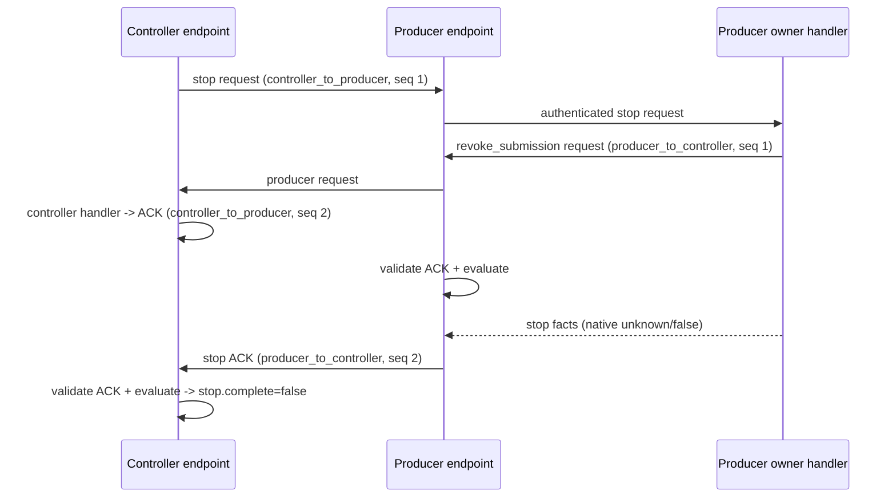

# CUA Control Channel（候选接线合同）

状态：**默认禁用、未接产品 launcher 的候选 endpoint**。本文件只描述 `@zcode/zcode-cua/control-channel` 的可信双工流接线规则。它不表示 Computer Use、Helper、TCC、签名身份、原生输入、MCU1、产品 launcher 或 OS 隔离已通过验收；`zcodeCuaPlaceholder` 与默认 executor 保持不变。

## 1. 范围与非目标

本 endpoint 接受调用方**已经连接**的 `Duplex`，只负责：

- 严格有界的 JSONL request/ACK 收发、分片与多帧处理、EOF/超限关闭。
- 复用 `@zcode/zcode-cua/control-protocol` 的严格 schema、Ed25519 验签、replay window 与 `evaluateControlAck`。
- 双向 request/ACK 关联、每方向共享序号、pending 登记、duplicate 去重与有界 ACK 缓存。
- 关闭锁存、pending 结算、owner 单次通知与迟到 handler 隔离。

明确不包含：密钥生成/签发/发现、环境变量或首包协商、socket 发现、握手、重连、持久化、原生 Helper 调用、产品 launcher 接入、UI 或自动激活。私钥、公钥 trust map、完整 binding 与本端 role 必须由可信启动代码显式注入。

producer 侧的业务 handler 见 [PRODUCER-CONTROL.md](./PRODUCER-CONTROL.md)：它只处理已认证的
`revoke_submission` / `stop`，并且在没有 Helper 时绝不会把投影 close 冒充 native fence。

## 2. 公共 API

```ts
const channel = createControlChannel({
  duplex, // 已连接标准 Node Duplex，要求 emitClose 语义
  role, // "controller" | "producer"
  binding, // 完整 channelId + 三个 incarnation
  keyId, // 本端签名 keyId
  privateKey, // 内存 Ed25519 私钥
  trustedKeys, // 对端 keyId -> Ed25519 公钥
  onRequest, // 已认证 request -> { phase, facts }
  onClosed, // 可选，关闭后调用一次
  replayWindowSize, // 默认 64，范围 1..1024
  maxPendingRequests, // 本端等待 ACK 的请求上限，默认 32
  maxIncomingRequests, // 并发 handler 上限，默认 32
  maxAckCache, // duplicate request 的 ACK 缓存上限，默认 64
  maxFrameBytes, // 单个 JSONL frame 上限，默认 64 KiB + 8 KiB
  maxOutboundBytes, // 待写队列字节上限，默认 256 KiB
  requestTimeoutMs, // 默认 30000；超时关闭，绝不当作成功
});
```

`channel.request({ operation, submissionLineageId, authorizationRevision, signal? })` 返回：

```ts
{
  messageId,
  sequence,
  ack: VerifiedControlEnvelope<ControlAckBody>,
  evaluation: ControlAckEvaluation,
}
```

`ACK` 已通过严格 schema、验签、方向/binding 与 replay 校验；`evaluation` 只来自纯协议 `evaluateControlAck`。endpoint 不补充 `nativeFenced`、`pending`、`ownedInputsReleased`、`leaseReleased`、`admissionClosed`、`projectionApplied` 或 `authorizationRevoked`；这些事实必须由 owner handler 或对端真实回执提供。没有原生 Helper 时 handler 应保持 native 事实为 `false`/unknown，因此 `stop.complete` 必须为 `false`。

`onRequest(request)` 收到 `{ body, keyId, digest, signal }`，必须同步或异步返回 `{ phase, facts }`。endpoint 用本端 keyId、完整 binding、对端 request 的关联字段与新的本端发送序号构造并签名 ACK。handler 抛错、返回非法形状或关闭后才完成时，不发送 ACK 且关闭连接。

`channel.close()` / `channel.dispose()` 返回 `Promise<void>`，幂等。`onClosed(event)` 只调用一次，随后 pending request 全部 reject、迟到 handler 失效。`requestTimeoutMs`、`AbortSignal`、连接 EOF/错误、非法帧/签名/绑定/关联/序号冲突都会 fail closed；不存在 timeout 成功路径。

构造时拒绝普通 `emitClose: false` 或缺少标准 readable/writable state 的伪 Duplex；`net.Socket` 因其自带真实 close 语义单独允许。关闭先同步锁存、reject pending 并通知 owner，再调用 `destroy()` 并等待真实 `close` 事件；已 `closed` 的流立即完成。`destroy()` 抛错时 close 结果 reject，不把物理关闭失败报告为完成；内部触发的关闭会自行吞掉该 rejection，避免 unhandled rejection，但显式 `close()`/`dispose()` 仍返回 reject。

## 3. 状态 owner 与顺序

| 事实                                        | owner                 | endpoint 行为                                                         |
| ------------------------------------------- | --------------------- | --------------------------------------------------------------------- |
| 业务 projection、撤销投影、native stop 事实 | 调用方 handler / 对端 | 原样进入 ACK，不推断、不代填                                          |
| 本端私钥与对端信任根                        | 调用方构造参数        | 构造时复制/规范化；拒绝私钥材料进入 trust map                         |
| binding / incarnation                       | 调用方构造参数        | 通过 replay window 严格规范化并冻结；之后参数对象变更不影响 channel   |
| 本端发送序号                                | endpoint              | request 与 ACK 共用同一方向 counter                                   |
| 入站 replay 水位                            | endpoint              | 每 channel、每入站方向一份，仅 exact 推进                             |
| pending request                             | endpoint              | 登记后才发送；ACK/close/abort/timeout 恰好结算一次                    |
| duplicate handler 去重                      | endpoint              | 复用有界 ACK 缓存，不再次调用 handler                                 |
| close 锁存与 owner 通知                     | endpoint              | 先锁存，再 reject pending + reject/handler abort，最后通知 owner 一次 |



handler 并发启动，不经过单一串行队列；一个方向等待对方 ACK 时，另一端仍可处理入站 request/ACK。入站 ACK 的处理不会等待任何业务 handler。

候选 producer owner 的接线方式是 `onRequest: owner.onRequest`、`onClosed: () => owner.close()`；
它自身的状态、容量、stale/close 与 stop 真值规则以 [PRODUCER-CONTROL.md](./PRODUCER-CONTROL.md)
为准。endpoint 仍负责验签、replay、去重与关闭锁存，owner 不复制这些协议状态。

## 4. Framing 与上限

- 每帧是 UTF-8 JSON envelope + 单个 `\n`；允许任意分片和单 chunk 多帧。
- 单帧超过 `maxFrameBytes`、非法 UTF-8、空帧、非法 JSON、非法 schema 或一 chunk 超过固定帧数上限即关闭。
- EOF 时仍有不完整帧视为协议错误；干净 EOF 为 `peer_eof`。
- 写入通过单一有界队列与 `drain` 背压推进；待写字节超过 `maxOutboundBytes` 即关闭。
- 本端 pending request 达到 `maxPendingRequests` 时拒绝新请求且不消耗序号；入站并发 handler 达到 `maxIncomingRequests` 时关闭。
- duplicate request 不重复 handler；缓存 ACK 有界，缓存淘汰后的 duplicate 直接关闭而不是重跑 handler。
- 相同 seq 不同完整签名 body 判 conflict；跳号/过期判 stale；两者都关闭。

## 5. 关闭规则

以下情况立即锁存关闭：

- 调用方 `close()`/`dispose()`、`AbortSignal` 取消已发送请求、`requestTimeoutMs` 到期。
- Duplex EOF/error/close、写队列溢出发送失败。
- 验签、direction/binding、schema、replay conflict/stale、ACK 错关联、非法 handler 结果或 handler 异常。

关闭后：

1. 不再接受新 request。
2. 中止 handler signal，迟到 handler 结果被丢弃，不签名/不写 ACK。
3. 所有 pending request reject，且只 reject 一次。
4. `onClosed` 只调用一次。
5. 不重新开放旧 binding/incarnation，不重连，不重放旧 pending。

## 6. 验收案例（本切片真实执行）

| ID    | 场景                                                                                    | oracle                                                 |
| ----- | --------------------------------------------------------------------------------------- | ------------------------------------------------------ |
| CC-01 | 真实 spawn 子进程 + loopback socket，controller 发 stop，producer handler 内反向 revoke | 双向并发完成、各自 ACK 验签、无死锁                    |
| CC-02 | handler 报告 projection/revoked 但 native 事实 unknown/false                            | `stop.complete === false`，不自动 Fenced               |
| CC-03 | 双向 request/ACK 共享每方向序号                                                         | 同方向 request 与 ACK 序号连续、无跳号                 |
| CC-04 | 分片、单 chunk 多帧、EOF 半帧                                                           | 前两者正常；半帧关闭且 pending settle                  |
| CC-05 | 超长 frame、非法 JSON/UTF-8、篡改签名                                                   | 关闭并通知 owner 一次                                  |
| CC-06 | duplicate request / 相同 seq 冲突 / stale / ACK 错关联                                  | duplicate 不重复 handler、缓存 ACK；其余关闭           |
| CC-07 | kill 子进程、socket 断开、dispose、abort                                                | pending Promise settle，onClosed 一次，socket 真实关闭 |
| CC-08 | pending 容量、写队列容量                                                                | 有界拒绝/关闭，无无界增长                              |
| CC-09 | 迟到的异步 handler                                                                      | 关闭后不写 ACK、不复活、不二次通知                     |
| CC-10 | handler 抛错/非法结果                                                                   | fail closed，不产生成功 ACK                            |

所有案例只证明显式启动绑定与传输规则；不证明产品 launcher、OS 隔离、Helper、TCC 或原生 fence。
