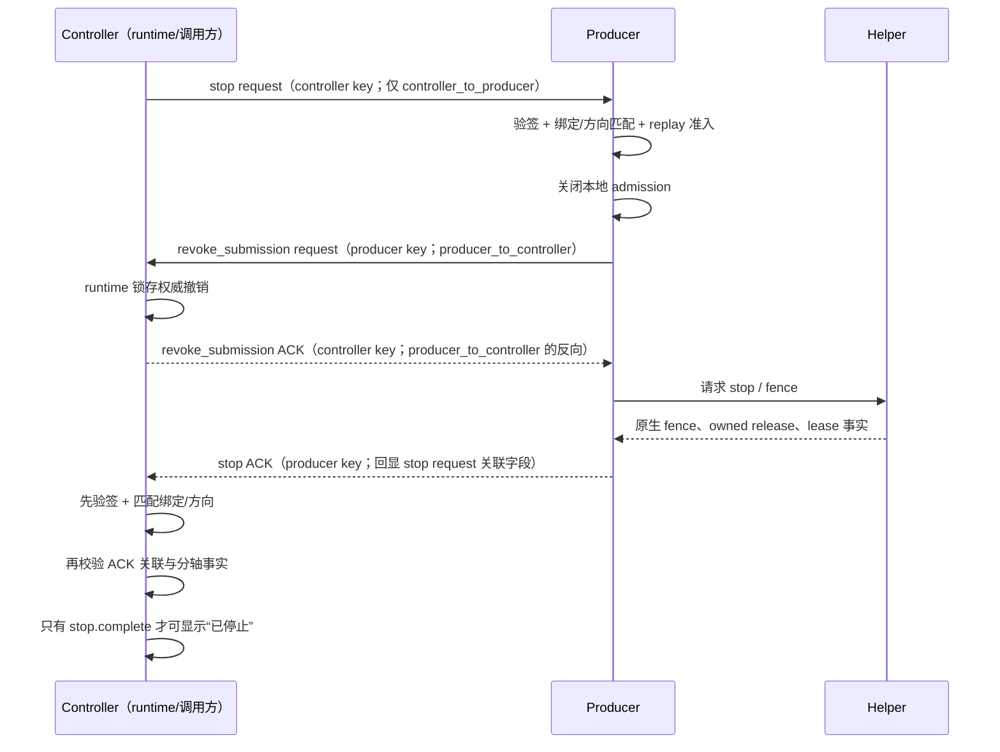
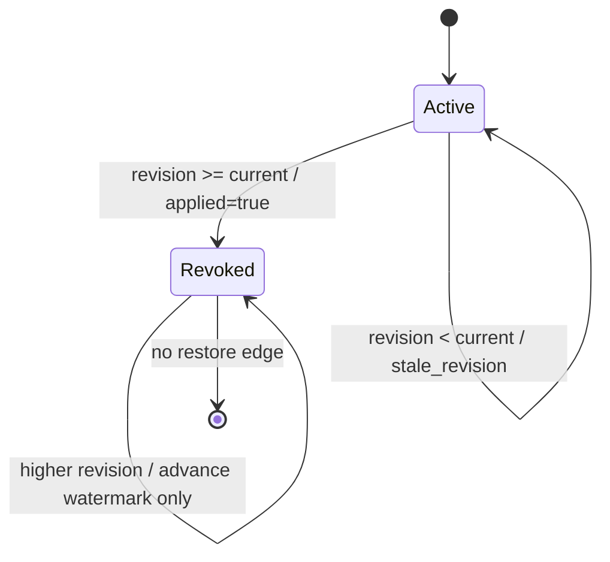

# CUA Control Protocol（候选合同）

状态：**默认禁用、未接线的纯协议合同**。本文件只描述 `@zcode/zcode-cua/control-protocol` 的数据形状与纯函数规则，不表示 Computer Use、Helper、TCC、签名身份、原生输入或 MCU1 已通过验收。当前有效签名身份为 0，P0 仍 blocked；包内 placeholder 保持不变。

## 1. 范围与非目标

本切片提供：

- 严格、嵌套、有界的 request/ACK schema。
- domain-separated canonical JSON 的 SHA-256 digest 与 Ed25519 签名/验证。
- 显式 `keyId -> public key` 信任映射，签名覆盖 `keyId`。
- `channelId / controllerIncarnation / producerIncarnation / appIncarnation` 绑定与方向校验；incarnation 是非空不透明字符串，与 runtime authority 的 UUID/string 对齐，不当作可重置的递增整数。
- request/ACK 的 `messageId / sequence / payloadDigest / lineage / revision` 关联。
- 有限 replay window：仅 `lastSequence + 1` 可推进；窗口内以完整已签名 body digest 判断 duplicate/conflict；窗口外或跳号判 stale；窗口绑定 channel binding 与 direction。
- 单调撤销规则。
- 分离的 projection / revoked / stop ACK 事实判定；stop 成功需全部必要条件成立。

明确不包含：transport、socket、timer、环境变量、全局 store、持久化、Helper/原生调用、真实输入、密钥生成或身份签发。协议函数只接受调用方已有的 `KeyObject`/PEM/DER 公钥和显式信任映射。

## 2. 唯一 owner 与事件顺序

| 事实                          | owner            | 本协议的责任                                                                                                                                                              |
| ----------------------------- | ---------------- | ------------------------------------------------------------------------------------------------------------------------------------------------------------------------- |
| 用户提交资格与撤销            | 可信 CLI runtime | `revoke_submission` 可由 runtime 发往 producer，也可由 producer 发往 runtime；请求携带 `submissionLineageId` 与正安全整数 `authorizationRevision`；协议只给单调撤销纯规则 |
| producer 准入投影             | producer         | ACK 报告 `admissionClosed`、`projectionApplied`；不能签发资格                                                                                                             |
| 原生 gate、owned 输入与 lease | Helper           | ACK 报告 `nativeFenced`、`pending`、`ownedInputsReleased`、`leaseReleased`                                                                                                |
| 签名身份信任                  | 调用方           | 通过显式 `trustedKeys` 传入；协议不使用默认密钥、不读取环境或磁盘                                                                                                         |
| replay 水位                   | 调用方持有并传回 | 每 channel + binding + direction 一份；协议函数不保存全局状态，只返回下一状态                                                                                             |



验证顺序是合同的一部分：**strict schema → keyId 信任映射 → Ed25519 验签 → 方向/绑定匹配 → 按该 binding+direction 的 replay 准入 → ACK 关联 → 分轴事实判定**。任何一步失败都必须 fail-closed；不得先读 `phase` 或 facts 再补验签。

## 3. 消息形状

### 3.1 Envelope

```text
{
  protocol: "zody.cua.control",
  version: 1,
  body: RequestBody | AckBody,
  signature: base64url(64-byte Ed25519 signature)
}
```

`signature` 是唯一的非 body 字段；`keyId` 在已签名 body 内，不存在未签名的发送者身份字段。

### 3.2 Binding

```text
{
  channelId: string,
  controllerIncarnation: non-empty opaque string,
  producerIncarnation: non-empty opaque string,
  appIncarnation: non-empty opaque string
}
```

incarnation 不解析、不排序、不转换成数字；它必须与 runtime authority 提供的 UUID/string 一致。request 与 ACK 的 binding 必须逐字段相等，并同时匹配调用方传入的 expected binding。只匹配其中一项不构成有效绑定。

### 3.3 RequestBody

```text
{
  keyId: string,
  kind: "request",
  direction: "controller_to_producer" | "producer_to_controller",
  binding: Binding,
  messageId: string,
  sequence: positive safe integer,
  submissionLineageId: string,
  authorizationRevision: positive safe integer,
  payload: { operation: "revoke_submission" | "stop" },
  payloadDigest: hex64(digestControlPayload(payload))
}
```

方向与 operation 的组合是封闭的：

- `stop` 只允许 `controller_to_producer`（runtime/controller 发起，producer 执行）。
- `revoke_submission` 双向允许：runtime 可主动撤销；producer 在执行 stop 时先关闭本地准入，再向 runtime 请求权威撤销并等待 ACK。

### 3.4 AckBody

```text
{
  keyId: string,
  kind: "ack",
  direction: "controller_to_producer" | "producer_to_controller",
  binding: Binding,
  messageId: string,
  sequence: positive safe integer,
  replyToMessageId: string,
  replyToSequence: positive safe integer,
  replyToPayloadDigest: hex64,
  submissionLineageId: string,
  authorizationRevision: positive safe integer,
  phase: "admission_closed" | "projection_applied" | "revoked" |
         "stop_pending" | "fenced" | "drained" |
         "unknown" | "rejected" | "retained_fault",
  facts: {
    projection: { admissionClosed: boolean, projectionApplied: boolean },
    revoked: { authorizationRevoked: boolean },
    stop: null | {
      nativeFenced: boolean,
      pending: boolean,
      ownedInputsReleased: boolean,
      leaseReleased: boolean
    }
  }
}
```

ACK 的 direction 必须是 request 的反向；`controller_to_producer` 的 ACK 只能由 producer 发出，`producer_to_controller` 的 ACK 只能由 controller/runtime 发出。ACK 必须同时回显 `replyToMessageId`、`replyToSequence`、`replyToPayloadDigest`、`submissionLineageId`、`authorizationRevision`。仅检查 `phase`、仅检查 messageId 或仅检查 lineage 都不构成关联。

## 4. Canonical JSON、digest 与签名

- canonical 遍历只接受：`null`、boolean、安全整数（含负数，拒绝 `-0`）、字符串、dense array、原型为 `Object.prototype`/`null` 的 plain object。
- 拒绝 getter/setter、symbol key、不可枚举自有属性、继承属性、class 实例、Date/Map/Set/TypedArray、稀疏数组、循环引用和超限结构。
- object key 按 UTF-16 排序；数组保持顺序；不包含空白。
- 遍历时逐段累计 UTF-8 字节和节点数；object key 也计入字符串预算与总字节。达到任一预算立即停止，不先构造完整输出；重复引用形成的宽 DAG 也会被节点预算拒绝。
- 字符串按 UTF-8 计算字节数；canonical 输出有总字节与总节点上限。
- `digestControlPayload(value) = SHA-256("zody.cua.control.v1/digest\0" + canonicalJson(value))`，输出 64 位小写 hex。
- 签名输入为 `"zody.cua.control.v1/signature\0" + bodyDigest`。Ed25519 只签 body 的 canonical digest，不签 envelope 外层。
- `keyId` 位于 body 内并受签名保护。验证时必须用 body 的 `keyId` 在调用方传入的 `trustedKeys` 中查找公钥；缺失即拒绝，禁止默认 key、首 key 或未签名 hint。
- 私钥与 trust store 公钥都必须显式检查 `asymmetricKeyType === "ed25519"`；不能依赖 `sign(null, ...)` 的异常作为类型判断。trust store 拒绝私钥材料。

## 5. Replay window

状态只有 `windowSize`、`binding`、`direction`、`lastSequence`、以及最近 `windowSize` 条 `{ sequence, messageId, bodyDigest }`。`bodyDigest` 必须是 `verifyControlEnvelope` 对完整已签名 body 计算出的 digest；不是只覆盖 `{ operation }` 的 payload digest。每次准入都必须携带 binding+direction，且与窗口状态完全一致，否则拒绝（不能跨 channel、binding 或方向复用同一窗口）。replay records 使用独立的 1024 上限，不受通用 array 32 上限影响。规则：

| 条件                                             | 结果        | 状态                                |
| ------------------------------------------------ | ----------- | ----------------------------------- |
| `sequence === lastSequence + 1`                  | `exact`     | 追加记录并裁剪，推进 `lastSequence` |
| 窗口内同一 sequence 且 messageId/bodyDigest 相同 | `duplicate` | 不推进，幂等                        |
| 窗口内同一 sequence 但 messageId/bodyDigest 不同 | `conflict`  | 不推进，拒绝                        |
| 已被窗口淘汰、或 `sequence > lastSequence + 1`   | `stale`     | 不推进，拒绝                        |

`sequence` 必须是从 1 开始的正安全整数；窗口大小有固定上下界，调用方显式传入，`CONTROL_LIMITS.defaultReplayWindow` 为 64。`bodyDigest` 覆盖 keyId、direction、binding、lineage、revision、facts 等全部已签名字段，因此同 messageId/sequence/payloadDigest 但 lineage/revision/facts/keyId 改变的 body 必须判为 `conflict`。duplicate/conflict/stale 都不能产生新的状态推进。

## 6. 单调撤销

- 初始状态为 `{ submissionLineageId, authorizationRevision, revoked: false }`。
- `applyControlRevocation` 只允许 `revoked: false -> true`；不存在恢复函数。
- revision 小于当前值返回 `stale_revision`，不改变状态。
- 已撤销后再收到同 revision 或更高 revision，保持 `revoked: true`；更高 revision 只推进 revision 水位，不解除撤销。
- lineage 不匹配、revision 非正安全整数或状态非法时抛错，不返回“未撤销”。



## 7. ACK 事实判定

`evaluateControlAck` 在已验签、已匹配绑定并已通过 replay 准入的 body 上工作，分别返回三个轴：

- `projection`：`admissionClosed`、`projectionApplied`、`complete`。
- `revoked`：`authorizationRevoked`、`complete`。
- `stop`：仅 stop request 适用；返回 `nativeFenced`、`pending`、`ownedInputsReleased`、`leaseReleased`、`complete`、`reasons`。

`phase` 为 `unknown`、`rejected`、`retained_fault` 时，三个轴的 `complete` 都必须为 false，即使 facts 声称成功。stop 还需 phase 为 `fenced` 或 `drained`。

stop 的 `complete` 仅在以下全部成立时为 true：

1. `admissionClosed === true`
2. `projectionApplied === true`
3. `authorizationRevoked === true`
4. `nativeFenced === true`
5. `pending === false`
6. `ownedInputsReleased === true`
7. `leaseReleased === true`

缺少 `facts.stop`、缺少任一字段、字段非 boolean 或出现额外字段都拒绝。单独的 ACK、单独 Fenced、单独 projection 关闭都不能构成 stop 成功。

## 8. 有界参数

| 限制                    | 值                  |
| ----------------------- | ------------------- |
| canonical 最大字节      | 64 KiB              |
| canonical 最大节点      | 4096                |
| 最大嵌套深度            | 8                   |
| 单字符串最大 UTF-8 字节 | 4096                |
| identifier 最大字节     | 256                 |
| 最大 object key 数      | 64                  |
| 最大 array 长度         | 32                  |
| replay records 最大数   | 1024                |
| replay window           | 1–1024；默认常量 64 |

超出限制、非整数、非安全整数、`NaN`/`Infinity`、`-0`、非 plain object、getter 或循环引用一律拒绝。

## 9. 接线边界

当前没有 transport、Helper、runtime、socket、存储或 UI 接入；producer 侧只提供默认禁用的
[窄 control owner](./PRODUCER-CONTROL.md) 候选，尚未接入产品 launcher。没有密钥生成、信任根或
身份注册；没有真实原生输入、TCC、签名、Helper 生命周期或 MCU1 验收。调用方未来接线时必须
自行保证：

- 每个方向只传入该方向受信的公钥映射。
- 先完成验签与绑定匹配，再调用 ACK 关联/事实判定。
- replay 状态由该 channel 的唯一 owner 持有，不能跨 channel 共享。
- runtime 的撤销事实仍是权威；本协议的 `authorizationRevoked` 只是 ACK 中的执行投影，不是资格签发。
