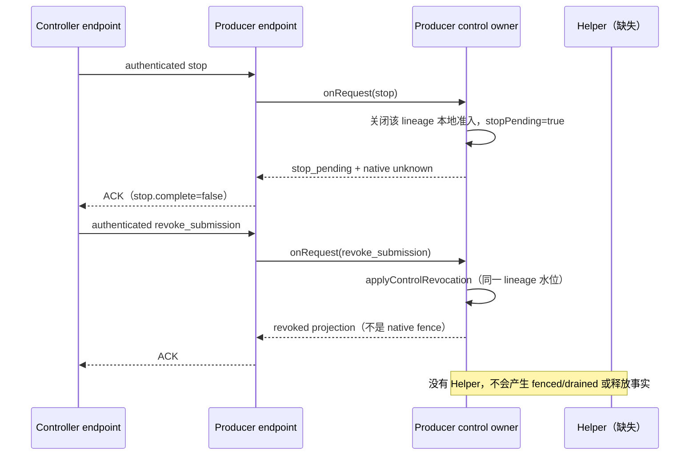

# CUA Producer Control Owner（候选接线合同）

状态：**已接第三轮 control-only 诊断 launcher，未接可执行产品链路的候选 owner**。本文件只描述
`@zcode/zcode-cua/producer-control` 的窄 handler 与只读投影。它不表示 Computer Use、
Helper、TCC、签名身份、原生输入、MCU1、产品 launcher 或 OS 隔离已通过验收；
`zcodeCuaPlaceholder` 与默认 executor 保持不变。

## 1. 范围与非目标

本模块由第三轮 control-only launcher 按如下方式接入，不自行创建 key、socket、Helper 或系统权限：

```ts
const owner = createProducerControlOwner({ maxLineages: 256 });
const channel = createControlChannel({
  // ...
  onRequest: owner.onRequest,
  onClosed: () => owner.close(),
});
```

它只处理 `createControlChannel` 在完成严格 schema、Ed25519 验签、方向/binding 与 replay
准入后交给 `onRequest` 的 `revoke_submission` / `stop`。owner 自己不是认证边界；直接调用
handler 的调用方必须已经持有同等级的可信事实。

明确不包含：密钥/信任根、transport、socket 发现、握手、重连、持久化、Helper 调用、原生
fence/drain、owned input 释放、lease 释放、产品 launcher、模型工具或自动激活。没有用于写入
`nativeFenced`、`pending`、`ownedInputsReleased`、`leaseReleased` 或任意 native receipt 的
公开接口。

## 2. 状态 owner 与顺序

| 事实                                                | owner                  | 本模块行为                                                                 |
| --------------------------------------------------- | ---------------------- | -------------------------------------------------------------------------- |
| 每个 lineage 的撤销水位、本地准入关闭、stop pending | 本 owner（单实例内存） | 只由已认证 handler 更新，不驱逐 tombstone                                  |
| runtime 权威撤销                                    | runtime authority      | 只把已认证 `revoke_submission` 记录为本地撤销事实；不从 stop/关闭/投影反推 |
| 原生 fence、owned input、lease                      | Helper（当前缺失）     | 永远报告 unknown/false；不提供写入路径                                     |
| channel/binding/replay/去重                         | control endpoint       | owner 不复制、不缓存协议状态                                               |



## 3. 规则

- `revoke_submission` 复用 `control-protocol` 的 `createControlRevocation` /
  `applyControlRevocation`。同 revision 或多个更高 revision 保持 `revoked: true`；更高
  revision 只推进水位，不存在恢复边。
- 每个 lineage 分别记录 `observedRevision` 与撤销证据 revision。已认证 `stop` 可推进
  `observedRevision`，但不会生成撤销证据；例如先 `revoke rev2` 再 `stop rev5` 时，stop ACK
  的 `authorizationRevoked` 必须为 false，不能在 rev5 上声称 runtime 已确认撤销。rev2 的
  sticky 撤销状态仍保留；随后 `revoke rev4` 因低于 observed watermark 被拒绝，不会被误接受。
- 旧 revision 返回 `phase: "rejected"`，不推进水位、不改变撤销/关闭状态；不会把更高
  revision 的撤销证据套到旧请求上，`evaluateControlAck` 的 phase 失败同时保证
  `revoked.complete === false`。
- 首次见到的 lineage 只有在容量允许时建立 tombstone；达到 `maxLineages` 后拒绝新 lineage，
  不驱逐旧 tombstone，并锁存全局 `admissionClosed`。容量拒绝同样 fail closed，不建立可复活
  状态；已有 lineage 的撤销仍可继续。
- `stop` 只关闭该 lineage 的本地准入并锁存 `stopPending`。没有 Helper 时必须返回：
  `phase: "stop_pending"`，`nativeFenced: false`、`pending: true`、
  `ownedInputsReleased: false`、`leaseReleased: false`。绝不返回 `fenced`/`drained`。
- `authorizationRevoked` 只来自本 owner 记录过的已认证 `revoke_submission`；stop、本地准入
  关闭、断连或诊断投影都不能把它推成 `true`。
- `close()`/`dispose()` 幂等，先锁存全局 `admissionClosed`，再把全部 lineage 标记为准入
  关闭并封闭新写入。关闭后直接调用 handler 只会得到 rejected 投影，不建立新 lineage；
  未知 lineage 的 rejected 投影不会声称该 revision 的 `projectionApplied`。连接断开的
  launcher 应把它接到 `onClosed`。
- `diagnostics()` 返回冻结快照，不包含密钥或可写句柄。`nativeHelper` 固定为
  `"unavailable"`、`nativeFence` 固定为 `"unknown"`、`executableAdmission` 固定为
  `false`、`candidateIsGrant` 固定为 `false`：candidate 不是 grant，当前没有可执行原生准入。

## 4. 验收案例（包内真实执行）

| ID    | 场景                                             | oracle                                                                          |
| ----- | ------------------------------------------------ | ------------------------------------------------------------------------------- |
| PC-01 | 真实 endpoint 收到两个相同已签名 request（重送） | handler 只调用一次，ACK 复用，lineage 只一条                                    |
| PC-02 | 真实 endpoint 调 handler 撤销，重复逻辑请求      | 幂等撤销、水位不回退、终止不复活                                                |
| PC-03 | 旧 revision                                      | `phase=rejected`，`revoked.complete=false`，水位与 sticky 撤销保持              |
| PC-04 | lineage 容量                                     | 新 lineage 拒绝、全局准入锁存关闭，且不驱逐旧 tombstone                         |
| PC-05 | 真实断连触发 `onClosed -> close()`               | 全局与全部 lineage 准入关闭，后续 handler 拒绝且不新建                          |
| PC-06 | 无 Helper 的 stop                                | `stop_pending`，native 四字段固定 false/true/false/false，`stop.complete=false` |
| PC-07 | 同 revision 已认证 revoke 后 stop                | 撤销事实为 true，但 native 仍 unknown，stop 仍未完成                            |
| PC-08 | 伪造签名                                         | endpoint 关闭，owner handler 未被调用                                           |
| PC-09 | revoke rev2 后 stop rev5，再 revoke rev4         | rev5 stop 不声称 rev2 撤销证据；rev4 拒绝，rev2 sticky 撤销不丢                 |

这些案例只证明包内 handler/投影与真实 endpoint 接线，不证明产品 launcher、Helper、TCC、
系统输入、OS 隔离或原生 fence。
