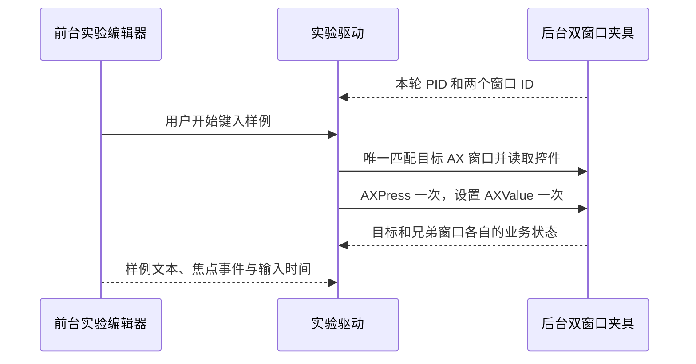

# macOS 后台 AX 并发实验

本实验验证二期选型，入口为独立构建的本地实验应用。用户在前台实验编辑器键入固定样例时，驱动在同名的后台双窗口中找到指定窗口、读控件、按一次按钮并设置一个字段。分别运行 AppKit 和 Electron 两组；使用临时测试数据。

| 所有者 | 职责 |
| --- | --- |
| 实验驱动 | 接收本轮夹具身份，依据 PID 与 CGWindowID 解析 AX 窗口，验证控件位于该窗口子树，只执行 AXPress 与 AXValue 写。失效、无权限、歧义和不可设均返回诊断。已可能派发的动作不得重试。 |
| 双窗口夹具 | 提供窗口编号和独立业务读回。两窗同名，目标和兄弟窗口分别记录点击数和字段值。Electron 用渲染端事件更新的模型值检验输入。 |
| 前台编辑器 | 从用户第一次输入开始记录键窗口与应用失焦事件、输入顺序和结束状态。通过真实键盘输入验证并发，头尾样例之间必须包含后台动作。 |
| 实验控制器 | 独立签名身份，检查自己的 AX 系统授权；一次运行只接受自己启动的测试目标。结束后关闭本轮子进程，输出结果和分项判据。 |



验收须同时满足正确目标变化一次、兄弟窗口不变、前台输入准确、测量期间零失焦，并有输入与动作时间交叉。任何必需信号缺失均不得报告通过。纯判定测试先覆盖短暂失焦后恢复、兄弟窗口改变、动作无效果和输入未跨越动作。AX 权限不足时先提供可复现的授权入口，不能据此推定产品 Helper 权限。探针产物存放在仓库 output 以外的本地实验目录。

## 运行与复核

从仓库根目录运行以下命令。构建使用本机 Xcode 命令行工具、仓库 Electron 和本地签名身份 `Zody Local Computer Use`。

```sh
packages/desktop/native/macos-cua-background-probe/build.sh
open "$HOME/Library/Application Support/Zody AX Probe/Zody AX Probe.app"
```

1. 点“辅助功能授权”，在系统设置中开启 **Zody AX Probe**。实验应用 identifier 为 `io.github.zclaudia.zody.ax-concurrency-probe`，与发行版 Helper 独立。
2. 选择“开始 AppKit”。待前台实验编辑器提示“开始键入”后，使用英文输入连续键入 `abcdefghijklmnopqrstuvwxyz`。第一键触发驱动；后台按完按钮后须再收到一键才写字段。事务结束后仍需收到至少一键。这里测的是两个动作与前台输入的交错。
3. 等待结果，选择“开始 Electron”重复。该夹具显式启用 Chromium 辅助功能，使用仓库 Electron 和每轮独立的用户目录。渲染端监听 input/change，因此仅有 AX 值回显无法通过。
4. 点“查看结果”。每轮在 `~/Library/Application Support/Zody AX Probe/runs/<UUID>/result.json` 保留窗口身份、前后业务快照、动作派发标记、前台逐键时间、失焦数和分项判定。以顶层 `passed` 为准，结合 `reason` 和 `verdict.checks` 区分输入样例不完整、目标未生效、驱动拒绝及焦点变化。无结果文件的轮次不能计为通过。

两组都通过也只覆盖这两个测试控件和当前系统版本。此轮观测键窗口和应用激活，不测剪贴板、光标、Space 或任意第三方应用的兼容性。编译阶段同时运行评分器对照测试。固定版 Rust 的纯窗口范围决策可在独立 crate 编译，12 个原测试通过；真实窗口匹配仍需要原生 AX/CG 映射。实验采用 ObjC++ 实现这一小段，生产实现的语言选型仍取决于真机结果及完整依赖闭包。

## 已执行结果

2026-11-11，AppKit 第二轮与 Electron 轮次通过本规格的全部判据。AppKit 首轮因前台字符轨迹不匹配样例而失败，目标操作正确且零失焦。全部三份 JSON 已独立复算，原始结果、候选二进制摘要与限制见[真机补充报告](../docs/cua/2026-11-10-macos-background-control-feasibility.md#2026-11-11-真机补充)。当前验证的是独立 ObjC++ 探针与原生/HTML 简单控件。
