# macOS Computer Use 首期集成规格

## 2026-10-31 App 内确认弹窗替代 Helper 原生 NSAlert（用户已批准）

本章为规格先行：把当前每次截图前由固定签名 Helper 弹原生 NSAlert（`packages/desktop/native/macos-cua-desktop-session/src/confirmation.mm`）逐次确认，替换为 Zody App 内确认弹窗，用户已批准该替换。本章是本轮唯一规则来源；对应测试先于行为实现，工作流与验收见 [实施计划](../docs/plans/computer-use-macos-phase1-arm64-screenshot.md) 末尾「App 内确认弹窗轮次」一节。

### 批准与范围

- 用户在 Zody App 弹窗中允许/拒绝，Helper 接收 App 经既有 authority 会话返回的决定并采信。用户明确接受本方案不抵御恶意 Host/UI：普通 Host 来源可信性缺口继续保留，本轮不新增任何可信性声明。
- Helper 仍负责实际截图；既有 submission authority、machine lease、frame owner、Stop、迟到结果丢弃与资源释放语义全部不变。macOS 系统屏幕录制权限不变；不新增证书、entitlement、系统权限、进程结构或 UI 关闭开关。
- 弹窗选项遵循既有工具权限策略（2026-10-31 用户修订，取代此前「恰两动作、不新增记住」的过度约束）：「允许本次截图」（allow_once，文案保留专用标签）/「总是允许（项目级持久规则）」（allow_always，经既有 suggestedPermissionUpdates 应答链落项目规则）/「拒绝」（deny），并在会话支持时提供 Full access（会话级免确认，走既有 grantPermissionFullAccess 链）。默认动作与 Esc 仍为拒绝；deny 仍是安全默认。
- 规则命中免交互：confirm 发起前先查既有 permission 规则（项目 allow 规则或会话 full access）；命中 allow 时免弹窗直接放行本次 confirm（helper 侧关联校验、决定后 check/lease/交付复核、Stop/迟到防护全部不变）；规则查询失败按未命中处理，仍走用户交互。
- 本次替换是逐次确认的呈现位置变化：不出现第二层重复弹窗——原生 NSAlert 移除，App 弹窗是唯一确认。

### wire 契约（authority 双工请求帧，复用现有 bootstrap/check 帧格式）

- Helper→CLI 新增 method `confirm`，payload：generation（正整数，进程内单调，同 ConfirmationState）、与 check 帧相同的完整关联字段（ref/traceId/producerIncarnation/runId/turnId）、target 展示事实 `{pid, windowId, layer, x, y, width, height, ownerName, windowName}`（有界字符串，ownerName/windowName 上限 128 字符）。
- CLI 响应 result 三类：用户允许 `{ok:true, allowed:true}`；用户取消/关闭弹窗 `{ok:true, allowed:false}`；CLI 侧拒绝/失败 `{ok:false, reason:"confirmation-unavailable"|"confirmation-invalid"|"confirmation-duplicate"|"confirmation-failed"}`。Helper 对 `ok:false` 一律 fail-closed 拒绝本次截图。

### CLI 侧合同

- `@zcode/adapters`（`apps/zcode-cli/packages/adapters`）的 authority contract/protocol：`CuaNativeAuthorityMethod` 增加 `"confirm"`；handleConfirm 前置校验：已 bootstrap、未 invalidated、关联字段与 scope 完全匹配（同 check 的严格程度）、generation 为正整数且未见过的值；同 generation 重复 → `confirmation-duplicate`，不二次请求用户。
- 确认请求必须发布合成 v4 `PermissionRequested` 事件（raw seq 0、仅 live 投影），结束/中止时发布 `PermissionResolved`，参照 MCP elicitation 的 ingest 先例；否则 v4 snapshot 无 pending interaction，PermissionDialog 不会出现。v4 投影把 allow_once 的 optionId/kind 投影为 `allowOnce` 且 `freeText` 恒 true、`detail=input`——UI 侧对 `cua_screenshot_confirm` 必须兼容该形状（optionId 双形状、忽略 freeText、raw.target 读取）并保持恰两动作与默认/Esc 拒绝。
- confirm 等待期间 authority wire 的逐行处理是串行 await：迟到 revoke/close 帧会排队到 confirm 应答之后被处理（延迟、不丢失）；Stop/取消经 capture signal → confirmRequest abort 立即解锁，不产生死锁。该时序为本轮已知行为，不宣称并行帧处理。
- 处理路径复用既有会话交互链路：bootstrap 的 `captureCuaRuntimeOnce` 为 authority session 提供 confirmRequest 回调；回调调用 AgentRuntime 新公开方法 `requestCuaNativeCaptureConfirmation`，其内部先查既有 permission 规则（含会话 full access），命中 allow → 免交互放行；未命中 → 经 runtime 既有的 permissionBroker（desktop 会话为 `createProtocolInteractionBroker`）发起标准 permission 请求：不设 `approvalMode="user-once"`（选项由既有 `buildProtocolPermissionOptions` 默认策略投影：allow_once + allow_always(项目规则) + deny），携带 `suggestedPermissionUpdates`（项目规则由既有 permission 应答链持久化）、`riskLevel="high"`、`requestId="cua-confirm-"+generation`、input 携带 target 展示事实、绑定原 sessionId/turnId/traceId 与本次执行 runId；full access 支持按既有通用 permission 路径条件透传。请求经既有反向 RPC `interactionRequestPermission` 与 v4 pending interaction（与 MCP elicitation 同链路）到达 App UI 既有 PermissionDialog。
- runtime 方法在当前 active turn/foreground execution 与传入 turnId/runId 不匹配时 fail-closed 拒绝；AbortSignal 由 capture signal 与 scope invalidation 级联，Stop/取消时中止 broker 请求并撤回弹窗。
- 无 attached client、无 broker、校验失败：confirm 响应 `ok:false`，不截图。

### Native 侧合同

- `packages/desktop/native/macos-cua-desktop-session`：`confirmation.{h,mm}` 移除 NSAlert/NSWindow 创建与 sheet 流程，保留 ConfirmationState 状态机（generation、单活动 prompt、late/deny/invalidate/dismissAll 语义）与 `[cua-native]` confirmation-presented/confirmation-resolved 审计 marker；新增 App 决定入口 `resolveFromApp(generation, allowed)`：allowed → `approve()`（marker reason `user-approved`），拒绝 → `deny("user-canceled")`。AppKit install/runloop 保留，不新增进程/线程结构。
- `session_supervisor.mm`：确认段改为 begin → 发送 confirm 帧 → 250ms 片等循环（poll stop_/EOF/revoked，无固定 deadline，由响应/连接终止/stop 收口）→ `resolveFromApp`；决定后既有 check、lease、capture、交付前复核流程不变；`kAuthorityIoTimeoutMs=10s` 仍只用于 bootstrap/check。
- 审计 marker：confirmation-resolved 的 reason 枚举新增唯一值 `app-confirm-failed`（CLI `ok:false` 或 confirm 帧处理失败时使用），`packages/services/src/zcode-agent/cuaNativeAuditLog.ts` 的 `confirmationReasonSchema` 与其测试同步；其余 reason 复用既有枚举（user-approved/user-canceled/owner-invalidated/authority-eof/confirmation-stale/shutdown/relay-*/signal/supervisor-destroyed）。`fixed_capture_failure_reason` 将 confirmation-failed/confirmation-invalid/confirmation-duplicate 前缀归入既有 confirmation-unavailable/confirmation-denied 固定桶。

### UI 侧合同

- 复用 `packages/ui` 既有 PermissionDialog（pending interaction kind permission）、主题与 i18n；弹窗显示目标应用/窗口身份（ownerName/windowName/pid/windowId，来自 permission 请求 input）。选项集与普通工具权限一致：allow_once（文案保留「允许本次截图」）、allow_always（项目规则，标准文案）、deny（标准文案），full access 由 v4 投影按既有条件提供；不再屏蔽通用选项/反馈输入遵循通用弹窗行为。默认焦点与 Esc 仍为拒绝；目标身份展示与畸形 input 回退保留；桌面与移动布局遵循 DESIGN.md；不新增授权状态、store 字段或新的协议事件类型。

### 失效与幂等（验收测试必须覆盖）

1. UI Stop/turn 取消：broker 请求 abort、弹窗关闭，authority 关闭，Helper invalidate，无截图。
2. 会话终止/断连/EOF：同上收口，迟到允许不得触发截图。
3. 关闭弹窗/取消 = 拒绝：`allowed:false`，Helper 拒绝本次。
4. 重复 confirm 帧（同 generation）→ `confirmation-duplicate`，不二次弹窗。
5. 迟到/失效后的允许（state machine late）→ 不截图。
6. App 允许后：既有 lease/check/交付复核与真实单窗口截图链不变。

### 事件顺序

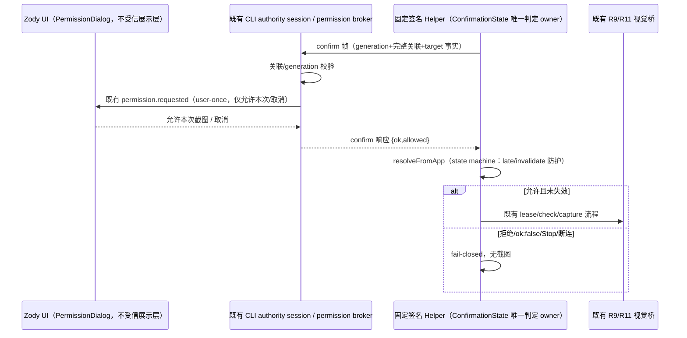

### 构建与 pin

- 原生源变更后用现有冻结工具链与 local-self-signed 身份重建 Helper，prepare-narrow 产物写入新目录 `output/cua-inapp-confirm/`；`packages/desktop/scripts/macos-cua-demo-defaults.mjs` 的 `manifestRelativePath` 与 `manifestSha256` pin 及对应测试随之更新；startup snapshot 与 identity pins 不变。报告目录：`packages/desktop/native/macos-cua-driver-closure/reports/2026-10-31-inapp-confirm/`。旧 output、旧冻结与旧报告只读。

### 边界保留

- 本轮是确认呈现位置变化 + 既有交互链路复用；不改变 eligibility/profile/placeholder、不开放其他 CUA 工具、不新增验证矩阵；普通 Host 来源可信性、完整 CLI 兼容等既有缺口全部保留。独立实测仍限：App 内允许后真实单窗口截图成功；弹窗等待时 UI Stop 取消；迟到确认拒绝由相关测试覆盖。

## 2026-10-31 arm64/macOS 窄截图 self-use 默认启用（用户已对齐，窄范围截图与 Stop 已通过，整体 Phase 1 仍 BLOCKED）

本轮把已实测的窄截图能力收敛为普通 darwin/arm64 构建的 self-use 默认路径；此前“默认关闭/显式 opt-in”的约束只在本窄功能范围内被取代，不改变其他默认关闭能力。无额外环境变量或 demo 命令时，构建期默认选择已实测 production manifest `output/cua-arm64-screenshot/controller-prepared-production/manifest.json` 与 measured startup snapshot `output/cua-arm64-screenshot-product/startup-snapshot-production.json`，由 `createNormalHostNarrowProfile` 生成 fixed Host profile，并由同一选择器把 presigned `cua-narrow` 资源装入 package。默认 profile 只接受 darwin/arm64、macOS `26.6.2`、prepared allowlisted repo 与固定 DeepSeek startup provider/network digest。默认目标缺失、无效或 pin 不符的必要构建资源必须显式构建失败，不得静默宣称已启用；运行时 OS/arch/repo/startup/eligibility 或已装配资源不满足时才回退既有普通 Host 并保持 CUA 不可用，非 allowlisted/remote workspace 同样回退。非 darwin/arm64 构建路径不变。默认启用不允许新增进程结构、用户交互、权限或 runtime/UI 关闭开关；每次调用 native confirmation 与 UI Stop 语义保持不变。

本轮只定义这一条 self-use 窄截图链，不把任何开发测试或已有候选记为本轮验收通过。实现现已落盘；2026-10-31 本轮已批准的 arm64/macOS 窄范围完成：真实单窗口 PNG 正例（1172x976）与 actual OS completion-held 的同一 lineage UI Stop 均有实际证据，held completion 未消费/未交付并已丢弃，cell 已 reaped、lease 已释放。该结论只覆盖本轮批准的窄范围；整体 Phase 1 仍 BLOCKED，普通 Host 来源可信性等缺口保留。规格先行，对应测试仍须先于后续行为修改。R11 冻结源、旧输出与旧报告均只读；本轮派生 patch、构建和输出统一写入 `output/cua-arm64-screenshot/`，产品阶段新产物写入 `output/cua-arm64-screenshot-product/`，Stop 验收归档写入 `packages/desktop/native/macos-cua-driver-closure/reports/2026-10-31-arm64-screenshot-stop/`。既有 `output/cua-helper-round11/`、`output/cua-phase1-closeout/` 与 `reports/2026-10-30-closeout/` 不修改、不覆盖、不重写。

### 2026-10-31 状态账本（窄范围截图与 Stop 已通过，整体 Phase 1 仍 BLOCKED）

以下按层记录实际执行事实；本轮已批准窄范围的通过结论不构成整体 Phase 1 通过；窄功能默认启用仅覆盖本机已实测 darwin/arm64、macOS 26.6.2 与固定配置。

| 层次 | 已记录事实 | 证据 |
| --- | --- | --- |
| 编译/链接 | 生产与诊断 visual 各自编译/Rust 46 项完成；fake-visual native harness 6 场景为模拟；新生产 Helper 编译/链接 10 个 native 程序完成，诊断复用同一 native source 未重复跑测试；生产/诊断固定 local-self-signed 身份、真实 prepare-narrow 资源校验完成；最新 production-audit 与 diagnostic-audit build input 独立 hash 核对为 2091 个 workspace input 引用、916 distinct、0 mismatch，7 个 virtual esbuild define 另行记账 | [visual-production.log](../output/cua-arm64-screenshot/independent-checks/visual-production.log)、[visual-diagnostic.log](../output/cua-arm64-screenshot/independent-checks/visual-diagnostic.log)、[helper-production.log](../output/cua-arm64-screenshot/independent-checks/helper-production.log)、[helper-diagnostic.log](../output/cua-arm64-screenshot/independent-checks/helper-diagnostic.log)、[sign-helper-production.log](../output/cua-arm64-screenshot/independent-checks/sign-helper-production.log)、[prepare-narrow-production.log](../output/cua-arm64-screenshot/independent-checks/prepare-narrow-production.log) |
| 模拟/单元 | Root 独立最终 Host 130、cell 66、narrow Node 35、Stop 15 项通过；native audit 独立 2 文件 150 项通过（84 parser + 66 ProcessManager）；CLI `node:test` 与 shared auth 早期通过；audit 后根 typecheck、lint（301 warnings/0 errors）、architecture（0 violations）通过；`desktop/services/zcode-cli` policy 为 `managed:false`，故 architecture 0 不证明 unmanaged runtime 边界，root diff review 另行记录 | [host-tests-final.log](../output/cua-arm64-screenshot/independent-checks/host-tests-final.log)、[cell-tests-final.log](../output/cua-arm64-screenshot/independent-checks/cell-tests-final.log)、[native-audit-independent-tests.log](../output/cua-arm64-screenshot-product/independent-checks/native-audit-independent-tests.log)、[typecheck-after-native-audit.log](../output/cua-arm64-screenshot-product/independent-checks/typecheck-after-native-audit.log)、[lint-after-native-audit.log](../output/cua-arm64-screenshot-product/independent-checks/lint-after-native-audit.log)、[architecture-after-native-audit.log](../output/cua-arm64-screenshot-product/independent-checks/architecture-after-native-audit.log) |
| 实际原生 | measured platform 为实际 arm64 macOS 26.6.2（build 25G83）、Node 24.14.0：产品生产 UI+PNG 成功（1172x976、108925 bytes、SHA-256 `e1bca9e1…`）；diagnostic-audit cell 990 于 12:21:33.717 suspended、12:21:33.730 loaded verified 后才 resume，source 3,575,522 bytes；独立 `SecCodeCopyGuest` 严格 fixed leaf DR/CDHash `3c57a9bb…`/flags 65536/空 entitlements 通过；最新 diagnostic Helper/Node strict `codesign` pass 的 hashes 保持 `4b3156…`/`14931e…` 不变；attempt #1 native confirmation 120s timeout `authority-eof`、SIGKILL/reaped、capture-rejected，无 actual OS completion/UIStop。负例仍只覆盖 unsigned 映像，错 certificate/错 DR/非空 entitlements 未分别覆盖 | [production-observation.json](../output/cua-arm64-screenshot-product/production-observation.json)、[diagnostic-cell-independent-loaded-identity.json](../output/cua-arm64-screenshot-product/diagnostic-cell-independent-loaded-identity.json)、[diagnostic-attempt1-native-events.log](../output/cua-arm64-screenshot-product/diagnostic-attempt1-native-events.log) |
| Stop/在途 | 2026-10-31 live retry：main 99745 / Host 264 / Helper 350 / signed CLI 360；fresh target TextEdit PID 40077 / window 89384；cell 19065 suspended→loaded verify（CDHash `3c57…`、空 entitlements）→resume，source 3,575,522 bytes。generation 2 于 12:49:32.118 user-approved，32.175 lease acquired，32.565 submit-return targetMatches true，32.622 actual OS completion-held `hasImage=true`/`captureError=false`。UI Stop ~39.5；readonly ledger completed 39.554、`cancelled_by_user=1`、duration 37,942 ms，CLI failed 39.560 `TOOL_CANCELLED`；cell reaped 39.576，gate release 39.639 `completionConsumed=false`/`heldCompletionDiscarded=true`，lease released 39.694，capture-rejected `capture-canceled`；无 capture-delivered/gate-timeout。独立同 inode `149745182` flock 在 45.398 acquired/unlocked 时 Helper 350 仍存活。**本轮批准窄范围 PASS**；tool cancel 先于 cleanup，故不声明 instant stop/nativeFence/hardSLA/all-descendants。无独立 actual `callbackReleased` receipt；只记录源码审计的 release/destroy guard 与观测 lease/gate discard，owner revoke-before-abort 也只作代码审计排序 | [Stop ACCEPTANCE](../packages/desktop/native/macos-cua-driver-closure/reports/2026-10-31-arm64-screenshot-stop/ACCEPTANCE.md)、[acceptance-facts](../output/cua-arm64-screenshot-stop-2026-10-31/live-evidence/acceptance-facts.json)、[lease held](../output/cua-arm64-screenshot-stop-2026-10-31/live-evidence/lease-held-before-stop.json)、[lease after](../output/cua-arm64-screenshot-stop-2026-10-31/live-evidence/lease-after-stop.json)、[final native/stop log](../output/cua-arm64-screenshot-stop-2026-10-31/live-evidence/native-and-stop-events-final.log) |
| 产品 | formal electron-builder `--dir` 与 narrow 资源装配此前 PASS；2026-10-31 cleanup 后 63GB free、Mac unlocked，独立新候选已组装，但首次系统启动 PID 49687 在无 UI 时 SIGTRAP。已确认 packaging defect（InfoPlist whole-archive hash `4c73cb…` vs raw-header `153d9c…`；旧 app embedded `772740…` vs FINAL header `fffcb7…`），详见下节；candidate `fuse4EnableEmbeddedAsarIntegrityValidation` 实际读取为 ASCII `48`（false），与 vanilla 一致且未改，故该 header metadata defect 不能被归因为本次 SIGTRAP/终止原因。root unified logs 已定位 process 49687 于 11:24:53 FATAL `electron/shell/app/electron_main_delegate_mac.mm:65 Unable to find helper app`；父 display/name 已改但 Chromium helper bundle/executable 名仍为 `ZodyPreview`。该 identity 装配问题与 header metadata defect 分账，fuse4 仍 false，不互相归因。normal Host 产品 UI+PNG 正例来自先前 `controller-normal-host-production`，仍是独立的真实证据；最新 `controller-normal-host-production-audit` 以 production manifest 重建 PASS 30.511s，但未启动、无新截图，仅构成 build/log 增量。diagnostic-audit 为当前同一 Host 的新 source，main 99745、host 264、helper 350、signed CLI 360；该实际 run 已用于本轮 Stop 验收。W5/completion-held Stop 已由独立 live retry 通过（见 Stop/在途行）；attempt #1 timeout 仍为历史 NOT PASS。产品阶段新输出见 `output/cua-arm64-screenshot-product/`，旧 outputs/reports 只读 | [formal-pack-child-audit.json](../output/cua-arm64-screenshot/independent-checks/formal-pack-child-audit.json)、[formal-pack-child-audit.log](../output/cua-arm64-screenshot/independent-checks/formal-pack-child-audit.log)、[诊断审计 #1](../output/cua-arm64-screenshot-product/diagnostic-attempt1-native-events.log)、[产品阶段输出](../output/cua-arm64-screenshot-product/) |

Native cell 上限沿用既有 30 分钟 MCP max；actual per-tool 默认 600 秒与 `AbortSignal` 语义不变。root 上一轮已有 177 项测试、typecheck、lint（301 warnings/0 errors）、architecture（0 violations）通过；本轮未重跑。文档修改前 4275 个 source 文件匹配清单 SHA-256 `98a35c35cbd050e7c7d778720777d5a017965b6eabc153d0f78e8400b0868c4d`，最终 diff/source freeze 由 root 在执行 status-doc 更新后完成。以上状态不新增验证矩阵，仅按已测窄范围关闭装配、cell 启动链与 completion-held Stop 问题；列明的整体 Phase 1 门槛继续保留。

### 构建证据输入合同（2026-10-31 补充）

独立编译发现三组 compile PASS 但 final assembly evidence writer 报 ENOENT；根因是 esbuild virtual `<define:NAME>` input 是生成表达式，不是磁盘路径。证据 writer 必须显式分类并固定 virtual input 的 name、精确 supplied expression SHA256 与 byte count，不得把表达式当文件路径读取，也不得转储原始配置或 secret；filesystem input 继续按精确源文件 SHA-256 记录。unknown 或 unresolved virtual input 必须 fail closed。该项只修证据输入分类，不改变进程、交互或授权，不新增验证矩阵；Host worker 在本 spec 落盘后实施，完成后通知 controller。

### ASAR integrity 装配合同（2026-10-31 产品阶段补充）

产品阶段首次系统启动 PID 49687 无 UI SIGTRAP；不得宣称 header metadata defect 是本次崩溃的根因。candidate 的 `fuse4EnableEmbeddedAsarIntegrityValidation` 实际读取为 ASCII `48`（false），保持 vanilla 未改，因此当前终止不能归因于 header 校验；实际 fatal 已在状态账本按 unified logs 记录，独立 launch 仍需复验。已确认的 packaging defect 是 candidate `Info.plist` 的 `ElectronAsarIntegrity` 使用了 WHOLE archive hash `4c73cb…`，而 raw header hash 为 `153d9c…`；上一轮 app 嵌入 `772740…`、当前 FINAL header 为 `fffcb7…`，差异来自 afterPack repack/sourcemap rewrite。官方 Electron ASAR integrity 文档与已安装 `app-builder-lib/out/asar/integrity.js` 的 `hashHeader` 均要求 raw header UTF-8 bytes 的 exact SHA-256。

合同：archive full SHA-256 与 header integrity hash 分账记录，禁止互相替代；`Info.plist` 的 integrity 值必须在 FINAL ASAR rewrite 之后、签名之前刷新；candidate 与 formal Darwin 构建路径必须由同一个 packager owner 执行同一刷新；不得修改 fuses/LV、Helper/Node 签名或既有身份，candidate fuse4 保持实测 ASCII `48`（false）的 vanilla 状态；unknown、missing ASAR 或 invalid header 一律 fail closed。该 metadata 格式与刷新修复仍然有效且必要，但当前 fuse 未启用，不能据此声称 header 校验导致本次崩溃。窄回归场景只覆盖：FINAL rewrite 后 header SHA-256 与 Info.plist 相等且 archive full SHA 单独记录；模拟 rewrite 后 header 变化时 stale Info.plist 被拒绝；candidate 与 formal Darwin 路径都由同一 owner 刷新；missing/invalid/unknown 全部 fail closed。该合同不改变进程、UX、授权，不新增平台/功能验证矩阵。

### 决策与适用边界

用户已接受窄方案，并明确接受“普通 Host 来源不可信”仍是开放安全缺口：

- 保留普通、完整的 Electron utility Host，其 PTY、SSH 与 remote 能力全部保留。不得用缺 PTY/SSH 的 candidate Host 替换它，也不得为窄链新增 throw-only 兼容层。
- 只有在构建期选中的 profile（darwin/arm64 默认 pinned profile，或显式 `explicit build profile` 覆盖）与 Agent 启动时的实际配置严格匹配时，才允许把既有唯一 Agent 经现有 Helper `workspace-relay` 路由到 signedNode sealedCLI。profile 限定实验本地 workspace allowlist、已测 arm64/macOS、固定 native 资源 hash，并要求 Host 既有 service 读到并匹配启动默认 selection、`providerRevisionSha256`、normalized `proxy`/`noProxy`/`CA` path digest；不是 per-task provider guard，也不代表任意后续模型或网络配置兼容。profile/resource 选择必须发生在构建期，不能由 runtime env、argv、UI 或模型参数临时打开。
- 不符合 native eligibility 时，普通 Agent 路径保持不变，CUA 不可用；darwin/arm64 构建默认使用上述已测 profile/resource，其他构建保持既有普通 Agent 与 `zcodeCuaPlaceholder` 状态，不得只翻转 placeholder 元数据。不存在按 task 静默切换、失败后偷换普通/窄 Host 或自动重试到另一条链的路径。
- 远程 workspace 不进入本窄截图链；remote/mobile 仍走既有普通 Agent 路径，CUA 不可用。远程身份、`workspaceIdentity` 与 `remoteSessionId` 的既有传递规则不变。
- 复用既有唯一 Agent、`CommandInbox`、`CuaSubmissionAuthority`、authority/lease/frame owner 与 Stop 语义。不得新增截图 runtime、第二套 Agent 循环、第二个授权状态或多个 frame owner。
- 本轮能力只含单窗口 screenshot；其他输入、AX、全屏与完整 CUA API 不在范围内。sealedCLI 采用 `--jitless` 及既有 shims/network 适配，存在明确的模块、WASM、代理、自定义 CA 等兼容局限，不能声称完整 CLI 兼容。

### 启动 profile 与 task 边界

1. 构建 profile（darwin/arm64 默认或显式覆盖）是构建期固定项：实验本地 workspace allowlist、已测 OS/架构与 native 资源 hash。每次**新 Agent 启动**时，resolver 还必须由 Host 既有 service 重读启动默认 selection，并用既有 `ProviderSettingsView` 的公开非秘密 provider/model transport 事实规范化后计算 `providerRevisionSha256`，同时计算 normalized `proxy`/`noProxy`/`CA` path digest，与 profile 固定值严格比较。credential/header 值不进入 digest；Provider Registry 的 numeric revision 是 process-local，不能跨启动 pin，也不得作为 profile 字段。
2. startup profile 只保存 `providerRevisionSha256` 与默认 selection，不归档整份 provider 配置或内部 baseUrl。network digest 只证明 normalized proxy/noProxy/CA path 配置相等，不代表 CA 文件内容已 pin，也不代表全面 proxy/custom CA 兼容；这些网络缺口继续保留。
3. 任一字段不匹配、缺失或读取失败时，Agent 启动 resolver 返回 `null`，保留 ordinary Agent 路径并使 CUA 不可用；不得重试到窄链、自动回退为已测配置或用 Host 自报值补齐。
4. 该检查只在 Agent spawn 时选择一次路径。已运行 Agent 不因 task、模型选择或配置变化而切换路径，不新增 task-time provider guard，也不因配置变化自动 kill/restart Agent；不新增 UI 限制。用户自行切换模型或 task override 不算兼容性验收。
5. Host 启动时没有 task actual model，因此 startup profile 匹配不能证明后续 task override、模型或 provider 配置变化的兼容性；该 live task 配置兼容缺口与完整 CLI 兼容缺口继续保留。独立验收只使用固定、已测的模型配置。

正式 electron-builder 资源链除复制 Helper.app 外，必须把通过 `validateNarrowManifest` 的原 manifest 精确 bytes 复制到 `Resources/cua-narrow/manifest.json`，并在 afterPack/afterSign 复核摘要；darwin/arm64 默认装配 pinned manifest 与 presigned 资源，非目标构建不装配；pinned 资源缺失、无效或摘要不符必须显式构建失败，不得用临时 launcher SHA 生成的 pass manifest 替代正式验证。普通 Host 的窄候选须使用独立 `CFBundleIdentifier`、显示名和 Electron profile（system entry 不激活已安装版），该差异仅作为 UI identity 的 build-time seam：不设置 `candidateNativeHostLaunch`，不改变固定受信 CUA Helper/Node 身份或既有 CLI store/authority，不新增用户交互，并将 `productDefaultDisabled=true` 与 `explicitCandidateOptIn=true` 分开记账；Hostworker 只做必要真实接线修复，不新增进程结构。

### 候选 UI identity / Chromium Helper 重命名合同（2026-10-31）

candidate UI identity 变更必须在构建期一致重命名**既有** Chromium `Helper.app` 及其全部现有 variant 的 bundle、可执行文件与 `CFBundleExecutable`，使名称与父 app 的期望 parent name 一致。不得为此新增 helper 进程、launcher 或 wrapper，完整 ordinary Host topology 不变；固定受信 CUA Helper 与 Node 的既有 bytes/identity 不变。验收须覆盖：重命名后所有既有 helper 均能解析，framework 相对链接保持，native Helper identity 不变。该合同只修复候选 UI identity 装配，不改变运行时授权、进程结构或 CUA 能力。

### 所有者与信任边界

| 所有者 | 唯一职责 | 明确不拥有/不证明 |
| --- | --- | --- |
| 普通 Electron utility Host | 保留完整 UI 转发、PTY、SSH、remote 与既有会话装配；作为不受信 transport 传递请求 | 不因 `hostInstanceId`、`runtimeInstanceId` 或 `intent.inputOrigin` 成为可信来源；这些字段只用于路由、关联和排障 |
| 既有唯一 Agent / CLI | 持有当前 session/workspace/turn、`CommandInbox`、`CuaSubmissionAuthority`、提交 scope、lease 与 frame 关联 | 不因位于签名 Node 中就获得新的系统权限；不接受 Host 自报授权 |
| 固定签名 Helper | 通过 `workspace-relay` 接收既有 FD/stdio，执行 native peer/资源校验、每次截图原生确认、单窗口 one-shot 截图与取消 | 不保存第二份 submission/authority/lease 业务状态；不把 JSON、路径、nonce 或 argv 当身份 |
| cell Node | 执行模型 JS，只持既有每次调用 capability；由同一 CLI Helper 用 `posix_spawn` `START_SUSPENDED` 启动实际 Node | 不继承 native authority/control FD，不接触可信代码选择，不创建 new authorization state |
| 既有 frame/lease owner | 发布最终真实 OS frame、维护 capture generation、交付前复核与资源归还投影 | 不由诊断 gate、测试 shim 或 Host 声明合成 frame/成功 |
| UI | 展示工具结果与发出既有 Stop | 不作为截图授权来源；不直接调用 Helper 或新增授权接口 |

普通 Host 是**不受信 transport**：即使请求经由已连接、已分类的 `intent.inputOrigin` 进入，也不能抵御被篡改或恶意 Host。`hostInstanceId`/`runtimeInstanceId` 仅提供路由、幂等关联与诊断，不能提升为来源真实性证明。窄链依靠既有**逐次原生确认**在真实截图前批准本次 submission/target；这是本方案的安全边界，不新增 Host 可信性证明。该 Host 来源可信性缺口必须保留为开放缺口，不能通过文档、测试、签名 Node、Helper peer 校验或输入来源分类宣称关闭。

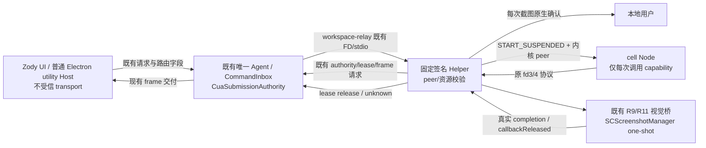

### sealedCLI、relay 与 cell 启动合同

1. 默认 darwin/arm64 构建或显式构建组合保留普通完整 Host，同时允许唯一 Agent 经现有 Helper `workspace-relay` 进入 signedNode sealedCLI。relay 只转交既有有界 FD/stdio 与上下文，不解码业务消息、不保存授权或 lease。native 校验只覆盖 Helper 以及其启动/接管的 sealed CLI 资源与实际 peer（peer audit token、PIN 的 DR/CDHash、签名、空 entitlement），路径/argv/nonce 仅用于关联；普通 Host 不在该信任边界内，仍是未认证的非 OS 可信 transport，不能因 relay、路由字段或连接分类被视为可信。
2. sealedCLI 固定使用 `--jitless`，不新增 JIT、LV 或 TCC entitlement。Cell 仍由 CLI Helper 负责启动：Helper 以 `posix_spawn` + `START_SUSPENDED` 启动**实际 Node**；在任何模型代码、`CellRequest` 处理或 capability 释放之前，必须用 OS 取得的真实子进程 PID 核验 DR/CDHash/空 entitlement。核验成功后才 `resume`；失败立即 `kill` 并 `reap`，不得投递请求或留下可运行 cell。
3. 由此 cell 的 PPID 从 CLI 变为 Helper。Helper 亲自读取 pinned/sealed server；模型 JS 的私有 `cell.sock` 只接受该 Helper 所启动的自身 CLI Node 的内核 peer。原 fd3/4 协议由 Helper 字节中继，不解析、不改写、不新增授权状态；中继与截图控制使用独立线程，避免 capture 路径阻塞造成死锁。同 UID 进程仍可 unlink/rebind 该 socket，因此 `0700`/`0600` 权限与“server 只检查 CLI”不足以证明连接来自真实 Helper；必须叠加下述 ready/socket 传输认证，fake `cell-ready` 不得绕过。
4. 同类证据适用于 capture authority：`cua-launch-session.ts` 的 `connectAuthoritySocket` 仅按 `authorityEndpoint` path 连接，session supervisor 也只做 server 端 CLI auth；path、权限与 PID 检查同样不足以证明 authority 连接来自真实 Helper。必须使用同一 ready/socket 传输认证并设置 `role=authority`，且在建立 wire `CuaNativeAuthoritySession` 或发送 scope/ref/capture 数据前完成。现有 `captureCuaRuntimeOnce` 必须先固定本轮 turn 对应的同一本地 scope/ref，再 `await connect`；握手 await 后不得重读或换绑新 turn。proof 前允许该本地 scope 存在但不得发出；proof 失败必须关闭该 scope。
5. Helper 只转交既有协议与 capability，`CommandInbox`、`CuaSubmissionAuthority`、submission lineage、lease、frame 与 stop 仍归既有 CLI/Agent owner。cell 启动成功不授予 CUA，原生确认与 authority 复核仍是每次截图的前置。
6. **ready/socket 私有传输认证（cell 与 capture authority 共用，不改变进程结构）。** Helper 每次 session 用 CSPRNG 生成仅本次使用的 `transportAuthenticationKey`（256-bit），只通过 inherited fd3 的 session-ready 交给 sealedCLI；不得写入 env、argv、日志、模型、普通 Host 或公开协议。CLI 对 `cell.sock` 与 capture authority socket 的每个连接分别生成 fresh 256-bit challenge。native 已做 OS clientPeer 认证，无需额外 client 认证往返/新状态；Helper 必须先用 kernel peer 验证实际 PID 为自身 CLI，并验证 CLI 实际 loaded CDHash，再返回唯一的 HMAC-SHA256 helper proof。canonical MAC 固定 UTF-8 域/通道前缀 `helper-proof`，随后按固定换行顺序加入 `version`、冻结字符串 `role='cell'`/`role='authority'`、`challenge`（64 位 lowercase hex）、`sourceSha`（64 位 lowercase hex 或空）、request bounds（decimal ASCII）、response bounds（decimal ASCII）；每个字段校验长度/字符/角色白名单，防止拼接歧义。CLI 仅在对应 role 的 `timingSafeEqual` 成功后才允许 cell 发送 `CellRequest`/释放 capability，或 authority 进入 wire `CuaNativeAuthoritySession` 并放行 scope/ref/capture 数据；错误、缺失、过期或重放 proof 一律 fail closed。公开的 `producerIncarnation` 不是 secret，不得作为 key 或替代 proof。
7. 两类私有 server 都只接受自身 CLI PID；同 UID 的伪造 endpoint 进程不能把 fresh challenge 转发给真实 Helper，因为 Helper 在 peer 阶段即拒绝，socket unlink/rebind 本身也不能伪造 ready。该 secret 与 challenge/proof 仅是 ephemeral transport 校验，不新增 CUA authorization owner、授权 map 或 lease，不改变 `CuaSubmissionAuthority`；真实 key 不得写入日志或归档。authority 握手必须只消费固定认证帧，不得吞掉或改写原协议 payload；proof 成功后把剩余字节原样交给 `AuthorityFdReader`/原 authority 协议，真实 authority 协议字节不得因握手丢失。本项与 cell 属同一 path-only socket 信任缺口的必要接线修复，不增加平台/功能验证矩阵、进程结构或 UI。

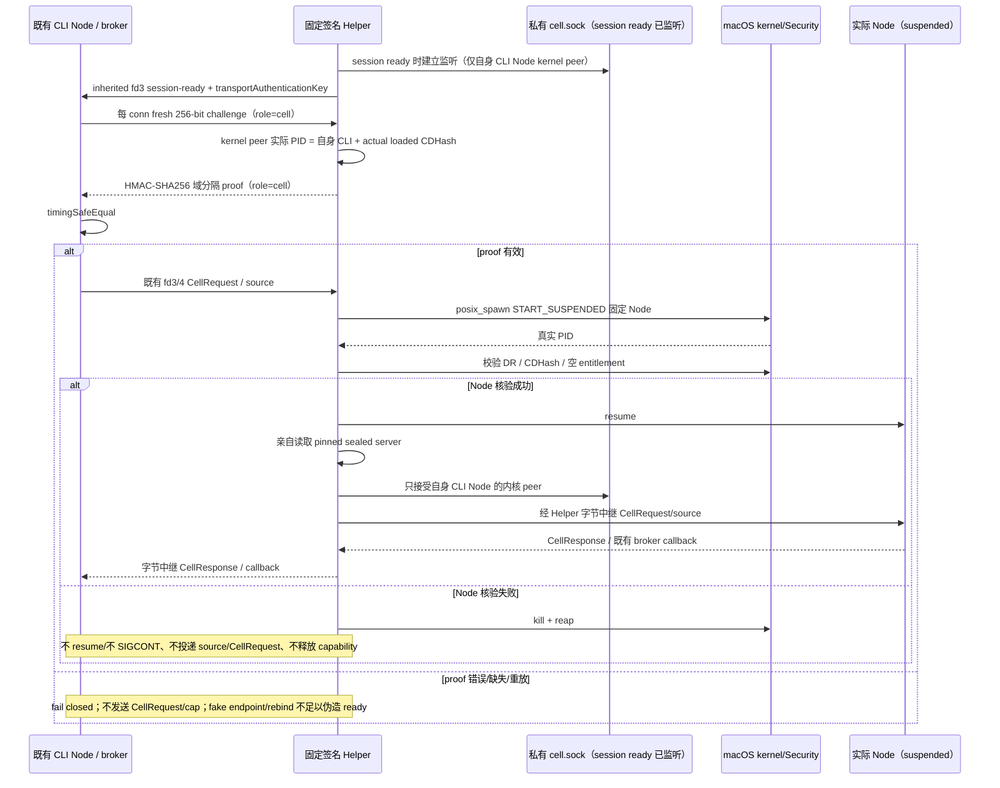

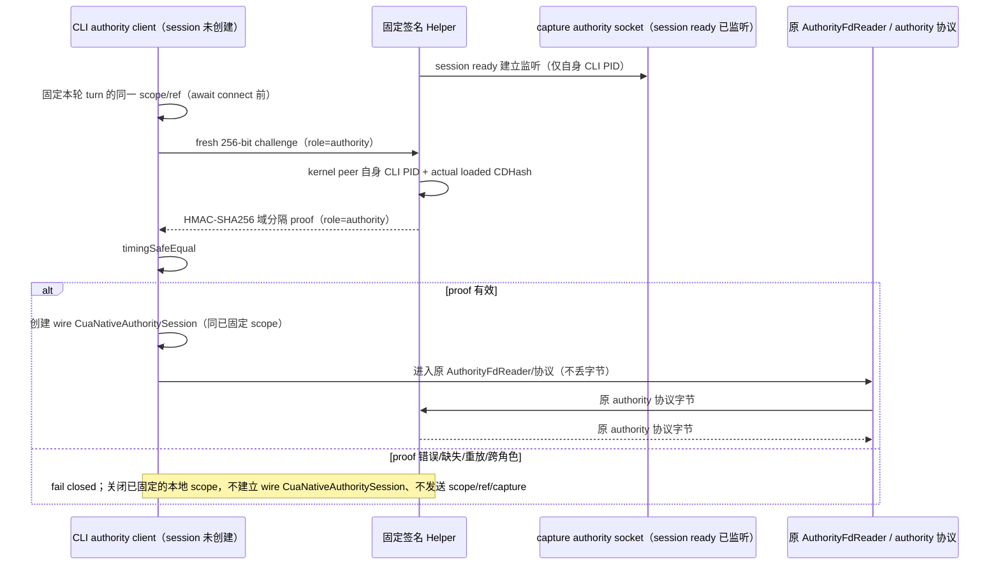

**Node suspended Security 前置 probe（controller 独立实测已通过；生产 cell 仍待实现）。** 实测环境为本机 macOS 26.6.2 arm64。正例对本机真实 signedNode 执行 `SSTOP`，在 suspend 状态核验实际 CDHash/DR/空 entitlements，随后 `SIGCONT`，观察到 stdout `42`、`exit 0` 与实际 reap。负例只覆盖 **unsigned 映像**的 loaded-code-invalid：同样 `SSTOP`，不发送 `SIGCONT`、不发送 stdin，执行 `SIGKILL` 并 reap，标记文件不存在。本轮未分别覆盖错 certificate、错 DR 或非空 entitlements 负例，不把这些列作已通过；负例覆盖范围的缺口保留。日志见 `output/cua-arm64-screenshot/independent-checks/suspended-node-positive.log` 与 `suspended-node-negative.log`。该结果仅证明本机固定 Node 的 suspend→Security 核验→resume/kill 前置机制，不证明生产 Helper 的 `posix_spawn` 接线、cell.sock/fd 中继、capability 释放或完整 cell 隔离；这些实现与生产正负例仍待做。若后续实现无法保持基础正负例区分或核验不在 resume/代码执行之前，本方案继续阻断，不得以 spawn 后复核、路径检查或普通 `codesign` 输出替代。

### 真实截图、在途 Stop 与诊断 gate

一次真实截图必须同时满足：构建期选中的 profile/resource（默认或显式）、native eligibility 与启动 profile 匹配、本地 workspace、既有唯一 Agent 的 submission/target scope、未撤销的 authority/lease、固定单窗口目标及逐次原生确认。确认后、真实采集前及最终交付前均由既有 owner 复核同一 lineage；不一致、撤销、过期或连接代际变化直接拒绝。不得把 Host 的 `inputOrigin` 或 UI 标志当作确认。

Stop 的唯一状态 owner 仍是既有 submission authority。UI Stop 在任何阶段都必须可进入既有 cancel/requestStop：尚未 admission、已 admission 但未 submit、one-shot 已 submit 且 completion 尚未消费/交付，以及已交付等阶段，owner 均**先撤销**并关闭新准入与结果接收，再沿该阶段既有 command/abort/requestStop 路径取消和清理；不得因 capture 尚未 submit 而拒绝 Stop。**本轮“在途 Stop”验收只在**真实 `SCScreenshotManager` one-shot 已 submit、其 completion 尚未被消费且图片尚未交付时计数；此时按同 lineage 执行 native cancel 并丢弃迟到图片。仅在观察到最后实际 callback 释放（`callbackReleased`）与 lease 释放（lease release）后，才允许报告本次 release 完成；任一释放事实未知时必须保留 lease，报告 pending/unknown，不得伪造成功、Fenced 或已清理。

以下证据不能替代“在途 Stop”：截图已交付后的 cancel、尚未进入 native admission 的 gate 拒绝、仅 UI 收到 `TOOL_CANCELLED`、已知资源在 Stop 前已释放，或不同 lineage 的 Stop。当前实现没有 `SCStream`，也不声称 OS 内部取消、nativeFenced 或所有后代退出。

测试诊断 gate 只能控制**真实 OS completion 的调度时机**，用于稳定构造“completion 尚未消费/交付”的在途窗口；它不得合成 frame、伪造 completion、跳过 authority 或制造成功。生产默认为无 gate，不能由环境变量或 UI 打开；测试/诊断配置与产品路径分开记账。

**原生审计 marker 可观测性（2026-10-31）。** 仅当本次 Agent 命令实际配置为 fixed native launcher 时，Host 才可把 native stderr 中严格匹配固定 schema 的 `[cua-native]` 审计 marker 以 `info` 转发到既有 Host 日志；普通 CLI、普通原生 stderr 和无法解析/超限/带额外字段的行仍只走原 debug 路径，不进入生产日志。允许集合只来自现有 native source：`confirmation-presented`、`confirmation-resolved`、`cell-spawned`、`cell-loaded-code`、`cell-resumed`、`cell-source-sent`、`cell-peer-verified`、`cell-reaped`、`machine-lease-acquired`、`machine-lease-released`、`capture-delivered`、`capture-rejected`，以及 diagnostic feature 的 `visual-completion-held`、`visual-submit-return`、`visual-stop-gate-release`、`visual-stop-gate-timeout`、`visual-stop-gate-error`。每类 marker 必须按 source 的精确字段、类型、固定 reason/gate 枚举、PID/generation/requestId 边界、40/64 位小写 hex 与 identifier 约束校验，并从校验后字段重建规范行，不能转发原始 JSON；未知 marker、额外 `secret` 字段、控制字符、非 JSON 或超长行一律拒绝。production 不产生 `visual-*` marker；只有 stop-diagnostic 构建可观察 completion gate。`capture-resource-release` 当前不存在，不得虚构。该日志只用于运营观察和证据关联，native 事件仍是 self-report，严格解析不证明 Helper/Node/cell 身份、授权或 Host 来源可信；普通 Host 可伪造 origin 的缺口继续 OPEN，不新增 auth state、队列、runtime、事件协议、UI、签名或权限。

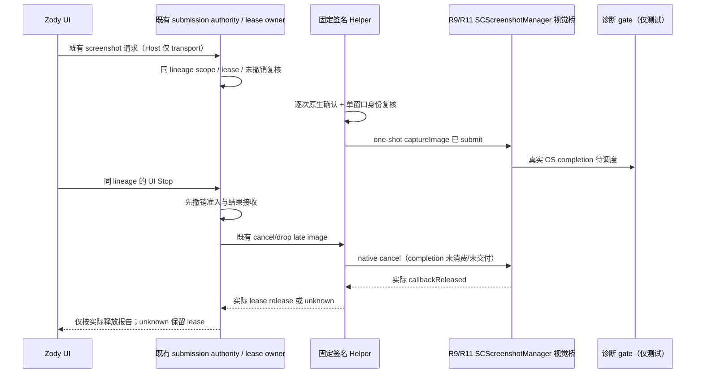

### 本轮最小验收与保留缺口

本轮只登记以下最小场景，不扩展验证矩阵；具体测试先于对应实现增补，执行结果按层记录，只记录本轮批准窄范围的 PASS/FAIL，不写成整体产品通过：

1. 普通 Host 路径：完整 Electron utility Host 的 PTY/SSH/remote 保留；非 darwin/arm64 构建不选择窄 profile/resource，CUA 不可用。
2. 默认启用且启动 profile 全部匹配：无 opt-in env/额外 demo 命令的普通构建使用固定已测 manifest、startup snapshot 与测试 workspace，既有唯一 Agent 经 Helper `workspace-relay` → signedNode sealedCLI，复用既有 `CommandInbox`/authority/lease/frame；单窗口截图链可用。
3. 默认下载入 profile 任一字段不匹配/读取失败、OS/arch/repo/startup 不匹配，以及 remote workspace：resolver 返回 `null`，普通 Agent 路径保留，CUA 不可用；无按 task 静默切换或自动 kill/restart。默认目标缺失或无效必要资源必须在构建期显式失败，不能把未装配的构建报告为已启用。
4. 真实 suspended Node 前置 probe 已在本机 macOS 26.6.2 arm64 独立实测：正例核验实际 DR/CDHash/空 entitlement 后 resume 并执行；负例只覆盖 unsigned 映像 loaded-code-invalid，不 resume、不读 stdin、SIGKILL/reap。未分别覆盖错 certificate、错 DR、非空 entitlements，不扩大列作已通过。生产 `START_SUSPENDED` cell 990 已在 diagnostic-audit 实测：12:21:33.717 suspended，12:21:33.730 loaded verified 后才 resume，source 3,575,522 bytes；独立 `SecCodeCopyGuest` 严格 fixed leaf DR/CDHash `3c57a9bb…`/flags 65536/空 entitlements 0 通过（`diagnostic-cell-independent-loaded-identity.json`）。ready/socket 最小负例还必须覆盖同 UID fake cell endpoint/rebind、fake authority endpoint、错误/缺失/重放或跨角色 HMAC proof：均 fail closed，未发送 `CellRequest`/cap。authority 可先固定本地 turn scope 再 await connect，但 proof 前不得建立 wire session/发送 scope/ref/capture，失败必须关闭该 scope；await 后不得换绑新 turn。authority proof 成功后原协议字节必须无损进入 `AuthorityFdReader`。
5. 真实单窗口截图已由 production UI 得到 PNG：1172x976、108925 bytes、SHA-256 `e1bca9e1…`。2026-10-31 live retry 的 same-lineage completion 在未消费/未交付时被真实 UI Stop：`hasImage=true`、ledger `TOOL_CANCELLED`、cell `19065` SIGKILL/reaped、gate `heldCompletionDiscarded=true`/`completionConsumed=false`、lease released、`capture-canceled`，无交付/timeout，**本轮批准窄范围 PASS**；默认启用不改变逐次 native confirmation 或 UI Stop。tool cancel 先于 cleanup，故不声明 instant stop/nativeFence/hardSLA/all-descendants；无独立 actual `callbackReleased` receipt，源码 guard 与观测 lease/gate discard 分账。diagnostic attempt #1 的 120s timeout 与旧截图 timeout 仍为历史 NOT PASS；只有 authority 先撤销、completion 未消费/未交付、native cancel 丢弃迟到图片、资源/lease 实际释放后才报告释放，unknown 保留 lease。
6. 根 `pnpm typecheck`、`pnpm lint`、`pnpm architecture:check --changed` 及必要相关测试；执行或受限状态如实记录。
7. fixed native launcher 的 `[cua-native]` 审计行已实现 controller 复核的 strict schema/bounded info 通道（仅 nativeLauncher → Host info；普通 CLI 与任意 stderr 保持 debug-only）；额外字段/畸形/超长输入拒绝。独立 `cuaNativeAuditLog`/ProcessManager 测试 2 文件 150 项通过（84 parser + 66 ProcessManager），audit 后 typecheck/lint/architecture 通过。该审计行是 operational self-report，不作为身份或授权证明；直接 `SecCodeCopyGuest` loaded identity 是独立证据。production 无 `visual-*`，diagnostic gate 事件需在 stop-diagnostic 构建中单独验证。
8. 编译/链接、模拟测试、真实原生调用、产品验收分账记录，不互相替代；签名/资源摘要与命令独立归档。

以下既有缺口继续保留，不因本轮关闭：完整 D06/OS 隔离；输入 native Fenced；所有后代退出；6 项 JS 许可 missing；Intel 与最低 macOS 实机；升级后的身份/TCC 稳定性；普通 Host 来源可信性；完整 CLI 兼容；`SCStream`、OS 内部取消与真实全后代清理。

## 历史规格

详细设计（2026-10-25）：[首期详细设计评审修订稿](../docs/design/computer-use-macos-phase1.md)收敛 Helper 形态、可信 scope、最终 frame、停止/退役与恢复协议，并列出 D01–D07 工程决策和 C01–C13 验证交接。本次补齐独立 cell 进程隔离、手机混合输入与 submission lineage 撤销规则。本文仍是产品规则唯一来源；设计修订不关闭 P0，也不进入产品实现。

最新开发切片（2026-10-25）：[drag/stop watchdog 与创建预留 retire 容量](/Users/zhvala/SourceCode/scripts/experiments/zody-cua-p0-g2-stop-retire-reservation/REPORT.md)完成首轮独立开发验证。同一binary644唯一进程通过（14容量+7机制+40重放+583受影响回归），另3个动态ABI进程单列；未接产品、零系统输入。已复现worker提前结束导致旧barrier等待及在途ABI阻塞stop的机制，历史20秒事故具体触发仍未确认。create预留实际生命周期entry可行，但不承诺OOM/调度/永久阻塞下无条件destroy。正式G1/G2、整体D2仍blocked，Cua优先排序不变。

前轮开发切片（2026-10-25）：[publisher/retire/drain](/Users/zhvala/SourceCode/scripts/experiments/zody-cua-p0-g2-publisher-drain/REPORT.md)完成候选Helper的晚到发布拒绝、在途task/custody保留、异步fence与非阻塞drain开发验证。最终同一binary2723唯一进程通过（97专项+2626完整回归），46编译控制、14专项core函数及40既有授权测试通过；另3个独立cdylib动态ABI进程单列。系统post为0，正式G1/G2与整体D2仍blocked，G3/G4未执行，Cua优先、UI-TARS/nut-js备选不变。一次既有drag/stop watchdog失败原因仍未确认，40次诊断重放与最终重跑通过不抹掉该缺口。

日期：2026-10-25。状态：产品待实现；P0-G1 blocked；P0-G2 含真实对象actuator seam开发证据持续推进、正式验收 blocked；G3/G4 未执行；未开放、未发布。配套 [实施计划](../docs/plans/computer-use-macos-phase1-implementation.md)。本文定义后续目标，不将旧闭源文档、占位导出或本次文档检查视为能力已实现。

2026-10-25 实施授权更新：用户要求 DeepSeek 分工实现并由 controller 验收，见 [分工台账](../docs/plans/computer-use-macos-phase1-agent-work.md)。允许开发默认禁用的候选合同和隔离/生命周期切片；完整产品采用、真实输入和发布仍受本文 P0 与正式验收门槛约束，不以测试替身或新增代码替代通过记录。

2026-10-26 第二轮接线：在原有协议上实现显式注入可信双工流的控制 endpoint，复用标准 Ed25519 验签与有界 replay；私钥、公钥信任表、完整 incarnation binding 仅由调用方启动代码注入，不从模型参数、MCP metadata、环境变量或线上首个消息建立信任。endpoint 负责有界换行帧、双向请求/ACK 关联、重复请求去重和断连结算，业务 owner 通过有限 handler 接收已认证请求。非法帧、错签名/绑定/方向/关联、冲突或序号缺口均关闭连接并通知 owner 撤销；EOF/abort/dispose 不得留下 pending Promise 或重新开放旧 incarnation。handler 不得因重送执行两次，回调异常不能制造成功 ACK。关闭必须在异步回执前锁存；迟到 handler/ACK 不能复活连接。

本轮控制 endpoint 的真实子进程 IPC 验收只证明显式启动绑定与传输规则，不证明产品 launcher 已接线或 OS 隔离。没有原生 Helper 的 handler 只能报告实际 projection/revoked 事实；native fence 保持 unknown，stop 不得完成。endpoint 不新增公开模型工具、环境开关或自动激活路径，placeholder 与默认 executor 保持不变。

第二轮 runtime 接线仅处理 candidate/revoked 生命周期：`CuaSubmissionAuthority` 仍为唯一状态 owner，协调器只持当前引用和输入关联，不复制授权状态。通过 AgentRuntime 的显式可信依赖注入固定身份；没有完整身份不构造候选，不能由 bootstrap 随意生成假 Host 标识补缺。Host 现有 `intent.inputOrigin` 可表达来源，但持久化 intent 本身不证明 live admission；建立新 candidate 还须有实例内、不可序列化的可信 live 提交凭证，绑定 source/queue 与当前 owner。凭证由受信调用方显式登记，经现有 admission/队列携带关联，不写 transcript、trace、模型参数或公开协议。恢复、重放、直接执行与自动续跑不能只凭旧 intent 建立资格；可信队列项提升最多消费一次凭证，不建立第二条输入队列。

runtime 在实际 admission、steer/queue、用户 stop 与 shutdown 路径调用协调器；手机/unknown 对活动 lineage 的影响先锁存撤销，stop 先撤销再 abort，shutdown 幂等封闭并撤销。新输入不能残留旧当前引用；去重或已撤销输入不得复活。自动续跑仅沿用原 lineage，无新凭证则不能重授予。来源/身份/容量不足只拒绝 CUA candidate，不影响普通聊天。尚无原生 Helper 时不实现假的 Fenced 屏障；本轮不得向 producer 签发可执行资格，真实手机投递屏障、Host 注册 live 凭证与产品启动身份仍是激活前置项。

### 正式构建收尾与 cell 资源快照（2026-10-30）

本轮输出 `output/cua-phase1-closeout/`，验收另存 `packages/desktop/native/macos-cua-driver-closure/reports/2026-10-30-closeout/`；既有 launchservices/desktop-session 报告、冻结源和候选只读。继续 local-self-signed，功能默认禁用，`zcodeCuaPlaceholder:true`。完整 D06、native Fenced、所有后代退出、JS 六项许可缺失、Intel/最低 OS/升级 TCC 稳定性均不因本轮关闭。

**cell 代码资源合同。** 固定签名 CLI 从已封装 Node 的固定同级资源名打开 node-repl server，拒绝符号链接、非普通文件、错误 owner、group/other 可写及超限内容。在同一个打开句柄上有界读取（读取期间增长也不能突破上限）、对所得原始字节核验封装钉住的 SHA-256，保留同一份可执行 UTF-8 内容的私有不可变快照。校验失败或非可无损执行的 UTF-8 必须拒绝。之后即使资源被 rename、unlink、原位改写或替换为 symlink，每次 cell 都只执行该快照；不得关闭句柄丢弃内容后再按 serverPath 打开，不得以重复 hash/重试缩小竞态冒充消除。

快照通过子进程私有 stdin 传入固定 Node 的 ESM stdin 入口，模型请求/结果继续使用 fd3/fd4，且 authority/control FD 不继承。stdin 写入必须处理 backpressure、错误、abort 和直接子进程退出；取消/失败不得留下 pending Promise。源码不能进入命令行、环境、日志或模型参数。CUA composition 必须提供校验快照，缺失直接失败；普通 MCP/SEA/Worker 的现有路径启动语义不改变。启动 descriptor 的固定资源名仅作诊断，不作为再打开执行的路径。不为快照增加授权状态；原 CuaSubmissionAuthority、turn scope、per-call capability、机器 lease、frame owner 仍是唯一所有者。

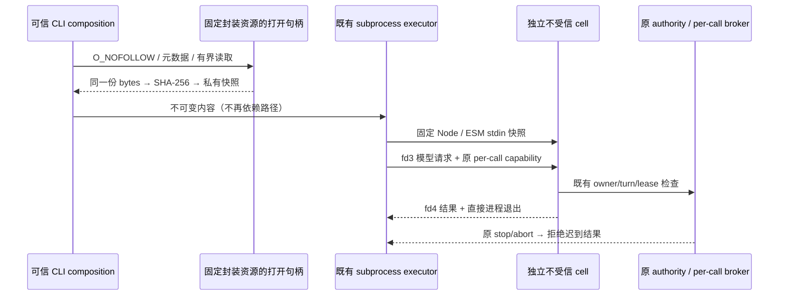

最小验收：① 真正子进程执行已核验快照，校验后替换/原位改写/删除原文件均不执行新字节；② 错摘要、symlink、可写/超限/读取增长和无快照 CUA composition 拒绝；③ fd3/fd4、jitless、环境过滤及 abort/失败结算保留；④ 以本次构建产出的真实 server bundle 与固定签名 Node 独立验证快照执行，再按需要验证最终封装的一次单窗口截图。不把以上结果扩大为 OS 沙箱/完整 D06 或 native Fenced。cell 的 Node 可执行文件仍按固定路径 spawn，本切片未增加该 cell PID 的 loaded-code 校验或消除二进制替换窗口；这与已关闭的 JS 内容重开竞态分别记账。

正式构建集成须先核对发行入口；不能把缺 node-pty/SSH 的候选 Host 静默替换普通 Host。装配与激活分别记账；若将截图入口接入普通应用需要改变批准的进程结构或用户交互，先列具体差异与用户对齐，不能用仅复制资源宣称普通产品截图已可用。

**正式发行资源装配合同（不激活）。** 正常桌面 `bundle` / electron-builder 允许显式构建输入把本轮已签名窄 Helper 放入独立 `Resources/cua-narrow/` 槽位；默认构建无此输入时行为不变。该输入只属于构建机，不能由 runtime env/argv/UI 改变进程路由。原有 `cua-helper` 槽位、producer 检测和 installer 不复用，不设置 candidate Host compile seam。窄资源不得改变普通 Host/Agent/PTY/SSH/remote 的启动和依赖；`zcodeCuaPlaceholder:true` 保持不变。仅 arm64/macOS14.2 固定来源可装配，其他目标的显式请求必须报错而不是携带错误架构。

构建在输入和最终复制位置分别验证完整资源内容摘要、固定 Helper/Node identifier、现有 local-self-signed 证书/DR、strict signature、hardened runtime 和严格 library validation；不接纳 ad-hoc、额外 entitlement 或 unsigned 替身，不重签可信 Helper/Node。封装不得留向仓库/缓存的符号链接，源/复制后清单不一致即失败；外层 Electron 继续不受信 UI。签名资源与源码/审计摘要、默认禁用/限制说明随构建记录归档。不得将此项记为普通应用已能调用截图；普通 Host 的功能接入需要另行对齐进程/协议方案。

验收仅检查：默认装配未切换 Host；显式 arm64 资源经实际 electron-builder 配置进入正确槽位、复制前后签名与内容一致；错误签名/摘要/目标明确拒绝；本轮新 Helper 的实际一次截图单列。无需重测普通 Host 完整功能矩阵。

### 真实桌面会话的可信 Node 与原生确认（2026-10-30，用户已批准实施）

候选的 sealed CLI 已显式装配 native capture 与 node_repl 工厂时，实际会话工具目录必须注册该本地 node_repl；不能仅包装端口却仍等待默认禁用的 CUA 插件贡献 server 配置。此注册只提供调用入口，不建立授权或绕过当前 submission/turn、原生确认与 lease。普通启动、缺任一可信依赖、显式禁用 MCP 时不自动注册；不修改插件启用状态或用户设置。验收必须覆盖无预设 node_repl server 的真实 app composition。

候选封装必须按当前工作区公开 source exports 解析内部包，记录实际 inputs；不得悄悄使用未重建的工作区 dist。构建发现本候选运行链中的旧 dist 输入须失败，不能将源码测试通过当成封装二进制包含修复的证明。第三方 registry 包仍使用已锁定来源，不改缓存。

候选本地 MCP descriptor 保留该 server 已声明的有界 timeout，避免外层默认30秒提前截断 node_repl 的显式等待；内部 cell 的 timeout、用户 stop 和 owner 失效仍正常取消。截图在原绑定复核及 native ACK 后，记录一次有界交付事实（绑定关联、原始PNG摘要/尺寸、实际资源与lease释放字段），不记像素、用户正文或凭据；日志不是授权状态或 native Fenced。

原生连接从确认阶段的非阻塞reader交给既有阻塞AuthorityClient时，交接方必须显式校验并转换FD读模式，保留其他flags；转换失败即拒绝，不能把暂时无数据的EAGAIN当作撤销/EOF。shutdown仍须唤醒阻塞读取，既有有界写入和完整绑定校验保持不变。回归用真实socket延迟响应及中断验证这一交接，不修改冻结R11源码。

采集失败诊断保留固定枚举的失败阶段（例如TCC拒绝、visual start/wait/take失败），未知原因继续泛化；不输出任意原生错误文本。真实确认成功与截图成功分别记录，连接关闭/owner撤销不能代替截图或UI Stop完成。系统TCC实际responsible/subject必须如实记账，不能把requesting Helper的签名身份当作权限归属证明。

独立本地截图候选不得复用真实账号的远控 gateway 注册，以免与已安装桌面的 backend/epoch 冲突；候选装配中禁止开启远控连接，不写回用户原有 remoteAccess 设置。普通产品与既有远程身份规则保持原样。

可信 Node 启动仍须完成原 Host/Session storage preparation，不能因 sealed stdin 的资源位置变化跳过迁移或 ready 屏障。所需 worker/存储入口由封装代码显式注入固定资源，纳入构建摘要与启动校验；不得从 UI/env 指定未验证脚本。普通 Electron 路径保持既有实现。候选 UI 仅在独立 output 中通过编译期装配启用可信 Host，不能改安装应用或产品默认开关。

现有 local-self-signed + hardened runtime 严格库验证下，Electron main/Framework 实际加载因无 Apple Team ID 拒绝；strict codesign verify 不能替代运行。用户已同意 Electron 只承担不受信 UI，将需要信任的既有 window-scoped Host/CLI 逻辑迁至固定签名 Node 与封装代码。不得关闭 library validation、伪造 Team ID、借 DYLD 或去掉 hardened runtime 绕过。保持默认禁用及 `zcodeCuaPlaceholder:true`，安装版与旧冻结材料只读。

**唯一所有者及接口。** 仍为每窗口一个 Local Host、既有 CommandInbox / CuaSubmissionAuthority / turn scope、原生机器 lease 和 frame owner。Electron 与 Node 的消息/端口桥只传输现有协议，不保存业务授权；缺少可信 launcher 配置走原有禁用路径。固定 Node 的身份不自动覆盖加载 JS：原生 launcher 必须验证封装资源、固定签名、实际 peer 与加载代码，私有控制流只能由该链建立。环境变量、任意可执行路径、首包身份、UI approved 布尔或 JSON PID 都不能建立信任。迁移要保留端口的 FIFO、关闭、错误及 Dispose 语义；remote/mobile 继续既有来源和 replayable attachment，不变成新 Desktop Host。

**原生确认顺序。** 既有 admission 建立 candidate（非许可）→ 实际活动 turn 捕获不可变完整 ref/revision/run/turn 与唯一 producer → 认证 Helper 请求本地用户确认会话身份和精确目标窗口 → 确认后重新向同一 owner 检查所有绑定并核验目标 → 取得既有机器 lease → 采集 → 提交前再次复核。确认仅是该次调用栈的必要条件，不新建授权 map/ticket/缓存；每个新的截图授权都须重新确认，不跨 submission、目标或连接代际复用。原生窗口明确展示 session 与目标 PID/window 身份及取消选项，默认拒绝；不能通过自动点击生成用户在场证据。

**停止与来源。** UI 自报 desktop 不证明用户同意；remote/mobile/unknown 提交仍不能取得可截图 scope，也不能通过弹确认洗成 desktop。native prompt 等待期间仍须处理 owner 失效/EOF/stop：关闭确认和结果接收，禁止晚到同意或 PNG 复活。开始与交付均复核同一 scope；停止使用原有撤销/abort/Helper 取消路径。只记录实际资源归还、lease 释放，不把 runtime revoked、进程退出或 timeout 写成 native Fenced。TCC 是 OS 许可，不能替代本次确认。

最小验收场景：① Node 端口桥能承载既有真实 Host 初始化/服务端口并有序关闭；② 原生确认取消或等待时 stop 不截图；③ 同一真实桌面 submission 经确认得到一次真实 PNG，图片沿原有工具结果回原会话，stop 后不接收迟到图并释放 lease。针对变更执行相关测试与根 typecheck/lint/architecture；实际编译/加载、模拟测试、原生截图及完整产品验收分别记账。尚未完成的装配不得以 fixture 或组件通过替代。详见[接线计划](../docs/plans/computer-use-macos-phase1-desktop-session.md)。

### 生产 owner 接线续作（2026-10-30）

用户已批准为固定签名 Helper 开启屏幕录制权限；产品仍默认禁用，`zcodeCuaPlaceholder:true`。R11 的独立开发 authority 与生产 runtime 必须区分。当前生产 bootstrap/CommandInbox 已注入身份和登记 live ticket，不重复实现；本续作只补同一 owner 的 turn binding、可信 consumer 装配及 Helper 接口，旧冻结材料只读，新证据位于 `output/cua-helper-product-integration/`。

runtime 新增仅可信 composition 可调用的 `createCuaSubmissionTurnScope()`，缺 coordinator、无真实 regular activeTurn、无未取消的 activeForegroundExecution、非 candidate 或子 Agent 时返回 undefined。scope 捕获当前完整 ref、真实 traceId/turnId 及 `activeForegroundExecution.foregroundExecutionId`，后者作为本切片 wire runId（即既有 RuntimeCommand.id，不新造 UUID，不等于 workflow runId）。调用方不得传入或覆盖上述身份。

scope 合同固定为 `CuaSubmissionTurnScope`：只读 `ref/traceId/runId/turnId/producerPort`，`bindProducer(producerIncarnation): boolean`、`onInvalidated(listener(reason)): unsubscribe` 与幂等 `close()`（reason 仅 `owner-revoked` 或 `scope-closed`）。bind 仅在真实 turn/execution 仍是原对象、owner 仍持原 revision candidate 时调用同一个 authority.bindTurn；producer incarnation 必须来自本次实际 launcher 的同一份 bootstrap material。scope 不是 grant，不签发 nativeFence，不创建第二份授权 map。为避免多个 handle 清理同一 binding，单一 runtime turn 至多一个活动 scope；重复创建不得产生可独立释放同一 binding 的句柄。

producerPort 的 resolve/revoke 逐项核验本 scope 完整 ref，转发同一 authority；不接受别的 lineage/host/runtime/session/workspace。owner 撤销、真实 turn 结束、foreground abort/结束、shutdown、scope close 同步封闭准入并通知 consumer；晚到 bind/ready/resolve 不复活。清理持创建时的 ref/runId/turnId 调 endTurn，绝不重新读取新 currentRef。normal close/正常 turn end 发 `scope-closed`，adapter 只关闭该 consumer 并释放自己的 binding，不能误当 control-lost 撤销仍有效的 lineage；owner 撤销发 `owner-revoked`。control/producer lost 经既有 revoke 路径先撤销再清理。观察者必须可退订、终态订阅立即通知，不能借异常回调恢复 scope。

adapter 使用该 scope 建立控制会话：订阅失效 → 准备本次唯一 control material → 用其 producer incarnation 绑定 → 实际启动/握手 → 复核 scope，任一步失败封闭并清理。bootstrap 提供显式可信 composition 入口，从本 app.runtime 取得 scope 并把同一对象交给 adapter。普通启动、恢复、模型 schema 和公开业务协议不触发此入口；无受信 launch 配置时拒绝，不从环境变量或模型输入获得授权。现有 control-only/native unknown 语义不因新接线而改成成功。

原生 authority 接口只接收该内存 scope、可信 launcher 已建立的私有双工流及其 producer incarnation，复用 R11 的有界 bootstrap/check/revoke/close 帧语义。bootstrap 返回 runtime 捕获的身份，拒绝请求方注入 host/session/ref/run/turn；不得 new authority、admitLive 或补造身份。check 严格核对原 ref/revision、trace、producer、run、turn，并在异步 resolve 后重核当前状态。owner 撤销先封闭 check，再发送真实撤销事实；正常 scope 结束以关闭通知/EOF取消 Helper，不声称 owner 已撤销；传输异常先向同一 owner 请求 control-lost 撤销再清理。旧流不能绑定新 scope，清理必须有界且不遗留 pending Promise。该适配接口本身不认证 OS peer，只有通过既有原生 peer/代码资源验证的 launcher 才能装配；未装配到可信产品启动链前仍不可执行。

对应最小场景：真实 runtime scope 经原生帧协议返回同一身份、check 后撤销阻止晚到结果；错误 ref/turn 或正常 turn 结束关闭旧流；现有已签名 Helper 独立截图与该接口接线分别记账。测试流或 fixture 不升级为产品截图证据。

本续作允许在独立输出目录构建签名原生组合候选：复用冻结 R11 的 peer、机器 lease、capture owner、视觉静态库与固定签名身份，仅将原生 supervisor 的开发身份 bootstrap 改为请求空 payload、使用当前 `create-app → CommandInbox → runtime scope` 实际返回的 ref/trace/run/turn/producer；签名资源内的受控输入和 held model fixture 只驱动真实生产对象，不直接实例化第二个 authority。候选运行一次用户已批准的 Zody 单窗口截图与撤销，用于证明新接口和原生消费者兼容。来源、派生 patch、资源与二进制摘要必须固定，旧候选只读；不得把 fixture Host/模型当真实安装版 UI 输入或完整产品启动验收。相同证书和 Helper identifier/DR 保持稳定，不增加 entitlement、系统权限或默认激活路径。 原生候选的失败诊断须保留有界 Helper reason 与显式继承的 Node stderr，不能用统一退出码遮蔽授权/采集失败；诊断不改变成功判定，stderr 不记录用户提示、凭据或帧内容。

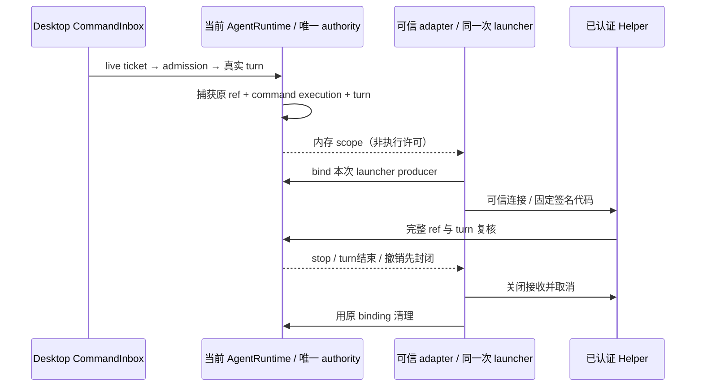

实际已安装 `/Applications/Zody.app` 为 ad-hoc、无资源封口，不能直接接受为可信产品 controller。本续作不重签或修改已安装应用，不把任意 Node/FD/socket、JSON 自报身份或 TS 布尔当可信主体。新增原生接收端须继续固定实际 peer、签名及代码资源，缺真实产品启动链证明则 fail-closed；这部分未有证据时不能宣布生产截图通过。必要检查只覆盖真实 runtime admission→同 owner绑定/撤销/清理与真实子进程控制组合、当前签名 Helper 独立截图，以及仓库必需 typecheck/lint/architecture，不新增全平台验收矩阵。

### 第十一轮单次截图纵向接线（2026-10-29）

本轮只推进显式开发入口的「真实 Helper → 既有 submission → Helper 机器 lease → 一次精确窗口截图 → 撤销」，保持产品默认禁用与 `zcodeCuaPlaceholder:true`。第九轮冻结视觉树、第十轮身份诊断/控制代码及归档作为只读基线；派生构建写入独立 round11 目录。不得将更多策略测试替代尚未运行的真实链路。

`CuaSubmissionAuthority` 仍唯一拥有提交及撤销状态，复用其 admitLive/bindTurn/resolve/revoke/producerLost；开发入口只处理本次明确本地调用，不读取历史提交、不运行模型 cell。Helper 只持已认证连接、一次操作及机器互斥资源和单调关闭投影。本轮在设计既定的 Helper 机器仲裁 owner 内实现实际 OS 排他锁，不在 TS 新建授权 map 或 leaseGranted 开关。锁域不随 workspace/data-root 变化；锁失败直接 busy，不窃取、不 unlink 重建锁；锁释放须晚于本次采集资源交还，未知则保留到实际进程隔离。只读采集的锁释放不证明输入 cleanup 或产品 native Fenced。

可信启动必须覆盖实际执行的代码。固定 local-self-signed 证书、identifier、DR、bundle 资源及实际 peer audit token；不能把签名 Node 当作其加载 JS 的身份证明。允许本轮采用签名原生 supervisor 封装的窄开发 bundle：验证自身资源及固定 Node/authority 资源，私有继承 FD 启动无模型 authority 子进程，认证 native supervisor 与 Helper 的真实连接。未封装/未签名/错身份时在 lease 与采集之前拒绝。无任意 script 路径、env 注入、首包自报 identity 或 approved 布尔后门；发行和完整 D06 不在本轮开放。

开始采集与最终交付均须向现有 owner 复核同一完整 ref/revision/turn binding，并检查连接代际和仍持有的实际锁。撤销先关闭准入与结果接收，再取消/等待真实资源交还；EOF/owner 死亡同样封闭，迟到完成不得发图或复活。控制路径不能排在同步截图等待之后。复用 R9 CG/SCK、尺寸和 PNG 校验及取消生命周期，不引入另一条截图实现或新的 frame owner。一次图片仅是本地开发输出，不发布产品 finalFrame，不取得输入能力。

先完成编译和无权限变更的拒绝/撤销检查；签名身份只读预检显示本机 0 valid identities。可签名产物和明确操作准备后，安装证书/钥匙串信任变更须获用户确认；TCC 未授权时仅 preflight 并停止，不主动 request 或借用终端权限。真实截图只针对明确指定的测试窗口，绝不默认全屏或首个窗口。证书或 TCC 尚未完成时如实记 blocked，不标纵向链路完成。

必要验收限于：R11-01 实际 Helper 编译/链接与未签名拒绝；R11-02 既有 authority 完整绑定、撤销/断连后零新采集与迟到结果拒绝；R11-03 两进程争同一机器锁及真实释放；R11-04 获批后同一签名产物的一次精确截图与撤销。执行仓库必需 typecheck/lint/architecture 及直接受影响测试，不扩 Intel、全 D06、输入或移动屏障矩阵。详见[第十一轮计划](../docs/plans/computer-use-macos-phase1-round11.md)。

### 第十轮 Helper 身份与撤销接线（2026-10-29）

以第九轮冻结树 `421530ae2c2cab7b537226e459905916c849c1cf76095db0a45f574f9c49e02e` 为只读基线；本轮不改该树或前轮归档。现有静态 local-self-signed doctor 不证明活进程 peer，现有 control-only launcher 不证明 Helper；旧 Driver 私有 window lease 不是产品机器级 lease。本轮分别推进原生 peer 身份证据与 runtime/control 生命周期接线，不能把两项开发证据拼成执行授权。

原生诊断只处理本轮自有 Unix socket/子进程，使用内核 `LOCAL_PEERTOKEN` 的完整 audit token 定位 Security.framework 动态代码对象，再核验实际 UID/PID、代码有效性、非 ad-hoc 叶证书 SHA-256、identifier 与固定 designated requirement。不能信任线上自报 PID、首包密钥或任意 Team ID；PID 相同不足以替代 token，缺 token/签名/工具一律拒绝或 blocked。保留 OSStatus 与真实探测层次，不用模拟签名通过替代系统 API。读取已存在的证书或代码身份不改变钥匙串/TCC；生成、安装证书或改变系统权限须另行说明影响并获确认。诊断输出只是证据，不能作为可序列化许可重新注入产品。可用本机已存在、无需重签名的Node二进制作Security API正向对照，固定其实际叶证书/identifier，仅验证读取和比较机制；它不是local-self-signed Zody Helper，也不证明其加载的JS代码身份。

控制接线只借用完整 `CuaSubmissionRef` 与既有 `CuaSubmissionProducerPort`，runtime authority 仍唯一拥有 candidate/revoked 与 revision；adapter 只拥有一个控制进程/binding 的生命周期与在途调用，不建立第二份授权 map、lease owner 或 frame owner。建立接线前后向同一 authority 复核完整身份；被撤销、未知、错 app/host/runtime/session/workspace、旧 revision 或关闭后的迟到 ready 不能恢复关联。现有 onRevocation 通知只能降低权限并转发当前 owner revision；入站已认证 revoke 也只能作用于本次完整 ref，不能仅凭 lineage 字符串撤销其他会话。

launcher 在首个关闭原因处同步锁存并通知失效（startup failure、EOF、error、协议错误、close、child exit），通知必须早于等待子进程退出；最终 onClosed 仍独立报告真实 cleanup/exit 结果。绑定层在失效时立即封闭自身接收并请求唯一 authority 撤销，随后关闭 transport/子进程；撤销/stop/重复关闭幂等，异步迟到结果不得重开。runtime stop/mobile/unknown/dispose 撤销沿既有 owner 通知传播；不更改普通聊天或 desktop-continuous / web-remote-replayable 投递，手机 native Fenced 仍 unknown。

反向撤销先封闭 admission，再保留最多一个 requestTimeoutMs 的只用于回执的控制通道，随后自动清理；该期限仅是资源保留上限，不证明 ACK 已发送或对端已收到，更不是 native drain 屏障。显式 cleanup 可立即结束保留期。撤销调用失败须在 cleanup 结果中暴露，仍须尝试关闭实际子进程；不得仅记日志后宣称清理成功。并发反向撤销只准入一个在途操作；stop、外部 owner 撤销、控制丢失和显式 cleanup 都使旧异步 ACK 失效。转发成功须满足既有协议对应操作的事实判定，不能只凭非 rejected phase。

未取得可信 Helper 动态身份、TCC 与机器级 lease 时，接线诊断必须始终声明不可执行；不提供 acquire/release 假 lease、不修改 nativeFenced/leaseReleased 的真实来源，也不调用 R9 原生采集或发布 finalFrame。内部桥的取消句柄只能将来由真实 Helper 资源 owner 使用，不能由 JS JSON/模型参数制造。默认 launcher、executor、工具 schema 与 `zcodeCuaPlaceholder:true` 保持。

验收场景：R10-01 R9冻结/旧归档与其他本地改动保留；R10-02 真正编译并通过自有socket读取内核peer token、动态Security身份，错PID/UID/身份、ad-hoc、缺证书拒绝，正向签名未实测则blocked；R10-03 authority与现有真实控制子进程接线、完整ref匹配、入站越界拒绝；R10-04 首次失效先撤销再等待cleanup、启动竞态、迟到ready/ACK/owner通知、重复关闭；R10-05 mobile/unknown/stop/dispose与旧revision不复活，native stop/lease事实保持unknown；R10-06 相关测试、typecheck/lint/架构检查和真实原生诊断分层登记。见[第十轮计划](../docs/plans/computer-use-macos-phase1-round10.md)。

第十轮开发验收结果：本轮25文件249项自动化测试通过，真实内核peer/Security诊断与既有authority/正式control-only入口组合有独立证据；诊断能力仍不构成可执行Helper许可，产品采用继续blocked。构建、原生调用、纯策略及缺证边界分别见[第十轮验收](../packages/desktop/native/macos-cua-driver-closure/reports/2026-10-29-round10/ACCEPTANCE.md)。

### 第九轮截图桥与采集生命周期（2026-10-29）

从第八轮冻结树 `4cbad8776947504f9883bf5370d6802177090d7a01075c5640b64a730950d9de` 在独立 round9 目录派生。新视觉根可用固定 SCK 8.0.1 源码中必要单窗口 API 派生极窄 Swift 桥，替换该根对通用 SCK/AppleMetal wrapper 的依赖；保留旧 SDK/platform 源码、安全限制及其锁记录。真实编译只纳入窗口选择、单窗口 filter、截图配置、SCScreenshotManager 和有界 CGImage RGBA 转换；不编译流式录屏、音频、picker、Metal 纹理桥。必须固定 registry 归档 checksum、原文件摘要、原文许可及派生 patch/清单，不能修改 registry 或用成功 stub 替代 API。

候选构建部署下限固定 macOS 14.2（保守延续 R8 选择的 feature 对应版本；不把 Rust feature gate 当作系统 API 首次可用版本，也不宣称产品最低系统已经验收）。Swift 与最终 Mach-O 消费者必须明确使用同一下限，显式匹配 arm64/x86_64 target，缺 SDK/工具/兼容库即失败。消费者负责自身 Swift 兼容库链接及 `/usr/lib/swift` runtime rpath；库构建成功不能替代消费者链接和启动。以无原生调用的独立消费者强制保留真实桥对象，并记录符号、autolink、LC_BUILD_VERSION、LC_RPATH 与动态依赖。禁止 DYLD 覆盖、复制系统库、忽略未解析符号、跳过 native 编译或降低 library validation。Intel 与最低系统未实跑则继续 blocked。

视觉 crate 只拥有一次采集的资源与回调生命周期，不签发 Helper 许可，不复制 submission、identity、lease 或 frame owner。公开采集入口仍验证参数后返回 HostNotApproved；本轮不能新增外部可构造的 approved 布尔值/token、环境开关或裸桥公开执行接口。未来可信 Helper 需从既有认证 generation、runtime submission 与 lease owner 取得实际借用关系，在开始与交付时复核；这些证据尚不存在，不能以纯测试补造。

内部取消/关闭只单调关闭该次观察的结果接收与后续阶段；操作 ID 不复用且不是授权。回调上下文必须由实际仍可能回调的工作持有，取消、调用方退出或超时不得释放仍被 native 引用的内存。晚到回调丢弃像素，不能形成 CapturedFrame 或 finalFrame；窗口枚举后已取消则不能启动截图。容量须有界，永久不回调保留在途占用并拒绝后续准入，不靠超时驱逐债务。桥容量只有在 C 结果回调返回、桥自有像素存储与借用交还后才可释放；这不证明 Apple 系统回调线程已经静止。查询取消、桥资源交还与原生退出事实分开；不得把 observer 已取消、runtime revoked、进程退出或有界等待返回标为 native Fenced/Drained。内部 OS 调用本身的自然阻塞上限仍待实测。

验收场景：R9-01 精确冻结 R8→R9 重建，拒绝漂移/已有输出/越界，前轮材料不变；R9-02 真实桥编译与对象符号审查，目标图不含通用 SCK/AppleMetal/录屏依赖，不以 lock 数量推断；R9-03 最终独立消费者链接、加载、部署目标与 rpath，运行仅纯逻辑；R9-04 取消前/回调前后/晚到完成/重复关闭/容量占满与退出语义的纯回归，公开入口仍拒绝；R9-05 图内许可与派生来源/patch逐项可复核，材料门不等于法律采用；R9-06 固定工具链重新执行相关测试、根 typecheck/lint/架构检查，真实截图/TCC/Helper/Fenced/D06分开登记。范围与证据见[第九轮计划](../docs/plans/computer-use-macos-phase1-round9.md)。

第九轮实跑（2026-10-29）：最终冻结树 `421530ae2c2cab7b537226e459905916c849c1cf76095db0a45f574f9c49e02e` 的视觉目标图20包，窄Swift桥与独立消费者真实编译/链接/纯启动通过；50项Rust纯测试、106项Driver工具测试及根检查通过。许可正文0missing/0partial、44份材料；未运行原生截图，未接可信Helper许可，内部取消不证明native Fenced/Drained，功能默认禁用。详见[第九轮验收](../packages/desktop/native/macos-cua-driver-closure/reports/2026-10-29-round9/ACCEPTANCE.md)。

### 第八轮视觉窄接口与平台依赖裁剪（2026-10-28）

本轮在第七轮冻结树上新增独立视觉候选构建根，逐步提取真实单窗口事实、ScreenCaptureKit 单帧采集及最终 PNG 处理所需代码。旧 SDK/platform/core 源码与 ABI 不删除；新根与旧 SDK 功能不等价，不以更小依赖图声称替代完整 Driver。新的视觉候选不得依赖旧 SDK/core/platform 的宽入口，剪贴板、AX 语义树、overlay/PiP、录屏、输入派发、浏览器、daemon 与脚本工具不进入该目标图；SCK 依赖内部仍编译的录屏实现须单列，不能把去掉平台录屏模块写成上游 SCK 库完全无录屏代码。

视觉候选只拥有一次观察的窗口事实、像素和转换校验，不拥有 submission、lease、frame 发布或输入权限。CGWindow 的 PID/窗口号/几何匹配只是观察一致性，不是进程 incarnation、前台授权或正式 finalFrame。截图前、SCK 所选窗口、截图后事实不一致或数据非法即拒绝；不得悄悄换窗、重试新身份、返回占位 PNG。只有最终编码字节与实际宽高对应时才能形成内部观察结果，后续接入既有 frame owner 前仍不能用于动作。

原生采集实现保持 crate 内部；公开入口在缺少可信 Helper 许可集成时返回明确未批准错误，不增加可自报的布尔许可、环境开关或成功替身。纯类型/几何/编码逻辑可以公开并以纯输入验证。不得复制旧 capture_consent 的裸进程/未知状态放行或 env 绕过；不引入主动 TCC 请求、shell/SkyLight 回退、自动启动应用与 AX 语义扫描。本轮不调用原生窗口枚举/截图/输入，不修改证书与系统权限。截图实现可编译不证明不弹窗或签名/TCC 已通过。

准备与审计复用前轮严格树摘要、patch、缓存、工具链及许可正文规则，只写新目录。更换 graph 根必须在比较策略中明确声明 baseline/candidate 包和功能缩减，默认仍拒绝未声明的换根；仅实际图中消失的精确包版本可标为由裁剪移出，不能标成许可补齐。新增自身/派生源码明确固定上游来源与许可，不借新包名隐去第三方归属。旧目标所需安全 feature 在旧树继续保留；新无输入根不伪造同名安全 feature 来通过检查。

本轮链接闭包补充：新视觉 crate 的构建入口只可从当前选择的 Apple 工具链定位已有 Swift 兼容库，验证真实目录/所需文件后补充局部 native link-search；不下载/复制系统库、不修改全局 SDK/环境、不关闭签名校验。缺失或工具输出异常即构建失败，不能退回忽略未解析符号。最终 Mach-O 消费者同时须声明系统 Swift runtime 的 `/usr/lib/swift` rpath；不使用 DYLD 环境覆盖或复制系统 dylib，rlib 不能被宣称自动携带消费者运行时配置。纯路径选择测试与真实 Mach-O 测试链接分别验收；rlib 编译成功不等于最终消费者可链接，最低系统仍须实机验证。

验收场景：R8-01 从冻结 R7 重建精确新树并拒绝漂移/已有输出/越界；R8-02 视觉窄入口真实实现、无宽依赖回流及无成功 stub；R8-03 纯测试覆盖非法身份/几何/尺寸/字节、前后漂移与未批准采集，且不调用 OS；R8-04 固定工具链 locked/offline 真正编译视觉库，实际 graph 与编译产物分别记录；R8-05 显式换根比较、功能差异和许可缺口逐包重核，未知换根与映射失败；R8-06 原实验、前轮证据不变，全仓检查重跑，默认禁用。具体结果与未闭包项见[第八轮计划](../docs/plans/computer-use-macos-phase1-round8.md)。

第八轮实跑（2026-10-29）：独立视觉根实际图30包，旧SDK图259包；这是功能缩减，不是等价替换。最终冻结树的arm64离线库构建、32项纯Rust与87项Driver工具测试通过，根typecheck/lint/架构检查通过。新图许可正文0missing/0partial、62份包内材料，旧图13missing/1partial未被补齐。SCK内部录屏、真实Helper/TCC/取消/Fenced、完整D06和最低系统仍未验收；功能继续默认禁用，详见第八轮验收。

### 第七轮最小依赖裁剪候选（2026-10-28）

本轮在独立、可重建的候选中逐步收窄正式 Driver 所需依赖，首先消除跨 crate 默认 feature 回流，core 显式保留 yaml、排除 script/rego；contract 与 SDK 的 UniFFI 导出层改为默认关闭的显式可选 feature；不在一轮内用空实现替代复杂原生模块。保留的 typed Rust/手写 ABI、原生能力封口与开发 no-input 限制不得放宽。移除的脚本/策略格式必须不注册或明确失败，不能静默返回成功、跳过明确配置的拒绝策略或借此开放原生执行。候选仅是采用前开发材料，产品入口与 placeholder 继续默认禁用。

候选生成工具为唯一写入 owner：先验证第六轮冻结输入，再将审查过的 patch 应用至新建目录；固定新 source manifest、Cargo.lock、配置与补充许可映射。原实验、旧缓存及前轮报告只读，禁止原地修补；输出已存在、源漂移、patch/目标树不符、未声明依赖或 feature 回流均拒绝。候选源码仍含未编译模块时须明确记录，不把 feature 裁剪写成源码删除或完整 visual-only Driver。

审计复用既有严格来源、重建缓存、工具链和许可规则。实际目标 graph 与实际编译产物分别比较；不能以 Cargo.lock 包数下降替代目标图，也不能仅凭 manifest 删除依赖就声称消失。每个消失/保留的许可缺口绑定准确 name/version 和新图；补充映射可生成显式子集并更新已变更清单的摘要，但不能静默忽略未知包、跨版本套用正文或把 MPL 包移除解释为法律审查完成。保留依赖的缺正文、partial、SDK 衍生材料关系继续 blocked。

验收场景：R7-01 从冻结输入/patch 重建新候选并拒绝漂移、已有输出和路径逃逸；R7-02 目标图无本轮明确排除的包/feature且保留必要窄桥，无 stub 成功；R7-03 固定1.97.1工具链 locked/offline 真正编译库并保存产物摘要；R7-04 旧新图差额与逐包许可缺口独立核验，旧图/配置不可被改写；R7-05 裁剪能力拒绝、未知许可映射和图漂移有测试；R7-06 原始输入与前轮证据不变、全仓检查复跑、默认禁用。复杂AX/overlay/PiP/录屏耦合、正式Helper与D06剩余项以调查证据分期，未完成项写入[第七轮计划](../docs/plans/computer-use-macos-phase1-round7.md)，不关闭原生验收门。

第七轮实跑：目标图298→259（registry 290→251），默认构建无QuickJS/Rego/UniFFI；固定工具链库编译、125项相关测试和3项Rust纯回归通过。15个手写ABI导出保留，UniFFI命名导出276→0。许可剩13missing/1partial/0图内MPL，产品仍blocked；仅为依赖裁剪候选，未关闭Helper/Fenced/D06，详见第七轮验收。

## 第三轮接线契约（2026-10-26）

本轮按 [第三轮计划与验收](../docs/plans/computer-use-macos-phase1-round3.md) 推进生产调用点；第二轮已有 authority、认证 endpoint 和独立 cell 候选不重复实现。默认禁用与 `zcodeCuaPlaceholder: true` 保持，candidate 仍不是原生 grant。

- 身份由实际 owner 创建并绑定生命周期：Main 的现有 Host ID 随 InitLocal 进入 Host，实际 ProcessManager 将同一进程的 runtimeInstanceId 经私有 stdio `startup/runtimeIdentity` 固定给 Agent；同值重送幂等，冲突拒绝，业务 createSession payload 不携带启动身份。每次 createZCodeApp 独立生成 appIncarnation，冷恢复不得复用旧 app 的 live ticket。workspace key 使用 `workspaceIdentity?.trim() || workspacePath`。不完整、remote、replayable 或未证明的来源不得建立 CUA candidate。
- live 注册只发生在可信连接确认的当次输入与 CommandInbox 新 admission 交汇处。恢复 intent、历史 command、重送命中、后台续跑和模型 metadata 不签发凭证。持久输入来源用于展示与保守撤销，不构成 live 授权；注册必须关联实际 sourceCommandId/queueItemId，失败取消未消费登记，不另造输入队列。
- 官方 launcher 的控制入口与 MCP 工具流分离。supervisor 持有 controller key 与连接代际；producer main 持有自己的 key，启动材料仅经继承私有通道传递，禁止 env/argv/日志/持久配置携带私钥。插件配置可序列化字段与同名 server 不足以授权建立 sideband。缺失或非法启动材料失败关闭，不回退首包 TOFU。
- D06 尚未验收时，持有控制凭据的诊断进程不得运行模型 cell；不能以 fork 替代 OS sandbox。普通 node_repl/Browser Use 默认入口保留。生产可执行控制模式必须同时满足可信启动、隔离和 Helper 门槛，不能以显式布尔配置冒充验收证明。
- producer 撤销投影与 runtime 撤销分开记账；只有 runtime owner 可以确认 authorizationRevoked。控制断连/启动失败/退出撤销关联 lineage、关闭本地准入，不使重启后的旧提交重新有效。缺少 Helper 时 nativeFence 为 unknown，stop 保持 pending/unknown；ACK、进程退出和 timeout 均不能转成 Fenced/Drained。
- 手机输入屏障只有绑定当前 incarnation、lineage 与 revision 的真实原生 Fenced 证据才可通过。当前无原生 Helper，不能启用一个会把撤销投影当作屏障完成的执行路径。无 CUA 执行能力的普通聊天沿原 admission；有未决原生控制时的待投递实现与真实手机 E2E 必须独立验收。

第三轮验收场景：R3-01 缺 Host/非法或 remote 身份拒绝；R3-02 live 新输入一次登记、重送/恢复零重授予；R3-03 排队提升、失败取消以及用户移除/清空队列同步失效未消费 ticket；R3-04 私有启动材料的真实子进程传递且 env/argv 不含 key；R3-05 错身份、EOF、启动失败、旧 incarnation 与重复关闭；R3-06 双向撤销、stop 的投影与 native 事实分离；R3-07 手机/unknown 撤销不得假造 Fenced；R3-08 默认 Worker/Browser Use 与未启用 CUA 普通聊天非回归。测试替身仅证明协议或接线；Helper peer/TCC/系统输入、安全隔离与 packaged 验收不由这些场景推导。

### 第四轮工程化边界（2026-10-27）

先建立原生诊断 Helper 的源码、固定构建工具链、锁文件、许可与制品清单，再验证 D06 隔离候选。诊断制品不是可输入的产品 Helper，不接默认安装、启动或打包路径，不携带控制密钥，也不宣称具备 peer 认证、截图、输入或原生 Fenced。仅允许明确的诊断/健康检查与退出；未知命令、非法输入和构建前置条件缺失必须失败。诊断模式不请求 TCC，不安装证书，不使用 ad-hoc 冒充 local-self-signed。

构建脚本拥有源码与工具链检查、独立输出目录和产物清单；进程入口拥有诊断协议与退出。采用尚未闭包的 Driver 之前，分别记录候选来源 revision、上游工具链、patch 和许可差额；未链接的候选不能写成已集成依赖。当前实验的 Rust 1.93.1 与源码声明的 1.97.1 不一致，不继承实验产物为产品可重建证明。

D06 验证必须使用无真实凭据的临时 canary 资源和真实子进程。区分既有 fork 候选的可访问反例与 OS 限制候选的拒绝证据；固定执行文件、配置和可读写资源清单。至少覆盖可信文件读写、控制句柄继承、子进程、网络/调试入口与合法 SDK/Browser 调用需求；未能实测的边界记为 blocked。实验工具缺失、策略加载失败或不兼容时不得回退到无隔离执行。验证进程不获得真实控制 key、Helper 或系统输入权限，结果不自动翻转产品 executor。

第四轮验收场景：R4-01 固定工具链与离线锁定构建；R4-02 `.app` 布局、Mach-O 架构与摘要可复核，签名状态如实记录；R4-03 真实诊断子进程健康/非法调用/退出；R4-04 无默认启动或能力开放；R4-05 fork 的资源越界反例可复现；R4-06 OS 隔离候选的拒绝与允许矩阵；R4-07 策略失败不回退、资源清理与证据分层。具体范围、worker 与实测结果登记于[第四轮计划](../docs/plans/computer-use-macos-phase1-round4.md)。这些场景不关闭 G1、完整 D06、原生停止或手机 Fenced 门槛。

### 第五轮依赖闭包与隔离补证（2026-10-27）

本轮推进正式 Driver 采用所需的可复核依赖闭包，继续默认禁用；不把历史实验、诊断骨架或可编译源码直接登记为产品 Helper。来源 owner 为显式闭包工具：固定上游 revision、原始文件摘要、候选 patch/新增文件、锁文件、实际 features/target、registry checksum、许可正文与工具链差额。读取外部实验只能作为显式源输入，不改写历史目录；缺文件、摘要漂移、未知依赖、路径逃逸、未解释 patch 或许可缺失均阻止闭包通过。源码清单、构建依赖闭包、许可审查与产品采用分别记账；构建不得隐式下载工具链、联网更新锁或执行未审查的上游程序。

D06 补证由独立诊断入口拥有临时资源与子进程，复用第四轮拒绝默认策略和执行接口。可以编译无输入的原生探针、加载真实 Browser 客户端资源并连接合成 broker、测试临时资源篡改与直接 cell 中断；这些不接触用户 Browser/Helper，不发系统输入、不申请权限。原生加载被拒绝、原生代码加载后仍受 OS 限制、运行时不提供某 API 是不同结论；必须有可运行的非隔离对照，不把缺少扩展文件、编译失败或未知错误计作隔离成功。调试附加只能以本轮拥有的无敏感目标进程为对象，工具或系统权限不足记 blocked，不能改变系统安全配置以完成测试。

真实 Browser 资源的源摘要、构建输出摘要和加载方式须记录；合成 broker 只能证明真实客户端加载/协议兼容，不代表真实浏览器 E2E。资源只读拒绝与可信安装不可篡改分别验证；进程结束/直接 child 回收不得推导所有后代回收，更不能转成 native Fenced。SEA、签名包、Intel/最低 macOS 等缺环境项单列。任何诊断结果都不自动打开生产控制模式，`zcodeCuaPlaceholder` 保持 true。

第五轮验收场景：R5-01 固定来源与完整 patch/新增文件清单可复核；R5-02 锁定依赖、特性/目标、工具链与许可证据及缺项 fail-closed；R5-03 原生 addon/FFI 有效对照与同策略越界探针；R5-04 真实 Browser 资源的隔离加载与写入拒绝；R5-05 临时可信资源篡改检测、失败不执行；R5-06 直接 cell 中断/退出证据与后代边界；R5-07 调试附加、SEA/签名包等未完成项逐项明确。范围调整、worker 和实际验收见[第五轮计划](../docs/plans/computer-use-macos-phase1-round5.md)。

### 第六轮缓存、许可材料与固定工具链闭包（2026-10-28）

本轮以第五轮固定来源清单为输入。闭包准备工具唯一拥有新建的 staging 目录，历史候选、原始 Cargo 缓存和第五轮报告只读。先检查归档 checksum 与锁文件，再逐个安全解包至空目录；拒绝重复路径、绝对路径、逃逸、软硬链接及超出限制的归档，包含 Cargo.lock 在内逐字节核验重建结果。记录原缓存的全部可检查差异与重建清单，不能忽略差异或把原缓存改写成通过。缺归档、checksum 不符和未知 source 均 fail-closed。

许可补充材料必须绑定实际 package/version、锁定归档 checksum、固定 upstream revision、源路径和正文 SHA-256；只能使用有可复核关系的根许可或精确版本源材料，不能套用另一个 crate 或当前主分支的同名许可证。固定源与下载材料分离，联网取材是显式准备步骤，审计可离线重放。正文识别须拒绝 copying.rs、copyrights.yml 等代码/配置误命中，不能因文件名前缀相似消除缺口。逐项保留包级材料缺口、表达式/正文覆盖和许可义务审查，材料齐全不自动批准 MPL 或产品分发。只输出事实与待审清单，不作法律结论。

工具链由显式准备阶段按官方固定版本/发行摘要安装到本项目独立输出目录，不更改用户默认 Rust、系统工具或旧诊断 Helper 的固定版本。审计阶段只使用指定工具链的绝对路径，核验 rustc/cargo/host/commit/sysroot，缺失或不符立即阻断，不回退 stable，不隐式联网或下载。工具链 provenance、Cargo 目标图、编译验证与产品采用分别记账；允许在新 staging 中做 locked/offline 的非输入编译检查，须记录 Cargo 实际 build-script-executed 事件及 proc-macro 编译产物；后者不单独证明宏执行范围，不启动候选应用或调用系统输入。

验收场景：R6-01 完整缓存差异和严格重建可复跑，原输入摘要不变；R6-02 归档 checksum/路径/重复/链接/缺失负例拒绝；R6-03 许可补充映射、正文与来源一致且离线可验，未知/漂移拒绝；R6-04 精确工具链与默认环境隔离，无 stable fallback；R6-05 实际目标依赖与可实施编译证据分层记录；R6-06 默认禁用、旧 Helper/第五轮归档不被重写。签名、TCC、真实 Helper/Fenced、完整 D06 与 Intel/最低 macOS 门槛不因闭包工具通过而关闭。执行范围、worker、结果和剩余依赖见[第六轮计划](../docs/plans/computer-use-macos-phase1-round6.md)。

第六轮实跑记录：严格重建316归档、目标290 registry核验与独立Rust1.97.1库编译通过；22包补充许可材料已验证，14包缺正文、2包partial、6个MPL义务及objc2 SDK关系待审，许可证与产品采用仍blocked。97项相关测试通过；不升级任何原生签名/TCC/Fenced/D06结论。详见第六轮验收文档。

## 1. 背景、优先级与发布边界

### 当前签名策略（2026-10-26）

用户决定暂不加入 Apple Developer Program，当前以 `local-self-signed` 本地自用 profile 持续开发和验收，不设置迁移到 Developer ID 的期限。本文的“自有签名”包含由项目自行生成、持有私钥的代码签名证书；不要求 Apple 签发 Developer ID，也不将 Apple 公证作为该 profile 的交付条件。未来若需要 Apple 认可的对外分发，再单独引入 `developer-id-distribution` profile 并制定对应门槛。

自签名证书与 ad-hoc 签名分别记录。G1 须固定证书指纹、bundle ID、designated requirement、entitlements、运行时及产物摘要，实测 Helper 加载、peer 校验、TCC 主体、冷启动和覆盖升级。自签名 profile 不假设存在 Apple Team ID，不以任意证书名或自填 Team 字段替代身份校验；证书更换须重验身份与权限连续性。不得把选定自签名策略登记为上述实验通过，也不得为此自动关闭 library validation、扩大 entitlements 或绕过系统权限。

当前缺少 Developer ID 不再是本地开发/自用验收阻断项；自签名 profile 尚未完成原生验证仍是证据缺口。Intel 与最低 macOS 的测试环境缺口独立登记，不阻止现有 arm64 主机上的开发验证，也不由 arm64 结果推导双架构通过。既有双架构首期验收范围、执行隔离与停止等功能门槛不变。后文历史报告中的 Developer ID/公证前置要求仅反映当时计划，当前执行以本节为准；历史失败与未执行结果保持原样。

第二轮开发先提供只读自签名产物诊断：显式传入 `.app` 与本地 profile，核对 bundle/executable、目标架构/最低 OS、代码签名有效性、非 ad-hoc 的证书叶 SHA-256、designated requirement、entitlements 与可执行文件摘要。证书指纹、产物或必需工具缺失时输出结构化 blocked，签名或身份不匹配时失败；不得将缺 Team ID 视为自签名失败。示例采用 `io.github.zclaudia.zody.cua-helper`，不继承旧 ZCode/上游 Team 标识；空指纹和摘要为待填写项，不能生成通过结果。静态 Rust Helper 默认不要求 JIT 权限，profile 中允许的 entitlements 必须显式冻结；不能从旧 Node Helper 文件自动继承宽权限。诊断只读取指定产物，使用异步 IO，不启动 Helper、不修改签名/钥匙串/TCC，不将静态通过表述为加载、peer 或权限验收通过。

当前 `packages/zcode-cua` 是 fail-closed 占位 producer。消费侧 SDK、node_repl bridge 和展示逻辑仍在，但 Helper broker、安装验签、frame 校验等同样需要实现。Cua Driver 为优先验证候选，UI-TARS/nut-js 保留为备选；由 §6 的 P0 四组实验决定是否采用。重建 Zody 自有 producer，不接入第二套 Agent 循环、模型服务或独立 CUA MCP。候选排序不代表已采用后端或完成实机验证。

本规范不改变 [0.1.0 首发规格](zody-0.1.0-release.md) 的未签名预览版与系统级 CUA 隐藏规则。只在本文的身份、能力和验收门槛完成，并另行更新对应发行规格后开放产品入口。无证书、仅 ad-hoc 签名或终端已有权限，只能形成开发证据。

历史 `docs/cua*` 中的 ZCode 名称、`dev.zcode.*`、上游 Team、旧数据目录和独立 MCP 叙述不作为新发行配置。内部 `@zcode/*` 与协议标识按现行兼容规则保留；面向用户使用 Zody，路径经现有解析器进入 `~/.zody/`。Helper 显示名候选为 `Zody Computer Use`，bundle id 候选为 `io.github.zclaudia.zody.cua-helper`；最终 Helper/launcher 标识、证书身份、签名要求及最低 macOS 版本须在实施 P0 固定；Team ID 按所选 profile 的实际签名结果记录，不在本文假定已配置。

参考的历史不变量为 [最终栅格契约](../docs/superpowers/specs/2026-08-14-cua-final-raster-integrity-contract.md)、[动作回执](../docs/cua/2026-08-18-ax-action-state-consistency.md)、[Helper 懒启动](../docs/cua-permission-broker/2026-09-21-cua-helper-lazy-startup-spec.md) 和 [生命周期隔离](../docs/cua-permission-broker/2026-09-02-helper-lifecycle-agent-runtime-isolation-spec.md)。发生冲突时，当前发行规则与本文明确的首期收窄优先，不把旧文档中的“已实现”迁移为新 producer 的完成状态。

## 2. 首期能力范围

### 2.1 环境与目标

| 维度   | 首期目标                                               | 明确不支持/拒绝条件                                                               |
| ------ | ------------------------------------------------------ | --------------------------------------------------------------------------------- |
| 平台   | 本地 macOS arm64、x64，两种架构分别验收                | Windows、Linux；一架构通过不推导另一架构通过                                      |
| 会话   | Desktop 主 Agent，`desktop-continuous`，本地 workspace | subagent、SSH/WSL/Docker/Server workspace、独立 CLI/Web 发起 CUA                  |
| 手机   | 既有 attachment 与任务历史展示保持原义                 | 不新增手机 `web-remote-replayable` 发起截图/输入/权限引导；不新建 Helper 或 Agent |
| 显示器 | 恰好一个活动显示器，含 Retina；拓扑可验证              | 多屏环境在原生截图/输入前拒绝；接拔屏、镜像、旋转、分辨率/scale 变化令旧帧失效    |
| 应用   | 已运行的、按真实进程身份唯一解析的应用                 | 自动启动/安装应用、名称模糊匹配、PID 复用、权限/系统安全界面                      |
| 窗口   | 同一应用的显式窗口绑定与前台操作                       | 后台输入、跨应用/窗口拖拽、窗口歧义、最小化/不可见/不可证明目标表面               |
| 图像   | 目标窗口的可验证截图，最终图片像素选点                 | 无 owner/provenance 的整屏图不能作为可动作窗口帧；黑屏、空图、陈旧帧不可动作      |
| 元素   | 视觉模式显式声明 AX 不可用                             | AX 树、元素索引、setValue、语义 action、按文本选择                                |

读取应用/窗口元数据不要求截图权限，也不自动聚焦。目标 name 仅在唯一时解析；提供的 bundle id、PID、window id 任一发生具体冲突立即拒绝，不靠更弱的名称或“第一个窗口”洗白。PID 与启动身份一起绑定；窗口有 generation，不能仅凭复用的整数 window id 恢复授权。

首期不自动启动应用。`getApp` 无目标窗口时返回明确的不可用诊断，指导用户打开应用/窗口；有多个候选时通过 `list_windows` 枚举并用现有 `getApp({pid, window_id})` 显式绑定，不新增公开方法。用户授权后的显式观察可激活精确目标，但激活成功必须再验证原生前台身份，不将“已发送激活请求”当作成功。跨应用临时面板、不能证明归属的 sheet/弹窗暂拒绝，不能把输入发到宿主主窗口。

锁屏、睡眠、用户切换、非交互桌面或安全输入状态下拒绝输入并使帧失效；屏幕恢复后需重新观察，不自动重放。是否可可靠检测这些条件属于 R3/R4 技术门槛。

### 2.2 14 个工具与 SDK 行为

保留 `computer-use-client.mjs` 的方法名与公开位置参数；工具仍经 `agent.computerUse`，不增加模型可见 capability 工具。低层逃逸口同样接受严格校验，不能绕过绑定与能力检查。

| 工具                    | 首期目标行为                                                                            |
| ----------------------- | --------------------------------------------------------------------------------------- |
| `list_apps`             | 返回真实运行应用元数据；不隐式观察、授权、启动或激活                                    |
| `list_windows`          | 返回绑定应用的真实窗口和可操作性原因；不是 AX 树                                        |
| `get_app_state`         | 视觉模式返回真实 app/window、观察 state_id、AX 不可用标识；按请求附截图；不提供 AX diff |
| `left_click`            | 坐标 target；左/右/中键、单/双击及明确支持的修饰键；范围按 capability 声明              |
| `scroll`                | 坐标 target，上/下；`scroll_amount` 按页数契约转换，不能忽略参数固定滚 500              |
| `left_click_drag`       | 两端都为同一可动作窗口帧内的坐标；按分步取消与释放规则执行                              |
| `type`                  | 绑定窗口的前台文本输入；保留空格、换行、中文与 emoji；不隐式追加 Enter/提交             |
| `key`                   | 绑定窗口的显式按键/组合键；Ctrl 与 Cmd 分开；repeat/hold 受已冻结上限约束               |
| `paste`                 | 仅纯文本 `format=text`，绑定窗口；剪贴板事务须验证，不支持富文本                        |
| `set_value`             | `ACTION_UNAVAILABLE`，零原生输入                                                        |
| `select_text`           | `ACTION_UNAVAILABLE`，零原生输入                                                        |
| `perform_action`        | `ACTION_UNAVAILABLE`，零原生输入                                                        |
| `request_access`        | 返回真实权限快照；不自行打开设置或请求权限                                              |
| `stop_computer_control` | 停止调用方控制 session，阻止后续动作，释放其 lease/按住状态；幂等                       |

所有元素 target、左右滚动、未声明修饰键/策略/格式均以稳定错误拒绝，不自动降级、忽略或返回成功。`type` 若借助剪贴板实现，也必须遵守 `paste` 的保真、恢复和并发规则。不能复制上游 `.trim()`、尾换行转 Enter、Ctrl→Cmd 统配、0 坐标 truthy 判断、日志记录正文或仅 warn 的不支持分支。

视觉响应在现有 SDK 必需字段 `state_id/app/window/elements` 中使用真实观察 ID、真实身份与 `elements: []`；另以受信能力/模式明确 AX 不可用。空表不是“AX 树为空”的证明。`getAXState`、`getAXStateAndScreenshot` 和所有元素辅助方法明确失败；`getScreenshot` 和支持的视觉状态读取在 capability 下可用。SDK 的必填字段解析、隐藏绑定探针、首用文档均需一起适配并测试，不能靠假树或伪造元素通过。

`state_id` 首期只标识视觉元数据观察，不赋予元素授权；视觉模式不维护 AX diff。`getApp` 的隐藏元数据探针不签发或替换当前 frame；跨 fresh Worker 重绑定同一目标可以使用 runtime 的有效帧。换目标、换 turn、换 generation 则不可继承旧帧。

`getState`/`listApps` 保持现有应用 inventory 语义；窗口图像通过绑定对象的 `getScreenshot` 获取，元数据通过现有 `get_app_state` 读取。视觉模式下不得把 inventory 或空元素表显示为 AX ready。设置、工具结果和停控反馈复用现有组件，在中英文、浅/深主题及窄桌面窗口保持可读；不扩展手机操作入口。

### 2.3 后端复用与首期裁剪

当前形态推荐以 [详细设计 §4](../docs/design/computer-use-macos-phase1.md#4-helper-形态构建与维护) 为准：自有签名 Helper 静态链接受限 Rust SDK 窄桥，仍待 G1 与 D01 正式验证。下面的 TS `embedded: true` 是最初入口调查顺序，保留为比较依据，不表示当前继续优先默认 TS 加载。Rust 推荐不等于已采用；AppKit/TCC/分发不成立时须显式重新裁决。

优先验证 `libs/cua-driver` 的原生平台层与 SDK。由 Zody 自有签名 Helper 显式创建进程内 Driver，先验证 `embedded: true` / 配置可信授权 host 的入口；实际入口以 P0 冻结版本为准。禁止默认创建时连接既有 daemon、用 `open` 启动上游 CuaDriver.app 或隐式回退。Driver 不直接暴露给模型、Worker 或通用 `callTool`；原生扩展、文件/进程、浏览器/CDP、脚本、录屏等未声明能力不在可信配置中放行。显式配置最小 manifest/可信授权 host，未声明能力默认拒绝；上游 standard 模式不替代 Zody 的可信准入。

`EmbeddedCuaDriverHost` 是子 daemon 形态；如进程内加载、AppKit 或 TCC 不可行，须重新裁决自有签名子进程/Rust SDK/C ABI。入口的授权回调、peer、取消和关闭语义分别验证，不能当作等价替换。daemon 客户端 shutdown 不证明原生服务已停止。若使用 daemon，显式关闭遥测与更新检查，实测离线及零外连；不下载安装上游 app、运行时或感知模型。

Cua Driver 已实现应用/窗口枚举、窗口截图、AX、capture registry 和多类输入，但它的 AX/后台能力不改变 §2.1–2.2：过滤 inventory 到已运行应用，视觉响应仍显式 AX unavailable，所有元素操作拒绝。`set_value`、部分 AX action 也不是全部 14 工具等价实现，不能通过 generic 路径绕过 profile。

只选 Driver 必需的 MIT 核心与经审计依赖闭包，排除 FSL 的 Spaces/spacesd/DriverBench 和可选 perception/OCR 模型。Rust 源码及工作流可查不等于已经可重建或可签名分发；部分后台路径的私有 SkyLight SPI 是兼容性风险，首期前台路径是否依赖它须在 P0 明确。

备选只抽取 UI-TARS/nut-js 原语并重写 Zody 适配语义；不得运行时自动切换、继承另一后端的 frame/token/lease 或重放未确认动作。切换候选必须先更新裁决与版本组合，并重跑相同 P0 门槛。

## 3. 状态所有者与写入路径

| 事实                                                                  | 唯一逻辑 owner                                               | 生命周期与约束                                                                                                              |
| --------------------------------------------------------------------- | ------------------------------------------------------------ | --------------------------------------------------------------------------------------------------------------------------- |
| 任务、turn、已接受用户输入                                            | 既有 CLI/runtime、CommandInbox                               | CUA 不新增第二条任务 admission；Main/gateway 不持有业务状态                                                                 |
| workspace/Host 路由                                                   | 既有窗口 Host、连接注册表和 owner/lease                      | 使用统一 workspace identity key；不只按路径匹配                                                                             |
| CUA 可信会话、目标关联、视觉观察、最终交付 frame 映射、动作关联账本   | Zody producer runtime                                        | 按可信 Host/runtime/session/workspace/turn/generation 隔离；映射 Driver session/window/capture；Worker 只是短生命周期调用者 |
| 原生 AX snapshot/token、capture 字节/变换/有效性、Driver 内部 session | Cua Driver（采用时）                                         | 不复制第二套 AX/token/cache；原生 token 不能独立授权 Zody 输入；换后端不继承                                                |
| 可支持能力声明                                                        | producer 发布清单与经认证 Helper 的版本化握手                | 声明是只读事实，runtime 计算交集；不由 UI、模型或用户参数声称支持                                                           |
| Helper 安装、启动、稳定连接、启动代际                                 | services 的 Helper 管理入口，经 producer 公共 port           | 首用懒启动、显式授权/维护；不因 ready/recovery 重建 Agent                                                                   |
| 系统权限与原生进程/窗口/显示器事实                                    | OS，由实际签名 Helper 查询                                   | UI 只显示投影；缓存不充当派发前的授权事实                                                                                   |
| 机器级输入 owner/lease、fence、原生 dispatch 序号、按住按键/鼠标      | 同一 OS 用户交互桌面的 Helper 执行仲裁器                     | 对所有窗口 Host/Helper 代际唯一；不能是每 Host 一份 JS mutex                                                                |
| 剪贴板原文与 changeCount                                              | OS；Helper 持有一次事务的临时恢复副本                        | 内存短存；其他写入出现时不覆盖用户新内容；不落盘、不写日志                                                                  |
| 用户提交的 CUA 资格与撤销事实                                         | 可信 CLI runtime，经既有 CommandInbox admission/control 入口 | 按用户提交 lineage 锁存；跨自动续跑与 producer 重启保留；未知来源或恢复的旧提交不获权                                       |
| 执行准入与原生停止                                                    | producer 持撤销投影；Helper 唯一持有 fence/输入许可          | 两者不能签发或恢复用户提交资格；停止成功另需真实 fence、owned release 与 lease 释放                                         |
| 图像媒体保护                                                          | producer 签发，现有 core/adapter 在各自边界验证              | 一张最终 raster + 紧邻 image_ref，不能 UI/模型伪造 authority                                                                |
| 可见开关、权限引导、错误展示                                          | 既有 settings service、UI hook/store                         | UI 状态不是 Helper readiness；平台动作经 IPlatformService，不直接访问 window.zcode                                          |

身份 key 统一使用 `workspaceIdentity?.trim() || workspacePath`；`workspacePath` 只负责文件操作、cwd 和展示，不替代远程身份。

机器级仲裁器是唯一逻辑 owner，不新增 Desktop Host 或 Agent。Driver 的进程内物理输入 mutex、按 PID 后台锁、host lease/授权 registry 均不能代替机器级独占。首选让受签名身份约束的 Helper 使用 OS 级独占锁成为当前桌面的唯一执行者；其他 Helper 可查询状态，但未取得执行锁不得发送输入。锁文件/endpoint 不按 workspace 或可配置数据目录划分，避免两个数据根各得一把“机器锁”；锁还须区分 OS 用户和交互登录会话。锁、peer 身份、权限和 symlink 防护在 P0 验证，不能用 PID 文件或“等待几秒”替代。

lease 绑定 Host 实例、runtime session、workspaceKey、run/turn、Helper generation 与递增 fence。另一个 session 得 `CONTROLLER_BUSY`，不排队偷接管、不自动 kill 现有 owner。lease 从取得控制保持到显式停止、会话结束、断连或失效；空闲时限只负责回收，不充当权限。具体超时/续租/按键时长/输入长度/帧 TTL 上限在 P0 形成版本化参数表；未冻结这些参数不能进入产品候选。

这里的断连指可信 Host/runtime 控制关系终止或 lease 续租失效，不是一次 RPC socket 的正常结束。fresh Worker 退出不释放整个 session；单次 RPC 异常只先取消该 action，若无法确认安全清理则 fence 对应控制关系。turn 进入终态时释放该 turn 的 lease/frame；后续 turn 仍须检查所属用户提交资格，不能把新 turn 等同于新的用户授权。所有信号走现有可信生命周期入口，不依赖 Worker 自报自己结束。

Helper 失联时 runtime 立即作废对应 frame/lease，已接收的输入仍可能在 OS 生效；新代际必须先确认旧执行者退出或已被 OS 锁隔离，再接受新 lease。不能因超时就假定旧进程已停止。runtime 动作账本只记录派发事实，不镜像 OS 已产生的业务效果。

### 3.1 用户提交来源与停止锁存

可信 runtime 在既有用户输入 admission 确认该输入建立独立执行提交时，创建内部 `submissionLineageId`；steer 保留自身输入来源但引用当前执行 lineage。lineage 绑定 app incarnation、原始 command/input 关联及可信来源；它不是模型参数，也不能直接把客户端传入 ID 当凭据。只有从可信本地 Desktop 主会话用户输入建立的新提交可获得 CUA 候选资格，实际调用仍须满足其余准入门槛。每个 turn/run 引用该 lineage；目标自动续跑、后台结果、重试、驻留重建与历史恢复都不能自行产生新的用户授权。自动续跑继承原 lineage 的有效或已撤销状态，frame/lease 仍按 turn 重新准入。来源缺失或不能证明因果关系时拒绝 CUA。

停止撤销该 lineage 的所有 CUA 执行子 scope。撤销只允许从有效变为 revoked，不能因 Worker、turn、producer 或 Helper 换代、目标变化、后续本地 steer 而恢复。只有后续可信本地用户输入实际建立独立新提交时，才可重新评估资格；steer 仍进入旧执行 lineage，不解除其停止。非 CUA 任务可按原有规则继续。

CLI runtime 是撤销事实的唯一 owner，producer 只持单调的执行投影。工具停控先在 producer 关闭准入，同时经私有控制关系请求 runtime 锁存撤销并请求 Helper stop；无需等待 runtime ACK 才开始 fence，但只有 runtime 已确认撤销且满足原生停止条件后才可返回“已停止”。若回传丢失或控制关系中断，保持 stopping/unknown；runtime 将该关系绑定的 lineage 撤销，不能恢复输入。producer 死亡或 sideband 丢失同样撤销相关 lineage；新 producer 不得凭 active turn 重注册它们。runtime 自身死亡时不从历史、磁盘 active 标记或旧 register 恢复授权；新 runtime 中的旧任务继续运行时 CUA 默认拒绝，须新的本地用户提交重新评估。此规则不依赖持久化可复用 grant；机器 dirty/quarantine 仍独立阻止不安全接管。

### 3.2 手机输入混入本地执行

`clientMode/deliveryKind` 的 runtime 配置只描述执行/传输环境，不能证明每条用户输入来自桌面。CUA 资格须接入 Host 从可信连接注入并随 CommandInbox 传递的 `inputOrigin` 与 admission 关联；拒绝模型 metadata、恢复的展示字段或调用方自报值。手机排队输入即使在本地 runtime 后续执行，也没有 CUA 资格。

首期选择“撤销当前提交的 CUA 后，继续普通聊天”的规则：手机 guide/steer 要进入一个有 CUA 资格的本地运行时，runtime 必须先撤销该执行 lineage，通知 producer/Helper 关闭准入，并在收到真实 Fenced 后才把该输入提交到模型上下文。Fenced 前已有在途动作按真实回执处理，不能宣称追溯零输入；该手机输入可见后不得再开始普通原生 handoff。若 fence 无法确认，输入保留在既有 admission 的待投递状态，暴露阻断原因，不能先注入模型或把 ACK/timeout 当 Fenced；不得另建 CUA 队列、丢弃已接受输入或阻塞独立控制请求。无活动 CUA scope 时，也须取得 producer 对该 revision 的 admission-close 确认，证明无未决注册/acquire 或失联动作后再投递；不能只查 runtime 本地缓存。后续本地 steer 不自动恢复该 lineage。

手机仅查看、订阅、attach/reconnect 或断开观察者不触发上述撤销。需验证桌面与手机交错输入、queue→guide 转换、后台续跑和并发 tool call；源头来源、输入投递和 CUA 撤销都复用现有 owner，不把授权状态放进 gateway/Main。

## 4. 接口、能力与失败契约

### 4.1 公共接口与准入

保持 `createComputerUseRuntime(options)`、`execute({toolName, arguments, context, signal})`、`closeSession(context)`、`dispose()` 的公共形状。其他 consumer 正在导入的 `broker`、`broker/server`、`frame-contract`、`host-display-contract`、`request-access-contract`、`pip-session*` 等公开面必须逐项审计：必要项真实实现，不支持项明确 unavailable；不能删导出破坏非 CUA 启动，也不能靠空实现伪称 ready。首期不新增 PiP/后台控制能力。

保持 Worker → node_repl 私有 broker → producer → Helper 的两段认证边界。Helper bearer credential 不给 Worker、Bash、hooks、其他 MCP 或通用子进程；现有 bridge token 只授权相应请求范围，不能等同于 Helper 机器控制权。peer 进程、签名 launcher、UID/登录会话与必要的后代/精确进程关系需验证，不能接受调用方自报的 launcher PID。

承载模型代码的执行单元必须与 producer/控制凭据处于可强制执行的进程隔离边界。现有 `worker_threads`、`node:vm` 和仅替换 `process` facade 不满足要求；当前宿主模块加载路径不能在持有可信状态的同一进程继续使用。目标为可信 node_repl main 持有 producer，每次 cell 在独立受限子进程执行；SDK 名称与 fresh Worker 语义保持兼容。子进程只得到本调用 capability，不继承控制/Helper FD、凭据、调试端点或可写可信代码路径。还必须验证 OS/签名限制下的调试附加、inspector、原生 addon/FFI、宿主模块加载、子孙进程及文件替换反例；仅更换为子进程或禁用一个 import 名称不算完成隔离。具体隔离机制、依赖 allowlist 与 Browser Use 兼容性由 D06 冻结，未证明前保持 unavailable。

producer 的准入顺序是：可信 context、调用绑定与未撤销的 submission lineage → 平台/发行门槛 → 参数/能力校验 → 需要时懒启动并认证 Helper → 取得/核验 lease → 原生权限/目标/frame 复核 → dispatch。单纯不支持、subagent 或 remote 拒绝不得触发安装、截图、聚焦、剪贴板写入或输入。Helper 也校验 scope/fence，不能只相信 SDK guard。

context 保留 `sessionId`、`workspaceKey`、`workspacePath`、`workspaceIdentity`、`remoteSessionId`、`turnId`、`runtimeScope`、`clientMode`、`deliveryKind`。原生发起仅允许本地 Desktop 主 run；缺少可验证 run/Host 身份时 fail closed，不从模型参数补造。若当前接口无法携带可信 fence/调用关联，使用内部认证 port/请求元数据补足；变更先定义共享类型与运行时校验，不扩展模型参数。

### 4.2 能力与 readiness 分离

能力 profile 候选名为 `macos-visual-v1`；以下是待实现的逻辑结构，不是现有导出或最终 wire schema：

```text
schemaVersion / protocolVersion / producerBuild / helperBuild / helperGeneration
profile = macos-visual-v1
supported = { visualState, appWindowInventory, frameCoordinates,
              pointerButtons, clickCounts, scrollDirections,
              textInput, plainTextPaste, keyChords, boundedHold }
unsupported = { axTree, elementTarget, axActions, backgroundInput,
                multipleDisplays, horizontalScroll, remoteInitiation, pip }
readiness = { permissionState, interactiveDesktop, displayEligibility,
              helperAvailability, controllerBusy, reason }
```

发布清单可静态声明候选 profile，零 IO；真正可执行集合由 runtime 与受认证 Helper 的 schema/版本/原生能力交集决定。缺版本、缺 frame proof、版本不兼容或权限未知时不准入。`supported` 表示实现能力，不因暂时缺权变成“不支持”；`readiness` 是有代际的查询投影，不能绕过派发前复核。

在现有 `request_access`/状态结果中通过版本化具名元数据传递最小快照，复用既有权限元数据，不增加第 15 个模型工具。新 namespace、runtime schema、SDK 映射与 UI 消费契约在 P1 冻结；不能把整份内部 `_meta` 序列化给模型。模型可见文档明确视觉模式和受限方法，未知能力字段不得默认 true。

### 4.3 frame 与目标安全

- Driver 拥有原生 capture 字节、变换与 token；producer 在最终交付点注册 Zody frame→native capture 映射，绑定最终图像摘要、像素尺寸、MIME、裁剪/映射、真实进程启动身份、窗口 generation/bounds、display identity/topology、Helper generation 和可信 session/workspace/run。优先原样交付 Driver PNG；若变换字节，必须重建并验证完整映射，不能沿用原 capture 摘要。frame ID 不持久化为可恢复权限。
- 模型仅提供收到的最终图片中的非负整数 `[x,y]`；范围严格小于图像宽高，`0` 是有效坐标。不要求模型计算 Retina/DPI 或 relaying 内部凭据；内部按像素中心作投影，不使用上游归一化框解析器。
- 省略 frame_id 时只绑定同一可信 transport/session/目标最近一次已通过媒体证明的 frame，不是整个机器“最新截图”。同一 turn 的下一个 fresh Worker 可重用仍有效的帧；明确旧 frame、跨应用/session/workspace/run 或 superseded frame 均拒绝。
- 一次结果只签发一张最终 raster，image 与紧邻 image_ref 原子交付。consumer 不再次压缩、旋转、裁剪；预算移除必须成对移除；实际不可交付的图不授予动作权限。编码预算使用现有 frame 契约的统一常量，不能在 SDK/UI 复制一个不同常量。
- official 媒体保护由可信 broker 来源、producer 完整性元数据及 core 最终 attestation 决定，不按同名插件、可写文本或模型输出授权。`frame-contract` 的占位实现必须补齐真实校验和反例。
- 执行前 Helper 重新验证 owner、窗口、显示器、焦点、可见表面与 fence。观察后移动/缩放窗口、覆盖目标、弹出未知模态窗口、切屏、generation 变化或 TTL 超时，均拒绝旧帧。不能换到 `sources[0]`、屏幕原点或另一个“相似窗口”。
- 接受任何写入后作废该 scope 的坐标帧，不自动截图；下一次坐标动作前显式观察。元数据探针不刷新旧帧的时间或 provenance；一次调用期间不能被另一个并发观察悄悄改绑。

Cua 的 capture registry 已接入窗口截图和 click，但 `capture_id` 是 click 的可选参数，缺省可取最近 scale；拖拽/滚动等入口没有统一 token 准入。Zody 必须覆盖全部首期坐标入口，禁止走未验证的 native fallback。Driver 的 capture admission 不证明模型实际收到相同字节，也不保证拒绝所有移动/遮挡/焦点变化；这些由 Helper 的前台复核和 Zody 交付证明补齐，不能放宽负例。

#### 4.3.1 统一 frame adapter 的独立验证契约

- 状态所有者延续 §3：producer 唯一持有最终交付 frame→Driver capture 映射和 supersede 顺序；core/媒体 adapter 回报可信的最终 image/image_ref 交付事实；Helper 唯一持有执行 fence 与全入口准入。Worker 只能提交坐标/frame 引用，不能签发交付确认或自报当前 OS 事实。Driver 原始 capture/变换不另建替代 cache。
- frame 状态为 staged → delivered → consumed/invalidated。staged、交付失败、预算移除、缺失/不紧邻 image_ref、摘要/尺寸/MIME 不一致均不可动作；重编码或 resize 必须由可信 producer 先生成最终字节并重新绑定映射，不得只更新摘要字段洗白未知变换。实际 provider 后续改写字节仍须由最终 attestation 捕获。
- click/drag/scroll 通过同一执行入口；未指定 frame 也只能解析同 scope/目标已交付 latest，不能回退 native 最近 scale。拖拽先校验两端整数、最终图边界、完整映射及原生 bounds，再一次性消费 capture；不可逐端消费，也不可第一端派发后再验证第二端。有限但映射到原生界外的点拒绝。
- 新观察开始即退休同 scope 旧帧（新观察交付失败也不恢复旧授权）；每次接受写入使该 scope 的帧失效；未知送达不复活帧。目标、PID 启动身份、窗口代际/bounds、前台/可见表面、topology、Helper generation、lease/fence、可信 scope 或 TTL 变化均拒绝旧帧。元数据查询和 fresh Worker 不延长 TTL、不替换已交付映射。
- 最终交付确认、supersede、生命周期失效与动作准入须有唯一线性化顺序；两个并发调用至多一个消费，同步失败不能以重试复活 token。单进程 Mutex 的开发模型不能代替跨进程 Helper fence、机器锁或 OS 检查/派发原子性。

以上是产品目标及独立实验断言，尚非产品实现。开发模型必须调用固定源码的真实 CaptureService，而非用自写“总是拒绝”guard 代替；可信媒体/OS 端口使用合成替身时逐项标注。正式通过仍要求 §6.1 的 live/媒体链证据。

截图验证和原生输入之间仍存在 OS 级竞态，不能宣称 JS 层聚焦检查能提供原子保证。P0 必须确定原生检查/派发粒度和可证明的遮挡检测方式；若无法满足负例验收，收窄支持目标或更换原生实现，不能通过超时、重复激活或自动重试掩盖。

#### 4.3.2 Rust/SDK 窄桥的执行边界

- 窄桥由Helper可信host私有持有同一registry、capture service和显式授权context。对外仅为首期允许的typed内部动作，不返回raw Driver/registry、generic callTool或可clone原始handle；不新增模型工具。opaque frame/session proof不接受模型反序列化或自报context/native标记。
- 必须将显式context与native-window-pixel evidence同时送入canonical授权边界，绑定session冲突拒绝；禁止无task-local的顶层native入口回落legacy context，不能靠进程全局宽松模式完成证明。
- 统一adapter已经消费capture后，真实执行端不再带同一capture_id做第二次admit；已映射raw像素走受信native-pixel路由，禁止普通screenshot_scale再次映射。drag全部端点先验；desktop/zoom/AX/element/background等本期外路由不得从内部旁路进入。
- API隐藏和派发前准入都要验证。所有实际可达的generic/typed/transport/alternate入口最终只能进入同一gate；私有一次性permit至少绑定tool、完整规范化参数、context、target、坐标空间及消费事实，不能用公开JSON伪造。Rust私有字段不代替Helper进程、peer、签名与机器fence。
- 窄ABI若跨N-API/UniFFI/C ABI，使用新的受认证opaque对象/handle及明确生命周期，不能原样把仍带generic方法的CuaDriver对象交给Worker。具体ABI/入口须经过构建和实际接线验证，不按Rust可编译结果预设完成。

前轮独立candidate新增18行core入口与GuardedSpy取得开发证据，详见 [窄桥报告](/Users/zhvala/SourceCode/scripts/experiments/zody-cua-p0-g2-bridge/REPORT.md)。前轮只覆盖真实core/contract和替身槽位；本轮SDK/ABI与三工具入口的新增开发证据见下文，仍不等于Helper发布。此门槛与§4.3.1媒体/TTL/失效规则必须组合验证，不能自动继承另一独立模型的通过状态。

##### opaque ABI 与控制面补充约束

- ABI 公开面、最终动态导出、可达构造器/transport和真实派发边界一起收口；头文件隐藏不算导出封闭。发布构建必须检查符号白名单及raw SDK链接/dlsym反例；模型/Worker不得获得dev publisher、任意tool name/JSON或自建raw runtime入口。
- explicit context/native evidence/私有permit必须由可信owner传入。不能假定task-local自动穿过SDK C ABI executor的spawn或platform的spawn_blocking；需要可审计的私有能力传递，不能退化为JSON标记。
- early preflight阻断无permit/本期外入口；最终gate在输入lane等待之后复核context、完整参数与fence。原生内部direct Tool调用、递归及子动作必须有明确capability规则，不能因为顶层经过registry就跳过；一张不可重入proof并未解决全部平台链。
- frame状态、控制epoch/取消与动作账本各有唯一owner；图像处理、授权/capture等待、platform调用及worker排空不占用控制锁。cancel/stop/poll独立于frame锁和input lane；最终gate与stop在同一控制线性化点裁决，避免跨整个动作持有状态锁。
- gate前取消可证未进入platform；gate已commit则先保守记为可能派发/unknown，只有下文custody的权威未启动证明才可细化not_sent；停止请求确认不等于OS动作中止。不得自动重试。若承诺stop返回后不再开始事件，必须在实际actuator逐事件验证fence并安全释放mouse-up/modifier；AX等不可抢占调用明确partial/unknown。
- worker生命周期由Helper执行owner持有至真正完成，调用方取消/断连不直接abort已开始的阻塞worker。destroy的句柄失效、stop的逻辑关闭、资源retire与最终drain分别回执；必须定义在途publisher、handle/action回收和容量，不能把token或异步future drop当成进程鉴权与安全收尾。

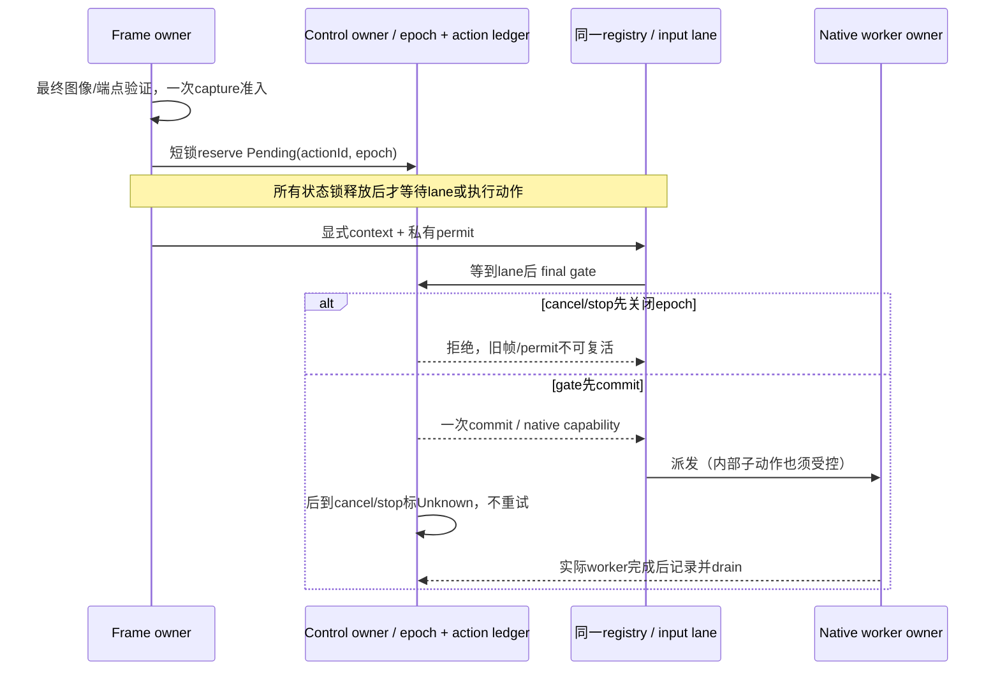

##### 子动作与 blocking worker 的补充契约

- child只能由审查过的可信调用点签发，绑定同一registry/context/actionId/epoch、目标与完整规范化参数。首个验证候选仅允许零事件前的同参数leaf/一层递归，深度1、委派1、普通事件预算64；委派同时消费父执行权。失败入口尝试不能置admitted；改目标/参数、跨父、重复消费、孙节点和JSON伪造均拒绝。这些是开发参数，正式采用前需冻结上限，不是新增模型API。
- 不把上游focus fallback、double-click改count、后台drag后前台递归等同于上述同参数委派。凡已可能产生副作用的路径不得自动重放；新子动作协议须另有目标复核、派发事实及明确采用证据。
- opaque能力显式移动到blocking worker，不能假定task-local传播。执行owner必须保有实际core输入coordinator及能力/context，直到原生worker实际完成清理；调用方future abort、断连或destroy不提前释放。第二把局部锁不能替代实际输入lane，所有可达输入路径须受同一机器执行owner约束。
- 每个普通事件reserve与stop/cancel共享短控制线性化点；post/阻塞等待不持控制锁。stop只关闭后续reserve，一个先前reserve的事件可能在确认后完成，此时结果为Unknown且不自动重试。只有证明实际dispatch边界满足更强约束后才能承诺stop确认后零普通事件。
- worker在down可能送达之前登记自己的release责任；只在确证NotSent时回滚。停止、普通错误或unwind时，在最后尝试位置最多一次mouse-up，再逆序modifier-up；清理权不受取消epoch阻断，不引入新动作。未知/不支持参数明确拒绝，不能静默舍弃modifier。真实OS flag/用户原有持键与本动作责任须分清，开发逻辑flags不证明物理状态。
- 从final gate之前即建立action-state收尾责任，覆盖能力取得前panic/取消、worker lane acquire失败、blocking闭包queued/prestart取消、正常退出和join异常；不能仅在闭包体内创建RAII。quarantine必须属于稳定执行owner，不能随单动作或观察者销毁而释放隔离；同进程static lane不提供跨Helper机器锁。
- release失败或cleanup/join异常必须先封闭准入、记cleanup debt/Unknown并保留执行隔离，再释放局部worker资源；禁止出现释放lane后才标quarantine的间隙。隔离恢复需要可验证的实际清理/旧owner隔离，不以超时或丢弃测试Engine代替；panic=abort/SIGKILL另验。正常返回/CGEvent post返回void不证明已释放。

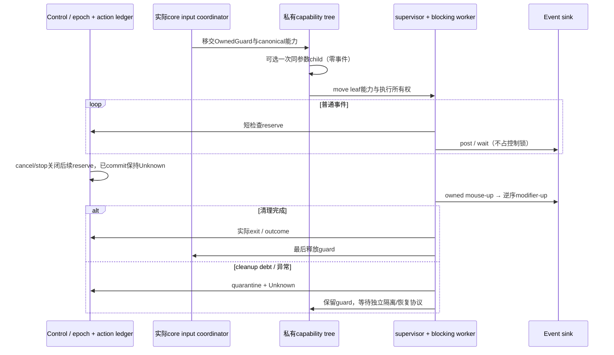

##### dispatch custody 与稳定进程隔离补充

- 实际输入lane在final gate前即纳入私有custody，先捕获同一registry/context的fence与完整参数证明，再允许commit；不能在commit后才创建收尾owner或重新取得授权context。commit锁内/外panic、平台入口proof后取worker前中断、已取capability但尚未交给supervisor时中断均须有唯一终态。
- root→worker的责任转移一次完成；blocking job在提交前就按值捕获能力及执行所有权。即使闭包从未运行，捕获值析构也会终结未启动动作；结果receiver关闭、supervisor异常、worker lane关闭都不得遗留Committed。普通event reserve必须处于Running且未终结，结束能力按值消费，未Started不得报告成功或重复使用。
- gate commit后在权威证据未齐时继续保守Unknown；仅当执行owner确定worker从未进入、且原生输入只能在其Running之后开始时，允许细化为内部NotSentAfterGate/派发not_sent。该证明须由实际队列/闭包生命周期取得，不能靠零日志、超时或取消请求推断；此终态仍禁止自动重发。一旦Started且收尾不明，保持Unknown并按债务规则隔离。
- quarantine属于稳定进程执行owner，保留实际core guard、不可逆poison与唯一process custody ID，不持有Engine/Bridge/registry/context形成生命周期环；不提供生产reset或按超时恢复。新Bridge及已排队调用均复核隔离；已有lane waiter须被通知拒绝，不能无限等待被隔离的lane。最终短commit段与poison共用线性化顺序，不能check后未受保护地放行。
- 每个quarantine开发场景在新测试子进程中运行；在同一场景内验证旧Engine/Bridge/registry Weak失效后重建仍拒绝。子进程退出不算安全恢复；进程级static不提供跨Helper机器锁，不关闭SIGKILL/panic=abort、崩溃或重启后旧OS状态的门槛。

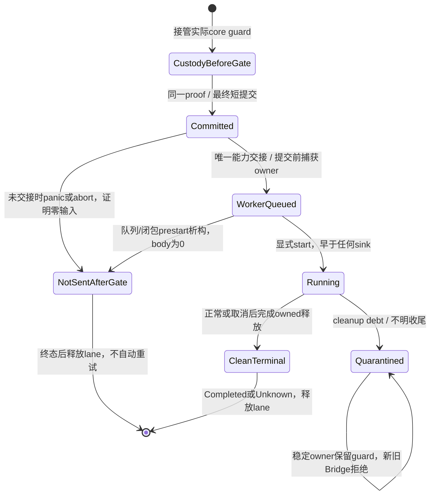

### 4.4 动作回执、幂等与错误

| 内部派发事实                                 | 回执                                                                  | 恢复规则                                |
| -------------------------------------------- | --------------------------------------------------------------------- | --------------------------------------- |
| 能证明从未进入原生输入派发                   | `action_sent=false, dispatch_status=not_sent`                         | 根据错误处理；重观察/重新授权不自动重发 |
| 已进入 OS 派发且有确切受理证据               | `action_sent=true, dispatch_status=accepted`                          | 仅证明派发，不证明点击或业务目标成功    |
| 已可能进入派发，但断线/取消/异常导致无法确认 | `action_sent=true, dispatch_status=possibly_sent, retry_action=false` | SDK 抛带 actionSent 的错误；禁止盲重放  |

Driver 的 `ActionEffect`（Confirmed/Partial/Unverifiable/SuspectedNoop/Refused）是效果轴；`ActionCompletion`（NotStarted/Completed/Unknown）是阶段证据。两者均不能机械映射本表：Completed 不等于业务成功，Unverifiable 不直接等于 possibly_sent。必须依据 Helper 原生派发记录与独立事件 oracle 分类；无法确定时保留可能已发并禁止重放。

内部 actionId 在一次调用重连中保持不变；同 session/generation/actionId 不重复执行。Helper 维护原生派发阶段，runtime 维护关联账本，不从异常字符串猜测已发送与否；在 Helper 重启后无法证明旧调用状态时仍按可能已发处理。动作去重只保证在约定存活窗口内不重复派发，不宣称跨崩溃持久 exactly-once。

缺少 lease 返回 `CONTROLLER_BUSY`；显式停止返回 `CONTROL_STOPPED`；缺权/鉴权失败返回 `PERMISSION_DENIED`/`NOT_AUTHORIZED`；不支持返回 `ACTION_UNAVAILABLE`；无有效 frame/状态返回可重观察错误。内部 `stale_frame`、scope、版本与窗口错误到 SDK 错误码的映射必须显式覆盖，不能全部变成可重试 `INTERNAL`。错误含零输入/送达事实，不含 token、socket 或截图落盘路径。

错误语义在 P1 用契约测试冻结；原 schema 未明确支持的可选参数不得静默忽略。成功动作无隐式 post-state；需要 UI 事实时显式观察。业务后置条件用独立 oracle 验证，不能把 native Promise resolve 当作业务成功。

### 4.5 取消、停止和资源释放

详细协议见 [设计 §7](../docs/design/computer-use-macos-phase1.md#7-stop取消retire-与资源完成)。AdmissionClosed/StopRequested、Fenced、Drained 是不同事实；早期停止 ACK 不得映射为“已停止”成功。只有最终门关闭与本 scope 的 owned 输入安全收尾满足下述条件才可确认停止；在途 ABI 未结束时必须保留 unknown/stopping 和容量债务。本说明不放宽优先停止要求，实际 ABI 停止上限仍须 P0-G3 正式验证。

- Driver/ABI 存在取消接口，但 abort 不证明 `spawn_blocking` 或已送 OS 的操作已停止；SDK shutdown 也不等于优先 stop。原生检查点、按住状态清理、故障时完成状态须由 P0-G3 实测，不把尚未实测的风险写成已确认缺陷。
- `AbortSignal`/断线需传播到 Helper 的 actionId，不只终止 Worker。动作队列逐项检查取消；长输入/拖拽按可中断阶段检查目标与 fence，不用 sleep 模拟同步。
- `stop_computer_control` 和可信本地用户紧急停止走独立优先控制路径，不等待正在执行的拖拽、输入、租约队列或 AX。普通调用只能停止自己 scope；本地可信用户入口可停止机器当前 owner，模型不能伪造该权限。
- 停止先关闭准入并发起 runtime lineage 撤销与 Helper fence，再取消在途、由 Helper 释放账本中实际持有的键/鼠标，最后释放 lease；权威撤销 ACK 与原生停止条件共同决定成功。清理事件是释放操作，不得在停止后再产生输入正文、点击或补偿动作。
- 每次异常/取消都有 finally；如果释放无法确认，readiness 进入 degraded，阻止其他 session 接管，直到 OS/Helper 证明清理完成。不能为“清理”盲目释放用户自己按下的所有键。
- 剪贴板保存所有原有格式的可恢复快照；写入后只在 changeCount/写入归属仍相同时恢复。用户或其他进程已改写则保留新值。自有快照失败时先拒绝粘贴；不伪称已恢复，不持久保存剪贴板正文。
- `closeSession` 必须从真实 session 结束/关闭入口调用，失效目标/frame、取消在途并释放该 scope；Worker cell 结束不是 session 结束。`dispose` 处理 runtime 全部 scope，幂等并有可观察完成结果。当前链路缺少 closeSession 调用点，需要实施中补齐；不得无限保留历史会话控制权。

## 5. 生命周期与远端边界

Host/Agent 启动只做静态能力与纯数据凭据装配，不安装、探活或启动 Helper。首次真正需要原生能力的调用、用户显式设置/授权操作、按需维护才拉起 Helper；无周期健康轮询，无“Helper ready 触发 Agent recycle”。读权限状态本身不触发截图探针，普通错误不打开系统设置。

安装从随包、已验证的自有 Helper 获取，原子替换；每次启动前重新验签、身份、版本和架构。不在线临时下载 Helper，不静默清除 quarantine 或放宽签名要求。权限 onboarding 按可信本地 live 观察复用现有流程：先确认、再读取新鲜缺权项；返回后受控重启 Helper，并只做一次显式功能探针，不自动继续任务。

锁存的显式停控与配置开关分开：停控撤销用户提交 lineage 并立即请求 fence 当前执行 scope；配置开关沿当前启动门控语义生效，不冒充紧急停止。显式禁用后新 Host/Agent 不装配 CUA；非 CUA 启动和 Browser Use 保持可用。

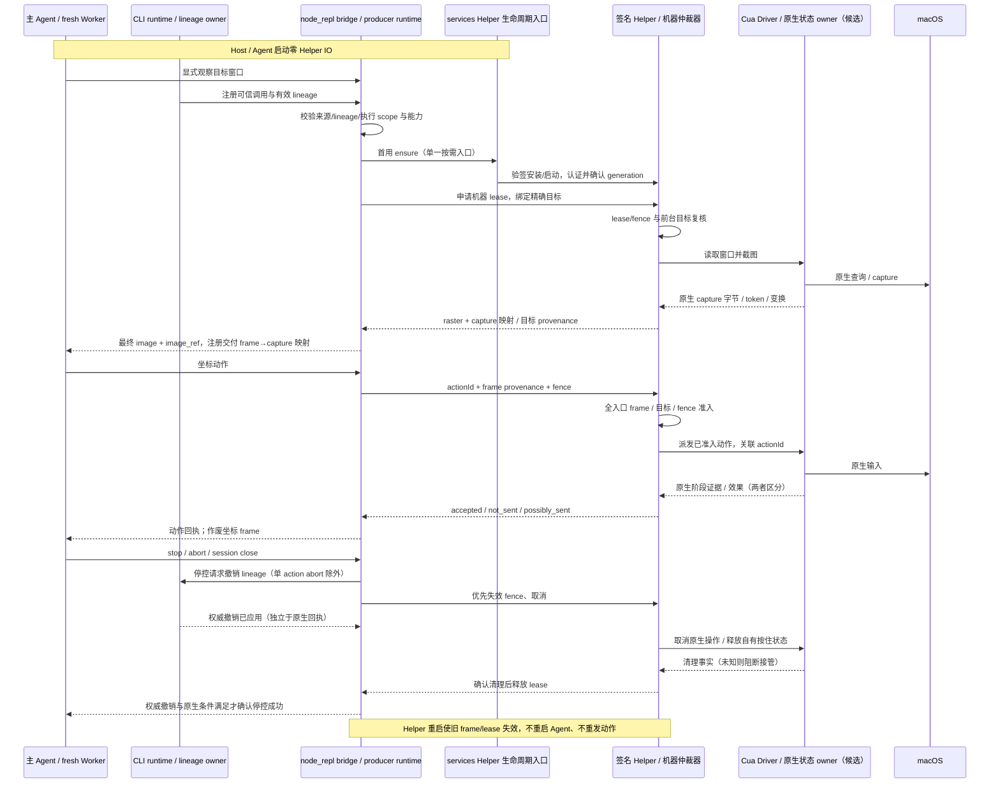

显式截图可能聚焦窗口，因此也必须先取得 lease；隐藏 metadata probe、应用/窗口枚举与只读权限查询不聚焦、不改剪贴板。原生 write 的 target 校验在 Helper，而不是 UI。

手机只恢复既有任务事件/历史，不把历史图像、actionId 或 image_ref 恢复成可动作 frame。手机 attach/reconnect 不转移控制权、不触发授权。由本地 continuous run 已合法发起的动作仍按其原 run 生命周期处理，不能仅因旁观 attachment 的变化重复或转交执行。带 remote workspace 或 replayable 请求上下文的新原生调用明确拒绝；Main/gateway 不新增 CUA 状态。

手机向同一会话发送新输入不属于只读观察；按 §3.2 在模型可见前处理 lineage 撤销与 Fenced。不能因底层仍是 desktop-continuous runtime 而沿用桌面 CUA 资格。

## 6. 技术风险与实施前门槛

| ID  | 尚未验证的风险                                                                               | 必须取得的证据                                                                                       | 不通过时的裁决                                                       |
| --- | -------------------------------------------------------------------------------------------- | ---------------------------------------------------------------------------------------------------- | -------------------------------------------------------------------- |
| R1  | 自有 Helper/launcher 的签名、TCC 主体、最低 OS 与升级稳定性                                  | arm64/x64 真实签名产物、权限主体、重启/移动/升级；固定 Team、身份与最低系统                          | 缺材料记 blocked；保持隐藏，不借用上游身份或终端权限                 |
| R2  | Cua 源码/SDK/native 版本一致性、许可闭包、Node/SEA/UniFFI/N-API 加载；备选 libnut 来源       | 源码 revision、制品摘要、可重建步骤、第三方清单、hardened runtime 加载；不能混用渠道版本             | 暂缓该组合或改候选；禁止把公开源码/二进制元数据当作完整证据          |
| R3  | 最终 raster/capture 映射、精确窗口身份、Retina 与前台复核；native capture 准入只覆盖部分路径 | 两相似窗口、网格/0/边界、全部坐标入口、旧帧/复用窗口/遮挡/焦点/拓扑零派发；明确前台路径私有 SPI 依赖 | 补齐可测试的 adapter/原生检查；不能直接使用后台语义或最近 scale 降级 |
| R4  | 原生取消粒度、优先 stop、按住状态、Unicode/剪贴板、派发事实与效果区别                        | 派发前后故障、断线/进程退出、真实 key-up/事件计数、保真读回、并发剪贴板恢复                          | 无清理证据不放行接管；分解/更换原语，不靠超时认定停止                |
| R5  | 多 Host/进程/数据根/Helper 代际的机器级互斥与 fence                                          | OS 独占执行锁、旧 owner 迟到派发、锁边界/进程死亡反例；同 UID 非授权 peer 拒绝                       | 双执行者或旧 fence 可输入即阻断；Driver 内部 mutex 不替代机器锁      |
| R6  | 视觉 SDK、strict schema、official frame 证明链与逃逸口                                       | 14 名称/参数反例、AX 拒绝、fresh Worker、真实 node_repl→provider 字节 oracle                         | 先补契约，不伪造 AX 或关闭 attestation；完整链路待 P3/P6             |
| R7  | 资源闭包、懒启动、签名打包、离线与恢复隔离                                                   | 两架构 Helper 加载/零上游启动/零外连；最终安装升级且 Agent 不换代                                    | 不翻转占位/开放入口；P0 加载探针不替代 P6 安装包                     |

所有 R 项仍待验证。P0 是四组最小技术实验，R6 的完整 provider 与 R7 的完整安装/升级证据在后续实现补齐，不因 P0 通过而关闭。现有未签名 0.1.0 继续按原规格构建。

### 6.1 P0 四组验证场景

本节是四组场景与采用标准的唯一规则源；实施计划维护执行步骤/产物。2026-10-24 最新授权已推进独立 P0-G1：固定 0.37.0 组合并完成部分 arm64 CLI/SEA 离线加载，整体裁决 `blocked`，见 [P0-G1 独立验证报告](/Users/zhvala/SourceCode/scripts/experiments/zody-cua-p0-g1/REPORT.md)。G2 已有逻辑、SDK/ABI、三工具入口及受限child/blocking worker开发证据，正式验收仍 blocked；G3/G4 未执行；不接入产品代码，不开放入口。后续只在隔离数据根、scratch 目标和专用验收机器验证；双架构分别取证，Rosetta 结果不替代原生 x64/arm64。

**P0-G1：自有签名 Helper、模块加载、TCC 与离线（R1/R2/R7；MCU1-02/03/23/26/27 的最小子集）。**

- 给定：冻结同 revision 的源码/SDK/native/配置组合、摘要与许可闭包，选定 Helper 形态；在 arm64/x64 上使用当前 `local-self-signed` profile 的固定证书身份和随包运行时加载，而非开发终端直接启动库。可先完成本机架构验证，分别登记其他架构的缺口。
- 触发：冷启动、缺权/授权后重启、移动/覆盖升级、离线运行；验证截图和一次受控输入，记录 permission owner、进程树、加载文件和网络观测。确认普通 Host/Agent 启动不启动 Driver/上游 app。
- 通过：模块在最终 Helper 形态下可加载；TCC 主体与固定身份一致；无隐式 `open`、任意 daemon 连接、下载、遥测或更新外连；前台调用可用且所需依赖/签名/最低 OS 可审计。daemon 路线显式关闭遥测/更新并实测；原样设置变量不算证据。
- 阻断：缺所选 profile 的自签名证书/目标 OS/架构或匹配制品按对应验证项记 blocked；不因缺 Developer ID 阻断本地自签名验证。签名加载失败、权限归到错误主体、隐式启动/外连、来源不明均不能通过。源码 deployment target 13.0 不替代最低系统实机证据。

**P0-G2：相似窗口、Retina、最终图像与旧帧拒绝（R3/R6；MCU1-05–13/15 的相关子集）。**

- 给定：同一应用两个相似窗口、可独立计数的 marker 网格；单屏 Retina/非 Retina，含 `[0,0]` 和像素边界。原生 capture token 与 Zody 最终 image/image_ref 建立可核验映射，不把 AX/DOM 坐标给模型。
- 触发：观察后分别点击、拖拽、滚动；再注入移动/缩放、遮挡、切焦点、未知模态、窗口/PID 复用、TTL/generation/目标/scope 变化及显示器拓扑变化。测试无 token、跨 scope 与全部公开/底层逃逸入口。
- 通过：有效帧像素与所选窗口原生效果对应，另一窗口不变；所有陈旧/错目标/越界/不支持路径零派发，不自动用最近 scale 或换窗口。最终图像重编码/丢 image_ref 后不得留下动作凭据。每次接受写入后旧坐标帧不可复用；同 turn fresh Worker 的有效映射不因 cell 退出丢失。
- 阻断：仅 click 受保护、无法检测前台变化、capture 与模型最终字节无证明、任何拒绝样本仍有 native 输入。SDK 原生 capture 检查不完整可以由有证据的 Zody guard 补齐，不能通过放宽本规格解决。

**P0-G3：派发中取消/断线、按住状态与不重放（R4/R6；MCU1-14/16/18–22 的相关子集）。**

- 给定：scratch 文本/按键/拖拽窗口与独立 native 事件 oracle，记录 actionId、派发阶段与持有状态；冻结可中断粒度、停止响应上限和测量点，不以超时作为完成证据。
- 触发：长文本、拖拽、修饰键按住期间分别在派发前/后 abort、断开 RPC/控制关系、stop、关闭 session、终止 Helper；重复 actionId/stop 并注入迟到完成。覆盖空白/换行/CJK/emoji、Ctrl/Cmd、多格式剪贴板及并发用户改写。
- 通过：派发前可证零输入；派发后按事实回 accepted/possibly_sent；不确定调用不重放。优先 fence 后停止正文/点击派发，仅释放自有按住状态；不能确认清理则 degraded、禁止接管。文本/剪贴板符合 §4.5；单次 RPC/cell 完成不误关整个 session，真实结束会清理，Agent 不随 Helper 重建。
- 阻断：abort/Promise 结束被当作原生停止、效果枚举冒充派发回执、残留按住状态、释放用户按键、重复输入或无法明确停止边界。各观察点须记录实际已送事件与迟到事件，不能宣称撤销 OS 已接收事件。

**P0-G4：两 Host、两数据根与跨进程机器仲裁（R5；MCU1-17/19/20/23/25 的相关子集）。**

- 给定：两个独立 Host、两个数据根、两个可独立启动的 Helper/Driver 实例竞争同一 OS 用户交互桌面；验证 OS 锁与 endpoint 不按 workspace/数据根拆分。
- 触发：同时申请、owner 正常释放、断线/崩溃、旧进程未退出时启动新代际；提交旧 fence、迟到 ready、旧 Worker、伪造 peer，并覆盖锁屏/睡眠/用户切换的失效与重新准入。
- 通过：每一时刻只有一个有效机器执行者，另一方 CONTROLLER_BUSY 且不抢焦点/剪贴板；新代际先证明旧执行者隔离与清理，显式新请求才可取得新 lease。旧代际/旧 fence/非授权 peer 零输入；所有权释放记录与 native 事件可关联。
- 阻断：同进程测试或 JS mutex 作为唯一证据、两个 owner 同时输入、超时后无条件接管、旧 owner 迟到可派发。进程锁只能证明独占，不能代替按住状态清理与身份校验。

### 6.2 采用、阻断与备选裁决

P0 开始前登记候选组合与参数：源码 SHA、SDK/native 版本及摘要、运行时/构建链、Helper/launcher/证书指纹/实际 Team 信息、最低 OS、能力/协议版本、frame TTL/字节预算、lease/fence 失效策略、停止上限/可中断阶段、按键/文本/滚动/拖拽限制与关联账本生命周期。每轮实验先固定组合、参数与断言，P0 出口冻结已通过实测的版本；不直接照搬上游默认 TTL/图片尺寸。过程中变更组合或参数需重跑受影响证据，不能拼接不同版本的通过结果。

- **采用进入 P1–P6**：同一冻结组合在两架构的四组必需实验均通过；来源/许可可审计；差距可在职责明确且可测试的 Zody adapter/Helper 中补齐，不复制 Driver 原生状态、不扩大首期范围、不引入第二套 Agent 或超范围依赖。记录残余风险、所选入口与证据；完整 R6/R7、28 个 MCU1 和发行门槛仍待后续验收。
- **blocked**：材料/环境/oracle 缺失或关键语义没有证据；允许继续契约/文档设计，不准开放产品原生输入或标成已采用。未执行不是不通过，也不是通过。
- **不采用当前组合 / 转备选验证**：失败无法由有边界的 adapter 解决，或需放宽安全门槛、深度重写 Driver 核心、维持不可维护 fork。先记录失败与取舍，再显式选择 UI-TARS/nut-js 的固定组合；在相同四组与产品门槛下重新验证，不能继承 Cua 结果。若仍无法满足，保持 unavailable，不先上线再补。

候选切换是工程裁决，不是运行时自动 fallback。已运行 scope 先 fence 并确认隔离/清理，旧 frame/token/lease 作废；任何 possibly_sent 动作不因换后端而重放。P0 通过不修改 0.1.0、placeholder、能力发布清单或产品入口。

## 7. 验收场景

完整 MCU1 场景当前均为 `planned / 未完成验收`；P0-G1/G2 的独立开发子项证据不等于整项通过。`contract` 为可控替身/故障注入，`desktop-e2e` 为真实 Electron→Agent→node_repl→producer 链，`live-macos` 为真实 Helper/OS 与独立原生效果 oracle，`packaged` 为实际安装包。mock、历史用例和另一架构通过不能替代所需证据。独立实验已有合成夹具和纯逻辑测试；产品及正式原生验收夹具尚未实现。

| ID      | 给定 / 触发                                                                      | 通过断言                                                                                                                    | 必需证据                                          |
| ------- | -------------------------------------------------------------------------------- | --------------------------------------------------------------------------------------------------------------------------- | ------------------------------------------------- |
| MCU1-01 | 占位构建或发行门槛未通过，启动应用与普通任务                                     | CUA 入口隐藏；零 Helper 安装/启动/截图；Browser Use/普通 turn 正常                                                          | contract + desktop-e2e                            |
| MCU1-02 | 干净本地 Desktop，首次合法 CUA；多个并发首调                                     | 只有一个有效执行仲裁器；非 CUA spawn 不等待；冷启动结果不伪成功                                                             | contract + desktop-e2e + live-macos               |
| MCU1-03 | 真实缺权，打开设置/显式授权，然后返回；中英文/双主题/窄窗口                      | 权限属于 Zody Helper；只处理确认后仍缺的项；只一次显式像素探针；不重发原动作                                                | desktop-e2e + live-macos + packaged               |
| MCU1-04 | 普通状态轮询、普通错误、历史 request_access、手机恢复                            | 零截图探针/权限 prompt/系统设置副作用                                                                                       | contract + desktop-e2e                            |
| MCU1-05 | 同名应用、冲突 bundle/PID、PID/window id 复用、多窗口                            | 只绑定精确有效身份；歧义零输入；不启动/替换为相似应用                                                                       | contract + live-macos                             |
| MCU1-06 | 同一应用两个相似窗口，显式选择一个后观察并点击                                   | 图像、前台身份与 native 效果均属于所选窗口；另一窗口未修改                                                                  | desktop-e2e + live-macos                          |
| MCU1-07 | 单屏 Retina/非 Retina，含左上角 0 坐标和边界 marker                              | 最终图片像素→原生 marker 精确对应；不在模型侧换算；越界零派发                                                               | contract + live-macos 两架构                      |
| MCU1-08 | 观察后移动/缩放窗口、覆盖目标、切焦点、出现未知模态窗口                          | 旧帧动作返回重观察错误，native 输入计数为 0；不点覆盖窗口                                                                   | contract + live-macos race                        |
| MCU1-09 | 多屏启动；观察后接拔屏/改变 scale、旋转、分辨率                                  | 多屏截图/输入拒绝；所有旧帧失效；不回退首个 source                                                                          | contract + live-macos                             |
| MCU1-10 | 无帧、过期/被替换帧、跨 session/workspace/run/frame                              | 全部零输入；同路径不同 identity 不能交叉使用；帧不因重绑定续期                                                              | contract + node_repl 集成                         |
| MCU1-11 | 两个 fresh Worker cell：第一 cell 截图，第二 cell 重绑定并点击                   | 同可信 turn/目标有效帧可用；cell 结束不 closeSession；写入后旧坐标帧作废                                                    | node_repl 集成 + desktop-e2e                      |
| MCU1-12 | 最终图像被缩放、重编码、换 MIME、拆开 image_ref、重复栅格或超预算                | 整对原子拒绝/移除，不留下可动作 credential；第三方同名输出不能获得保护                                                      | core/adapter contract + node_repl 媒体集成        |
| MCU1-13 | 所有 14 工具经绑定 API 和逃逸口；AX 方法/元素 target/左右滚动                    | 支持子集按严格 schema 执行；不支持稳定 ACTION_UNAVAILABLE 且零派发；原始 Driver/generic 调用不可逃逸，视觉模式不报 AX ready | contract + SDK 集成                               |
| MCU1-14 | scratch 文本窗口输入前后空白、多行、中文、emoji、显式 Enter                      | 内容按码点精确读回；普通 type/paste 不额外提交；Ctrl 与 Cmd 含义不同                                                        | contract + live-macos                             |
| MCU1-15 | 左/右/中键、单/双击、修饰键、上下滚动量、0 坐标拖拽                              | 真实事件及独立 fixture 后置条件匹配声明；scroll_amount 不被忽略                                                             | live-macos                                        |
| MCU1-16 | 多格式剪贴板粘贴中注入异常；同时用户/另一进程写剪贴板                            | 自有事务可恢复原格式；外部新值保留；不泄漏/记录正文；不发生第二次粘贴                                                       | contract + live-macos                             |
| MCU1-17 | 两个独立窗口 Host、两个数据根的 session 同时申请控制                             | 只一个 owner 发输入，另一个 CONTROLLER_BUSY；不抢焦点/剪贴板；释放后需显式新请求                                            | 双 Host desktop-e2e + 双进程 live-macos           |
| MCU1-18 | 长拖拽、按住键或输入中 abort/断线/本地紧急停止                                   | 优先 fence；停止后无新增正文/点击，持有键释放；回执按真实派发阶段分类                                                       | contract + live-macos fault                       |
| MCU1-19 | stop 重复调用；旧 Worker/run/fence、迟到 ready、自动续跑及 producer/runtime 重建 | 幂等；已撤销 lineage 不因新 turn/进程复活；普通 scope 不能停止其他 owner；详见 §7.1                                         | contract + 多进程 + desktop-e2e                   |
| MCU1-20 | 原生派发前/派发后分别超时、断线、重复 actionId、Helper 重启                      | 前者 not_sent，后者 accepted/possibly_sent；不重放；旧代际不能确认新动作                                                    | broker/runtime fault + live-macos                 |
| MCU1-21 | turn 终态、session 关闭、workspace 移除、Host 退出、runtime dispose              | 关联 frame/lease/按住状态释放；无迟到写入；其他普通任务不被 CUA 清理误停                                                    | contract + desktop-e2e                            |
| MCU1-22 | Helper 空闲退出/崩溃/权限刷新/恢复                                               | Agent PID/runtime generation 不变；旧帧失效；按需恢复且无周期探测/自动重发                                                  | contract + desktop-e2e + live-macos               |
| MCU1-23 | 缺失/错 token、伪造 launcher PID、同 UID 非授权 peer、替换 Helper；cell 隔离绕过 | 原生动作前拒绝；凭据不进入 Worker/Bash/hooks/其他 MCP/env/log；cell 不能操作可信状态或直接调用 Helper；见 §7.1              | contract + 进程隔离 + packaged live-macos         |
| MCU1-24 | subagent、SSH/WSL/Docker/Server、独立 CLI/Web、手机与本地 turn/queue/guide 混合  | 未授权调用零副作用、不增加 Agent/Host/Helper；手机输入可见前撤销/Fenced；只读旁观不误停；见 §7.1                            | scope contract + Desktop/手机 replayable 代表集成 |
| MCU1-25 | 锁屏/睡眠/用户切换/安全输入，随后恢复                                            | 停止输入、帧失效；恢复不自动续控，须重新观察；不盲输密码                                                                    | live-macos                                        |
| MCU1-26 | 无用户 Node/pnpm 的离线环境安装 arm64/x64 候选包                                 | Helper/原生依赖路径、架构、签名、许可材料正确；不下载闭源产物；观察→动作→停止通过                                           | packaged 两架构                                   |
| MCU1-27 | 覆盖升级、移动安装位置、旧 Helper/损坏资源/签名不匹配                            | TCC 主体符合 R1 结论；不执行旧/损坏代码，不恢复旧 frame；有明确错误                                                         | packaged live-macos                               |
| MCU1-28 | 真多模态模型根据最终 raster 点击无 AX/DOM 坐标的 canvas 目标                     | 使用真实 node_repl/producer/native 路径，独立 marker oracle 验证唯一目标；记录失败与重复轮次，不宣称通用成功率              | desktop-e2e + live-macos model                    |

错误场景的“零输入”以 Helper 派发 hook/原生事件计数及独立目标 oracle 为证，不以 UI toast 或 Promise 拒绝代替。测试在独立数据根、scratch 应用、非敏感文本和受控显示器环境执行；锁屏/崩溃/权限重置等破坏性操作只在专用验收机器进行。

### 7.1 授权边界审查补充用例

以下是 MCU1-19/23/24 的必需子用例，均为 planned，不另计正式通过数。每项同时覆盖拒绝路径与合法对照，不能以“全部拒绝”证明能力可用。

| 子用例   | 给定 / 触发                                                                                                          | 必需断言与证据                                                                                                                                                   |
| -------- | -------------------------------------------------------------------------------------------------------------------- | ---------------------------------------------------------------------------------------------------------------------------------------------------------------- |
| MCU1-23a | 在真实 cell 中尝试 inspector 连接可信 main、调试附加、读取/复用控制 FD、加载原生模块、改写可信文件，并从子孙进程重复 | 不可读取测试密钥/改写测试权威状态，不可伪造 control/Helper 请求；无原生派发。必须跑最终隔离进程配置，不能只 mock loader；合法 SDK 观察与 Browser Use 对照正常    |
| MCU1-24a | 桌面先注册并取得 CUA，手机 guide/steer 与坐标调用交错；覆盖有/无在途动作及同 turn 尚未创建原生 scope                 | 可信 mobile 来源不能被本地 runtime 配置覆盖；模型可见前 lineage 撤销且所有相关活动 scope 已 Fenced。该时点后普通 handoff 增量为 0；此前在途与 owned release 单列 |
| MCU1-24b | revoke ACK 丢失、Helper fence 阻塞/失联、输入 queue→guide 或 guide→queue；随后收到本地 steer                         | 未确认 Fenced 的手机输入不提交模型；已接受输入仍可追踪且不重复投递；控制路径继续可用；本地 steer 不解除撤销。迟到 ACK/旧 revision 不恢复资格                     |
| MCU1-24c | 手机输入正常排队并在本地 runtime 晋升执行；另做只读 attach/reconnect/disconnect 对照                                 | 手机新 turn 的原生/安装/权限副作用为 0；来源缺失同样拒绝；纯旁观不撤销合法桌面 lineage                                                                           |
| MCU1-19a | 停控已确认后 producer 崩溃；或在 runtime 撤销 ACK 前后丢回执/断 sideband，再创建新 producer                          | 停止成功必须有权威撤销 ACK；runtime 存活时保留撤销，关联关系失联时也撤销；新 producer 仅凭 active turn 不能 register/acquire，新增普通输入为 0                   |
| MCU1-19b | 停控后目标自动续跑产生新 turn，注入后台结果、换目标、fresh Worker；再终止 runtime 并恢复旧任务                       | 所有旧提交派生执行保持禁用；runtime 恢复不从历史重建 grant；普通任务仍可运行，无重放                                                                             |
| MCU1-19c | 已撤销提交结束后，新的可信本地用户输入建立独立提交；另设机器 dirty/quarantine 未解除                                 | 新 lineage 才可重新评估资格；旧 lineage/ID/消息不能复活；即使是新 lineage，机器恢复未确认仍拒绝输入。记录合法恢复对照及有界撤销记录回收/溢出反例                 |

## 8. 完成与证据要求

首期完成需同时满足：P0 四组裁决有完整证据并固定后端组合；R1–R7 对应门槛关闭；上述必需场景通过；macOS 两架构签名安装包验证完成；无新增 AX/跨平台/手机 CUA 承诺；发行规格和 UI 能力声明与实际制品一致。若仅一架构完成，只记录该架构结果，调整首期范围须先修订本文，不以 skip 冒充完成。

后续代码阶段须执行 `pnpm typecheck`、`pnpm lint`、`pnpm architecture:check --changed`、目标包测试及对应 E2E/实机/安装包验证。采用当前 package.json 的真实入口；新 producer 测试入口需随实现建立，不能在文档中伪称已有命令。

每条证据记录 case ID、源码/候选制品 SHA、macOS 版本/架构、Node/Helper/native 版本、签名验证结果、测试入口/步骤、native oracle、预期/实际、pass/fail/blocked 及脱敏附件。旧闭源用例可做场景参考，不能继承其通过状态。生产日志只记录关联 ID、阶段、错误、派发和清理事实；截图、按键/输入正文、剪贴板与凭据不落盘，测试证据也须脱敏。

## 9. 源码与调研锚点

- Zody 基线 `beb2f750c06252915155b853aeb40fb10ca0d33d`，同时考虑 2026-10-24 调研工作树；`packages/zcode-cua/`、`apps/zcode-cli/packages/node-repl-host/src/cua-{bridge,broker}.ts`、`server.ts`。
- SDK/14 工具：`apps/zcode-cli/packages/zcode-cua-plugin/scripts/computer-use-client.mjs`；真实 strict schema 尚需重建。
- Cua 优先候选 HEAD `ceb65a2659450b383fd27c0f09d56c5a134a5b7a`（源码 0.38.0）；组件 [0.38.0 release](https://github.com/trycua/cua/releases/tag/cua-driver-rs-v0.38.0) tag SHA 为 `85e2b1318bd77ccf3cfa88ccdf875a4bb7eaed19`，不能将 HEAD 能力直接归给 release。调研时 npm latest/hosted 安装脚本仍为 0.37.0；P0 冻结同 revision SDK/native，不混装、不依赖 latest。
- Cua 来源：`libs/cua-driver/typescript/src/{index,daemon}.ts`；Rust 下 `cua-driver-sdk/src/{lib,runtime,embedded,worker,service_session}.rs`、`platform-macos/src/{tools/get_window_state,tools/click}.rs`、`cua-driver-core/src/capture_registry.rs`、`cua-driver-core/src/tool.rs`；路径位于 `libs/cua-driver/rust/crates/`。构建见 `rust-toolchain.toml`、`.cargo/config.toml` 与 `.github/workflows/cd-rust-cua-driver.yml`。
- [Cua 许可清单](https://github.com/trycua/cua/blob/ceb65a2659450b383fd27c0f09d56c5a134a5b7a/legal/LICENSING.md)：Driver 核心 MIT，不包含 FSL 组件和可选模型的自动许可；未完成完整第三方/制品审计或实机 PoC。
- UI-TARS 备选基线 `3ac2cb8d946d78d5ff92ad17b318eaafa18c178c`，来源 [NutJSOperator](https://github.com/bytedance/UI-TARS-desktop/blob/3ac2cb8d946d78d5ff92ad17b318eaafa18c178c/packages/ui-tars/operators/nut-js/src/index.ts)、`apps/ui-tars/src/main/agent/operator.ts`、`systemPermissions.ts`、`forge.config.ts`。
- 备选依赖为 `@computer-use/nut-js@4.2.0`、`@computer-use/libnut@4.2.0`、`libnut-darwin@2.7.1`；平台归档摘要与 UI-TARS lockfile 一致，darwin 二进制为 x64/arm64 Universal，带 Apache-2.0 LICENSE；匹配原生源码、构建、签名加载仍未验证。
- 当前打包判定 `packages/desktop/scripts/computer-use-producer.mjs` 使用 placeholder 标记，不是逐能力 readiness。未来按平台/profile 交付时必须同步改造，不能只删布尔标记导致 Windows/旧 Helper 构建路径误启动。

文档阶段之后已按最新授权在独立目录推进 P0-G1，不属于产品实现。固定源码 `2d2f99228d4d2508dc6fcc84c176b296e146714a`、SDK/native 0.37.0；基础 Node 24.14.0 SEA smoke 通过，hardened 保留上游 native 签名时实际因 Team ID 不同拒绝。当前无有效自有签名 identity，未做真实 TCC 授权/截图/输入、x64 或最低系统验收，故 G1 blocked。该 Node 制品静态 minos=13.5，不能据 Driver target 13.0 承诺最低系统。未修改产品协议、依赖、签名发布配置或入口；详细证据见 [P0-G1 独立验证报告](/Users/zhvala/SourceCode/scripts/experiments/zody-cua-p0-g1/REPORT.md)。

### P0-G2 开发证据快照

2026-10-24：固定 2d2f992 / 0.37.0 的29项原始纯测试、6组PNG/24点像素映射及24点双阶段投影、16拒绝反例、8轮一次性并发消费均有开发证据。纯 registry 不自动 supersede、click token 可选、drag/scroll 无统一 admission、窗口实例/前台 stale 与最终模型交付未闭环。Rust1.93.1 纯模块/几何切片 harness 不等于上游1.97.1完整构建或SDK/native/实机通过。

证据见 [G2报告](/Users/zhvala/SourceCode/scripts/experiments/zody-cua-p0-g2/REPORT.md)。正式 G2 **blocked**；统一 adapter 仅在 [独立目录](/Users/zhvala/SourceCode/scripts/experiments/zody-cua-p0-g2-adapter/README.md) 验证 §4.3.1，不接入产品、不关闭 R3/R6 或 MCU1 场景。真实两相似窗口、物理Retina、零原生派发、OS竞态、真实provider媒体链与最终签名Helper仍未验收。

统一adapter独立开发模型随后取得证据：258矩阵断言、29原始+5新增单测、9PNG/12点独立投影、12轮混合工具消费与8轮观察竞争通过，见 [adapter报告](/Users/zhvala/SourceCode/scripts/experiments/zody-cua-p0-g2-adapter/REPORT.md)。它仅验证§4.3.1的单进程模型：真实OS事实、媒体确认、生命周期钩子、native执行均未接通。Rust内部trusted native-pixel入口提供特定窗口路径避免重复scale的基础，公开TS/SDK没有等价入口；尚需窄桥可构建性、同一registry与授权context、无重复消费及全入口不可绕过证据。未报告的焦点变化后恢复、ack后的provider改图当前不可察觉，不能关闭旧帧或媒体链正式门槛。None引用只按可信scope在准入点绑定已交付latest，真实请求排队/SDK关联仍须验证。

### 前轮Rust窄桥专项的证据边界

2026-10-24：原始core/contract和仅加18行入口的candidate分别构建；46运行场景、9PNG/12点投影、6轮Barrier混合调用、10外部编译控制通过。实际registry/context/capture owner、Bounded manifest与撤销已运行，最终工具为GuardedSpy。公开Rust对象及替身槽位的generic/typed逃逸反例已验证；实际SDK/ABI与platform工具未执行。上轮258矩阵、5000ms交付TTL和image/image_ref规则没有整体移植到本窄桥，不能合并写成完整G2通过；证据见 [窄桥报告](/Users/zhvala/SourceCode/scripts/experiments/zody-cua-p0-g2-bridge/REPORT.md)。R3/R6及MCU1正式验收仍未关闭。

### opaque ABI / platform gate 的新增开发证据

2026-10-24本轮独立实验实际编译/链接source SDK 0.37.0、core默认feature组合和macOS platform。真实SDK普通及bound-session的generic/typed方法经过C ABI executor进入同一实验registry并被拒绝；正向Bridge显式持有同一registry/capture/context，真实ClickTool/DragTool/ScrollTool入口检查private proof后，在正文首行强制no-input截停。51场景组、58个ctypes ABI断言、独立C客户端、raw SDK链接失败与精确9符号导出通过，见 [本轮报告](/Users/zhvala/SourceCode/scripts/experiments/zody-cua-p0-g2-opaque-gate/REPORT.md)。

控制面已从Frame State拆成独立Control；原coordinator等待、native探针挂起、frame锁被占住均不阻塞cancel/stop，opaque destroy后的owner仍由worker保持至释放。stop只做逻辑epoch关闭，不同步等待物理capture清理或worker drain；已在途publisher仍可能返回不可用handle。当前实验只认开发sentinel回执，ABI含2个dev发布器且没有peer鉴权/完整close回收，指定linker封口尚未变成默认构建/发布CI不变量。

strict proof会拒绝上游内部ClickTool嵌套和drag self.invoke，原生正文/逐事件fence、blocking worker安全收尾、无重复scale/admit及真实坐标/滚动单位仍未验收。arm64/macOS26.6.2、Rust1.93.1/ad-hoc产物不能替代最终Developer ID/TCC、x64和最低OS证据。上轮image_ref/TTL/OS/lifecycle完整adapter未组合进本桥；G1/G2、R3/R6及MCU1继续blocked，G3/G4不因此关闭。

### 原生子动作 / blocking worker 的新增开发证据

2026-10-24：[本轮独立报告](/Users/zhvala/SourceCode/scripts/experiments/zody-cua-p0-g2-native-worker/REPORT.md)记录189场景组、180轨迹/974个fake sink样本、1个core能力树矩阵测试函数、8个外部编译控制通过。实际source SDK generic/typed及直接Tool无proof仍拒绝；实际core coordinator的OwnedGuard随能力树进入worker/隔离状态，abort观察future不释放实际lane。逐项cancel/stop、普通事件与释放位置的故障、loop unwind、cleanup/join panic和unsupported modifier均有确定性开发反例。前轮58 ABI/9导出封口未在本轮重验。

正例child/drag递归由dev hook在零事件时同参数委派；不是上游focus/background retry原生正文。实际spawn_blocking线程使用显式能力、独立supervisor更新同一账本；已reserve事件取消后仍可能落下，只有后续普通reserve被关闭。mouse-up和逆序modifier释放仅证明fake sink尝试；debt/异常先quarantine并保留实际core lane。Engine销毁仅用于结束独立case，不是产品恢复方案。

仅drag复用上游纯计划；click/scroll/modifier flags、延时与窗口事实为替身。原始CGEvent/AX/foreground activation、真实单位/scale/admit、用户持键、焦点/overlay、SIGKILL/panic=abort、并发revoke/expiry、跨Helper隔离与恢复仍未验收。ABI/peer/回收/默认构建封口及最终provider/frame/TTL/OS链未组合，用户准备的签名/TCC/x64/最低OS环境待验。正式G1/G2、R3/R6与MCU1保持blocked；G3/G4未执行，无产品实现变更。

前轮最终只读复审确认主体修正，但当时commit→capability前、worker lane acquire失败及blocking闭包prestart取消尚缺action-state/所有权收敛证据；quarantine依赖Engine存活，未证明稳定owner、双Bridge或跨进程隔离。cleanup外层panic仅覆盖入口，未覆盖部分释放后panic；revoke/expiry组合未验。以上仍为采用阻断，本轮abort证据限定在worker已取得能力的路径。

### dispatch custody / 稳定隔离的新增开发证据

2026-10-24：[本轮报告](/Users/zhvala/SourceCode/scripts/experiments/zody-cua-p0-g2-dispatch-custody/REPORT.md)记录110个独立子进程场景、200轨迹/700个fake事件、1个core能力矩阵测试函数和9个外部编译控制通过。final gate前custody接管实际coreguard，未启动中断收敛NotSentAfterGate；worker能力显式传递并由Drop承接闭包prestart取消，Started未知仍Unknown。42个未启动场景包含12个真正单blocking线程池排队/abort组合，均零body/事件且后续新Bridge正常；20个清理债务/异常场景验证对象释放后稳定隔离，3例已有其他Bridge排队并被watch唤醒拒绝。

前轮提出的三项阻断在当前受限开发模型中关闭；core最终commit与poison同进程admission短锁裁决，实际lane缺失拒绝，process custody ID与Bridge actionId分开。结束能力按值消费，未start/二次start/结束后复用反例拒绝；30个完整参数/目标/context/registry、SDK generic/typed与direct Tool反例保持封闭。详细矩阵不继承旧189/58 ABI/9符号计数。

真实CGEvent/AX、OS释放/用户持键/焦点、原生单位/scale、原始focus/background retry、revoke/expiry及完整publisher/drain、最终provider/frame链与ABI/peer/默认构建封口仍未验收；静态owner不跨Helper进程，无恢复/reset证据。用户准备的Developer ID/Team/TCC、x64/最低OS/Retina正式环境仍待运行。G1/G2正式blocked，G3/G4未执行，R3/R6与MCU1不因此关闭，无产品代码接入。

最终复审补强：Control/custody共用NativeActionCell，终态不用host回调；工厂/identity/cell端口只在commit前捕获且panic/缺失拒绝。正常返回时worker未终结，立即按owner_protocol_fault置Unknown并稳定隔离，旧能力不能再start/reserve；这与observer取消后允许worker收尾分开验证。最终110场景包含15个precommit拒绝/取消、42个postcommit未启动、6个故意停放cap后提前返回、3个活跃容量满后在同一Bridge恢复准入的场景；总200轨迹/700个fake样本，9个外部编译控制通过。诊断环128、活跃最多256、终态保留128；Unknown但仍有worker不回收。Frame锁内、capture消费前权威检查容量，终结旧cell后同帧可继续；不把该开发回收证明写成正式ABI/产品生命周期已完成。普通动作Unknown但owned release已明确清洁时不强制进程隔离，仍禁止自动重试；收尾不明或owner丢失则必须隔离。真实OS release确认仍为正式阻断。

回收反例补充：当前请求强持同一动作cell，Control目录仅管容量/保留，回执不按目录是否存在推断成功。新增9个retire场景在工具返回后删除目录条目再放行，NotSent/Unknown/债务仍返回原错误；owner协议故障即便未Started也按Unknown隔离，与清洁prestart取消区分。最终110个独立子进程、200轨迹/700 fake样本和9个外部编译控制通过，静态复审未代替运行证据；正式门槛不变。

### actuator seam 的开发执行契约与正式准入差额

2026-10-24：[独立验证报告](/Users/zhvala/SourceCode/scripts/experiments/zody-cua-p0-g2-actuator-seam/REPORT.md)。本节细化D1目标与新增证据，不改变首期产品范围、状态所有者或正式门槛。固定0.37.0/SHA `2d2f99228d4d2508dc6fcc84c176b296e146714a` 的独立候选；真实Tool入口后仍由dev runner选新platform executor，原始正文未整体迁入。

- core custody唯一拥有同一registry/context/action cell与实际lane；opaque worker按值进入blocking闭包，Running后只领取一次actuator执行权。platform唯一拥有私有Step、原生对象及release ledger；frame仍由Bridge owner管理，不能在事件层二次admit/scale。
- 普通事件为reserve→creation fence→真实构造→dispatch fence→登记可能down→单次handoff。状态锁不得覆盖CG调用、port或delay；取消可丢弃已创建未派发的对象。最后fence后仍有一个已获准事件竞态，不能承诺stop返回即绝对零事件。
- release仅从本动作可能派发的down产生：mouse-up在最后可能位置，之后逆序modifier-up，剩余flags准确；取消不关闭已拥有的释放权，每项仅一次。明确NotSent可回滚down；Unknown/panic不可猜测未派发。释放构造/派发不明需debt/quarantine并继续其他释放，禁止重试或新Helper规避债务。
- 延时需在同一capability下逐slice检查fence；本轮真实2ms sleep并非OS调度/系统调用的硬上限。正式产品节奏和停止SLA须实测。当前可信host的finish bool要在正式阶段替换/封装为账本核验的不可伪造终态回执，不能让ABI调用者自报完成。

开发场景464进程通过：三工具normal、repeat拒绝、source故障、observer abort；各事件创建/派发前后故障及NotSent/Unknown/panic；delay故障；每普通位置×六checkpoint的cancel/stop与首release处取消。独立oracle核对2,492真实对象、2,378边界attempt、2,332本地记录，54debt隔离；端点从final120×80中心映射一次到raw240×160的(1,1)/(239,159)。110 custody回归/200轨迹/700 fake样本、1 core矩阵函数、11编译控制通过；SDK generic/typed/direct Tool反例继续封闭，未重建本轮Helper ABI产物。

**证据级别是“真实对象创建/字段读回＋派发拦截＋真实延时”，零OS post。** 不执行AX/warp/焦点激活，无TCC申请；没有清空已有TCC记录。私有no-post边界没有原生指针出口；`Completed`仅代表开发拦截路径与账本干净，不是系统受理。mouse字段、FlagsChanged/keycode、LINE unit可读回，但窗口事实、用户持键与Retina仍为缺口；option虽有候选映射，本轮仅cmd+shift故障覆盖。

正式采用仍要求：D1b真实单transport绑定并封闭所有raw post/scroll双发/焦点等绕行，系统事件oracle证明收尾；D1c每事件不可复用permit/预算预检/完成回执及默认构建封口；D2真实revoke/expiry、跨进程机器fence和安全恢复；D3认证ABI/peer与最终provider/image_ref/TTL/window generation/lease同链；D4最终签名Helper与用户准备环境。普通step最大8<预算64只证明当前有界计划，不接受上游200步drag/50ticks未经预检扩展。正式G1/G2、R3/R6、MCU1仍blocked，G3/G4未执行，没有产品实现改动。

复审修正与证据补充：明确NotSent的drag步骤恢复此前可能派发的位置，释放失败的modifier flag在后续清理中保守保留。最终464场景已包含新增26个source/event构造器Err替代注入（不是自然OS失败），独立oracle另有6个故障trace变异拒绝控制；首轮438场景只作历史失败/修正前证据，最终重跑计数不与其相加。

最终只读复审接受NotSent位置、失败modifier flag和合成constructor Err修正；controller另补完整464 case集/唯一PID/二进制SHA、非normal delay、cleanup error与原生零字段oracle断言并通过。该补强未修改Rust或扩大OS输入，正式采用门槛不变。

### 单一 native transport / 核验终态的开发契约与差额

2026-10-25：[本轮独立报告](/Users/zhvala/SourceCode/scripts/experiments/zody-cua-p0-g2-transport-receipt/REPORT.md)及其执行前契约。固定0.37.0同revision候选，未接产品。以下是本轮语言/编译/ABI约束的证据，不改变首期范围或正式验收门槛。

| 唯一所有者/边界                       | 当前候选规则                                                                                                                             | 正式差额                                                                           |
| ------------------------------------- | ---------------------------------------------------------------------------------------------------------------------------------------- | ---------------------------------------------------------------------------------- |
| core custody / ActionCell / lane      | 同一registry/context/frame；cancel/stop短锁；终态CAS先于guard释放，debt稳定隔离                                                          | 跨Helper机器fence、崩溃/安全恢复仍无证据                                           |
| private actuator / ledger / transport | 完整有界预算预检；创建/派发双fence、延时slice；唯一CGEventPost(HID)，owned release一次；NotSent回滚位置，未知modifier释放保守保留flag    | CG调用返回为void；系统受理/实际释放不能由handoff返回推断；窗口事实仍fixture        |
| terminal receipt                      | execute按值消费worker，私有核验后自动settle；无public finish bool或Report完成输入；receipt只读、非Clone/Default/Deserialize/Sync         | 仅Safe Rust API封装；Helper peer/wire和事实投影尚未验收，不允许从JSON构造authority |
| raw入口与默认build                    | post/warp高层方法与原生声明不可用；SkyLight解析器None；interactive不公开且focus拒绝；AX mutation拒绝；三工具allowlist，默认input固定禁用 | 不是全macOS API沙箱；原始硬拒绝panic不是产品错误协议；默认build不是可用产品输入    |

当前有界plan为单左click、4步foreground drag、≤5 LINE tick，cmd+shift；option/scroll+modifier无正向验收，其他工具不注册只代表本实验输入边界，外部14工具兼容目标不变。macOS执行器与账本暂同处core私有target模块，是本轮封装布局；产品需再裁决sealed native crate等层次，不能把该依赖下沉当成Zody架构已批准。

461个主场景+25补充以同一最终binary、新OS进程通过；主矩阵2,469真实对象/2,355attempt/2,309原生C ABI记录、54debt隔离；30编译控制、2独立core矩阵、6个trace变异拒绝。C getter与Rust observation逐条互核，并验证SDK generic/typed/direct拒绝、实际blocking prestart、observer、旧owner销毁后隔离。另有人为预取tree在fence恒true时被process poison阻止start/claim/reserve/execute的单元反例，不能称为跨机器lane证明。

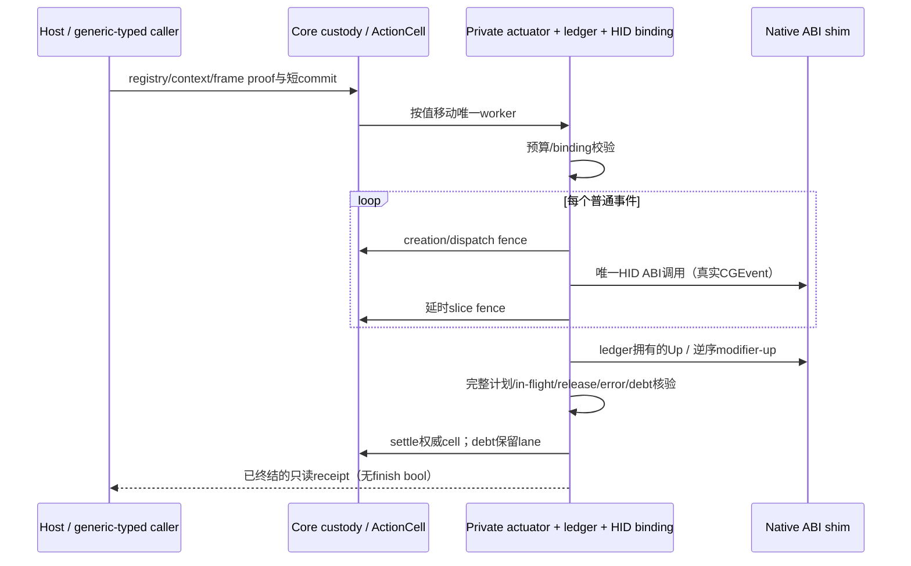

开发shim不forward系统；缺shim和非空错误地址均拒绝，默认无dev-probe时固定禁用，未申请TCC。这里的Completed仅为本地账本收敛；不证明OS受理、焦点/命中、真实Retina/窗口generation、用户持键或实际释放，也不赋予serialized Report权威。

D1b尚需真实HID exact-foreground/window lease与OS oracle；D1c尚需正式artifact/default CI封口、删除开发shim/publisher；D2尚需revoke/expiry/retire/drain、跨进程仲裁和stop硬上限/SIGKILL；D3尚需认证opaque ABI/peer和最终provider/raster/image_ref/TTL同链；D4使用用户准备的正式环境。正式G1/G2、R3/R6、MCU1仍blocked，G3/G4未执行，P1–P6未实施。旧464/110或旧ABI计数不继承。

### 真实窗口事实 / 精确前台 / generation 与 lease：开发契约（2026-10-25）

本轮独立目录为 [window-lease](/Users/zhvala/SourceCode/scripts/experiments/zody-cua-p0-g2-window-lease/README.md)，最终执行结果以 [报告](/Users/zhvala/SourceCode/scripts/experiments/zody-cua-p0-g2-window-lease/REPORT.md) 与 hash 索引为准。固定0.37.0 / `2d2f99228d4d2508dc6fcc84c176b296e146714a` 加独立候选patch；不接产品、不改前九轮。下述规则不能由旧 focus_guard/PID 检查替代。

| 所有者                          | 首期目标规则                                                                                                                 | 本轮实验边界                                                                                                |
| ------------------------------- | ---------------------------------------------------------------------------------------------------------------------------- | ----------------------------------------------------------------------------------------------------------- |
| 自有 Helper 的窗口观察 registry | 唯一持有进程启动身份、窗口观察代次、lease epoch、撤销和 observer 存活状态；首次捕获到最终动作绑定同一条身份链                | 当前只有 worker 私有单次 lease，action/lease_id 唯一、epoch 单调撤销；没有正式跨帧窗口 registry 或认证 peer |
| frame registry / adapter        | frame 绑定该窗口代次、lease、最终 PNG/坐标变换/交付 TTL；重建、移动、显示变化或 lease 失效必须作废旧帧                       | 继承 fixture frame gate；真实 sampler 与最终媒体交付尚未闭环，不能重新采样当前窗口就延长旧帧授权            |
| private native actuator         | 真实采样与 ledger 同一 worker；创建前、派发前、delay slice 和最后 transport handoff 重验，慢采样/未知/不一致立即停止普通事件 | live 读取 CG/AX/进程启动时间/HID；replay 只在 dev feature 中开放；默认 transport 固定禁用                   |
| release ledger / custody        | 只释放可能已派发的自有 down；不能由普通调用、JSON 或 Report 构造释放权；清理不明持有实际 lane 并稳定隔离                     | 焦点/窗口失效仅可进入受限清理；用户持键/按钮、输入未知阻止释放并留债；live release 因归因未证额外拒绝       |

精确前台谓词需要 NSWorkspace 前台 PID、系统 AX focused application PID、AX focused window 的精确 CGWindowID、CG owner/可见/layer/bounds、进程启动时间同时一致；禁止按最大窗口、z-order 第一个或 PID 猜目标。AX 或精确 ID 不可得就拒绝。AX 仅用于内部身份守卫，不开放 AX 树/元素工具。候选保留 AX element 作 CFEqual 连续性比较；它不是已证明的窗口 incarnation token，私有 `_AXUIElementGetWindow` 的兼容性仍是正式风险。

本地 generation 明确是“已观察到的代次”，不是 OS 全局 generation。失效一旦被观察，本次 lease 永不复活，即使焦点/窗口字段恢复旧值；expiry 不因采样成功续租。候选1500ms总租期、50ms采样上限只是独立实验参数，不是产品时限或 stop 硬 SLA。双读 AX/前台可发现部分采样中变化，但 CG/AX/HID 是非原子读取，仍存在 sample→post 竞态、漏检 ABA、同 ID/同 bounds 窗口复用、observer 缺失与全局事件命中歧义。

HID key/button/flags 必须区分 known/unknown；权限 preflight false 时读到全零仍是 unknown。preflight true 也只是必要条件，不能证明完整物理归因。用户预持键、执行中按键、同 modifier/button 与已注入 down 重合都要验证；无法分清时停止普通输入、保留债务并隔离，不能通过强制 up 或重试来“恢复”。本轮 C ABI 不转发，不证明真实系统释放或用户输入归因。

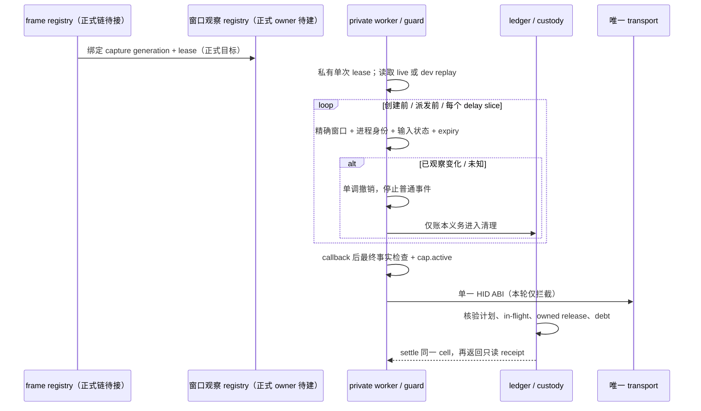

正式验收至少覆盖：同 PID 两窗口切换及弹窗/菜单、跨应用焦点与焦点 ABA；窗口关闭重建/ID复用、PID复用、移动缩放及旧帧失效；物理持键/按钮与注入 down 重合；查询阻塞时取消/stop、焦点失效后的 mouse-up/逆序 modifier release 和 scroll 不再新增 tick。必须使用最终签名 Helper、受控测试窗口与系统事件 oracle，另验锁屏/解锁、隐藏/最小化、当前 Space、遮挡和多屏拒绝。P0-G1/G2、R3/R6、MCU1仍 blocked，G3/G4未执行，P1–P6仍 planned。

本轮复审后的硬边界：native HID查询目前只作诊断，`flags_known`固定false，不能因监听preflight允许或查询全零而放行；live在任何事件对象创建前拒绝。正向/故障派发只允许显式dev replay，并仍截停于不转发C ABI。compound sample增加尾部CG字段、AX proxy连续性、进程启动时间复核，仍不能当作原子事实。最终cancel/stop与handoff共用同一动作cell的私有短锁，仅包围tag+CGEventPost；AX/CG查询、host callback和延时在锁外。已经进入ABI的调用可能影响stop返回上限，实际系统调用阻塞与安全恢复仍需正式验证。owned release可在stop后按账本收尾，用户持键/输入未知或live归因未证仍禁止。observer abort只取消观察者，detached worker继续收尾，不等于取消动作。

前轮window-lease复审保留的D2差额（历史快照；两项进程内竞态的本轮结果见末节）：context revoke/expiry以及跨cell process poison发布，当时尚未与最后handoff构成共同线性化点。当前只声明同一动作cell上的cancel/stop/finish顺序和已观察失效的lease拒绝，不宣称所有生命周期/进程级硬门已关闭。AX/listen preflight可用于负向拒绝，不能作为HID物理归因的充分条件；Screen Recording preflight只记录，截图交付仍按frame/provider权限规则。真实sampler拒绝与三条live执行零事件断言分别记录，不互相替代。

本轮最终验证：同一binary `c8c36735afcf9f4e…` 的2206唯一进程全部通过；1602窗口/输入/lease replay、114 sampler/Transport取消与stop、461+25回归、1真实采样和3live执行拒绝；34跨crate编译控制、8个core矩阵及默认构建/无dev入口/网络fork拒绝/imports/558依赖checksum审计通过。原生对象与ABI拦截不等于系统输入，真实采样与replay不拼接为正向证明。前九轮与上游保持原样。产品仓库freshness/typecheck/lint已执行，lint311warnings/0errors；源码与模型复审、实际执行结果分开归档。

只读CG补证另用1个独立native进程取得3个普通on-screen窗口的真实windowID/owner/bounds/layer与3个进程启动时间；该survey不选精确前台、不授予lease、不接frame/Guard，不计入2206同binary进程。主sampler虽可读前台PID，但本次没有可匹配的CG普通窗口candidate，AX/listen仍拒绝；不能以survey或“第一个窗口”补齐授权。详情见本轮报告的CG补证附件。

## context 生命周期 / 跨 cell quarantine 到 handoff 的开发契约（2026-10-25）

本轮在 [独立目录](/Users/zhvala/SourceCode/scripts/experiments/zody-cua-p0-g2-lifecycle-handoff/README.md)复制固定0.37.0/SHA `2d2f99228d4d2508dc6fcc84c176b296e146714a` 候选，继续验证上一轮D2明确保留的两项竞态；[执行报告](/Users/zhvala/SourceCode/scripts/experiments/zody-cua-p0-g2-lifecycle-handoff/REPORT.md)区分源码复审、确定性执行与正式验收。仍不接产品，不改前十轮或上游。

| 唯一事实所有者                             | 规则与本轮收口方向                                                                                                                                                                                             |
| ------------------------------------------ | -------------------------------------------------------------------------------------------------------------------------------------------------------------------------------------------------------------- |
| SessionAuthorizationRegistry / 实际context | custody从core canonical dispatch的私有task-local捕获同一Arc；不由Host trait、JSON或报告替换。connection/host/all revoke及runtime关闭/销毁，使已保留的context clone同样失效                                     |
| context与manifest各自原有共享lifetime事实  | 原有revoked/idle状态保持唯一，不另造授权tombstone；absolute新增shared sticky latch。所有检查/commit与失效写入同一个短域，拒绝不能仅刷新context或manifest一半                                                   |
| private NativeDomain                       | 只持序列化锁与不可伪造borrowed token，不复制授权状态；最终handoff、实际expiry/revoke和process隔离发布共域。token携带一次monotonic grant时刻，context和manifest判定/提交共用                                    |
| ProcessState / custody                     | 实际guard/debt先进入稳定owner，再发布poison；跨cell最后post与发布在同域内排序。没有reset；不把process-local域称为跨Helper或跨dylib机器锁                                                                       |
| native actuator / ledger                   | 域外采样、创建与延时；域内只查本地window deadline/失效、真实context/manifest lifetime、cell/custody/process，再调用唯一tag+ABI。owned release可豁免context关闭，不能豁免process隔离、terminal、owner和输入不明 |

到期语义明确为：绝对与idle deadline在最终grant时刻按`>=`拒绝；manifest绝对期从加载时转为monotonic deadline，Unix时间只作展示。已观察到期的latch不能由clone、wall回拨或后续commit复活。handoff先取得域并获准后即属在途，之后时间流逝/撤销调用不得解释为已撤回OS副作用；后续每个普通事件重新判定。release不刷新任一idle lease。

锁顺序为外层registry→域、域→cell→私有custody/lifetime短锁、域→process记录。原有commit admission可域→Control；因此Host active须先释放Control再读context，最终域内禁止Host active/registry/Control回调。stop/cancel仍只取Control→cell，不持锁等待AX/CG查询或delay。域可能等待实际在途ABI返回；这是尚未给出硬上限的同步native调用，不能称stop硬SLA已完成。

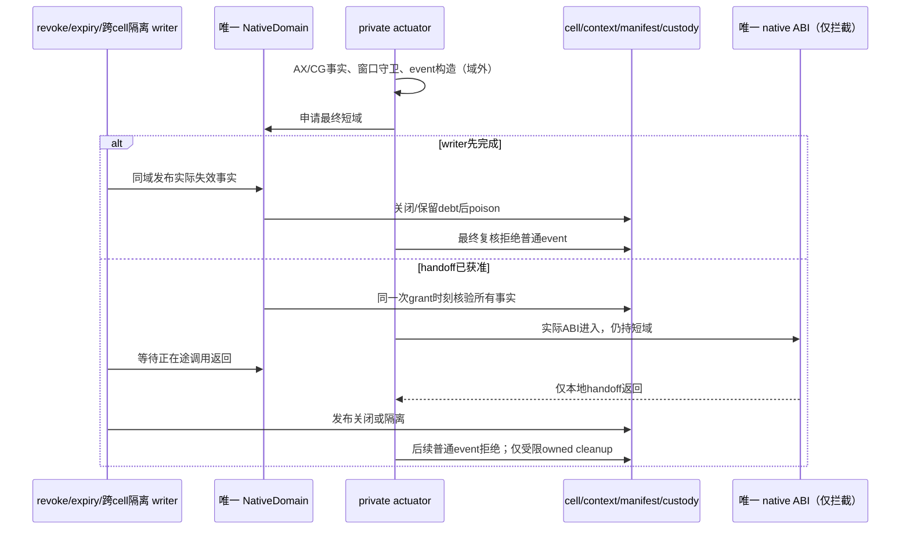

确定性验收开发场景：connection/host/all/runtime关闭、context absolute/idle、manifest absolute/idle、跨cell custody/debt发布，均覆盖已通过active后的writer-first，以及真实C ABI内暂停的handoff-first；检查实际ABI普通前缀、释放义务/债务与终态。查询/延时边界barrier下writer必须先返回，解阻后无普通ABI。域竞争用指定publisher线程的等待事实而非sleep或“线程已创建”推断；fake clock只在dev feature操作同一实际lifetime事实，不能提供正向权限。

本轮开发验证不等于正式G1/G2或完整D2关闭：真实OS受理/安全释放、ABI自然阻塞上限、跨进程机器控制权、publisher/retire/drain和崩溃恢复、真实窗口observer/ABA、物理持键归因、最终frame/provider/认证Helper链与签名/TCC/两架构/Retina仍需后续证据。Cua继续优先、UI-TARS/nut-js备选；G3/G4未执行，P1–P6 planned，未签名0.1.0 CUA隐藏规则不变。

复审补强：core早期仅check，protected native的实际cell admission成功后才同Token刷新两份原lifetime；legacy路径也后移到session/lane/gate检查之后。Context/Manifest的commit及alias收为pub(crate)，外部不能直接续租。SDK源码shutdown在drain前close_runtime，Drop也关闭；context/manifest双idle写前先取得全部guard，避免写后一半失败。完整矩阵曾发现manifest在最后普通ABI后失效仍Completed，现active与同域settle均复核完整lifetime，并按权威terminal修正Report；新增BeforeSettle场景确认关闭后不能伪装成功。域内唯一native ABI派发是明确例外，不包含AX/CG窗口查询或延时，其自然阻塞风险仍未关闭。

本轮最终开发证据：binary `b6d02c099558abae…` 的2626唯一进程全部通过，含405生命周期竞态（153真实ABI在途、54 query/delay、27终态边界）+15 admission拒绝及2206完整回归；另42编译控制、13专项core函数、18+22原授权纯测试通过。所有计数来自最终同binary重跑，初版末事件manifest失效仍Completed的失败单独留存。默认SDK和无dev API封口、558依赖checksum、原十轮hash/upstream clean审计通过。native clock推进只作dev失效注入，真实窗口/物理输入与frame/provider/认证Helper仍未贯通；同进程domain不能代替机器级锁。域可等待真实ABI返回，未给出stop硬上限。正式G1/G2、R3/R6、MCU1与整体D2未关闭，P1–P6 planned。

## publisher / retire / drain 本轮执行前契约（2026-10-25）

仅在[独立实验目录](/Users/zhvala/SourceCode/scripts/experiments/zody-cua-p0-g2-publisher-drain/README.md)验证。Helper句柄准入/最终发布由同一owner关闭；destroy为RetireRequested，fence与drain另有状态，不把future/observer结束或cell终态当作worker退出。publisher租约、执行task和真实native custody全部静止且fence完成后才清理；隔离债务继续由process owner保留。drain为有界非阻塞查询，Pending不能超时强制回收；卡住的native调用仍是正式风险。固定容量与显式ticket release防止无界retired资源；故障保留不能伪装完成。验收交错包括句柄销毁、准备后晚到发布、commit与启动边界、ABI在途、settle后仍持cap、observer abort、panic/Unknown/容量满。正式门槛及Cua优先排序不变，最终结果见下文；前序记录按历史保留，不累计计数。

本轮publisher/retire/drain最终开发裁决：opaque Helper入口的lookup+publisher登记、最终session/frame/action提交与关闭共用Tables→Life短锁；slot在副作用前reservation。旧句柄销毁为RetireRequested，稳定retired owner先入表；后台close_runtime→stop结束后才Fenced。句柄数值全局单调不复用，旧owner数值在独立retired namespace作ticket，数值不是认证凭据。提交先于retire的响应可晚到，但旧句柄不能恢复Helper或自动重放；正式wire的请求/响应代际关联仍需验。publisher/task归零且真实cell terminal/custody静止后，poll只调度单个后台cleaner，不等待native ABI；显式清frame/capture/snapshot/context/Control/receipt与handles后才Drained。action release保守要求Helper所有observer task结束，并按core action id回收receipt；单次worker lifetime guard保留原Custody到实际blocking闭包body末尾。Unknown/terminal、future drop和observer结束都不能代替worker静止。查询/创建/await/延时/fence/cleaner不持Tables/Life锁，native domain的唯一tag+post例外沿用。

开发验收共97个独立进程，与2626完整回归同binary共2723唯一进程；46编译控制、14专项core函数、18+22原授权测试通过。涵盖准备后晚到发布、未poll task、worker启动/查询/派发/延时/settle/body边界、真实ABI在途与指定retire线程竞争、真实observer abort、fault保留、8路retire/poll唯一cleaner、last-slot reservation、256正常Completed容量、257次正常Completed循环receipt 1→0。另3个外部动态ABI进程单列，不拼接主binary计数。测试shim trace固定4096，超限仍abort且不转发；原十一轮/upstream/558依赖审计通过。

retired ticket上限64、live Helper32、session64/frame128/action256；满额明确拒绝，不丢弃仍活跃owner。当前retired满额时retire失败、原live句柄仍有效；正式采用前需裁决create是否预留退役槽，不能把destroy当作无条件关闭承诺。drain Pending需继续观察，完成后显式release；RetainedFault禁止release/自动重试。DrainedQuarantined只表示Helper资源清完，实际process debt/lane永久保留，不能推导机器安全、系统release或可卸载。若native ABI/publisher永久阻塞，owner保持Pending且容量可能耗尽；查询调用返回有界状态不等于底层阻塞已解决，旧stop/cancel仍无硬SLA。

复审修正了stop先取cell而无法进入domain的fence次序、receipt循环增长及临时视觉资源回滚。另保留一次既有stop_slice/drag/5的20秒watchdog失败，原因未确认；新增诊断后40次重放及最终全套通过，不据此宣称根因已修复。正式还需sealed Helper/认证peer与全部writer同链、SDK shutdown/retire/drain、动态卸载时机、自然阻塞与恢复、跨Helper机器锁、真实窗口/物理持键与OS release、最终frame/provider、签名/TCC/arm64+x64/最低OS/物理Retina。G1/G2、R3/R6、MCU1、整体D2未关闭，G3/G4未执行，P1–P6 planned。

## drag/stop watchdog 与创建预留退役容量：独立开发契约（2026-10-25）

本轮在 [新独立目录](/Users/zhvala/SourceCode/scripts/experiments/zody-cua-p0-g2-stop-retire-reservation/README.md) 定位既有 drag/stop watchdog，并验证创建时预留退役容量。Tables 为唯一 owner；create 在构造前同时预留总生命周期槽和 live 配额，失败回滚，成功后原槽贯穿 live、retired、Pending/Fault、Drained 至显式 release。retire 不再临时申请新容量；这只验证容量维度，不承诺 OOM、线程创建失败或永久原生阻塞下的关闭完成。旧实验和证据索引保留。历史 watchdog 缺少现场栈，确定性注入用于区分机制，不能自动确认原事故原因。详见独立契约中的所有者、时序及场景；不接产品、不执行系统输入，正式门槛保持 blocked。

## drag/stop watchdog 与创建预留 retire 容量：首轮结果（2026-10-25）

[新独立报告](/Users/zhvala/SourceCode/scripts/experiments/zody-cua-p0-g2-stop-retire-reservation/REPORT.md)、[执行前契约](/Users/zhvala/SourceCode/scripts/experiments/zody-cua-p0-g2-stop-retire-reservation/README.md)。本节是最新候选结论，之前各轮章节和数字作为历史证据保留，不累计。原publisher-drain目录6550个非构建文件哈希一致，12轮历史报告/证据索引锚点继续保留；候选full-source未变，只改本轮harness及探针。

watchdog机制已分开验证：Port保留Pause Sender时，worker在DelaySlice/5前因source/constructor/window/expiry结束，旧barrier-only wait仍Pending；当前继承的select Join能诊断提前结束。真实1.5秒lease下人为停顿1.6秒可触发同类提前结束，但不证明历史事故有此停顿。FactsBefore/5暂停时stop可返回；真实不转发C ABI/5在途持cell锁时stop会等待，解除后返回。这是两种机制证据，不是已确定历史根因、锁环或停止硬上限。

Tables为唯一owner：create构造前预留实际None entry和live额度，Err/panic回滚；creating+live≤32，creating+live+retired≤64。成功创建保留同一entry，retire原位None→Some并关闭live，不再临时申请retire容量；None不可作为ticket查询，Pending/Fault/Drained未release仍占槽，只有完成后的显式release归还。64个未释放ticket将拒绝新create，不能驱逐债务。try_reserve CapacityOverflow、构造/提交故障、Weak清理、最后槽/live上限并发、32路retire及Pending/Fault满额均有确定性证据。此方案只关闭容量维度；继承的后台调度panic/返回歧义、永久阻塞和OOM等不在成功承诺内。

最终同一binary644进程（14容量、7watchdog机制、40原场景重放、461native、25补充、97publisher）通过，新7/native6/publisher4个oracle变异拒绝；另3个外部动态ABI进程单列。本轮未重跑前轮完整窗口/生命周期矩阵与46编译控制，不拼接为同制品验收。产品freshness/typecheck/lint在Node24.14.0/pnpm10.33.2下通过（lint311 warnings/0errors）；开发失败、模型复审和运行证据分开留档。

历史事故触发原因、自然阻塞/停止上限、正式sealed Helper/认证wire及全部writer同链、SDK shutdown/drain/动态卸载、跨Helper机器锁/崩溃恢复、真实窗口/物理持键/OS release、最终frame/provider、签名/TCC/arm64+x64/最低OS/物理Retina仍是阻断。G1/G2、整体D2、R3/R6、MCU1未关闭，G3/G4未执行，P1–P6 planned，Cua优先、UI-TARS/nut-js备选不变。

#### 正式应用启动与 Helper 权限归属接线（2026-10-30，窄链路已验收）

在独立、默认禁用的完整 Zody 候选 `.app` 中，采用真实 Electron Mach-O 应用入口和 `process.resourcesPath` 相对资源布局，不依赖启动 shell、工作区绝对 launcher 路径或外部 node_modules 链接。Electron 仍为不受信 UI；不改变用户已批准的固定签名 Node 承载现有 Host/CLI 的边界。候选具有独立应用/profile 标识，不覆盖已安装 Zody；正常产品构建及 `zcodeCuaPlaceholder=true` 保持关闭。

显式 `workspace-relay` 启动模式让同一固定签名 native launcher 通过公共 NSWorkspace/LaunchServices API 启动自身 bundle 的新 Helper 实例。原 fd5 Host bridge、fd6/7 CLI bridge 及 stdio 由私有 rendezvous 上的 SCM_RIGHTS 转交；relay 不解码业务消息、不保存授权或 lease。双方使用内核 peer audit token、实际 PID/UID、固定 leaf/DR/identifier、strict validity/HR/空 entitlements 和当前自身 CDHash 校验。父端只能接受 NSWorkspace 返回的实际新 PID；nonce/路径/argv 仅用于关联，不充当身份。不得静默回退到继承调用方 TCC 的直接启动。原直接启动接口保留供既有诊断使用。

认证后可传递有界 cwd/环境配置，以保持 workspaceIdentity、provider 和现有运行语义；绝不从环境选择可信代码或身份，禁止 DYLD/LD/NODE_OPTIONS/NODE_PATH/NODE_EXTRA_CA_CERTS 等注入项。接收端必须校验协议版本、角色、长度、FD 数量/截断并关闭多余 FD，防止交接泄漏；Host/CLI 代码仍由现有 sealed resources 验证和固定 Node 启动器加载。

relay 只拥有本次传输及子应用生命周期。原父端结束、relay EOF 或启动失败必须使 child 进入既有 requestStop/清理路径；启动中同样有效。child 退出向 relay 传播明确状态；无状态 EOF 是失败，不能当正常停止或 native Fenced。原 submission owner、authority、lease、frame owner、CommandInbox 与桌面 continuous/手机 replayable 语义均不变。

```mermaid
sequenceDiagram
  participant UI as Zody UI / existing Host
  participant R as native relay
  participant LS as LaunchServices
  participant H as fixed Helper
  participant N as signed Node Host / CLI
  UI->>R: existing fd5 or fd6/7 + explicit relay mode
  R->>LS: open fixed own bundle / new instance
  LS->>H: launch
  R->>H: mutual peer validation + bounded context + SCM_RIGHTS
  H->>N: existing sealed launch / same authority owner
  N->>H: existing submission + lease + screenshot request
  H->>H: native human confirmation / capture / final scope check
  H-->>N: existing frame + release
  UI->>N: existing Stop command
  N->>H: existing revoke / stop
  Note over R,H: relay EOF also enters existing requestStop; no second authorization state
```

本轮必要验收仅包括：真实 FD 交接及畸形/错误 peer 拒绝、父端退出的清理；受影响 Host/CLI 启动测试与仓库必需 typecheck/lint/架构检查；固定工具链 native 编译/链接/签名；系统应用入口启动完整候选，并从 OS 日志确认实际采集 Helper 的 TCC subject，再完成一次真实截图和 UI Stop。只读 preflight probe 已确认固定 Helper 标识在系统独立启动时可用，但不能代替最终进程归属或截图验收。若最终 Helper 需要新的系统权限或证书，先取得用户确认。这里不扩大为 Intel、升级稳定性、完整 D06 或 native Fenced 验收。

实际结果：完整.app候选的包内Helper77429由系统独立启动，tccd ScreenCapture subject为固定Helper identifier；真实2400×1600截图交付后，UI Stop撤销同一submission lineage，14ms后工具收到取消。资源及machine lease在Stop前已释放，不声明native Fenced。正常发行入口仍关闭；详见[本轮验收](../packages/desktop/native/macos-cua-driver-closure/reports/2026-10-30-launchservices/ACCEPTANCE.md)。

#### 默认关闭候选的实际 node_repl 装配边界（2026-10-30）

为完成上述真实会话链，显式 native 启动 composition 可以向实际 app 的既有 McpPort 注入仅接管 `node_repl` 的候选适配器，其余 MCP 服务委托原端口；仍调用真实 node_repl server/工具合同与结果路径，不合成 tool call 或 transcript。`ComputerUseRuntime.execute('screenshot',{target:{pid,windowId}})` 为本轮窄内部截图入口，其他输入/AX/全屏能力拒绝，不视为官方完整 CUA API 等价实现。调用上下文必须来自当前真实工具调用，与 app 当前 session/workspace/turn 精确匹配；队列中的旧请求不得换绑新 turn。

node_repl 的模型 JS 必须使用既有独立 subprocess executor，不能放进可信 CLI/Host 进程执行；cell 不继承 native authority/control FD，仅持既有每次调用 capability，producer 仍由 CLI 的同一 scope 提供。这里不宣称完整 D06/后代隔离验收。候选 server/cell 的静态代码资源随独立包封装，不能从工作区或环境变量选择可信代码。普通 CLI/server 与 placeholder 不自动启用此装配。

候选网络兼容要求：固定签名 Node 使用 `--jitless`，不得为绕过加载问题增加 JIT/LV entitlement。实际探针确认本机该模式下 WebAssembly 不可用，内建/普通 undici fetch 的 HTTP 路径不能运行；仅延迟 import 不能记为网络已通过。允许独立 sealed candidate 注入基于当前锁定 node-fetch 与 Node http/https 的真实网络适配，维持请求/响应流、abort、redirect 与必要 header 行为；代理/自定义 CA 若暂不支持须明确拒绝，不能静默改直连。默认产品网络路径不替换，不以成功 stub、空响应或未封装包补齐候选。

#### Helper bundle 应用图标资源（2026-10-31）

desktop-session Helper 的 app bundle 携带固定应用图标：builder 把仓库主应用图标 `packages/desktop/build/icon.icns` 原样复制到 `Contents/Resources/AppIcon.icns`，`Info.plist` 声明 `CFBundleIconFile=AppIcon.icns`。图标只服务于 Finder/LaunchServices/系统权限列表的展示，不是可执行资源：不进入 sealed entry、不参与 native 身份 pin（leaf/DR/Node CDHash）、不改变授权、TCC、进程结构或任何运行时行为。构建清单按既有 resources 账本记录其 path/source/sha256；窄资源树清点按既有 manifest 树校验自动覆盖，不新增信任根或固定文件清单。图标源缺失时构建按固定输入 preflight 直接失败，不得静默产出无图标 bundle；正式发行槽位换用新构建时随既有 prepare-narrow → pin → afterPack 复核链整体更新，不单独改包。

##### 图标轮 v4 默认 pin 与冻结材料可搬迁（2026-10-31）

`macos-cua-demo-defaults` 的默认装配 pin 从 inapp-confirm v3 切到图标轮 v4（`output/cua-app-icon/controller-prepared/manifest.json`，manifest SHA `48a657bb…`）。与 v3 的差异只限：AppIcon.icns 新增、Info.plist 增加图标键、cli/session entry 随当日工作区源码重新封装；host-entry、Node 与签名身份（leaf/DR/CDHash）逐字节不变。默认 pin 的材料属于构建机本地 `output/`（gitignore），机器间搬迁必须走冻结归档：`restore-cua-narrow-frozen.mjs` 只接受先验 sha256（CLI 或 sidecar）校验通过的 tar.gz，归档条目仅允许仓库相对 `output/` 前缀，解包后必须立即重跑默认选择解析（pin + manifest 树 + codesign 身份）通过才算还原成功；已存在 pinned manifest 时拒绝覆盖，需显式 `--force`。归档/还原不新建信任根——信任仍只来自固定 pin 与 codesign 实测。
