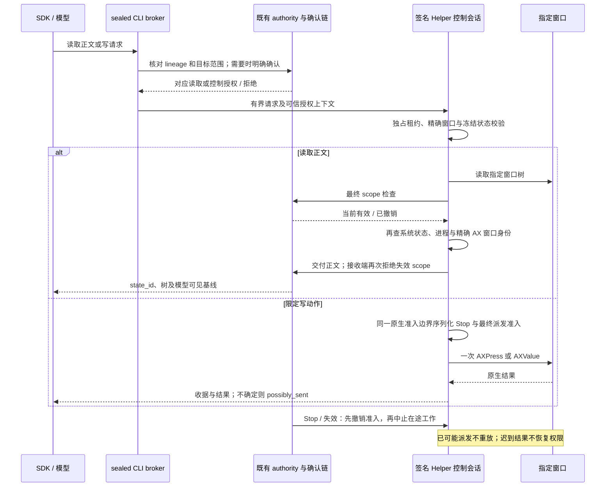
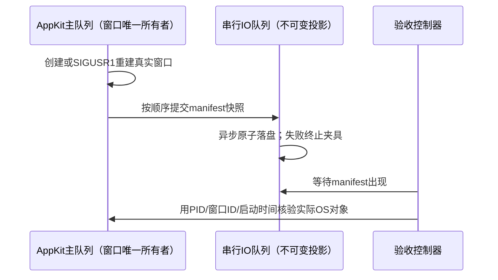
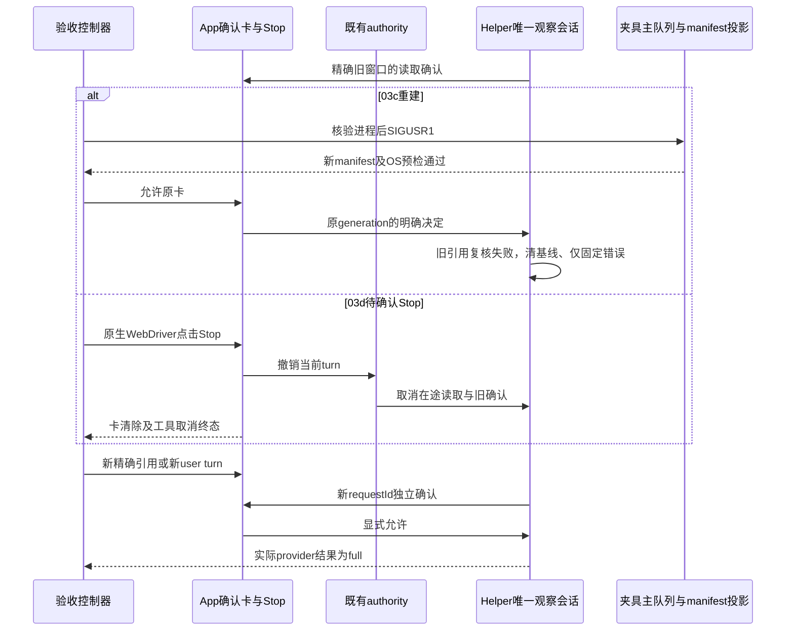

# macOS Computer Use 二期：限定 AX 后台切片

状态（2026-11-13）：R1 只读源码已接线；当前固定签名候选的 metadata、deny、allow、03b、03c、03d 六项整轮 6/6、截图回归 3/3，通过后仍 pending 人工审阅；额外手机 Web 模拟触摸 1/1 不计本期门槛。默认 AppKit 03a、完整无干扰、系统状态故障注入及只读交付撤销交错仍未闭环；历史冷启动问题另列为已知问题，不新增完成门槛；R2/R3 尚未执行，R1 与二期未整体完成。依据 [可行性报告](../docs/cua/2026-11-10-macos-background-control-feasibility.md)、[探针规格](computer-use-macos-background-ax-probe.md) 和 [phase1](computer-use-macos-phase1.md)。14 方法是后续规划，不是本批交付承诺。

## 基线与目标

已安装的冻结 sealed CLI 及独立 `createCuaCaptureComputerUseRuntime` 仍只接受 `screenshot`；R1 新增的观察 runtime 只在提供真实观察回调的显式源码 composition 中接入，未修改冻结 pin。仓库内 [SDK 合同](../apps/zody-cli/packages/zody-cua-plugin/docs/computer-use.md)及其 client 是公开方法和参数的依据。截图使用现有 frame、machine lease、authority 和签名 Helper 链；phase1 已记录 mobile-origin 持久截图授权扩展。不得从截图授权，包括手机来源截图授权，推导正文读取或控制授权，也不得改变该截图链的资格和语义。普通 CLI/server 的占位路径继续 fail-closed，子代理不可用。

选择 A3/B1：以现有签名 Helper 为唯一新增 native 执行主体，sealed CLI 负责适配和转发；不引入 Node FFI 主体。实际辅助功能授权主体必须以完整签名候选在系统设置和运行时实测，不预先声称已获授权。Rust 切片或 Helper 内实现均须保证可审计的限定入口无法到达通用输入派发。重新运行完整 build/sign/freeze/pin 和闭包审计，不热补 sealed 快照。

探针在 AppKit 和显式启用 Chromium AX 的 Electron 简单夹具各有一次通过；它们是可行性证据，不是生产支持名单或稳定率。首批 AX 正文读取与动作仅准入已打开、当前 Space、可见且非最小化的指定窗口；隐藏、最小化、不在当前 Space、锁屏或无法证明窗口归属和上述条件时安全拒绝。可见不要求窗口处于前台或未被其他窗口遮挡，不得为满足条件激活应用。纯元数据枚举可列出不满足操作条件的窗口，但不因此读取正文或授予动作资格。启动、切 Space 或恢复最小化窗口不属于首批能力，也不得作为 fallback。复杂编辑器、富文本、Canvas、快捷键及其他应用未获证明。

## 首批合同与范围

保留 SDK 同名同签、参数和返回合同，不悄悄删除公开方法或更改语义。下列是首批允许执行的组合；其余方法及参数组合必须在任何原生写派发前明确安全拒绝，不能转为坐标、合成事件、前台激活、剪贴板或其他 fallback。拒绝应映射到 SDK 可识别的类型化错误，绝不伪造成功。

| 方法                                                                                                | 首批允许组合与条件                                                                                                                                                                                  |
| --------------------------------------------------------------------------------------------------- | --------------------------------------------------------------------------------------------------------------------------------------------------------------------------------------------------- |
| `list_apps({})`                                                                                     | 只读运行应用元数据。                                                                                                                                                                                |
| `list_windows({app_ref?})`                                                                          | 枚举窗口元数据；`text_preview` 属正文，未获相应读取授权时不得采集或返回正文。保持 title 空串/null 和窗口身份合同。                                                                                  |
| `get_app_state({app_ref, include_screenshot?, disable_diffing?})`                                   | 只读已打开的指定窗口 AX 树；首次正文读取前授权。`include_screenshot=true` 的像素仍经 phase1 截图链及其独立授权，不借此授予正文或控制。内部 `tree_shown_to_model` 语义保留。无法精确映射窗口时拒绝。 |
| `left_click({target, mouse_button?, click_count?, modifiers?, strategy?, app_ref?, return_state?})` | 仅冻结的 element 目标、左键一次、无修饰键、`auto` 或 `a11y`，且目标实际广告并支持 AXPress；`auto` 在本切片不得回退事件。                                                                            |
| `perform_action({target, action, app_ref?, return_state?})`                                         | 仅冻结的 element 目标和该元素广告的 `AXPress`。                                                                                                                                                     |
| `set_value({target, value, strategy?, app_ref?, return_state?})`                                    | 仅普通文本字段的冻结 element 目标、`auto` 或 `a11y`，且 AXValue 可设置并与 SDK 的 value 语义一致；不处理富文本或需要菜单、键入、事件的控件。                                                        |
| `request_access({capabilities?})`                                                                   | 如实报告实际能力与 grantOwner；不能将系统辅助功能权限当作用户的任务读取或控制授权。                                                                                                                 |
| `stop_computer_control({reason?})`                                                                  | 始终允许撤销；与 UI Stop 接入同一撤销链。                                                                                                                                                           |

首批受支持动作均支持 SDK 的 `return_state`：`none`（默认）、`compact`、`full`。返回状态的读取遵守同一正文授权、精确窗口及状态合同，必要授权须在写派发前完成；写后观察失败仍保留动作收据和派发状态，不得重放动作。`type` 是键入，不是 `set_value`。`scroll`、`left_click_drag`、`type`、`select_text`、`key`、`paste`、坐标目标、`event` 策略及其他动作均不在首批。首批八个方法仅支持上表限定组合；其余六个方法规划如下，公开签名和合同继续保留，启用前须各自制定规范、授权、验收及安全派发方案。现有 SDK 的 frame 栅格及其他公开安全合同继续保留，不能因本批不支持坐标而删除。

窗口解析必须先唯一确定应用，再确定精确窗口。未给 `window_id` 时，只能绑定唯一符合条件的窗口，并在取得该窗口的相应授权后读取正文或写入；多窗口歧义必须拒绝并提示通过 `list_windows` 选择，不能默认最前窗口。显式窗口失效时不得转向兄弟窗口；AX 元素必须属于该窗口子树，App 菜单栏等树外元素不构成可操作目标。具体支持名单按通过验收的“App × 控件 × 操作”发布，不能由支持 AX 属性直接推导无干扰保证。

| 后续方法          | 后续路线，首批安全拒绝                 |
| ----------------- | -------------------------------------- |
| `scroll`          | 单独验证滚动语义及目标和前台影响。     |
| `left_click_drag` | 单独验证拖动目标、事件顺序和焦点影响。 |
| `type`            | 单独验证键入及目标窗口，不等同赋值。   |
| `select_text`     | 单独验证选区及可选择性。               |
| `key`             | 单独验证按键、修饰键和窗口路由。       |
| `paste`           | 单独验证剪贴板、消费和前台约束。       |

## 不变的合同与接入边界

- 对公开方法、嵌套 target、枚举和参数在生产端严格校验；未知或不支持组合在任何原生写派发前拒绝。未实现组合返回 SDK 可识别的 `ACTION_UNAVAILABLE`；`FOREGROUND_REQUIRED` 仅用于合同已有的前台约束。权限、授权、失效状态、窗口归属及元素不可用各用对应错误分类，不混作未实现。错误须区分确定未派发与可能派发，未知不能假报未派发。
- not-ready 明确标注 `retryable` 和原因；客户端仅对 `retryable=true` 的非动作调用退避重试，动作可能派发时绝不重放。
- `request_access` 保留 `packages/zody-cua/request-access-contract.d.ts` 的 schema 与 `zcode.cua/request-access-status-v1` meta key，报告 accessibility、screenRecording 和真实 `grantOwner`；候选须验证签名 Helper 的实际系统授权主体，不伪造 granted。
- screenshot、frame owner 和 one-raster 合同不变；坐标使用最近 actionable raster 的精确整数像素及边界校验，本批不开放坐标。大树裁剪与有界 payload 在 R1 前确定，并验收截断、上限和 fail-closed 行为。
- sealed 注入点为 `cua-node-repl-mcp-port.ts`，新 runtime 显式 composition；现有 `cua-capture-runtime.ts` 的截图语义不改。普通 CLI/server 继续 unavailable，不能通过 env、argv、UI 或模型参数打开半可用路径。

## 授权、状态所有者和顺序

首次读取目标正文之前取得明确读取授权，包括 SDK 的 `getApp` 内部静默观察和 `elements()` 等不 emit 的观察；首次写之前取得明确控制授权。授权展示目标 app/window、操作类别和范围；拒绝、过期、目标失效或撤销均不得派发。可以在一次明确确认中授予两类权限，但截图 allow、系统 TCC、读取授权互不自动升级为控制授权。`list_windows` 的无标题正文预览同样受读取授权保护，R1 只读轮即须完成这一保护。对现有持久规则或 full access 是否覆盖新增类别，只能按明确涵盖该类别的授权事实判断，不能沿用仅截图规则。

| 状态                                       | 所有者和边界                                                                                                                                                                                                |
| ------------------------------------------ | ----------------------------------------------------------------------------------------------------------------------------------------------------------------------------------------------------------- |
| submission lineage、撤销事实               | 既有 authority；不由 UI、Helper 或模型另造授权事实。保留现有 desktop/mobile 资格链，新增控制只在具备独立明确授权时准入。                                                                                    |
| 确认展示                                   | 现有确认链；展示不是授权事实的第二个所有者。                                                                                                                                                                |
| 控制租约和原生派发准入                     | Helper 中的控制会话，绑定可信 lineage、完整目标身份和授权范围，消费 authority 撤销；接入现有 machine lease 仲裁边界保证跨 Helper 的控制排他，不能仅靠单个进程的 busy 标志。第二会话返回 `CONTROLLER_BUSY`。 |
| state_id、模型可见 diff 基线、冻结元素映射 | 驱动会话按精确窗口维护；索引只用于其观察版本。静默观察不推进模型可见基线，之后的树请求返回整树。                                                                                                            |
| frame / raster                             | 现有 phase1 frame owner；AX 树或上游 snapshot token 不代替它。                                                                                                                                              |
| 派发收据                                   | 执行路径记录 `actionSent` / `dispatchStatus`，不确定是否派发时标记 `possibly_sent`；客户端不得重放。                                                                                                        |

租约绑定完整目标身份和可信 lineage 的 session、turn、workspace 身份及远程关联；workspace key 使用 `workspaceIdentity?.trim() || workspacePath`，远程沿用可信 `remoteSessionId`，不因此扩大远程授权。仅当租约和 authority 仍有效时，成功的受支持写动作完成可更新活动时间；观察、元数据、失败请求和迟到结果不续租。距最近成功写动作（首次以授租时刻计）120 秒空闲即失效；会话结束、lineage 撤销、目标退出或 Stop 立即失效，需重新取得授权。

写动作上线前必须同时完成授权、排他租约、收据和 Stop 链。Stop 先撤销原子准入，再中止在途工作；Stop 与最终原生派发准入在同一边界序列化并具有可判定的先后顺序，不能仅在 AX 调用前读取一次撤销状态。如果 Stop 先生效则零派发；若派发先获得准入，保留已派发或可能派发收据，不承诺撤销已送达目标的效果。正文读取结果交付前也须最终核验撤销和授权；撤销先于交付时不得交付正文。迟到结果不得恢复授权或释放给新会话作为成功；需保留可诊断的派发状态。锁屏、失效窗口、元素归属不明和版本过期均 fail-closed。

观察生成结构化状态字段 `state_id` 和内部冻结索引到 native 元素映射；公开 element target 仍为 `{type: "element", index}`，不新增模型参数。动作必须校验状态与精确窗口，不能以同 PID、标题或新的上游 snapshot token 代替身份。模型没看过的树不得成为 diff 基线；元素消失、窗口关闭或重建后旧映射不得用于派发。`possibly_sent` 映射 SDK 的 `actionSent` 和 `dispatchStatus`，不能将不确定性表示为安全重试。

## 实施顺序

1. **R1 观察轮**：测试先行，定义正文授权、窗口身份、状态与拒绝语义；只读路径上线前接入读取授权及撤销后的交付检查，包括正文预览。
2. **R2 写动作准入轮**：在任何写入口可用之前完成控制授权、排他租约、原子撤销/最终复核、派发收据和 Stop 交错测试；再接限定 AXPress 与 AXValue。原草案 R3 安全边界提前至本轮写动作接入之前。
3. **R3 产物与验收轮**：整轮构建、签名、冻结、pin 与闭包审计，验证真实 SDK → sealed CLI → 签名 Helper → 目标链；随后进行下列真机验收。后续扩大方法须另行更新规格，不自动开启通用 fallback。

### 当前剩余工作（2026-11-13）

| 阶段 | 未完成项 | 完成判据 |
| --- | --- | --- |
| R1-03a | 默认 AppKit 非根 group 的窗口归属冲突 | 查清 other_process / AXWindow 缺失的原因，保持守卫，默认组合真实完成 full/diff/silent/full/diff；03b 不替代该组合 |
| R1-03 只读交付交错 | 读取允许后、最终正文交付前后的 UI Stop / 撤销 | 实证撤销先于交付时零正文，精确取消终态、迟到结果不恢复权限；03d 只覆盖允许前。工具 Stop、控制租约与原生写派发交错归 R2 |
| R1-04 | AppKit / Electron 前台持续输入下的完整无干扰验收 | 全部信号和监测故障校准齐全，每支持组合至少 20 次成功且保留全部试次；可见性采样不替代该验收 |
| R1-05 | 签名候选锁屏/解锁、睡眠、快速用户切换及过渡 | 真实候选在不可用或未知状态拒绝，解锁后独立重新确认；已有一次字段校准不代替故障注入 |
| 人工审阅 | 已通过 pending 用例的证据审阅 | 按用例生命周期审阅后再晋升，不把自动通过直接当已准入 |
| R2 | 限定写动作实现与安全准入 | 控制授权、排他租约、120 秒空闲失效、工具 Stop 与原子撤销 / 派发排序、收据及不重放先完成，再接 AXPress / 普通文本 AXValue；含 return_state 与业务效果验证 |
| R3 | 发布产物与整轮验收 | 正式 build/sign/freeze/pin 和闭包审计，真实 SDK→sealed CLI→签名 Helper→目标全链；限定 App×控件×操作支持矩阵、无干扰重复试次及故障注入通过 |

本期范围是 macOS AX 后台切片，不包含实体手机或原生 Android 验收。已有 390px 模拟触摸、模拟只读 Android bridge 与真实 gateway/Host 链仅作为共享 SessionPane 的额外回归证据，不计入 R1 或二期完成门槛，也不建立手机补验待办；其结果不外推为实体手机或原生 Android 支持。未新增 R2 写动作授权。

#### 范围自查与历史问题分类（2026-11-13）

本轮用户明确要求桌面与窄屏可达性；这不等于要求新建手机远控端到端验收。Android bridge 模拟、gateway/TLS/资源代理、专用测试凭证及为此引入另一种 Host 装配，是执行者自行扩大的路线，不是 03d 的必要前置；原有成功/失败证据保留，但不据此新增 R1 或二期门槛。手机源文件仅为额外 pending 测试，不新增产品手机功能。

此前把历史冷启动 protocol timeout / watchdog 放入“R1 稳定性”完成判据，是把已知问题提升为未经确认的新门槛。现只保留已知问题记录：原失败不能追认，admission / ACK 不得猜测、不得自动重发；如再次复现并阻碍既有验收，再针对实际故障处理。它没有被证明已修复，但不独立扩大本轮验收范围。

此前将工具 Stop / 写派发竞争混列于 R1，现按既有实施顺序归回 R2；R1 仅保留读取与正文交付的撤销保护。每组合 20 次及 120 秒控制租约来自接手时既有规格，并非本轮新增；本次自查不把“规格已有”改称“用户已逐项确认”，也不自行增加次数或其他门槛。

### R1 接入合同（2026-11-11）

- R1 在显式 sealed composition 中接入 `list_apps`、`list_windows`、`get_app_state`；普通 CLI/server 仍不可用，所有写方法仍拒绝。现有截图 runtime 保持独立。元数据枚举不读取任何窗口正文，`text_preview` 在本轮固定为 `null`，不能先采集再过滤。未运行的 app 不启动。
- 同一 runtime 的观察与截图共用单次调用准入，重入直接 `CONTROLLER_BUSY`，不建立第二条待办队列，避免并行 consumer 共享同一 turn scope 后互相关闭。dispose/取消之后的迟到结果不得交付。
- 本轮正文授权采用既有 PermissionBroker 的 `user-once`、`no-always-allow` 请求，类别为 `cua_ax_read_confirm`，展示 OS 解析的应用及精确窗口。每次正文观察（含静默观察）独立确认，不读取或沿用截图规则，也不从会话 full access 自动推导新增正文权限；本轮不落持久读取规则。R2 再把已明确授予的权限与有界租约连接，不能以省略本轮授权保护作为过渡。拒绝或取消后不采集正文；采集后撤销则不交付。
- 可信 CLI 从同一 runtime 创建 live turn scope，通过现有已认证 authority 连接响应空 `bootstrap`，新增 `observation: {method, arguments}` 字段。native 只接受该可信响应中的观察意图，不从 cell、环境或 fd3 提示构造身份。观察分支不伪造截图 target，不修改截图 bootstrap 形状。
- 新增内部 `confirmRead` 和 `observationResult` 方法。两者都必须验证完整 ref、traceId、producerIncarnation、runId、turnId；`confirmRead` 另带 generation 与 OS target，明确区别于截图 `confirm`。正文结果在 CLI 核验同一 live scope、对应窗口已获本次读取授权后才可接受，接受回执之前的结果不视为已交付。结构化失败使用 SDK 现有错误信封，不把权限或状态失败伪装为空树。
- Helper supervisor 持有唯一只读观察会话，按可信 lineage 与精确窗口隔离状态，跨单次 authority 连接保留冻结的 native 元素、单调字符串 `state_id` 和模型可见基线；CLI/SDK 不复制该状态。静默观察之后的树请求发整树；native 在结果获接受后才提交对应基线，拒绝、取消、交付失败不提交。窗口或 lineage 失效清除旧映射。
- 窗口身份除 PID/window ID 外保留 AX 原生窗口引用和 OS 进程启动时间，读取前后与交付前再次解析核验；不能跨 PID 重用或窗口重建继承映射。即使控件文案相同，原生元素引用发生位移时也强制整树，不能返回无变化的 diff。正常 consumer close 只释放本次 binding，同一仍有效 turn 可创建后续 scope；owner 撤销、turn 结束和 Stop 不得由正常重建复活。
- 观察结果分开设限：`get_app_state` 及所有错误结果本体仍至多 12 KiB；`list_apps` / `list_windows` 元数据结果本体至多 64 KiB，均按完整结果 JSON 的 UTF-8 字节计量，超限明确拒绝，不静默截断列表。仅可信会话固定的元数据观察允许 `observationResult` authority 帧至多 128 KiB、该连接接收累计缓冲至多 256 KiB，为完整 scope 与 JSON 转义留出有界空间；其他方法、正文读取及截图维持 16 KiB 单帧、64 KiB 缓冲。CLI 在元数据会话放宽传输容量后仍逐帧核验方法，不能借元数据连接发送超大 check/confirm/close；调用方配置只能收紧限额。native 仅对已认证 bootstrap 明确为元数据的结果发送放宽；CLI 回写响应及 native 接收响应仍维持 16KiB，CLI 输出积压仍限 64KiB。树至多 64 个返回元素、16 层，每项文本至多 256 UTF-8 字节，所有裁剪在完整码点边界进行，文本与结构化结果标明裁剪。只冻结实际返回的元素；整体仍超限则返回 `STRUCTURED_STATE_UNAVAILABLE`，不交付半个状态或提交基线。每个 Helper 至多保留 32 个窗口状态，超额有界淘汰且下次观察重新全树。R1 测试覆盖边界与截断，不以缺失元素索引继续操作。
- `get_app_state(include_screenshot=true)` 的像素仍通过既有截图回调取得，按 AX 返回的实际 PID/window ID 绑定；组合交付前再核对原完整 ref/revision、run 与 turn。为避免 AX 已接受但随后截图失败时把未展示的树设为模型基线，组合请求强制 AX 整树且 `tree_shown_to_model:false`；即使组合成功也保守要求下一次整树。AX 状态和截图各自满足授权条件，一结果只含一个 raster。R1 源码与自动化通过不等于签名安装件发布；冻结 pin、系统权限主体和持续输入真机验收留在 R3 独立记账。
- macOS 资格检查必须同时验证当前 console/login 会话、明确的未锁屏事实、应用未隐藏、窗口在当前屏幕集合、AX 非最小化与精确窗口映射。窗口映射仍依赖私有 `_AXUIElementGetWindow`；锁屏观测按下述签名候选轮校准后的组合规则执行，不能单凭 console/login 或 CGSession 字段缺失推导未锁屏。元数据中的 `main`/`focused` 无法由真实 AX 窗口证明时为 `null`；`subrole` 只在真实 AX 匹配时提供。

### R1 本轮执行记录（2026-11-11）

- 新增观察模块和原生状态/会话测试先经历缺模块或缺实现的红阶段，再补实现转绿；原生引用位移 diff、拒绝后换 generation 重复确认、并行 consumer 互相关闭及 dispose 后迟到交付也分别被测试复现并修复。未交付状态不作基线、SDK 隐式窗口绑定、真实 subprocess cell → broker → 观察回调、bootstrap Duplex 的授权/取消/换 turn/revision、正文规范化错误及元数据禁预览均有回归覆盖。
- 固定 Node 24.14.0、pnpm 10.33.2：Core CUA 73 项、Adapter CUA 71 项、Bootstrap CUA 53 项、node-repl CUA/SDK 52 项，共 29 文件 249 项通过。Adapter 旧测试的包内 `@zody/core` 无法解析，执行时临时映射到其已重建公开 `dist/index.js` 入口；未改依赖或将加载失败当成通过。
- 当前 Helper 源码按既有 source stage 与编译参数成功链接，15 组 native 测试通过；随后追加的拒绝接受回执/下次整树测试也单独编译执行通过。该编译检查借用历史 pin 头与现有视觉静态库，只证明当前源码可编译和测试，不是新的 sealed 候选或签名发布。原生只读测试产物未发现 AX 写派发或 CGEvent 输入的未定义符号，不外推为完整安装件审计。
- 根 `pnpm typecheck` / `pnpm lint` 与 CLI `pnpm --dir apps/zody-cli typecheck` / `pnpm --dir apps/zody-cli lint` 均退出 0；根 lint 为 321 warnings、0 errors。`pnpm architecture:check --changed` 无新违规，新增 TypeScript/文档格式检查通过；原生目录不在 managed 模块覆盖内，另以编译和原生测试验证。
- 本轮未请求或变更系统辅助功能权限、未签名、未更新冻结 pin、未验收实际应用的 AX 正文读取、桌面/手机 UI 确认及持续输入无干扰。锁屏未知拒绝、私有窗口映射兼容性、真实窗口关闭/重建、监测器故障注入和 App 支持组合仍需签名候选验收；10 秒遍历预算不含前后窗口解析，也不承诺 OS 同步调用可被精确中断。R2 在这些保护的基础上继续，不能把本节当成写能力已准入。

## 验收门槛

### R1 签名候选验收轮（2026-11-11 开始）

本轮在独立输出目录重建当前 Helper 全部 JS/native 资源，使用现有本机签名身份，重新 prepare 内容清单并装配独立应用；不覆盖已安装应用，不更新发布冻结 pin。E2E 使用隔离 HOME、仅回环地址的确定性 provider fixture 和无意义测试 key，模型返回真实 node_repl SDK 调用；不 stub 工具结果、不注入 fake authority 或伪造 live ticket。原生夹具使用同 PID、同标题双窗口，正文分别为固定目标/兄弟标记。夹具必须装配为带固定 bundle ID 的 AppKit 应用并经 LaunchServices 启动，预检进程启动时间存在；裸命令行夹具 launchDate=nil 时仍按生产规则拒绝，不能据此放宽 incarnation 校验。验收夹具窗口显式使用 AppKit 的跨 Space 与 fullscreen auxiliary 行为，避免候选切换 Space 后夹具离屏；不激活、移 Space 或绕过生产端 onscreen 校验。每次测试保留夹具窗口 onscreen/隐藏/进程启动时间的前后事实，离屏仍拒绝，不计成功。需要系统辅助功能授权时由用户在系统设置操作，探针权限不代表候选 Helper 权限。

| Case          | 操作与判据                                                                                                                  | 证据状态                                                           |
| ------------- | --------------------------------------------------------------------------------------------------------------------------- | ------------------------------------------------------------------ |
| CUA-AX-R1-01  | 校验资源、签名与 prepare 闭包；真实 SDK 枚举且无正文预览，旧截图链回归                                                      | 固定槽资源/签名/真实枚举及截图 3/3 通过，pending 审阅              |
| CUA-AX-R1-02  | 同 PID 同标题窗口，独立读取确认拒绝/允许；精确 PID/window ID 与正文边界                                                     | v6 真机通过：两张独立卡、拒绝无正文、允许仅目标正文                |
| CUA-AX-R1-03  | 模型可见 full/diff/silent、状态 ID、Stop、窗口关闭重建及失效交错                                                            | 部分：03b/03c/03d 通过；默认03a归属冲突与其他交错未完成  |
| CUA-AX-R1-03b | 独立显式AX内容夹具，生产守卫下五次独立确认和实际provider结果                                                                | 真机通过full/diff/silent/full/diff；不代替03a或其他门槛，仍pending |
| CUA-AX-R1-03c | 显式夹具确认等待中关闭重建，旧卡/旧ref拒绝，新ref独立确认默认full                                                           | 独立签名v11真机v5通过；pending人工审阅，前四轮失败保留             |
| CUA-AX-R1-03d | 待确认读卡上真实WebDriver Stop，取消终态零正文，新turn重新确认                                                              | 固定槽六项 6/6、手机模拟触摸 1/1 通过；pending 人工审阅        |
| CUA-AX-R1-04  | 持续前台真实输入与后台观察交错；完整无干扰测量、AppKit/Electron 分组，各组合保留总试次与至少 20 次成功                      | 待执行；监测缺项不通过                                             |
| CUA-AX-R1-05  | 用户参与锁屏/解锁故障注入；同时采样 CGSession 和 IOKit Root 的严格布尔状态、console/login、电源状态，核对未知拒绝和变化时序 | 部分完成：一次用户锁屏校准与纯判定通过；候选锁屏拒绝待验           |

锁屏观测先收集证据，不先放宽生产准入。当前机器缺失 `CGSSessionScreenIsLocked`，Root `IOConsoleLocked` 则为明确 CFBoolean false；Apple XNU 的 IOService 会结合锁定时间、电源和会话状态写入后者，不能未经校准直接替代认证解锁事实。相关实现变更必须先补规格及负例，保留缺失/类型异常/冲突时拒绝，并在签名候选上核验。

2026-11-11 用户执行了一次真实锁屏/解锁。9,118 个原始样本中，锁屏段 104 次 CGSession 锁定值与 Root 锁定值均为严格 true；解锁前后的 CGSession 锁定字段缺失、Root 明确 false，按旧规则计为 unknown（9,014 次）。未把旧分类重新改成已通过；该轮只校准字段呈现与变化，尚未覆盖睡眠、快速用户切换或全部过渡时序。原始记录与转换摘要位于本机 `output/cua-ax-r1-acceptance/lock-run/`。

首轮签名候选已进入真实 SDK/cell，但尚未通过读取：本机应用枚举 188 项约 19,569 字节，超过现有 12KiB 上限；原裸 AppKit 夹具进程启动时间缺失，生产解析正确拒绝。2026-11-11 用户已确认元数据单独 64KiB、正文保持 12KiB；按上述专用结果及传输边界更新测试和实现。先修正夹具真实启动方式，不放宽窗口身份校验。经 LaunchServices 启动后预检启动时间存在、两个窗口均在屏；第二轮 E2E 中读取返回 `permission_denied` 且未进入任务确认卡，用户已确认添加并开启该 Helper 的系统辅助功能权限，后续须重新构建签名候选并以实际读取验证，不能仅据用户操作宣告通过。两轮 E2E 均未通过，不将工具内 DENIED_OK 标记误记为用户拒绝场景通过。E2E 以独立绝对证据目录持久化受限 receipt（固定错误码、类型、夹具 PID/window 与目标/兄弟标记命中布尔值）；原始 provider 请求仅在内存，不能将源码中的预期标记误认为实际正文。

校准后的读取准入采用新鲜组合事实：console/login 必须均为严格 true，主显示器必须存在、在线、活跃且未休眠，IORegistry Root `IOConsoleLocked` 必须是明确 CFBoolean。Root=true 时拒绝；Root=false 时，CGSession 锁字段可缺失（已观测的非锁屏表示）或明确 false。CGSession 若存在但非布尔，或与 Root 冲突，均拒绝；Root 缺失/异常也拒绝。这里的正向事实是明确的内核属性 false，而非 CG 字段缺失。采集前后及交付前重查，不缓存解锁授权；系统状态不产生任务读取或控制授权。最终 authority 往返返回后，再核对新鲜系统状态、精确 PID/window ID、进程启动时间与 AX 窗口身份，随后才发送正文；失败只返回固定错误并清空基线。系统采样与跨进程发送无法构成内核原子事务，因此不宣称消除采样之后的所有物理时序窗口；接收端仍须按当前 scope 拒绝 Stop/撤销后的迟到结果。

该内核属性的来源依据为 Apple [XNU IOService::updateConsoleUsers](https://github.com/apple-oss-distributions/xnu/blob/f6217f891ac0bb64f3d375211650a4c1ff8ca1ea/iokit/Kernel/IOService.cpp#L7442)。公开源码 SHA 尚未证明与本机内核构建逐字一致；使用公开 IOKit 读取 API，属性语义与 CG 私有键仍作为平台兼容性限制记账。新规则必须覆盖缺失、类型异常、冲突、会话与显示器无效的单测，重新构建签名候选后再执行真实读取及锁屏拒绝；不能把静态或一次校准当成长期无干扰发布证据。

R1 签名候选还必须校验文档中的 SDK bootstrap 可独立运行：cell 最小环境不得依赖调用方插件环境或仓库路径。SDK 客户端与必要文档作为当前 Helper 的固定资源纳入构建、摘要及 prepare 闭包，路径从实际封装资源导出，只向 cell 提供明确的非凭据资源定位信息，不放宽环境白名单去继承任意插件变量。若缺少、摘要不符或资源定位不可验证，执行前拒绝；不能从工作区、用户插件缓存或临时修改的资源回退。SDK 的同名同签、普通 CLI/server unavailable、原生授权与 cell 无 authority FD 等合同保持不变。资源或接线变更需整轮重新 build/sign/prepare，不对已签名候选热补。

SDK 传输使用可选、严格且有界的内部 `cuaSdk: {root, clientSource, documentationSource}` 快照。root 固定从实际 Helper Resources 的 `computer-use-sdk` 目录导出；客户端至多 512 KiB、文档至多 256 KiB，且仍受 cell request 总计 1 MiB 上限。受限 process facade 只显式提供该 root；虚拟导入只匹配固定 `root/scripts/computer-use-client.mjs` 的 file URL，执行已核验快照，不能扩展为任意导入映射。bridge 的内部文档快照供 SDK 读取，避免校验后按路径重开；普通未注入路径不改变原行为，所有快照均不携带原生 authority。

以下次数是本规格新拟定的候选发布门槛，并非已有观测结果或长期稳定率。每个候选版本、目标应用、控件和允许操作组合分别记录试次与结果。使用同一登录会话中持续输入的前台夹具和预先打开的后台双窗口夹具，兄弟窗口同 PID、同标题、不同业务标记。每组合至少 20 次独立试次，且至少 20 次效果已证实并全程无干扰；不得通过挑选“有效试次”剔除不通过项，安全拒绝可单列但必须保留并报告总试次数；任何一次干扰、错误窗口动作或监测缺失均阻止该组合宣称支持。安全拒绝单独计数，不算成功；效果未知不算成功。分别报告效果已证实且无干扰、安全拒绝、效果未知、发生干扰的次数及比例，并保留原始记录、构建身份和试次 ID；单次探针通过不能换算稳定率。首次授权、冷启动与稳态试次分别记录。

| 验证             | 必须通过的判据                                                                                                                                                                                                                                                                                                                 |
| ---------------- | ------------------------------------------------------------------------------------------------------------------------------------------------------------------------------------------------------------------------------------------------------------------------------------------------------------------------------ |
| 完整链与主体     | 实际 SDK 经 sealed CLI 和完整 build/sign/freeze/pin 候选到达签名 Helper 和目标；核验签名、冻结摘要、闭包、系统授权主体及截图链回归。系统权限缺失时真实拒绝。                                                                                                                                                                   |
| 授权             | 首次正文读取、无标题 `text_preview` 和首次写前分别验证允许、拒绝、撤销及权限失效；截图授权和 mobile 截图授权均不能授予读取或控制。拒绝后零正文泄漏、零写派发。                                                                                                                                                                 |
| 窗口与状态       | 同 PID 同标题兄弟窗口只命中指定窗口；关闭、重建、失效和元素消失使旧映射拒绝且零派发。验证 state_id、模型可见 diff、静默观察后整树及冻结索引位移防护。                                                                                                                                                                          |
| 业务效果         | AppKit 与 Electron 简单夹具分别由目标记录按钮计数、字段应用模型及相关事件，兄弟窗口不变；AX 回显本身不足以证明业务效果。                                                                                                                                                                                                       |
| 前台无干扰       | 读取和写动作分别进行前台持续输入并发试次；每次均须证明至少一个前台输入事件与后台读取或写事务实际交错。每试次以单调时钟记录完整有序前台字符、active/key 变化、真实指针、剪贴板 change count、Space、窗口层序和新弹窗；目标和前台共享试次 ID。任一必测信号缺失或异常不得计入成功。                                               |
| 监测校准         | 真机逐项故障注入短暂失焦、丢字符、错误兄弟窗口、目标忽略效果、指针/剪贴板/Space/层序变化及弹窗；每项必须被对应监测或评分检出。仅评分单元测试不足。                                                                                                                                                                             |
| Stop 与并发      | 在授权前、租约后、最终复核前后和原生调用交错注入 UI Stop 与工具 Stop；Stop 先赢得准入边界时零派发，派发先赢得准入时保留收据，之后不再准入新动作；已可能派发不重放，迟到结果不恢复权限或交付正文。验证 120 秒空闲、会话结束、lineage 撤销和目标退出的失效，以及观察和迟到结果不续租。第二会话及另一 Helper 不能同时取得控制权。 |
| 收据与不支持路径 | 注入调用前失败、可能已发送后失败和迟到结果，验证 `possibly_sent`、`actionSent`、`dispatchStatus` 与 SDK 禁止重试；对每种未支持方法、策略、坐标及参数组合验证类型化拒绝和零原生写派发。                                                                                                                                         |

phase1 已知平台及隔离缺口继续保留；本规格不将探针结果外推为其他应用或平台的支持承诺。

### R1 本机证据索引（2026-11-11，本轮尚未验收通过）

- 构建与 16 组原生测试：`output/cua-ax-r1-acceptance/controller-build-v3/build/build-manifest.json`、`native-test-results.json`。
- 签名资源闭包：`output/cua-ax-r1-acceptance/controller-prepared-v3/`；UI 签名后 Helper 完整树摘要仍相等，记录于 `helper-post-ui-signature-check.json`。
- 两轮真实 E2E 报告：`packages/desktop/.e2e-artifacts/desktop-e2e-20261111-151403-498/summary.md`、`desktop-e2e-20261111-152024-361/summary.md`。后者受限工具收据位于 `output/cua-ax-r1-acceptance/e2e-evidence-v3-ls/r1-receipts.json`。报告为失败；metadata 命中容量拒绝，deny/allow 均未到读取确认卡，不是成功授权验收。
- 夹具 LS 预检：`output/cua-ax-r1-acceptance/fixture-run-ls/preflight.json`。锁屏布尔采样：`output/cua-ax-r1-acceptance/lock-run/transition-summary.json`。
- 状态合同、Stop/窗口重建真实交错、截图回归、AppKit/Electron 无干扰完整测量与重复试次尚未通过；pending 用例尚未人工审阅，不晋升。

元数据容量回归必须覆盖：完整结果 UTF-8 64KiB 边界及超限、19.6KB 以上真实形状数组经 native→authority→adapter 完整交付、正文仍 12KiB、非元数据连接和元数据连接上的非结果帧仍 16KiB、128KiB 帧及 256KiB 缓冲超限、未授权附加正文仍拒绝。新签名候选必须实际重跑 SDK 枚举和任务读取确认允许/拒绝正反例。

用户授权后的原候选复测不再返回 `permission_denied`，但返回 `element_unavailable`。同时只读窗口探针发现真实 LS 夹具在 OptionAll 中存在、layer=0、尺寸有效，而 OnScreenOnly 缺失；不能把离屏改为可读。先调整测试夹具自身的跨 Space 显示行为，并保留运行同时的可见性事实后复验。

读取确认的 App 投影合同：`cua_ax_read_confirm` 复用既有交互 broker / V4 gateway，发起前投放同一 scope 的临时 `PermissionRequested`，并显式携带 `approvalMode=user-once`、`optionsPolicy=no-always-allow`；响应、异常或取消后投放一次 `PermissionResolved`，不能只登记反向 RPC 而让 App 无卡可答。不得继承截图持久规则或 Full access。读取确认卡复用窗口身份展示，标题与按钮明确为“读取窗口内容 / 允许本次读取”，展示应用、窗口、PID/window ID，不显示 raw JSON；读取卡沿用截图确认的默认拒绝与 Escape 拒绝交互，必须显式选择本次允许；截图卡与持久规则保持既有语义。交互修复须覆盖投放/清除、允许/拒绝/取消、无 always/full-access 选项和截图回归；真实 E2E 必须见卡、点击后才计任务授权验收。

资源格式兼容：加入 SDK 闭包不能使旧版冻结截图包失效。验证器精确接受两种完整辅助资源集合：旧版仅 `node-repl-server.mjs`；R1 版为该文件加 SDK 客户端与文档两项。SDK 两项必须成对出现，并与同一 native build manifest 的受核验摘要/树记录一致，不能部分出现、缺失声明文件、篡改或混用新旧清单。R1 新 CLI 仍强制同句柄校验其内嵌 SDK pins，不回退到旧包、仓库或环境资源。候选 UI 构建可显式选择本轮 prepare manifest；不得为了构建去改发布冻结 pin 或旧冻结包。兼容测试必须覆盖旧完整包验证通过、新包缺失/篡改/部分资源拒绝。

CUA-AX-R1-03a（状态观察）：同一真实用户 turn、同一指定窗口内，通过连续五个 node_repl cell 依次进行 SDK 读取：强制整树、默认 diff、`tree_shown_to_model=false` 静默整树、静默后的默认整树、随后默认 diff。每次均须独立读取确认并显式允许。应展示的整树/diff 必须真实进入随后模型请求的对应 tool_result；静默第三次只交付受限诊断，不交付树。测试按精确 toolCallId 从真实 provider 请求读取结果，不能用单 cell 内收到结果、尚未向模型交付就把它当作已见基线；用真实返回的树/diff 类型与目标/兄弟标记断言，不能从模型源码预期值或安全拒绝推断成功。读卡 DOM 可投影其现有 requestId 为稳定测试属性，不创建第二状态；测试逐次确认不同 requestId，避免重复点击上一张卡。SDK 隐藏的 state_id 不从 prose 猜测；单调 ID/冻结句柄继续以原生合同测试记账，Stop/窗口重建的真机证据仍另列。

### 2026-11-12 本轮结果与继续条件

原生观察失败的诊断只允许固定枚举阶段与固定错误码，不记录 AX 正文、标题、路径、任意系统错误描述或 provider 请求。对窗口解析、授权后采集及交付前复核分别记账；源读取阶段进一步区分 AX 窗口枚举、唯一窗口匹配、资格判定与节点窗口归属检查。native 发出固定 `observation-rejected` JSON 事件，仅含白名单 `phase`、`code`、`ax`；既有 Services 审计解析器严格验证并重建后，沿现有日志链投影，不直接提升任意 stderr。额外字段、非枚举值与无效 JSON 均拒绝，native 未知值归一为固定 unknown。诊断仅用于定位，不能作为身份/授权证明，不能改变公开失败码、重试读取、放宽身份/系统状态复核或提交失败基线。必须测试原生事件经实际解析器可见、任意字符串不会进入日志，并在完整重建、签名和 prepare 的候选上复验。

节点直接窗口查询成功却未匹配目标时，固定阶段区分 `node_direct_window_zero`（返回零 ID）和 `node_direct_window`（非零且不同），不输出实际 ID 或正文；两者当前均拒绝。区分后再依据真机事实评估读取规则，不将零值或矛盾归属猜为成功。

非零冲突进一步发出受限 `observation-window-conflict` JSON，仅含 `atRoot` 布尔、`role`（window/button/text/group/other/unknown）、`direct`（target/same_process/other_process/missing/unknown）、`axWindow`（target/direct/other/missing/invalid/unknown）及 `axWindowIsTargetReference` 布尔。基于新鲜 CG 元数据和已获准节点的 AXWindow/AXRole 查询分类，比较 AXWindow 与已绑定原生窗口引用；不读取该失败节点的 title/value/children，不输出任何实际 ID、角色原文或系统错误描述。诊断查询沿既有总预算，不能重试、覆盖原失败码或改变拒绝；字段未知仍为固定 unknown。原生 formatter 的实际输出必须通过 Services 严格解析器及隐私负例。

Apple 的 [kAXWindowAttribute 合同](https://developer.apple.com/documentation/applicationservices/kaxwindowattribute)明确该属性指向包含当前元素的窗口，窗口后代必须提供；本机 SDK 的 AXAttributeConstants.h 同样如此。它支持归属对照查询，不能据此未经真机验证就忽略私有窗口 ID 查询的矛盾，也未证明私有 SPI 对当前异常节点的行为。

验收 harness 在退出前从仅存内存的实际回环抓包投影受限网络统计：采集器是否可用、请求总数、预期 fixture 模型匹配数、pending/complete/error 数及 HTTP 成功/失败数。不保存模型字符串、URL、headers、请求/响应正文或任意错误描述；采集器不可用与零请求分开记账。DOM submit、RPC OK 和请求送达分别记录，不能代替实际工具结果或推断读取成功。

发送fixture prompt复用现有 `sendV4PromptAndWaitAccepted`：先单次submit，再等当前composer清空及该prompt的真实user row出现，记录`submissionAccepted`，随后才开始工具出现的等待阶段；两个阶段分别沿用既有60秒预算，不增加用例总超时。提交事件、慢RPC或watchdog回收不算accepted；任一步失败不自动重发、不预热虚假prompt、不更换command重试。原先缺少admission屏障的失败轮保留，不能凭后续成功追认其输入已接纳；此屏障不修复或掩盖底层冷启动故障。

`submissionAccepted`仅表示上述renderer用户行与composer事实，不等于某条command ACK或服务端inputAccepted事件；没有可归属的ACK证据时不能补造其类型、状态或原因码。工具成功仍必须有真实provider tool_result。

用户确认元数据单独 64KiB，并手动启用 Helper 辅助功能。已修复元数据双向 wire 限额、读取确认 V4 事件漏接、读取卡独立语义及默认拒绝，保持旧冻结截图包的完整格式兼容。v6 完整签名候选已通过真实 metadata、deny、allow 三项；179 次夹具同步可见性采样均为两个指定窗口 onscreen。读取卡无 always/full access；deny 确实点击拒绝且无正文，allow 确实点击允许且仅目标标记。报告：`packages/desktop/.e2e-artifacts/desktop-e2e-20261111-160209-761/summary.md`；受限收据：`output/cua-ax-r1-acceptance/e2e-evidence-v6-retry/r1-receipts.json`。首次 v6 WebDriver 未建会话，另保留失败报告，不能删掉只报成功。

v7 仅新增读取请求 ID 的 DOM 投影用于逐卡核对，嵌入的签名 Helper 与 v6 完整树摘要一致。03a 已实现为同一 turn 的五次工具调用，按真实 provider tool_result 核对实际展示及静默；源码/单测/类型检查通过。该轮实际 metadata 通过，三项读取用例未通过（`element_unavailable`，未进入读取卡），不算状态合同成功。随后当前系统布尔探针 17 个样本均为 CGSession=true、IOConsoleLocked=true、displayAsleep=true；这证明探针时处于锁屏/休眠，不反推整个测试区间的锁定时刻。报告：`packages/desktop/.e2e-artifacts/desktop-e2e-20261111-161446-801/summary.md`；收据与可见性采样：`output/cua-ax-r1-acceptance/e2e-evidence-v7/`；系统事实：`output/cua-ax-r1-acceptance/lock-current-v7/lock-samples.json`。正常解锁后重新启动夹具并绑定新 PID/window ID，再重跑03a；无需重复授予已确认的辅助功能权限。

前台无干扰门槛仍未满足：旧 background probe 走独立 AX 写驱动，其按钮/字段效果评分不能用于生产观察验收。现有代码可复用受控前台输入、焦点通知和单调时间；仍缺完整指针/剪贴板计数/Space/层序及弹窗采集、真实事务区间关联、采集器故障注入校准、Electron 对照及每组20次成功并保留总试次。不得用这次179次窗口可见性采样替代完整无干扰试次。

用户确认解锁后，v7 新夹具重跑 metadata、deny、allow 再次通过；03a 在第一次读取卡获准后收到真实错误，尚未交付整树，后四步未执行。该轮163次夹具采样均正常。增加受限 receipt 诊断后，另一次仅03a的定向轮第一步真实整树交付成功，第二步独立读取卡获准后返回 `element_unavailable`，后续未执行；155次夹具采样均正常。两轮运行前分别采集18/16个新鲜系统样本，console/login=true、Root严格false、CG字段缺失或false、显示未休眠；不据此推断整个运行区间系统状态。后一次失败码覆盖多个原生分支，尚不能归因于某一源读取阶段；下一步使用上述固定阶段诊断定位，不重复索要已生效的辅助功能授权。失败证据保留于 `e2e-evidence-v7-unlocked-20261112/` 与 `e2e-evidence-v7-state-diagnostic-20261112/`，不能将其记为状态合同通过。

v8 定向轮仍第一步成功、第二步失败，141次夹具采样正常；初版固定诊断未接入 Services 的严格审计 schema，被既有日志链过滤，未据此猜测失败来源。补齐固定 JSON 事件并用真实原生 formatter 输出通过实际 Services parser 后，v9 重跑确认失败阶段为 `node_direct_window`：授权后树遍历中，直接窗口查询返回成功，但某节点 ID 与目标不符。177次夹具采样正常；此时尚未区分零 ID 与非零错窗，读取继续拒绝。证据分别位于 `e2e-evidence-v8-state-native-diagnostic-20261112/`、`e2e-evidence-v9-state-native-diagnostic-20261112/`；v9 的 `observation-diagnostics.json` 只保留固定诊断。

v10 单独冷启动03a未出现首个 node_repl 调用；DOM submit 与 RPC OK 已观测，但当时未保留网络计数，目标 prompt admission/provider 请求是否发生不能确认，不能归因为锁屏、原生读取或冷启动。增加仅含计数的网络收据后，同一v10候选完整四项中基础三项通过，03a首次读取允许后返回非零 `node_direct_window` 冲突，后续未执行；11个请求均为预期模型、complete/HTTP2xx，165次夹具可见性采样正常。保留单独失败，不以顺序不同的完整轮结果消除它。

v11 完整轮再次基础三项通过；03a首次读取允许后安全拒绝，未交付正文。真实冲突为 `atRoot=false, role=group, direct=other_process, axWindow=missing, axWindowIsTargetReference=false`：该节点没有可核实的已授权窗口归属。11个请求均为预期模型并complete/HTTP2xx，171次夹具采样正常。该事实不能单独归因为 macOS、私有 SPI、夹具或其他具体实现缺陷；不得忽略冲突或以父节点/同PID猜测归属。证据：`output/cua-ax-r1-acceptance/e2e-evidence-v11-window-conflict-20261112/`，报告：`packages/desktop/.e2e-artifacts/desktop-e2e-20261111-172101-379/summary.md`。所有本轮夹具均已按PID和可执行路径核验后停止。

### 已对齐：默认 AppKit 夹具与显式 AX 内容夹具分别验收

2026-11-12 用户已选择“新增独立受控夹具”。生产归属守卫、独立读取确认及五步状态断言均保持不变，不移除历史失败用例；这不缩减原组合的未完成验收，也不是新增支持承诺。

| 组合                                   | 拟定处理                                                         | 验收判据与限制                                                                                                    |
| -------------------------------------- | ---------------------------------------------------------------- | ----------------------------------------------------------------------------------------------------------------- |
| 现有默认 AppKit 双窗口                 | 保留真实失败，继续定位 group 的来源和归属；不宣称支持            | 非零错窗或缺少正向归属仍拒绝，不从其他组合成功外推                                                                |
| 新增显式 AX 归属的受控 AppKit 内容夹具 | 独立组合暴露可核验的真实窗口、控件和正文；先完成模型可见状态合同 | 同一生产SDK/Helper与双窗口、逐次授权、实际full/diff/silent/full/diff；不能伪造工具结果/authority/ID或降低生产校验 |
| 后续支持范围                           | 根据各组合真实证据决定是否纳入首批；未证明者单独保留未通过       | 新夹具成功不能代替默认 AppKit 组合、Stop/重建、截图或完整无干扰门槛，也不能据此收尾R1/二期                        |

新增组合记为 CUA-AX-R1-03b，复用真实生产 SDK/Helper 与五步回放。夹具采用独立 bundle ID、可执行文件和输出目录，manifest 显式标识 `fixtureKind=explicit-ax-content-v1`；旧 manifest 未带该字段时仅归入 `default-appkit`。未知 kind 拒绝，不能默认为已批准的新组合。E2E receipt 保留组合及 case ID，构建身份/manifest/窗口采样/清理分别落盘，不能覆盖旧夹具或其证据。

夹具唯一拥有真实 NSWindow/NSView/NSTextField 及正文模型。显式 AX surface 只暴露本窗口真实内容树，节点的 AXParent、AXWindow 从实际 Cocoa 容器与 `.window` 引用导出，目标和兄弟窗口引用必须相互隔离；不由测试生成 CG/AX ID、不注入返回树、不伪造 authority，不读取其他应用。窗口仍同PID同标题，采用既有跨Space/FullScreenAuxiliary显示行为；启动须经LaunchServices，具备真实启动时间。保留SIGUSR1仅重建本夹具目标窗口的路径。

窗口创建/重建及不可变manifest快照由AppKit主队列串行拥有；文件投影在单一串行IO队列异步原子写入，不能将旧窗口快照晚写覆盖新快照。IO队列不读取或修改窗口状态；写入失败使夹具以固定错误终止，不能继续使用旧manifest。验收先等实际manifest落盘，再按OS身份绑定；测试覆盖连续快照的最终顺序和实际文件内容。

实现前先验证双窗口独立性、真实字段值、AX parent/window引用与树范围；随后用现有签名v11候选（内容与签名重新核验）执行基础三项及03b。五次工具调用必须是同一turn的 full→diff→silent full→full→diff，每次读取确认独立且真实结果进入provider；静默阶段不交付树。任何原生归属拒绝仍判失败，不改生产守卫、不抑制错误或放宽断言。新组合通过只能记为03b通过，03a、Stop/重建、截图、完整无干扰门槛和二期完成状态均分别记账。

### 2026-11-12 显式 AX 内容组合结果

新夹具使用独立bundle `org.zody.cua.explicit-observation-fixture`，真实窗口仅暴露自有内容视图和静态文本字段，AX parent/window引用由实际Cocoa对象导出。原生构建包含默认目录合同、预检自测、双窗口AX引用隔离与真实字段值、异步manifest连续写入顺序测试，均通过。生产Helper未改动，复用v11；每轮重新核验deep strict签名及与prepared-v11的完整树一致。

首轮 `v11-explicit-v1-20261112`：03b五步、拒绝和允许通过；metadata在工具出现前失败，整轮exit 1（3/4）。该阶段首个Agent因protocol请求超时被watchdog回收，替代启动约37.4秒；日志不足以确认该慢RPC的command类型/ACK或首条输入是否入队，不追认metadata通过。13个fixture请求均HTTP2xx；355次窗口可见性采样无异常。该失败保留于 `output/cua-ax-r1-acceptance/e2e-evidence-v11-explicit-v1-20261112/`，报告 `packages/desktop/.e2e-artifacts/desktop-e2e-20261112-015259-901/summary.md`。

复用既有renderer accepted屏障后，fresh HOME、新夹具进程和新输出的 `v11-explicit-admission-20261112` 完整轮exit 0（4/4）：metadata、独立拒绝、独立允许与03b均通过。03b五张不同读取卡逐次允许，provider对应tool_result为full、diff、不含树的silent、full、diff，全部无兄弟正文；四次提交的renderer收据均为true。16个请求均为预期fixture模型并HTTP2xx；160次窗口可见性采样无异常。夹具已按PID/可执行路径核验后停止。证据为 `output/cua-ax-r1-acceptance/e2e-evidence-v11-explicit-admission-20261112/r1-receipts.json`、`window-visibility-samples.json`；报告 `packages/desktop/.e2e-artifacts/desktop-e2e-20261112-020335-907/summary.md`。

这里的两轮窗口采样不是完整无干扰试次；单次完整轮通过也未解决历史冷启动异常。03b继续留在pending，默认AppKit的03a归属冲突、真实Stop/窗口重建、签名截图回归、完整监测/校准/20次组合成功、锁屏/睡眠/用户切换注入和R2/R3仍未完成；不收尾R1或二期。

### R1-03c / 03d：显式夹具的重建与待确认 Stop

这两案细化既定R1窗口失效/撤销合同，使用已批准的 `explicit-ax-content-v1`，保留03a/03b及全部历史失败。复用同一签名生产链、renderer accepted屏障、精确工具call ID与独立读取requestId；仍不开放R2、写入口或工具`stop_computer_control`。fixture只拥有窗口，测试manifest只是OS对象投影，不产生authority。

各case保存发送时的不可变fixture快照，历史收据必须用对应快照投影，不能在窗口重建后用全局新引用重解释旧metadata/03b结果。03d作为独立case，在发送前重新读取当前manifest，核验同一夹具PID、kind、正文标记及兄弟ID，结合control身份和CG预检确认当前目标，再写入其runtime manifest；03c中途失败也不能让03d直接使用过期引用。新case重新核验是独立setup，不追认前案通过、不重启夹具或自动重发旧command。

03c（同一turn窗口重建）按以下顺序验收：

1. 旧窗口首次独立确认允许，真实provider收到目标full且无兄弟正文。
2. 第二次旧引用读取卡出现后，锁定其requestId和旧PID/window ID；控制器核对夹具可执行路径后发SIGUSR1，仅重建该夹具目标窗口。
3. 等新manifest原子落盘及CG预检：同一PID/启动时间、兄弟ID不变、新目标ID不等于旧ID或兄弟ID、双窗可见且尺寸/layer有效；信号已发或固定sleep不算重建完成。ID重用/未知事实不得计成功。
4. 明确允许原旧卡，实际SDK必须返回`element_unavailable`或`stale_state`，provider仅收到受限失败诊断，零树、零目标/兄弟正文；其他错误不能当作本故障注入通过。
5. 再用精确旧引用读取，必须在新确认卡出现前按上述类型拒绝；不能按同PID/标题绑定新窗口。
6. 从新manifest取得精确新引用，出现不同requestId的读取卡，显式允许后默认读取（不设disable_diffing）使provider收到full且仅目标标记，不继承旧diff/索引映射。

03d（同一会话、下一user turn恢复）按以下顺序验收：

1. 实际node_repl调用已出现，独立读取卡处于待确认，核验目标身份和默认拒绝；不得先允许正文。
2. 在当前主pane对可见/可用的Stop按钮执行WebDriver原生element.click；必须实际命中，不能DOM `.click()`、直接调用Service/RPC或移除卡片绕过交互。
3. 原requestId卡清除、原工具进入取消/终止状态、会话退出running；精确旧call的工具输出与provider结果均无目标/兄弟正文，受控provider不发预设续调用/终答。仅“没有后续请求”不足以证明取消，必须同时有UI工具终态和卡清除证据。
4. 同会话发起新的明确user prompt（不是自动重发旧command），核验renderer接受；新读取必须出现不同requestId的卡并显式允许，默认读取（不设disable_diffing）使provider取得仅目标正文的full，旧等待/旧授权不能复活。

收据只保存fixture/profile/case、请求关联的固定布尔、预期错误码、工具终态枚举、manifest新旧ID（限本夹具）、重建/停止/卡清除的有序时间关联与受限网络统计；不保存树、任意错误描述或provider原始请求。原生合同补confirm等待中取消/替换的负例、零read/零正文/失败不commit及新引用full。真实回放失败如实保留，不改守卫、重发未知调用或用超时掩盖同步问题。

03c负例的SDK/MCP错误投影须按现有合同判定：SDK会投放真实native错误到structured sink，Node REPL即使正常执行完cell也把外层`isError`设为true；它不能单独视为脚本异常。负例cell不捕获任意异常冒充返回对象，只有低层调用正常返回实际object、码为stale/element unavailable时，才输出唯一严格`R1_LIFECYCLE`诊断（含stage、outcome=returned）和固定完成标记。按精确call ID在实际provider结果同时核验外层isError=true、严格规范native错误JSON（相同允许码、固定消息、action_sent=false、dispatch_status=not_sent）、唯一对应诊断和完成标记；不接受仅源码/堆栈字面量、捕获异常、码不一致或额外正文。现有provider错误文本路径可能合并content blocks，不能虚构其原始块边界；只能以明确受限行与受控cell固定异常路径验证。`toMcpRunResult`未捕获异常分支会丢弃之前的structured结果与正常logs，不能据错误flag抹掉这一区别。新的判据仍须真实重跑，不追认旧收据通过。

通用`formatMcpToolResult`在未声明message-only时会加固定首行`MCP tool returned an error:`。本夹具没有该声明，因此规范provider负例文本应为四个非空行，顺序严格为该固定首行、native错误JSON、阶段诊断、阶段完成标记；不能任意忽略首行、无序搜索三种片段或接受其他额外行。收据增加非空行数、固定首行匹配及顺序匹配布尔，不保存任意行。v3已有收据只能证明三类内容都出现且存在额外行，未保存原始结果，不能据源码推断将其追认为通过；修正后需新一轮实证。

03c使用独立fixture-control测试工具：inspect只在PID、精确规范化可执行路径、固定explicit夹具bundle ID/可执行文件名均匹配时返回真实启动时间；rebuild再次核对同一身份及启动时间后只发SIGUSR1。拒绝负PID/进程组、未知/失效身份及泛用信号。工具不进入Helper或cell，不是生产控制权限。控制器通过仅WDIO测试进程可读的 `ZODY_CUA_R1_FIXTURE_CONTROL`、`ZODY_CUA_R1_FIXTURE_EXECUTABLE` 传递已核验构建目录内的绝对路径；由显式preflight构建目录确定，缺失/无效使03c失败，不搜索其他目录或降级。它们不进入sealed CLI/cell环境白名单。默认夹具不运行03c/03d，报告为未执行而非通过。

“旧ref再读不得出现新确认卡”特指窗口正文读取确认；每个受控node_repl cell本身的通用工具权限仍按项目现行策略独立处理，只允许本次，不能提升为项目常许或full access。第三阶段等待器须区分两种卡：通用node权限可按现有helper允许一次，任何新的read卡立即判失败且不允许；真实provider精确call结果仍是完成屏障。补充异步回归，覆盖node卡→正常typed错误结果、意外read卡零允许及超时/无结果不通过，避免只有静态收据测试而遗漏UI等待分支。

03d不覆盖允许后/最终交付竞争、工具Stop、控制租约或写派发。它们继续列为未完成，不从本案成功外推。

#### 2026-11-12 lifecycle 验收历史

同一签名v11和独立explicit夹具的三轮六项验收均保留exit 1：

| 轮次                        | 已通过                | 03c                                                                                                                         | 03d                                                                         |
| --------------------------- | --------------------- | --------------------------------------------------------------------------------------------------------------------------- | --------------------------------------------------------------------------- |
| `v11-lifecycle-v1-20261112` | metadata、deny、allow | 首读身份断言将DOM相邻数字拼接，尚未重建                                                                                     | 身份断言失败，未点击Stop；03b同样受测试断言影响                             |
| `v11-lifecycle-v2-20261112` | 基础三项、03b         | 实际重建115124→115161，兄弟115125不变；旧卡允许后native拒绝，收据错误要求外层非error                                        | 继承过期目标导致未出现有效卡，未点击Stop                                    |
| `v11-lifecycle-v3-20261112` | 基础三项、03b         | 实际重建115227→115264，兄弟115228不变；外层error、native错误、returned诊断及DONE均匹配，零树/正文，但额外行尚未证明规范格式 | 独立刷新当前窗口后卡默认拒绝；Stop元素存在但不可见，未执行enabled检查或点击 |

v1/v2/v3分别有14/22/20个预期fixture请求，全部HTTP2xx；窗口采样347/330/143次均无异常。这些采样不构成完整无干扰验收，native拒绝和部分步骤也不能计为03c/03d整体通过。证据各自位于`output/cua-ax-r1-acceptance/e2e-evidence-v11-lifecycle-v{1,2,3}-20261112/`；每轮夹具均核验精确可执行路径及启动时间后停止并确认退出。

03d已确认的产品缺陷：`ConversationComposer`在blocking interaction存在时对整个输入区设置`display:none`和`aria-hidden`，包含其Stop按钮；读取卡的Esc处理会拒绝并阻止向会话Stop冒泡。现有DOMclick测试helper可触发隐藏按钮，不能替代本案要求的真实用户可达性。修复交互前该用例保持未通过。

独立03c轮`v11-lifecycle-rebuild-v4-20261112`保留exit 1：旧卡允许后的规范四行错误包络已实证通过（lineCount=4、wrapper/order/native/diag/DONE均匹配、零树/正文），第三cell出现通用node权限卡，等待器漏处理导致无provider结果；未手工补点击，03c整体不通过，其余case未执行。3个fixture请求均HTTP2xx，317次窗口采样无异常，夹具核验身份后停止。证据`output/cua-ax-r1-acceptance/e2e-evidence-v11-lifecycle-rebuild-v4-20261112/`，报告`packages/desktop/.e2e-artifacts/desktop-e2e-20261112-033148-367/summary.md`。该事实只更正收据格式的实证，不追认前三轮或尚未执行的旧ref/新ref阶段。

独立03c轮`v11-lifecycle-rebuild-v5-20261112`完整通过exit 0（1/1）：同PID71298实际重建115301→115334，兄弟115302不变；旧卡获准及旧ref再读均返回`element_unavailable`，外层error和严格四行包络全部匹配，零树/目标/兄弟正文，旧ref没有新读取卡；新ref经不同requestId确认后默认读取full，最终DONE已进入timeline。其他case未执行，不能将本轮记成六项全过。6个fixture请求均为预期模型且HTTP2xx，141次窗口采样无异常，夹具核验原路径和启动时间后停止退出。v11 deep strict签名及12项Helper树一致，controller另行复核签名通过，未修改生产Helper或守卫。证据`output/cua-ax-r1-acceptance/e2e-evidence-v11-lifecycle-rebuild-v5-20261112/r1-receipts.json`，报告`packages/desktop/.e2e-artifacts/desktop-e2e-20261112-033901-583/summary.md`。

新增原生session合同、explicit夹具及控制器负例构建测试通过；mocked stale只证明会话流，真实窗口替换以v5另证。通用权限等待修复和固定包络分别先红后绿，补充边界回归直接green；control测试没有初始red记录。最终focused三文件18项、E2E与全仓类型、lint、架构、fixture检查均通过（lint既有321警告，fixture既有4警告）。中途max-lines失败通过拆分等待器修复，未加入规则豁免。03c继续pending人工审阅、不晋升；03d先前等待用户对齐，现已按下节确认可见“停止任务”方案，尚未实施。默认03a、其他Stop交错、截图、完整无干扰及R2/R3仍未完成。

### 03d 可见“停止任务”交互（2026-11-12 用户确认并实现）

用户已同意在等待交互区增加可见“停止任务”，复用现有会话Stop撤销链。本次授权包含该UI修复、测试及独立签名候选重跑，无需再次确认同一设计。既有失败及未验收边界继续保留。

#### 2026-11-12 实施与验收

等待区在当前 pane 有阻塞交互且 `canStop` 时显示按钮，复用会话停止处理；组件测试先观察旧行为缺少可见按钮，再验证命令路由及门控。v13 为独立重建的 UI 候选，deep strict 签名验证通过，内嵌 Helper 与已准备的 v11 逐文件一致，Helper 签名身份及 CDHash 一致；实际新读取 full 证明该身份在本轮有可用的系统权限。未更改生产守卫或 v11。v12 首轮因 renderer 未启用测试桥而在用例前失败，证据保留。

v13 独立 03d 和后续 fresh HOME、新夹具的六项整轮均通过：前者原卡默认拒绝、WebDriver 原生点击唯一可见可用 Stop、原卡清除、精确工具 `stopped`、退出运行、旧输出零树/正文且无旧续跑，同会话新请求独立确认后默认 full 并观察最终 `RESUME_DONE`；后者 metadata、deny、allow、03b、03c、03d 均通过，26 个 fixture 请求全为预期且 HTTP 2xx。收据分别为 `output/cua-ax-r1-acceptance/e2e-evidence-v13-stop-20261112/r1-receipts.json` 和 `output/cua-ax-r1-acceptance/e2e-evidence-v13-full-20261112/r1-receipts.json`。仍待人工审阅，不晋升 pending。

窄屏首次尝试因 Electron WebDriver 不支持 window/rect 而失败；第二次用现有 Electron helper 请求 400px，但低于桌面最小宽度 480px 而未收敛，两次均未点击，保留失败证据。第三次实际 viewport 为 480×800，原生点击和完整撤销/新 turn 链通过，证据 `output/cua-ax-r1-acceptance/e2e-evidence-v13-narrow-v3-20261112/r1-receipts.json`。另用独立夹具分别在按钮显式获得焦点后发送真实 Enter 和 Space，均观察到默认拒绝、stopped、零正文和新 turn 独立确认；收据位于 `e2e-evidence-v13-key-enter-20261112/`、`e2e-evidence-v13-key-space-20261112/`。显式设置焦点不能证明 Tab 顺序。手机 Web 窄屏、实际触屏与 Tab 导航仍需独立验证；组件回归不能替代这些证据。截图确认组件回归已执行，签名截图真机回归仍待验。默认 03a 归属冲突、其他 Stop 竞争、完整无干扰、R2/R3 和二期均未完成。

后续真实 Tab 测试发现权限选项及反馈框各自截获 Tab：v14 焦点轨迹在选项和反馈框循环，未点击或授权。两处均先以组件测试复现，再按上述边界修复；v15 实际 Tab 到达 Stop 并以 Enter 完成撤销及新 turn，未预设焦点。React 检查又补齐等待区 memo 依赖，最终独立 v16 经 deep strict 校验、Helper 树与 v11 准备件逐文件一致：480×800 独立 03d 真实点击通过，随后 fresh HOME/夹具六项整轮 6/6，26 个 fixture 请求均为预期且 HTTP 2xx。证据 `output/cua-ax-r1-acceptance/e2e-evidence-v16-narrow-20261112/r1-receipts.json`、`output/cua-ax-r1-acceptance/e2e-evidence-v16-full-20261112/r1-receipts.json`；Tab 证据 `output/cua-ax-r1-acceptance/e2e-evidence-v15-key-tab-20261112/r1-receipts.json`。v15 首次窄屏提交未被 renderer 接受、v15 六项启动时 WebDriver 会话删除超时，均保留失败；两轮未到授权。v16 仅增加 memo 依赖，Tab/Space 未重新以 v16 独立重跑。手机 Web 窄屏、实际触屏及签名截图真机回归仍未验证，不能从桌面通过外推；R1、二期仍未完成。

#### 2026-11-13 集中补验范围

本轮连续补齐既有 03d 的手机 Web 触摸视口与签名截图回归：手机页面必须使用当前候选的已校验发布资源，通过真实 gateway 附着同一桌面 Host/session；浏览器可模拟 Android 宿主只读 session-context 和触摸输入，必须明确记账，不能据此宣称实体手机或 Android 原生桥通过。打包 Main 的 HTTPS 守卫保持不变；桌面与 Node 本地测试 TLS 使用任务目录内的独立 CA 显式信任，不关闭其证书校验或修改系统信任。隔离的 Playwright 浏览器为该回环测试使用 `ignoreHTTPSErrors`，该例外不进入产品代码或系统设置，也不证明 Android 的证书实现。390px 页面以真实 tap 命中 Stop，并同时核验桌面精确工具取消、新 turn 默认 full 和最终完成。

LaunchServices native Host 候选的 `candidateRemoteAccess` 合同明确禁止远控，不能用它验收手机，也不能删除该守卫。手机补验使用仓库已有的普通 utility Host + prepared manifest 窄能力装配，建立固定 `normal-host-slot`；Helper/Node 原样复制且签名摘要不变，手机仅附着这个窗口已经拥有的 Host/session。该运行形态需独立实际证明 AX 读取接线；特殊候选六项通过不能追认普通 Host。临时 electron-builder shell 在验收槽装配成功后删除，不按测试轮次新建 App。

截图回归使用独立图像能力 provider，实际 SDK/Helper 的目标窗口截图分别拒绝、允许，按精确 tool call 检查实际 provider PNG 交付；正文与截图确认各自独立，随后正文拒绝仍零树/正文。测试回放只合成模型调用，不合成工具结果或 authority。完成后对同一候选重跑既有六项并集中记录所有失败、签名、资源闭包及清理事实。既有默认 03a、无干扰与用户锁屏门槛继续独立；不开放 R2 写动作，不晋升 pending。

03d 补验将权威 snapshot.control.phase 直接投影到已有 pane 根的 data-session-phase 供只读观察；待授权 Stop 后须同时观察精确工具 stopped 与同会话 phase 为 completedInterrupted，不能以 canStop 或旧 store 推断；在同会话新读取允许前核验该新卡默认拒绝；`RESUME_DONE` 后再次按原 tool call ID 核对原卡片仍为 stopped，UI 与 provider 历史中该工具结果均无 AX 树、目标或兄弟正文。取消历史本身不视为旧任务续跑；此观察只覆盖该时点，不推断任意晚期 fence。

#### 2026-11-13 集中补验结果

最终固定槽 `normal-host-slot` 使用原路径和本地签名身份，新增只读 phase 投影后只装配一次；严格 deep 签名通过，Helper 与 prepared-v11 逐文件一致，CDHash 仍为 `ab9feaf57fe7e2c1f40de9dac4eed12fa06dd6ee`。旧固定槽的清单保存在 `normal-host-slot-history-20261113`，临时 electron-builder shell 已删除。未修改任何生产授权、归属或系统状态守卫。

- `normal-mobile-v8-20261113` 完整通过 1/1：390×844、hasTouch、44px 按钮，实际 Playwright tap；原卡默认拒绝、原卡清除、精确旧工具 stopped、权威 phase=completedInterrupted；恢复前无旧续跑，同 session 不同 requestId 在手机仍默认拒绝，独立允许后实际 provider 默认 full，最终 RESUME_DONE，恢复后旧工具仍 stopped 且零正文。4 个模型请求全部预期且 HTTP 2xx，66 个真实资源请求全部 200，429 重试为零，140 次窗口采样。收据 `output/cua-ax-r1-acceptance/e2e-evidence-normal-mobile-v8-20261113/r1-receipts.json`。
- 该手机证据采用真实 127.0.0.1 资源代理经 TLS gateway 获取当前候选发布资源，页面为 localhost 安全上下文；只读 Android bridge 与触摸设备是浏览器模拟。先前 route.fulfill 模拟 gateway origin 触发 Chromium `ERR_BLOCKED_BY_LOCAL_NETWORK_ACCESS_CHECKS`，未进入 Stop，失败均保留。没有关闭浏览器安全检查；测试资源代理的有界 GET/429 重试不是 Android 原生行为证明。实体手机和原生 Android 桥仍未验收。
- 手机通过后，`normal-six-final-v2-20261113` fresh HOME/新夹具完整六项 6/6，26 个模型请求全部预期且 HTTP 2xx，128 次窗口采样；03d 记录原生 WebDriver click、精确工具 stopped、同 session phase=completedInterrupted、新卡默认拒绝、不同 requestId 独立允许后的默认 full、RESUME_DONE 及恢复后旧工具复查。收据 `output/cua-ax-r1-acceptance/e2e-evidence-normal-six-final-v2-20261113/r1-receipts.json`。前一加强断言轮 `normal-six-final-20261113` 因旧 helper 读取 legacy taskStore 的空状态而失败，不能追认；已改为权威 phase 直接投影后真实重跑。
- v17 截图第四轮完整 3/3：用户开启系统权限后，实际 provider 收到 600×324 PNG；随后同 session 不同 requestId 的正文卡仍默认拒绝，拒绝后零树/正文/图像。收据 `output/cua-ax-r1-acceptance/e2e-evidence-v17-screenshot-v4-20261113/screenshot-receipts.json`。额外的 `normal-screenshot-final-20261113` 为 2/3，允许截图被系统 TCC 拒绝：系统将授权主体归给外层 `io.github.zclaudia.zody.cua-normal-host-candidate`，状态 Unknown(None)，真实 Helper 已获得并释放 lease，native 为 tcc-not-authorized、下游 eof。不能把 v17 授权外推给普通 Host，也不能将该轮后续 read 通过称为“截图允许后隔离”通过；用户为同一固定槽的外层 App 开启权限后，未重建 App 或改变签名，`normal-screenshot-final-v2-20261113` 真实重跑完整 3/3：实际 provider PNG 600×324，同 session 后续不同 read request 默认拒绝、零树/正文/图像。该成功不追认前一轮，两个收据均保留。

最终相关 8 个文件 135 项测试通过，截图收据 Node 测试 1 项通过；全仓 typecheck、lint、架构通过（0 架构违规，lint 0 错误/321 既有警告），三个 fixture 检查通过（分别 4/2/3 个标记警告）。最终固定槽三组通过后删除已被取代的 v17 App，只保留正常 Host 运行槽和签名 Helper 准备件；合计删除 30 个过期 App（约 13.05 GiB 逻辑大小），临时 shell、TLS/资源代理、测试凭证和私钥已清理。全部失败历史与清理收据保留。03d 与新增用例继续 pending 人工审阅，不晋升；默认 03a 归属冲突、完整无干扰、锁屏门槛、R1、R2/R3 和二期仍未完成。

#### 展示与交互

- 当前可交互SessionPane存在阻塞交互（沿用现有`blockingInteractionId`判定），且其权威`snapshot.control.canStop`为true时，在等待交互区提供文字按钮“停止任务”/“Stop task”。入口属于会话，可供读取、截图及其他阻塞交互复用；不在只读子会话、无阻塞交互或不可停止时额外展示。
- 按钮位于被隐藏composer之外、卡片长内容滚动区之外；同一pane最多一个可见Stop入口。沿用composer保持挂载并隐藏以保护草稿的规则，不能为露出Stop而恢复整个编辑器。桌面及窄屏Web均须可见、可聚焦、可点击，触屏命中区遵守DESIGN.md；复用现有按钮、主题和国际化。
- 保留授权卡默认拒绝、拒绝按钮及Esc拒绝语义。Stop是停止当前任务，不是拒绝这次授权，也不授予任何权限；不得因按钮出现或点击而触发allow。按钮焦点上的Enter/Space只激活Stop，不能同时提交授权卡。阻塞交互出现时不抢夺卡片正常焦点。
- 组件边界补验覆盖存在 Stop 时首项 Shift+Tab 与普通权限卡出口；退出不得应答或改变现有默认选项。
- 权限选项及反馈框原先循环截获 Tab，无法到达卡片外的停止入口。仅当当前 pane 确有可用 Stop 时，列表首项反向 Tab、末项正向 Tab 和反馈框正向 Tab 交还浏览器；列表内方向键及其他 Tab 循环不变，不在退出时应答或更改默认拒绝。由会话现有 snapshot 决定该布尔投影，不新增授权或会话状态所有者。

#### 唯一所有者与事件顺序

- SessionPane继续消费现有snapshot和阻塞交互投影，不新增accepted任务状态、权限owner、队列或第二条Stop通道。新入口复用`handleStopFromButton`到既有`handleStop`/`dispatchCommand("stop")`，保留当前snapshot复核、foreground execution约束、workspace/session路由及现有幂等/过期防护；不得直接调用Helper、删除卡片或发送permission reject冒充Stop。
- 点击后先由既有会话/authority所有者撤销当前turn并取消在途等待，再由事实投影清除卡片、呈现工具取消和退出running；按钮点击或renderer本地清卡均不算撤销完成。旧scope迟到结果不得交付正文或恢复权限，UI不自行声称成功，不用固定sleep代替完成屏障。
- 新user turn必须沿原会话提交路径显式发起，使用不同读取requestId并重新确认；原卡、旧授权和旧等待不得复活。既有desktop-continuous与web-remote-replayable语义和资格边界不变，新入口不建立额外远程执行链。

#### 测试与完成门槛

1. 测试先行复现“阻塞交互隐藏composer时Stop不可达”。组件/集成回归覆盖：canStop true/false、阻塞有/无、只读pane、卡片仍默认拒绝、草稿保留、单一可见Stop、正确pane与现有命令路径、键盘焦点/Enter/Space，以及已有截图/普通权限交互。增加桌面与窄屏布局的实际可达性验证，不能以静态HTML或DOM click替代真实点击。
2. 更新pending的03d：锁定当前pane和精确读取requestId，确认默认拒绝；从该pane内选择唯一可见、启用、实际可点击的Stop，以WebDriver原生`element.click()`命中。既有`clickV4Stop`/`clickV4StopInPane`的DOM click不能作为本案证据；隐藏composer中的同名按钮不应被误选。
3. 实际观察原卡清除、原toolCallId进入V4的`stopped`（取消投影）终态、会话退出running；failed、节点消失、超时及仅没有网络请求均不能算取消。旧工具UI输出和provider结果零树、零目标/兄弟正文；恢复前无精确旧call续请求或预设stop-final。恢复后历史携带取消结果可接受，不能误判为旧turn续跑。
4. 同一session发出新的明确user prompt并核验renderer接受；不同requestId独立允许后，默认`get_app_state`（不设disable_diffing）向实际provider交付仅目标正文的full，最终RESUME_DONE出现。仍按精确toolCallId核验，不从cell代码或本地成功日志推断模型已见结果。
5. UI修复须形成新候选身份；不得热改已签名v11。按现有构建/prepare/签名工具产生独立候选，核验Helper资源闭包、真实签名和实际系统授权主体，再运行fresh HOME、新夹具及新证据目录的03d；通过后完整重跑metadata/deny/allow/03b/03c/03d六项回归。只有明确相同且已核验的Helper身份才可沿用已有TCC授权；缺失时保留拒绝并按既有规则由用户处理。
6. 记录所有失败、原始系统/窗口事实、签名摘要、精确进程身份与清理结果。完成E2E类型检查、相关回归、`pnpm typecheck`、`pnpm lint`和架构检查，更新本规格、catalog、matrix及verification索引。pending人工审阅前不晋升；03d成功也不代表其他Stop竞争、默认03a、无干扰门槛、R2/R3或二期完成。
