> 当前状态（2026-11-19）：macOS arm64本地/CI自动准备与外层私有签名代码接线完成；隔离实物冷还原、配置加载、84项定向Node及8项相关Vitest与根检查通过。真实CI与签名仍未执行，待两个Secrets及冻结归档来源就绪；不注册Developer ID、不公证、不上传/发布/替换安装。见[接线与配置记录](../docs/testing/cua-build-auto-private-20261119.md)。

## macOS arm64 自动准备与私有签名（2026-11-19）

默认打包必须携带现有冻结CUA Helper、sealed Node、SDK与正常Host profile。本地bundle、直接tsup、electron-builder和prepare:runtime-assets消费同一构建准备入口。保留既有纯选择/验证器供restore与离线用例调用，避免defaults→fetch→restore递归。显式manifest/profile仍按原合同验证，不触发默认下载；非darwin/arm64不扩展当前CUA支持范围。dry-run保持只读，不获取或发布材料。

准备器是自动材料发布的唯一owner。先走纯选择器验证已存在的材料，成功则复用且零下载；仅默认manifest明确ENOENT且冻结目录缺失时取档。存在但损坏/不完整、摘要或代码身份不匹配时失败关闭，禁止自动force或覆盖。复用fetch/restore的归档/manifest/代码身份校验，在同卷隔离临时repo还原并完成验证后，才将完整 `output/cua-narrow-frozen` 目录原子发布。跨进程允许独立准备临时树，只有完整树可发布；发布区用独占mkdir锁，锁内重新检查，任何已有目录（含空目录）均不覆盖。胜方已发布时验证同pin结果再复用；活跃竞争明确返回busy，不等待、不重放、不强拆或按超时宣称成功。持锁者finally清理自己的锁及临时树；崩溃残留锁只提示确认无活跃构建后手动清理。纯restore不调用自动准备器。

当前归档仍只有本地验收材料。默认按pin从同仓库release取档，`ZODY_CUA_NARROW_FROZEN_ARCHIVE` 可指定本地文件；本轮不上传归档、不触发GitHub工作流。CI去除旧可选restore变量，darwin-arm64始终执行公共prepare入口并校验；其他matrix条目保持已有构建行为。CI相同仓库使用自带contents:read token，不能静默改用未pin的下载源。

外层私有签名仅适用于darwin/arm64、local-self-signed CUA装配；默认开启，显式 `ZODY_MAC_PRIVATE_SIGN=0` 仅供需明确无签名的构建使用，CI arm64强制1。开发者身份分支仍独立显式选择。私有hook通过固定leaf SHA1选择 `Zody Local Computer Use`，可显式限定 `ZODY_MAC_PRIVATE_KEYCHAIN`，不信任electron-builder自动发现的其他证书。签署顺序复用已验收流程：Frameworks下的app（inherit entitlements）→framework→外层App（产品bundle id+固定leaf DR+主entitlements），runtime且timestamp=none。禁止施签 --deep、禁止遍历/重签cua-narrow；前后完整资源校验、最终deep/strict只用于验证。DMG封装不宣称已签名或公证，显式关闭dmg.sign，ZIP/DMG内部App保持同一已签字节。

CI只在darwin-arm64导入用户提供的P12到runner私有临时keychain，signer显式传该路径，不修改用户/系统默认keychain、search list或信任设置。输入为Secrets `ZODY_MAC_PRIVATE_CERT_P12_BASE64`、`ZODY_MAC_PRIVATE_CERT_PASSWORD`；keychain解锁口令runner随机生成。输出不得包含P12、私钥、任何口令或带秘密的命令/错误。always清理临时keychain、P12和状态。缺配置明确失败并给固定提示，不要求Developer ID。当前只实现并模拟测试导入/清理，不实际导入或导出私钥。

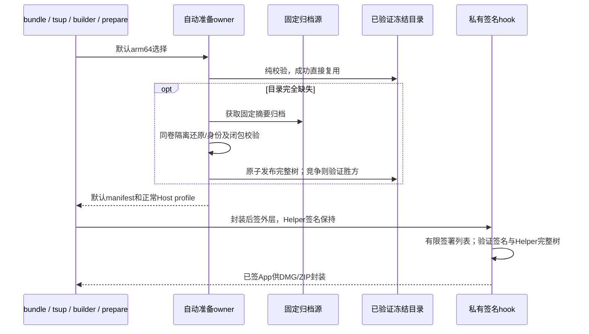

先补能复现缺材料提前失败和local签名被拒的回归，再实现。定向测试覆盖缓存复用、缺失自动还原、损坏/失败不覆盖、竞争发布、显式选择/非目标/dry-run不下载；私签mock检查固定身份、顺序、entitlements、Helper前后校验和失败传播；CI临时keychain生命周期/秘密不落盘日志及workflow接线。只读复用R1/R2/R3，不重跑完整矩阵或18笔。完成根typecheck/lint/架构与独立审阅；真实CI未执行、Secret未配置和归档未上传均如实列明。

> 当前决策（2026-11-18，用户最新指示）：采用现有私有证书 `Zody Local Computer Use` / `local-self-signed`，不注册 Developer ID Application。缺少该身份、对应策略未配置及 Apple 公证未完成不阻塞当前私有签名路径；除非用户明确改变目标，不重复要求申请。私有签名的精确身份、资源闭包、权限和原生守卫保持。此决策不执行签名、公证、上传、发布或安装替换。

> 前一阶段结果（2026-11-18）：Developer ID可选接线已完成，23个build输入与已验收本地冻结pin复原；79项离线回归及根检查通过。Developer ID分支保留为未来显式选择，当前未配置状态不作为私有签名的blocker。见[历史阶段记录](../docs/testing/cua-developer-id-wiring-20261118.md)。

## Developer ID 分发身份接线（2026-11-18）

本节记录此前Developer ID准备合同。用户后续已选择私有签名，故本节关于Developer ID证书/私钥和公证的要求仅适用于未来显式选择该分支，不是当前分发门槛；既有local默认及其验收证据继续复用。

本地R1/R2/R3证据继续有效，不能视为Developer ID签名身份的验收。开工时build目录的23个跟踪资源缺失，仓库clean/clean:output均不删除此目录，具体删除来源未证实。只补缺失的静态资源；冻结metadata按第1/2步验收摘要恢复，禁止直接还原HEAD中的旧R1 pin。现有候选/安装和证据不变。

构建身份选择只有 `local-self-signed`（既有默认）和显式 `developer-id`。发布信任根唯一所有者为仓库受控 `packages/desktop/build/cua-narrow-developer-id.json`，不从资源manifest、自报pins、运行时环境或任意用户文件建立信任。未配置时仅保存schema/kind/status，不伪造证书、Team、CDHash或签名材料；选择发布身份必须失败关闭。配置后需精确绑定TeamIdentifier、证书leaf SHA256/SHA1、Helper/Node固定identifier和各自DR、Node CDHash，DR限定Apple Developer ID Application链和该Team。Helper/Node使用同一发布证书。发布pin、Node签名与Helper编译/签名在后续获授权阶段由真实材料确定。

原native builder增加 `--identity-profile`，复用 `--identity-pins`；发布选择要求显式pins文件。narrow prepare同样提供显式profile/pins选项；validate、打包前/后验证沿 `ZODY_CUA_NARROW_IDENTITY_PROFILE` 的单次构建选择传递。默认不根据manifest或pins自动升级/降级身份；发布profile缺失/未配置/字段不完整、错误Team/leaf/DR/CDHash、manifest/原生编译pins不一致均拒绝。选发布身份时外层electron-builder必须显式开启Developer ID签名并与受控Team匹配，不能使用当前本地冻结默认输入冒充发布输入；要求显式已准备manifest，后续真实冻结完成才更新默认双pin。

所有入口消费同一身份策略加载器，native builder把精确Helper/Node pins写入既有编译头；运行时仍按编译pin验签、audit-token/同二进制/资源摘要复验。代码签名验证在Developer ID分支额外要求正式Authority、精确Team和签名时间戳，保留hardened runtime和既有空entitlements约束。不得放宽authority、控制租约、最终admission、窗口资格或R1不透明边界。

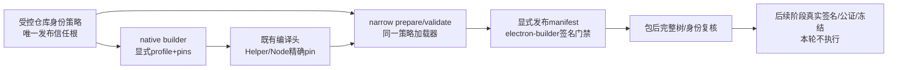

定向回归先复现Developer ID身份拒绝/未支持，随后覆盖显式选择、默认local兼容、未配置与伪造pin拒绝、Team/证书/DR/CDHash/时间戳/entitlements拒绝、编译头传递与构建入口不降级。只运行受影响资源/identity/build测试、typecheck/lint/架构；本轮不做真机SDK或完整矩阵，不生成或重签候选。缺少发布凭据记录为后续签名阶段前置条件，不为此请求本轮无关的系统授权。

> 当前状态（2026-11-16）：正式pin、正式身份最小本地验收及第3步本机安装切换已完成；旧App与完整本机数据已备份，正常启动与默认cua-narrow装配就绪，主控与Terra复核通过。未公证/上传/发布。见[安装记录](../docs/testing/cua-r3-install-20261116.md)；前轮动作证据复用，不重跑矩阵。

## 本机安装切换（2026-11-16，第3步，已完成）

结果见[本轮记录](../docs/testing/cua-r3-install-20261116.md)：备份逐项一致，已安装完整树等于已验收候选，正常界面与默认Host warmup ready成立。启动9条warning/0条error原样保留，没有新增SDK调用或写动作。

用户已授权备份旧 App 与必要数据后，将 `/Applications/Zody.app` 切换为已验收正式身份候选。复用第1/2步和R1/R2证据，不重建、不重签、不重跑写动作/截图/完整矩阵；不公证、上传、发布或自动提交。

主控串行拥有安装切换。确认无当前Zody进程和数据写入者、无路径覆盖后，完整备份旧App与 `~/.zody`（包含业务数据、SQLite伴随文件和Electron profile），在私有目录保存摘要回执；用户项目文件不属于本次数据备份。先核验备份再同卷暂存候选，验证字节与签名后切换；仅正常启动真实用户profile，核对可见窗口、正常Host启动与默认cua-narrow接线，不提交任务、不派发CUA写入。真实配置或历史会话内容不进入工作区证据。异常时保留事实并使用旧App备份回滚；不得为启动检查修改授权或自动更新。

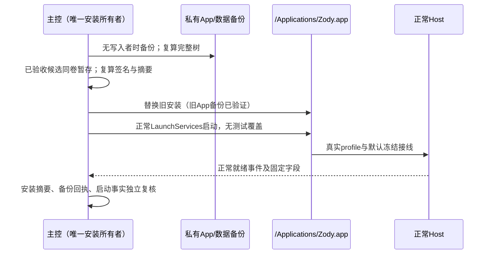

> 前轮状态（2026-11-16）：用户授权的R3最小发布前准备已完成；以本文“R3按实际差异收敛门槛”及[最终记录](../docs/testing/cua-r3-prepublish-closeout-20261116.md)为准。R1/R2旧闭锁、旧20次/全故障门槛按历史理解；正式pin、公证、上传、发布仍未启动。

# R1 只读撤销交付补验（2026-11-14）

历史 R1 轮只覆盖 macOS 正常桌面，本段“R2 闭锁”表示当时时点。当前 R2 已按下方 2026-11-15 启动合同获授权实施；不恢复 workflow 工作树，不改写历史失败或将默认 03a 的历史安全拒绝记为通过。

只读交付沿用唯一 runtime authority 和不可恢复的 turn scope。最终 authority 往返之后仍须重验原生窗口身份；窗口重验返回后、发送正文前检查本地取消，ACK 返回后、提交 diff 基线前再次检查取消。接收端在异步 authority 检查返回后以及同步 ACK 写入返回后检查关闭/撤销锁存；迟到 candidate、旧结果或成功 ACK 均不能恢复旧 scope。检查失败清除待提交基线，新 turn 必须重新确认且首次输出 full。不得通过增加父链、角色、路径豁免或重复授权查询替代既有守卫。

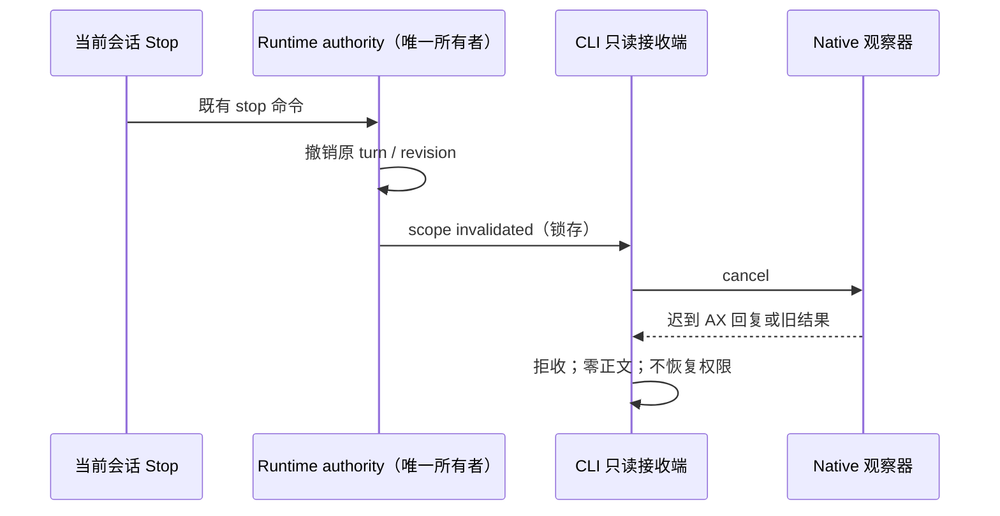

回归须分别覆盖最终窗口重验内撤销、ACK 期间撤销、异步 resolve 迟到 candidate、旧 scope 结果及同会话新 turn。真机使用独立受控 AppKit 夹具，阻塞真实 AX 回复，显式允许后等待读取屏障，点击正常桌面实际 Stop；以同一 CLI 观察调用的 authority invalidated 事件作为撤销事实，再释放回复。仅 UI 点击/终态时间不能证明 authority 顺序。超时不得记作撤销通过；只观察到迟到 AX 回复时不得声称观察到迟到正文帧。诊断只记录固定事件、局部序号与身份摘要，不记录正文、窗口标题或工作区路径，且不参与授权。新 turn 新授权后重新检查原工具仍 stopped、无正文、无 provider 续跑。

# macOS Computer Use 二期：限定 AX 后台切片

## R2 启动与实现合同（2026-11-15，当前授权）

用户已明确授权在当前未提交 R1 工作区上实施和受控验收 R2。本文及 R1 收尾材料中“R2 闭锁”表示当时状态，不能覆盖本次授权；R3、冻结发布 pin 和最终发布仍不启动。归档五份最终验收文件已经逐项核对 manifest SHA-256/大小，R1 支持范围不扩大。

当前技术证据已齐：租约、截图借锁及两平台18条输入路径完成主控与独立Terra核验；18笔合格/19次真实写尝试，1笔输入取证失败原样保留。用户已确认两轮通过阶段未观察到输入、焦点、鼠标或窗口异常，控制输入用例据此晋升；不追加真机轮次，不启动R3。晋升后的CUA R2真机用例与R1相同，仅显式定向执行，默认全量排除，不进入Docker默认套件；正式目录不代表无需真实夹具、签名候选和人工输入。当前状态及失败解释统一见 [R2验收记录](../docs/testing/cua-r2-acceptance-20261115.md)。

### R2 收敛测试计划（2026-11-15，当前生效）

用户已要求精简验证过程。本节取代此前将发布矩阵完整套用于 R2 的执行要求；产品安全合同不变。R2 证明限定功能接线与关键安全边界，R3 原计划承担发布级重复、冻结与完整系统故障矩阵；该测试数量已由下文2026-11-16“R3按实际差异收敛门槛”取代。R1已完成次数和失败不改记。

| 层次 | 本轮执行范围 | 完成条件 |
| --- | --- | --- |
| 确定性回归 | native/CLI 测试承担授权隔离、竞争/120秒边界、Stop/admission 两种排序、旧窗口/索引、迟到、禁止重放、写前读拒绝及写后观察失败、未支持组合 | 复用已通过且未受影响的结果；改动只补和跑受影响回归，不逐条复制成真机故障用例 |
| 已完成真机 | 复用 UI/SDK Stop、新 turn 恢复、R1 metadata/deny/allow/五步读取、目标忽略效果校准 | 保留各自候选身份和原始结论；记录后续差异的影响，不冒称在新候选上重跑 |
| 剩余自动真机 | 空闲租约 1 案；控制→截图借锁→再次控制 1 案 | 分别验证真实 busy/到期不续租和真实 PNG/借锁收据/新冻结状态；每案通过一次，不扩大排列 |
| 集中人工输入 | AppKit、Electron 各 1 轮；每轮 3 操作 × none/compact/full 各 1 次，共 9 笔，两轮合计 18 笔 | 每笔真实业务效果、精确目标、兄弟不变、真实收据及输入无干扰齐全；首笔兼作冒烟，不再单开功能性 20 次轮 |
| 收尾 | 一次最终差异/证据只读复核；代码冻结后根 typecheck、lint、架构及相关 E2E 类型/fixture 检查 | 真实结果和 warning 记账，必要项齐全后结束 R2 技术验收；用例晋升仍需人审，R3/发布不启动 |

真机前先在实际 node_repl cell 环境完成模板导入、结果解析、权限卡分类和回放匹配的离线自检，不派发 OS 写动作；现有硬编码 20 次的驱动须先改为上述 3 种 return_state 各一次并通过类型/fixture 检查，不能沿用旧数量误跑。验证器失败先保存错误并离线修复，只重跑该案；产品失败先补确定性回归和修复，只回归受影响路径。可能已发送的动作不重放，安全拒绝/效果未知不算成功，也不靠增加试次凑通过数。

人工就绪仅在构建和自动项结束、输入驱动已自检后集中安排，等待放在 SDK 调用前。连续两平台执行中仅在明确转换点暂停/继续，不在开发调试期间请用户持续键入。复用 R1 未变的监测与校准证据；新增 fence 的协议/因果检查用定向测试及本轮真实输入验证，不重做失焦、剪贴板、Space、锁屏、睡眠等整套故障注入。

人工轮驱动只运行三项正例，每项依次 `none/compact/full`，不重跑已通过的 deny。首次 `left_click` 提交前等待操作员就绪及新的硬件按键；每平台使用新的 fixture、monitor 进程和独立目录，屏障与监测命令序号均从零开始。测试驱动是试次序列的唯一所有者，monitor 只报告真实输入和系统状态，fixture 只拥有业务效果；离线模板自检允许模拟 SDK，但不得计入真机证据。三种返回模式分别验证 not_requested/synced/synced 和实际状态身份，可能已发送或缺少证据的试次保留，不自动重试。

输入监测的 `insertedText` 必须根据 begin 时的实际文档与选区、end 时的实际文档推导，并验证选区外前后文未变；不能按原文长度截取末尾、假定光标总在文末，也不能用键盘事件文本合成“实际插入”。无法解释的文档变更输出未知并由原评分器拒绝，不新增监测字段，不调整真实键序/焦点/窗口等判据。Electron已发送但输入取证不一致的失败笔保留，不重放该attempt；后续只执行新明确试次及尚未完成路径，AppKit通过结果不重跑。

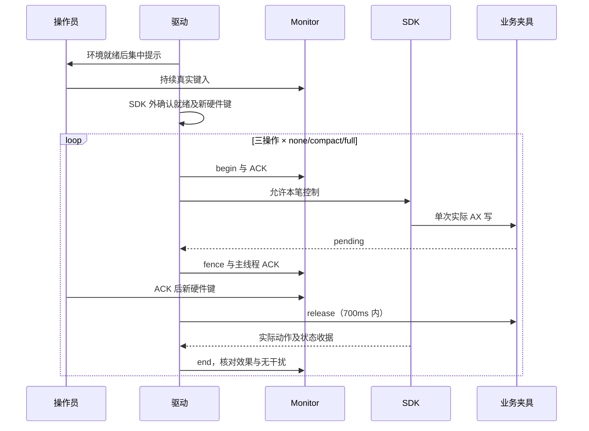

候选复用同一运行槽；只有被封装的产品字节变化才重建/签名/prepare 一次。测试脚本、fixture、报告变化不触发产品重建，未受影响的通过证据继续有效。不得因“更放心”追加新完成门槛；发现真实阻断问题时明确对应合同和受影响用例。执行状态只维护在 [R2 验收记录](../docs/testing/cua-r2-acceptance-20261115.md)，本规格、catalog 和 matrix 不再逐轮复制日志。

实现先完成安全准入，再连接写动作。唯一状态所有者和内部接口如下，公开 SDK 同名同签不变：

- 既有 runtime authority 继续拥有完整 submission ref、producer/run/turn/trace 和撤销事实；控制确认独立使用 `cua_ax_control_confirm` 的单次、默认拒绝、禁止 always/full-access 继承的确认。展示 OS 解析的精确 app/window、限定动作与 120 秒空闲范围；截图、TCC 和读取卡不能授予控制。可信 workspace identity 与 remote session 关联沿原上下文传递并核对。
- 复用现有认证 authority transport 和 observation request composition，内部请求扩展为三个限定动作及 `stop_computer_control`；`confirmControl` 单独于 `confirmRead`。冻结 state_id 在内部适配层绑定，模型 target 仍是 `{type:"element",index}`，不让模型提供或覆盖原生句柄/身份/授权。
- Helper 内控制 owner 持有既有 `MachineLease`（跨进程 flock）、完整 scope、精确窗口及进程启动身份、租约 generation 和单调活动时间。观察与正常单次连接关闭不续租；120 秒到期、Stop、owner/turn/session 失效、目标失效封闭准入。未支持/失败/迟到完成不续租。第二会话或 Helper 必须 `CONTROLLER_BUSY`。CLI 同 consumer 的并发重入也必须在 native 调用前返回 controller_busy，并明确 action_sent:false、dispatch_status:not_sent、state_sync_status:not_requested；不能仅返回错误码而遗漏动作事实。
- `ObserverState` 是已交付冻结元素映射的唯一所有者；只能从同 scope、精确 native window/启动身份和 state_id 查询元素。静默观察、旧窗口重建、索引位移或映射失效不能借新遍历恢复旧索引。系统远端不透明截止保持零正文/零索引/零句柄。
- 原生 control gate 对撤销与最终 admission 给出单一顺序。在 gate 中取得派发资格并记录 attempt 后仅调用一次受支持 AX 操作；不持锁等待可能阻塞的 AX 回复。Stop 先赢为 `not_sent`/零 AX；admission 先赢保留 `sent` 或 `possibly_sent`，不会承诺取消已送达效果。in-flight 未确认结束前不释放跨 Helper 排他；迟到成功不恢复 grant/generation、不续租。
- 动作结果使用独立 `controlResult`，严格验证 `action_sent`、`dispatch_status` 和 `state_sync_status`。连接丢失或撤销不得被观察通用脱敏重建成确定未派发；派发未知按 `possibly_sent` 保留且不重放。写后读取失败保留收据；`none` 不做写后观察，`compact/full` 所需读取确认必须在派发前完成，返回读取仍受最终撤销守卫。`set_value` 对当前 AXValue 做字符串类型核验属于必要正文读取，无论 return_state 都先取得本次读取确认再取得控制确认；旧值仅用于 Helper 本地类型判断，不记录或交付。拒绝读取后零 getter/写调用。
- 所有元素复验失败（包括首次与最终复验）都封闭同 scope 的租约并清除冻结映射；元素恢复也不能复活旧 state_id/index。跨进程 AX getter 可能阻塞，受支持性/可设置性读取结束后须重核原句柄直接 PID/实际 PID/窗口归属，且在 admission 前执行不访问 AX 正文的系统/进程启动身份/hidden/精确 CG onscreen 资格检查；getter 期间发生的锁屏、隐藏、最小化不得沿用之前资格。该检查不重新遍历、不重建索引、不授权 fallback。
- 仅 AXPress（left_click 为 element/left/1/无修饰键/auto 或 a11y；perform_action 为实际广告 AXPress）及普通文本 AXTextField 的可设置 AXValue。原生 adapter 也校验实际广告/可设置性和精确窗口归属，不开放事件、坐标、键入、剪贴板、滚动、激活或前台 fallback。

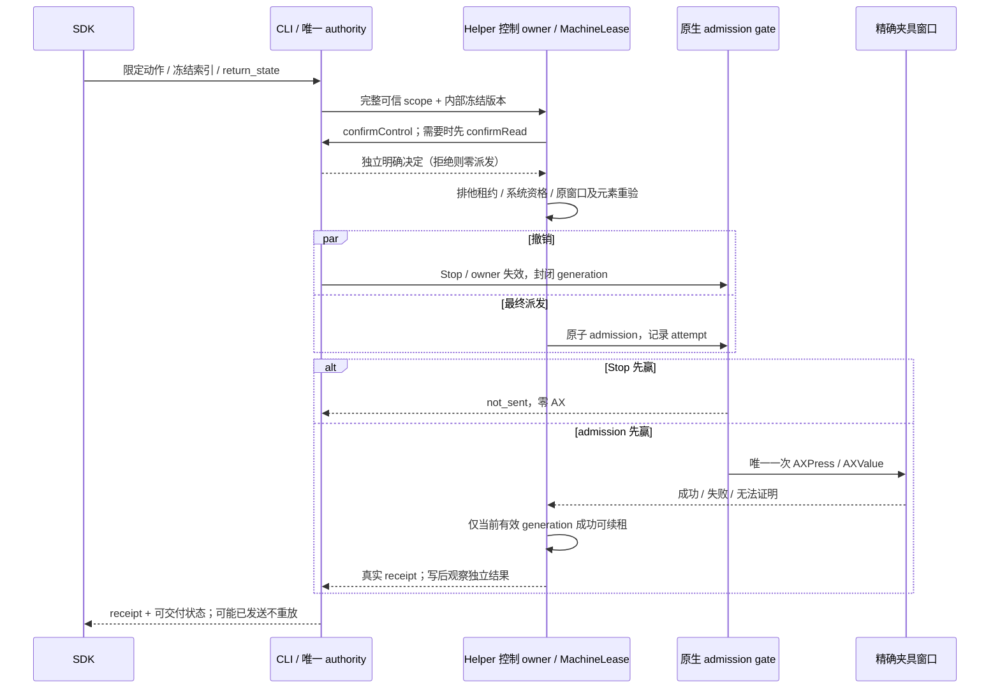

回归先行：授权拒绝、未支持组合零 native 调用、跨 Helper 竞争、恰好 120 秒失效、Stop 先/后 admission 的确定性屏障、迟到成功、旧 scope/window/index、无重放、return_state 写前读取授权与写后失败收据。真机层按上文收敛计划验证关键接线与业务效果，不重复完整边界矩阵。真实验收仅使用受控 AppKit/Electron 夹具；要求精确目标、同 PID 同标题兄弟窗口不变、真实派发收据与无干扰，不能以 AX 返回成功或安全拒绝代替业务效果。目标忽略效果校准已检出，复用其证据。E2E 先 pending，人审前不晋升；复用单运行槽并保留全部失败。

跨调用失效监听：首次授租的 `controlResult` payload 使用内部 `lease_watch:true`，ACK 回显后将同一认证连接交给租约 owner 的唯一 reader，CLI 保留该 consumer scope 并先返回动作收据。后续工具连接独立关闭不能关闭 watcher；同一 authority owner 广播撤销至所有 consumer。watcher 收到 owner revoked/异常 EOF 立即封闭 gate；120 秒到期正常发送 `close` 再结束该 consumer，不将到期伪装为 control-lost 撤销整个 lineage。Helper 在 in-flight 尚未结束时保持 machine lease。此监听不提供第二条授权路径。

截图与树的组合交付必须先完成两种独立授权及最终 scope 检查；成功后 composition 使用仅内部 `commit_state({app_ref,state_id})` 提交原已采集树的可见性。此方法不是模型工具，不读取新正文、不重建索引，只在同 scope、精确原生窗口及进程启动身份和同 latest sequence 下，经最终 authority/系统资格/窗口重验与 `observationResult` ACK 才提升原元素和句柄；失败不提交。固定成功结果仅含 `committed:true,state_id`。CLI 同时更新冻结目标，使实际已交付的树可用于后续限定写；截图失败、旧版本和撤销不能推进基线。

同完整 association 的截图可借用已有控制 MachineLease；借用保持 in-flight token，归还不续租，Stop/到期后直到截图资源确认释放才允许归还机器锁。异 scope 仍排他拒绝。截图 association 同样贯穿可信 workspaceIdentity/remoteSessionId，并与 control scope 精确相等。截图收据区分真实 OS 锁释放（原 `machineLeaseReleased:true`）与归还借用（`machineLeaseReleased:false,machineLeaseBorrowReturned:true`），两种事实互斥，不能将归还借用伪报成释放仍活跃的控制锁；像素/权限/文件核验语义不变。

SDK raw `computer.*` 遵循原工具结果的一次解包合同：受支持写动作含 `structuredContent`（compact/full）时保留完整结果和真实 receipt，不能因只有一块 receipt text 而丢弃已授权的状态。none 的单块收据仍按原规则解包；高层 Target 同名同签及 void/抛错合同不变，可能发送不得自动重试。

SDK 的 not-ready 退避仅用于非动作调用；写动作即使收到 `retryable:true` 也只调用一次并将错误的 `details.retryable` 收紧为 false。收据里的 action_sent/dispatch_status 继续保留，不能以通用 not-ready 覆盖可能发送事实。

生产审计仅投影 Native 固定事实：`[cua-control]` 的 event（rejected/admitted/completed）、正安全整数 attempt、16 位十六进制 scope 摘要和 dispatch_status，严格拒绝额外字段及事件/派发状态矛盾；rejected 只对应 not_sent，admitted 只对应 possibly_sent，completed 对应 sent/possibly_sent。既有 Host stderr 的受控解析器将这些行提升到生产日志，而不是放宽任意 stderr。截图日志同样按真实借用/释放互斥字段解析。诊断不成为权限或结果所有者，不含值、标题、workspace 路径或原始身份。

R2 验收夹具采用独立 `controlled-ax-write-v1` bundle/目录，不修改 R1 默认或显式只读夹具。AppKit 目标与兄弟窗口同 PID 同标题，分别拥有真实按钮计数和普通文本字段业务模型；按钮 target/action 与字段的原生 accessibility setter 更新模型，独立异步原子持久化业务快照，AX 回显不代替业务证明。夹具自身可显式开启忽略效果校准，只记录真实收到的请求并不更新模型，评分必须失败。无第三方窗口访问、无模拟输入、不读取剪贴板。所有写值为固定验收文本。

真实输入交错可显式启用受控目标的业务效果屏障：目标收到真实 AX 写请求后以当前 run nonce 和单调 request sequence 异步公布 pending，业务模型尚未变化；控制器在独立前台监测就绪且观察到该 pending 后，向监测进程发送只读 `fence` 命令；监测主线程采样当前 keySequence 并经串行 IO 写匹配 trialId/command sequence 的 `key-fence.json`。控制器收到该真实 ACK 后，等待序号严格大于 fence 的硬件键入，再释放同 nonce/sequence。异步 last-key 文件可能晚落盘，不能仅以控制器看到文件的先后证明真实输入交错。目标只消费相符的一次 release，随后完成本次真实业务效果；超时、错 nonce、旧 sequence 均不得被计作成功，不重放动作。IO 在串行后台队列执行，AppKit 主队列仍是业务模型唯一所有者。人工开始/恢复等待在 SDK 外，试次内仅为有界机器屏障，不能自动生成键入。未经屏障的功能性效果轮不宣称证明输入交错。AppKit 屏障在真实 accessibility setter/action 内等待；Electron 的普通 DOM 动作通过 renderer IPC 触达 main 业务 owner，再异步等待屏障。后者仅证明真实业务接纳待提交期间的硬件输入交错，不能以异步审计到达顺序声称 AX RPC 仍被阻塞。两者均必须证明最终实际业务效果与兄弟不变，报告保留该机制差异。

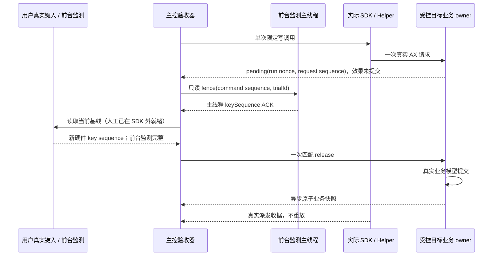

状态（2026-11-15）：单用户 macOS 正常桌面 R1-A/B/C 技术验收已齐：默认 03a 有限本地投影五步、撤销交付、AppKit 20/20 与 Electron 20/23 真实输入交错/监测校准、锁屏原生拒绝/恢复及最终 v27 睡眠恢复均已独立核验。远端系统正文仍不读取；旧安全拒绝与所有失败不追认。R1-D 已经用户确认人审，四项本期用例完成正式晋升和晋升后核验，R1 在该单用户正常桌面范围收尾；R2/R3 继续闭锁。此前 metadata、deny/allow、03b/03c/03d 与截图记录按各自历史证据保留，不声称重跑了组合整轮。跨用户切换按用户批准保留未验证限制。详见 [收尾记录](../docs/testing/cua-r1-closeout-20261115.md)。

## 当前执行范围（2026-11-13 修订）

目标：在 macOS 正常桌面窗口内，完成真实 SDK→sealed CLI→签名 Helper→指定目标窗口的只读 AX 观察，再按既有首批合同完成限定 AXPress / 普通文本 AXValue 控制。正常鼠标、键盘操作和既有授权/撤销语义是本期 UI 验收范围。

- 不包含窄屏专项、触屏、手机 Web、Android、gateway/TLS 或远控适配验收。原交接中的窄屏条目已按用户最新反馈退出当前计划；不得把旧交接或历史测试记录重新作为该项授权。
- 保留已经通过的桌面 Stop、六项整轮和截图回归；仅在相关源码、资源或失败证据有变化时定向复验。正常窗口的键盘 Tab / Enter / Space 可达性仍属桌面交互，继续保留。
- 历史窄屏与手机成功/失败材料只作附加证据；相关额外 pending 测试不进入本期执行、晋升或完成清单，不自动删除已有文件或改动共享 UI 以追求回滚整齐。
- 保留窗口归属、系统状态、默认拒绝、Esc 拒绝和唯一状态所有者等既有安全合同。不因缩小界面范围放宽守卫，也不将 03b 的显式夹具通过替代默认 03a。
- 120 秒控制租约是产品合同，不因测试收敛改变；R2 执行数量以上文收敛计划为准，每组合20次的旧R3数量要求已由2026-11-16按实际差异门槛取代。无干扰仅验证拟支持的 macOS 组合，不附加屏宽/设备维度。

## 基线与目标

已安装的冻结 sealed CLI 及独立 `createCuaCaptureComputerUseRuntime` 仍只接受 `screenshot`；R1 新增的观察 runtime 只在提供真实观察回调的显式源码 composition 中接入，未修改冻结 pin。仓库内 [SDK 合同](../apps/zody-cli/packages/zody-cua-plugin/docs/computer-use.md)及其 client 是公开方法和参数的依据。截图使用现有 frame、machine lease、authority 和签名 Helper 链；phase1 已记录 mobile-origin 持久截图授权扩展。不得从截图授权，包括手机来源截图授权，推导正文读取或控制授权，也不得改变该截图链的资格和语义。普通 CLI/server 的占位路径继续 fail-closed，子代理不可用。

选择 A3/B1：以现有签名 Helper 为唯一新增 native 执行主体，sealed CLI 负责适配和转发；不引入 Node FFI 主体。实际辅助功能授权主体必须以完整签名候选在系统设置和运行时实测，不预先声称已获授权。Rust 切片或 Helper 内实现均须保证可审计的限定入口无法到达通用输入派发。重新运行完整 build/sign/freeze/pin 和闭包审计，不热补 sealed 快照。

探针在 AppKit 和显式启用 Chromium AX 的 Electron 简单夹具各有一次通过；它们是可行性证据，不是生产支持名单或稳定率。首批 AX 正文读取与动作仅准入已打开、当前 Space、可见且非最小化的指定窗口；隐藏、最小化、不在当前 Space、锁屏或无法证明窗口归属和上述条件时安全拒绝。可见不要求窗口处于前台或未被其他窗口遮挡，不得为满足条件激活应用。纯元数据枚举可列出不满足操作条件的窗口，但不因此读取正文或授予动作资格。启动、切 Space 或恢复最小化窗口不属于首批能力，也不得作为 fallback。复杂编辑器、富文本、Canvas、快捷键及其他应用未获证明。

## 首批合同与范围

保留 SDK 同名同签、参数和返回合同，不悄悄删除公开方法或更改语义。下列是首批允许执行的组合；其余方法及参数组合必须在任何原生写派发前明确安全拒绝，不能转为坐标、合成事件、前台激活、剪贴板或其他 fallback。拒绝应映射到 SDK 可识别的类型化错误，绝不伪造成功。

| 方法                                                                                                | 首批允许组合与条件                                                                                                                                                                                                                        |
| --------------------------------------------------------------------------------------------------- | ----------------------------------------------------------------------------------------------------------------------------------------------------------------------------------------------------------------------------------------- |
| `list_apps({})`                                                                                     | 只读运行应用元数据。                                                                                                                                                                                                                      |
| `list_windows({app_ref?})`                                                                          | 枚举窗口元数据；`text_preview` 属正文，未获相应读取授权时不得采集或返回正文。保持 title 空串/null 和窗口身份合同。                                                                                                                        |
| `get_app_state({app_ref, include_screenshot?, disable_diffing?})`                                   | 只读已打开指定窗口的本地 AX 投影；系统远端边界截止并标 truncated；首次正文读取前授权。`include_screenshot=true` 的像素仍经 phase1 截图链及其独立授权，不借此授予正文或控制。内部 `tree_shown_to_model` 语义保留。无法精确映射窗口时拒绝。 |
| `left_click({target, mouse_button?, click_count?, modifiers?, strategy?, app_ref?, return_state?})` | 仅冻结的 element 目标、左键一次、无修饰键、`auto` 或 `a11y`，且目标实际广告并支持 AXPress；`auto` 在本切片不得回退事件。                                                                                                                  |
| `perform_action({target, action, app_ref?, return_state?})`                                         | 仅冻结的 element 目标和该元素广告的 `AXPress`。                                                                                                                                                                                           |
| `set_value({target, value, strategy?, app_ref?, return_state?})`                                    | 仅普通文本字段的冻结 element 目标、`auto` 或 `a11y`，且 AXValue 可设置并与 SDK 的 value 语义一致；不处理富文本或需要菜单、键入、事件的控件。                                                                                              |
| `request_access({capabilities?})`                                                                   | 如实报告实际能力与 grantOwner；不能将系统辅助功能权限当作用户的任务读取或控制授权。                                                                                                                                                       |
| `stop_computer_control({reason?})`                                                                  | 始终允许撤销；与 UI Stop 接入同一撤销链。                                                                                                                                                                                                 |

首批受支持动作均支持 SDK 的 `return_state`：`none`（默认）、`compact`、`full`。返回状态的读取遵守同一正文授权、精确窗口及状态合同，必要授权须在写派发前完成；写后观察失败仍保留动作收据和派发状态，不得重放动作。`type` 是键入，不是 `set_value`。`scroll`、`left_click_drag`、`type`、`select_text`、`key`、`paste`、坐标目标、`event` 策略及其他动作均不在首批。首批八个方法仅支持上表限定组合；其余六个方法规划如下，公开签名和合同继续保留，启用前须各自制定规范、授权、验收及安全派发方案。现有 SDK 的 frame 栅格及其他公开安全合同继续保留，不能因本批不支持坐标而删除。

窗口解析必须先唯一确定应用，再确定精确窗口。未给 `window_id` 时，只能绑定唯一符合条件的窗口，并在取得该窗口的相应授权后读取正文或写入；多窗口歧义必须拒绝并提示通过 `list_windows` 选择，不能默认最前窗口。显式窗口失效时不得转向兄弟窗口；AX 元素必须属于该窗口子树，App 菜单栏等树外元素不构成可操作目标。具体支持名单按通过验收的“App × 控件 × 操作”发布，不能由支持 AX 属性直接推导无干扰保证。

| 后续方法          | 后续路线，首批安全拒绝                 |
| ----------------- | -------------------------------------- |
| `scroll`          | 单独验证滚动语义及目标和前台影响。     |
| `left_click_drag` | 单独验证拖动目标、事件顺序和焦点影响。 |
| `type`            | 单独验证键入及目标窗口，不等同赋值。   |
| `select_text`     | 单独验证选区及可选择性。               |
| `key`             | 单独验证按键、修饰键和窗口路由。       |
| `paste`           | 单独验证剪贴板、消费和前台约束。       |

## 不变的合同与接入边界

- 对公开方法、嵌套 target、枚举和参数在生产端严格校验；未知或不支持组合在任何原生写派发前拒绝。未实现组合返回 SDK 可识别的 `ACTION_UNAVAILABLE`；`FOREGROUND_REQUIRED` 仅用于合同已有的前台约束。权限、授权、失效状态、窗口归属及元素不可用各用对应错误分类，不混作未实现。错误须区分确定未派发与可能派发，未知不能假报未派发。
- not-ready 明确标注 `retryable` 和原因；客户端仅对 `retryable=true` 的非动作调用退避重试，动作可能派发时绝不重放。
- `request_access` 保留 `packages/zody-cua/request-access-contract.d.ts` 的 schema 与 `zcode.cua/request-access-status-v1` meta key，报告 accessibility、screenRecording 和真实 `grantOwner`；候选须验证签名 Helper 的实际系统授权主体，不伪造 granted。
- screenshot、frame owner 和 one-raster 合同不变；坐标使用最近 actionable raster 的精确整数像素及边界校验，本批不开放坐标。大树裁剪与有界 payload 在 R1 前确定，并验收截断、上限和 fail-closed 行为。
- sealed 注入点为 `cua-node-repl-mcp-port.ts`，新 runtime 显式 composition；现有 `cua-capture-runtime.ts` 的截图语义不改。普通 CLI/server 继续 unavailable，不能通过 env、argv、UI 或模型参数打开半可用路径。

## 授权、状态所有者和顺序

首次读取目标正文之前取得明确读取授权，包括 SDK 的 `getApp` 内部静默观察和 `elements()` 等不 emit 的观察；首次写之前取得明确控制授权。授权展示目标 app/window、操作类别和范围；拒绝、过期、目标失效或撤销均不得派发。可以在一次明确确认中授予两类权限，但截图 allow、系统 TCC、读取授权互不自动升级为控制授权。`list_windows` 的无标题正文预览同样受读取授权保护，R1 只读轮即须完成这一保护。对现有持久规则或 full access 是否覆盖新增类别，只能按明确涵盖该类别的授权事实判断，不能沿用仅截图规则。

| 状态                                       | 所有者和边界                                                                                                                                                                                                |
| ------------------------------------------ | ----------------------------------------------------------------------------------------------------------------------------------------------------------------------------------------------------------- |
| submission lineage、撤销事实               | 既有 authority；不由 UI、Helper 或模型另造授权事实。保留现有 desktop/mobile 资格链，新增控制只在具备独立明确授权时准入。                                                                                    |
| 确认展示                                   | 现有确认链；展示不是授权事实的第二个所有者。                                                                                                                                                                |
| 控制租约和原生派发准入                     | Helper 中的控制会话，绑定可信 lineage、完整目标身份和授权范围，消费 authority 撤销；接入现有 machine lease 仲裁边界保证跨 Helper 的控制排他，不能仅靠单个进程的 busy 标志。第二会话返回 `CONTROLLER_BUSY`。 |
| state_id、模型可见 diff 基线、冻结元素映射 | 驱动会话按精确窗口维护；索引只用于其观察版本。静默观察不推进模型可见基线，之后的树请求返回整树。                                                                                                            |
| frame / raster                             | 现有 phase1 frame owner；AX 树或上游 snapshot token 不代替它。                                                                                                                                              |
| 派发收据                                   | 执行路径记录 `actionSent` / `dispatchStatus`，不确定是否派发时标记 `possibly_sent`；客户端不得重放。                                                                                                        |

租约绑定完整目标身份和可信 lineage 的 session、turn、workspace 身份及远程关联；workspace key 使用 `workspaceIdentity?.trim() || workspacePath`，远程沿用可信 `remoteSessionId`，不因此扩大远程授权。仅当租约和 authority 仍有效时，成功的受支持写动作完成可更新活动时间；观察、元数据、失败请求和迟到结果不续租。距最近成功写动作（首次以授租时刻计）120 秒空闲即失效；会话结束、lineage 撤销、目标退出或 Stop 立即失效，需重新取得授权。

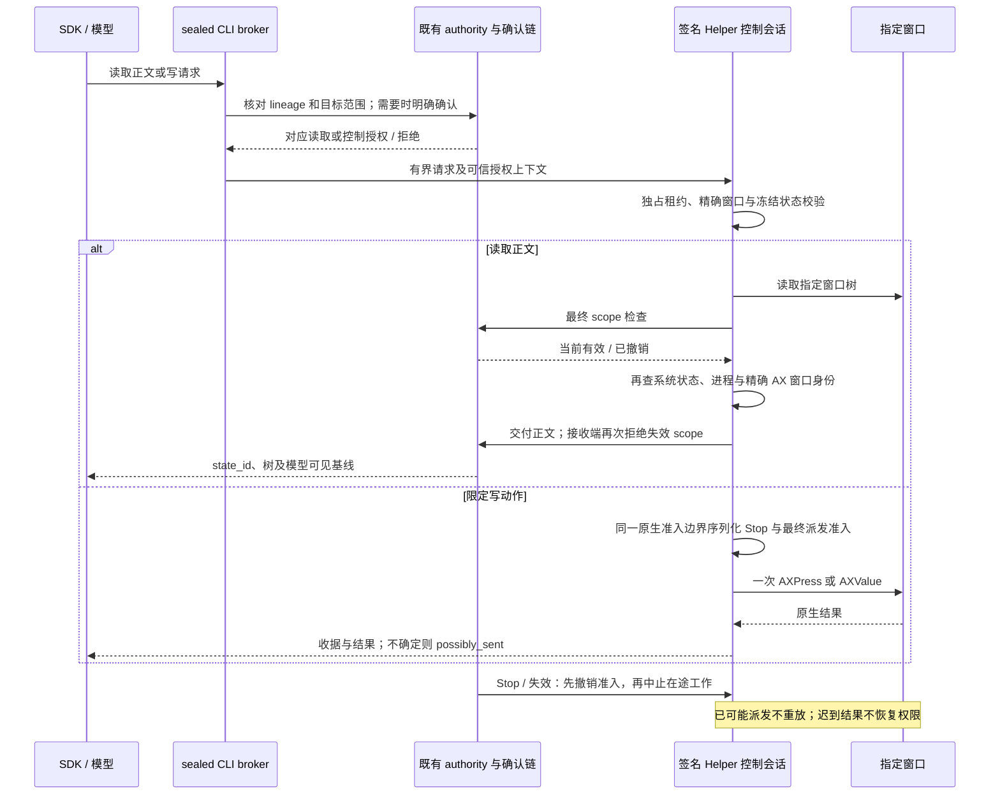

写动作上线前必须同时完成授权、排他租约、收据和 Stop 链。Stop 先撤销原子准入，再中止在途工作；Stop 与最终原生派发准入在同一边界序列化并具有可判定的先后顺序，不能仅在 AX 调用前读取一次撤销状态。如果 Stop 先生效则零派发；若派发先获得准入，保留已派发或可能派发收据，不承诺撤销已送达目标的效果。正文读取结果交付前也须最终核验撤销和授权；撤销先于交付时不得交付正文。迟到结果不得恢复授权或释放给新会话作为成功；需保留可诊断的派发状态。锁屏、失效窗口、元素归属不明和版本过期均 fail-closed。

观察生成结构化状态字段 `state_id` 和内部冻结索引到 native 元素映射；公开 element target 仍为 `{type: "element", index}`，不新增模型参数。动作必须校验状态与精确窗口，不能以同 PID、标题或新的上游 snapshot token 代替身份。模型没看过的树不得成为 diff 基线；元素消失、窗口关闭或重建后旧映射不得用于派发。`possibly_sent` 映射 SDK 的 `actionSent` 和 `dispatchStatus`，不能将不确定性表示为安全重试。

## 修订后的实施顺序（唯一当前执行计划）

### AppKit 系统远端视图不透明边界（2026-11-14，用户已授权实施）

本修订只覆盖 macOS 正常桌面 R1 只读观察，R2 继续闭锁。已留存的真实证据确认：默认 AppKit 缩放按钮下的远端代理，实际 PID 和 CG 窗口 owner 都指向 Apple `com.apple.appkit.xpc.ThemeWidgetControlViewService`。父链、角色、路径位置以及 Apple 签名都不证明它属于已授权窗口，不能据此读取远端正文。

读取合同改为“目标窗口本地 AX 内容 + 系统远端视图不透明边界”：正文与元素句柄仍须通过原 public PID、direct window、AXWindow 和本次目标身份检查，并额外要求 ActualPid 明确等于目标 PID。只有非根节点的 public PID 仍为目标、ActualPid 为真实外进程、direct ID 为非零异窗，且下列只读元数据全部完整、前后稳定时，才允许截止该子树：ActualPid 等于单个定向 CG 窗口 owner；进程启动秒/微秒一致；动态代码满足 Apple anchor、精确 code identifier 和系统 AppKit 内 ThemeWidgetControlViewService.xpc 规范路径；节点 ActualPid/direct ID 重采样一致。身份未知、API 缺失、超时、PID 复用、CG owner 变化、签名或标识/路径不符、普通兄弟窗口及其他外进程均整次拒绝。元数据只用于截止，不用于授信或返回窗口内容；无跨次缓存或新状态 owner。

命中边界后不调用该节点的 title/value/children/actions，不生成占位元素、索引或 native 句柄，设置现有 `truncated=true` 并发出仅固定原因的 `observation-system-view-omitted` 审计事件。现有 `full` 表示受支持本地投影的完整快照，不承诺原始 AX 树完整；省略必须在实际模型结果中保留现有截断提示，silent 仍不交付树。普通窗口与正文的全部原有守卫、授权/Stop/系统状态、最终交付和冻结索引位移保护不变。此项是明确限定的读取范围修订，不允许通用跳过冲突节点或按角色/父链/路径过滤，不开放远端内容或动作。新候选不继承旧策略的 diff 基线；边界出现/消失仍遵守真实元素和句柄的既有 full/diff 判据。

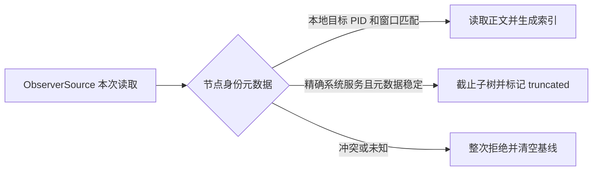

验收先于实现：在真实遍历代码中复现原先异窗导致整次失败；为远端 title/value/children/actions 安装调用即失败的探针，证明截止前没有读取；注入远端和同 PID 同标题兄弟窗口标记，验证本地结果、diff、silent、索引与句柄均不泄漏，兄弟窗口仍拒绝。覆盖伪造/非 Apple 服务、错误路径或标识、启动身份/CG owner/ActualPid/direct ID 变化、缺失和超时。随后实际验证原默认 AppKit 双窗口五步 full/diff/silent/full/diff、五次独立确认、模型实际结果、truncated 和省略审计。历史安全拒绝继续是失败；新策略通过仅证明有限本地投影读取，不能称为完整远端菜单读取或 R1/R2 完成。

以下按依赖推进；历史章节仅保留事实，不覆盖此处的最新范围。R2/R3 是后续工作，本次计划修订不提前开放写动作。

| 顺序     | 工作                       | 退出条件                                                                                                                                                                                                                                                                        |
| -------- | -------------------------- | ------------------------------------------------------------------------------------------------------------------------------------------------------------------------------------------------------------------------------------------------------------------------------- |
| 1 / R1-A | 默认 AppKit 03a 归属问题   | 在现有固定候选与原默认夹具上定位非根 group 的 other_process / AXWindow 缺失；明确是夹具、观察映射或系统限制。修复必须先有回归证据且不放宽守卫；同一 turn 的五步 full/diff/silent/full/diff 真实通过，03b 不代替。若无法建立可信归属，保留拒绝并报告支持范围问题，不另造通过组合 |
| 2 / R1-B | 补齐只读撤销交付边界       | 读取允许后、最终正文交付前后的 UI Stop / 撤销，证明撤销先发生则零正文、迟到结果不恢复权限。已通过的允许前 03d 只作回归，不重新扩成新平台测试                                                                                                                                    |
| 3 / R1-C | macOS 无干扰与系统状态验收 | 按 R1-04/R1-05 的既有合同完成前台输入与后台读取交错、监测校准、AppKit/Electron 读取组合试次，以及锁屏/解锁、睡眠、用户切换的拒绝和恢复；用户参与的操作集中安排，不逐轮重复索取相同授权                                                                                          |
| 4 / R1-D | 汇总并人工审阅             | 复核必要证据、相关测试与检查；人工审阅后按生命周期晋升本期用例。额外窄屏/手机证据、历史冷启动问题不新增 R1 完成门槛                                                                                                                                                             |
| 5 / R2   | 限定写动作与安全准入       | 控制授权、排他租约及失效、工具 Stop、原子撤销/最终派发排序、收据与禁止重放先完成，再接 AXPress / 普通文本 AXValue；验证 return_state、目标业务效果与兄弟窗口不变，拒绝未支持组合，不提供坐标/事件等 fallback                                                                    |
| 6 / R3   | 产物与最终验收             | 对最终实现集中 build/sign/freeze/pin 和闭包审计；复核真实 SDK 全链、系统授权主体、限定 App×控件×操作支持矩阵、写动作无干扰及故障注入，再完成发布验收。候选签名通过不等于冻结发布已完成                                                                                          |

2026-11-14 本轮结果：先 spec，随后真实生产遍历的旧逻辑回归编译成功、断言 SIGABRT（-6）；实现截止边界后转绿。远端 title/value/children/actions 调用探针均零调用，兄弟窗口、缺失 API、超时和身份变化仍拒绝。18 项 native、180 项解析器/收据测试、全仓 typecheck、桌面 E2E typecheck、lint（0 error / 321 既有 warning）和架构检查均通过。默认双窗口夹具未替换或更改 AX 导出；真实五次独立确认，provider 结果 full/diff/silent/full/diff，第 2/4/5 步带 truncated，第 3 步不交付树，五步无兄弟正文；原始审计 4 次固定省略、0 次拒绝。签名和资源闭包通过，已独立核对候选 native 源摘要；原夹具按身份核验后退出，临时 App 已清理。未创建 workflow 工作树、未恢复旧工作树、未改冻结发布 pin、未提交或晋升用例，R2 继续闭锁。

证据：[独立验收](../output/cua-appkit-opaque-r1-20261114/independent-acceptance.json)、[真实五步收据](../output/cua-ax-r1-acceptance/e2e-evidence-default03a-opaque-v1/r1-receipts.json)、[原始确认与省略审计核验](../output/cua-ax-r1-acceptance/e2e-evidence-default03a-opaque-v1/native-raw-independent-review.json)。历史默认 03a 拒绝、引擎格式失败与 CLI EPERM 仍保留且仍记失败；新通过仅适用于本轮有限本地投影，R1 其余验收和人工审阅继续待完成。

### R1-A 默认 AppKit 03a（本轮有限投影已过，本期人审已通过）

1. 阅读并核对现存 03a 失败收据与当前源码；先确认默认夹具、目标 PID/window ID、进程启动身份及 AX 节点归属事实，不重做已通过的 03b/03c/03d。
2. 围绕非根 group 的直接窗口映射、AXWindow、父链与目标窗口关系做最小诊断，输出可复现原因；区分已证实事实与假设，不扩大到其他应用或手机路线。
3. 原因明确后先补对应回归，再做限定修复；仅允许上节已授权的系统远端视图不透明边界，不得通用跳过冲突节点、放宽正文归属判断、默认 full 或替换为显式夹具冒充通过。
4. 源码确有变化才集中重建所需候选，复用固定路径，核验签名/资源闭包和实际授权；先定向跑 03a，通过后执行受影响的桌面回归并更新证据。

### 执行与完成规则

2026-11-15 用户明确选择按本机单用户 macOS 正常桌面范围收尾。R1-C 不再要求在本机新建或启用第二账户；真实跨用户切换列为未验证支持限制，不能记为通过。既有 console/login/锁屏/电源、窗口身份、只读确认和撤销守卫均保持不变。R2 继续闭锁。

验收器的人工就绪提示须使用完成标准 AppKit 启动的独立夹具；等待就绪在 SDK 调用之外。只有当前轮实际按钮产生的原子答复才算就绪，超时、退出或 LaunchServices 状态不能代替用户答复。LaunchServices 返回异常但已存在当前轮有效答复时，保留启动异常后读取该答复；无答复则失败。受控睡眠故障由验收控制器在就绪后一次调用 `pmset sleepnow`，与被测只读 SDK 分离，不构成 R2 控制能力。

监测校准只在独立前台夹具实施：丢弃一次真实硬件键入、短暂显示自身弹窗再关闭、短暂移动并恢复真实指针。夹具须记录故障已触发的收据和原始监测差异，不伪造 SDK 结果或将校准当作成功读取。剪贴板仅由用户复制夹具测试数字来改变计数，不读取或清空原有剪贴板；Space 由用户切换已有桌面后返回。写动作的“目标忽略效果”校准归属仍闭锁的 R2。

睡眠退出诊断的回调须先实际写入注册收据并由控制器核验，不能把 Electron bridge 返回空值当作注册成功。仅诊断模式不执行系统状态变更、不读取正文，独立标记为非验收证据；正常退出回调只记录，不拦截退出。

睡眠退出归因须区分验收控制器、ChromeDriver 与应用：对齐当前轮实际故障请求、ChromeDriver Quit/Browser.close、应用 JS quit 调用及原生 before-quit、窗口 close/closed、power suspend/resume/lock 通知。诊断只记录元数据与调用栈，退出调用原样转发，不用阻止退出或延长原生超时使测试通过；原始失败先保留，再补能够复现已确认原因的回归与最小修复。

原生退出来源仍不明确时，独立诊断 addon 在 before-quit 中读取当前 AppleEvent 的 class/id、严格类型 sender PID、退出 reason 及该 PID 的可执行路径；不读取事件正文，不替换 AppleEvent 处理器，不发送 AppleEvent。另一个显式诊断开关可旁路记录 HUP/INT/TERM 的内核 sender PID：只包裹已经存在的自定义 handler，保留其 mask/flags，立即原样转发一次；默认/忽略处理不替换，原 handler 改动后的 disposition 不恢复。signal handler 仅用固定结构和 signal-safe write，不使用 UI、JSON、分配或锁。先验证元数据负例、真实子进程信号发送者、原 handler 转发及一次性重置，再用于定位。不修改候选资源、签名、权限或守卫，最终睡眠验收撤下整个诊断 addon。

人工就绪预算与机器调用预算分离：集中真机轮可显式配置 60–1800 秒的人工等待，默认 300 秒。开始按钮等待与故障后人工唤醒/解锁分别使用该预算；CPU 暂停期间不得消耗只有 40 秒的机器恢复资格等待。控制器的预算函数独自计算外层用例（两段人工预算加 300 秒）和监测生命期（外层再加 120 秒，至多 4200 秒），避免外层先销毁候选。SDK、原生读取及取得资格后的新读取时限不变；预算不授予资格，仍须本轮真实 didWake 和当前 allowed。超时保持失败，不能从睡眠通知或等待结束推断恢复。等待到期、暂停或没有当前轮实际按钮答复均不执行睡眠，也不记成功。

2026-11-15 已通过内核信号发送者确认：睡眠定位轮的首个 SIGTERM 来自 ChromeDriver，随后才进入应用既有退出链。验证器不得因浏览器传输中断自动终止候选：仅本机 R1 系统状态用例独立执行时设置 ChromeDriver detach；空选择或与其他 spec 混跑均维持默认配置，显式收尾仍走既有退出与身份校验。先用受控 Electron 窗口主动切断调试传输复现旧配置杀进程、证明新配置保留同一 PID，再接线。系统故障请求先锁存控制器阶段；睡眠/锁屏期间只轮询 SDK 结果和原始系统监测，不发浏览器 UI 命令。唤醒、当前系统资格与本轮 sleep/wake 序号均已证明后才恢复 UI 读取确认；不重放写入或确认，不把新的进程当作恢复。

本轮故障边界在实际 pmset 请求前记录，不能计入此前等待期间的通知。系统监测独自保存最近 sleep/wake 序号并随每个原始样本提供；生命期由同一控制器预算计算，结束样本不得准许 UI。先在 40 秒机器预算内见本轮睡眠与不可用状态再放行 SDK 负例；取得一次真实零正文拒绝后，不重复刷拒绝，而是在独立人工恢复预算内等本轮 didWake 和当前资格恢复，再放行下一次 SDK 调用与新的单次确认。机器探测仍为 40 秒，不用超时或状态恢复本身冒充读取成功。回归必须复现睡眠超过 40 秒、唤醒后仍锁定再解锁的事件顺序，并证明陈旧 wake 或当前 unknown 即使预算有余也不能准许 UI。

系统状态评分不能用故障前的普通权限拒绝充数：只有故障已被原始监测证明、当前 guard 为 locked/unknown 且实际固定错误返回零正文时，才计系统拒绝；睡眠恢复还须同时具备该拒绝、实际 didWake 和新鲜成功读取。单有 sleep/wake 通知不算读取拒绝与恢复通过。

SDK 负例须匹配真实交付层：Native 固定消息是 `Read-only observation failed`，CLI adapter 为防止自由文本携带正文，会重建为 `Computer use observation failed`。验收器只接受这两种已定义消息、严格四字段与零派发事实；不把未抛异常当成功，不接受额外正文或未知字段。未知非树返回留存有界原文，仅供诊断、不计系统拒绝，并等待恢复事实后取新结果，避免刷满试次而错过人工解锁。

睡眠负例 cell 在取得故障后的一个实际返回后立即结束，不把 SDK/node_repl 调用悬挂到人工唤醒之后。控制器在 SDK 外等待本轮 wake 与 allowed，再于同一候选、同一 session 的新 turn 提交单独恢复读取，新卡必须重新单次确认且 requestId 不同。分别保留负例 tool 完成和恢复 tool/full 的原始事实；不得增加 node_repl 的 120 秒上限或恢复已结束的旧授权。确定性回归须证明负例返回后即使没有恢复 ACK 也已结束，真实恢复仍必须另取结果，不能复用故障前 full。

v24 证明 detach 仅保留应用进程，不能恢复已被 ChromeDriver 删除的协议 session。睡眠恢复阶段在任何 UI 命令前显式重新绑定一次验证器：仅使用故障前保存的 loopback debugger 地址、同一候选 PID/可执行路径/启动时间；先以原生只读身份检查和 CDP `SystemInfo.getProcessInfo` 的 browser PID 双重核验，才创建只含 debuggerAddress 的 attach session。禁止传 app binary/启动参数、退出旧应用、调用已有的应用重启 helper 或重放提交/确认。绑定后重建测试 CDP bridge，核对实际 main PID 及启动身份仍一致，再提交新恢复读取。未知身份、端口复用、非回环、连接/核验失败均停止，不搜索其他实例或自动再次重绑；这不是产品授权路径，不改变任何读取守卫。先在实际断连回归中证明旧 session 无效、新 session 指向同一存活进程，再用无睡眠/无正文的签名候选诊断验证 bridge；最后才执行用户参与的睡眠验收。

验证器所启动的候选直接由 ChromeDriver exec，LaunchServices `launchDate` 可能缺失。其传输绑定统一使用独立检查器的内核 `proc_bsdinfo` 启动秒/微秒、实际可执行路径及 bundle ID，不做 LS→内核 fallback；这只识别验收器自己的候选进程。产品 AX 目标身份与 AppKit 夹具的原有窗口/启动时间合同完全不变，不能拿这个传输身份向任何窗口授予读取权限。

R1-D 人审后四项用例可以晋升 formal，但继续只接受显式定向的本机签名候选验收：默认全量 replay 由现有环境用例选择器排除 `conversation-session-cua-r1-*.test.ts`，即使环境残留夹具配置也不自动执行。显式选中时仍保留用例自身缺少 Darwin/候选/当前夹具/证据路径的 fail-closed 行为；晋升不代表进入 Docker 套件，不自动运行真实输入或系统电源变更。

2026-11-14 收尾实施：R1-A/B 复用已经独立核验的最终候选与原始证据，不重新 build/sign，也不重复五步。R1-C 新增独立只读前台监测夹具和 pending 验收驱动，不能复用旧 AX 写 probe 冒充生产读取。监测只采集自身编辑器的真实键入、实际 active/key、指针位置、剪贴板 changeCount、当前 Space、无标题的窗口 ID/层序和系统状态；不采集其他应用正文，不注入键盘字符。控制器仅拥有试次与证据，runtime authority 仍是唯一授权所有者。

每次真实读取以现有 CLI allowed/delivered 事件关联 observationId、完整 scope 摘要和指定窗口。跨进程不比较未校准的时钟：在前台监测就绪后允许读取；先观察 allowed，再记录 witness 的按键序号基线，观察新的真实键入后复查 CLI 尚未 delivered，随后才接收该读取结果，构成可验证的因果交错。各进程仍保留自身单调时间及序号。无输入交错的尝试保留为未证明，不筛掉总试次；缺少监测项、真实干扰、错误窗口或读取未成功均不得计为成功。AppKit/Electron 分别至少 20 次成功，实际人工输入与系统状态操作集中安排；无人参与时不得生成替代输入或伪造完成。R1-D 先形成可审阅的完整证据与差异，再按既有生命周期的人审条件晋升。R2 保持闭锁。

- `normal-host-slot` 是唯一当前运行槽；fresh HOME、新夹具和新证据目录与 App 复制无关。测试 helper/fixture/断言调整不要求重新构建 App；产物变化必须按已有构建和签名流程形成可审计新修订，不热补旧签名件。
- 每项需要行为改动时先更新相应合同与测试，明确唯一所有者和事件顺序；按变化执行相关测试、E2E 类型检查、全仓 typecheck/lint、架构及 fixture 检查。通过后不为扩大覆盖数字反复重跑。
- 真实取消、授权、工具结果与派发状态必须来自实际链路；不以 DOM click、直接 Stop RPC、failed、节点消失、超时或没有网络请求替代所需证据。
- 旧失败、原始收据和清理回执继续保留；已知历史冷启动异常只记录，不推定已修复，也不单独扩张本期门槛。

#### 范围自查与历史问题分类（2026-11-13）

最初交接文本含桌面与窄屏可达性，但用户随后明确质疑窄屏是否属于真实目标；当前计划仅保留正常桌面交互，不把窄屏或手机链作为需求。Android bridge 模拟、gateway/TLS/资源代理、专用测试凭证及为此引入另一种 Host 装配，是执行者自行扩大的路线，不是 03d 的必要前置；原有成功/失败证据保留，但不据此新增 R1 或二期门槛。手机源文件仅为额外 pending 测试，不新增产品手机功能。

此前把历史冷启动 protocol timeout / watchdog 放入“R1 稳定性”完成判据，是把已知问题提升为未经确认的新门槛。现只保留已知问题记录：原失败不能追认，admission / ACK 不得猜测、不得自动重发；如再次复现并阻碍既有验收，再针对实际故障处理。它没有被证明已修复，但不独立扩大本轮验收范围。

此前将工具 Stop / 写派发竞争混列于 R1，现按既有实施顺序归回 R2；R1 仅保留读取与正文交付的撤销保护。每组合 20 次及 120 秒控制租约来自接手时既有规格，并非本轮新增；本次自查不把“规格已有”改称“用户已逐项确认”，也不自行增加次数或其他门槛。

### R1 接入合同（2026-11-11）

- R1 在显式 sealed composition 中接入 `list_apps`、`list_windows`、`get_app_state`；普通 CLI/server 仍不可用，所有写方法仍拒绝。现有截图 runtime 保持独立。元数据枚举不读取任何窗口正文，`text_preview` 在本轮固定为 `null`，不能先采集再过滤。未运行的 app 不启动。
- 同一 runtime 的观察与截图共用单次调用准入，重入直接 `CONTROLLER_BUSY`，不建立第二条待办队列，避免并行 consumer 共享同一 turn scope 后互相关闭。dispose/取消之后的迟到结果不得交付。
- 本轮正文授权采用既有 PermissionBroker 的 `user-once`、`no-always-allow` 请求，类别为 `cua_ax_read_confirm`，展示 OS 解析的应用及精确窗口。每次正文观察（含静默观察）独立确认，不读取或沿用截图规则，也不从会话 full access 自动推导新增正文权限；本轮不落持久读取规则。R2 再把已明确授予的权限与有界租约连接，不能以省略本轮授权保护作为过渡。拒绝或取消后不采集正文；采集后撤销则不交付。
- 可信 CLI 从同一 runtime 创建 live turn scope，通过现有已认证 authority 连接响应空 `bootstrap`，新增 `observation: {method, arguments}` 字段。native 只接受该可信响应中的观察意图，不从 cell、环境或 fd3 提示构造身份。观察分支不伪造截图 target，不修改截图 bootstrap 形状。
- 新增内部 `confirmRead` 和 `observationResult` 方法。两者都必须验证完整 ref、traceId、producerIncarnation、runId、turnId；`confirmRead` 另带 generation 与 OS target，明确区别于截图 `confirm`。正文结果在 CLI 核验同一 live scope、对应窗口已获本次读取授权后才可接受，接受回执之前的结果不视为已交付。结构化失败使用 SDK 现有错误信封，不把权限或状态失败伪装为空树。
- Helper supervisor 持有唯一只读观察会话，按可信 lineage 与精确窗口隔离状态，跨单次 authority 连接保留冻结的 native 元素、单调字符串 `state_id` 和模型可见基线；CLI/SDK 不复制该状态。静默观察之后的树请求发整树；native 在结果获接受后才提交对应基线，拒绝、取消、交付失败不提交。窗口或 lineage 失效清除旧映射。
- 窗口身份除 PID/window ID 外保留 AX 原生窗口引用和 OS 进程启动时间，读取前后与交付前再次解析核验；不能跨 PID 重用或窗口重建继承映射。即使控件文案相同，原生元素引用发生位移时也强制整树，不能返回无变化的 diff。正常 consumer close 只释放本次 binding，同一仍有效 turn 可创建后续 scope；owner 撤销、turn 结束和 Stop 不得由正常重建复活。
- 观察结果分开设限：`get_app_state` 及所有错误结果本体仍至多 12 KiB；`list_apps` / `list_windows` 元数据结果本体至多 64 KiB，均按完整结果 JSON 的 UTF-8 字节计量，超限明确拒绝，不静默截断列表。仅可信会话固定的元数据观察允许 `observationResult` authority 帧至多 128 KiB、该连接接收累计缓冲至多 256 KiB，为完整 scope 与 JSON 转义留出有界空间；其他方法、正文读取及截图维持 16 KiB 单帧、64 KiB 缓冲。CLI 在元数据会话放宽传输容量后仍逐帧核验方法，不能借元数据连接发送超大 check/confirm/close；调用方配置只能收紧限额。native 仅对已认证 bootstrap 明确为元数据的结果发送放宽；CLI 回写响应及 native 接收响应仍维持 16KiB，CLI 输出积压仍限 64KiB。树至多 64 个返回元素、16 层，每项文本至多 256 UTF-8 字节，所有裁剪在完整码点边界进行，文本与结构化结果标明裁剪。只冻结实际返回的元素；整体仍超限则返回 `STRUCTURED_STATE_UNAVAILABLE`，不交付半个状态或提交基线。每个 Helper 至多保留 32 个窗口状态，超额有界淘汰且下次观察重新全树。R1 测试覆盖边界与截断，不以缺失元素索引继续操作。
- `get_app_state(include_screenshot=true)` 的像素仍通过既有截图回调取得，按 AX 返回的实际 PID/window ID 绑定；组合交付前再核对原完整 ref/revision、run 与 turn。为避免 AX 已接受但随后截图失败时把未展示的树设为模型基线，组合请求强制 AX 整树且 `tree_shown_to_model:false`；即使组合成功也保守要求下一次整树。AX 状态和截图各自满足授权条件，一结果只含一个 raster。R1 源码与自动化通过不等于签名安装件发布；冻结 pin、系统权限主体和持续输入真机验收留在 R3 独立记账。
- macOS 资格检查必须同时验证当前 console/login 会话、明确的未锁屏事实、应用未隐藏、窗口在当前屏幕集合、AX 非最小化与精确窗口映射。窗口映射仍依赖私有 `_AXUIElementGetWindow`；锁屏观测按下述签名候选轮校准后的组合规则执行，不能单凭 console/login 或 CGSession 字段缺失推导未锁屏。元数据中的 `main`/`focused` 无法由真实 AX 窗口证明时为 `null`；`subrole` 只在真实 AX 匹配时提供。

### R1 本轮执行记录（2026-11-11）

- 新增观察模块和原生状态/会话测试先经历缺模块或缺实现的红阶段，再补实现转绿；原生引用位移 diff、拒绝后换 generation 重复确认、并行 consumer 互相关闭及 dispose 后迟到交付也分别被测试复现并修复。未交付状态不作基线、SDK 隐式窗口绑定、真实 subprocess cell → broker → 观察回调、bootstrap Duplex 的授权/取消/换 turn/revision、正文规范化错误及元数据禁预览均有回归覆盖。
- 固定 Node 24.14.0、pnpm 10.33.2：Core CUA 73 项、Adapter CUA 71 项、Bootstrap CUA 53 项、node-repl CUA/SDK 52 项，共 29 文件 249 项通过。Adapter 旧测试的包内 `@zody/core` 无法解析，执行时临时映射到其已重建公开 `dist/index.js` 入口；未改依赖或将加载失败当成通过。
- 当前 Helper 源码按既有 source stage 与编译参数成功链接，15 组 native 测试通过；随后追加的拒绝接受回执/下次整树测试也单独编译执行通过。该编译检查借用历史 pin 头与现有视觉静态库，只证明当前源码可编译和测试，不是新的 sealed 候选或签名发布。原生只读测试产物未发现 AX 写派发或 CGEvent 输入的未定义符号，不外推为完整安装件审计。
- 根 `pnpm typecheck` / `pnpm lint` 与 CLI `pnpm --dir apps/zody-cli typecheck` / `pnpm --dir apps/zody-cli lint` 均退出 0；根 lint 为 321 warnings、0 errors。`pnpm architecture:check --changed` 无新违规，新增 TypeScript/文档格式检查通过；原生目录不在 managed 模块覆盖内，另以编译和原生测试验证。
- 本轮未请求或变更系统辅助功能权限、未签名、未更新冻结 pin、未验收实际应用的 AX 正文读取、桌面/手机 UI 确认及持续输入无干扰。锁屏未知拒绝、私有窗口映射兼容性、真实窗口关闭/重建、监测器故障注入和 App 支持组合仍需签名候选验收；10 秒遍历预算不含前后窗口解析，也不承诺 OS 同步调用可被精确中断。R2 在这些保护的基础上继续，不能把本节当成写能力已准入。

## 验收门槛

### R1 签名候选验收轮（2026-11-11 开始）

本轮在独立输出目录重建当前 Helper 全部 JS/native 资源，使用现有本机签名身份，重新 prepare 内容清单并装配独立应用；不覆盖已安装应用，不更新发布冻结 pin。E2E 使用隔离 HOME、仅回环地址的确定性 provider fixture 和无意义测试 key，模型返回真实 node_repl SDK 调用；不 stub 工具结果、不注入 fake authority 或伪造 live ticket。原生夹具使用同 PID、同标题双窗口，正文分别为固定目标/兄弟标记。夹具必须装配为带固定 bundle ID 的 AppKit 应用并经 LaunchServices 启动，预检进程启动时间存在；裸命令行夹具 launchDate=nil 时仍按生产规则拒绝，不能据此放宽 incarnation 校验。验收夹具窗口显式使用 AppKit 的跨 Space 与 fullscreen auxiliary 行为，避免候选切换 Space 后夹具离屏；不激活、移 Space 或绕过生产端 onscreen 校验。每次测试保留夹具窗口 onscreen/隐藏/进程启动时间的前后事实，离屏仍拒绝，不计成功。需要系统辅助功能授权时由用户在系统设置操作，探针权限不代表候选 Helper 权限。

| Case          | 操作与判据                                                                                                                  | 证据状态                                                                               |
| ------------- | --------------------------------------------------------------------------------------------------------------------------- | -------------------------------------------------------------------------------------- |
| CUA-AX-R1-01  | 校验资源、签名与 prepare 闭包；真实 SDK 枚举且无正文预览，旧截图链回归                                                      | 固定槽资源/签名/真实枚举及截图 3/3 通过，pending 审阅                                  |
| CUA-AX-R1-02  | 同 PID 同标题窗口，独立读取确认拒绝/允许；精确 PID/window ID 与正文边界                                                     | v6 真机通过：两张独立卡、拒绝无正文、允许仅目标正文                                    |
| CUA-AX-R1-03  | 模型可见 full/diff/silent、状态 ID、Stop、窗口关闭重建及失效交错                                                            | 部分：本轮默认03a有限投影五步通过、pending人审；03b/03c/03d历史通过；其他交错未完成    |
| CUA-AX-R1-03b | 独立显式AX内容夹具，生产守卫下五次独立确认和实际provider结果                                                                | 真机通过full/diff/silent/full/diff；不代替03a或其他门槛，仍pending                     |
| CUA-AX-R1-03c | 显式夹具确认等待中关闭重建，旧卡/旧ref拒绝，新ref独立确认默认full                                                           | 独立签名v11真机v5通过；pending人工审阅，前四轮失败保留                                 |
| CUA-AX-R1-03d | 待确认读卡上真实WebDriver Stop，取消终态零正文，新turn重新确认                                                              | 固定槽六项 6/6 通过；pending 人工审阅，窄屏/手机仅留历史证据                           |
| CUA-AX-R1-04  | 持续前台真实输入与后台观察交错；完整无干扰测量、AppKit/Electron 分组，各组合保留总试次与至少 20 次成功                      | AppKit 20/20、Electron 20/23 真实交错与完整监测校准已独立核验，本期人审已通过          |
| CUA-AX-R1-05  | 用户参与锁屏/解锁故障注入；同时采样 CGSession 和 IOKit Root 的严格布尔状态、console/login、电源状态，核对未知拒绝和变化时序 | 锁屏旧原生证据保留；v27 睡眠后锁屏零正文拒绝，新卡 full、同一 PID 恢复，本期人审已通过 |

锁屏观测先收集证据，不先放宽生产准入。当前机器缺失 `CGSSessionScreenIsLocked`，Root `IOConsoleLocked` 则为明确 CFBoolean false；Apple XNU 的 IOService 会结合锁定时间、电源和会话状态写入后者，不能未经校准直接替代认证解锁事实。相关实现变更必须先补规格及负例，保留缺失/类型异常/冲突时拒绝，并在签名候选上核验。

2026-11-11 用户执行了一次真实锁屏/解锁。9,118 个原始样本中，锁屏段 104 次 CGSession 锁定值与 Root 锁定值均为严格 true；解锁前后的 CGSession 锁定字段缺失、Root 明确 false，按旧规则计为 unknown（9,014 次）。未把旧分类重新改成已通过；该轮只校准字段呈现与变化，尚未覆盖睡眠、快速用户切换或全部过渡时序。原始记录与转换摘要位于本机 `output/cua-ax-r1-acceptance/lock-run/`。

首轮签名候选已进入真实 SDK/cell，但尚未通过读取：本机应用枚举 188 项约 19,569 字节，超过现有 12KiB 上限；原裸 AppKit 夹具进程启动时间缺失，生产解析正确拒绝。2026-11-11 用户已确认元数据单独 64KiB、正文保持 12KiB；按上述专用结果及传输边界更新测试和实现。先修正夹具真实启动方式，不放宽窗口身份校验。经 LaunchServices 启动后预检启动时间存在、两个窗口均在屏；第二轮 E2E 中读取返回 `permission_denied` 且未进入任务确认卡，用户已确认添加并开启该 Helper 的系统辅助功能权限，后续须重新构建签名候选并以实际读取验证，不能仅据用户操作宣告通过。两轮 E2E 均未通过，不将工具内 DENIED_OK 标记误记为用户拒绝场景通过。E2E 以独立绝对证据目录持久化受限 receipt（固定错误码、类型、夹具 PID/window 与目标/兄弟标记命中布尔值）；原始 provider 请求仅在内存，不能将源码中的预期标记误认为实际正文。

校准后的读取准入采用新鲜组合事实：console/login 必须均为严格 true，主显示器必须存在、在线、活跃且未休眠，IORegistry Root `IOConsoleLocked` 必须是明确 CFBoolean。Root=true 时拒绝；Root=false 时，CGSession 锁字段可缺失（已观测的非锁屏表示）或明确 false。CGSession 若存在但非布尔，或与 Root 冲突，均拒绝；Root 缺失/异常也拒绝。这里的正向事实是明确的内核属性 false，而非 CG 字段缺失。采集前后及交付前重查，不缓存解锁授权；系统状态不产生任务读取或控制授权。最终 authority 往返返回后，再核对新鲜系统状态、精确 PID/window ID、进程启动时间与 AX 窗口身份，随后才发送正文；失败只返回固定错误并清空基线。系统采样与跨进程发送无法构成内核原子事务，因此不宣称消除采样之后的所有物理时序窗口；接收端仍须按当前 scope 拒绝 Stop/撤销后的迟到结果。

该内核属性的来源依据为 Apple [XNU IOService::updateConsoleUsers](https://github.com/apple-oss-distributions/xnu/blob/f6217f891ac0bb64f3d375211650a4c1ff8ca1ea/iokit/Kernel/IOService.cpp#L7442)。公开源码 SHA 尚未证明与本机内核构建逐字一致；使用公开 IOKit 读取 API，属性语义与 CG 私有键仍作为平台兼容性限制记账。新规则必须覆盖缺失、类型异常、冲突、会话与显示器无效的单测，重新构建签名候选后再执行真实读取及锁屏拒绝；不能把静态或一次校准当成长期无干扰发布证据。

R1 签名候选还必须校验文档中的 SDK bootstrap 可独立运行：cell 最小环境不得依赖调用方插件环境或仓库路径。SDK 客户端与必要文档作为当前 Helper 的固定资源纳入构建、摘要及 prepare 闭包，路径从实际封装资源导出，只向 cell 提供明确的非凭据资源定位信息，不放宽环境白名单去继承任意插件变量。若缺少、摘要不符或资源定位不可验证，执行前拒绝；不能从工作区、用户插件缓存或临时修改的资源回退。SDK 的同名同签、普通 CLI/server unavailable、原生授权与 cell 无 authority FD 等合同保持不变。资源或接线变更需整轮重新 build/sign/prepare，不对已签名候选热补。

SDK 传输使用可选、严格且有界的内部 `cuaSdk: {root, clientSource, documentationSource}` 快照。root 固定从实际 Helper Resources 的 `computer-use-sdk` 目录导出；客户端至多 512 KiB、文档至多 256 KiB，且仍受 cell request 总计 1 MiB 上限。受限 process facade 只显式提供该 root；虚拟导入只匹配固定 `root/scripts/computer-use-client.mjs` 的 file URL，执行已核验快照，不能扩展为任意导入映射。bridge 的内部文档快照供 SDK 读取，避免校验后按路径重开；普通未注入路径不改变原行为，所有快照均不携带原生 authority。

### R3 发布前准备（2026-11-15，当前授权）

用户已授权先整理R1/R2证据基线并核对分发链缺口，按实际差异处理；不重复已通过测试，不更新正式pin，不公证、上传或发布。本节的准备授权不表示下节发布矩阵已启动或通过。

既有最终收据是验收事实的唯一来源；本轮索引仅记录摘要、制品身份、支持范围和复用限制，不重写原始试次、人审或失败。R1从清理归档按五份指定JSON直接读取并核对manifest；不整体还原。R2关联最终人审/18条路径/19次真实写尝试及原生源码、Helper资源闭包；不把不同候选或不同Host装配的证据合并成一次运行。

默认冻结输入与显式候选输入分别记账。正式pin保持原字节，默认冻结材料缺失只登记为恢复条件，不下载/覆盖旧材料来冒充R1/R2实现。现有R2单槽候选走candidate native Host装配，与正常生产Host及`cua-narrow`资源槽不是同一种制品，已有通过证据不能自动证明生产打包后的接线。

复用现有 `createNormalHostNarrowProfile` 和构建选择器，为R2 prepare manifest生成配对的构建profile，并只执行选择校验/`bundle --dry-run`；不建立新信任根或修改runtime选择规则。仅显式manifest而未提供profile时允许资源装配但不激活Host，这一既有语义不改；准备方案必须同时绑定manifest摘要与签名launcher摘要。后续只有实际封装、入口、签名或产品字节变化才确定受影响验证，不把旧完整真机轮重跑作为默认步骤。

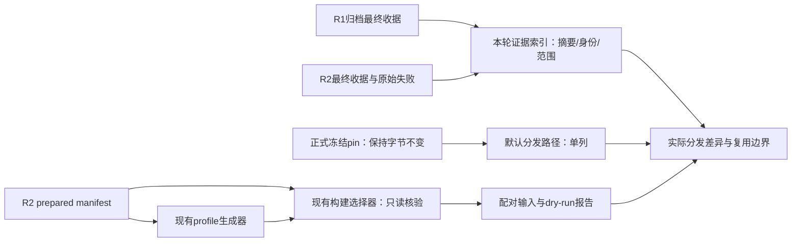

准备阶段的交付为可复核证据索引、配对构建输入及分发缺口报告；不生成新签名候选、不操作桌面/TCC、不执行正式freeze/pin。现有每组合20次与完整故障矩阵在该准备时点标为未执行；后续按2026-11-16收敛门槛处置，不把18条R2路径改称旧矩阵通过。

#### 正常生产Host接线验证（后续用户授权）

用户已进一步授权使用上述配对输入构建一个独立候选并验证实际装配差异。此授权取代上段在前一轮准备阶段“不生成候选/不操作桌面”的执行限制，但不开放正式pin、公证、上传或发布。保持R2候选及证据原样，新候选使用独立输出、应用身份和隔离数据目录；只有一个App运行槽。

使用真实生产tsup/打包配置：Host编译匹配profile，Main的candidate NativeHost seam编译为undefined，固定`cua-narrow`槽内manifest与Helper与已验收prepare逐字一致。独立身份只影响应用命名/标识；不改Host、authority、SDK或原生准入行为。构建沿用既有资源完整性和打包后钩子，明确关闭发布与公证；保留签名Helper不重签，仅对新外层候选进行必要本地签名。

先核对静态接线/闭包和可启动环境，再复用一个受控夹具单案验证正常Host→sealed CLI→原生读取/AXPress→截图借锁→再次AXPress的实际接线（2次写，兄弟窗口不变，真实PNG/收据）。这验证新Host装配差异，不重跑R1/R2完整安全、故障、租约或18笔输入矩阵，不要求新人工键入。只有实际OS权限需要用户操作时集中通知，先定位主体与签名，不反复盲试。

2026-11-16正常Host启动缺口：打包Electron从仓库cwd启动时，开发源码自动发现抢在包内CLI前，且源码fallback没有storagePreparationEntry，导致正式存储准备以unsupported_runtime失败。普通utility进程探针已证明Electron版本/resourcesPath存在；不新增资源根注入或环境授权。修复既有命令解析顺序：可信native配置与显式command仍优先；有受支持Electron包内JS时优先包内JS和同源storage worker，仅提前当前process.resourcesPath内实际存在的JS；用户级/仓库staged bundle不提前，缺包内JS时仍按原顺序走开发发现、旧bundle与原生回退。不能从cwd源码或开发缓存来证明发布包闭包。先以“包内CLI存在+仓库仅有源码”的回归复现，再只更新本轮候选受影响Main/Host装配，R2签名Helper及正式pin保持原样。旧SDK前失败和旧进程树不改记为当前接线成功。

2026-11-16执行结果：CUA-AX-R3-01单案通过，68项定向回归及必需检查通过，主控与Terra独立核验完成。正常utility Host经cua-narrow cli-entry产生2条sent收据、目标计数0→2、兄弟不变；620×404 PNG摘要与native审计一致，借锁归还且控制锁未释放。配对输入、正式pin3份、R2最终收据及Helper12份保持原字节。观察renderer与合成provider的范围限制、SDK前历史失败及实际进程对应见[正常Host记录](../docs/testing/cua-r3-normal-host-20261115.md)。D3接线缺口关闭，不新增人工验收或晋升，不代表以下完整发布门槛已满足。

### R3 按实际差异收敛门槛（2026-11-16，当前生效）

用户已授权此最小剩余计划。本节取代旧R3固定“每组合至少20次”和全量真机故障矩阵的必执行要求，收敛测试数量，不改变授权、租约、Stop、窗口归属、远端不透明及收据产品合同。旧矩阵保留为历史方案/风险清单，状态为“未执行、被按差异方案取代”，不记为通过，不换算稳定率。

| 当前门槛 | 已有证据/实际差异 | 最小处理与完成条件 |
| --- | --- | --- |
| 原生/CLI/SDK功能及安全边界 | R1最终人审与四项晋升；R2确定性回归、租约、Stop、截图借锁、两平台18条路径/19次写尝试；原生/SDK与Helper12份资源未变 | 复用原身份和失败，不重跑输入、120秒或系统故障；仅真实受影响代码变化触发对应回归 |
| 正常生产Host装配 | CUA-AX-R3-01真实utility Host→cli-entry、2次AXPress、PNG借锁及兄弟不变已通过；仓库cwd入口缺口已修复且68项定向回归通过 | 复用通过收据；当前Main/Host/profile保持原字节，无追加写动作 |
| 纯生产renderer | 当前验收renderer启用了E2E观察桥；此前结论不覆盖去桥制品 | CUA-AX-R3-02：同一未封存候选槽仅替换无桥生产renderer、刷新asar integrity并本地重签；Main/Host/manifest/Helper摘要不变。从仓库外cwd、隔离数据冷启动，以普通DOM验证会话可用、发送一次只读请求并独立允许精确目标读取，真实provider tool_result含目标且无兄弟正文。无写动作、截图或人工持续输入 |
| 候选闭包及收尾 | renderer/asar/外层签名改变，已有Helper/依赖/正式pin基线可复用 | 对最终改动记录摘要与本地签名，验证其余资源不变；形成可复验本地候选清单和证据映射，主控+独立Terra只读复核。测试源码变化仅运行本轮必需类型/lint/架构/E2E类型/fixture检查，不重跑无关功能 |
| 正式分发 | 正式应用身份、正式pin、分发签名/公证及上传未启动 | 保持待授权；本轮仅可宣称“R3发布前准备完成”，不能宣称正式分发或发布验收完成 |

驱动准备与系统权限人工等待在SDK之外。唯一状态所有者仍为既有Host/runtime authority和Helper；测试只经普通DOM输入/权限卡调用既有产品链，不添加产品测试桥、不直接修改会话store、不从测试环境授予native authority。驱动不得默认跳过全套renderer readiness：无桥分支仅允许精确R3-02用例与独立打包候选，并断言观察桥不存在。一次submit后只等待实际接收与结果，不重发。

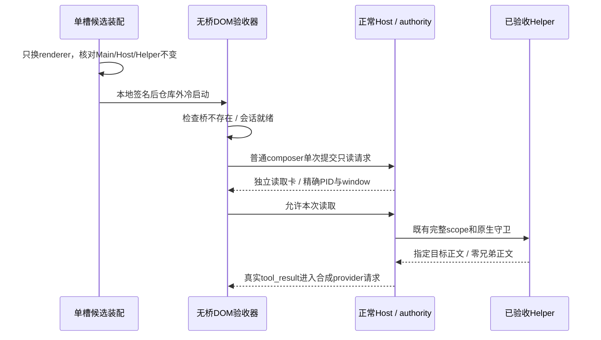

跨用户、长时间休眠等未验证项继续保留；R1三次未证明、R2一次取证失败和所有SDK前失败均不追认。没有新产品字节差异时不追加真机排列或付费模型验收；需要人审晋升的用例仍按现有规则另行办理，不将本轮技术复核冒充人审。

CUA-AX-R3-02执行结果（2026-11-16）：无store观察桥生产renderer单案通过；普通DOM单次提交、一次精确读取授权与真实目标tool_result，兄弟不泄漏且零写。新门禁9项回归及规定代码检查通过，主控重新核对非renderer24214文件/Helper12/原生57/SDK2与旧证据，独立Terra复核无阻断。旧URL验证器失败和两条原生观察拒绝保留，未记为零错误或长期稳定率。当前最小发布前准备完成；详细边界与本地候选清单见[收尾记录](../docs/testing/cua-r3-prepublish-closeout-20261116.md)。

### R3 正式pin与正式身份最小本地验收（2026-11-16追加授权）

构建输入所有者仍为既有 `macos-cua-demo-defaults` 默认选择器和 `cua-narrow-frozen.json` 归档pin；native身份信任根与runtime authority不变。将已验收R2 prepared完整原字节搬到 `output/cua-narrow-frozen/controller-prepared/`，manifest SHA保持 `9bcea0ea…`、launcher SHA保持 `00c91110…`，保留签名、stage文件模式及Helper12资源。同步默认manifest双pin与本地归档实测SHA；不改证书leaf、DR、Node CDHash或SDK方法。旧pin原字节保存为回滚材料，不自动提交。

本地归档以仓库相对 `output/` 条目记录；通过既有本地archive覆盖入口，在隔离repo-root实际restore并用默认选择器、manifest树和codesign复验。远程releaseTag只标识尚未上传的新归档，不能宣称远程已可下载；本轮不访问发布API或上传材料。默认构建不可依靠显式manifest/profile环境覆盖来冒充正式pin生效。

新增CUA-AX-R3-03只验证实际身份差异：使用正式 `Zody` / `io.github.zclaudia.zody`、无store观察桥的生产构建，一个独立输出槽、一套隔离数据、正常utility Host及固定cua-narrow Helper。从仓库外cwd启动，只发送一个受控工具流程：精确目标读取→1次冻结元素AXPress→单独授权截图。断言实际读取/控制/截图确认、目标press/request均+1、同PID同标题兄弟不变、1条真实sent收据、真实PNG及对应capture审计，截图不升级控制权限。复用已有Stop/120秒/18笔输入和R3-01借锁功能证据，不追加第二次写或完整矩阵。

截图沿用既有get_app_state(include_screenshot:true)组合接口，必须保留其必要的再次读取授权，不为凑一次调用省略读取守卫；初始读取和组合截图属于同一个最小流程。

正式身份以Info.plist的CFBundleIdentifier/CFBundleName和codesign核验；WDIO运行名继续采用既有隔离名，避免接管当前同名App单实例和正式协议注册。隔离名不改变Mach-O/bundle签名或TCC主体，不将其描述为正式安装切换。

驱动沿用普通DOM输入、既有权限卡和SDK；无桥readiness分支仅允许精确R3-03spec及本轮独立正式身份App，隔离数据但不冒用candidate bundle ID。SDK外先核对录屏状态与实际Helper身份。当前Helper没有独立AX权限查询接口，不以外层AX权限或operator-ready冒充Helper当前授权；辅助功能沿用字节/签名不变且R3-02读取已通过的证据，当前资格由首笔原生只读验证，失败必须在写前停止并保留零派发收据，再集中处理实际所缺权限。授权等待在SDK之外，可能已派发的动作不自动重放。验收不覆盖现有App、不读取真实用户配置、不切换本机安装；如系统权限实际归属不符先停止并诊断，不盲目重置TCC。

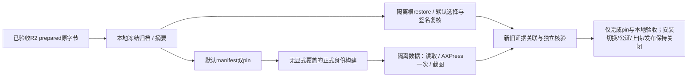

本轮执行结果：默认manifest双pin已切换到已验收R2原字节，本地归档完成隔离restore/签名核验；CUA-AX-R3-03 v3在正式bundle身份独立目录通过一次读取→1笔AXPress(none)→截图组合，目标业务+1、兄弟不变、真实sent收据及PNG审计一致。v1 SDK外等待超时、v2旧夹具离屏导致的零写读取拒绝均保留，验收器补上SDK前onscreen预检并通过5项离线检查；产品包未为此重建。实际写总数1，未重放已发送动作。默认构建无显式manifest/profile覆盖，Helper12/原生57/SDK2和旧证据不变，安装文件复核未变。完整边界与本地归档可用性见[本轮记录](../docs/testing/cua-r3-formal-local-20261116.md)。

### R3 旧发布矩阵（历史方案，已由2026-11-16按差异门槛取代）

以下保留原候选发布方案用于溯源，固定重复次数和全量真机排列已被上节取代，不再作为本轮必执行清单；旧未执行项不记通过。R2 执行数量和分层以上文“R2 收敛测试计划”为准。以下次数并非已有观测结果或长期稳定率。每个候选版本、目标应用、控件和允许操作组合分别记录试次与结果。使用同一登录会话中持续输入的前台夹具和预先打开的后台双窗口夹具，兄弟窗口同 PID、同标题、不同业务标记。每组合至少 20 次独立试次，且至少 20 次效果已证实并全程无干扰；不得通过挑选“有效试次”剔除不通过项，安全拒绝可单列但必须保留并报告总试次数；任何一次干扰、错误窗口动作或监测缺失均阻止该组合宣称支持。安全拒绝单独计数，不算成功；效果未知不算成功。分别报告效果已证实且无干扰、安全拒绝、效果未知、发生干扰的次数及比例，并保留原始记录、构建身份和试次 ID；单次探针通过不能换算稳定率。首次授权、冷启动与稳态试次分别记录。

| 验证             | 必须通过的判据                                                                                                                                                                                                                                                                                                                 |
| ---------------- | ------------------------------------------------------------------------------------------------------------------------------------------------------------------------------------------------------------------------------------------------------------------------------------------------------------------------------ |
| 完整链与主体     | 实际 SDK 经 sealed CLI 和完整 build/sign/freeze/pin 候选到达签名 Helper 和目标；核验签名、冻结摘要、闭包、系统授权主体及截图链回归。系统权限缺失时真实拒绝。                                                                                                                                                                   |
| 授权             | 首次正文读取、无标题 `text_preview` 和首次写前分别验证允许、拒绝、撤销及权限失效；截图授权和 mobile 截图授权均不能授予读取或控制。拒绝后零正文泄漏、零写派发。                                                                                                                                                                 |
| 窗口与状态       | 同 PID 同标题兄弟窗口只命中指定窗口；关闭、重建、失效和元素消失使旧映射拒绝且零派发。验证 state_id、模型可见 diff、静默观察后整树及冻结索引位移防护。                                                                                                                                                                          |
| 业务效果         | AppKit 与 Electron 简单夹具分别由目标记录按钮计数、字段应用模型及相关事件，兄弟窗口不变；AX 回显本身不足以证明业务效果。                                                                                                                                                                                                       |
| 前台无干扰       | 读取和写动作分别进行前台持续输入并发试次；每次均须证明至少一个前台输入事件与后台读取或写事务实际交错。每试次以单调时钟记录完整有序前台字符、active/key 变化、真实指针、剪贴板 change count、Space、窗口层序和新弹窗；目标和前台共享试次 ID。任一必测信号缺失或异常不得计入成功。                                               |
| 监测校准         | 真机逐项故障注入短暂失焦、丢字符、错误兄弟窗口、目标忽略效果、指针/剪贴板/Space/层序变化及弹窗；每项必须被对应监测或评分检出。仅评分单元测试不足。                                                                                                                                                                             |
| Stop 与并发      | 在授权前、租约后、最终复核前后和原生调用交错注入 UI Stop 与工具 Stop；Stop 先赢得准入边界时零派发，派发先赢得准入时保留收据，之后不再准入新动作；已可能派发不重放，迟到结果不恢复权限或交付正文。验证 120 秒空闲、会话结束、lineage 撤销和目标退出的失效，以及观察和迟到结果不续租。第二会话及另一 Helper 不能同时取得控制权。 |
| 收据与不支持路径 | 注入调用前失败、可能已发送后失败和迟到结果，验证 `possibly_sent`、`actionSent`、`dispatchStatus` 与 SDK 禁止重试；对每种未支持方法、策略、坐标及参数组合验证类型化拒绝和零原生写派发。                                                                                                                                         |

phase1 已知平台及隔离缺口继续保留；本规格不将探针结果外推为其他应用或平台的支持承诺。

### R1 本机证据索引（2026-11-11，本轮尚未验收通过）

- 构建与 16 组原生测试：`output/cua-ax-r1-acceptance/controller-build-v3/build/build-manifest.json`、`native-test-results.json`。
- 签名资源闭包：`output/cua-ax-r1-acceptance/controller-prepared-v3/`；UI 签名后 Helper 完整树摘要仍相等，记录于 `helper-post-ui-signature-check.json`。
- 两轮真实 E2E 报告：`packages/desktop/.e2e-artifacts/desktop-e2e-20261111-151403-498/summary.md`、`desktop-e2e-20261111-152024-361/summary.md`。后者受限工具收据位于 `output/cua-ax-r1-acceptance/e2e-evidence-v3-ls/r1-receipts.json`。报告为失败；metadata 命中容量拒绝，deny/allow 均未到读取确认卡，不是成功授权验收。
- 夹具 LS 预检：`output/cua-ax-r1-acceptance/fixture-run-ls/preflight.json`。锁屏布尔采样：`output/cua-ax-r1-acceptance/lock-run/transition-summary.json`。
- 状态合同、Stop/窗口重建真实交错、截图回归、AppKit/Electron 无干扰完整测量与重复试次尚未通过；pending 用例尚未人工审阅，不晋升。

元数据容量回归必须覆盖：完整结果 UTF-8 64KiB 边界及超限、19.6KB 以上真实形状数组经 native→authority→adapter 完整交付、正文仍 12KiB、非元数据连接和元数据连接上的非结果帧仍 16KiB、128KiB 帧及 256KiB 缓冲超限、未授权附加正文仍拒绝。新签名候选必须实际重跑 SDK 枚举和任务读取确认允许/拒绝正反例。

用户授权后的原候选复测不再返回 `permission_denied`，但返回 `element_unavailable`。同时只读窗口探针发现真实 LS 夹具在 OptionAll 中存在、layer=0、尺寸有效，而 OnScreenOnly 缺失；不能把离屏改为可读。先调整测试夹具自身的跨 Space 显示行为，并保留运行同时的可见性事实后复验。

读取确认的 App 投影合同：`cua_ax_read_confirm` 复用既有交互 broker / V4 gateway，发起前投放同一 scope 的临时 `PermissionRequested`，并显式携带 `approvalMode=user-once`、`optionsPolicy=no-always-allow`；响应、异常或取消后投放一次 `PermissionResolved`，不能只登记反向 RPC 而让 App 无卡可答。不得继承截图持久规则或 Full access。读取确认卡复用窗口身份展示，标题与按钮明确为“读取窗口内容 / 允许本次读取”，展示应用、窗口、PID/window ID，不显示 raw JSON；读取卡沿用截图确认的默认拒绝与 Escape 拒绝交互，必须显式选择本次允许；截图卡与持久规则保持既有语义。交互修复须覆盖投放/清除、允许/拒绝/取消、无 always/full-access 选项和截图回归；真实 E2E 必须见卡、点击后才计任务授权验收。

资源格式兼容：加入 SDK 闭包不能使旧版冻结截图包失效。验证器精确接受两种完整辅助资源集合：旧版仅 `node-repl-server.mjs`；R1 版为该文件加 SDK 客户端与文档两项。SDK 两项必须成对出现，并与同一 native build manifest 的受核验摘要/树记录一致，不能部分出现、缺失声明文件、篡改或混用新旧清单。R1 新 CLI 仍强制同句柄校验其内嵌 SDK pins，不回退到旧包、仓库或环境资源。候选 UI 构建可显式选择本轮 prepare manifest；不得为了构建去改发布冻结 pin 或旧冻结包。兼容测试必须覆盖旧完整包验证通过、新包缺失/篡改/部分资源拒绝。

CUA-AX-R1-03a（状态观察）：同一真实用户 turn、同一指定窗口内，通过连续五个 node_repl cell 依次进行 SDK 读取：强制整树、默认 diff、`tree_shown_to_model=false` 静默整树、静默后的默认整树、随后默认 diff。每次均须独立读取确认并显式允许。应展示的整树/diff 必须真实进入随后模型请求的对应 tool_result；静默第三次只交付受限诊断，不交付树。测试按精确 toolCallId 从真实 provider 请求读取结果，不能用单 cell 内收到结果、尚未向模型交付就把它当作已见基线；用真实返回的树/diff 类型与目标/兄弟标记断言，不能从模型源码预期值或安全拒绝推断成功。读卡 DOM 可投影其现有 requestId 为稳定测试属性，不创建第二状态；测试逐次确认不同 requestId，避免重复点击上一张卡。SDK 隐藏的 state_id 不从 prose 猜测；单调 ID/冻结句柄继续以原生合同测试记账，Stop/窗口重建的真机证据仍另列。

### 2026-11-12 本轮结果与继续条件

原生观察失败的诊断只允许固定枚举阶段与固定错误码，不记录 AX 正文、标题、路径、任意系统错误描述或 provider 请求。对窗口解析、授权后采集及交付前复核分别记账；源读取阶段进一步区分 AX 窗口枚举、唯一窗口匹配、资格判定与节点窗口归属检查。native 发出固定 `observation-rejected` JSON 事件，仅含白名单 `phase`、`code`、`ax`；既有 Services 审计解析器严格验证并重建后，沿现有日志链投影，不直接提升任意 stderr。额外字段、非枚举值与无效 JSON 均拒绝，native 未知值归一为固定 unknown。诊断仅用于定位，不能作为身份/授权证明，不能改变公开失败码、重试读取、放宽身份/系统状态复核或提交失败基线。必须测试原生事件经实际解析器可见、任意字符串不会进入日志，并在完整重建、签名和 prepare 的候选上复验。

节点直接窗口查询成功却未匹配目标时，固定阶段区分 `node_direct_window_zero`（返回零 ID）和 `node_direct_window`（非零且不同），不输出实际 ID 或正文；两者当前均拒绝。区分后再依据真机事实评估读取规则，不将零值或矛盾归属猜为成功。

非零冲突进一步发出受限 `observation-window-conflict` JSON，仅含 `atRoot` 布尔、`role`（window/button/text/group/other/unknown）、`direct`（target/same_process/other_process/missing/unknown）、`axWindow`（target/direct/other/missing/invalid/unknown）及 `axWindowIsTargetReference` 布尔。基于新鲜 CG 元数据和已获准节点的 AXWindow/AXRole 查询分类，比较 AXWindow 与已绑定原生窗口引用；不读取该失败节点的 title/value/children，不输出任何实际 ID、角色原文或系统错误描述。诊断查询沿既有总预算，不能重试、覆盖原失败码或改变拒绝；字段未知仍为固定 unknown。原生 formatter 的实际输出必须通过 Services 严格解析器及隐私负例。

Apple 的 [kAXWindowAttribute 合同](https://developer.apple.com/documentation/applicationservices/kaxwindowattribute)明确该属性指向包含当前元素的窗口，窗口后代必须提供；本机 SDK 的 AXAttributeConstants.h 同样如此。它支持归属对照查询，不能据此未经真机验证就忽略私有窗口 ID 查询的矛盾，也未证明私有 SPI 对当前异常节点的行为。

验收 harness 在退出前从仅存内存的实际回环抓包投影受限网络统计：采集器是否可用、请求总数、预期 fixture 模型匹配数、pending/complete/error 数及 HTTP 成功/失败数。不保存模型字符串、URL、headers、请求/响应正文或任意错误描述；采集器不可用与零请求分开记账。DOM submit、RPC OK 和请求送达分别记录，不能代替实际工具结果或推断读取成功。

发送fixture prompt复用现有 `sendV4PromptAndWaitAccepted`：先单次submit，再等当前composer清空及该prompt的真实user row出现，记录`submissionAccepted`，随后才开始工具出现的等待阶段；两个阶段分别沿用既有60秒预算，不增加用例总超时。提交事件、慢RPC或watchdog回收不算accepted；任一步失败不自动重发、不预热虚假prompt、不更换command重试。原先缺少admission屏障的失败轮保留，不能凭后续成功追认其输入已接纳；此屏障不修复或掩盖底层冷启动故障。

`submissionAccepted`仅表示上述renderer用户行与composer事实，不等于某条command ACK或服务端inputAccepted事件；没有可归属的ACK证据时不能补造其类型、状态或原因码。工具成功仍必须有真实provider tool_result。

用户确认元数据单独 64KiB，并手动启用 Helper 辅助功能。已修复元数据双向 wire 限额、读取确认 V4 事件漏接、读取卡独立语义及默认拒绝，保持旧冻结截图包的完整格式兼容。v6 完整签名候选已通过真实 metadata、deny、allow 三项；179 次夹具同步可见性采样均为两个指定窗口 onscreen。读取卡无 always/full access；deny 确实点击拒绝且无正文，allow 确实点击允许且仅目标标记。报告：`packages/desktop/.e2e-artifacts/desktop-e2e-20261111-160209-761/summary.md`；受限收据：`output/cua-ax-r1-acceptance/e2e-evidence-v6-retry/r1-receipts.json`。首次 v6 WebDriver 未建会话，另保留失败报告，不能删掉只报成功。

v7 仅新增读取请求 ID 的 DOM 投影用于逐卡核对，嵌入的签名 Helper 与 v6 完整树摘要一致。03a 已实现为同一 turn 的五次工具调用，按真实 provider tool_result 核对实际展示及静默；源码/单测/类型检查通过。该轮实际 metadata 通过，三项读取用例未通过（`element_unavailable`，未进入读取卡），不算状态合同成功。随后当前系统布尔探针 17 个样本均为 CGSession=true、IOConsoleLocked=true、displayAsleep=true；这证明探针时处于锁屏/休眠，不反推整个测试区间的锁定时刻。报告：`packages/desktop/.e2e-artifacts/desktop-e2e-20261111-161446-801/summary.md`；收据与可见性采样：`output/cua-ax-r1-acceptance/e2e-evidence-v7/`；系统事实：`output/cua-ax-r1-acceptance/lock-current-v7/lock-samples.json`。正常解锁后重新启动夹具并绑定新 PID/window ID，再重跑03a；无需重复授予已确认的辅助功能权限。

前台无干扰门槛仍未满足：旧 background probe 走独立 AX 写驱动，其按钮/字段效果评分不能用于生产观察验收。现有代码可复用受控前台输入、焦点通知和单调时间；仍缺完整指针/剪贴板计数/Space/层序及弹窗采集、真实事务区间关联、采集器故障注入校准、Electron 对照及每组20次成功并保留总试次。不得用这次179次窗口可见性采样替代完整无干扰试次。

用户确认解锁后，v7 新夹具重跑 metadata、deny、allow 再次通过；03a 在第一次读取卡获准后收到真实错误，尚未交付整树，后四步未执行。该轮163次夹具采样均正常。增加受限 receipt 诊断后，另一次仅03a的定向轮第一步真实整树交付成功，第二步独立读取卡获准后返回 `element_unavailable`，后续未执行；155次夹具采样均正常。两轮运行前分别采集18/16个新鲜系统样本，console/login=true、Root严格false、CG字段缺失或false、显示未休眠；不据此推断整个运行区间系统状态。后一次失败码覆盖多个原生分支，尚不能归因于某一源读取阶段；下一步使用上述固定阶段诊断定位，不重复索要已生效的辅助功能授权。失败证据保留于 `e2e-evidence-v7-unlocked-20261112/` 与 `e2e-evidence-v7-state-diagnostic-20261112/`，不能将其记为状态合同通过。

v8 定向轮仍第一步成功、第二步失败，141次夹具采样正常；初版固定诊断未接入 Services 的严格审计 schema，被既有日志链过滤，未据此猜测失败来源。补齐固定 JSON 事件并用真实原生 formatter 输出通过实际 Services parser 后，v9 重跑确认失败阶段为 `node_direct_window`：授权后树遍历中，直接窗口查询返回成功，但某节点 ID 与目标不符。177次夹具采样正常；此时尚未区分零 ID 与非零错窗，读取继续拒绝。证据分别位于 `e2e-evidence-v8-state-native-diagnostic-20261112/`、`e2e-evidence-v9-state-native-diagnostic-20261112/`；v9 的 `observation-diagnostics.json` 只保留固定诊断。

v10 单独冷启动03a未出现首个 node_repl 调用；DOM submit 与 RPC OK 已观测，但当时未保留网络计数，目标 prompt admission/provider 请求是否发生不能确认，不能归因为锁屏、原生读取或冷启动。增加仅含计数的网络收据后，同一v10候选完整四项中基础三项通过，03a首次读取允许后返回非零 `node_direct_window` 冲突，后续未执行；11个请求均为预期模型、complete/HTTP2xx，165次夹具可见性采样正常。保留单独失败，不以顺序不同的完整轮结果消除它。

v11 完整轮再次基础三项通过；03a首次读取允许后安全拒绝，未交付正文。真实冲突为 `atRoot=false, role=group, direct=other_process, axWindow=missing, axWindowIsTargetReference=false`：该节点没有可核实的已授权窗口归属。11个请求均为预期模型并complete/HTTP2xx，171次夹具采样正常。该事实不能单独归因为 macOS、私有 SPI、夹具或其他具体实现缺陷；不得忽略冲突或以父节点/同PID猜测归属。证据：`output/cua-ax-r1-acceptance/e2e-evidence-v11-window-conflict-20261112/`，报告：`packages/desktop/.e2e-artifacts/desktop-e2e-20261111-172101-379/summary.md`。所有本轮夹具均已按PID和可执行路径核验后停止。

### 已对齐：默认 AppKit 夹具与显式 AX 内容夹具分别验收

2026-11-12 用户已选择“新增独立受控夹具”。生产归属守卫、独立读取确认及五步状态断言均保持不变，不移除历史失败用例；这不缩减原组合的未完成验收，也不是新增支持承诺。

| 组合                                   | 拟定处理                                                         | 验收判据与限制                                                                                                    |
| -------------------------------------- | ---------------------------------------------------------------- | ----------------------------------------------------------------------------------------------------------------- |
| 现有默认 AppKit 双窗口                 | 保留真实失败，继续定位 group 的来源和归属；不宣称支持            | 非零错窗或缺少正向归属仍拒绝，不从其他组合成功外推                                                                |
| 新增显式 AX 归属的受控 AppKit 内容夹具 | 独立组合暴露可核验的真实窗口、控件和正文；先完成模型可见状态合同 | 同一生产SDK/Helper与双窗口、逐次授权、实际full/diff/silent/full/diff；不能伪造工具结果/authority/ID或降低生产校验 |
| 后续支持范围                           | 根据各组合真实证据决定是否纳入首批；未证明者单独保留未通过       | 新夹具成功不能代替默认 AppKit 组合、Stop/重建、截图或完整无干扰门槛，也不能据此收尾R1/二期                        |

新增组合记为 CUA-AX-R1-03b，复用真实生产 SDK/Helper 与五步回放。夹具采用独立 bundle ID、可执行文件和输出目录，manifest 显式标识 `fixtureKind=explicit-ax-content-v1`；旧 manifest 未带该字段时仅归入 `default-appkit`。未知 kind 拒绝，不能默认为已批准的新组合。E2E receipt 保留组合及 case ID，构建身份/manifest/窗口采样/清理分别落盘，不能覆盖旧夹具或其证据。

夹具唯一拥有真实 NSWindow/NSView/NSTextField 及正文模型。显式 AX surface 只暴露本窗口真实内容树，节点的 AXParent、AXWindow 从实际 Cocoa 容器与 `.window` 引用导出，目标和兄弟窗口引用必须相互隔离；不由测试生成 CG/AX ID、不注入返回树、不伪造 authority，不读取其他应用。窗口仍同PID同标题，采用既有跨Space/FullScreenAuxiliary显示行为；启动须经LaunchServices，具备真实启动时间。保留SIGUSR1仅重建本夹具目标窗口的路径。

窗口创建/重建及不可变manifest快照由AppKit主队列串行拥有；文件投影在单一串行IO队列异步原子写入，不能将旧窗口快照晚写覆盖新快照。IO队列不读取或修改窗口状态；写入失败使夹具以固定错误终止，不能继续使用旧manifest。验收先等实际manifest落盘，再按OS身份绑定；测试覆盖连续快照的最终顺序和实际文件内容。

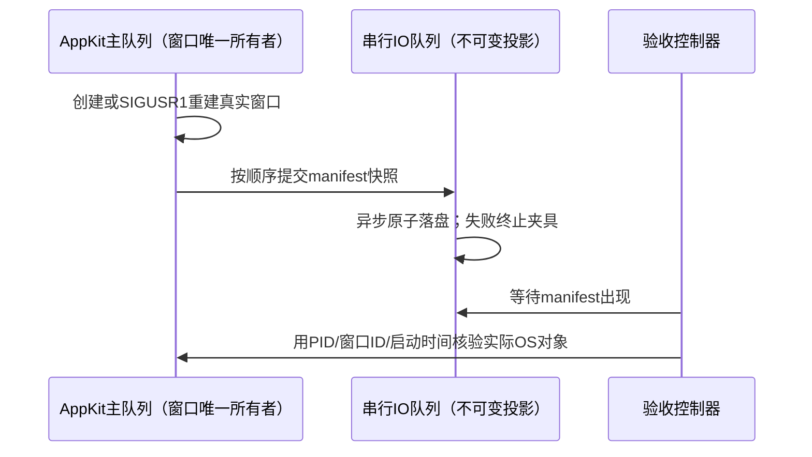

实现前先验证双窗口独立性、真实字段值、AX parent/window引用与树范围；随后用现有签名v11候选（内容与签名重新核验）执行基础三项及03b。五次工具调用必须是同一turn的 full→diff→silent full→full→diff，每次读取确认独立且真实结果进入provider；静默阶段不交付树。任何原生归属拒绝仍判失败，不改生产守卫、不抑制错误或放宽断言。新组合通过只能记为03b通过，03a、Stop/重建、截图、完整无干扰门槛和二期完成状态均分别记账。

### 2026-11-12 显式 AX 内容组合结果

新夹具使用独立bundle `org.zody.cua.explicit-observation-fixture`，真实窗口仅暴露自有内容视图和静态文本字段，AX parent/window引用由实际Cocoa对象导出。原生构建包含默认目录合同、预检自测、双窗口AX引用隔离与真实字段值、异步manifest连续写入顺序测试，均通过。生产Helper未改动，复用v11；每轮重新核验deep strict签名及与prepared-v11的完整树一致。

首轮 `v11-explicit-v1-20261112`：03b五步、拒绝和允许通过；metadata在工具出现前失败，整轮exit 1（3/4）。该阶段首个Agent因protocol请求超时被watchdog回收，替代启动约37.4秒；日志不足以确认该慢RPC的command类型/ACK或首条输入是否入队，不追认metadata通过。13个fixture请求均HTTP2xx；355次窗口可见性采样无异常。该失败保留于 `output/cua-ax-r1-acceptance/e2e-evidence-v11-explicit-v1-20261112/`，报告 `packages/desktop/.e2e-artifacts/desktop-e2e-20261112-015259-901/summary.md`。

复用既有renderer accepted屏障后，fresh HOME、新夹具进程和新输出的 `v11-explicit-admission-20261112` 完整轮exit 0（4/4）：metadata、独立拒绝、独立允许与03b均通过。03b五张不同读取卡逐次允许，provider对应tool_result为full、diff、不含树的silent、full、diff，全部无兄弟正文；四次提交的renderer收据均为true。16个请求均为预期fixture模型并HTTP2xx；160次窗口可见性采样无异常。夹具已按PID/可执行路径核验后停止。证据为 `output/cua-ax-r1-acceptance/e2e-evidence-v11-explicit-admission-20261112/r1-receipts.json`、`window-visibility-samples.json`；报告 `packages/desktop/.e2e-artifacts/desktop-e2e-20261112-020335-907/summary.md`。

这里的两轮窗口采样不是完整无干扰试次；单次完整轮通过也未解决历史冷启动异常。03b继续留在pending，默认AppKit的03a归属冲突、真实Stop/窗口重建、签名截图回归、完整监测/校准/20次组合成功、锁屏/睡眠/用户切换注入和R2/R3仍未完成；不收尾R1或二期。

### R1-03c / 03d：显式夹具的重建与待确认 Stop

这两案细化既定R1窗口失效/撤销合同，使用已批准的 `explicit-ax-content-v1`，保留03a/03b及全部历史失败。复用同一签名生产链、renderer accepted屏障、精确工具call ID与独立读取requestId；仍不开放R2、写入口或工具`stop_computer_control`。fixture只拥有窗口，测试manifest只是OS对象投影，不产生authority。

各case保存发送时的不可变fixture快照，历史收据必须用对应快照投影，不能在窗口重建后用全局新引用重解释旧metadata/03b结果。03d作为独立case，在发送前重新读取当前manifest，核验同一夹具PID、kind、正文标记及兄弟ID，结合control身份和CG预检确认当前目标，再写入其runtime manifest；03c中途失败也不能让03d直接使用过期引用。新case重新核验是独立setup，不追认前案通过、不重启夹具或自动重发旧command。

03c（同一turn窗口重建）按以下顺序验收：

1. 旧窗口首次独立确认允许，真实provider收到目标full且无兄弟正文。
2. 第二次旧引用读取卡出现后，锁定其requestId和旧PID/window ID；控制器核对夹具可执行路径后发SIGUSR1，仅重建该夹具目标窗口。
3. 等新manifest原子落盘及CG预检：同一PID/启动时间、兄弟ID不变、新目标ID不等于旧ID或兄弟ID、双窗可见且尺寸/layer有效；信号已发或固定sleep不算重建完成。ID重用/未知事实不得计成功。
4. 明确允许原旧卡，实际SDK必须返回`element_unavailable`或`stale_state`，provider仅收到受限失败诊断，零树、零目标/兄弟正文；其他错误不能当作本故障注入通过。
5. 再用精确旧引用读取，必须在新确认卡出现前按上述类型拒绝；不能按同PID/标题绑定新窗口。
6. 从新manifest取得精确新引用，出现不同requestId的读取卡，显式允许后默认读取（不设disable_diffing）使provider收到full且仅目标标记，不继承旧diff/索引映射。

03d（同一会话、下一user turn恢复）按以下顺序验收：

1. 实际node_repl调用已出现，独立读取卡处于待确认，核验目标身份和默认拒绝；不得先允许正文。
2. 在当前主pane对可见/可用的Stop按钮执行WebDriver原生element.click；必须实际命中，不能DOM `.click()`、直接调用Service/RPC或移除卡片绕过交互。
3. 原requestId卡清除、原工具进入取消/终止状态、会话退出running；精确旧call的工具输出与provider结果均无目标/兄弟正文，受控provider不发预设续调用/终答。仅“没有后续请求”不足以证明取消，必须同时有UI工具终态和卡清除证据。
4. 同会话发起新的明确user prompt（不是自动重发旧command），核验renderer接受；新读取必须出现不同requestId的卡并显式允许，默认读取（不设disable_diffing）使provider取得仅目标正文的full，旧等待/旧授权不能复活。

收据只保存fixture/profile/case、请求关联的固定布尔、预期错误码、工具终态枚举、manifest新旧ID（限本夹具）、重建/停止/卡清除的有序时间关联与受限网络统计；不保存树、任意错误描述或provider原始请求。原生合同补confirm等待中取消/替换的负例、零read/零正文/失败不commit及新引用full。真实回放失败如实保留，不改守卫、重发未知调用或用超时掩盖同步问题。

03c负例的SDK/MCP错误投影须按现有合同判定：SDK会投放真实native错误到structured sink，Node REPL即使正常执行完cell也把外层`isError`设为true；它不能单独视为脚本异常。负例cell不捕获任意异常冒充返回对象，只有低层调用正常返回实际object、码为stale/element unavailable时，才输出唯一严格`R1_LIFECYCLE`诊断（含stage、outcome=returned）和固定完成标记。按精确call ID在实际provider结果同时核验外层isError=true、严格规范native错误JSON（相同允许码、固定消息、action_sent=false、dispatch_status=not_sent）、唯一对应诊断和完成标记；不接受仅源码/堆栈字面量、捕获异常、码不一致或额外正文。现有provider错误文本路径可能合并content blocks，不能虚构其原始块边界；只能以明确受限行与受控cell固定异常路径验证。`toMcpRunResult`未捕获异常分支会丢弃之前的structured结果与正常logs，不能据错误flag抹掉这一区别。新的判据仍须真实重跑，不追认旧收据通过。

通用`formatMcpToolResult`在未声明message-only时会加固定首行`MCP tool returned an error:`。本夹具没有该声明，因此规范provider负例文本应为四个非空行，顺序严格为该固定首行、native错误JSON、阶段诊断、阶段完成标记；不能任意忽略首行、无序搜索三种片段或接受其他额外行。收据增加非空行数、固定首行匹配及顺序匹配布尔，不保存任意行。v3已有收据只能证明三类内容都出现且存在额外行，未保存原始结果，不能据源码推断将其追认为通过；修正后需新一轮实证。

03c使用独立fixture-control测试工具：inspect只在PID、精确规范化可执行路径、固定explicit夹具bundle ID/可执行文件名均匹配时返回真实启动时间；rebuild再次核对同一身份及启动时间后只发SIGUSR1。拒绝负PID/进程组、未知/失效身份及泛用信号。工具不进入Helper或cell，不是生产控制权限。控制器通过仅WDIO测试进程可读的 `ZODY_CUA_R1_FIXTURE_CONTROL`、`ZODY_CUA_R1_FIXTURE_EXECUTABLE` 传递已核验构建目录内的绝对路径；由显式preflight构建目录确定，缺失/无效使03c失败，不搜索其他目录或降级。它们不进入sealed CLI/cell环境白名单。默认夹具不运行03c/03d，报告为未执行而非通过。

“旧ref再读不得出现新确认卡”特指窗口正文读取确认；每个受控node_repl cell本身的通用工具权限仍按项目现行策略独立处理，只允许本次，不能提升为项目常许或full access。第三阶段等待器须区分两种卡：通用node权限可按现有helper允许一次，任何新的read卡立即判失败且不允许；真实provider精确call结果仍是完成屏障。补充异步回归，覆盖node卡→正常typed错误结果、意外read卡零允许及超时/无结果不通过，避免只有静态收据测试而遗漏UI等待分支。

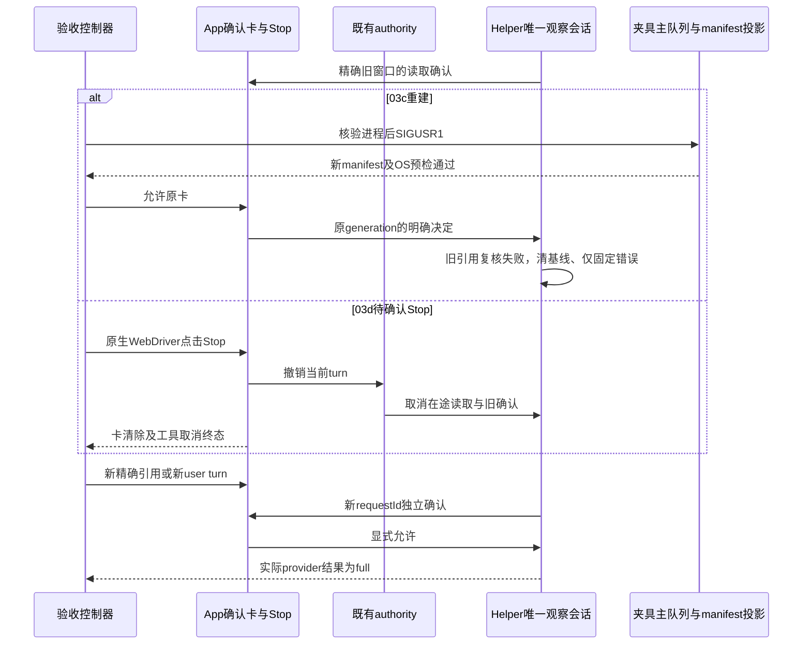

03d不覆盖允许后/最终交付竞争、工具Stop、控制租约或写派发。它们继续列为未完成，不从本案成功外推。

#### 2026-11-12 lifecycle 验收历史

同一签名v11和独立explicit夹具的三轮六项验收均保留exit 1：

| 轮次                        | 已通过                | 03c                                                                                                                         | 03d                                                                         |
| --------------------------- | --------------------- | --------------------------------------------------------------------------------------------------------------------------- | --------------------------------------------------------------------------- |
| `v11-lifecycle-v1-20261112` | metadata、deny、allow | 首读身份断言将DOM相邻数字拼接，尚未重建                                                                                     | 身份断言失败，未点击Stop；03b同样受测试断言影响                             |
| `v11-lifecycle-v2-20261112` | 基础三项、03b         | 实际重建115124→115161，兄弟115125不变；旧卡允许后native拒绝，收据错误要求外层非error                                        | 继承过期目标导致未出现有效卡，未点击Stop                                    |
| `v11-lifecycle-v3-20261112` | 基础三项、03b         | 实际重建115227→115264，兄弟115228不变；外层error、native错误、returned诊断及DONE均匹配，零树/正文，但额外行尚未证明规范格式 | 独立刷新当前窗口后卡默认拒绝；Stop元素存在但不可见，未执行enabled检查或点击 |

v1/v2/v3分别有14/22/20个预期fixture请求，全部HTTP2xx；窗口采样347/330/143次均无异常。这些采样不构成完整无干扰验收，native拒绝和部分步骤也不能计为03c/03d整体通过。证据各自位于`output/cua-ax-r1-acceptance/e2e-evidence-v11-lifecycle-v{1,2,3}-20261112/`；每轮夹具均核验精确可执行路径及启动时间后停止并确认退出。

03d已确认的产品缺陷：`ConversationComposer`在blocking interaction存在时对整个输入区设置`display:none`和`aria-hidden`，包含其Stop按钮；读取卡的Esc处理会拒绝并阻止向会话Stop冒泡。现有DOMclick测试helper可触发隐藏按钮，不能替代本案要求的真实用户可达性。修复交互前该用例保持未通过。

独立03c轮`v11-lifecycle-rebuild-v4-20261112`保留exit 1：旧卡允许后的规范四行错误包络已实证通过（lineCount=4、wrapper/order/native/diag/DONE均匹配、零树/正文），第三cell出现通用node权限卡，等待器漏处理导致无provider结果；未手工补点击，03c整体不通过，其余case未执行。3个fixture请求均HTTP2xx，317次窗口采样无异常，夹具核验身份后停止。证据`output/cua-ax-r1-acceptance/e2e-evidence-v11-lifecycle-rebuild-v4-20261112/`，报告`packages/desktop/.e2e-artifacts/desktop-e2e-20261112-033148-367/summary.md`。该事实只更正收据格式的实证，不追认前三轮或尚未执行的旧ref/新ref阶段。

独立03c轮`v11-lifecycle-rebuild-v5-20261112`完整通过exit 0（1/1）：同PID71298实际重建115301→115334，兄弟115302不变；旧卡获准及旧ref再读均返回`element_unavailable`，外层error和严格四行包络全部匹配，零树/目标/兄弟正文，旧ref没有新读取卡；新ref经不同requestId确认后默认读取full，最终DONE已进入timeline。其他case未执行，不能将本轮记成六项全过。6个fixture请求均为预期模型且HTTP2xx，141次窗口采样无异常，夹具核验原路径和启动时间后停止退出。v11 deep strict签名及12项Helper树一致，controller另行复核签名通过，未修改生产Helper或守卫。证据`output/cua-ax-r1-acceptance/e2e-evidence-v11-lifecycle-rebuild-v5-20261112/r1-receipts.json`，报告`packages/desktop/.e2e-artifacts/desktop-e2e-20261112-033901-583/summary.md`。

新增原生session合同、explicit夹具及控制器负例构建测试通过；mocked stale只证明会话流，真实窗口替换以v5另证。通用权限等待修复和固定包络分别先红后绿，补充边界回归直接green；control测试没有初始red记录。最终focused三文件18项、E2E与全仓类型、lint、架构、fixture检查均通过（lint既有321警告，fixture既有4警告）。中途max-lines失败通过拆分等待器修复，未加入规则豁免。03c继续pending人工审阅、不晋升；03d先前等待用户对齐，现已按下节确认可见“停止任务”方案，尚未实施。默认03a、其他Stop交错、截图、完整无干扰及R2/R3仍未完成。

### 03d 可见“停止任务”交互（2026-11-12 用户确认并实现）

用户已同意在等待交互区增加可见“停止任务”，复用现有会话Stop撤销链。本次授权包含该UI修复、测试及独立签名候选重跑，无需再次确认同一设计。既有失败及未验收边界继续保留。

#### 2026-11-12 实施与验收（历史记录）

本节按当时执行保留，包括已退出当前范围的窄屏/手机条目，不再据此安排验证；当前范围与下一步以本文开头的修订计划为准。

等待区在当前 pane 有阻塞交互且 `canStop` 时显示按钮，复用会话停止处理；组件测试先观察旧行为缺少可见按钮，再验证命令路由及门控。v13 为独立重建的 UI 候选，deep strict 签名验证通过，内嵌 Helper 与已准备的 v11 逐文件一致，Helper 签名身份及 CDHash 一致；实际新读取 full 证明该身份在本轮有可用的系统权限。未更改生产守卫或 v11。v12 首轮因 renderer 未启用测试桥而在用例前失败，证据保留。

v13 独立 03d 和后续 fresh HOME、新夹具的六项整轮均通过：前者原卡默认拒绝、WebDriver 原生点击唯一可见可用 Stop、原卡清除、精确工具 `stopped`、退出运行、旧输出零树/正文且无旧续跑，同会话新请求独立确认后默认 full 并观察最终 `RESUME_DONE`；后者 metadata、deny、allow、03b、03c、03d 均通过，26 个 fixture 请求全为预期且 HTTP 2xx。收据分别为 `output/cua-ax-r1-acceptance/e2e-evidence-v13-stop-20261112/r1-receipts.json` 和 `output/cua-ax-r1-acceptance/e2e-evidence-v13-full-20261112/r1-receipts.json`。仍待人工审阅，不晋升 pending。

窄屏首次尝试因 Electron WebDriver 不支持 window/rect 而失败；第二次用现有 Electron helper 请求 400px，但低于桌面最小宽度 480px 而未收敛，两次均未点击，保留失败证据。第三次实际 viewport 为 480×800，原生点击和完整撤销/新 turn 链通过，证据 `output/cua-ax-r1-acceptance/e2e-evidence-v13-narrow-v3-20261112/r1-receipts.json`。另用独立夹具分别在按钮显式获得焦点后发送真实 Enter 和 Space，均观察到默认拒绝、stopped、零正文和新 turn 独立确认；收据位于 `e2e-evidence-v13-key-enter-20261112/`、`e2e-evidence-v13-key-space-20261112/`。显式设置焦点不能证明 Tab 顺序。手机 Web 窄屏、实际触屏与 Tab 导航仍需独立验证；组件回归不能替代这些证据。截图确认组件回归已执行，签名截图真机回归仍待验。默认 03a 归属冲突、其他 Stop 竞争、完整无干扰、R2/R3 和二期均未完成。

后续真实 Tab 测试发现权限选项及反馈框各自截获 Tab：v14 焦点轨迹在选项和反馈框循环，未点击或授权。两处均先以组件测试复现，再按上述边界修复；v15 实际 Tab 到达 Stop 并以 Enter 完成撤销及新 turn，未预设焦点。React 检查又补齐等待区 memo 依赖，最终独立 v16 经 deep strict 校验、Helper 树与 v11 准备件逐文件一致：480×800 独立 03d 真实点击通过，随后 fresh HOME/夹具六项整轮 6/6，26 个 fixture 请求均为预期且 HTTP 2xx。证据 `output/cua-ax-r1-acceptance/e2e-evidence-v16-narrow-20261112/r1-receipts.json`、`output/cua-ax-r1-acceptance/e2e-evidence-v16-full-20261112/r1-receipts.json`；Tab 证据 `output/cua-ax-r1-acceptance/e2e-evidence-v15-key-tab-20261112/r1-receipts.json`。v15 首次窄屏提交未被 renderer 接受、v15 六项启动时 WebDriver 会话删除超时，均保留失败；两轮未到授权。v16 仅增加 memo 依赖，Tab/Space 未重新以 v16 独立重跑。手机 Web 窄屏、实际触屏及签名截图真机回归仍未验证，不能从桌面通过外推；R1、二期仍未完成。

#### 2026-11-13 集中补验范围（历史记录，非当前计划）

本轮连续补齐既有 03d 的手机 Web 触摸视口与签名截图回归：手机页面必须使用当前候选的已校验发布资源，通过真实 gateway 附着同一桌面 Host/session；浏览器可模拟 Android 宿主只读 session-context 和触摸输入，必须明确记账，不能据此宣称实体手机或 Android 原生桥通过。打包 Main 的 HTTPS 守卫保持不变；桌面与 Node 本地测试 TLS 使用任务目录内的独立 CA 显式信任，不关闭其证书校验或修改系统信任。隔离的 Playwright 浏览器为该回环测试使用 `ignoreHTTPSErrors`，该例外不进入产品代码或系统设置，也不证明 Android 的证书实现。390px 页面以真实 tap 命中 Stop，并同时核验桌面精确工具取消、新 turn 默认 full 和最终完成。

LaunchServices native Host 候选的 `candidateRemoteAccess` 合同明确禁止远控，不能用它验收手机，也不能删除该守卫。手机补验使用仓库已有的普通 utility Host + prepared manifest 窄能力装配，建立固定 `normal-host-slot`；Helper/Node 原样复制且签名摘要不变，手机仅附着这个窗口已经拥有的 Host/session。该运行形态需独立实际证明 AX 读取接线；特殊候选六项通过不能追认普通 Host。临时 electron-builder shell 在验收槽装配成功后删除，不按测试轮次新建 App。

截图回归使用独立图像能力 provider，实际 SDK/Helper 的目标窗口截图分别拒绝、允许，按精确 tool call 检查实际 provider PNG 交付；正文与截图确认各自独立，随后正文拒绝仍零树/正文。测试回放只合成模型调用，不合成工具结果或 authority。完成后对同一候选重跑既有六项并集中记录所有失败、签名、资源闭包及清理事实。既有默认 03a、无干扰与用户锁屏门槛继续独立；不开放 R2 写动作，不晋升 pending。

03d 补验将权威 snapshot.control.phase 直接投影到已有 pane 根的 data-session-phase 供只读观察；待授权 Stop 后须同时观察精确工具 stopped 与同会话 phase 为 completedInterrupted，不能以 canStop 或旧 store 推断；在同会话新读取允许前核验该新卡默认拒绝；`RESUME_DONE` 后再次按原 tool call ID 核对原卡片仍为 stopped，UI 与 provider 历史中该工具结果均无 AX 树、目标或兄弟正文。取消历史本身不视为旧任务续跑；此观察只覆盖该时点，不推断任意晚期 fence。

#### 2026-11-13 集中补验结果

最终固定槽 `normal-host-slot` 使用原路径和本地签名身份，新增只读 phase 投影后只装配一次；严格 deep 签名通过，Helper 与 prepared-v11 逐文件一致，CDHash 仍为 `ab9feaf57fe7e2c1f40de9dac4eed12fa06dd6ee`。旧固定槽的清单保存在 `normal-host-slot-history-20261113`，临时 electron-builder shell 已删除。未修改任何生产授权、归属或系统状态守卫。

- `normal-mobile-v8-20261113` 完整通过 1/1：390×844、hasTouch、44px 按钮，实际 Playwright tap；原卡默认拒绝、原卡清除、精确旧工具 stopped、权威 phase=completedInterrupted；恢复前无旧续跑，同 session 不同 requestId 在手机仍默认拒绝，独立允许后实际 provider 默认 full，最终 RESUME_DONE，恢复后旧工具仍 stopped 且零正文。4 个模型请求全部预期且 HTTP 2xx，66 个真实资源请求全部 200，429 重试为零，140 次窗口采样。收据 `output/cua-ax-r1-acceptance/e2e-evidence-normal-mobile-v8-20261113/r1-receipts.json`。
- 该手机证据采用真实 127.0.0.1 资源代理经 TLS gateway 获取当前候选发布资源，页面为 localhost 安全上下文；只读 Android bridge 与触摸设备是浏览器模拟。先前 route.fulfill 模拟 gateway origin 触发 Chromium `ERR_BLOCKED_BY_LOCAL_NETWORK_ACCESS_CHECKS`，未进入 Stop，失败均保留。没有关闭浏览器安全检查；测试资源代理的有界 GET/429 重试不是 Android 原生行为证明。实体手机和原生 Android 桥仍未验收。
- 手机通过后，`normal-six-final-v2-20261113` fresh HOME/新夹具完整六项 6/6，26 个模型请求全部预期且 HTTP 2xx，128 次窗口采样；03d 记录原生 WebDriver click、精确工具 stopped、同 session phase=completedInterrupted、新卡默认拒绝、不同 requestId 独立允许后的默认 full、RESUME_DONE 及恢复后旧工具复查。收据 `output/cua-ax-r1-acceptance/e2e-evidence-normal-six-final-v2-20261113/r1-receipts.json`。前一加强断言轮 `normal-six-final-20261113` 因旧 helper 读取 legacy taskStore 的空状态而失败，不能追认；已改为权威 phase 直接投影后真实重跑。
- v17 截图第四轮完整 3/3：用户开启系统权限后，实际 provider 收到 600×324 PNG；随后同 session 不同 requestId 的正文卡仍默认拒绝，拒绝后零树/正文/图像。收据 `output/cua-ax-r1-acceptance/e2e-evidence-v17-screenshot-v4-20261113/screenshot-receipts.json`。额外的 `normal-screenshot-final-20261113` 为 2/3，允许截图被系统 TCC 拒绝：系统将授权主体归给外层 `io.github.zclaudia.zody.cua-normal-host-candidate`，状态 Unknown(None)，真实 Helper 已获得并释放 lease，native 为 tcc-not-authorized、下游 eof。不能把 v17 授权外推给普通 Host，也不能将该轮后续 read 通过称为“截图允许后隔离”通过；用户为同一固定槽的外层 App 开启权限后，未重建 App 或改变签名，`normal-screenshot-final-v2-20261113` 真实重跑完整 3/3：实际 provider PNG 600×324，同 session 后续不同 read request 默认拒绝、零树/正文/图像。该成功不追认前一轮，两个收据均保留。

最终相关 8 个文件 135 项测试通过，截图收据 Node 测试 1 项通过；全仓 typecheck、lint、架构通过（0 架构违规，lint 0 错误/321 既有警告），三个 fixture 检查通过（分别 4/2/3 个标记警告）。最终固定槽三组通过后删除已被取代的 v17 App，只保留正常 Host 运行槽和签名 Helper 准备件；合计删除 30 个过期 App（约 13.05 GiB 逻辑大小），临时 shell、TLS/资源代理、测试凭证和私钥已清理。全部失败历史与清理收据保留。03d 与新增用例继续 pending 人工审阅，不晋升；默认 03a 归属冲突、完整无干扰、锁屏门槛、R1、R2/R3 和二期仍未完成。

#### 展示与交互

- 当前可交互SessionPane存在阻塞交互（沿用现有`blockingInteractionId`判定），且其权威`snapshot.control.canStop`为true时，在等待交互区提供文字按钮“停止任务”/“Stop task”。入口属于会话，可供读取、截图及其他阻塞交互复用；不在只读子会话、无阻塞交互或不可停止时额外展示。
- 按钮位于被隐藏composer之外、卡片长内容滚动区之外；同一pane最多一个可见Stop入口。沿用composer保持挂载并隐藏以保护草稿的规则，不能为露出Stop而恢复整个编辑器。本期仅要求 macOS 正常桌面窗口内可见、可聚焦、可点击；复用现有按钮、主题和国际化，不增加窄屏或触屏验收门槛。
- 保留授权卡默认拒绝、拒绝按钮及Esc拒绝语义。Stop是停止当前任务，不是拒绝这次授权，也不授予任何权限；不得因按钮出现或点击而触发allow。按钮焦点上的Enter/Space只激活Stop，不能同时提交授权卡。阻塞交互出现时不抢夺卡片正常焦点。
- 组件边界补验覆盖存在 Stop 时首项 Shift+Tab 与普通权限卡出口；退出不得应答或改变现有默认选项。
- 权限选项及反馈框原先循环截获 Tab，无法到达卡片外的停止入口。仅当当前 pane 确有可用 Stop 时，列表首项反向 Tab、末项正向 Tab 和反馈框正向 Tab 交还浏览器；列表内方向键及其他 Tab 循环不变，不在退出时应答或更改默认拒绝。由会话现有 snapshot 决定该布尔投影，不新增授权或会话状态所有者。

#### 唯一所有者与事件顺序

- SessionPane继续消费现有snapshot和阻塞交互投影，不新增accepted任务状态、权限owner、队列或第二条Stop通道。新入口复用`handleStopFromButton`到既有`handleStop`/`dispatchCommand("stop")`，保留当前snapshot复核、foreground execution约束、workspace/session路由及现有幂等/过期防护；不得直接调用Helper、删除卡片或发送permission reject冒充Stop。
- 点击后先由既有会话/authority所有者撤销当前turn并取消在途等待，再由事实投影清除卡片、呈现工具取消和退出running；按钮点击或renderer本地清卡均不算撤销完成。旧scope迟到结果不得交付正文或恢复权限，UI不自行声称成功，不用固定sleep代替完成屏障。
- 新user turn必须沿原会话提交路径显式发起，使用不同读取requestId并重新确认；原卡、旧授权和旧等待不得复活。既有desktop-continuous与web-remote-replayable语义和资格边界不变，新入口不建立额外远程执行链。

#### 测试与完成门槛

1. 测试先行复现“阻塞交互隐藏composer时Stop不可达”。组件/集成回归覆盖：canStop true/false、阻塞有/无、只读pane、卡片仍默认拒绝、草稿保留、单一可见Stop、正确pane与现有命令路径、键盘焦点/Enter/Space，以及已有截图/普通权限交互。验证 macOS 正常桌面窗口内鼠标与键盘实际可达，不能以静态HTML或DOM click替代真实点击；窄屏、触屏和手机不计本期门槛。
2. 更新pending的03d：锁定当前pane和精确读取requestId，确认默认拒绝；从该pane内选择唯一可见、启用、实际可点击的Stop，以WebDriver原生`element.click()`命中。既有`clickV4Stop`/`clickV4StopInPane`的DOM click不能作为本案证据；隐藏composer中的同名按钮不应被误选。
3. 实际观察原卡清除、原toolCallId进入V4的`stopped`（取消投影）终态、会话退出running；failed、节点消失、超时及仅没有网络请求均不能算取消。旧工具UI输出和provider结果零树、零目标/兄弟正文；恢复前无精确旧call续请求或预设stop-final。恢复后历史携带取消结果可接受，不能误判为旧turn续跑。
4. 同一session发出新的明确user prompt并核验renderer接受；不同requestId独立允许后，默认`get_app_state`（不设disable_diffing）向实际provider交付仅目标正文的full，最终RESUME_DONE出现。仍按精确toolCallId核验，不从cell代码或本地成功日志推断模型已见结果。
5. UI修复须形成新候选身份；不得热改已签名v11。按现有构建/prepare/签名工具产生独立候选，核验Helper资源闭包、真实签名和实际系统授权主体，再运行fresh HOME、新夹具及新证据目录的03d；通过后完整重跑metadata/deny/allow/03b/03c/03d六项回归。只有明确相同且已核验的Helper身份才可沿用已有TCC授权；缺失时保留拒绝并按既有规则由用户处理。
6. 记录所有失败、原始系统/窗口事实、签名摘要、精确进程身份与清理结果。完成E2E类型检查、相关回归、`pnpm typecheck`、`pnpm lint`和架构检查，更新本规格、catalog、matrix及verification索引。pending人工审阅前不晋升；03d成功也不代表其他Stop竞争、默认03a、无干扰门槛、R2/R3或二期完成。

2026-11-14 本轮补验完成（仍为 pending 人工审阅）：先补回归复现最终 AX 重验内取消仍交付，以及 ACK 同步关闭后仍 accept；最小修复保留全部窗口/进程/authority 守卫。签名候选正常桌面 R1-B 真机第三轮通过：原 scope 的 CLI 原始 JSONL 为 allowed → owner-revoked → discarded，随后受控夹具显式释放真实迟到 AX 回复；无旧 scope accepted/delivered，原工具 stopped、completedInterrupted、UI/provider 无正文且无续跑。同会话新 turn 新卡默认拒绝，独立允许后 full，原工具复查仍 stopped。前两轮因采证目录错误未到 Stop、夹具超时，全部保留为失败；不把超时算撤销通过。

同一最终产品源码与签名候选另行复验未改动的默认 AppKit 03a 五步通过（full → diff → 静默 → full → diff，5 次独立确认，无兄弟正文）；历史 03a 安全拒绝不改记。18 项 native、59 项相关 Vitest、根/CLI/E2E 类型检查、lint 和架构结果及独立核验见 `output/cua-read-delivery-r1-20261114/independent-acceptance.json`。未恢复 workflow 工作树，R1 总体未完成，R2 继续闭锁；本轮不扩展窄屏或手机。
