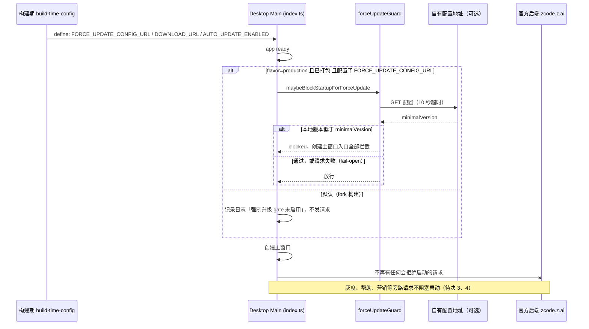

# Fork 对官方后端的运行时依赖：强制升级 gate、自动更新与启动期请求

状态：草案（2026-10-16），待评审后实现。本文只描述规则和改动范围，不含代码改动。

## 背景与决策

本 fork（当前版本 3.15.1）与官方 ZCode 是两个完全独立的产品，不考虑共存。官方后端（`zcode.z.ai`）对 fork 来说是黑盒，且官方可以随时改变它的响应。

调查发现，打包版桌面应用在**创建主窗口之前**就会请求官方后端，并可能因为官方的响应拒绝启动。这是 fork 的可用性风险，也是对外部方的隐性控制，必须由 fork 自己掌握。

已确认的决策：

1. 强制升级 gate 不再读取官方端点。fork 构建默认没有 gate；只有构建时显式配置了**自有**配置地址，才启用。
2. 自动更新在 fork 构建中固定关闭，并补齐目前没有被关闭开关覆盖的入口（见「自动更新」）。
3. 其余启动期官方请求逐项盘点、分级，影响可用性的立即处理，其余作为待决事项交给产品决策。
4. 手机远控的官方 relay 不在本文范围，见 `specs/mobile-remote-control-via-gateway.md`。

## 现状调查

以下均来自源码阅读，**未做运行时验证**（没有构建或启动打包版，也没有请求真实的官方端点）。

### 强制升级 gate 的完整行为

入口：`packages/desktop/src/main/index.ts` 约 L2527-2547，实现在 `forceUpdateGuard.ts`、`forceUpdatePrompt.ts`，共享解析在 `packages/shared/src/forceUpdate.ts` 与 `remoteAppConfig.ts`。

| 项             | 行为                                                                                                                                                                                          |
| -------------- | --------------------------------------------------------------------------------------------------------------------------------------------------------------------------------------------- |
| 启用条件       | `ZCODE_PRODUCT_FLAVOR === "production"` 且 `app.isPackaged`。`pnpm dev:desktop` 等未打包运行跳过，所以开发时**永远看不到**，第一次打包版运行才会触发                                          |
| 请求地址       | `{active endpoint origin}/api/v1/client/configs?app_version=3.15.1&platform=<os>-<arch>`。active endpoint 在 production 环境下由 `ZCODE_BASE_URL` 等环境变量决定，缺省是 `https://zcode.z.ai` |
| 时机           | 创建主窗口之前同步 `await`，请求超时 10 秒，响应上限 1 MiB                                                                                                                                    |
| 判定           | 响应里 `forceUpdate.minimalVersion`（两种信封都认）按 semver 与 `ZCODE_VERSION` 比较，本地版本更低即拉闸                                                                                      |
| 失败语义       | 网络错误、非 2xx、超大、非 JSON、`code != 0` 一律 fail-open：记 warn、不拉闸                                                                                                                  |
| 拉闸后         | 设置 `forceUpdateMainWindowCreationBlocked`，Dock、托盘、activate、二次启动和 deep link 都不能再创建主窗口；弹出独立小窗口，三个动作：自动升级、手动升级、退出                                |
| 手动升级       | 用系统浏览器打开 `{origin}/cn` 或 `{origin}/en`，即官方下载页；随后 `app.quit()`                                                                                                              |
| 自动升级       | 调用 `requestForceAutoUpdate`，走 `autoUpdater.checkForUpdates()`（见下一节的缺口）                                                                                                           |
| 对 fork 的后果 | 官方只要把 `minimalVersion` 提到高于 fork 版本号，fork 的所有打包版用户启动即被拦截，并被引导去官方下载页，安装官方应用                                                                       |
| 其他消费者     | `ForceUpdateConfig` 另有 `getForceUpdateConfig()`（services）与 `forceUpdate.*` 文案（ui locales），源码中没有调用方或引用，属于死代码，可在后续清理                                          |

附带影响：只要 `ZCODE_BASE_URL` 之类的环境变量被设置，gate 就会跟着换地址，同时所有其他官方 API 也一起换；gate 没有自己的配置项。

### 产品身份与后端环境是两条轴

`ZCODE_ENV` 决定后端环境，`ZCODE_PRODUCT_FLAVOR` 决定安装包身份（`production` 或 `preview`）。本仓库里 test 与 production 的官方端点是同一个地址。

- 构建时 `ZCODE_ENV` 缺省按 `test` 处理，得到 `preview` 身份：此时 gate 和自动更新都是关闭的，但应用名、数据目录和安装身份是「ZCode Preview」，不适合作为独立产品。
- fork 要拿到正式身份，就必须以 `ZCODE_ENV=production` 构建，这同时就启用了 gate。**因此 gate 的关闭不能依赖 flavor，必须有独立开关。**

## 产品规则

### 强制升级 gate

1. fork 构建默认**没有** gate：不发请求、不等待、不拉闸。
2. gate 仅在同时满足下列条件时启用：`ZCODE_PRODUCT_FLAVOR === "production"`、`app.isPackaged`、构建时配置了 `ZCODE_FORCE_UPDATE_CONFIG_URL`。
3. gate 的请求地址只来自 `ZCODE_FORCE_UPDATE_CONFIG_URL`，不推导、不回落，也不读取 `ZCODE_BASE_URL`、`zcodeEndpointOrigin` 等运行时 endpoint。代码里 `forceUpdateGuard.ts` 不再引用 `DEFAULT_ZCODE_ENDPOINT_ORIGIN`、`buildZCodeEndpointUrls`。
4. `ZCODE_FORCE_UPDATE_CONFIG_URL` 是完整 URL，必须是 `https`（`localhost`、`127.0.0.1`、`[::1]` 允许 `http`，仅用于测试），构建期校验，非法则构建失败。它可以指向任意静态 JSON 文件，响应格式沿用现有解析器，最小形态为 `{"forceUpdate":{"minimalVersion":"x.y.z"}}`。请求仍只带 `app_version` 和 `platform` 两个查询参数，不带设备标识。
5. 手动升级按钮只打开 `ZCODE_FORCE_UPDATE_DOWNLOAD_URL`（构建期配置，同样要求 https）。未配置时不显示手动升级按钮。代码里不再出现 `{origin}/cn`、`{origin}/en`。
6. 自动升级按钮仅在自动更新启用时显示（见下一节）。若两个升级入口都不可用，对话框只保留「退出」。
7. 失败语义保持 fail-open。保留 10 秒超时和 1 MiB 上限。
8. fork 的版本号体系独立于官方，只与自有配置里的 `minimalVersion` 比较。

### 自动更新

核实结果（源码）：

| 层            | 现状                                                                                                                                                                                                                                                             |
| ------------- | ---------------------------------------------------------------------------------------------------------------------------------------------------------------------------------------------------------------------------------------------------------------- |
| 构建期开关    | `scripts/build-time-config.mjs` 是唯一解析入口：环境变量 `ZCODE_AUTO_UPDATE` 或 `config/private/build-defaults.json`，缺省关闭。仓库里不存在 `config/private/`，所以 fork 默认构建关闭。tsup 与 vite 都注入 `__ZCODE_AUTO_UPDATE_ENABLED__`                      |
| 启动初始化    | `index.ts` 约 L2240：`initAutoUpdater({ enabled: ZCODE_PRODUCT_FLAVOR === "production" && ZCODE_AUTO_UPDATE_ENABLED })`。关闭时 `initAutoUpdater` 提前返回，不配置 feed、不启动轮询、不注册更新相关 IPC                                                          |
| 手动检查      | `checkForUpdateMenuClick` 有 `autoUpdaterDisabledForProductFlavor` 兜底，关闭时直接返回 `dev-skipped`                                                                                                                                                            |
| 打包占位 feed | `electron-builder.config.js` L932-940 的 generic publish 指向 `http://localhost:8081`，运行时由 manifest provider 取代；`applyManifestUpdateProvider` 的缺省 origin 是官方 `DEFAULT_ZCODE_ENDPOINT_ORIGIN`，manifest 路径是 `/api/v1/releases/electron/manifest` |

结论：**默认构建下，启动轮询和手动检查确实是关闭的。** 但有四处缺口，更新器关闭状态并没有被所有入口遵守：

1. `requestForceAutoUpdate`、`requestAutoUpdateCheckWithoutWindow`、`refreshAutoUpdaterReleaseChannel`（`autoUpdater.ts`）只检查 `canUseAutoUpdaterInCurrentRuntime()`（是否已打包），不检查禁用标记。更新器未初始化时它们会直接调用 `autoUpdater.checkForUpdates()`，对打包时的占位 feed（`localhost:8081`）发请求。其中 `refreshAutoUpdaterReleaseChannel` 在用户切换设置里的「接收预览更新」时触发（`index.ts` 约 L1097）；`requestForceAutoUpdate` 则是 gate 的自动升级按钮。
2. 「检查更新」入口（`desktopApplicationMenu.ts` L122、L263，`desktopUpdateMenu.ts` 的 `shouldShowDesktopUpdateEntry`，`useDesktopUpdateMenu`，`WindowsCaptionMenuButton`）只按 flavor 显示。production 身份但自动更新关闭的 fork 构建会显示一个点了只返回「跳过」的入口。
3. 设置页「接收预览更新」同样不随自动更新开关隐藏。
4. 未来若有人设置了 `ZCODE_AUTO_UPDATE=1` 而没有自有更新源，更新器会向官方 manifest 取包。fork 的安装包会被官方包原地替换，这比被拦截更糟。

规则：

1. **唯一开关**：自动更新是否生效，由构建期能力 `ZCODE_AUTO_UPDATE_ENABLED` 与 flavor 共同决定，封装为 shared 中的一个判定（`isDesktopAutoUpdateActive()`，即 `flavor === "production" && ZCODE_AUTO_UPDATE_ENABLED`）。启动初始化、应用菜单、托盘、渲染端入口、设置项、gate 的自动按钮都读这一个判定，不再各自拼条件。
2. **入口 fail-closed**：`autoUpdater.ts` 中所有会调用 `autoUpdater.checkForUpdates()` 或下载的入口，在更新器未启用时直接返回，不触碰 `electron-updater`。以模块内单一的 `assertAutoUpdaterActive()` 实现，不在每个入口复制条件。
3. **UI**：自动更新未生效时，不显示「检查更新」菜单项、不显示「接收预览更新」设置。
4. **构建护栏**：在自有更新源（feed、签名、manifest 服务）的 spec 落地之前，`resolveBuildTimeConfig` 在 `ZCODE_AUTO_UPDATE` 为真时直接报错并指向本文。这样不会有构建意外启用向官方取包的更新器。
5. fork 构建不设置 `ZCODE_AUTO_UPDATE`，也不提供 `config/private/build-defaults.json`。

### 启动期官方请求的总原则

- fork 可用性不得依赖任何官方端点的响应内容。允许的失败语义只有：功能降级，或回落到内置值；不允许拒绝启动。
- 向官方发送的设备标识（`X-Device-Mid`）和版本信息，属于隐私面，每一项请求都要在下表里有明确的去留。

## 启动期官方请求盘点

分级：**阻断**（可拒绝启动）、**拖慢**（启动路径上等待网络）、**降级**（失败或不可达时功能静默变化）、**外露**（向官方发送设备标识，或展示官方内容）、**用户触发**（不在启动路径）。

| #   | 调用                                                                | 触发时机                                                                                                  | 地址                                                                                  | 失败/不可达时                                                                                   | 对 fork 可用性                                                                        | 处理                                      |
| --- | ------------------------------------------------------------------- | --------------------------------------------------------------------------------------------------------- | ------------------------------------------------------------------------------------- | ----------------------------------------------------------------------------------------------- | ------------------------------------------------------------------------------------- | ----------------------------------------- |
| 1   | 强制升级 gate（`forceUpdateGuard.ts`）                              | 创建主窗口前，同步等待，最长 10 秒                                                                        | `{官方}/api/v1/client/configs`                                                        | fail-open 启动；成功且 `minimalVersion` 更高则**拒绝启动**                                      | **阻断**，另有最长 10 秒的**拖慢**                                                    | 本文：默认移除，仅自有地址启用            |
| 2   | 自动更新（`autoUpdater.ts`、`manifestUpdateProvider.ts`）           | 启动后轮询（15 分钟，窗口可见时 2 分钟）、菜单、预览通道切换、gate 自动按钮                               | `{官方}/api/v1/releases/electron/manifest`                                            | 默认构建下**未初始化**，但入口有缺口                                                            | 默认不影响；缺口见上                                                                  | 本文：入口 fail-closed，构建护栏          |
| 3   | 桌面上下文提示灰度（`desktopContextPromptRollout.ts`）              | 创建 Host 时 `refresh()`，另有 `index.ts` 约 L2107；3 秒超时，缓存 1 小时                                 | `{官方}/api/v1/client/configs`，带 `X-Device-Mid`、版本、平台                         | fail-close：功能保持关闭                                                                        | **降级**、**外露**                                                                    | 待决 3、4                                 |
| 4   | 渲染端动作追踪灰度（`rendererActionTraceRollout.ts`）               | 同上机制（共用 `singleFeatureRollout.ts`）                                                                | 同上                                                                                  | fail-close                                                                                      | **降级**、**外露**                                                                    | 待决 3、4                                 |
| 5   | 帮助与社群配置（`desktopHelpConfig.ts`、`helpAppConfig.ts`）        | 作为 `fetchHelpConfig` 注入菜单与托盘（`index.ts` L1493、L2308），具体读取时机未逐项核对；成功缓存 1 小时 | 同上，带 `X-Device-Mid`                                                               | 回落到内置 `config/default.json`                                                                | 回落安全；反馈、社群链接可被官方改写（**外露**）                                      | 待决 4                                    |
| 6   | Agent 侧的灰度策略（动态工作流、闲时任务）                          | Host 向 CLI 同步结论，CLI 只缓存（`dynamic-workflow-policy.ts`）；判定权在 Host                           | `/client/configs`                                                                     | fail-closed：未取到则功能关闭                                                                   | **降级**                                                                              | 待决 3                                    |
| 7   | 营销触达（`marketingTouchService.ts`，ui `MarketingTouchProvider`） | UI 挂载后查询，未登录也会请求；具体轮询间隔未逐项核对                                                     | `{官方}/api/v1/marketing/touch`，带 `X-Device-Mid`，有 token 时带 Bearer              | 失败不影响界面                                                                                  | **外露**：官方可在 fork 里弹窗、展示横幅                                              | 待决 4                                    |
| 8   | ARMS RUM、事件上报（`appARMSBootstrap.ts`、`telemetryCore.ts`）     | 启动                                                                                                      | 构建期 `ZCODE_ARMS_RUM_ENDPOINT`、`ZCODE_TELEMETRY_REPORT_ENDPOINT`                   | 端点为空则 SDK 不启用、事件直接返回                                                             | 默认构建下**无请求**（仓库不含默认端点）                                              | 固化：fork 构建不配置这两项               |
| 9   | Agent OTLP 遥测                                                     | 由打包环境 `ZCODE_PACKAGED_AGENT_OTEL_*` 注入                                                             | 打包时给定                                                                            | 未配置则 no-op；`tsup.config.ts` 仅在 CI 且 `CI_COMMIT_TAG` 或 `release/current` 分支时强制要求 | 无请求；fork 若沿用 GitLab 的 CI 变量名会被强制要求                                   | 固化：fork 构建不配置；CI 注意该校验      |
| 10  | 插件市场（`plugin-marketplaces.ts`）                                | 打开商店或首次需要 manifest 时懒加载；本地有 seed                                                         | `cdn-zcode.z.ai/zcode/official-plugin/…`；GitHub `anthropics/claude-plugins-official` | 无缓存时官方市场列表为空                                                                        | **用户触发**；不可达只影响商店内容                                                    | 待决 5                                    |
| 11  | 远程运行时资源 CDN（`remoteCdn.ts`）                                | 仅 SSH 远程工作区部署时                                                                                   | `cdn-zcode.z.ai`、`cdn.codegeex.cn`，路径含官方版本号                                 | 远程工作区无法部署运行时                                                                        | **用户触发**；推断 fork 版本号的包不在该 CDN 上，远程工作区**很可能不可用**（未实测） | 待决 5                                    |
| 12  | 登录与套餐（OAuth、zcode-plan、闲时、加速、额度）                   | 用户登录或使用相关模型                                                                                    | `zcode.z.ai`、`chat.z.ai`、`api.z.ai`、`bigmodel.cn`                                  | 无法登录官方账号；自带 API key 的模型不受影响                                                   | **用户触发**                                                                          | 待决 3                                    |
| 13  | 手机远控 relay                                                      | 用户开启远控                                                                                              | `wss://zcode.z.ai/ws`                                                                 | —                                                                                               | **用户触发**                                                                          | 见 `mobile-remote-control-via-gateway.md` |

仅 #1 属于**阻断**；#2 在默认构建下无请求，但入口有缺口；#11 在 fork 上很可能不可用（推断 CDN 上没有 fork 版本的资源，未实测）。其余不阻止启动。#3 到 #7 虽然 fail-open 或 fail-close 都不阻止启动，但每次都向官方发送设备标识，且功能是否开启取决于官方的响应，这是独立产品的归属问题，见待决事项。

## 状态归属

| 状态                              | 唯一所有者                                                                                               |
| --------------------------------- | -------------------------------------------------------------------------------------------------------- |
| gate 是否启用、请求地址、下载地址 | 构建期配置，由 `scripts/build-time-config.mjs` 解析并经 define 注入 `@zcode/shared` env 常量，运行时只读 |
| 「主窗口创建被拦截」              | `index.ts` 中的 `forceUpdateMainWindowCreationBlocked`（现状不变）                                       |
| 自动更新是否生效                  | `@zcode/shared` 的 `isDesktopAutoUpdateActive()`；所有入口只读它                                         |
| 更新器状态（检查、下载、就绪）    | `autoUpdater.ts`（现状不变），未生效时不进入任何状态                                                     |
| 灰度开关的取值（#3、#4、#6）      | 待决 3：目前是官方响应加本地 fail-closed 默认值                                                          |

## 时序

## 改动清单

| 对象                                                                                                                                  | 处理                                                                                                                                                                                             |
| ------------------------------------------------------------------------------------------------------------------------------------- | ------------------------------------------------------------------------------------------------------------------------------------------------------------------------------------------------ |
| `scripts/build-time-config.mjs`                                                                                                       | 新增 `ZCODE_FORCE_UPDATE_CONFIG_URL`、`ZCODE_FORCE_UPDATE_DOWNLOAD_URL` 两项，沿用「环境变量优先、缺省关闭」，校验 https；`ZCODE_AUTO_UPDATE` 为真时报错（构建护栏）                             |
| `packages/shared/src/env.ts` 与 desktop 的 tsup、vite define                                                                          | 新增对应常量与 define；新增 `isDesktopAutoUpdateActive()`                                                                                                                                        |
| `packages/desktop/src/main/forceUpdateGuard.ts`                                                                                       | 删除 `endpointOrigin` 参数、`resolveForceUpdateClientConfigUrl` 的 origin 推导、默认下载页；请求地址和下载地址改读构建常量；无下载地址时不显示手动按钮                                           |
| `packages/desktop/src/main/forceUpdatePrompt.ts`                                                                                      | 支持隐藏手动/自动按钮                                                                                                                                                                            |
| `packages/desktop/src/main/index.ts` 约 L2527-2547                                                                                    | gate 条件改为 `flavor === production && app.isPackaged && 已配置地址`，并为每种跳过原因记录日志                                                                                                  |
| `packages/desktop/src/main/autoUpdater.ts`                                                                                            | 新增 `assertAutoUpdaterActive()`，用于 `requestForceAutoUpdate`、`requestAutoUpdateCheckWithoutWindow`、`refreshAutoUpdaterReleaseChannel`、`downloadAvailableUpdate`、`checkForUpdateMenuClick` |
| `desktopApplicationMenu.ts`、托盘、`desktopUpdateMenu.ts`、`useDesktopUpdateMenu`、`WindowsCaptionMenuButton`、设置页「接收预览更新」 | 统一改读 `isDesktopAutoUpdateActive()`                                                                                                                                                           |
| 测试                                                                                                                                  | 见「验收」。更新 `forceUpdateGuard.test.ts`、`build-time-config.test.mjs`（现有用例断言 `ZCODE_AUTO_UPDATE=1` 启用，需改为报错）、`desktopUpdateMenu` 相关用例                                   |
| 文档                                                                                                                                  | 更新 `docs/force-update-client-config.md`（把「读 active endpoint」改为自有地址）与 `docs/desktop/build-time-optional-capabilities.md`                                                           |
| 死代码                                                                                                                                | 后续清理：`getForceUpdateConfig()` 及 services 中相关解析、ui locales 的 `forceUpdate.*`（需先确认无动态引用）。不在本次改动内                                                                   |

## 验收与验证

1. **gate 默认关闭（单测）**：flavor 为 production、已打包、未配置地址时，注入的 `fetchRemoteConfig` 与 `net.request` 均未被调用，主窗口被创建，日志说明原因。
2. **官方响应无影响（单测 + 打包版）**：把官方端点指向本地桩（`ZCODE_BASE_URL`），桩对 `/api/v1/client/configs` 返回 `forceUpdate.minimalVersion = 99.0.0`。打包版启动后主窗口正常出现，且 gate 没有向桩发出请求（桩日志里只允许出现旁路灰度和帮助请求）。
3. **已配置自有地址**：桩返回更高版本 → 拦截并展示对话框，不创建主窗口，二次启动、deep link、Dock、托盘均不能绕过（保留现有用例）；返回相同或更低版本 → 放行；超时、非 2xx、HTML、超大、`code != 0` → fail-open。
4. **按钮规则**：未配置下载地址时无手动按钮；配置后点击只打开该地址（断言 `shell.openExternal` 的参数，且任何路径都不含官方域名）；自动更新未生效时无自动按钮。
5. **构建校验**：`ZCODE_FORCE_UPDATE_CONFIG_URL` 为 `http://example.com` 或非法 URL 时构建失败；loopback 的 http 通过；`ZCODE_AUTO_UPDATE=1` 时构建失败并给出指向本文的信息。
6. **自动更新 fail-closed（单测，fake `electron-updater`）**：`initAutoUpdater({enabled:false})` 之后，`requestForceAutoUpdate`、`requestAutoUpdateCheckWithoutWindow`、`refreshAutoUpdaterReleaseChannel`、`checkForUpdateMenuClick`、`downloadAvailableUpdate` 对 `checkForUpdates` 与下载的调用次数均为 0；不注册更新相关 IPC。
7. **UI**：自动更新未生效时，应用菜单、Windows 标题栏菜单、托盘无「检查更新」，设置页无「接收预览更新」；生效时均出现。
8. **残留检查**：`forceUpdateGuard.ts` 与 `forceUpdatePrompt.ts` 中不再出现 `DEFAULT_ZCODE_ENDPOINT_ORIGIN`、`buildZCodeEndpointUrls`、`/cn`、`/en`；`pnpm knip` 没有新增未使用导出。
9. **回归**：`pnpm typecheck`、`pnpm lint`、`pnpm architecture:check --changed` 通过，结果如实记录；相关桌面单测（`forceUpdateGuard`、`desktopSecondInstanceDeepLink`、`autoUpdaterReadyState`、`desktopProductIdentity`、`build-time-config`）通过。

本次交付只含 spec，以上均未执行。

## 实施顺序

1. **构建配置**：`build-time-config.mjs`、shared 常量、define、`isDesktopAutoUpdateActive()`，附构建期校验和测试。
2. **自动更新 fail-closed**：`assertAutoUpdaterActive()`，各入口与 UI 改读单一判定。这一步独立于 gate，先落地可以消除缺口。
3. **gate 改造**：地址与按钮规则，index.ts 条件，测试。
4. **打包版验证**：验收 2，用本地桩确认官方响应不再影响启动。
5. **文档与死代码清理**。

## 待决事项

1. **gate 是保留还是整体删除。** 推荐保留并默认关闭：它是 fork 自己的下线开关，改动小。如果近期不打算自建配置端点，删除整个 gate（`forceUpdateGuard.ts`、`forceUpdatePrompt.ts`、`desktopSecondInstanceDeepLink.ts` 中的拦截、相关文案和测试）更干净，但属于较大的删除，需要你确认。
2. **fork 的版本号体系**是否与官方脱钩（建议脱钩），以及 `minimalVersion` 配置文件由谁托管。
3. **灰度类功能（#3、#4、#6）和官方账号功能（#12）的归属。** 目前它们依赖官方的响应，不可达时 fail-closed。fork 是否继续使用官方账号、套餐和灰度，是更大的产品决策：继续使用，就等于长期依赖官方后端；不使用，需要把这些功能的取值改为本地固定值（开或关），并在 UI 隐藏登录和套餐入口。本文不替你决定。
4. **向官方发送设备标识（#3、#4、#5、#7）。** 是否停止发送 `X-Device-Mid`，是否关闭营销触达（#7），是否让帮助和社群链接只用内置值（#5）。建议至少关闭营销触达。
5. **插件市场与远程运行时 CDN（#10、#11）。** 推断官方 CDN 上没有 fork 版本的远程运行时，SSH 远程工作区在 fork 上很可能不可用（未实测），需要自有资源托管或暂时隐藏该入口；插件市场需决定是否保留官方市场作为默认源。
6. **「接收预览更新」设置在自动更新关闭时隐藏**，以及对应的已有设置值如何处理（保留不读取即可），请确认。
7. **品牌与身份**：fork 需要以 `ZCODE_ENV=production` 构建才能拿到正式身份，应用名、`appId`、数据目录的改名属于另一项工作，需要与本文的 gate 配置同时考虑，避免与官方应用共用数据目录。
