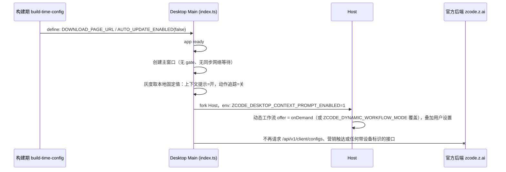

# Fork 对官方后端的运行时依赖：强制升级 gate、自动更新与启动期请求

状态：草案（2026-10-16；2026-10-17 按总纲 `fork-official-deps-removal-plan.md` 的决策门 D1、D1b、D2 修订），待评审后实现。本文只描述规则和改动范围，不含代码改动。

## 背景与决策

本 fork（当前版本 3.15.1）与官方 ZCode 是两个完全独立的产品，不考虑共存。官方后端（`zcode.z.ai`）对 fork 来说是黑盒，且官方可以随时改变它的响应。

调查发现，打包版桌面应用在**创建主窗口之前**就会请求官方后端，并可能因为官方的响应拒绝启动。这是 fork 的可用性风险，也是对外部方的隐性控制，必须由 fork 自己掌握。

已确认的决策：

1. **强制升级 gate 整体删除**（D1，2026-10-17）：fork 不设远程下线开关，用户手动下载新版本升级。
2. 自动更新在 fork 构建中固定关闭，并补齐目前没有被关闭开关覆盖的入口（见「自动更新」）。
3. 其余启动期官方请求逐项盘点、分级。灰度开关改为本地固定值（D1b，见「灰度开关的本地默认值」）；向官方发送设备标识的请求全部停止（D2 路线 B）。
4. 官方账号体系按路线 B 移除（D2），实施见总纲阶段 4；本文只处理启动与更新链路。
5. 手机远控的官方 relay 不在本文范围，见 `specs/mobile-remote-control-via-gateway.md`。

## 现状调查

以下均来自源码阅读，**未做运行时验证**（没有构建或启动打包版，也没有请求真实的官方端点）。

### 强制升级 gate 的完整行为

入口：`packages/desktop/src/main/index.ts` 约 L2527-2547，实现在 `forceUpdateGuard.ts`、`forceUpdatePrompt.ts`，共享解析在 `packages/shared/src/forceUpdate.ts` 与 `remoteAppConfig.ts`。

| 项             | 行为                                                                                                                                                                                          |
| -------------- | --------------------------------------------------------------------------------------------------------------------------------------------------------------------------------------------- |
| 启用条件       | `ZCODE_PRODUCT_FLAVOR === "production"` 且 `app.isPackaged`。`pnpm dev:desktop` 等未打包运行跳过，所以开发时**永远看不到**，第一次打包版运行才会触发                                          |
| 请求地址       | `{active endpoint origin}/api/v1/client/configs?app_version=3.15.1&platform=<os>-<arch>`。active endpoint 在 production 环境下由 `ZCODE_BASE_URL` 等环境变量决定，缺省是 `https://zcode.z.ai` |
| 时机           | 创建主窗口之前同步 `await`，请求超时 10 秒，响应上限 1 MiB                                                                                                                                    |
| 判定           | 响应里 `forceUpdate.minimalVersion`（两种信封都认）按 semver 与 `ZCODE_VERSION` 比较，本地版本更低即拉闸                                                                                      |
| 失败语义       | 网络错误、非 2xx、超大、非 JSON、`code != 0` 一律 fail-open：记 warn、不拉闸                                                                                                                  |
| 拉闸后         | 设置 `forceUpdateMainWindowCreationBlocked`，Dock、托盘、activate、二次启动和 deep link 都不能再创建主窗口；弹出独立小窗口，三个动作：自动升级、手动升级、退出                                |
| 手动升级       | 用系统浏览器打开 `{origin}/cn` 或 `{origin}/en`，即官方下载页；随后 `app.quit()`                                                                                                              |
| 自动升级       | 调用 `requestForceAutoUpdate`，走 `autoUpdater.checkForUpdates()`（见下一节的缺口）                                                                                                           |
| 对 fork 的后果 | 官方只要把 `minimalVersion` 提到高于 fork 版本号，fork 的所有打包版用户启动即被拦截，并被引导去官方下载页，安装官方应用                                                                       |
| 其他消费者     | `ForceUpdateConfig` 另有 `getForceUpdateConfig()`（services）与 `forceUpdate.*` 文案（ui locales），源码中没有调用方或引用，属于死代码，可在后续清理                                          |

附带影响：只要 `ZCODE_BASE_URL` 之类的环境变量被设置，gate 就会跟着换地址，同时所有其他官方 API 也一起换；gate 没有自己的配置项。

### 产品身份与后端环境是两条轴

`ZCODE_ENV` 决定后端环境，`ZCODE_PRODUCT_FLAVOR` 决定安装包身份（`production` 或 `preview`）。本仓库里 test 与 production 的官方端点是同一个地址。

- 构建时 `ZCODE_ENV` 缺省按 `test` 处理，得到 `preview` 身份：此时 gate 和自动更新都是关闭的，但应用名、数据目录和安装身份是「ZCode Preview」，不适合作为独立产品。
- fork 要拿到正式身份，就必须以 `ZCODE_ENV=production` 构建，这同时就启用了 gate。**因此不能靠 flavor 关闭 gate**；按 D1 直接删除 gate。

## 产品规则

### 强制升级 gate（删除）

1. 删除 gate 全链路：`forceUpdateGuard.ts`、`forceUpdatePrompt.ts`、`index.ts` 中的 `maybeBlockStartupForForceUpdate` 调用与 `forceUpdateMainWindowCreationBlocked` 拦截（含 Dock、托盘、activate、二次启动）、`desktopSecondInstanceDeepLink.ts` 中的拦截分支、`autoUpdater.ts` 的 `requestForceAutoUpdate`、`packages/shared/src/forceUpdate.ts`、`remoteAppConfig.ts` 的 `getForceUpdateMinimalVersionFromConfig`、services 中的 `getForceUpdateConfig()`、ui locales 的 `forceUpdate.*` 文案、`docs/force-update-client-config.md`。
2. 启动路径上不再有任何同步等待网络的步骤：app ready 之后直接创建主窗口。
3. 不引入 `ZCODE_FORCE_UPDATE_CONFIG_URL`、`ZCODE_FORCE_UPDATE_DOWNLOAD_URL`。
4. 手动升级的入口统一为构建期 `ZCODE_DOWNLOAD_PAGE_URL`（完整 https URL，构建期校验；loopback 允许 http，仅用于测试）。当前唯一消费者是 CPU 架构不匹配弹框的「前往下载」（`desktopArchitectureGuard.ts:143-146`，总纲 2.1）；未配置时不显示该按钮，弹框只做说明。代码里不再出现 `{origin}/cn`、`{origin}/en` 形式的官方下载页。
5. 删除前确认 `services`/`ui` 中的 `forceUpdate` 引用均为死代码（`pnpm dep:refs --list-exports`），删除后 `pnpm knip` 无新增未使用导出。

### 自动更新

核实结果（源码）：

| 层            | 现状                                                                                                                                                                                                                                                             |
| ------------- | ---------------------------------------------------------------------------------------------------------------------------------------------------------------------------------------------------------------------------------------------------------------- |
| 构建期开关    | `scripts/build-time-config.mjs` 是唯一解析入口：环境变量 `ZCODE_AUTO_UPDATE` 或 `config/private/build-defaults.json`，缺省关闭。仓库里不存在 `config/private/`，所以 fork 默认构建关闭。tsup 与 vite 都注入 `__ZCODE_AUTO_UPDATE_ENABLED__`                      |
| 启动初始化    | `index.ts` 约 L2240：`initAutoUpdater({ enabled: ZCODE_PRODUCT_FLAVOR === "production" && ZCODE_AUTO_UPDATE_ENABLED })`。关闭时 `initAutoUpdater` 提前返回，不配置 feed、不启动轮询、不注册更新相关 IPC                                                          |
| 手动检查      | `checkForUpdateMenuClick` 有 `autoUpdaterDisabledForProductFlavor` 兜底，关闭时直接返回 `dev-skipped`                                                                                                                                                            |
| 打包占位 feed | `electron-builder.config.js` L932-940 的 generic publish 指向 `http://localhost:8081`，运行时由 manifest provider 取代；`applyManifestUpdateProvider` 的缺省 origin 是官方 `DEFAULT_ZCODE_ENDPOINT_ORIGIN`，manifest 路径是 `/api/v1/releases/electron/manifest` |

结论：**默认构建下，启动轮询和手动检查确实是关闭的。** 但有四处缺口，更新器关闭状态并没有被所有入口遵守：

1. `requestForceAutoUpdate`、`requestAutoUpdateCheckWithoutWindow`、`refreshAutoUpdaterReleaseChannel`（`autoUpdater.ts`）只检查 `canUseAutoUpdaterInCurrentRuntime()`（是否已打包），不检查禁用标记。更新器未初始化时它们会直接调用 `autoUpdater.checkForUpdates()`，对打包时的占位 feed（`localhost:8081`）发请求。其中 `refreshAutoUpdaterReleaseChannel` 在用户切换设置里的「接收预览更新」时触发（`index.ts` 约 L1097）；`requestForceAutoUpdate` 则是 gate 的自动升级按钮（随 gate 删除）。
2. 「检查更新」入口（`desktopApplicationMenu.ts` L122、L263，`desktopUpdateMenu.ts` 的 `shouldShowDesktopUpdateEntry`，`useDesktopUpdateMenu`，`WindowsCaptionMenuButton`）只按 flavor 显示。production 身份但自动更新关闭的 fork 构建会显示一个点了只返回「跳过」的入口。
3. 设置页「接收预览更新」同样不随自动更新开关隐藏。
4. 未来若有人设置了 `ZCODE_AUTO_UPDATE=1` 而没有自有更新源，更新器会向官方 manifest 取包。fork 的安装包会被官方包原地替换，这比被拦截更糟。

规则：

1. **唯一开关**：自动更新是否生效，由构建期能力 `ZCODE_AUTO_UPDATE_ENABLED` 与 flavor 共同决定，封装为 shared 中的一个判定（`isDesktopAutoUpdateActive()`，即 `flavor === "production" && ZCODE_AUTO_UPDATE_ENABLED`）。启动初始化、应用菜单、托盘、渲染端入口、设置项都读这一个判定，不再各自拼条件。fork 采用手动更新（D1），该判定在 fork 构建中恒为 false。
2. **入口 fail-closed**：`autoUpdater.ts` 中所有会调用 `autoUpdater.checkForUpdates()` 或下载的入口，在更新器未启用时直接返回，不触碰 `electron-updater`。以模块内单一的 `assertAutoUpdaterActive()` 实现，不在每个入口复制条件。
3. **UI**：自动更新未生效时，不显示「检查更新」菜单项、不显示「接收预览更新」设置。
4. **构建护栏**：在自有更新源（feed、签名、manifest 服务）的 spec 落地之前，`resolveBuildTimeConfig` 在 `ZCODE_AUTO_UPDATE` 为真时直接报错并指向本文。这样不会有构建意外启用向官方取包的更新器。
5. fork 构建不设置 `ZCODE_AUTO_UPDATE`，也不提供 `config/private/build-defaults.json`。

### 启动期官方请求的总原则

- fork 可用性不得依赖任何官方端点的响应内容。允许的失败语义只有：功能降级，或回落到内置值；不允许拒绝启动。
- 向官方发送的设备标识（`X-Device-Mid`）和版本信息，属于隐私面，每一项请求都要在下表里有明确的去留。按 D2 路线 B，全部停止。
- fork 不再请求 `{官方}/api/v1/client/configs`：gate 已删除，灰度开关改为本地固定值，帮助与社群配置只用内置值。

### 灰度开关的本地默认值（D1b）

以下取值为 fork 的固定产品决策，不再由任何远端下发。读取远端配置的代码不再被调用；按总纲原则 6，删除抓取代码是可选清理，不是本阶段验收项。

| 开关                                         | 控制什么                                                                                                                                                                                                     | fork 取值                 | 理由                                                                                                                                                                                         | 唯一所有者                                                                                                                                                              |
| -------------------------------------------- | ------------------------------------------------------------------------------------------------------------------------------------------------------------------------------------------------------------ | ------------------------- | -------------------------------------------------------------------------------------------------------------------------------------------------------------------------------------------- | ----------------------------------------------------------------------------------------------------------------------------------------------------------------------- |
| 桌面上下文提示（`desktopContextPrompt`，#3） | Desktop Host 为 Agent 注入「ZCode Desktop Context」系统提示段（`apps/zcode-cli/packages/core/src/context/sections/desktop.ts`）：Gen UI 内联视图、文件与 URL 的 Markdown 链接、`::code-comment` 行内评审批注 | **开**                    | 这些都是桌面端已实现的渲染能力，关闭时 Agent 不会使用，桌面体验退化为终端；只影响本机注入的提示，不发请求                                                                                    | Desktop Main：`desktopContextPromptEnabled()` 固定返回 true，经 `ZCODE_DESKTOP_CONTEXT_PROMPT_ENABLED=1` 下发 Host                                                      |
| 渲染端动作追踪（`rendererActionTrace`，#4）  | 渲染进程用户动作的 OTLP trace 采样与本地 TTFT 统计                                                                                                                                                           | **关**                    | 属于遥测；fork 无自有 OTLP 端点，开启也无处上报；符合隐私原则                                                                                                                                | Desktop Main：固定使用 `DISABLED_RENDERER_ACTION_TRACE_CONFIG`                                                                                                          |
| 动态工作流（`dynamicWorkflow`，#6）          | `/workflow` 命令、`dynamic-workflows` 技能、自动化页工作流 tab，以及向模型注册的 10 个工作流工具                                                                                                             | **提供，默认 `onDemand`** | 功能完整可用且用户可在设置里改为 `alwaysOn` 或 `disabled`；`onDemand` 在会话首次使用 `/workflow` 前不注册工具，普通会话不增加提示词和工具面，BYOK 用户不会因模型自发启动工作流而产生额外费用 | Host：提供值固定为 `onDemand`，来源记为 `default`；开发与运维仍可用 `ZCODE_DYNAMIC_WORKFLOW_MODE` 覆盖（现有三档规则不变），用户选择仍以设置 `dynamicWorkflowMode` 为准 |
| 闲时任务（`offPeak`）                        | Coding Plan 闲时额度下的排队任务                                                                                                                                                                             | **关，随阶段 4 删除**     | 依赖官方账号与闲时票据，路线 B 不再提供                                                                                                                                                      | 无（随 `coding-plan-subscription/` 删除）                                                                                                                               |

注意：动态工作流的提供值目前由 `BigModelCodingPlanSubscriptionProvider.getDynamicWorkflowClientConfig()`（`packages/services/src/coding-plan-subscription/`）读取远端得到，而该目录将在总纲阶段 4 删除。本阶段先把提供值的所有者迁到独立于官方账号的 Host 模块（例如 `services/src/dynamic-workflow/` 下的本地 offer 提供者），阶段 4 删除 `coding-plan-subscription/` 时不受影响。

## 启动期官方请求盘点

分级：**阻断**（可拒绝启动）、**拖慢**（启动路径上等待网络）、**降级**（失败或不可达时功能静默变化）、**外露**（向官方发送设备标识，或展示官方内容）、**用户触发**（不在启动路径）。

| #   | 调用                                                                | 触发时机                                                                                                  | 地址                                                                                  | 失败/不可达时                                                                                   | 对 fork 可用性                                                                        | 处理                                      |
| --- | ------------------------------------------------------------------- | --------------------------------------------------------------------------------------------------------- | ------------------------------------------------------------------------------------- | ----------------------------------------------------------------------------------------------- | ------------------------------------------------------------------------------------- | ----------------------------------------- |
| 1   | 强制升级 gate（`forceUpdateGuard.ts`）                              | 创建主窗口前，同步等待，最长 10 秒                                                                        | `{官方}/api/v1/client/configs`                                                        | fail-open 启动；成功且 `minimalVersion` 更高则**拒绝启动**                                      | **阻断**，另有最长 10 秒的**拖慢**                                                    | 本文：整体删除（D1）                      |
| 2   | 自动更新（`autoUpdater.ts`、`manifestUpdateProvider.ts`）           | 启动后轮询（15 分钟，窗口可见时 2 分钟）、菜单、预览通道切换、gate 自动按钮                               | `{官方}/api/v1/releases/electron/manifest`                                            | 默认构建下**未初始化**，但入口有缺口                                                            | 默认不影响；缺口见上                                                                  | 本文：入口 fail-closed，构建护栏          |
| 3   | 桌面上下文提示灰度（`desktopContextPromptRollout.ts`）              | 创建 Host 时 `refresh()`，另有 `index.ts` 约 L2107；3 秒超时，缓存 1 小时                                 | `{官方}/api/v1/client/configs`，带 `X-Device-Mid`、版本、平台                         | fail-close：功能保持关闭                                                                        | **降级**、**外露**                                                                    | D1b：固定开，不再请求                     |
| 4   | 渲染端动作追踪灰度（`rendererActionTraceRollout.ts`）               | 同上机制（共用 `singleFeatureRollout.ts`）                                                                | 同上                                                                                  | fail-close                                                                                      | **降级**、**外露**                                                                    | D1b：固定关，不再请求                     |
| 5   | 帮助与社群配置（`desktopHelpConfig.ts`、`helpAppConfig.ts`）        | 作为 `fetchHelpConfig` 注入菜单与托盘（`index.ts` L1493、L2308），具体读取时机未逐项核对；成功缓存 1 小时 | 同上，带 `X-Device-Mid`                                                               | 回落到内置 `config/default.json`                                                                | 回落安全；反馈、社群链接可被官方改写（**外露**）                                      | 只用内置 `config/default.json`，不再请求  |
| 6   | Agent 侧的灰度策略（动态工作流、闲时任务）                          | Host 向 CLI 同步结论，CLI 只缓存（`dynamic-workflow-policy.ts`）；判定权在 Host                           | `/client/configs`                                                                     | fail-closed：未取到则功能关闭                                                                   | **降级**                                                                              | D1b：固定 `onDemand`，不再请求            |
| 7   | 营销触达（`marketingTouchService.ts`，ui `MarketingTouchProvider`） | UI 挂载后查询，未登录也会请求；具体轮询间隔未逐项核对                                                     | `{官方}/api/v1/marketing/touch`，带 `X-Device-Mid`，有 token 时带 Bearer              | 失败不影响界面                                                                                  | **外露**：官方可在 fork 里弹窗、展示横幅                                              | 关闭（总纲 2.2）                          |
| 8   | ARMS RUM、事件上报（`appARMSBootstrap.ts`、`telemetryCore.ts`）     | 启动                                                                                                      | 构建期 `ZCODE_ARMS_RUM_ENDPOINT`、`ZCODE_TELEMETRY_REPORT_ENDPOINT`                   | 端点为空则 SDK 不启用、事件直接返回                                                             | 默认构建下**无请求**（仓库不含默认端点）                                              | 固化：fork 构建不配置这两项               |
| 9   | Agent OTLP 遥测                                                     | 由打包环境 `ZCODE_PACKAGED_AGENT_OTEL_*` 注入                                                             | 打包时给定                                                                            | 未配置则 no-op；`tsup.config.ts` 仅在 CI 且 `CI_COMMIT_TAG` 或 `release/current` 分支时强制要求 | 无请求；fork 若沿用 GitLab 的 CI 变量名会被强制要求                                   | 固化：fork 构建不配置；CI 注意该校验      |
| 10  | 插件市场（`plugin-marketplaces.ts`）                                | 打开商店或首次需要 manifest 时懒加载；本地有 seed                                                         | `cdn-zcode.z.ai/zcode/official-plugin/…`；GitHub `anthropics/claude-plugins-official` | 无缓存时官方市场列表为空                                                                        | **用户触发**；不可达只影响商店内容                                                    | 待决 2（总纲 D4a/b）                      |
| 11  | 远程运行时资源 CDN（`remoteCdn.ts`）                                | 仅 SSH 远程工作区部署时                                                                                   | `cdn-zcode.z.ai`、`cdn.codegeex.cn`，路径含官方版本号                                 | 远程工作区无法部署运行时                                                                        | **用户触发**；推断 fork 版本号的包不在该 CDN 上，远程工作区**很可能不可用**（未实测） | 待决 2（总纲 D4a/b）                      |
| 12  | 登录与套餐（OAuth、zcode-plan、闲时、加速、额度）                   | 用户登录或使用相关模型                                                                                    | `zcode.z.ai`、`chat.z.ai`、`api.z.ai`、`bigmodel.cn`                                  | 无法登录官方账号；自带 API key 的模型不受影响                                                   | **用户触发**                                                                          | D2 路线 B：移除（总纲阶段 4）             |
| 13  | 手机远控 relay                                                      | 用户开启远控                                                                                              | `wss://zcode.z.ai/ws`                                                                 | —                                                                                               | **用户触发**                                                                          | 见 `mobile-remote-control-via-gateway.md` |

仅 #1 属于**阻断**；#2 在默认构建下无请求，但入口有缺口；#11 在 fork 上很可能不可用（推断 CDN 上没有 fork 版本的资源，未实测）。其余不阻止启动。#3 到 #7 虽然 fail-open 或 fail-close 都不阻止启动，但每次都向官方发送设备标识，且功能是否开启取决于官方的响应，这是独立产品的归属问题，已按 D1b、D2 决定，见「灰度开关的本地默认值」与表中处理列。

## 状态归属

| 状态                                 | 唯一所有者                                                                                               |
| ------------------------------------ | -------------------------------------------------------------------------------------------------------- |
| 下载页地址 `ZCODE_DOWNLOAD_PAGE_URL` | 构建期配置，由 `scripts/build-time-config.mjs` 解析并经 define 注入 `@zcode/shared` env 常量，运行时只读 |
| 自动更新是否生效                     | `@zcode/shared` 的 `isDesktopAutoUpdateActive()`；所有入口只读它                                         |
| 更新器状态（检查、下载、就绪）       | `autoUpdater.ts`（现状不变），未生效时不进入任何状态                                                     |
| 桌面上下文提示、渲染端动作追踪的取值 | Desktop Main，本地固定值（D1b），不读远端                                                                |
| 动态工作流的提供值（offer）          | Host 内独立于官方账号的本地 offer 提供者，固定 `onDemand`，`ZCODE_DYNAMIC_WORKFLOW_MODE` 可覆盖          |
| 动态工作流的用户选择                 | 设置 `dynamicWorkflowMode`（现状不变）                                                                   |

## 时序

## 改动清单

| 对象                                                                                                                                  | 处理                                                                                                                                                                                                                                                                                                                       |
| ------------------------------------------------------------------------------------------------------------------------------------- | -------------------------------------------------------------------------------------------------------------------------------------------------------------------------------------------------------------------------------------------------------------------------------------------------------------------------- |
| `scripts/build-time-config.mjs`                                                                                                       | 新增 `ZCODE_DOWNLOAD_PAGE_URL`，沿用「环境变量优先、缺省关闭」，校验 https；`ZCODE_AUTO_UPDATE` 为真时报错（构建护栏）                                                                                                                                                                                                     |
| `packages/shared/src/env.ts` 与 desktop 的 tsup、vite define                                                                          | 新增对应常量与 define；新增 `isDesktopAutoUpdateActive()`                                                                                                                                                                                                                                                                  |
| gate 全链路                                                                                                                           | 按「强制升级 gate（删除）」第 1 条删除；`index.ts` 约 L2527-2547 改为直接创建主窗口                                                                                                                                                                                                                                        |
| `desktopArchitectureGuard.ts`                                                                                                         | 「前往下载」改读 `ZCODE_DOWNLOAD_PAGE_URL`，未配置不显示按钮                                                                                                                                                                                                                                                               |
| `packages/desktop/src/main/autoUpdater.ts`                                                                                            | 新增 `assertAutoUpdaterActive()`，用于 `requestAutoUpdateCheckWithoutWindow`、`refreshAutoUpdaterReleaseChannel`、`downloadAvailableUpdate`、`checkForUpdateMenuClick`；删除 `requestForceAutoUpdate`                                                                                                                      |
| `desktopApplicationMenu.ts`、托盘、`desktopUpdateMenu.ts`、`useDesktopUpdateMenu`、`WindowsCaptionMenuButton`、设置页「接收预览更新」 | 统一改读 `isDesktopAutoUpdateActive()`                                                                                                                                                                                                                                                                                     |
| `desktopContextPromptRollout.ts`、`rendererActionTraceRollout.ts` 的装配点（`index.ts`、`desktopHostProcess.ts`）                     | 改为本地固定值，不再构造请求 `/client/configs` 的 `fetchConfig`                                                                                                                                                                                                                                                            |
| 动态工作流 offer                                                                                                                      | 从 `BigModelCodingPlanSubscriptionProvider.getDynamicWorkflowClientConfig()` 迁到独立的 Host 本地 offer 提供者；`DEFAULT_DYNAMIC_WORKFLOW_MODE` 的 fail-closed 语义改为 fork 固定 offer `onDemand`（`packages/shared/src/dynamic-workflow-feature.ts` 注释与 `docs/dynamic-workflow/launch.md`「Gray release」节同步更新） |
| 帮助与社群配置（`desktopHelpConfig.ts`）                                                                                              | 只读内置 `config/default.json`，不再请求远端                                                                                                                                                                                                                                                                               |
| 测试                                                                                                                                  | 见「验收」。删除 `forceUpdateGuard.test.ts` 等 gate 测试；更新 `build-time-config.test.mjs`（现有用例断言 `ZCODE_AUTO_UPDATE=1` 启用，需改为报错）、`desktopUpdateMenu`、`desktopSecondInstanceDeepLink`、灰度与动态工作流 offer 相关用例                                                                                  |
| 文档                                                                                                                                  | 删除 `docs/force-update-client-config.md`；更新 `docs/desktop/build-time-optional-capabilities.md`                                                                                                                                                                                                                         |

## 验收与验证

1. **无 gate（单测 + 打包版）**：打包 production 构建启动时，Main 在创建主窗口前不发起任何网络请求；源码中不再存在 `forceUpdateGuard`、`forceUpdatePrompt`、`forceUpdateMainWindowCreationBlocked`、`requestForceAutoUpdate`。
2. **官方响应无影响（打包版）**：把官方端点指向本地桩（`ZCODE_BASE_URL`），桩对 `/api/v1/client/configs` 返回 `forceUpdate.minimalVersion = 99.0.0` 及各灰度键的相反取值。打包版启动后主窗口正常出现，桩日志中**没有任何请求**；灰度功能表现与 D1b 一致。
3. **下载页按钮**：未配置 `ZCODE_DOWNLOAD_PAGE_URL` 时架构不匹配弹框无「前往下载」；配置后点击只打开该地址（断言 `shell.openExternal` 的参数，不含官方域名）。
4. **构建校验**：`ZCODE_DOWNLOAD_PAGE_URL` 为 `http://example.com` 或非法 URL 时构建失败；loopback 的 http 通过；`ZCODE_AUTO_UPDATE=1` 时构建失败并给出指向本文的信息。
5. **灰度本地值（单测）**：Host 启动 env 中 `ZCODE_DESKTOP_CONTEXT_PROMPT_ENABLED=1`，Agent 系统提示包含「ZCode Desktop Context」段；渲染端动作追踪配置为禁用；动态工作流 offer 为 `onDemand`、来源 `default`，`ZCODE_DYNAMIC_WORKFLOW_MODE` 覆盖规则不变，用户设置可改为 `alwaysOn`/`disabled`；上述过程均不调用 `fetchConfig`。
6. **自动更新 fail-closed（单测，fake `electron-updater`）**：`initAutoUpdater({enabled:false})` 之后，`requestAutoUpdateCheckWithoutWindow`、`refreshAutoUpdaterReleaseChannel`、`checkForUpdateMenuClick`、`downloadAvailableUpdate` 对 `checkForUpdates` 与下载的调用次数均为 0；不注册更新相关 IPC。
7. **UI**：自动更新未生效时，应用菜单、Windows 标题栏菜单、托盘无「检查更新」，设置页无「接收预览更新」；生效时均出现。
8. **残留检查**：`desktopArchitectureGuard.ts` 不再出现官方下载页；`pnpm knip` 没有新增未使用导出。
9. **回归**：`pnpm typecheck`、`pnpm lint`、`pnpm architecture:check --changed` 通过，结果如实记录；相关桌面单测（`desktopSecondInstanceDeepLink`、`autoUpdaterReadyState`、`desktopProductIdentity`、`build-time-config`、动态工作流 offer）通过。

验收 1、4、5、6、7、9 已随 M0-M4 各任务的单测与门禁执行并通过（见 specs/fork-official-deps-removal-tasks.md 各任务记录）；验收 2、8 的打包版部分由 2026-10-19 的 F2.11 断网容器验收覆盖，记录见下节。

### F2.11 打包断网验收记录（2026-10-19）

环境：colima（8C/16GiB，`--vz-rosetta`）+ linux/amd64 容器；官方域名清单（scripts/lib/official-domains.mjs，13 个 host）经 `--add-host` 全部 sink-hole 到容器内 official-request-sink；`OFFICIAL_REQUESTS_ASSERT_MODE=empty` 硬断言（默认 report 只观察）。镜像内构建产物不可直测（陈旧 out/），被测对象为容器内 E2E prepare 的真实构建（run-production-build → tsup/vite）。

结果（均以 `bash scripts/test-desktop-e2e-container.sh --block-official` 执行）：

1. **启动与交互零官方请求（验收 1、2 打包版）**：默认 preset 中 4 个有 Docker 准入的 spec（container-boot、smoke、e2ecase-regression、task-list-archive-confirmation）全部通过，sink 记录 **0 条（PASS）**。验收 2 的敌对桩（minimalVersion=99.0.0 与相反灰度值）由「零请求」先验满足：应用对官方端点零请求，敌对响应无从到达（gate 已删、client-config 已本地化、营销/账号链路已删）。
2. **BYOK 首启与会话链路（断网容器）**：`official-account-removal-fresh-install`（F4.1a 语义）通过；运行日志实证 `provider/model 就绪（providerId: e2e-upstream，本地回放上游）`、`sendConversationCommandV4 OK`、v4 会话订阅激活——**断网容器内 BYOK provider 就绪且会话命令真实往返**，模型流量仅发往本地回放上游，sink 零记录。
3. **部分覆盖与遗留**：`upstream-provider`（断言模型请求经配置上游的完整对话 spec）无 Docker 准入（脚本自身声明），容器内因模拟时序未完成抓包断言；宿主机运行受阻于 fork 首启流程与旧 helper 的适配债（2026-10-19 宿主全量 E2E 120/171 通过、51 失败为同族存量问题，非 M0-M4 删除引入）。BYOK 请求直连的功能正确性另由 adapters/bootstrap 全量单测覆盖（F3.1 后全绿）。**遗留任务：E2E 首启引导适配（occupation-onboarding/v4-conversation helper 对 fork WelcomeScreen 流程）与 conversation spec 的 Docker 准入。**

环境与配套修复（已提交）：容器脚本转发 WebDriver 请求限流旋钮（QEMU/Rosetta 模拟下会话创建超 30s 默认超时）；e2ecase 头像菜单「使用统计」两用例改为否定断言（F4.1b 已按 D2 摘除该入口）；occupation-onboarding 轮询条件容错（isExisting 在元素缺失时抛 no-such-element 会让 waitUntil 误报）。本机注意：Chrome for Testing 不发布 linux-arm64 chromedriver，容器 E2E 须 amd64（Apple Silicon 上建议 Rosetta，QEMU 下 Electron 内存失控）。

## 实施顺序

1. **构建配置**：`build-time-config.mjs`、shared 常量、define、`isDesktopAutoUpdateActive()`，附构建期校验和测试。
2. **自动更新 fail-closed**：`assertAutoUpdaterActive()`，各入口与 UI 改读单一判定。
3. **删除 gate**：先补「无 gate」测试，再删全链路，`index.ts` 直接创建主窗口；架构弹框改读下载页地址。
4. **灰度本地值**：上下文提示与动作追踪改本地固定值；动态工作流 offer 迁出 `coding-plan-subscription/` 并固定 `onDemand`；帮助配置只读内置值。
5. **打包版验证**：验收 2，用本地桩确认官方响应不再影响启动、且无任何官方请求。
6. **文档清理**。

## 待决事项

已决（2026-10-17，见总纲决策门）：原待决 1（gate 整体删除，D1）、3（灰度本地固定值 D1b；官方账号按 D2 路线 B 移除）、4（设备标识全部停发、营销触达关闭、帮助与社群只用内置值）。

1. **fork 的版本号体系**是否与官方脱钩（建议脱钩）。gate 已删除，不再涉及 `minimalVersion` 托管。
2. **插件市场与远程运行时 CDN（#10、#11）。** 见总纲阶段 6 的 D4a/b。
3. **「接收预览更新」设置在自动更新关闭时隐藏**，以及对应的已有设置值如何处理（保留不读取即可），请确认。
4. **品牌与身份**：fork 需要以 `ZCODE_ENV=production` 构建才能拿到正式身份，应用名、`appId`、数据目录的改名见总纲阶段 7，避免与官方应用共用数据目录。
